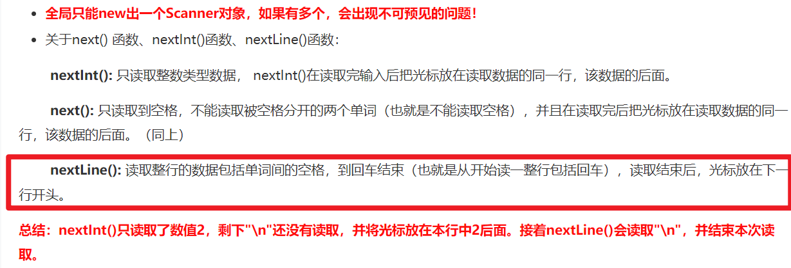
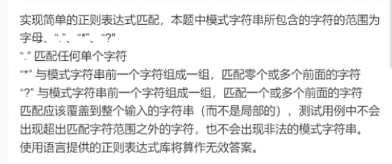

# ACM常见算法

---

# ACM模式输入




# 最大公约数最小公倍数
```java
public class GCDLCM {
    // 计算最大公约数（GCD）
    public static int gcd(int a, int b) {
        while (b != 0) {
            int temp = b;
            b = a % b;
            a = temp;
        }
        return a;
    }

    // 计算最小公倍数（LCM）
    public static int lcm(int a, int b) {
        return Math.abs(a * b) / gcd(a, b);
    }

    public static void main(String[] args) {
        int gcd = gcd(a, b);
        int lcm = lcm(a, b);
    }
}
```

# 拓扑排序
```java
    public static void main (String[] args) {
        // 用邻接表
        Scanner sc = new Scanner(System.in);
        int n = sc.nextInt(), m = sc.nextInt();
        int[] inDegree = new int[n];
        int[][] graph = new int[n][n];
        for(int i = 0; i < m; i++){
            int x = sc.nextInt(), y = sc.nextInt();
            graph[x][y] = 1;
            inDegree[y] ++;
        }
        Queue<Integer> queue = new LinkedList<>();
        for(int i = 0; i < n; i++){
            if(inDegree[i] == 0){
                // 入度为0的点放入队列
                queue.offer(i);
            }
        }
        List<Integer> res = new ArrayList<>();
        while(!queue.isEmpty()){
            int cur = queue.poll();
            // 将这个节点存好，消除其相关的边
            res.add(cur);
            for(int i = 0; i < n; i++){
                if(graph[cur][i] == 1){
                    graph[cur][i] = 0;
                    inDegree[i] --;
                    if(inDegree[i] == 0){
                        queue.add(i);
                    }
                }
            }
        }
        if(res.size() == n){
            for(int i = 0; i < n - 1; i++){
                   System.out.print(res.get(i) + " ");
            }
            System.out.println(res.get(n - 1));
        }else{
            System.out.println(-1);
        }
    }
```

# 弗洛伊德floyd
**可以解决图中任意两个节点的最短路径，自然也可以解决单源最短路径**

```java
  
   int[][] graph = new int[n][n];
        // 自己到自己是0，没有边是标Integer.MAX_VALUE
        for(int i = 0; i < n; i++){
            for(int j = 0; j < n; j++){
                if(i == j){
                    continue;
                }
                graph[i][j] = Integer.MAX_VALUE;
            }
        }
        for(int i = 0; i < m; i++){
            int x = sc.nextInt(), y = sc.nextInt();
            graph[x - 1][y - 1] = 1;
        }
// floyd
        for(int k = 0; k < n; k++){
            for (int i = 0; i < n; i++) {
                for (int j = 0; j < n; j++) {
                    // i -> k -> j 路径更短，则更新i -> j的路径
                    if(graph[i][k] != Integer.MAX_VALUE && graph[k][j] != Integer.MAX_VALUE && graph[i][k] + graph[k][j] < graph[i][j]){
                        graph[i][j] = graph[i][k] + graph[k][j];
                    }
                }
            }
        }

```

# 迪杰斯特拉算法
```java
    public static void main (String[] args) {
        Scanner sc = new Scanner(System.in);
        int n = sc.nextInt(), m = sc.nextInt();
        int[][] graph = new int[n][n];
        for(int i = 0; i < n; i++){
            for(int j = 0; j < n; j++){
                if(i == j){
                    continue;
                }
                graph[i][j] = Integer.MAX_VALUE;
            }
        }
        for(int i = 0; i < m; i++){
            graph[sc.nextInt() - 1][sc.nextInt() - 1] = sc.nextInt();
        }
        // 存放每个点到源点的距离
        int[] minDist = new int[n];
        Arrays.fill(minDist, Integer.MAX_VALUE);
        boolean[] visited = new boolean[n];
        minDist[0] = 0;
        for(int i = 0; i < n; i++){
            int minVal = Integer.MAX_VALUE;
            int cur = 0;
            // 选取距离原点最近且没有访问过的点 - 最开始是本身
            for(int v = 0; v < n; v++){
                if(!visited[v] && minDist[v] < minVal){
                    minVal = minDist[v];
                    cur = v;
                }
            }
            visited[cur] = true;
            // 更新minDist数组，基于cur到原点的最短距离
            for(int v = 0; v < n; v++){
                if(!visited[v] && graph[cur][v] != Integer.MAX_VALUE && minDist[cur] + graph[cur][v] < minDist[v]){
                    minDist[v] = minDist[cur] + graph[cur][v];
                }
            }
        }
        System.out.println(minDist[n - 1] == Integer.MAX_VALUE ? -1 : minDist[n - 1]);
    }
```

```java
    public static void main (String[] args) {
        Scanner sc = new Scanner(System.in);
        // 迪杰斯特拉朴素版
        int n = sc.nextInt(), m = sc.nextInt();
        int[][] graph = new int[n + 1][n + 1];
        for(int i = 1; i <= n; i++){
            for(int j = 1; j <= n; j++){
                if(i == j){
                    continue;
                }
                graph[i][j] = Integer.MAX_VALUE;
            }
        }
        for(int i = 0; i < m; i++){
            graph[sc.nextInt()][sc.nextInt()] = sc.nextInt();
        }
        // 标记节点是否已经确定最短路径
        boolean[] visited = new boolean[n + 1];
        // 其余节点到原点的距离
        int[] minDist = new int[n + 1];
        Arrays.fill(minDist, Integer.MAX_VALUE);
        // 原点到自己的最短距离是0
        minDist[1] = 0;
        for(int i = 1; i <= n; i++){
            int cur = i;
            int min_val = Integer.MAX_VALUE;
            // 找到距离cur最短的点
            for(int v = 1; v <= n; v++){
                if(!visited[v] && minDist[v] < min_val){
                    cur = v;
                    min_val = minDist[v];
                }
            }
            visited[cur] = true;
            // 更新基于该点能到达的其余点
            for(int v = 1; v <= n; v++){
                if(!visited[v] && graph[cur][v] != Integer.MAX_VALUE && minDist[cur] + graph[cur][v] < minDist[v]){
                    minDist[v] =  minDist[cur] + graph[cur][v];
                }
            }
        }
        System.out.println(minDist[n] == Integer.MAX_VALUE ? -1 : minDist[n]);
    }
```

# 并查集


```java
public class longtestPrefix {
    public static void main (String[] args) {
        Scanner sc = new Scanner(System.in);
        int n = sc.nextInt();
        String str = sc.next();
        // 开始遍历所有可能矩阵 n = 12 -> 1*12 12*1 3*4 4*3 2*6 6*2
        int res = n;
        for(int i = 1; i * i <= n; i++){
            //row = i, col = n / i
            if(n % i != 0){
                continue;
            }
            char[][] grip = new char[i][n / i];
            int idx = 0;
            for(int r = 0; r < i; r++){
                for(int c = 0; c < n / i; c++){
                    grip[r][c] = str.charAt(idx ++);
                }
            }
            // 矩阵构建成功后，构建并查集，返回联通数
            res = Math.min(countGrip(grip), res);
            grip = new char[n / i][i];
            idx = 0;
            for(int r = 0; r < n / i; r++){
                for(int c = 0; c < i; c++){
                    grip[r][c] = str.charAt(idx ++);
                }
            }
            res = Math.min(countGrip(grip), res);
        }
        System.out.println(res);
    }
    public static int countGrip(char[][] grip){
        // 构造顶点下标和并查集parent;
        int m = grip.length, n = grip[0].length;
        int[][] arr = new int[m][n];
        int idx = 0;
        // 给字符设置下标，方便后续并查集处理
        for(int i = 0; i < m; i++){
            for(int j = 0; j < n; j++){
                arr[i][j] = idx ++;
            }
        }
        int[] parent = new int[idx];
        // 初始化parent
        for(int i = 0; i < idx; i++){
            parent[i] = i;
        }
        // 遍历上下左右
        int[][] direct = new int[][]{
                {-1, 0},{1, 0},{0, -1},{0, 1}
        };
        for(int i = 0; i < m; i++){
            for(int j = 0; j < n; j++){
                // 和相邻的所有元素比较，如果一直则合并到一个集合中
                for(int k = 0; k < 4; k ++){
                    int row = i + direct[k][0], col = j + direct[k][1];
                    if(row >= 0 && row < m && col >= 0 && col < n && grip[i][j] == grip[row][col]){
                        // 合法的下标
                        union(arr[i][j], arr[row][col], parent);
                    }
                }
            }
        }
        HashSet<Integer> set = new HashSet<>();
        for(int p : parent){
            set.add(p);
        }
        return set.size();
    }

    public static int find(int x, int[] parent){
        if(parent[x] != x){
            parent[x] = find(parent[x], parent);
        }
        return parent[x];
    }
    public static void union(int x, int y, int[] parent){
        int root1 = find(x, parent);
        int root2 = find(y, parent);
        if(root1 > root2){
            parent[root1] = root2;
        }else{
            parent[root2] = root1;
        }
    }
}

```

# 前缀树
```java
class Trie {
    class TireNode{
        private boolean isEnd;
        TireNode[] next;
        public TireNode(){
            isEnd = false;
            next = new TireNode[26];
        }
    }
    private TireNode root;

    public Trie() {
        root = new TireNode();
    }
    
    public void insert(String word) {
        TireNode node = root;
        for(char c : word.toCharArray()){
            //对应的数组赋值，比如字符a是节点数组0，b是1，c是2号节点
            int index = c - 'a';
            if(node.next[index] == null){
                node.next[index] = new TireNode();
            }
            node = node.next[index];
        }
        //叶子节点
        node.isEnd = true;
    }
    
    public boolean search(String word) {
        TireNode node = root;
        for(char c : word.toCharArray()){
            //对应的数组赋值，比如字符a是节点数组0，b是1，c是2号节点
            int index = c - 'a';
            //查看根节点下的节点是否和字符匹配
            node = node.next[index];
            if(node == null){
                return false;
            }
        }
        //判断是前缀 还是整个字符（防止是前缀 ）
        return node.isEnd;
    }
    
    public boolean startsWith(String prefix) {
        TireNode node = root;
        for(char c : prefix.toCharArray()){
            int index = c - 'a';
            node = node.next[index];
            if(node == null){
                return false;
            }
        }
        return true;
    }
}
```

# KMP算法
```java
public int strStr(String haystack, String needle) {
        int m = haystack.length(), n = needle.length();
        if(m < n){
            return -1;
        }
        char[] s = haystack.toCharArray();
        char[] p = needle.toCharArray();
        int[] next = getNext(p);
        int i = 0, j = 0;
        while(i < m && j < n){
            if(s[i] == p[j]){
                i ++;
                j ++;
            }else if(j == 0){
                i ++;
            }else{
                j = next[j - 1];
            }
        }
        if(j == n){
            return i - n;
        }else{
            return -1;
        }
    }
    public int[] getNext(char[] t){
        int[] next = new int[t.length + 1];
        int j = 0;
        next[0] = 0;
        for(int i = 1; i < t.length; i++){
            while(j > 0 && t[j] != t[i]){
                j = next[j - 1];
            }
            if(t[i] == t[j]){
                j ++;
            }
            next[i] = j;
        }
        return next;
    }
```

# 正则匹配



```java
    public boolean isMatch(String s, String p) {
        int m = s.length(), n = p.length();
        // 先遍历匹配串
        boolean[][] dp = new boolean[n + 1][m + 1];
        dp[0][0] = true;
        for(int i = 1; i <= n; i++){
            char c1 = p.charAt(i - 1);
            for(int j = 0; j <= m; j++){
                if(c1 == '?'){
                    // 必须匹配一个字符 - 查看a？的a能否和s匹配
                    dp[i][j] |= dp[i - 1][j];
                    if(match(s, p, i - 1, j)){
                        // 匹配成功则查看？dp[i - 1][j - 1]匹配一个  
                        // dp[i][j - 1]s丢弃匹配的，继续往前匹配，匹配多个
                        dp[i][j] |= dp[i - 1][j - 1] || dp[i][j - 1];
                    }
                }else if(c1 == '*'){
                    // 可以匹配也可以不匹配
                    dp[i][j] |= dp[i - 2][j];
                    if(match(s, p, i - 1, j)){
                        // a*匹配  dp[i][j - 1]s丢弃匹配的，继续往前匹配，匹配多个
                        dp[i][j] |= dp[i - 1][j - 1] || dp[i][j - 1]; 
                    }
                }else if(match(s, p, i, j)){
                    // 是普通字符，如果p的i和s的j可以匹配，就查看前面是否可以匹配
                    dp[i][j] |= dp[i - 1][j - 1];
                }
            }
        }
        return dp[n][m];
    }
    public static boolean match(String s, String p, int i, int j){
        if(j == 0){
            return false;
        }
        if(p.charAt(i - 1) == '.'){
            return true;
        }
        return s.charAt(j - 1) == p.charAt(i - 1);
    }
```

```java
    public static void main(String[] args) {
        System.out.println(isMatch("aaa", ".?"));
    }
    public static boolean isMatch(String s, String p) {
        int m = s.length(), n = p.length();
        // dp[i][j]表示m的第i个字符和p的第j个字符是否匹配
        boolean[][] dp = new boolean[m + 1][n + 1];
        // “” “”匹配
        dp[0][0] = true;
        // 确定遍历次序，dp[i][j] = dp[i - 1][j - 1] -> 由前面决定，正序遍历即可
        for(int i = 0; i <= m; i++){
            for(int j = 1; j <= n; j++){
                // j从1开始 p.charAt(j - 1)
                if(p.charAt(j - 1) == '?'){
                    // 至少匹配一次，比如aaa 和 aa?
                    dp[i][j] |= dp[i][j - 1];
                    //匹配多次
                    if(isMatch(s, i, p, j - 1)){
                        // 匹配一次 | 匹配多次则s丢弃i往前匹配
                        dp[i][j] |= dp[i - 1][j - 1] || dp[i - 1][j];
                    }
                }else if(p.charAt(j - 1) == '*'){
                    // 匹配0次  比如ab 和 c*a*b可以匹配 c*作为整体
                    dp[i][j] |= dp[i][j - 2];
                    //匹配多次
                    if(isMatch(s, i, p, j - 1)){
                        // 匹配一次 | 匹配多次则s丢弃i往前匹配
                        dp[i][j] |= dp[i - 1][j - 1] || dp[i - 1][j];
                    }
                }else if(isMatch(s, i, p, j)){
                    // p是普通字符 | .
                    dp[i][j] |= dp[i - 1][j - 1];
                }
            }
        }
        return dp[m][n];
    }
    public static boolean isMatch(String s, int i, String p, int j){
        // 判断s和p中的字符是否匹配
        if(i == 0){
            // “”不匹配
            return false;
        }
        if(p.charAt(j - 1) == '.'){
            return true;
        }
        return s.charAt(i - 1) == p.charAt(j - 1);
    }
```

# n数之和
```java
class Solution {
    public List<List<Integer>> threeSum(int[] nums) {
        Arrays.sort(nums);
        return Nsum(nums, 3, 0, 0);
    }
    List<List<Integer>> Nsum(int[] nums, int n, int start, int target){
        List<List<Integer>> res = new ArrayList<>();
        int size = nums.length;
        //n代表要求几数之和，我们的目的就是全部转为2数
        if(n < 2 || size < n){
            return res;
        }
        if(n == 2){
            //双指针
            int left = start;
            int right = size - 1;
            while(left < right){
                int sum = nums[left] + nums[right];
                if(sum > target){
                    right --;
                }else if(sum < target){
                    left ++;
                }else{
                    res.add(new ArrayList<>(Arrays.asList(nums[left], nums[right])));
                    while(left < right && nums[left] == nums[left + 1]) left++;
                    while(left < right && nums[right] == nums[right - 1]) right --;
                    left ++;
                    right --;
                }
            }
        }else{
            for(int i = start; i < size; i++){
                List<List<Integer>> sub = Nsum(nums, n - 1, i + 1, target - nums[i]);
                //把n - 1的和结果合并
                for(List<Integer> arr : sub){
                    arr.add(nums[i]);
                    res.add(arr);
                }
                //去重
                while(i < size - 1 && nums[i] == nums[i + 1]){
                    i ++;
                }
            }
        }
        return res;
    }
}
```

# 最长递增子序列并输出
```java
 public static int lengthOfLIS(int[] nums) {
        if (nums.length == 0) return 0;
        int[] dp = new int[nums.length];
        int[] prev = new int[nums.length]; // 用于存储前驱索引
        Arrays.fill(dp, 1); // 每个元素至少可以形成长度为1的递增子序列
        Arrays.fill(prev, -1); // 初始化前驱数组
        int maxLength = 1; // 最长子序列的长度
        int maxIndex = 0; // 最长子序列的结束索引
        for (int i = 1; i < nums.length; i++) {
            for (int j = 0; j < i; j++) {
                if (nums[i] > nums[j] && dp[i] < dp[j] + 1) {
                    dp[i] = dp[j] + 1;
                    prev[i] = j; // 更新前驱索引
                }
            }
            if (dp[i] > maxLength) {
                maxLength = dp[i];
                maxIndex = i; // 更新最长子序列结束索引
            }
        }
        // 打印最长递增子序列
        printLIS(nums, prev, maxIndex);
        return maxLength;
    }
    public static void printLIS(int[] nums, int[] prev, int maxIndex) {
        // 从最大索引开始回溯构建子序列
        int[] lis = new int[maxIndex + 1];
        int length = 0;

        for (int i = maxIndex; i >= 0; i = prev[i]) {
            lis[length++] = nums[i];
            if (prev[i] == -1) break; // 直到没有前驱
        }
        // 反转以获得正确的顺序
        for (int i = length - 1; i >= 0; i--) {
            System.out.print(lis[i] + " ");
        }
        System.out.println();
    }
```

```java
 public static int lengthOfLIS(int[] nums) {
        if (nums.length == 0) return 0;
        List<Integer> dp = new ArrayList<>();
        int[] prev = new int[nums.length];
        int[] lisIndices = new int[nums.length];
        int length = 0;

        for (int i = 0; i < nums.length; i++) {
            int index = binarySearch(dp, nums[i]);
            if (index == dp.size()) {
                dp.add(nums[i]);
                lisIndices[length] = i;
                length++;
            } else {
                dp.set(index, nums[i]);
                lisIndices[index] = i;
            }
            prev[i] = index > 0 ? lisIndices[index - 1] : -1;
        }

        return length;
    }

    private static int binarySearch(List<Integer> dp, int target) {
        int left = 0, right = dp.size();
        while (left < right) {
            int mid = left + (right - left) / 2;
            if (dp.get(mid) < target) {
                left = mid + 1;
            } else {
                right = mid;
            }
        }
        return left;
    }

    public static void printLIS(int[] nums) {
        int length = lengthOfLIS(nums);
        List<Integer> dp = new ArrayList<>();
        int[] prev = new int[nums.length];
        int[] lisIndices = new int[nums.length];
        int maxIndex = -1;

        for (int i = 0; i < nums.length; i++) {
            int index = binarySearch(dp, nums[i]);
            if (index == dp.size()) {
                dp.add(nums[i]);
                lisIndices[length] = i;
                maxIndex = i; // 记录当前索引
            } else {
                dp.set(index, nums[i]);
                lisIndices[index] = i;
            }
            prev[i] = index > 0 ? lisIndices[index - 1] : -1;
        }

        List<Integer> lis = new ArrayList<>();
        for (int i = maxIndex; i >= 0; i = prev[i]) {
            lis.add(nums[i]);
            if (prev[i] == -1) break;
        }
        Collections.reverse(lis); // 反转以获得正确顺序
        System.out.println(lis);
    }
```


# 卡牌组合动态规划


```java
import java.util.*;

class Main{
    private static final long MOD = (1000000000 + 7);
    public static void main (String[] args) {
        Scanner sc = new Scanner(System.in);
        int n = sc.nextInt();
        int[][] cards = new int[n][2];
        for(int i = 0; i < n; i++){
            cards[i][0] = sc.nextInt() % 3;
            cards[i][1] = sc.nextInt() % 3;
        }
        // dp[i][j] 表示 到第i张卡牌，余数为j的方案数
        long[][] dp = new long[n + 1][3];
        dp[0][0] = 1;
        for(int i = 1; i <= n; i++){
            for(int j = 0; j < 3; j ++){
                // 余数为j -> （本次card + 上次余数 ）% 3 = j
                int m1 = (j - cards[i - 1][0] + 3) % 3;
                int m2 = (j - cards[i - 1][1] + 3) % 3;
                dp[i][j] = (dp[i][j] + dp[i - 1][m1] + dp[i - 1][m2]) % MOD;
            }
        }
        System.out.println(dp[n][0]);
    }
}
```

# 手撕LRU
```java
public class LRUCache {
    //利用map和链表设计LRU缓存
    int capacity;
    class Node{
        Node pre, next;
        int key, val;
        Node(int k, int v){
            key = k;
            val = v;
        }
    }
    Map<Integer, Node> map;
    Node head = new Node(0, 0);
    public LRUCache(int capacity) {
        this.capacity = capacity;
        map = new HashMap<>();
        head.next = head;
        head.pre = head;
    }

    public int get(int key) {
        if(map.containsKey(key)){
            Node cur = map.get(key);
            //删除这个节点，再添加这个节点到首部
            remove(cur);
            putFirst(cur);
            return cur.val;
        }else{
            return -1;
        }
    }
    public void put(int key, int value) {
        //放置需要看是否超出容量，判断是否存在map，存在就修改，不存在就插入并删除链表尾
        if(map.containsKey(key)){
            //直接更新
            Node cur = map.get(key);
            cur.val = value;
            return;
        }
        Node node = new Node(key, value);
        putFirst(node);
        if(map.size() == capacity){
            map.remove(head.pre.key);
            remove(head.pre);
        }else {
            map.put(key, node);
        }
    }
    public void remove(Node node){
        node.pre.next = node.next;
        node.next.pre = node.pre;
    }
    public void putFirst(Node node){
        node.next = head.next;
        head.next.pre = node;
        head.next = node;
        node.pre = head;
    }

}
```

# 单例模式
[Java单例模式8种方式 详解-腾讯云开发者社区-腾讯云](https://cloud.tencent.com/developer/article/2117618)

```java
//双重检查
class SingleTon {
 
    //1.构造器私有化，外部无法通过new创建对象
    private SingleTon() {}
    //2.本类内部创建对象实例
    private static volatile SingleTon instance;
    //3.提供一个公有的静态方法供外部使用，加入双重检查的代码，解决线程安全和懒加载问题
    //同时保证了效率，推荐使用
    public static synchronized SingleTon getInstance() {
        if(instance == null) {
            synchronized (SingleTon.class) {
                if(instance == null) {
                    instance = new SingleTon();
                }
            }
        }
        return instance;
    }
 
}
```

<font style="color:rgb(77, 77, 77);">需要volatile关键字的原因是，在并发情况下，如果没有volatile关键字，在第14行会出现问题。instance = new TestInstance();可以分解为3行伪代码</font>

```java
a. memory = allocate() //分配内存
b. ctorInstanc(memory) //初始化对象
c. instance = memory //设置instance指向刚分配的地址
```

<font style="color:rgb(77, 77, 77);">上面的代码在编译运行时，可能会出现重排序从a-b-c排序为a-c-b。在多线程的情况下会出现以下问题。当线程A在执行第14行代码时，B线程进来执行到第11行代码。假设此时A执行的过程中发生了指令重排序，即先执行了a和c，没有执行b。那么由于A线程执行了c导致instance指向了一段地址，所以B线程判断instance不为null，会直接跳到第18行并返回一个未初始化的对象。</font>

# 冒泡排序
```java
public static void optimizedBubbleSort(int[] arr) {
    int n = arr.length;
    boolean swapped;
    for (int i = 0; i < n - 1; i++) {
        swapped = false;
        for (int j = 0; j < n - i - 1; j++) {
            if (arr[j] > arr[j + 1]) {
                int temp = arr[j];
                arr[j] = arr[j + 1];
                arr[j + 1] = temp;
                swapped = true;
            }
        }
        // 如果没有发生交换，说明数组已经有序，可以提前结束
        if (!swapped) {
            break;
        }
    }
}

```

# <font style="color:rgb(77, 77, 77);">快速排序</font>
```java
public class QuickSort {
    public static void main(String[] args) {
        int[] arr= {4,7,6,5,3,2,8,1,3,4,2};
        quickSort(arr,0,arr.length - 1);
        System.out.println(Arrays.toString(arr));
    }
    public static void quickSort(int[] arr, int l, int r){
        if(l >= r){
            return;
        }
        int par = partition(arr, l, r);
        quickSort(arr, l, par - 1);
        quickSort(arr, par + 1, r);
    }
    public static int partition(int[] arr, int left, int right){
        int p = arr[left];
        while(left < right){
            while ((left < right) && arr[right] > p){
                right --;
            }
            arr[left] = arr[right];
            while ((left < right) && arr[left] <= p){
                left ++;
            }
            arr[right] = arr[left];
        }
        arr[left] = p;
        return left;
    }
}
```

---

# 快速选择 - 找到无序数组中位数
```java
public static double findMid(int[] arr){
    int n = arr.length;
    if(n % 2 == 1){
        return quickSelect(arr, 0, n - 1, n / 2);
    }else{
        int l = quickSelect(arr, 0, n - 1, n / 2 - 1);
        int r = quickSelect(arr, 0, n - 1, n / 2);
        return (l + r) / 2.0;
    }
}
private static int quickSelect(int[] arr, int l, int r, int k) {
    if(l == r){
        // 找到了中位数
        return arr[l];
    }
    int pivot = l, val = arr[l];
    // 枢轴元素丢到最右边，找到枢轴所在的位置
    swap(arr, pivot, r);
    // idx为枢轴最终存放的位置
    int idx = l, left = l;
    while(left < r){
        // 更小的丢到枢轴左边
        if(arr[left] < val){
            swap(arr, left, idx);
            idx ++;
        }
        left ++;
    }
    // 枢轴放到对应的位置idx
    swap(arr, idx, r);
    if(k == idx){
        return arr[k];
    }else if(k < idx){
        return quickSelect(arr, l, idx - 1, k);
    }else {
        return  quickSelect(arr, idx + 1, r, k);
    }
}
public static void swap(int[] arr, int i, int j){
    int tmp = arr[i];
    arr[i] = arr[j];
    arr[j] = tmp;
}
```

  


# 堆排序


```java
    public static void heapSort(int[] arr){
        int n = arr.length;
        // 构建大根堆，从最后一个非叶子开始向上调整：n / 2 - 1
        for(int i = n / 2 - 1; i >= 0; i--){
            heapify(arr, n, i);
        }
        for(int i = n - 1; i > 0; i--){
            // 开始堆排序，每次取出堆顶数据，调整堆
            int tmp = arr[0];
            arr[0] = arr[i];
            arr[i] = tmp;
            heapify(arr, i, 0);
        }
    }

    private static void heapify(int[] arr, int n, int i) {
        int lagest = i, l = 2 * i + 1, r = 2 * i + 2;
        // 从左右子树找更大的哪个数交换
        if(l < n && arr[l] > arr[lagest]){
            lagest = l;
        }
        if(r < n && arr[r] > arr[lagest]){
            lagest = r;
        }
        if(lagest != i){
            // 左右子树有更大的 交换
            int tmp = arr[i];
            arr[i] = arr[lagest];
            arr[lagest] = tmp;
            // 更小的数下沉到子树后，还需要继续调整子树
            heapify(arr, n, lagest);
        }
    }
```

```java
    private static void heapify(int[] arr, int n, int i) {
        int lagest = i, l = 2 * i + 1, r = 2 * i + 2;
        // 从左右子树找更大的哪个数交换
        if(l < n && arr[l] < arr[lagest]){
            lagest = l;
        }
        if(r < n && arr[r] < arr[lagest]){
            lagest = r;
        }
        if(lagest != i){
            // 左右子树有更小的 交换
            int tmp = arr[i];
            arr[i] = arr[lagest];
            arr[lagest] = tmp;
            // 更小的数下沉到子树后，还需要继续调整子树
            heapify(arr, n, lagest);
        }
    }
```

# 合并k个升序链表
```java
/**
 * Definition for singly-linked list.
 * public class ListNode {
 *     int val;
 *     ListNode next;
 *     ListNode() {}
 *     ListNode(int val) { this.val = val; }
 *     ListNode(int val, ListNode next) { this.val = val; this.next = next; }
 * }
 */
class Solution {
    // 归并合并 - 两两归并
    public ListNode mergeKLists(ListNode[] lists) {
        if(lists.length == 0){
            return null;
        }
        return merge(lists, 0, lists.length - 1);
    }
    public ListNode merge(ListNode[] lists, int l, int r){
        if(l > r){
            return null;
        }
        if(l == r){
            return lists[l];
        }
        int mid = (l + r) >> 1;
        return mergeTwoList(merge(lists, l, mid), merge(lists, mid + 1, r));
    }
    public ListNode mergeTwoList(ListNode l1, ListNode l2){
        ListNode head = new ListNode();
        ListNode res = head;
        while(l1 != null && l2 != null){
            if(l1.val > l2.val){
                head.next = l2;
                l2 = l2.next;
            }else{
                head.next = l1;
                l1 = l1.next;
            }
            head = head.next;
        }
        if(l1 != null){
            head.next = l1;
        }
        if(l2 != null){
            head.next = l2;
        }
        return res.next;
    }
}
```

# 01背包 + 完全背包
```java
        int[] dp = new int[bagWeight + 1];
        //遍历顺序：先遍历物品，再遍历背包容量
        for (int i = 0; i < wLen; i++){
            for (int j = bagWeight; j >= weight[i]; j--){
                dp[j] = Math.max(dp[j], dp[j - weight[i]] + value[i]);
            }
        }
```

```java
    // 完全背包的物品是可以添加多次的，所以背包容量就是要从小到大遍历
    int[] dp = new int[bagWeight + 1];
    for (int i = 0; i < weight.length; i++){ // 遍历物品
        for (int j = weight[i]; j <= bagWeight; j++){ // 遍历背包容量
            dp[j] = Math.max(dp[j], dp[j - weight[i]] + value[i]);
        }
    }
```

<font style="color:rgb(44, 62, 80);">纯完全背包求得装满背包的最大价值是多少，和凑成总和的元素有没有顺序没关系，即：有顺序也行，没有顺序也行！</font>

**<font style="color:rgb(44, 62, 80);">如果求组合数（无序 - （1，2））就是外层for循环遍历物品，内层for遍历背包</font>**<font style="color:rgb(44, 62, 80);">。</font>

**<font style="color:rgb(44, 62, 80);">如果求排列数（有序 - （1，2）（2，1））就是外层for遍历背包，内层for循环遍历物品</font>**<font style="color:rgb(44, 62, 80);">。</font>

# <font style="color:rgb(44, 62, 80);">手撕简单hashmap</font>
```java
public interface Map<K, V> {
 
    int size();
 
    boolean isEmpty();
 
    boolean containsKey(Object key);
 
    boolean containsValue(Object value);
 
    V get(Object key);
 
    V put(K key, V value);
 
    V remove(Object key);
 
    void clear();
 
    interface Entry<K, V> {
        K getKey();
 
        V getValue();
    }
}
```

```java
import java.util.Collection;
import java.util.Set;
 
public class TestMap<K, V> implements Map<K, V> {
    private static final int DEFAULT_INITIAL_CAPACITY = 16;
    private static final float DEFAULT_LOAD_FACTOR = 0.75f;
    private float loadFactor = 0;
    private int initCapacity = 0;
    private Entry<K, V>[] table = null;
    private int size = 0;
 
    public TestMap() {
        this.loadFactor = DEFAULT_LOAD_FACTOR;
        this.initCapacity = DEFAULT_INITIAL_CAPACITY;
        table = new Entry[this.initCapacity];
    }
 
//    private int hash(K key) {
//        int h;
//        return (key == null) ? 0 : Math.abs((h = key.hashCode())) ^ (h >>> 16);
//    }
 
    @Override
    public int size() {
        return size;
    }
 
    @Override
    public V get(Object key) {
        Entry<K, V> e = null;   //默认不存在
        //计算哈希码
        int hash = key.hashCode();
        //计算存储的位置
        int index = hash % table.length;
        //存储到指定的位置
        if (table[index] != null) { //该位置存储了元素
            Entry<K, V> entry = table[index]; //先指向第一个元素
            while (entry != null) {
                //比较
                if (entry.hash == hash && entry.getKey().equals(key)){ //找到了这个key
                    e = entry;
                    break;
                }
                //指向下一个结点,继续循环判断
                entry = entry.next;
            }
        }
        return e == null ? null : e.value;
    }
 
    @Override
    public V put(K key, V value) {
        //计算哈希码
        int hash = key.hashCode();
        //计算存储的位置
        int index = hash % table.length;
        //存储到指定的位置
        if (table[index] == null) {
            //该位置还没有元素
            table[index] = new Entry<K, V>(key, value, null, hash);
            ++size;
        } else {  //该位置已经存储了元素
            //查询是否存在相同key的Entry
            Entry<K, V> entry = table[index];  //指向链表的第一个元素
            while (entry != null) {
                //比较
                if (entry.hash == hash && entry.getKey().equals(key)){
                    //如果找到了相同的key,使用新的value将旧的value替换掉
                    entry.value = value;
                    return entry.value;
                }
                //指向下一个结点,继续循环判断
                entry = entry.next;
            }
            //如果没有相同的key,添加新的结点,下一个结点就是原来的第一个结点，也就是table[index],添加到链表的第一个位置(table[index])
            table[index] = new Entry<K, V>(key, value, table[index], hash);
            ++size;
        }
        return value;
    }
 
    @Override
    public V remove(Object key) {
        //计算哈希码
        int hash = key.hashCode();
        //计算存储的位置
        int index = hash % table.length;
        //先定义一个prev表示待删除的元素的上一个
        Entry<K, V> prev = table[index];
        Entry<K, V> e = prev;
        while (e != null) {
            //定位出e的下一个元素，当找到我们要删除的元素时，将链表切断，将prev和next连接即可。
            Entry<K, V> next = e.next;
            //在链表上定位到这个元素，先判断hash值是否相等，再判断key的equals是否相等！
            if(e.hash == hash && (e.key == key || (key != null && key.equals(e.key)))) {
                --size;
                //这里，还得判断一个东西，即定位到的这个Entry是否是table[i]，因为table[i]上的删除和链表上的删除有区别
                if(prev == e) {
                    table[index] = next;
                } else {
                    prev.next = next; //如果不是table位置的，则是链表后边的元素，此时，将prev的下一个置为e的next即可，此时，e已被切断,e的前后Entry被连接起来
                }
                return e.value;
            }
            //上边的if没进去，则执行下一次循环，指针向后移动一位！
            prev = e;
            e = next;
        }
        return null;
    }
 
    @Override
    public boolean isEmpty() {
        return size == 0;
    }
 
    @Override
    public boolean containsKey(Object key) {
        return get(key) != null;
    }
 
    @Override
    public boolean containsValue(Object value) {
        Entry<K, V>[] tab; V v;
        if ((tab = table) != null && size > 0) {
            for (Entry<K, V> e : tab) {
                for (; e != null; e = e.next) {
                    if ((v = e.value) == value ||
                            (value != null && value.equals(v)))
                        return true;
                }
            }
        }
        return false;
    }
 
    @Override
    public void clear() {
        Entry<K, V>[] tab;
        if ((tab = table) != null && size > 0) {
            size = 0;
            for (int i = 0; i < tab.length; ++i)
                tab[i] = null;
        }
    }
 
    @Override
    public String toString() {
        StringBuilder sb = new StringBuilder("{");
        for (int i = 0; i < table.length; i++) {  //外层循环主数组
            if (table[i] != null) {
                Entry<K, V> entry = table[i];  //让entry指向链表的第一个元素
                while (entry != null) {    //内层循环循环链表
                    sb.append(entry.key + " = " + entry.value + ", ");
                    //指向下一个结点,继续循环判断
                    entry = entry.next;
                }
            }
        }
        if (size != 0){      //如果有元素就把最后一个逗号去掉
            sb.deleteCharAt(sb.length() - 1);
        }
        sb.setCharAt(sb.length() - 1, '}');
        return sb.toString();
    }
 
    // HashMap中存储节点信息的数据结构
    class Entry<K, V> implements Map.Entry<K, V> {
        K key;
        V value;
        Entry<K, V> next;
        int hash;  //记录下标
 
        Entry(K key, V val, Entry<K, V> next, int hash) {
            this.key = key;
            this.value = val;
            this.next = next;
            this.hash = hash;
        }
 
        @Override
        public K getKey() {
            return key;
        }
 
        @Override
        public V getValue() {
            return value;
        }
    }
 
    public static void main(String[] args) {
        TestMap<String, Object> map = new TestMap<>();
        map.put("姓名", "张三");
        map.put("年龄", "20");
        map.put("性别", "男");
        map.put("爱好", "打篮球");
        System.out.println(map.get("姓名"));
        System.out.println(map);
        System.out.println("map集合中键值对数量为：" + map.size());
        System.out.println("map集合中是否包含key：" + map.containsKey("姓名"));
        System.out.println("map集合中是否包含value：" + map.containsValue("小哥"));
        String s = (String) map.remove("性别");
        System.out.println("移除的key对应的value值为：" + s);
        System.out.println("移除之后map集合中键值对数量为：" + map.size());
        map.clear();
        System.out.println("map集合是否为空：" + map.isEmpty());
    }
}
```

# 前中后非递归树遍历


```java
public List<Integer> preorderTraversal(TreeNode root) {
        List<Integer> res = new ArrayList<>();
        if (root == null){
            return  res;
        }
        LinkedList<TreeNode> stack = new LinkedList<>();
        stack.push(root);
        while(!stack.isEmpty()){
            TreeNode node = stack.pop();
            res.add(node.val);
            if(node.right != null){
                stack.push(node.right);
            }
            if(node.left != null){
                stack.push(node.left);
            }
            
        }
        return res;
    }
```

```java
public List<Integer> preorderTraversal(TreeNode root) {
        List<Integer> res = new ArrayList<>();
        if (root == null){
            return  res;
        }
        LinkedList<TreeNode> stack = new LinkedList<>();
        TreeNode p = root;
        while(p != null || !stack.isEmpty()){
            if(p != null){
                res.add(p.val);
                stack.push(p);
                p = p.left;
            }else{
                p = stack.pop();
                p = p.right;
            }
        }
        return res;
    }
```

```java
 public List<Integer> inorderTraversal(TreeNode root) {
        List<Integer> res = new ArrayList<>();
        //中序遍历用栈
        LinkedList<TreeNode> stack = new LinkedList<>();
        TreeNode p = root;
        while(!stack.isEmpty() || p != null){
            if(p != null){
                stack.push(p);
                p = p.left;
            }else{
                p = stack.pop();
                res.add(p.val);
                p = p.right;
            }
        }
        return res;
    }
```


# 前序和中序遍历构建二叉树
```java
/**
 * public class TreeNode {
 *     int val;
 *     TreeNode left;
 *     TreeNode right;
 *     TreeNode() {}
 *     TreeNode(int val) { this.val = val; }
 *     TreeNode(int val, TreeNode left, TreeNode right) {
 *         this.val = val;
 *         this.left = left;
 *         this.right = right;
 *     }
 * }
 */
class Solution {
    Map<Integer, Integer> map;
    int rootIdx = 0;
    public TreeNode buildTree(int[] preorder, int[] inorder) {
        map = new HashMap<>();
        for(int i = 0; i < inorder.length; i++){
            map.put(inorder[i], i);
        }
        return buildHepler(preorder, inorder, 0, inorder.length);
    }
    public TreeNode buildHepler(int[] preorder, int[] inorder, int left, int right){
        if(left > right || rootIdx == preorder.length){
            return null;
        }
        int rootVal = preorder[rootIdx];
        TreeNode root = new TreeNode(rootVal);
        // 获取跟再中序的下标
        int idx = map.get(rootVal);
        // 遍历下一个根
        rootIdx ++;
        root.left = buildHepler(preorder, inorder, left, idx - 1);
        root.right = buildHepler(preorder, inorder, idx + 1, right);
        return root;
    }
}
class Solution {
    Map<Integer, Integer> map;
    public TreeNode buildTree(int[] preorder, int[] inorder) {
        // 划分前序和中序
        map = new HashMap<>();
        for(int i = 0; i < preorder.length; i++){
            map.put(inorder[i], i);
        }
        return buildHelper(preorder, 0, preorder.length, inorder, 0, inorder.length);
    }
    public TreeNode buildHelper(int[] preorder, int preS, int preE, int[] inorder, int inS, int inE){
        if(preS >= preE || inS >= inE){
            return null;
        }
        int rootVal = preorder[preS];
        TreeNode root = new TreeNode(rootVal);
        int rootIdx = map.get(rootVal);
        // 划分左右子树
        int leftCount = rootIdx - inS;
        root.left = buildHelper(preorder, preS + 1, preS + 1 + leftCount, inorder, inS, rootIdx);
        root.right = buildHelper(preorder, preS + 1 + leftCount, preE, inorder, rootIdx + 1, inE);
        return root;
    }
}
收起


```

# 中序和后序构建二叉树
```java
class Solution {
    Map<Integer, Integer> map;
    int postId;
    public TreeNode buildTree(int[] inorder, int[] postorder) {
        // 记录后端位置
        map = new HashMap<>();
        postId = postorder.length - 1;
        for(int i = 0; i < inorder.length; i++){
            map.put(inorder[i], i);
        }
        return buildHelper(inorder, postorder, 0, inorder.length - 1);
    }
    public TreeNode buildHelper(int[] inorder, int[] postorder, int start, int end){
        if(start > end){
            return null;
        }
        int rootVal = postorder[postId];
        int rootIdx = map.get(rootVal);
        postId --;
        TreeNode root = new TreeNode(rootVal);
        root.right = buildHelper(inorder, postorder, rootIdx + 1, end);
        root.left = buildHelper(inorder, postorder, start, rootIdx - 1);
        return root;
    }
}
```

# 前序和后序构建二叉树
```java
Map<Integer, Integer> map;
    public TreeNode constructFromPrePost(int[] preorder, int[] postorder) {
        map = new HashMap<>();
        for(int i = 0; i < postorder.length; i++){
            map.put(postorder[i], i);
        }
        return buildr(preorder, 0, preorder.length - 1, postorder, 0, postorder.length - 1);
    }
    public TreeNode buildr(int[] preorder, int preS, int preE, int[] postorder, int postS, int postE){
        if(preS > preE){
            return null;
        }
        int rootVal = preorder[preS];
        if(preS == preE){
            return new TreeNode(rootVal);
        }
        int leftIdx = map.get(preorder[preS + 1]);
        TreeNode root = new TreeNode(rootVal);
        int leftCount = leftIdx - postS + 1;
        root.left = buildr(preorder, preS + 1, preS + leftCount, postorder, postS, leftIdx);
        root.right = buildr(preorder, preS + leftCount + 1, preE, postorder, leftIdx + 1, preE);
        return root;
    }
```

# 递归遍历文件夹，找到某个文件
```java
    static final String path  = "D:\\programming\\javaSpace\\leetcode\\src\\com\\jcy";
    public static String findTarget(String path, String target){
        File file = new File(path);
        File[] files = file.listFiles();
        for(File f : files){
            if(f.isDirectory()){
                String res = findTarget(String.valueOf(f), target);
                if(target.equals(res)){
                    return res;
                }
            }else{
                String[] split = f.getName().split("\\\\");
                if(split[split.length - 1].equals(target)){
                    return target;
                }
            }
        }
        return null;
    }
```

# 找到被4整除的字符串


给你一个字符串，字符串长度1 - 50000之间，由 0 - 9组成 请你截取字符串的连续字串，要求字串可以被4整除，计算截取出字串的种类数  

+ **单字符子串**：对于每个字符，如果它本身能被4整除，则它是一个合法的子串。
+ **两字符子串**：如果连续的两位数能被4整除，那么从前面任何一个字符开始到这两个字符的所有子串都是合法的。
+ **三字符及以上子串**：实际上，对于一个由三位或更多位组成的数字来说，只有最后两位决定了其是否能被4整除。因此，我们只需要检查每对连续的两个字符形成的数值是否能被4整除。  


```java
public class CountSubstringsDivisibleBy4 {
    public static void main(String[] args) {
        Scanner scanner = new Scanner(System.in);
        String S = scanner.nextLine();
        int length = S.length();
        int count = 0;

        // 遍历字符串，计算所有合法的子串数量
        for (int i = 0; i < length; i++) {
            // 单字符子串
            if ((S.charAt(i) - '0') % 4 == 0) {
                count++;
            }
            // 两字符子串
            if (i > 0) {
                int twoDigitNumber = (S.charAt(i - 1) - '0') * 10 + (S.charAt(i) - '0');
                if (twoDigitNumber % 4 == 0) {
                    count += i;  // i表示从S[0]到S[i]之间所有以S[i]为结尾的合法子串
                }
            }
        }
        // 输出结果
        System.out.println(count);
    }
}

```

# socket编程实战案例
```java
    public static void main(String[] args) {
        try (ServerSocket serverSocket = new ServerSocket(12345)) {
            System.out.println("等待客户端连接");
            Socket clientSocket = serverSocket.accept();
            System.out.println("客户端已连接");
            // 获取用户输入信息
            BufferedReader in = new BufferedReader(new InputStreamReader(clientSocket.getInputStream()));
            // 输出信息给用户
            PrintWriter out = new PrintWriter(clientSocket.getOutputStream(), true);

            String clientMessage;
            while ((clientMessage = in.readLine()) != null) {
                System.out.println("收到客户端信息 " + clientMessage);
                out.println("响应数据: " + clientMessage);
            }
        } catch (IOException e) {
            e.printStackTrace();
        }
    }
```

```java
public static void main(String[] args) {
    try (Socket socket = new Socket("localhost", 12345);
         // 发送信息到服务器
         PrintWriter out = new PrintWriter(socket.getOutputStream(), true);
         // 服务器输出信息
         BufferedReader in = new BufferedReader(new InputStreamReader(socket.getInputStream()));
         // 用户输入
         BufferedReader userInput = new BufferedReader(new InputStreamReader(System.in))) {

        String userInputLine;
        while ((userInputLine = userInput.readLine()) != null) {
            out.println(userInputLine);
            System.out.println("服务器响应数据: " + in.readLine());
        }
    } catch (IOException e) {
        e.printStackTrace();
    }
}
```


> 更新: 2024-10-18 11:20:36  
> 原文: <https://www.yuque.com/nibiwanxiamei/yrd6t1/16706a19db29cf89f1b17952dfc744a3>