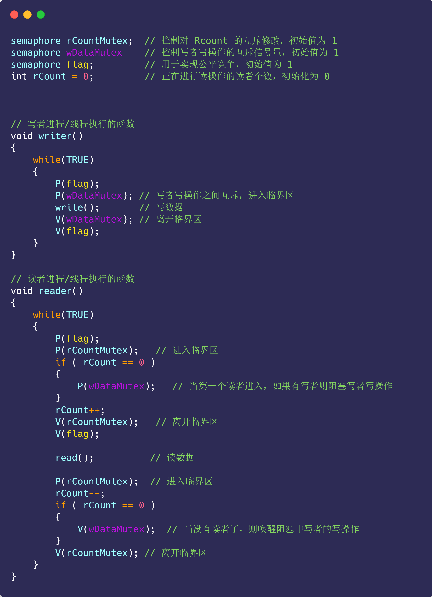

# 多线程手撕常见代码

:::success
**<font style="color:#DF2A3F;background-color:#FBDE28;">有问题请留言</font>**

:::

# 两个线程交替执行打印1 - 100
## **信号量实现**
```java
public class MultiThread {
    private static int count = 1;
    private static final int MAX_COUNT = 100;
    private static Semaphore mutex = new Semaphore(1);

    public static void main(String[] args) {

        ExecutorService executor = Executors.newFixedThreadPool(3);
        Runnable task1 = () -> printNumber(0);
        Runnable task2 = () -> printNumber(1);
        executor.execute(task1);
        executor.execute(task2);
        executor.shutdown();
    }
    public static void printNumber(int threadId){
        while (count <= MAX_COUNT){
            try {
                mutex.acquire();
				// 双重校验锁
                if(count <= MAX_COUNT && (count + 1) % 2 == threadId){
                    System.out.println("线程：" + threadId + "打印：" + count);
                    count ++;
                }
                mutex.release();
            } catch (InterruptedException e) {
                throw new RuntimeException(e);
            }
        }
    }
}
```


## ReentrantLock锁实现
**这里没有获取锁就直接下次循环了，所以不需要双重校验**

```java
public class MultiThread {
    private static int count = 1;
    private static final int MAX_COUNT = 100;
    private static ReentrantLock lock = new ReentrantLock();

    public static void main(String[] args) {

        ExecutorService executor = Executors.newFixedThreadPool(3);
        Runnable task1 = () -> printNumber(0);
        Runnable task2 = () -> printNumber(1);
        executor.execute(task1);
        executor.execute(task2);
        executor.shutdown();
    }
    public static void printNumber(int threadId) {
        while (count <= MAX_COUNT) {
            if (lock.tryLock()) {
                try {
                    if((count + 1) % 2 == threadId){
                        System.out.println("线程：" + threadId + "打印：" + count);
                        count ++;
                    }
                }finally {
                    lock.unlock();
                }
            }
        }
    }
}
```

## ReentrantLock + condition条件实现
```java
public class MultiThread {
    private static int count = 1;
    private static final int MAX_COUNT = 100;
    private static ReentrantLock lock = new ReentrantLock();
    private static Condition[] conditions = new Condition[]{
            lock.newCondition(), lock.newCondition()
    };

    public static void main(String[] args) {

        ExecutorService executor = Executors.newFixedThreadPool(3);
        Runnable task1 = () -> printNumber(0);
        Runnable task2 = () -> printNumber(1);
        executor.execute(task1);
        executor.execute(task2);
        executor.shutdown();
    }

    public static void printNumber(int threadId) {
        while (count <= MAX_COUNT) {
            lock.lock();
            try {
                while((count + 1) % 2 != threadId){
                    conditions[threadId].await();
                }
                if(count <= MAX_COUNT && (count + 1) % 2 == threadId){
                    System.out.println("线程：" + threadId + "打印：" + count);
                    count ++;
                    conditions[(threadId + 1) % 2].signal();
                }
            } catch (InterruptedException e) {
                throw new RuntimeException(e);
            } finally {
                lock.unlock();
            }
        }
    }
}
```

## synchronized实现
```java
public class MultiThread {
    private static int count = 1;
    private static final int MAX_COUNT = 100;
    private static final Object lock = new Object();


    public static void main(String[] args) {

        ExecutorService executor = Executors.newFixedThreadPool(3);
        Runnable task1 = () -> printNumber(0);
        Runnable task2 = () -> printNumber(1);
        executor.execute(task1);
        executor.execute(task2);
        executor.shutdown();
    }
    public static void printNumber(int threadId){
        while (count < MAX_COUNT){
            synchronized (lock){
                if((count + 1) % 2 == threadId){
                    System.out.println("线程：" + threadId + "打印：" + count);
                    count ++;
                }
            }
        }
    }
}
```

```java
public class ThreadTest {
    public static final Object lock = new Object();
    public static boolean flag = true;
    public static int count = 1;
    public static void main(String[] args) {
        new Thread(
                () -> {
                    while (count <= 100){
                        synchronized (lock){
                            if(flag && count <= 100){
                                System.out.println("线程" + Thread.currentThread().getName() + " -> " + count ++);
                                flag = false;
                            }
                        }
                    }
                }
        , "A").start();
        new Thread(
                () -> {
                    while (count <= 100){
                        synchronized (lock){
                            if(!flag && count <= 100){
                                System.out.println("线程" + Thread.currentThread().getName() + " -> " + count ++);
                                flag = true;
                            }
                        }
                    }
                }
                , "B").start();
    }
}
// 加入wait 和 notifyAll
 new Thread(
                () -> {
                    while (count <= 100){
                        synchronized (lock){
                            while (!flag){
                                try {
                                    lock.wait();
                                } catch (InterruptedException e) {
                                    throw new RuntimeException(e);
                                }
                            }
                            if(count <= 100){
                                System.out.println("线程" + Thread.currentThread().getName() + " -> " + count ++);
                                flag = false;
                                lock.notifyAll();
                            }
                        }
                    }
                }
        , "A").start();
```

```java
public static final Object lock = new Object();
public static int count = 1;

public static void main(String[] args) {
    new Thread(
        () -> {
            printNum(0);
        }
        , "0").start();
    new Thread(
        () -> {
            printNum(1);
        }
        , "1").start();
}
public static void printNum(int threadId){
while (count <= 100){
    synchronized (lock){
        while ((count - 1) % 2 != threadId){
            try {
                lock.wait();
            } catch (InterruptedException e) {
                throw new RuntimeException(e);
            }
        }
        if(count <= 100){
            System.out.println("线程" + Thread.currentThread().getName() + " -> " + count ++);
            lock.notifyAll();
        }
    }
}
}
```


# 3个线程交替打印1 - 100
## synchronized实现
```java
public class MultiThread {
    private static int count = 1;
    private static final int MAX_COUNT = 100;
    private static final Object lock = new Object();

    public static void main(String[] args) {

        ExecutorService executor = Executors.newFixedThreadPool(3);
        Runnable task1 = () -> printNumber(0);
        Runnable task2 = () -> printNumber(1);
        Runnable task3 = () -> printNumber(2);
        executor.execute(task1);
        executor.execute(task2);
        executor.execute(task3);
        executor.shutdown();
    }
    public static void printNumber(int threadId){
        while (count <= MAX_COUNT){
            synchronized (lock){
                if(count <= MAX_COUNT && (count + 2) % 3 == threadId){
                    String[] names = Thread.currentThread().getName().split("-");
                    System.out.println("线程：" + names[names.length - 1] + " 打印：" + count);
                    count ++;
                }
            }
        }
    }
}
```


优化，使用wait和notify

```java
public class MultiThread {
    private static int count = 1;
    private static final int MAX_COUNT = 100;
    private static final Object lock = new Object();

    public static void main(String[] args) {

        ExecutorService executor = Executors.newFixedThreadPool(3);
        Runnable task1 = () -> printNumber(0);
        Runnable task2 = () -> printNumber(1);
        Runnable task3 = () -> printNumber(2);
        executor.execute(task1);
        executor.execute(task2);
        executor.execute(task3);
        executor.shutdown();
    }

    public static void printNumber(int threadId) {
        while (count <= MAX_COUNT) {
            synchronized (lock){
                while((count - 1) % 3 != threadId){
                    try {
                        lock.wait();
                    } catch (InterruptedException e) {
                        throw new RuntimeException(e);
                    }
                }
                if(count <= MAX_COUNT && (count - 1) % 3 == threadId){
                    String[] names = Thread.currentThread().getName().split("-");
                    System.out.println("线程：" + names[names.length - 1] + " 打印：" + count);
                    count ++;
                    lock.notifyAll();
                }
            }
        }
    }
}
```


## 信号量实现
```java
public class MultiThread {
    private static int count = 1;
    private static final int MAX_COUNT = 100;

    private static Semaphore mutex1 = new Semaphore(1);

    public static void main(String[] args) {

        ExecutorService executor = Executors.newFixedThreadPool(3);
        Runnable task1 = () -> printNumber(0);
        Runnable task2 = () -> printNumber(1);
        Runnable task3 = () -> printNumber(2);
        executor.execute(task1);
        executor.execute(task2);
        executor.execute(task3);
        executor.shutdown();
    }
    public static void printNumber(int threadId){
        while (count <= MAX_COUNT){
            try {
                mutex1.acquire();
                if(count <= MAX_COUNT && (count + 2) % 3 == threadId){
                    String[] names = Thread.currentThread().getName().split("-");
                    System.out.println("线程：" + names[names.length - 1] + " 打印：" + count);
                    count ++;
                }
                mutex1.release();
            }catch (InterruptedException e) {
                throw new RuntimeException(e);
            }
        }
    }
}
```

## ReentrantLock锁实现
```java
public class MultiThread {
    private static int count = 1;
    private static final int MAX_COUNT = 100;

    private static ReentrantLock lock = new ReentrantLock();

    public static void main(String[] args) {

        ExecutorService executor = Executors.newFixedThreadPool(3);
        Runnable task1 = () -> printNumber(0);
        Runnable task2 = () -> printNumber(1);
        Runnable task3 = () -> printNumber(2);
        executor.execute(task1);
        executor.execute(task2);
        executor.execute(task3);
        executor.shutdown();
    }
    public static void printNumber(int threadId){
        while (count <= MAX_COUNT){
            if(lock.tryLock()){
                try {
                    if(count <= MAX_COUNT && (count + 2) % 3 == threadId){
                        String[] names = Thread.currentThread().getName().split("-");
                        System.out.println("线程：" + names[names.length - 1] + " 打印：" + count);
                        count ++;
                    }
                }finally {
                    lock.unlock();
                }
            }
        }
    }
}
```

## ReentrantLock + Condition
```java
public class MultiThread {
    private static int count = 1;
    private static final int MAX_COUNT = 100;
    private static ReentrantLock lock = new ReentrantLock();
    private static Condition[] conditions = new Condition[]{
            lock.newCondition(), lock.newCondition(), lock.newCondition()
    };
    public static void main(String[] args) {
        ExecutorService executor = Executors.newFixedThreadPool(3);
        Runnable task1 = () -> printNumber(0);
        Runnable task2 = () -> printNumber(1);
        Runnable task3 = () -> printNumber(2);
        executor.execute(task1);
        executor.execute(task2);
        executor.execute(task3);
        executor.shutdown();
    }
    public static void printNumber(int threadId) {
        while (count <= MAX_COUNT) {
            lock.lock();
            try {
                while((count - 1) % 3 != threadId){
                    conditions[threadId].await();
                }
                if(count <= MAX_COUNT && (count - 1) % 3 == threadId){
                    System.out.println("线程：" + threadId + "打印：" + count);
                    count ++;
                    conditions[(threadId + 1) % 3].signal();
                }
            } catch (InterruptedException e) {
                throw new RuntimeException(e);
            } finally {
                lock.unlock();
            }
        }
    }
}
```

# 三个线程ABC，交替打印1 2 3 10次
## synchronized + wait + notify实现
```java
public class MultiThread {
    private static int count = 1;
    private static final int MAX_COUNT = 30;
    private static final Object lock = new Object();
    public static void main(String[] args) {
        Thread A = new Thread(() -> printNumber(1), "A");
        Thread B = new Thread(() -> printNumber(2), "B");
        Thread C = new Thread(() -> printNumber(3), "C");
        A.start();
        B.start();
        C.start();
    }
    public static void printNumber(int threadId) {
        for (int i = 0; i < 10; i++) {
            synchronized (lock){
                while ((count - 1) % 3 != threadId - 1){
                    // 不是自己打印
                    try {
                        lock.wait();
                    } catch (InterruptedException e) {
                        throw new RuntimeException(e);
                    }
                }
                if(count <= 30 && (count - 1) % 3 == threadId - 1){
                    System.out.println("线程：" + Thread.currentThread().getName() + " 打印：" + threadId);
                    count ++;
                    lock.notifyAll();
                }
            }
        }
    }
}
```

```java

    public static void main(String[] args) {
        new Thread(
                () -> {
                    printNum(1);
                }
                , "A").start();
        new Thread(
                () -> {
                    printNum(2);
                }
                , "B").start();
        new Thread(
                () -> {
                    printNum(3);
                }
                , "C").start();
    }
    public static void printNum(int threadId) {
        for (int i = 0; i < 10; i++) {
            synchronized (lock){
                while (count != threadId){
                    try {
                        lock.wait();
                    } catch (InterruptedException e) {
                        throw new RuntimeException(e);
                    }
                }
                System.out.println("线程" + Thread.currentThread().getName() + " -> " + threadId);
                count ++;
                if(count > 3){
                    count = 1;
                }
                lock.notifyAll();
            }
        }
    }
```

## 信号量实现
```java
public class MultiThread {

    public static Semaphore mutex = new Semaphore(1);
    public static int count = 1;

    public static void main(String[] args) throws InterruptedException {
        Thread A = new Thread(
                () -> printNumber(0), "A"
        );
        Thread B = new Thread(
                () -> printNumber(1), "B"
        );
        Thread C = new Thread(
                () -> printNumber(2), "C"
        );
        A.start();
        B.start();
        C.start();
    }
    public static void printNumber(int threadId){
        // 信号量实现
        while (count <= 30){
            try {
                mutex.acquire();
                // 判断是否是自己打印
                if(count <= 30 && (count - 1) % 3 == threadId){
                    System.out.println("线程：" + Thread.currentThread().getName() + " 打印：" + (threadId + 1));
                    count ++;
                }
                mutex.release();
            } catch (InterruptedException e) {
                throw new RuntimeException(e);
            }
        }
    }
}
```

# 100个线程对变量加1操作100次
```java
public class MultiThread {
    private static final AtomicInteger count = new AtomicInteger(0);

    public static void main(String[] args) throws InterruptedException {
        ExecutorService executor = Executors.newFixedThreadPool(100);
        for (int i = 0; i < 100; i++) {
            executor.submit(() -> {
                for (int j = 0; j < 100; j++) {
                    count.incrementAndGet();
                }
            });
        }	
        executor.shutdown();
        executor.awaitTermination(1, TimeUnit.HOURS);
        System.out.println(count.get());
    }
}
```

# 两个线程打印12A34B
## synchronized + notify + wait


```java
    public static final Object lock = new Object();
    public static int count = 1;
    public static boolean flag = true;
    public static void main(String[] args) throws InterruptedException {
        Thread num = new Thread(() -> {
            while (count < 26){
                synchronized (lock){
                    if(!flag){
                        try {
                            lock.wait();
                        } catch (InterruptedException e) {
                            throw new RuntimeException(e);
                        }
                    }else {
                        System.out.println(count * 2 - 1);
                        System.out.println(count * 2);
                        flag = false;
                        lock.notifyAll();
                    }
                }
            }
        });
        Thread word = new Thread(() -> {
            while (count < 26){
                synchronized (lock){
                    if(flag){
                        try {
                            lock.wait();
                        } catch (InterruptedException e) {
                            throw new RuntimeException(e);
                        }
                    }else {
                        System.out.println((char) ('A' + count - 1));
                        flag = true;
                        count ++;
                        lock.notifyAll();
                    }
                }
            }
        });
        word.start();
        num.start();
    }
```


## reentranlock + condition
```java
    public static ReentrantLock lock = new ReentrantLock();
    public static Condition c1 = lock.newCondition();
    public static Condition c2 = lock.newCondition();
    public static int count = 1;
    public static boolean flag = true;
    public static void main(String[] args) throws InterruptedException {
        Thread num = new Thread(() -> {
            while (count <= 26){
                lock.lock();
                try {
                    if(!flag){
                        try {
                            c1.await();
                        } catch (InterruptedException e) {
                            throw new RuntimeException(e);
                        }
                    }else {
                        System.out.println(count * 2 - 1);
                        System.out.println(count * 2);
                        flag = false;
                        c2.signal();
                    }
                }finally {
                    lock.unlock();
                }
            }
        });
        Thread word = new Thread(() -> {
            while (count <= 26){
                lock.lock();
                try {
                    if(flag){
                        try {
                            c2.await();
                        } catch (InterruptedException e) {
                            throw new RuntimeException(e);
                        }
                    }else {
                        System.out.println((char) ('A' + count - 1));
                        flag = true;
                        count ++;
                        c1.signal();
                    }
                }finally {
                    lock.unlock();
                }
            }
        });
        word.start();
        num.start();
    }
```

# 手撕单例模式
[Java设计模式——单例模式_java单例设计模式-CSDN博客](https://blog.csdn.net/m0_62946761/article/details/128647217)

```java
//双重检查
class SingleTon {
 
    //1.构造器私有化，外部无法通过new创建对象
    private SingleTon() {}
    //2.本类内部创建对象实例
    private static volatile SingleTon instance;
    //3.提供一个公有的静态方法供外部使用，加入双重检查的代码，解决线程安全和懒加载问题
    //同时保证了效率，推荐使用
    public static SingleTon getInstance() {
        if(instance == null) {
            synchronized (SingleTon.class) {
                if(instance == null) {
                    instance = new SingleTon();
                }
            }
        }
        return instance;
    }
 
}
```

<font style="color:rgb(77, 77, 77);">需要volatile关键字的原因是，在并发情况下，如果没有volatile关键字，在第14行会出现问题。instance = new TestInstance();可以分解为3行伪代码</font>

```java
a. memory = allocate() //分配内存
b. ctorInstanc(memory) //初始化对象
c. instance = memory //设置instance指向刚分配的地址
```

<font style="color:rgb(77, 77, 77);">上面的代码在编译运行时，可能会出现重排序从a-b-c排序为a-c-b。在多线程的情况下会出现以下问题。当线程A在执行第5行代码时，B线程进来执行到第2行代码。假设此时A执行的过程中发生了指令重排序，即先执行了a和c，没有执行b。那么由于A线程执行了c导致instance指向了一段地址，所以B线程判断instance不为null，会直接跳到第6行并返回一个未初始化的对象。</font>


# 写一个打满CPU的代码
```java
import java.util.concurrent.ExecutorService;
import java.util.concurrent.Executors;
public class CpuIntensiveTask {
    public static void main(String[] args) {
        int cpuCores = Runtime.getRuntime().availableProcessors();
        ExecutorService executor = Executors.newFixedThreadPool(cpuCores);

        for (int i = 0; i < cpuCores; i++) {
            executor.submit(() -> {
                while (true) {
                    // 执行繁重的计算任务
                    Math.sqrt(Math.random());
                }
            });
        }

        // 注意：这段代码会无限循环，需手动终止程序
    }
}

```

# 生产者消费者模型
```java
public class produceAndConsumer {
    private static final Semaphore mutex = new Semaphore(1);
    private static final Semaphore empty = new Semaphore(10);
    private static final Semaphore full = new Semaphore(0);
    private static Queue<String> queue = new LinkedList<>();
    public static void main(String[] args) {
        new Thread(() -> {
            while (true){
                try {
                    empty.acquire();
                    mutex.acquire();
                    System.out.println("生产产品A");
                    queue.offer("产品A");
                    mutex.release();
                    full.release();
                    Thread.sleep(1000);
                } catch (InterruptedException e) {
                    throw new RuntimeException(e);
                }
            }
        }, "Producer").start();
        new Thread(() -> {
            while (true){
                try {
                    full.acquire();
                    mutex.acquire();
                    System.out.println("消费" + queue.poll());
                    mutex.release();
                    empty.release();
                } catch (InterruptedException e) {
                    throw new RuntimeException(e);
                }
            }
        }, "Consumer").start();
    }
}
```

```java
public class ProducerConsumerExample {  
  
    // 创建一个容量为10的阻塞队列  
    private static final BlockingQueue<Integer> queue = new ArrayBlockingQueue<>(10);  
  
    public static void main(String[] args) {  
        // 启动生产者线程  
        Thread producer = new Thread(() -> {  
            for (int i = 0; i < 20; i++) {  
                try {  
                    System.out.println("生产者生产了：" + i);  
                    queue.put(i); // 如果队列满，则等待  
                    Thread.sleep(100); // 模拟耗时操作  
                } catch (InterruptedException e) {  
                    Thread.currentThread().interrupt();  
                }  
            }  
        }, "生产者");  
  
        // 启动消费者线程  
        Thread consumer = new Thread(() -> {  
            for (int i = 0; i < 20; i++) {  
                try {  
                    Integer item = queue.take(); // 如果队列空，则等待  
                    System.out.println("消费者消费了：" + item);  
                    Thread.sleep(200); // 模拟耗时操作  
                } catch (InterruptedException e) {  
                    Thread.currentThread().interrupt();  
                }  
            }  
        }, "消费者");  
  
        producer.start();  
        consumer.start();  
    }  
}
```


# 读者写者


# 手撕独占锁
```java
public class OnlySyncByAQS {

    private final Sync sync = new Sync();
    public void lock() {
        sync.acquire(1);
    }
    public void unlock() {
        sync.release(1);
    }

    public boolean isLocked() {
        return sync.isHeldExclusively();
    }
    private static class Sync extends AbstractQueuedSynchronizer {
        @Override
        protected boolean tryAcquire(int arg) {
            //CAS 尝试更改状态
            if (compareAndSetState(0, 1)) {
                //独占模式下，设置锁的持有者为当前线程，来自于AOS
                setExclusiveOwnerThread(Thread.currentThread());
                System.out.println(Thread.currentThread().getName()+"获取锁成功");
                return true;
            }
            System.out.println(Thread.currentThread().getName()+"获取锁失败");
            return false;
        }
        @Override
        protected boolean tryRelease(int arg) {
            if (getState() == 0) {
                throw new IllegalMonitorStateException();
            }
            //置空锁的持有者
            setExclusiveOwnerThread(null);
            //改状态为0，未锁定状态
            setState(0);
            System.out.println(Thread.currentThread().getName()+"释放锁成功！");
            return true;
        }
        @Override
        protected boolean isHeldExclusively() {
            return getState() == 1;
        }
    }
}
```

```java
    private OnlySyncByAQS onlySyncByAQS = new OnlySyncByAQS();
    public void testAqs(){
        onlySyncByAQS.lock();
        try {
            Thread.sleep(2000);
            System.out.println(Thread.currentThread().getName() + "获取到锁啦有(⊙﹏⊙)");
        } catch (InterruptedException e) {
            throw new RuntimeException(e);
        }finally {
            onlySyncByAQS.unlock();
        }
    }
    public static void main(String[] args) {
        Test test = new Test();
        for (int i = 0; i < 5; i++) {
            new Thread(() -> {
                test.testAqs();
            }).start();
        }
    }
```


> 更新: 2024-10-11 15:07:06  
> 原文: <https://www.yuque.com/nibiwanxiamei/yrd6t1/arxn6owt3vu0ko1y>