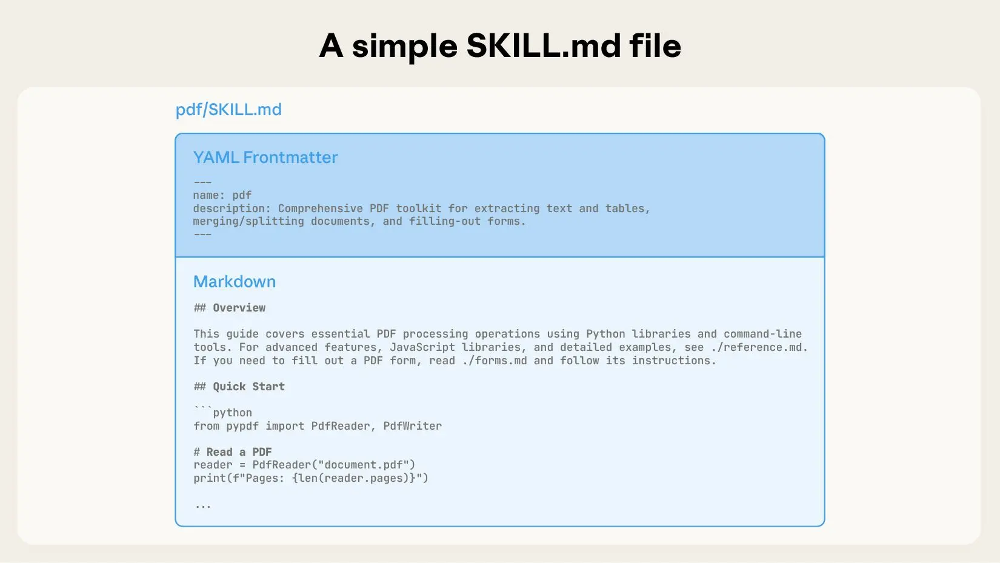
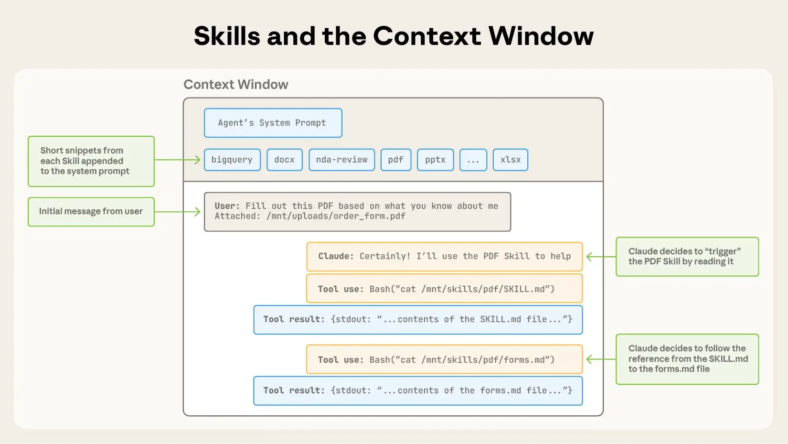

# Skills

[Agent Skills | 菜鸟教程](https://www.runoob.com/claude-code/claude-agent-skills.html)

<https://zhuanlan.zhihu.com/p/1992272492392380044>

# <font style="color:rgb(51, 51, 51);background-color:rgb(250, 252, 253);">一、基本概念</font>

<font style="color:rgb(51, 51, 51);background-color:rgb(250, 252, 253);">Agent Skills（智能体技能）是将专业知识、工作流规范固化为可复用资产的核心工具。Agent Skills 本质上是一个</font><font style="color:#DF2A3F;background-color:#FBDE28;">模块化的 Markdown 文件</font><font style="color:rgb(51, 51, 51);background-color:rgb(250, 252, 253);">，能教会 AI 工具 （如 Claude、GitHub Copilot、Cursor 等） 执行特定任务，且支持自动触发、团队共享与工程化管理，彻底告别重复的提示词输入。</font>

<font style="color:rgb(51, 51, 51);background-color:rgb(250, 252, 253);">Agent Skills 的本质不是工具，而是：</font>***<font style="color:rgb(51, 51, 51);background-color:rgb(243, 247, 240);">行为规范 + 专业知识 + 使用时机的组合，</font>***<font style="color:rgb(51, 51, 51);background-color:rgb(250, 252, 253);">给 AI 代理发放一本专业手册，AI 不会每次都从零学习，而是根据任务自动调用手册中的知识。简单来说，过去我们用提示词（prompt）教 AI 做事，现在用 Agent Skills 可以把提示词 + 资源打包成可复用、可共享的技能包，更高效、更可靠。</font>

<font style="color:rgb(25, 27, 31);">Agent Skills 实质仍是</font><font style="color:#DF2A3F;background-color:#FBDE28;"> Context 工程</font><font style="color:rgb(25, 27, 31);">，Skills 只是把垂直领域的知识、脚本调用方法等挂载到 Agent 的上下文窗口。所以 Skills 在实际应用中极其灵活，甚至在一次任务中能调用多个 Skill。</font>

# <font style="color:rgb(51, 51, 51);background-color:rgb(250, 252, 253);">二、工作原理</font>

<font style="color:rgb(51, 51, 51);background-color:rgb(250, 252, 253);">Agent Skills 的关键是渐进式披露（节省token），分三层加载：</font>

* **<font style="color:rgb(51, 51, 51);background-color:rgb(250, 252, 253);">层级 1：技能发现</font>**<font style="color:rgb(51, 51, 51);background-color:rgb(250, 252, 253);"> </font><font style="color:rgb(51, 51, 51);background-color:rgb(250, 252, 253);">-- AI 先读取所有技能的元数据（name 和 description），判断任务是否相关，这些元数据始终在系统提示中。</font>
* **<font style="color:rgb(51, 51, 51);background-color:rgb(250, 252, 253);">层级 2：加载核心指令</font>**<font style="color:rgb(51, 51, 51);background-color:rgb(250, 252, 253);"> -- 如果相关，AI 自动读取 </font><font style="color:#DF2A3F;background-color:rgb(250, 252, 253);">SKILL.md</font><font style="color:rgb(51, 51, 51);background-color:rgb(250, 252, 253);"> 的正文内容，获取详细指导。</font>
* **<font style="color:rgb(51, 51, 51);background-color:rgb(250, 252, 253);">层级 3：加载资源文件</font>**<font style="color:rgb(51, 51, 51);background-color:rgb(250, 252, 253);"> -- 只在需要时读取额外文件（如脚本、示例），或通过工具执行脚本。</font>

# <font style="color:rgb(51, 51, 51);background-color:rgb(250, 252, 253);">三、基本结构</font>

```markdown
my-skill/
└── SKILL.md   （唯一必需）
```

<font style="color:rgb(51, 51, 51);background-color:rgb(250, 252, 253);">SKILL.md 基本模板:</font>

```markdown
---
name: your-skill-name
description: What it does and when Claude should use it
---

# Skill Title

## Instructions
Clear, concrete, actionable rules.

## Examples
- Example usage 1
- Example usage 2

## Guidelines
- Guideline 1
- Guideline 2
```

<font style="color:rgb(51, 51, 51);background-color:rgb(250, 252, 253);">元数据字段:</font>

| <font style="color:rgb(255, 255, 255);">字段</font> | <font style="color:rgb(255, 255, 255);">必需</font> | <font style="color:rgb(255, 255, 255);">作用</font> |
| --- | --- | --- |
| <font style="color:rgb(51, 51, 51);">name</font> | <font style="color:rgb(51, 51, 51);">是</font> | <font style="color:rgb(51, 51, 51);">唯一标识，小写+连字符</font> |
| <font style="color:rgb(51, 51, 51);">description</font> | <font style="color:rgb(51, 51, 51);">是</font> | **<font style="color:rgb(51, 51, 51);">触发条件（最重要）</font>** |
| <font style="color:rgb(51, 51, 51);">allowed-tools</font> | <font style="color:rgb(51, 51, 51);">否</font> | <font style="color:rgb(51, 51, 51);">限制可用工具</font> |
| <font style="color:rgb(51, 51, 51);">model</font> | <font style="color:rgb(51, 51, 51);">否</font> | <font style="color:rgb(51, 51, 51);">指定模型</font> |
| <font style="color:rgb(51, 51, 51);">context</font> | <font style="color:rgb(51, 51, 51);">否</font> | <code><font style="color:rgb(51, 51, 51);">fork</font></code><br/><font style="color:rgb(51, 51, 51);"> </font><font style="color:rgb(51, 51, 51);">= 独立上下文</font> |
| <font style="color:rgb(51, 51, 51);">agent</font> | <font style="color:rgb(51, 51, 51);">否</font> | <font style="color:rgb(51, 51, 51);">fork 时使用的子代理</font> |
| <font style="color:rgb(51, 51, 51);">hooks</font> | <font style="color:rgb(51, 51, 51);">否</font> | <font style="color:rgb(51, 51, 51);">Skill 生命周期钩子</font> |
| <font style="color:rgb(51, 51, 51);">user-invocable</font> | <font style="color:rgb(51, 51, 51);">否</font> | <font style="color:rgb(51, 51, 51);">是否显示在</font><font style="color:rgb(51, 51, 51);"> </font><code><font style="color:rgb(51, 51, 51);">/</font></code><br/><font style="color:rgb(51, 51, 51);"> </font><font style="color:rgb(51, 51, 51);">菜单</font> |

如PDF SKILLS案例





# <font style="color:rgb(51, 51, 51);background-color:rgb(250, 252, 253);">相关资源</font>

* <font style="color:rgb(51, 51, 51);background-color:rgb(250, 252, 253);">Skills 市场：</font>[<font style="color:rgb(0, 102, 0);background-color:rgb(250, 252, 253);">https://skillsmp.com/zh</font>](https://skillsmp.com/zh)
* <font style="color:rgb(51, 51, 51);background-color:rgb(250, 252, 253);">官方标准网站：</font>[<font style="color:rgb(0, 102, 0);background-color:rgb(250, 252, 253);">https://agentskills.io</font>](https://agentskills.io/)
* <font style="color:rgb(51, 51, 51);background-color:rgb(250, 252, 253);">Anthropic 工程文章：</font>[<font style="color:rgb(0, 102, 0);background-color:rgb(250, 252, 253);">https://www.anthropic.com/engineering/equipping-agents-for-the-real-world-with-agent-skills</font>](https://www.anthropic.com/engineering/equipping-agents-for-the-real-world-with-agent-skills)
* <font style="color:rgb(51, 51, 51);background-color:rgb(250, 252, 253);">VS Code 文档：</font>[<font style="color:rgb(0, 102, 0);background-color:rgb(250, 252, 253);">https://code.visualstudio.com/docs/copilot/customization/agent-skills</font>](https://code.visualstudio.com/docs/copilot/customization/agent-skills)
* <font style="color:rgb(51, 51, 51);background-color:rgb(250, 252, 253);">Agent Skills:</font><font style="color:rgb(51, 51, 51);background-color:rgb(250, 252, 253);"> </font>[<font style="color:rgb(0, 102, 0);background-color:rgb(250, 252, 253);">https://github.com/anthropics/skills</font>](https://github.com/anthropics/skills)
* <font style="color:rgb(51, 51, 51);background-color:rgb(250, 252, 253);">Claude 技能列表：</font>[<font style="color:rgb(0, 102, 0);background-color:rgb(250, 252, 253);">https://github.com/ComposioHQ/awesome-claude-skills</font>](https://github.com/ComposioHQ/awesome-claude-skills)
* <font style="color:rgb(51, 51, 51);background-color:rgb(250, 252, 253);">软件开发工作流程 skills :</font><font style="color:rgb(51, 51, 51);background-color:rgb(250, 252, 253);"> </font>[<font style="color:rgb(0, 102, 0);background-color:rgb(250, 252, 253);">https://github.com/obra/superpowers</font>](https://github.com/obra/superpowers)
* <font style="color:rgb(51, 51, 51);background-color:rgb(250, 252, 253);">自动写 skill 的 skill：</font>[<font style="color:rgb(0, 102, 0);background-color:rgb(250, 252, 253);">https://github.com/anthropics/skills/tree/main/skills/skill-creator</font>](https://github.com/anthropics/skills/tree/main/skills/skill-creator)

[Just a moment...](https://skillsmp.com/)


> 更新: 2026-01-27 13:30:16  
> 原文: <https://www.yuque.com/nibiwanxiamei/yrd6t1/fkgn9xrg4abai977>