# JAVA - IO

1

***

# Java IO流

## IO 流简介

IO 即 `Input/Output`，输入和输出。数据输入到计算机内存的过程即输入，反之输出到外部存储（比如数据库，文件，远程主机）的过程即输出。数据传输过程类似于水流，因此称为 IO 流。IO 流在 Java 中分为**输入流和输出流**，而根据数据的处理方式又分为**字节流和字符流。**

Java IO 流的 40 多个类都是从如下 4 个抽象类基类中派生出来的。

* `InputStream` **/**`Reader`: 所有的输入流的基类，前者是字节输入流，后者是字符输入流。
* `OutputStream` **/**`Writer`: 所有输出流的基类，前者是字节输出流，后者是字符输出流。

## 字节流

### InputStream（字节输入流）

`InputStream`用于从源头（通常是文件）读取数据（字节信息）到内存中，`java.io.InputStream`抽象类是所有字节输入流的父类。

`InputStream` 常用方法：

* `read()`：返回输入流中下一个字节的数据。返回的值介于 0 到 255 之间。如果未读取任何字节，则代码返回 `-1` ，表示文件结束。
* `read(byte b[ ])` : 从输入流中\*\*读取一些字节存储到数组 **`**b**` \*\* 中**。如果数组 `b` 的长度为零，则不读取。如果没有可用字节读取，返回 `-1`。如果有可用字节读取，则最多读取的字节数最多等于 `b.length` ， 返回读取的字节数。这个方法等价于 `read(b, 0, b.length)`。
* `read(byte b[], int off, int len)`：在`read(byte b[ ])` 方法的基础上增加了 `off` 参数（偏移量）和 `len` 参数（要读取的最大字节数）。
* `skip(long n)`：忽略输入流中的 n 个字节 ,返回实际忽略的字节数。
* `available()`：返回输入流中可以读取的字节数。
* `close()`：关闭输入流释放相关的系统资源。

从 Java 9 开始，`InputStream` 新增加了多个实用的方法：

* `readAllBytes()`：读取输入流中的所有字节，返回字节数组。
* `readNBytes(byte[] b, int off, int len)`：阻塞直到读取 `len` 个字节。
* `transferTo(OutputStream out)`：**将所有字节从一个输入流传递到一个输出流。**

`FileInputStream` 是一个比较常用的字节输入流对象，可直接指定文件路径，可以直接读取单字节数据，也可以读取至字节数组中。

`FileInputStream` 代码示例：

```java
try (InputStream fis = new FileInputStream("input.txt")) {
    System.out.println("Number of remaining bytes:"
            + fis.available());
    int content;
    long skip = fis.skip(2);
    System.out.println("The actual number of bytes skipped:" + skip);
    System.out.print("The content read from file:");
    while ((content = fis.read()) != -1) {
        System.out.print((char) content);
    }
} catch (IOException e) {
    e.printStackTrace();
}
```

一般我们是不会直接单独使用 `FileInputStream` ，通常会配合 `BufferedInputStream`（**字节缓冲输入流**，后文会讲到）来使用。

像下面这段代码在我们的项目中就比较常见，我们通过 `readAllBytes()` 读取输入流所有字节并将其直接赋值给一个 `String` 对象。

```java
// 新建一个 BufferedInputStream 对象
BufferedInputStream bufferedInputStream = new BufferedInputStream(new FileInputStream("input.txt"));
// 读取文件的内容并复制到 String 对象中
String result = new String(bufferedInputStream.readAllBytes());
System.out.println(result);
```

`DataInputStream` 用于读取指定类型数据，不能单独使用，必须结合其它流，比如 `FileInputStream` 。

```java
FileInputStream fileInputStream = new FileInputStream("input.txt");
//必须将fileInputStream作为构造参数才能使用
DataInputStream dataInputStream = new DataInputStream(fileInputStream);
//可以读取任意具体的类型数据
dataInputStream.readBoolean();
dataInputStream.readInt();
dataInputStream.readUTF();
```

`ObjectInputStream` 用于从输入流中读取 Java 对象（反序列化），`ObjectOutputStream` 用于将对象写入到输出流(序列化)。

```java
ObjectInputStream input = new ObjectInputStream(new FileInputStream("object.data"));
MyClass object = (MyClass) input.readObject();
input.close();
```

另外，用于序列化和反序列化的类必须实现 `Serializable` 接口，对象中如果有属性不想被序列化，使用 `transient` 修饰

### OutputStream（字节输出流）

`OutputStream`用于将数据（字节信息）写入到目的地（通常是文件），`java.io.OutputStream`抽象类是所有字节输出流的父类。

`OutputStream` 常用方法：

* `write(int b)`：将特定字节写入输出流。
* `write(byte b[ ])` : 将数组`b` 写入到输出流，等价于 `write(b, 0, b.length)` 。
* `write(byte[] b, int off, int len)` : 在`write(byte b[ ])` 方法的基础上增加了 `off` 参数（偏移量）和 `len` 参数（要读取的最大字节数）。
* `flush()`：刷新此输出流并强制写出所有缓冲的输出字节。
* `close()`：关闭输出流释放相关的系统资源。

`FileOutputStream` 是最常用的字节输出流对象，可直接指定文件路径，可以直接输出单字节数据，也可以输出指定的字节数组。

`FileOutputStream` 代码示例：

```java
try (FileOutputStream output = new FileOutputStream("output.txt")) {
    byte[] array = "JavaGuide".getBytes();
    output.write(array);
} catch (IOException e) {
    e.printStackTrace();
}
```

类似于 `FileInputStream`，`FileOutputStream` 通常也会配合 `BufferedOutputStream`（字节缓冲输出流，后文会讲到）来使用

```java
FileOutputStream fileOutputStream = new FileOutputStream("output.txt");
BufferedOutputStream bos = new BufferedOutputStream(fileOutputStream)
```

<code>**DataOutputStream**</code> 用于写入指定类型数据，不能单独使用，必须结合其它流，比如 `FileOutputStream` 。

```java
// 输出流
FileOutputStream fileOutputStream = new FileOutputStream("out.txt");
DataOutputStream dataOutputStream = new DataOutputStream(fileOutputStream);
// 输出任意数据类型
dataOutputStream.writeBoolean(true);
dataOutputStream.writeByte(1);
```

`ObjectInputStream` 用于从输入流中读取 Java 对象（`ObjectInputStream`,反序列化），`ObjectOutputStream`将对象写入到输出流(`ObjectOutputStream`，序列化)。

```java
ObjectOutputStream output = new ObjectOutputStream(new FileOutputStream("file.txt")
Person person = new Person("Guide哥", "JavaGuide作者");
output.writeObject(person);
```

## 字符流

个人认为主要有两点原因：

* 字符流是由 Java 虚拟机将字节转换得到的，这个过程还算是比较耗时。
* 如果我们不知道编码类型就很容易出现乱码问题。

用字节流读取数据会产生乱码

I/O 流就提供了一个直接**操作字符**的接口，方便我们平时对字符进行流操作。如果**音频文件、图片等媒体文件用字节流比较好，如果涉及到字符的话使用字符流比较好**。

### Reader（字符输入流）

`Reader`用于从源头（通常是文件）读取数据（字符信息）到内存中，`java.io.Reader`抽象类是所有字符输入流的父类。

`**Reader**` \*\* 用于读取文本， **`**InputStream**` \*\* 用于读取原始字节**。

`Reader` 常用方法：

* `read()` : 从输入流读取一个字符。
* `read(char[] cbuf)` : 从输入流中读取一些字符，并将它们存储到字符数组 `cbuf`中，等价于 `read(cbuf, 0, cbuf.length)` 。
* `read(char[] cbuf, int off, int len)`：在`read(char[] cbuf)` 方法的基础上增加了 `off` 参数（偏移量）和 `len` 参数（要读取的最大字符数）。
* `skip(long n)`：忽略输入流中的 n 个字符 ,返回实际忽略的字符数。
* `close()` : 关闭输入流并释放相关的系统资源。

`InputStreamReader` 是字节流转换为字符流的桥梁，其子类 `FileReader` 是基于该基础上的封装，可以直接操作字符文件。

```java
// 字节流转换为字符流的桥梁
public class InputStreamReader extends Reader {
}
// 用于读取字符文件
public class FileReader extends InputStreamReader {
}
```

```java
try (FileReader fileReader = new FileReader("input.txt");) {
    int content;
    long skip = fileReader.skip(3);
    System.out.println("The actual number of bytes skipped:" + skip);
    System.out.print("The content read from file:");
    while ((content = fileReader.read()) != -1) {
        System.out.print((char) content);
    }
} catch (IOException e) {
    e.printStackTrace();
}
```

```java
The actual number of bytes skipped:3
The content read from file:我是Guide。
```

### Writer（字符输出流）

`Writer`用于将数据（字符信息）写入到目的地（通常是文件），`java.io.Writer`抽象类是所有字符输出流的父类。

`Writer` 常用方法：

* `write(int c)` : 写入单个字符。
* `write(char[] cbuf)`：写入字符数组 `cbuf`，等价于`write(cbuf, 0, cbuf.length)`。
* `write(char[] cbuf, int off, int len)`：在`write(char[] cbuf)` 方法的基础上增加了 `off` 参数（偏移量）和 `len` 参数（要读取的最大字符数）。
* `write(String str)`：写入字符串，等价于 `write(str, 0, str.length())` 。
* `write(String str, int off, int len)`：在`write(String str)` 方法的基础上增加了 `off` 参数（偏移量）和 `len` 参数（要读取的最大字符数）。
* `append(CharSequence csq)`：将指定的字符序列附加到指定的 `Writer` 对象并返回该 `Writer` 对象。
* `append(char c)`：将指定的字符附加到指定的 `Writer` 对象并返回该 `Writer` 对象。
* `flush()`：刷新此输出流并强制写出所有缓冲的输出字符。
* `close()`:关闭输出流释放相关的系统资源。

`OutputStreamWriter` 是字符流转换为字节流的桥梁，其子类 `FileWriter` 是基于该基础上的封装，可以直接将字符写入到文件。

```java
// 字符流转换为字节流的桥梁
public class OutputStreamWriter extends Writer {
}
// 用于写入字符到文件
public class FileWriter extends OutputStreamWriter {
}
```

```java
try (Writer output = new FileWriter("output.txt")) {
    output.write("你好，我是Guide。");
} catch (IOException e) {
    e.printStackTrace();
}
```

## 字节缓冲流

IO 操作是很消耗性能的，**缓冲流将数据加载至缓冲区，一次性读取/写入多个字节，从而避免频繁的 IO 操作，提高流的传输效率**。

字节缓冲流这里采用了装饰器模式来增强 `InputStream` 和`OutputStream`子类对象的功能。

举个例子，我们可以通过 `BufferedInputStream`（字节缓冲输入流）来增强 `FileInputStream` 的功能。

```java
// 新建一个 BufferedInputStream 对象
BufferedInputStream bufferedInputStream = new BufferedInputStream(new FileInputStream("input.txt"));
```

字节流和字节缓冲流的性能差别主要体现在我们使用两者的时候都是调用 `write(int b)` 和 `read()` 这两个一次只读取一个字节的方法的时候。由于字节缓冲流内部有缓冲区（字节数组），因此，**字节缓冲流会先将读取到的字节存放在缓存区，大幅减少 IO 次数**，提高读取效率。

我使用 `write(int b)` 和 `read()` 方法，分别通过字节流和字节缓冲流复制一个 `524.9 mb` 的 PDF 文件耗时对比如下：

```java
使用缓冲流复制PDF文件总耗时:15428 毫秒
使用普通字节流复制PDF文件总耗时:2555062 毫秒
```

```java
@Test
void copy_pdf_to_another_pdf_buffer_stream() {
    // 记录开始时间
    long start = System.currentTimeMillis();
    try (BufferedInputStream bis = new BufferedInputStream(new FileInputStream("深入理解计算机操作系统.pdf"));
         BufferedOutputStream bos = new BufferedOutputStream(new FileOutputStream("深入理解计算机操作系统-副本.pdf"))) {
        int content;
        while ((content = bis.read()) != -1) {
            bos.write(content);
        }
    } catch (IOException e) {
        e.printStackTrace();
    }
    // 记录结束时间
    long end = System.currentTimeMillis();
    System.out.println("使用缓冲流复制PDF文件总耗时:" + (end - start) + " 毫秒");
}

@Test
void copy_pdf_to_another_pdf_stream() {
    // 记录开始时间
    long start = System.currentTimeMillis();
    try (FileInputStream fis = new FileInputStream("深入理解计算机操作系统.pdf");
         FileOutputStream fos = new FileOutputStream("深入理解计算机操作系统-副本.pdf")) {
        int content;
        while ((content = fis.read()) != -1) {
            fos.write(content);
        }
    } catch (IOException e) {
        e.printStackTrace();
    }
    // 记录结束时间
    long end = System.currentTimeMillis();
    System.out.println("使用普通流复制PDF文件总耗时:" + (end - start) + " 毫秒");
}
```

如果是调用 `read(byte b[])` 和 `write(byte b[], int off, int len)` 这两个写入一个字节数组的方法的话，只要字节数组的大小合适，两者的性能差距其实不大，基本可以忽略。

这次我们使用 `read(byte b[])` 和 `write(byte b[], int off, int len)` 方法，分别通过字节流和字节缓冲流复制一个 524.9 mb 的 PDF 文件耗时对比如下：

```java
使用缓冲流复制PDF文件总耗时:695 毫秒
使用普通字节流复制PDF文件总耗时:989 毫秒
```

```java
@Test
void copy_pdf_to_another_pdf_with_byte_array_buffer_stream() {
    // 记录开始时间
    long start = System.currentTimeMillis();
    try (BufferedInputStream bis = new BufferedInputStream(new FileInputStream("深入理解计算机操作系统.pdf"));
         BufferedOutputStream bos = new BufferedOutputStream(new FileOutputStream("深入理解计算机操作系统-副本.pdf"))) {
        int len;
        byte[] bytes = new byte[4 * 1024];
        while ((len = bis.read(bytes)) != -1) {
            bos.write(bytes, 0, len);
        }
    } catch (IOException e) {
        e.printStackTrace();
    }
    // 记录结束时间
    long end = System.currentTimeMillis();
    System.out.println("使用缓冲流复制PDF文件总耗时:" + (end - start) + " 毫秒");
}

@Test
void copy_pdf_to_another_pdf_with_byte_array_stream() {
    // 记录开始时间
    long start = System.currentTimeMillis();
    try (FileInputStream fis = new FileInputStream("深入理解计算机操作系统.pdf");
         FileOutputStream fos = new FileOutputStream("深入理解计算机操作系统-副本.pdf")) {
        int len;
        byte[] bytes = new byte[4 * 1024];
        while ((len = fis.read(bytes)) != -1) {
            fos.write(bytes, 0, len);
        }
    } catch (IOException e) {
        e.printStackTrace();
    }
    // 记录结束时间
    long end = System.currentTimeMillis();
    System.out.println("使用普通流复制PDF文件总耗时:" + (end - start) + " 毫秒");
}
```

### BufferedInputStream（字节缓冲输入流）

`BufferedInputStream` 从源头（通常是文件）读取数据（字节信息）到内存的过程中不会一个字节一个字节的读取，而是会先**将读取到的字节存放在缓存区，并从内部缓冲区中单独读取字节。这样大幅减少了 IO 次数，提高了读取效率。**

`BufferedInputStream` 内部维护了一个缓冲区，这个缓冲区实际就是一个字节数组，通过阅读 `BufferedInputStream` 源码即可得到这个结论。

```java
public
class BufferedInputStream extends FilterInputStream {
    // 内部缓冲区数组
    protected volatile byte buf[];
    // 缓冲区的默认大小
    private static int DEFAULT_BUFFER_SIZE = 8192;
    // 使用默认的缓冲区大小
    public BufferedInputStream(InputStream in) {
        this(in, DEFAULT_BUFFER_SIZE);
    }
    // 自定义缓冲区大小
    public BufferedInputStream(InputStream in, int size) {
        super(in);
        if (size <= 0) {
            throw new IllegalArgumentException("Buffer size <= 0");
        }
        buf = new byte[size];
    }
}
```

缓冲区的大小默认为 **8192** 字节，也可以通过 `BufferedInputStream(InputStream in, int size)` 这个构造方法来指定缓冲区的大小

### BufferedOutputStream（字节缓冲输出流）

`BufferedOutputStream` 将数据（字节信息）写入到目的地（通常是文件）的过程中不会一个字节一个字节的写入，而是会先将要写入的字节存放在缓存区，并从内部缓冲区中单独写入字节。这样大幅减少了 IO 次数，提高了读取效率

```java
try (BufferedOutputStream bos = new BufferedOutputStream(new FileOutputStream("output.txt"))) {
    byte[] array = "JavaGuide".getBytes();
    bos.write(array);
} catch (IOException e) {
    e.printStackTrace();
}
```

类似于 `BufferedInputStream` ，`BufferedOutputStream` 内部也维护了一个缓冲区，并且，这个缓存区的大小也是 **8192** 字节。

## 字符缓冲流

`BufferedReader` （字符缓冲输入流）和 `BufferedWriter`（字符缓冲输出流）类似于 `BufferedInputStream`（字节缓冲输入流）和`BufferedOutputStream`（字节缓冲输入流），内部都维护了一个字节数组作为缓冲区。不过，前者主要是用来操作字符信息

## 打印流

```java
System.out.print("Hello！");
System.out.println("Hello！");
```

`System.out` 实际是用于获取一个 `PrintStream` 对象，`print`方法实际调用的是 `PrintStream` 对象的 `write` 方法。

`PrintStream` 属于字节打印流，与之对应的是 `PrintWriter` （字符打印流）。`PrintStream` 是 `OutputStream` 的子类，`PrintWriter` 是 `Writer` 的子类。

```java
public class PrintStream extends FilterOutputStream
    implements Appendable, Closeable {
}
public class PrintWriter extends Writer {
}
```

# Java IO 设计模式总结

## 装饰器模式

**装饰器（Decorator）模式** 可以**在不改变原有对象的情况下拓展其功能**。

装饰器模式**通过组合替代继承**来扩展原始类的功能，在一些继承关系比较复杂的场景（IO 这一场景各种类的继承关系就比较复杂）更加实用。

对于字节流来说， `**FilterInputStream**` \*\* （对应输入流）和\*\*`**FilterOutputStream**` **（对应输出流）是装饰器模式的核心**，分别用于增强 `InputStream` 和`OutputStream`子类对象的功能。

我们常见的`BufferedInputStream`(字节缓冲输入流)、`DataInputStream` 等等都是`FilterInputStream` 的子类，`BufferedOutputStream`（字节缓冲输出流）、`DataOutputStream`等等都是`FilterOutputStream`的子类。

举个例子，我们可以\*\*通过 \*\*`**BufferedInputStream**` \*\*（字节缓冲输入流）来增强 \*\*`**FileInputStream**` 的功能。

`BufferedInputStream` 构造函数如下：

```java
public BufferedInputStream(InputStream in) {
    this(in, DEFAULT_BUFFER_SIZE);
}
public BufferedInputStream(InputStream in, int size) {
    super(in);
    if (size <= 0) {
        throw new IllegalArgumentException("Buffer size <= 0");
    }
    buf = new byte[size];
}
```

`BufferedInputStream` 代码示例：

```java
try (BufferedInputStream bis = new BufferedInputStream(new FileInputStream("input.txt"))) {
    int content;
    long skip = bis.skip(2);
    while ((content = bis.read()) != -1) {
        System.out.print((char) content);
    }
} catch (IOException e) {
    e.printStackTrace();
}
```

**可以对原始类嵌套使用多个装饰器。**

对于字符流来说，`BufferedReader` 可以用来增加 `Reader` （字符输入流）子类的功能，`BufferedWriter` 可以用来增加 `Writer` （字符输出流）子类的功能。

```java
BufferedWriter bw = new BufferedWriter(new OutputStreamWriter(new FileOutputStream(fileName), "UTF-8"));
```

## 适配器模式

**适配器（Adapter Pattern）模式** 主要用于**接口互不兼容的类的协调工作**，你可以将其联想到我们日常经常使用的电源适配器。

适配器模式中存在被适配的对象或者类称为 **适配者(Adaptee)**  ，作用于适配者的对象或者类称为**适配器(Adapter)**  。适配器分为对象适配器和类适配器。**类适配器使用继承关系来实现，对象适配器使用组合关系来实现。**

IO 流中的字符流和字节流的接口不同，它们之间可以协调工作就是基于适配器模式来做的，更准确点来说是对象适配器。通过适配器，我们可以将字节流对象适配成一个字符流对象，这样我们可以直接通过字节流对象来读取或者写入字符数据。

`**InputStreamReader**` \*\* 和 \*\* `**OutputStreamWriter**` \*\* 就是两个适配器(Adapter)， 同时，它们两个也是字节流和字符流之间的桥梁\*\*。`InputStreamReader` 使用 `StreamDecoder` （流解码器）对字节进行解码，**实现字节流到字符流的转换** **，**  `OutputStreamWriter` 使用`StreamEncoder`（流编码器）对字符进行编码，实现字符流到字节流的转换。

> 字节流和字符流之间的转化通过`**InputStreamReader**` \*\* 和 \*\* `**OutputStreamWriter**` \*\* 这两个适配器(Adapter)\*\*

`InputStream` 和 `OutputStream` 的子类是被适配者， `InputStreamReader` 和 `OutputStreamWriter`是适配器。

```java
// InputStreamReader 是适配器，FileInputStream 是被适配的类
InputStreamReader isr = new InputStreamReader(new FileInputStream(fileName), "UTF-8");
// BufferedReader 增强 InputStreamReader 的功能（装饰器模式）
BufferedReader bufferedReader = new BufferedReader(isr);
```

`java.io.InputStreamReader` 部分源码：

```java
public class InputStreamReader extends Reader {
	//用于解码的对象
	private final StreamDecoder sd;
    public InputStreamReader(InputStream in) {
        super(in);
        try {
            // 获取 StreamDecoder 对象
            sd = StreamDecoder.forInputStreamReader(in, this, (String)null);
        } catch (UnsupportedEncodingException e) {
            throw new Error(e);
        }
    }
    // 使用 StreamDecoder 对象做具体的读取工作
	public int read() throws IOException {
        return sd.read();
    }
}
```

`java.io.OutputStreamWriter` 部分源码：

```java
public class OutputStreamWriter extends Writer {
    // 用于编码的对象
    private final StreamEncoder se;
    public OutputStreamWriter(OutputStream out) {
        super(out);
        try {
           // 获取 StreamEncoder 对象
            se = StreamEncoder.forOutputStreamWriter(out, this, (String)null);
        } catch (UnsupportedEncodingException e) {
            throw new Error(e);
        }
    }
    // 使用 StreamEncoder 对象做具体的写入工作
    public void write(int c) throws IOException {
        se.write(c);
    }
}
```

**适配器模式和装饰器模式有什么区别呢？**

**装饰器模式** 更侧重于动态地增强原始类的功能，装饰器类需要跟原始类继承相同的抽象类或者实现相同的接口。并且，装饰器模式支持对原始类嵌套使用多个装饰器。

**适配器模式** 更侧重于让接口不兼容而不能交互的类可以一起工作，当我们调用适配器对应的方法时，适配器内部会调用适配者类或者和适配类相关的类的方法，这个过程透明的。就比如说 `StreamDecoder` （流解码器）和`StreamEncoder`（流编码器）就是分别基于 `InputStream` 和 `OutputStream` 来获取 `FileChannel`对象并调用对应的 `read` 方法和 `write` 方法进行字节数据的读取和写入。

```java
StreamDecoder(InputStream in, Object lock, CharsetDecoder dec) {
    // 省略大部分代码
    // 根据 InputStream 对象获取 FileChannel 对象
    ch = getChannel((FileInputStream)in);
}
```

适配器和适配者两者不需要继承相同的抽象类或者实现相同的接口。

另外，`**FutureTask**` \*\* 类使用了适配器模式，\*\* `**Executors**` \*\* 的内部类 \*\* `**RunnableAdapter**` \*\* 实现属于适配器，用于将 \*\* `**Runnable**` \*\* 适配成 \*\* `**Callable**` **。**

`FutureTask`参数包含 `Runnable` 的一个构造方法：

```java
public FutureTask(Runnable runnable, V result) {
    // 调用 Executors 类的 callable 方法
    this.callable = Executors.callable(runnable, result);
    this.state = NEW;
}
```

`Executors`中对应的方法和适配器：

```java
// 实际调用的是 Executors 的内部类 RunnableAdapter 的构造方法
public static <T> Callable<T> callable(Runnable task, T result) {
    if (task == null)
        throw new NullPointerException();
    return new RunnableAdapter<T>(task, result);
}
// 适配器
static final class RunnableAdapter<T> implements Callable<T> {
    final Runnable task;
    final T result;
    RunnableAdapter(Runnable task, T result) {
        this.task = task;
        this.result = result;
    }
    public T call() {
        task.run();
        return result;
    }
}
```

## 工厂模式

工厂模式用于创建对象，NIO 中大量用到了工厂模式，比如 `Files` 类的 `newInputStream` 方法用于创建 `InputStream` 对象（静态工厂）、 `Paths` 类的 `get` 方法创建 `Path` 对象（静态工厂）、`ZipFileSystem` 类（`sun.nio`包下的类，属于 `java.nio` 相关的一些内部实现）的 `getPath` 的方法创建 `Path` 对象（简单工厂）。

```java
InputStream is = Files.newInputStream(Paths.get(generatorLogoPath))
```

## 观察者模式

NIO 中的文件目录监听服务使用到了**观察者模式**。

NIO 中的文件目录监听服务基于 `WatchService` 接口和 `Watchable` 接口。`WatchService` 属于观察者，`Watchable` 属于被观察者。

`Watchable` 接口定义了一个用于将对象注册到 `WatchService`（监控服务） 并绑定监听事件的方法 `register` 。

```java
public interface Path
    extends Comparable<Path>, Iterable<Path>, Watchable{
}

public interface Watchable {
    WatchKey register(WatchService watcher,
                      WatchEvent.Kind<?>[] events,
                      WatchEvent.Modifier... modifiers)
        throws IOException;
}
```

`WatchService` 用于监听文件目录的变化，同一个 `WatchService` 对象能够监听多个文件目录。

```java
// 创建 WatchService 对象
WatchService watchService = FileSystems.getDefault().newWatchService();

// 初始化一个被监控文件夹的 Path 类:
Path path = Paths.get("workingDirectory");
// 将这个 path 对象注册到 WatchService（监控服务） 中去
WatchKey watchKey = path.register(
watchService, StandardWatchEventKinds...);
```

`Path` 类 `register` 方法的第二个参数 `events` （需要监听的事件）为可变长参数，也就是说我们可以同时监听多种事件。

```java
WatchKey register(WatchService watcher,
                  WatchEvent.Kind<?>... events)
    throws IOException;
```

常用的监听事件有 3 种：

* `StandardWatchEventKinds.ENTRY_CREATE`：文件创建。
* `StandardWatchEventKinds.ENTRY_DELETE` : 文件删除。
* `StandardWatchEventKinds.ENTRY_MODIFY` : 文件修改。

`register` 方法返回 `WatchKey` 对象，通过`WatchKey` 对象可以获取事件的具体信息比如文件目录下是创建、删除还是修改了文件、创建、删除或者修改的文件的具体名称是什么。

```java
WatchKey key;
while ((key = watchService.take()) != null) {
    for (WatchEvent<?> event : key.pollEvents()) {
      // 可以调用 WatchEvent 对象的方法做一些事情比如输出事件的具体上下文信息
    }
    key.reset();
}
```

`WatchService` 内部是通过一个 daemon thread（守护线程）采用定期轮询的方式来检测文件的变化，简化后的源码如下所示。

```java
class PollingWatchService
    extends AbstractWatchService
{
    // 定义一个 daemon thread（守护线程）轮询检测文件变化
    private final ScheduledExecutorService scheduledExecutor;

    PollingWatchService() {
        scheduledExecutor = Executors
            .newSingleThreadScheduledExecutor(new ThreadFactory() {
                 @Override
                 public Thread newThread(Runnable r) {
                     Thread t = new Thread(r);
                     t.setDaemon(true);
                     return t;
                 }});
    }

  void enable(Set<? extends WatchEvent.Kind<?>> events, long period) {
    synchronized (this) {
      // 更新监听事件
      this.events = events;

        // 开启定期轮询
      Runnable thunk = new Runnable() { public void run() { poll(); }};
      this.poller = scheduledExecutor
        .scheduleAtFixedRate(thunk, period, period, TimeUnit.SECONDS);
    }
  }
}
```

# Java IO 模型详解 ♥♥♥

## 什么是IO

**I/O（Input/Outpu） 即输入／输出 。**

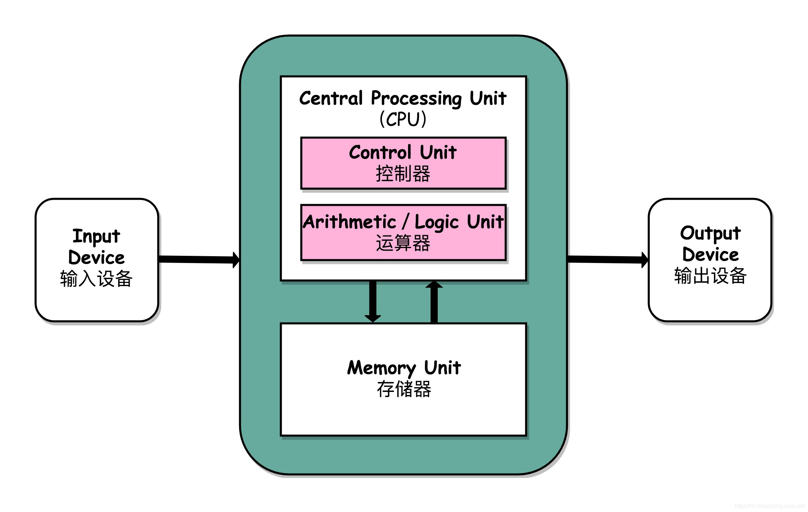

**I/O 描述了计算机系统与外部设备之间通信的过程。**

常见的IO模型：**同步阻塞 I/O、同步非阻塞 I/O、I/O 多路复用、信号驱动 I/O 和异步 I/O。**

## Java 中 3 种常见 IO 模型

### BIO (Blocking I/O)

**BIO 属于同步阻塞 IO 模型** 。同步阻塞 IO 模型中，应用程序发起 read 调用后，会一直阻塞，直到内核把数据拷贝到用户空间。

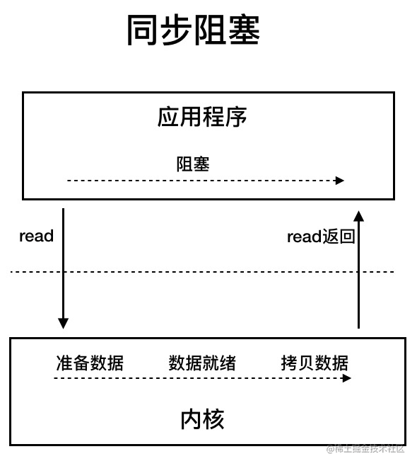

在客户端连接数量不高的情况下，是没问题的。但是，当面对十万甚至百万级连接的时候，传统的 BIO 模型是无能为力的。因此，我们需要一种更高效的 I/O 处理模型来应对更高的并发量

### NIO (Non-blocking/New I/O)

Java 中的 NIO 于 Java 1.4 中引入，对应 `java.nio` 包，\*\*提供了 \*\*`Channel` \*\* , **`Selector` **，**`Buffer` \*\* 等抽象**。NIO 中的 N 可以理解为 Non-blocking，不单纯是 New。它是支持面向缓冲的，基于通道的 I/O 操作方法。 对于高负载、高并发的（网络）应用，应使用 NIO 。

Java 中的 NIO 可以看作是 **I/O 多路复用模型**。也有很多人认为，Java 中的 NIO 属于同步非阻塞 IO 模型

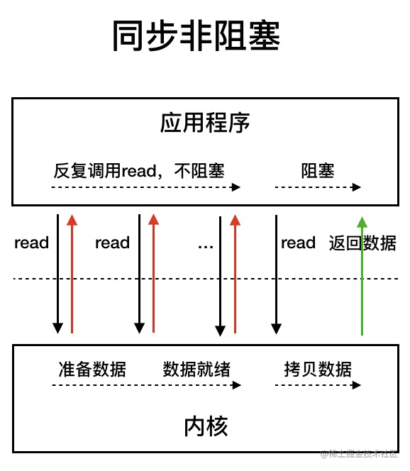

同步阻塞 IO 模型中，应用程序会一直发起 read 调用，等待数据从内核空间拷贝到用户空间的这段时间里，线程依然是阻塞的，直到在内核把数据拷贝到用户空间。

相比于同步阻塞 IO 模型，同步非阻塞 IO 模型确实有了很大改进。**通过轮询操作，避免了一直阻塞。**

但是，这种 IO 模型同样存在问题：**应用程序不断进行 I/O 系统调用轮询数据是否已经准备好的过程是十分消耗 CPU 资源的。**

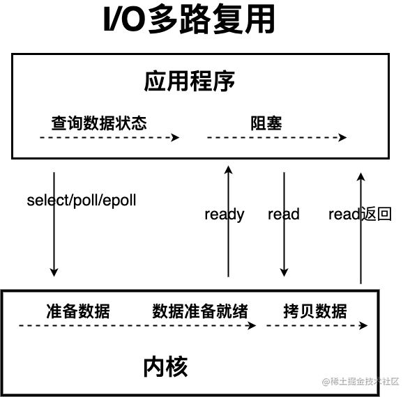

**IO 多路复用模型中，线程首先发起 select 调用，询问内核数据是否准备就绪，等内核把数据准备好了，用户线程再发起 read 调用。read 调用的过程（数据从内核空间 -> 用户空间）还是阻塞的。**

> 目前支持 IO 多路复用的系统调用，有 select，epoll 等等。select 系统调用，目前几乎在所有的操作系统上都有支持。
>
> * **select 调用**：内核提供的系统调用，支持一次查询多个系统调用的可用状态。大部分操作系统都支持。
> * **epoll 调用**：linux 2.6 内核，属于 select 调用的增强版本，优化了 IO 的执行效率

**<font style="color:#DF2A3F;">IO 多路复用模型，通过减少无效的系统调用</font>**<font style="color:#DF2A3F;"> </font>**<font style="color:#DF2A3F;">，减少了对 CPU 资源的消耗。</font>**

Java 中的 NIO ，有一个非常重要的**选择器 ( Selector )**  的概念，也可以被称为 **多路复用器**。通过它，**只需要一个线程便可以管理多个客户端连接**。当客户端数据到了之后，才会为其服务。

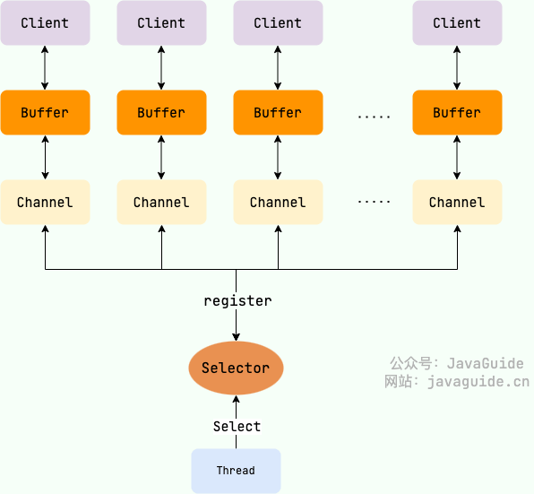

### AIO (Asynchronous I/O)

AIO 也就是 NIO 2。Java 7 中引入了 NIO 的改进版 NIO 2,它是异步 IO 模型。

**<font style="color:#DF2A3F;">异步 IO 是基于事件和回调机制实现的，也就是应用操作之后会直接返回，不堵塞</font>\*\*\*\*，** 当后台处理完成，操作系统会通知相应的线程进行后续的操作。

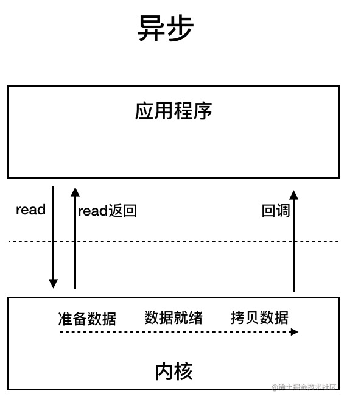

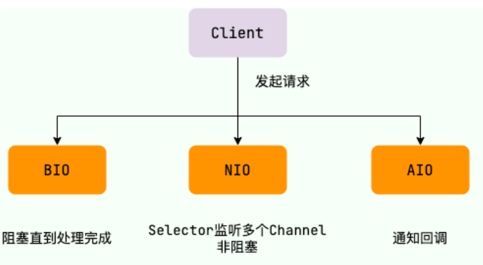

# Java NIO 核心知识总结

## NIO 简介

在传统的 Java I/O 模型（BIO）中，I/O 操作是以阻塞的方式进行的。也就是说，当一个线程执行一个 I/O 操作时，它会被阻塞直到操作完成。这种阻塞模型在处理多个并发连接时可能会导致性能瓶颈，因为需要为每个连接创建一个线程，而线程的创建和切换都是有开销的。

为了解决这个问题，在 Java1.4 版本引入了一种新的 I/O 模型 — **NIO** （New IO，也称为 Non-blocking IO） 。NIO 弥补了同步阻塞 I/O 的不足，它在标准 Java 代码中提供了**非阻塞、面向缓冲、基于通道的 I/O，可以使用少量的线程来处理多个连接**，大大提高了 I/O 效率和并发。


## NIO 核心组件

NIO 主要包括以下三个核心组件：

* **Buffer（缓冲区）** ：NIO 读写数据都是通过缓冲区进行操作的。读操作的时候将 Channel 中的数据填充到 Buffer 中，而写操作时将 Buffer 中的数据写入到 Channel 中。
* **Channel（通道）** ：Channel 是一个双向的、可读可写的数据传输通道，NIO 通过 Channel 来实现数据的输入输出。通道是一个抽象的概念，它可以代表文件、套接字或者其他数据源之间的连接。
* **Selector（选择器）** ：允许一个线程处理多个 Channel，基于事件驱动的 I/O 多路复用模型。所有的 Channel 都可以注册到 Selector 上，由 Selector 来分配线程来处理事件。


### Buffer（缓冲区）

在传统的 BIO 中，数据的读写是面向流的， 分为字节流和字符流。

在 Java 1.4 的 NIO 库中，**所有数据都是用缓冲区处理的**，这是新库和之前的 BIO 的一个重要区别，有点类似于 BIO 中的缓冲流。NIO 在读取数据时，它是直接读到缓冲区中的。在写入数据时，写入到缓冲区中。 使用 NIO 在读写数据时，都是通过缓冲区进行操作。

`Buffer` 的子类如下图所示。其中，最常用的是 `ByteBuffer`，它可以用来存储和操作字节数据。

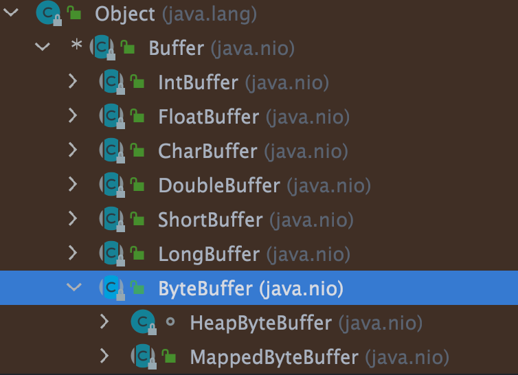

你可以将 Buffer 理解为一个数组，`IntBuffer`、`FloatBuffer`、`CharBuffer` 等分别对应 `int[]`、`float[]`、`char[]` 等。

```java
public abstract class Buffer {
    // Invariants: mark <= position <= limit <= capacity
    private int mark = -1;
    private int position = 0;
    private int limit;
    private int capacity;
}
```

这四个成员变量的具体含义如下：

1. 容量（`capacity`）：`Buffer`可以存储的最大数据量，`Buffer`创建时设置且不可改变；
2. 界限（`limit`）：`Buffer` 中可以读/写数据的边界。写模式下，`limit` 代表最多能写入的数据，一般等于 `capacity`（可以通过`limit(int newLimit)`方法设置）；读模式下，`limit` 等于 Buffer 中实际写入的数据大小。
3. 位置（`position`）：下一个可以被读写的数据的位置（索引）。**从写操作模式到读操作模式切换的时候（flip），**`position` \*\* 都会归零\*\*，这样就可以从头开始读写了。
4. 标记（`mark`）：`Buffer`允许将位置直接定位到该标记处，这是一个可选属性；

并且，上述变量满足如下的关系：**0 <= mark <= position <= limit <= capacity** 。

另外，Buffer 有读模式和写模式这两种模式，分别用于从 Buffer 中读取数据或者向 Buffer 中写入数据。**Buffer 被创建之后默认是写模式，调用 \*\* `flip()`  \*\* 可以切换到读模式**。如果要再次切换回写模式，可以调用 `clear()` 或者 `compact()` 方法。

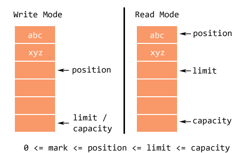

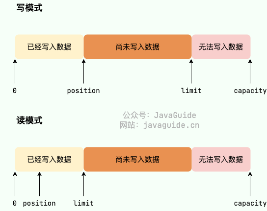

`Buffer` 对象不能通过 `new` 调用构造方法创建对象 ，只能通过静态方法实例化 `Buffer`。

```java
// 分配堆内存
public static ByteBuffer allocate(int capacity);
// 分配直接内存
public static ByteBuffer allocateDirect(int capacity);
```

Buffer 最核心的两个方法：

1. `get` : 读取缓冲区的数据
2. `put` ：向缓冲区写入数据

除上述两个方法之外，其他的重要方法：

* `flip` ：将缓冲区**从写模式切换到读模式**，它会将 `limit` 的值设置为当前 `position` 的值，将 `position` 的值设置为 0。
* `clear`: 清空缓冲区，将缓冲区**从读模式切换到写模式**，并将 `position` 的值设置为 0，将 `limit` 的值设置为 `capacity` 的值。

```java
import java.nio.*;

public class CharBufferDemo {
    public static void main(String[] args) {
        // 分配一个容量为8的CharBuffer
        CharBuffer buffer = CharBuffer.allocate(8);
        System.out.println("初始状态：");
        printState(buffer);

        // 向buffer写入3个字符
        buffer.put('a').put('b').put('c');
        System.out.println("写入3个字符后的状态：");
        printState(buffer);

        // 调用flip()方法，准备读取buffer中的数据，将 position 置 0,limit 的置 3
        buffer.flip();
        System.out.println("调用flip()方法后的状态：");
        printState(buffer);

        // 读取字符
        while (buffer.hasRemaining()) {
            System.out.print(buffer.get());
        }

        // 调用clear()方法，清空缓冲区，将 position 的值置为 0，将 limit 的值置为 capacity 的值
        buffer.clear();
        System.out.println("调用clear()方法后的状态：");
        printState(buffer);

    }

    // 打印buffer的capacity、limit、position、mark的位置
    private static void printState(CharBuffer buffer) {
        System.out.print("capacity: " + buffer.capacity());
        System.out.print(", limit: " + buffer.limit());
        System.out.print(", position: " + buffer.position());
        System.out.print(", mark 开始读取的字符: " + buffer.mark());
        System.out.println("\n");
    }
}
初始状态：
capacity: 8, limit: 8, position: 0

写入3个字符后的状态：
capacity: 8, limit: 8, position: 3

准备读取buffer中的数据！

调用flip()方法后的状态：
capacity: 8, limit: 3, position: 0

读取到的数据：abc

调用clear()方法后的状态：
capacity: 8, limit: 8, position: 0
```

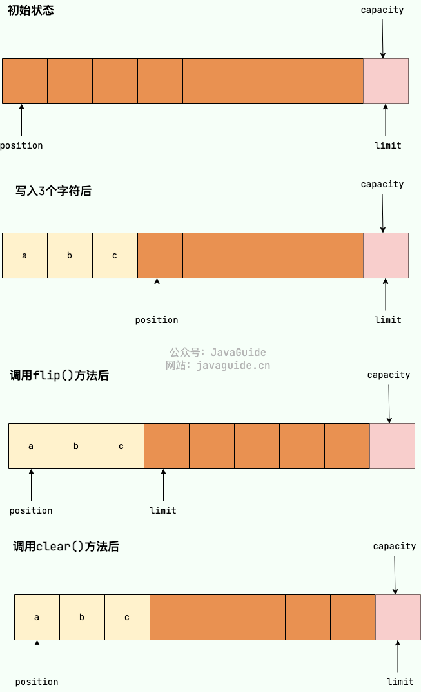

### Channel（通道）

Channel 是一个通道，它建立了与数据源（如文件、网络套接字等）之间的连接。我们可以利用它来读取和写入数据，就像打开了一条自来水管，让数据在 Channel 中自由流动。

BIO 中的流是单向的，分为各种 `InputStream`（输入流）和 `OutputStream`（输出流），数据只是在一个方向上传输。通道与流的不同之处在于通道是双向的，它可以用于读、写或者同时用于读写。

Channel 与前面介绍的 Buffer 打交道，读操作的时候将 Channel 中的数据填充到 Buffer 中，而写操作时将 Buffer 中的数据写入到 Channel 中。

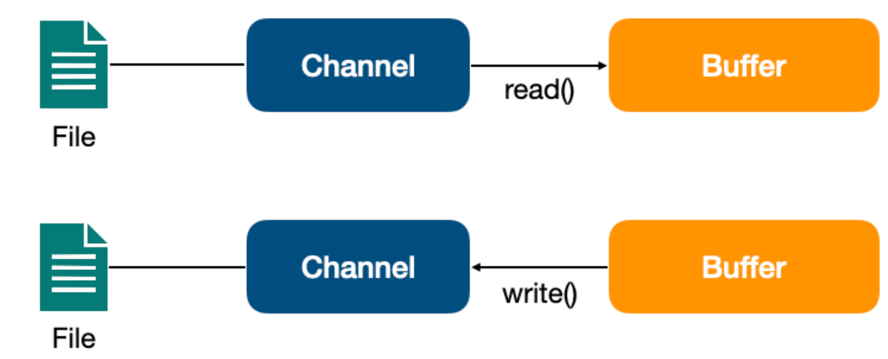

因为 **Channel 是全双工的**，所以它可以比流更好地映射底层操作系统的 API。特别是在 UNIX 网络编程模型中，底层操作系统的通道都是全双工的，同时支持读写操作。

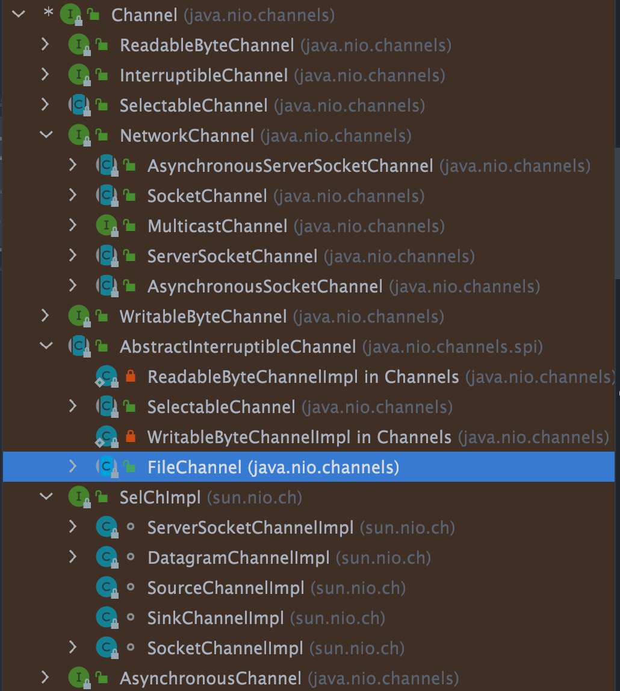

其中，最常用的是以下几种类型的通道：

* `FileChannel`：文件访问通道；
* `SocketChannel`、`ServerSocketChannel`：TCP 通信通道；
* `DatagramChannel`：UDP 通信通道；

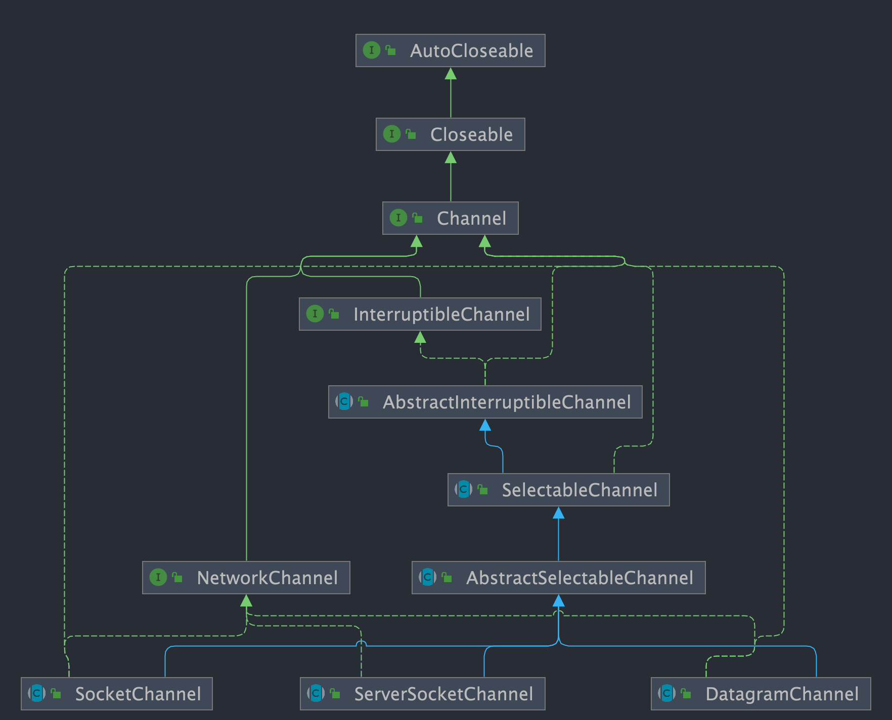

Channel 最核心的两个方法：

1. `read` ：读取数据并写入到 Buffer 中。
2. `write` ：将 Buffer 中的数据写入到 Channel 中。

```java
RandomAccessFile reader = new RandomAccessFile("/Users/guide/Documents/test_read.in", "r"))
FileChannel channel = reader.getChannel();
ByteBuffer buffer = ByteBuffer.allocate(1024);
channel.read(buffer);
```

### Selector（选择器）

Selector（选择器） 是 NIO 中的一个关键组件，它允许\*\*<font style="color:#DF2A3F;">一个线程处理多个 Channel</font>\*\*。Selector 是基于事件驱动的 I/O 多路复用模型，主要运作原理是：**通过 Selector 注册通道的事件，Selector 会不断地轮询注册在其上的 Channel**。当事件发生时，比如：某个 Channel 上面有新的 TCP 连接接入、读和写事件，这个 Channel 就处于就绪状态，会被 Selector 轮询出来。Selector 会将相关的 Channel 加入到就绪集合中。通过 SelectionKey 可以获取就绪 Channel 的集合，然后对这些就绪的 Channel 进行响应的 I/O 操作。

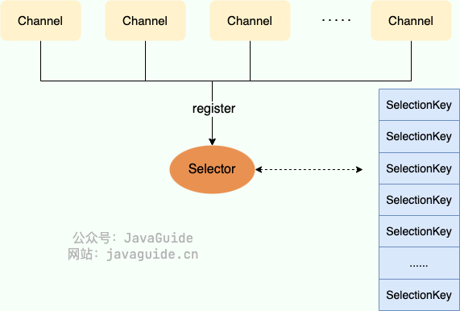

一个多路复用器 Selector 可以同时轮询多个 Channel，由于 JDK 使用了 `epoll()` 代替传统的 `select` 实现，所以它并没有最大连接句柄 `1024/2048` 的限制。这也就意味着只需要一个线程负责 Selector 的轮询，就可以接入成千上万的客户端。

Selector 可以监听以下四种事件类型：

1. `SelectionKey.OP_ACCEPT`：表示通道接受连接的事件，这通常用于 `ServerSocketChannel`。
2. `SelectionKey.OP_CONNECT`：表示通道完成连接的事件，这通常用于 `SocketChannel`。
3. `SelectionKey.OP_READ`：表示通道准备好进行读取的事件，即有数据可读。
4. `SelectionKey.OP_WRITE`：表示通道准备好进行写入的事件，即可以写入数据。

`Selector`是抽象类，可以通过**调用** `open()`  \*\* 静态方法来创建 Selector 实例\*\*。Selector 可以同时监控多个 `SelectableChannel` 的 `IO` 状况，是非阻塞 `IO` 的核心。

一个 Selector 实例有三个 `SelectionKey` 集合：

1. 所有的 `SelectionKey` 集合：代表了注册在该 Selector 上的 `Channel`，这个集合可以通过 `keys()` 方法返回。
2. 被选择的 `SelectionKey` 集合：代表了所有可通过 `select()` 方法获取的、需要进行 `IO` 处理的 Channel，这个集合可以通过 `selectedKeys()` 返回。
3. 被取消的 `SelectionKey` 集合：代表了所有被取消注册关系的 `Channel`，在下一次执行 `select()` 方法时，这些 `Channel` 对应的 `SelectionKey` 会被彻底删除，程序通常无须直接访问该集合，也没有暴露访问的方法。

简单演示一下如何遍历被选择的 `SelectionKey` 集合并进行处理：

```java
Set<SelectionKey> selectedKeys = selector.selectedKeys();
Iterator<SelectionKey> keyIterator = selectedKeys.iterator();
while (keyIterator.hasNext()) {
    SelectionKey key = keyIterator.next();
    if (key != null) {
        if (key.isAcceptable()) {
            // ServerSocketChannel 接收了一个新连接
        } else if (key.isConnectable()) {
            // 表示一个新连接建立
        } else if (key.isReadable()) {
            // Channel 有准备好的数据，可以读取
        } else if (key.isWritable()) {
            // Channel 有空闲的 Buffer，可以写入数据
        }
    }
    keyIterator.remove();
}
```

Selector 还提供了一系列和 `select()` 相关的方法：

* `int select()`：监控所有注册的 `Channel`，当它们中间有需要处理的 `IO` 操作时，该方法返回，并将对应的 `SelectionKey` 加入被选择的 `SelectionKey` 集合中，该方法返回这些 `Channel` 的数量。
* `int select(long timeout)`：可以设置超时时长的 `select()` 操作。
* `int selectNow()`：执行一个立即返回的 `select()` 操作，相对于无参数的 `select()` 方法而言，该方法不会阻塞线程。
* `Selector wakeup()`：使一个还未返回的 `select()` 方法立刻返回。

## NIO 零拷贝

零拷贝是提升 IO 操作性能的一个常用手段，像 ActiveMQ、Kafka 、RocketMQ、QMQ、Netty 等顶级开源项目都用到了零拷贝。

**<font style="color:#DF2A3F;">零拷贝是指计算机执行 IO 操作时，CPU 不需要将数据从一个存储区域复制到另一个存储区域, 全部由DMA完成，从而可以减少上下文切换以及 CPU 的拷贝时间</font>**。也就是说，零拷贝主主要解决操作系统在处理 I/O 操作时频繁复制数据的问题。零拷贝的常见实现技术有： `mmap+write`、`sendfile`和 `sendfile + DMA gather copy` 。

| CPU 拷贝 | DMA 拷贝 | 系统调用 | 上下文切换 |
| --- | --- | --- | --- |
| 传统方法 | 2 | 2 | read+write |
| mmap+write | 1 | 2 | mmap+write |
| sendfile | 1 | 2 | sendfile |
| sendfile + DMA gather copy | 0 | 2 | sendfile |

[9.1 什么是零拷贝？](https://xiaolincoding.com/os/8_network_system/zero_copy.html)

Java 对零拷贝的支持：

* `MappedByteBuffer` 是 NIO 基于内存映射（<code>**mmap**</code>）这种**零拷⻉⽅式**的提供的⼀种实现，底层实际是调用了 Linux 内核的 `mmap` 系统调用。它可以将一个文件或者文件的一部分映射到内存中，形成一个虚拟内存文件，这样就可以直接操作内存中的数据，而不需要通过系统调用来读写文件。
* <code>**FileChannel**</code>\*\* 的\*\*<code>**transferTo()/transferFrom()**</code> 是 NIO 基于发送文件（<code>**sendfile**</code>）这种零拷贝方式的提供的一种实现，底层实际是调用了 Linux 内核的 `sendfile`系统调用。它可以直接将文件数据从磁盘发送到网络，而不需要经过用户空间的缓冲区。关于`FileChannel`的用法可以看看这篇文章：[Java NIO 文件通道 FileChannel 用法](java_https:_www.cnblogs.com_robothy_p_14235598)。

```java
private void loadFileIntoMemory(File xmlFile) throws IOException {
  FileInputStream fis = new FileInputStream(xmlFile);
  // 创建 FileChannel 对象
  FileChannel fc = fis.getChannel();
  // FileChannle.map() 将文件映射到直接内存并返回 MappedByteBuffer 对象
  MappedByteBuffer mmb = fc.map(FileChannel.MapMode.READ_ONLY, 0, fc.size());
  xmlFileBuffer = new byte[(int)fc.size()];
  mmb.get(xmlFileBuffer);
  fis.close();
}
```

# Reactor - IO线程模型

[【码农Mark】Reactor 模型是如何处理网络 IO\_哔哩哔哩\_bilibili](https://www.bilibili.com/video/BV1Mp4y1w7eJ/?spm_id_from=333.337.search-card.all.click\&vd_source=434fcae166de8f97cb224fceaaf2e219)

<font style="color:rgb(25, 27, 31);">在网络 IO 处理层面几乎都采用了「I/O 多路复用方案」，这是服务端应对高并发的性能利器。</font>

**<font style="color:rgb(25, 27, 31);">「Reactor模式」，也叫反应器模式，本质是一个事件转发器，是网络模块核心中枢，负责将读写事件分发给对应的读写事件处理者。</font>**

**<font style="color:#DF2A3F;">reactor 模式的网络 IO 层会采用经典的 IO 多路复用方案，强强联手。</font>**

**<font style="color:#DF2A3F;"></font>**

<font style="color:rgb(25, 27, 31);">经典的一种切分方法是</font>**<font style="color:rgb(25, 27, 31);">将「连接」和「业务线程」分开处理（类似tcp三次握手accept）</font>**<font style="color:rgb(25, 27, 31);">，当「连接层」有事件触发时提交给「业务线程」，避免了业务线程因「网络数据处于准备中」导致的长时间等待问题，节省线程资源，这就是大名鼎鼎的</font><code>**<font style="color:rgb(25, 27, 31);background-color:rgb(248, 248, 250);">事件驱动模型</font>**</code><font style="color:rgb(25, 27, 31);">。</font>

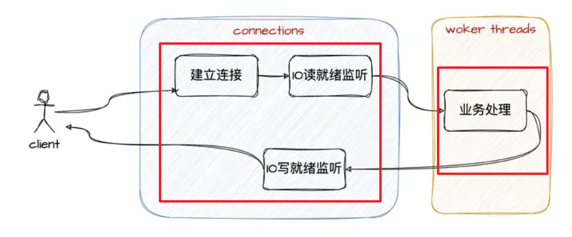

**<font style="color:rgb(5, 7, 59);background-color:rgb(253, 253, 254);">Reactor线程模型基于事件驱动和异步处理，其核心思想是使用一个或多个线程（称为Reactor线程）来监听和分发事件。这些事件通常与网络I/O操作相关，如连接建立、数据接收、连接关闭等。</font>**

**<font style="color:rgb(5, 7, 59);background-color:rgb(253, 253, 254);"></font>**

<font style="color:rgb(5, 7, 59);background-color:rgb(253, 253, 254);">Reactor线程模型通常包含以下几个核心组件：</font>

1. **<font style="color:rgb(5, 7, 59);background-color:rgb(253, 253, 254);">事件处理器（Handlers）</font>**<font style="color:rgb(5, 7, 59);background-color:rgb(253, 253, 254);">：负责处理特定类型的事件。在Reactor模型中，这些处理器通常被注册到Reactor线程上，以便在相应事件发生时被调用。</font>
2. **<font style="color:rgb(5, 7, 59);background-color:rgb(253, 253, 254);">多路复用器（Multiplexer）</font>**<font style="color:rgb(5, 7, 59);background-color:rgb(253, 253, 254);">：负责监听多个网络连接上的事件。当事件发生时，多路复用器会通知Reactor线程，并将事件传递给相应的事件处理器。常见的多路复用器实现包括select、poll、epoll（Linux特有）等。</font>
3. **<font style="color:rgb(5, 7, 59);background-color:rgb(253, 253, 254);">Reactor线程</font>**<font style="color:rgb(5, 7, 59);background-color:rgb(253, 253, 254);">：负责运行Reactor循环，监听来自多路复用器的事件，并将事件分发给相应的事件处理器。Reactor线程可以是一个或多个，具体数量取决于系统的并发需求和资源限制。</font>

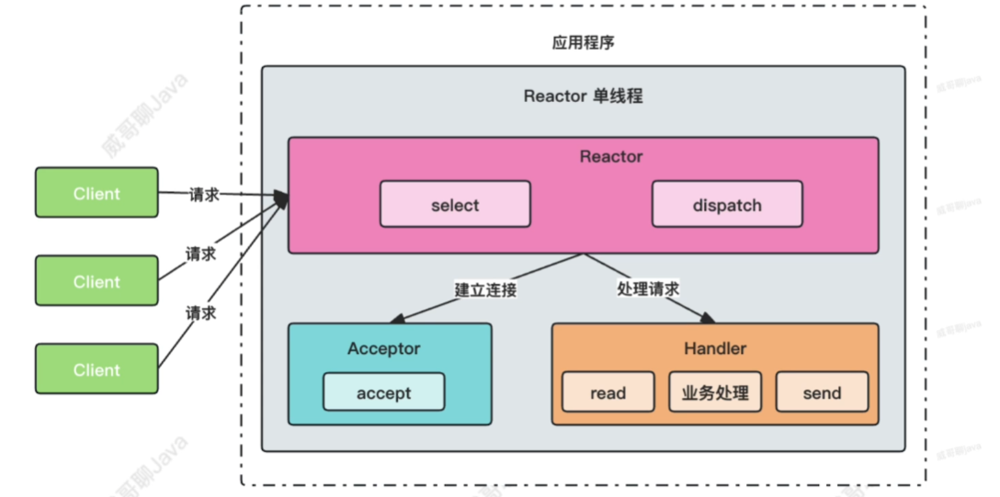

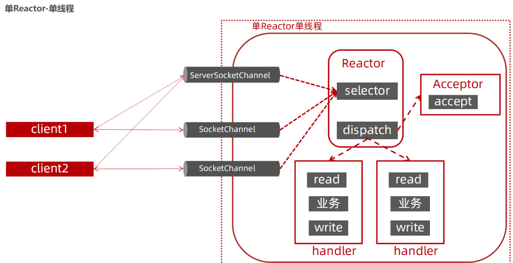

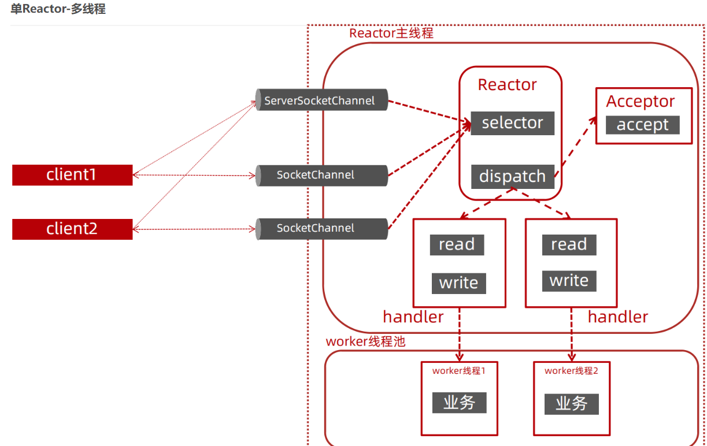

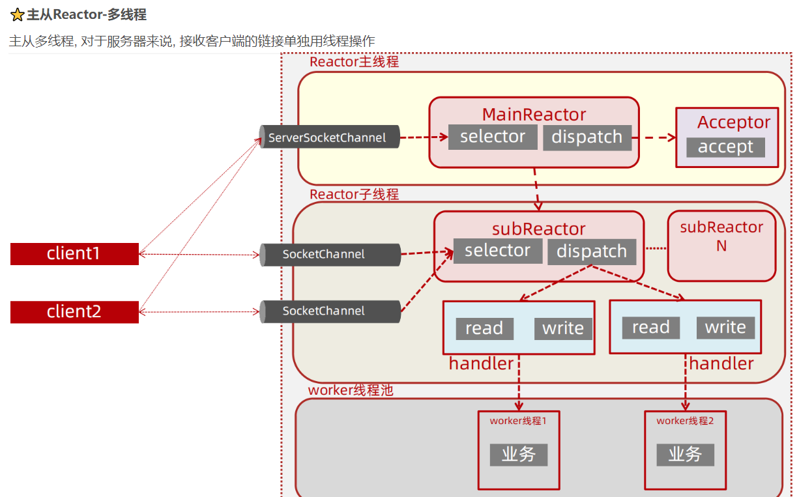


> 更新: 2024-10-08 22:03:48  
> 原文: <https://www.yuque.com/nibiwanxiamei/yrd6t1/e06f560db172014c9c33148cda9b7cad>