# JAVA基础 - 上

***

# Java概述

## 什么是编程？

编程就是让计算机为**解决某个问题而使用某种程序设计语言编写程序代码**，并终得到结果的过程。\
**使计算机能够根据人的指令一步一步去工作，完成某种特定的任务。这种人和计算机之间交流的过程就是编程。**

## 什么是java

java是一门面向对象编程语言，不仅吸收了C<u>语言的各种优点，还摒弃了C</u>里难以理解的多继承指针等概念，因此java语言具有**功能强大和简单易用**两个特征。java语言作为**静态面向对象编程语言**的代表，极好地实现了面向对象理论，允许程序员以优雅的思维方式进行复杂的编程。

> 一处实现，到处运行

## Java SE、JavaEE、JavaME

* Java SE（Java Platform，Standard Edition）: **Java 平台标准版**，Java 编程语言的基础，它包含了支持 Java 应用程序开发和运行的核心类库以及虚拟机等核心组件。Java SE 可以用于构建桌面应用程序或简单的服务器应用程序。
* Java EE（Java Platform, Enterprise Edition ）：**Java 平台企业版**，**建立在 Java SE 的基础上**，包含了支持企业级应用程序开发和部署的标准和规范（比如 Servlet、JSP、EJB、JDBC、JPA、JTA、JavaMail、JMS）。 Java EE 可以用于构建分布式、可移植、健壮、可伸缩和安全的服务端 Java 应用程序，例如 Web 应用程序
* Java ME（Java Platform，Micro Edition）。Java ME 是 Java 的微型版本，主要用于开发嵌入式消费电子设备的应用程序，例如手机、PDA、机顶盒、冰箱、空调等。

简单来说，**Java SE 是 Java 的基础版本，Java EE 是 Java 的高级版本**。Java SE 更适合开发桌面应用程序或简单的服务器应用程序，Java EE 更适合开发复杂的企业级应用程序或 Web 应用程序。JavaME嵌入式 -- 了解即可

## JVM，JDK，JRE

JDK（Java Development Kit），它是功能齐全的 Java SDK，是提供给开发者使用的，能够创建和编译 Java 程序。**他包含了 JRE**，同时还包含了编译 java 源码的编译器 javac 以及一些其他工具比如 javadoc（文档注释工具）、jdb（调试器）、jconsole（基于 JMX 的可视化监控⼯具）、javap（反编译工具）等等。

JRE（Java Runtime Environment） 是 Java 运行时环境。它是运行已编译 Java 程序所需的所有内容的集合，**主要包括 Java 虚拟机（JVM）、Java 基础类库（Class Library）** 。

也就是说，JRE 是 Java 运行时环境，仅包含 Java 应用程序的运行时环境和必要的类库。而 JDK 则包含了 JRE，同时还包括了 javac、javadoc、jdb、jconsole、javap 等工具，可以用于 Java 应用程序的开发和调试。

如果需要进行 Java 编程工作，比如编写和编译 Java 程序、使用 Java API 文档等，就需要安装 JDK。而对于某些需要使用 Java 特性的应用程序，如 JSP 转换为 Java Servlet、使用反射等，也需要 JDK 来编译和运行 Java 代码。因此，即使不打算进行 Java 应用程序的开发工作，也有可能需要安装 JDK。

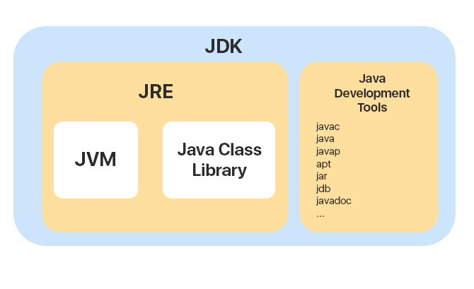

不过，从 JDK 9 开始，就**不需要区分 JDK 和 JRE 的关系**，取而代之的是模块系统（JDK 被重新组织成 94 个模块）+ [jlinkopen in new window](http://openjdk.java.net/jeps/282) 工具 (随 Java 9 一起发布的新命令行工具，用于生成自定义 Java 运行时映像，该映像仅包含给定应用程序所需的模块) 。并且，从 JDK 11 开始，Oracle 不再提供单独的 JRE 下载。

也就是说，可以用 jlink 根据自己的需求，创建一个更小的 runtime（运行时），而不是不管什么应用，都是同样的 JRE。

定制的、模块化的 Java 运行时映像有助于简化 Java 应用的部署和节省内存并增强安全性和可维护性。这对于满足现代应用程序架构的需求，如虚拟化、容器化、微服务和云原生开发，是非常重要的。

> JDK包括JRE，JRE包括JVM和Java Class Lib

## 什么是字节码?采用字节码的好处是什么?

Java源代码经过虚拟机编译器编译后产生的文件（即扩展名为 `.class` 的文件），它不面向任何特定的处理器，只面向JVM虚拟机。Java 语言通过字节码的方式，在一定程度上解决了传统解释型语言执行效率低的问题，同时又保留了解释型语言可移植的特点。所以， Java 程序运行时相对来说还是高效的（不过，和 C、 C++，Rust，Go 等语言还是有一定差距的），而且，由于字节码并不针对一种特定的机器，因此，Java 程序无须重新编译便可在多种不同操作系统的计算机上运行。

**Java 程序从源代码到运行的过程如下图所示**：

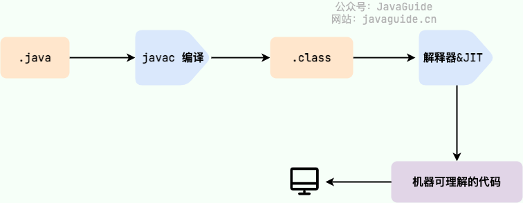

我们需要格外注意的是 `.class->机器码` 这一步。在这一步 JVM 类加载器首先加载字节码文件，然后通过解释器逐行解释执行，这种方式的执行速度会相对比较慢。而且，有些方法和代码块是经常需要被调用的(也就是所谓的**热点代码**)，所以后面引进了 **JIT（Just in Time Compilation）**  编译器，而 JIT 属于运行时编译。

当 JIT 编译器完成第一次编译后，其会将字节码对应的机器码保存下来，下次可以直接使用。机器码的运行效率高于 Java 解释器。这也解释了我们为什么经常会说 **Java 是编译与解释共存的语言** 。

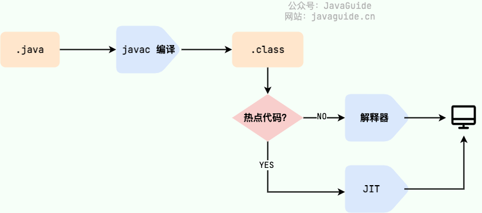

> HotSpot 采用了惰性评估(Lazy Evaluation)的做法，根据二八定律，消耗大部分系统资源的只有那一小部分的代码 **（热点代码），而这也就是 JIT 所需要编译的部分**。JVM 会根据代码每次被执行的情况收集信息并相应地做出一些优化，因此执行的次数越多，它的速度就越快。

JDK、JRE、JVM、JIT 这四者的关系如下图所示。

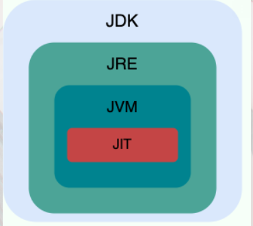

JVM 1.JVM和Java体系

## Java和C++的区别

虽然，Java 和 C++ 都是面向对象的语言，都支持封装、继承和多态，但是，它们还是有挺多不相同的地方：

* Java 不提供指针来直接访问内存，程序内存更加安全
* Java 的类是单继承的，C++ 支持多重继承；虽然 Java 的类不可以多继承，但是接口可以多继承。
* Java 有自动内存管理垃圾回收机制(GC)，不需要程序员手动释放无用内存。
* C ++同时支持方法重载和操作符重载，但是 Java 只支持方法重载（操作符重载增加了复杂性，这与 Java 最初的设计思想不符）

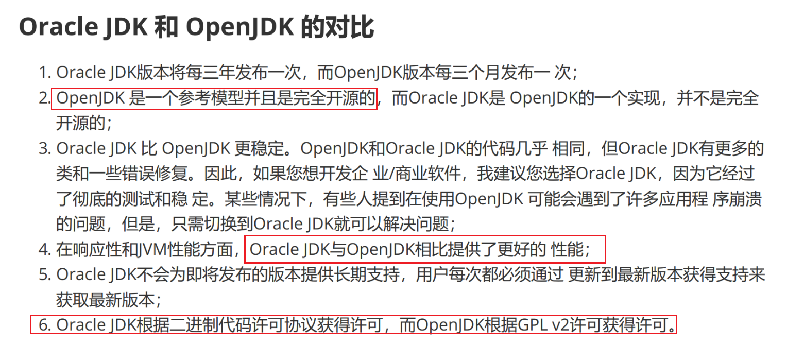

## AOT 有什么优点？为什么不全部使用 AOT 呢

JDK 9 引入了一种新的编译模式 **AOT(Ahead of Time Compilation)**  。和 JIT 不同的是，这种编译模式会**在程序被执行前就将其编译成机器码，属于静态编译**（C、 C++，Rust，Go 等语言就是静态编译）。**AOT 避免了 JIT 预热等各方面的开销，可以提高 Java 程序的启动速度，避免预热时间长**。并且，AOT 还能减少内存占用和增强 Java 程序的安全性（AOT 编译后的代码不容易被反编译和修改），特别适合云原生场景

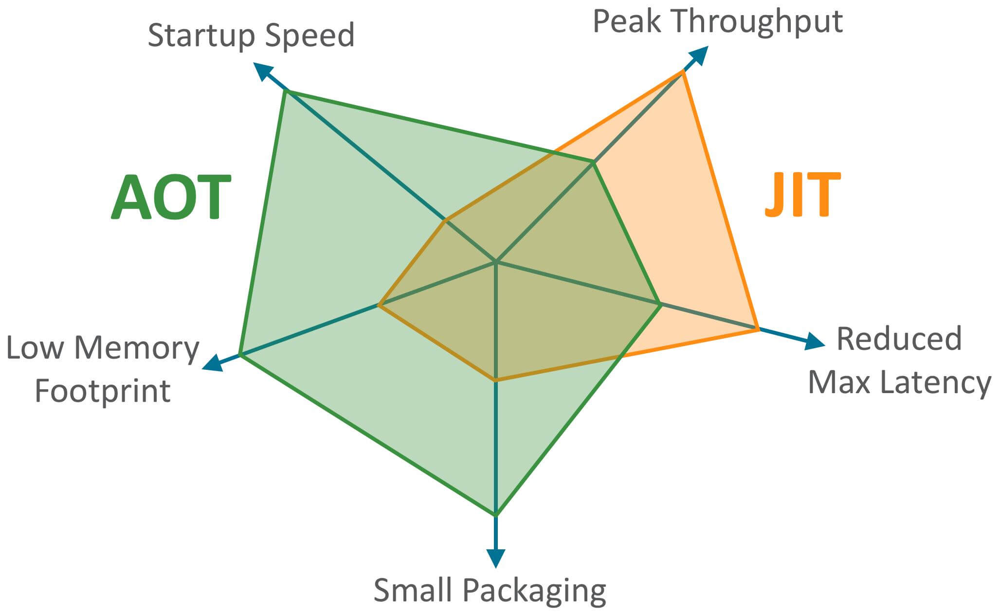

**AOT 的主要优势在于启动时间、内存占用和打包体积。JIT 的主要优势在于具备更高的极限处理能力，可以降低请求的最大延迟。**

# 基本语法

## 注释有哪几种形式？

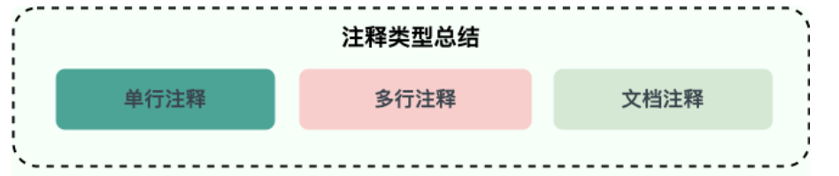

1. **单行注释**：通常用于解释方法内某单行代码的作用。
2. **多行注释**：通常用于解释一段代码的作用。
3. **文档注释**：通常用于生成 Java 开发文档。

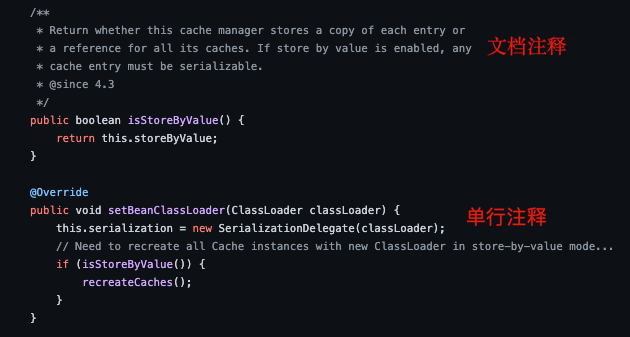

## 标识符和关键字的区别是什么？

**标识符就是一个名字。** 有一些标识符，Java 语言已经赋予了其特殊的含义，只能用于特定的地方，这些特殊的标识符就是 **关键字** 。简单来说，**关键字是被赋予特殊含义的标识符 。**

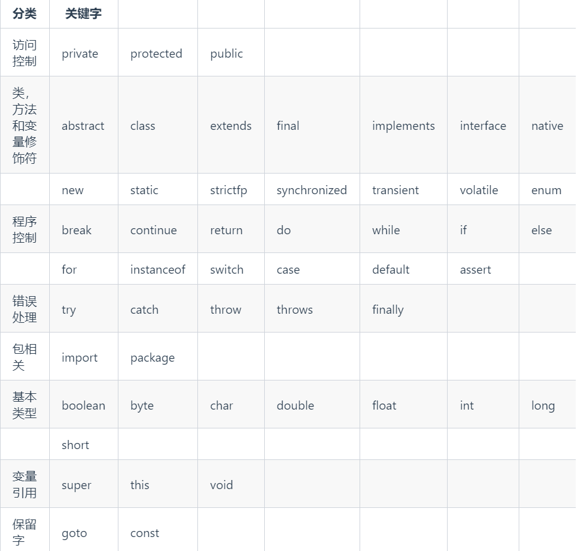

官方文档：[java\_https:\_docs.oracle.com\_javase\_tutorial\_java\_nutsandbolts\_\_keywords](https://docs.oracle.com/javase/tutorial/java/nutsandbolts/_keywords.html)

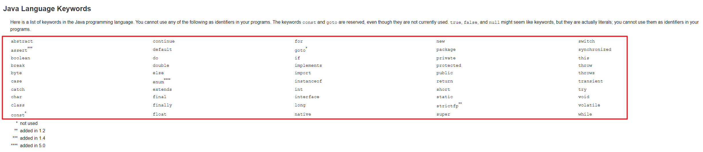

## 访问修饰符public,private,protected

* public：公共访问修饰符，不同类，任何包都可访问
* protected：保护访问修饰符，**同包、子类**
* default：默认访问修饰符，**同一个包**
* private：私有访问修饰符，**同一个类**

> **public > protected > 默认 > private**

## final，finally，finalize

* **final 用于声明** **属性(属性不可变)、方法(方法不可重写)、类(类不可继承)。**
* **finally 是 异常处理语句结构 的一部分，不管是否有异常，他的语句总是执行。**
* **finalize 是Object类的一个方法，调用System.gc() 方法的时候，由垃圾回收器调用finalize()，进行资源回收，例如关闭文件等。**

## 移位运算符

移位运算符是最基本的运算符之一，几乎每种编程语言都包含这一运算符。移位操作中，被操作的数据被**视为二进制数**，移位就是将其向左或向右移动若干位的运算。

移位运算符在各种框架以及 JDK 自身的源码中使用还是挺广泛的，`HashMap`（JDK1.8） 中的 `hash` 方法的源码就用到了移位运算符：

```java
static final int hash(Object key) {
    int h;
    // key.hashCode()：返回散列值也就是hashcode
    // ^：按位异或
    // >>>:无符号右移，忽略符号位，空位都以0补齐
    return (key == null) ? 0 : (h = key.hashCode()) ^ (h >>> 16);
  }
```

在 Java 代码里使用 `<<`、 `>>` 和`>>>`转换成的指令码运行起来会更高效些。

Java 中有三种移位运算符：

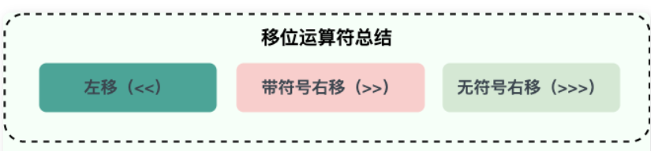

* `<<` :左移运算符，向左移若干位，高位丢弃，低位补零。`x << 1`,相当于 x 乘以 2(不溢出的情况下)。
* `>>` :带符号右移，向右移若干位，高位补符号位，低位丢弃。正数高位补 0,负数高位补 1。`x >> 1`,相当于 x 除以 2。
* `>>>` :无符号右移，忽略符号位，空位都以 0 补齐。

由于 `double`，`float` 在二进制中的表现比较特殊，因此不能来进行移位操作。

移位操作符实际上支持的类型只有`int`和`long`，编译器在对`short`、`byte`、`char`类型进行移位前，都会将其转换为`int`类型再操作。

**如果移位的位数超过数值所占有的位数会怎样？**

当 int 类型左移/右移位数大于等于 32 位操作时，会先求余（%）后再进行左移/右移操作。也就是说左移/右移 32 位相当于不进行移位操作（32%32=0），左移/右移 42 位相当于左移/右移 10 位（42%32=10）。当 long 类型进行左移/右移操作时，由于 long 对应的二进制是 64 位，因此求余操作的基数也变成了 64。

也就是说：`x<<42`等同于`x<<10`，`x>>42`等同于`x>>10`，`x >>>42`等同于`x >>> 10`。

**左移运算符代码示例**：

```java
int i = -1;
System.out.println("初始数据：" + i);
System.out.println("初始数据对应的二进制字符串：" + Integer.toBinaryString(i));
i <<= 10;
System.out.println("左移 10 位后的数据 " + i);
System.out.println("左移 10 位后的数据对应的二进制字符 " + Integer.toBinaryString(i));
```

输出：

```java
初始数据：-1
初始数据对应的二进制字符串：11111111111111111111111111111111
左移 10 位后的数据 -1024
左移 10 位后的数据对应的二进制字符 11111111111111111111110000000000
```

由于左移位数大于等于 32 位操作时，会先求余（%）后再进行左移操作，所以下面的代码左移 42 位相当于左移 10 位（42%32=10），输出结果和前面的代码一样。

```java
int i = -1;
System.out.println("初始数据：" + i);
System.out.println("初始数据对应的二进制字符串：" + Integer.toBinaryString(i));
i <<= 42;
System.out.println("左移 10 位后的数据 " + i);
System.out.println("左移 10 位后的数据对应的二进制字符 " + Integer.toBinaryString(i));
```

> 超出范围就取余，保证在范围内

## continue、break 和 return 的区别是什么？

1. `continue`：指跳出当前的这一次循环，继续下一次循环。
2. `break`：指跳出整个循环体，继续执行循环下面的语句。

`return` 用于跳出所在方法，结束该方法的运行。return 一般有两种用法：

1. `return;`：直接使用 return 结束方法执行，用于没有返回值函数的方法
2. `return value;`：return 一个特定值，用于有返回值函数的方法

## Java如何跳出多层循环

在Java中，要想跳出多重循环，可以在外面的循环语句前定义一个标号，然后在里层循环体的代码中使用带有标号的break语句，即可跳出外层循环。例如：

```java
    public static void main(String[] args) {
        tag:
        for (int i = 0; i < 100; i++) {
            for (int j = 0; j < 199; j++) {
                System.out.println(i + j);
                if (j == 10){
                    break tag;
                }
            }
        }
    }
```

# 基本数据类型

* 6 种数字类型：
  * 4 种整数型：`byte`、`short`、`int`、`long`
  * 2 种浮点型：`float`、`double`
* 1 种字符类型：`char`
* 1 种布尔型：`boolean`。

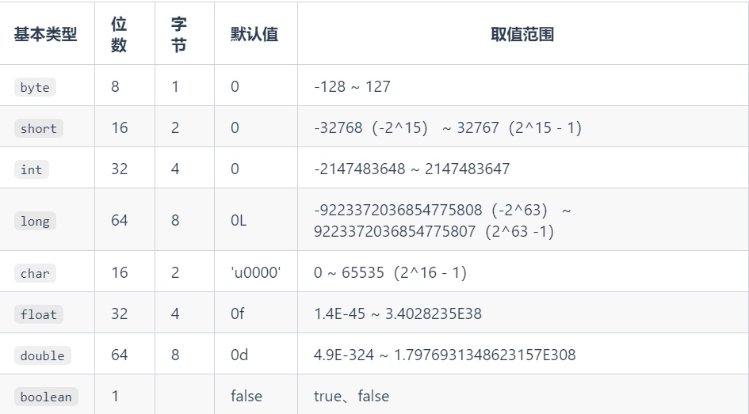

> Java 的每种基本类型所占存储空间的大小不会像其他大多数语言那样随机器硬件架构的变化而变化。**占存储空间大小的不变性**是 Java 程序比用其他大多数语言编写的程序更具可移植性的原因之一

## ♥基本类型和包装类型的区别？

> **答：首先基本数据类型是java中原始的数据类型，主要有8大类，基本数据类型一般存放再栈中。由于java是OOP语言，万事万物皆对象，为了让基本数据类型有面向对象的特征，java引入了包装类型，包装类型是对象，存储在堆中，可调用方法和属性。**

八种基本类型都有对应的包装类分别为：`Byte`、`Short`、`Integer`、`Long`、`Float`、`Double`、`Character`、`Boolean` 。

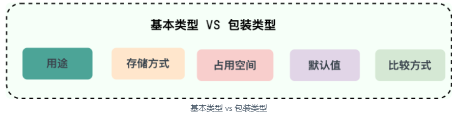

* **用途**：除了定义一些常量和局部变量之外，我们在其他地方比如**方法参数、对象属性**中很少会使用基本类型来定义变量。并且，**包装类型可用于泛型**，而基本类型不可以。
* **存储方式**：基本数据类型的局部变量存放在 Java 虚拟机栈中的局部变量表中，基本数据类型的\*\*成员变量（未被 **`static` \*\* 修饰  -- 存放在方法区中）存放在 Java 虚拟机的堆中**。**包装类型属于对象类型**，我们知道几乎所有对象实例都存在于堆中。
* **占用空间**：相比于包装类型（对象类型）， 基本数据类型占用的空间往往非常小。
* **默认值**：成员变量包装类型不赋值就是 `null` ，而基本类型有默认值且不是 `null`。
* **比较方式**：**对于基本数据类型来说，**`==` \*\* 比较的是值。对于包装数据类型来说，\*\* `==` \*\* 比较的是对象的内存地址。所有整型包装类对象之间值的比较，全部使用 \*\*`equals()`**方法。**

**为什么说是几乎所有对象实例都存在于堆中呢？**

[1.JVM和Java体系](https://www.yuque.com/nibiwanxiamei/yrd6t1/e86bac6431772a50e66a9dbb9f0c2e8d)

这是因为 HotSpot 虚拟机引入了 **JIT 优化之后，会对对象进行**\*\*<font style="color:#DF2A3F;">逃逸分析</font>\*\* **，如果发现某一个对象并没有逃逸到方法外部，那么就可能通过标量替换来实现栈上分配** **，而避免堆上分配内存**

## ♥包装类型的缓存机制了解么？

> 答：**Java 基本数据类型的包装类型的大部分都用到了缓存机制来提升性能。比如说**`Integer`包装类默认创建了数值  **\[-128，127]**  的相应类型的缓存数据。底层使用了一个静态内部类IntegerCache封装缓存信息。如果说我们以赋值的方式创建包装类，在缓存范围内就不会创建对象，直接使用缓存的对象，超过了缓存仍然需要创建对象。

`Byte`,`Short`,`Integer`,`Long` 这 4 种包装类默认创建了数值  **\[-128，127]**  的相应类型的缓存数据，`Character` 创建了数值在  **\[0,127]**  范围的缓存数据，`Boolean` 直接返回 `True` or `False`。

**Integer 缓存源码：**

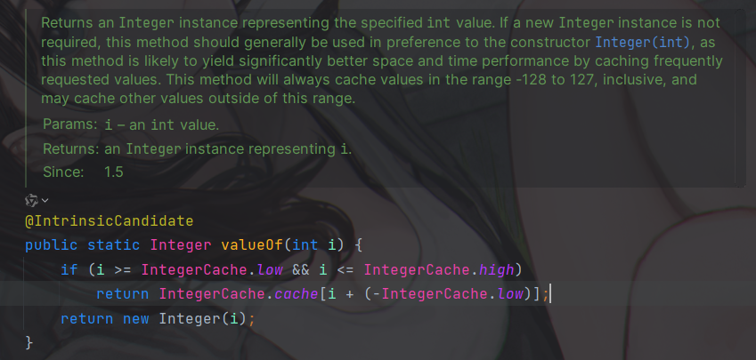

```java
public static Integer valueOf(int i) {
    if (i >= IntegerCache.low && i <= IntegerCache.high)
        return IntegerCache.cache[i + (-IntegerCache.low)];
    return new Integer(i);
}
private static class IntegerCache {
    static final int low = -128;
    static final int high;
    static {
        // high value may be configured by property
        int h = 127;
    }
}
```

**如果超出对应范围仍然会去创建新的对象，缓存的范围区间的大小只是在性能和资源之间的权衡。**

**<font style="color:#DF2A3F;">浮点数类型的包装类 </font>**<code><font style="color:#DF2A3F;">Float</font></code><font style="color:#DF2A3F;"> </font>**<font style="color:#DF2A3F;">,</font>**<code><font style="color:#DF2A3F;">Double</font></code><font style="color:#DF2A3F;"> </font>**<font style="color:#DF2A3F;"> 并没有实现缓存机制。</font>**

```java
Integer a = 26;
Integer b = 26;
System.out.println(a==b);  //true
Integer i1 = 40;
Integer i2 = new Integer(40);
System.out.println(i1==i2); // fals	e
```

`Integer i1=40` 这一行代码会发生装箱，也就是说这行代码等价于 `Integer i1=Integer.valueOf(40)` 。因此，`i1` 直接使用的是缓存中的对象。而`Integer i2 = new Integer(40)` 会直接创建新的对象。因此，答案是 `false` 。

## ♥自动装箱与拆箱了解吗？原理是什么？

> 答：自动装箱与拆箱说的是java中包装类型和基本数据类型的转换。自动装箱是说基本 -》包装，拆箱则相反。底层原理：装箱调用了valueOf，拆箱调用了xxxValue

* **装箱**：将基本类型用它们对应的引用类型包装起来；
* **拆箱**：将包装类型转换为基本数据类型

```java
Integer i = 101;  //装箱
int n = i;   //拆箱
```

装箱其实就是调用了 包装类的`valueOf()`方法，拆箱其实就是调用了 `xxxValue()`方法。

* `Integer i = 10` \*\* 等价于 \*\*`Integer i = Integer.valueOf(10)`  **;**
* `int n = i` \*\* 等价于 \*\*`int n = i.intValue()` **;**

## ♥为什么浮点数运算的时候会有精度丢失的风险？

> **浮点数在计算机中是以IEEE754标准存放的，java中的浮点数并不是一个精确值，而是一个近似值，无限循环的小数存储在计算机时，只能被截断，所以就会导致小数精度发生损失的情况。**

```java
float a = 2.0f - 1.9f;
float b = 1.8f - 1.7f;
System.out.println(a);// 0.100000024
System.out.println(b);// 0.099999905
System.out.println(a == b);// false
```

**计算机是二进制的，而且计算机在表示一个数字时，宽度是有限的，无限循环的小数存储在计算机时，只能被截断，所以就会导致小数精度发生损失的情况。**

## ♥如何解决浮点数运算的精度丢失问题？

<code>**BigDecimal**</code> 可以实现对浮点数的运算，不会造成精度丢失。通常情况下，大部分需要浮点数精确运算结果的业务场景（比如涉及到钱的场景）都是通过 `BigDecimal` 来做的。

```java
BigDecimal a = new BigDecimal("1.0");
BigDecimal b = new BigDecimal("0.9");
BigDecimal c = new BigDecimal("0.8");

BigDecimal x = a.subtract(b);
BigDecimal y = b.subtract(c);

System.out.println(x); /* 0.1 */
System.out.println(y); /* 0.1 */
System.out.println(Objects.equals(x, y)); /* true */
```

## ♥超过 long 整型的数据应该如何表示？

```java
long l = Long.MAX_VALUE;
System.out.println(l + 1); // -9223372036854775808
System.out.println(l + 1 == Long.MIN_VALUE); // true
```

`BigInteger` 内部使用 `int[]` 数组来存储任意大小的整形数据。

相对于常规整数类型的运算来说，`BigInteger` 运算的效率会相对较低 。

## ♥short s1 = 1; s1 = s1 + 1;有错吗?short s1 = 1; s1 += 1;有错吗

> **对于前面的，1是int类型变量，如果用s1 + 1 运算结果是int类型，要强制类型转换才能赋值给short类型的s1**
>
> **对于后者，s1 += 1等价于 s1 = short（s1 + 1），已经强制类型转换**

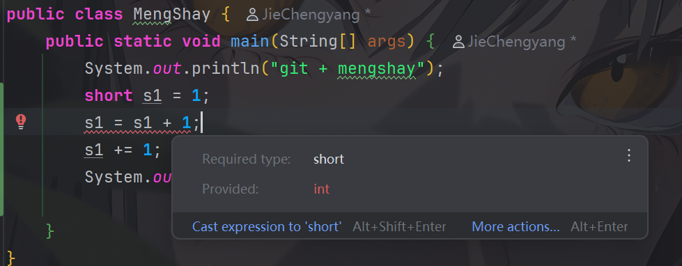

# 变量

## 成员变量与局部变量的区别？


* **语法形式**：**成员变量是属于类的，而局部变量是在代码块或方法中定义的变量或是方法的参数**；\*\*成员变量可以被 \*\*`public` **,**`private` **,**`static` \*\* 等修饰符所修饰，而局部变量不能被访问控制修饰符及 \*\*`static` \*\* 所修饰；但是，成员变量和局部变量都能被 **`final` \*\* 所修饰。**
* **存储方式**：如果\*\*成员变量是使用 \*\*`static` \*\* 修饰的，那么这个成员变量是属于类的 \*\* ，\*\*如果没有使用 **`static` \*\* 修饰，这个成员变量是属于实例的。而对象存在于堆内存，局部变量则存在于栈内存** **。**
* **生存时间**：成员变量是对象的一部分，它随着对象的创建而存在，而局部变量随着方法的调用而自动生成，随着方法的调用结束而消亡。
* **默认值**：**成员变量如果没有被赋初始值，则会自动以类型的默认值而赋值**（一种情况例外:被 `final` 修饰的成员变量也必须显式地赋值），而局部变量则不会自动赋值。

**为什么成员变量有默认值？**

1. 先不考虑变量类型，如果没有默认值会怎样？变量存储的是内存地址对应的任意随机值，程序读取该值运行会出现意外。
2. 默认值有两种设置方式：手动和自动，根据第一点，没有手动赋值一定要自动赋值。成员变量在运行时可借助反射等方法手动赋值，而局部变量不行。
3. 对于编译器（javac）来说，**局部变量没赋值很好判断，可以直接报错。而成员变量可能是运行时赋值，无法判断，误报“没默认值”又会影响用户体验，所以采用自动赋默认值。**

> **final类型的在编译阶段就初始化了，static类型的成员变量在链接阶段初始化，普通成员变量在初始化阶段初始化**

```java
public class VariableExample {

    // 成员变量
    private String name;
    private int age;

    // 方法中的局部变量
    public void method() {
        int num1 = 10; // 栈中分配的局部变量
        String str = "Hello, world!"; // 栈中分配的局部变量
        System.out.println(num1);
        System.out.println(str);
    }

    // 带参数的方法中的局部变量
    public void method2(int num2) {
        int sum = num2 + 10; // 栈中分配的局部变量
        System.out.println(sum);
    }

    // 构造方法中的局部变量
    public VariableExample(String name, int age) {
        this.name = name; // 对成员变量进行赋值
        this.age = age; // 对成员变量进行赋值
        int num3 = 20; // 栈中分配的局部变量
        String str2 = "Hello, " + this.name + "!"; // 栈中分配的局部变量
        System.out.println(num3);
        System.out.println(str2);
    }
}
```

## ♥静态变量有什么作用？

> 静态变量也就是被 `static` 关键字修饰的变量。它可以**被类的所有实例共享**，无论一个类创建了多少个对象，它们都共享同一份静态变量。静态变量只会被分配一次内存，这样可以**节省内存**。

静态变量是通过类名来访问的。例如`StaticVariableExample.staticVar`（如果被 `private`关键字修饰就无法这样访问了）。

```java
public class StaticVariableExample {
    // 静态变量
    public static int staticVar = 0;
}
```

通常情况下，静态变量会被 `final` 关键字修饰成为常量。

```java
public class ConstantVariableExample {
    // 常量
    public static final int constantVar = 0;
}
```

## 字符型常量和字符串常量的区别?

* **形式** : 字符常量是**单引号**引起的一个字符，字符串常量是**双引号**引起的 0 个或若干个字符。
* **含义** : 字符常量相当于一个整型值( ASCII 值),可以参加表达式运算; 字符串常量代表一个地址值(该字符串在内存中存放位置)。
* **占内存大小**：字符常量只占 2 个字节; 字符串常量占若干个字节

```java
public class StringExample {
    // 字符型常量
    public static final char LETTER_A = 'A';

    // 字符串常量
    public static final String GREETING_MESSAGE = "Hello, world!";
    public static void main(String[] args) {
        System.out.println("字符型常量占用的字节数为："+Character.BYTES);
        System.out.println("字符串常量占用的字节数为："+GREETING_MESSAGE.getBytes().length);
    }
}
字符型常量占用的字节数为：2
字符串常量占用的字节数为：13
```

# 方法

## 静态方法为什么不能调用非静态成员?

* **静态方法是属于类的，在类加载的时候就会分配内存，可以通过类名直接访问**。而非静态成员属于实例对象，只有在对象实例化之后才存在，需要通过类的实例对象去访问。
* **在类的非静态成员不存在的时候静态方法就已经存在了，此时调用在内存中还不存在的非静态成员，属于非法操作。**

```java
public class Example {
    // 定义一个字符型常量
    public static final char LETTER_A = 'A';

    // 定义一个字符串常量
    public static final String GREETING_MESSAGE = "Hello, world!";

    public static void main(String[] args) {
        // 输出字符型常量的值
        System.out.println("字符型常量的值为：" + LETTER_A);

        // 输出字符串常量的值
        System.out.println("字符串常量的值为：" + GREETING_MESSAGE);
    }
}
```

## 静态方法和实例方法有何不同？

在外部调用静态方法时，可以使用 `类名.方法名` 的方式，也可以使用 `对象.方法名` 的方式，而实例方法只有后面这种方式。也就是说，**调用静态方法可以无需创建对象** 。

**静态方法在访问本类的成员时，只允许访问静态成员**（即静态成员变量和静态方法），不允许访问实例成员（即实例成员变量和实例方法），而实例方法不存在这个限制

## 重载和重写有什么区别？

**重载：发生在同一个类中（或者父类和子类之间），方法名必须相同，参数类型不同、个数不同、顺序不同，方法返回值和访问修饰符可以不同。**

**重写发生在运行期，是子类对父类的允许访问的方法的实现过程进行重新编写。**

* 方法名、参数列表必须相同，子类方法返回值类型应比父类方法返回值类型更小或相等，抛出的异常范围小于等于父类，访问修饰符范围大于等于父类。
* 如果父类方法访问修饰符为 `private/final/static` 则子类就不能重写该方法，但是被 `static` 修饰的方法能够被再次声明。
* 构造方法无法被重写

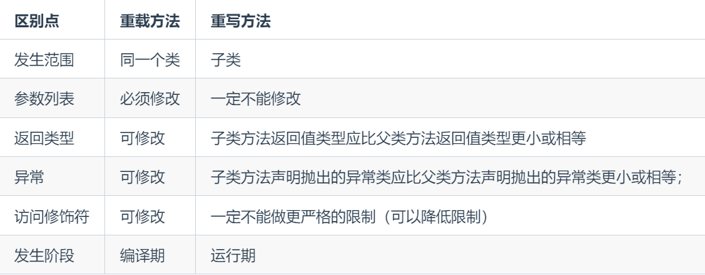

关于 **重写的返回值类型** 这里需要额外多说明一下，上面的表述不太清晰准确：如果**方法的返回类型是 void 和基本数据类型，则返回值重写时不可修改。但是如果方法的\*\*\*\*返回值是引用类型** **，重写时是可以\*\*\*\*返回该引用类型的子类的** **。**

```java
public class Hero {
    public String name() {
        return "超级英雄";
    }
}
public class SuperMan extends Hero{
    @Override
    public String name() {
        return "超人";
    }
    public Hero hero() {
        return new Hero();
    }
}

public class SuperSuperMan extends SuperMan {
    public String name() {
        return "超级超级英雄";
    }

    @Override
    public SuperMan hero() {
        return new SuperMan();
    }
}
```

## 什么是可变长参数？

从 Java5 开始，Java 支持定义可变长参数，所谓可变长参数就是允许在调用方法时传入不定长度的参数。就比如下面的这个 `printVariable` 方法就可以接受 0 个或者多个参数。

```java
public static void method1(String... args) {
   //......
}
```

**可变参数只能作为函数的最后一个参数，但其前面可以有也可以没有任何其他参数。**

**遇到方法重载的情况怎么办呢？会优先匹配固定参数还是可变参数的方法呢？**

答案是会**优先匹配固定参数的方法，因为固定参数的方法匹配度更高。**

**Java 的可变参数编译后实际会被转换成一个数组**

# 面向对象基础java面向对象编程(进阶)

## 面向对象和面向过程的区别

两者的主要区别在于解决问题的方式不同：

* **面向过程把解决问题的过程拆成一个个方法，通过一个个方法的执行解决问题**。
* **面向对象会先抽象出对象，然后用对象执行方法的方式解决问题。**

## 对象的相等和引用相等的区别

* **对象的相等一般比较的是内存中存放的内容是否相等。**
* **引用相等一般比较的是他们指向的内存地址是否相等。**

```java
String str1 = "hello";
String str2 = new String("hello");
String str3 = "hello";
// 使用 == 比较字符串的引用相等
System.out.println(str1 == str2); //false
System.out.println(str1 == str3); //true
// 使用 equals 方法比较字符串的相等
System.out.println(str1.equals(str2)); //true
System.out.println(str1.equals(str3)); //true
```

## 构造方法有哪些特点？是否可被 override?

构造方法特点如下：

* **名字与类名相同。**
* **没有返回值，但不能用 void 声明构造函数。**
* **生成类的对象时自动执行，无需调用。**

**构造方法不能被 override（重写）,但是可以 overload（重载）** ,所以你可以看到一个类中有多个构造函数的情况。

## ♥面向对象三大特征 - **封装，继承，多态**

### 封装

**封装是指把一个对象的状态信息（也就是属性）隐藏在对象内部，不允许外部对象直接访问对象的内部信息。但是可以提供一些可以被外界访问的方法来操作属性。**

> **就是属性私有化，然后提供get和set方法**

### 继承

**继承是使用已存在的类的定义作为基础建立新类的技术，新类的定义可以增加新的数据或新的功能，也可以用父类的功能，但不能选择性地继承父类。通过使用继承，可以\*\*\*\*快速地创建新的类，可以提高代码的重用，程序的可维护性，节省大量创建新类的时间 ，提高我们的开发效率。**

**关于继承如下 3 点请记住：**

1. **子类拥有父类对象所有的属性和方法（包括私有属性和私有方法），但是父类中的私有属性和方法子类是无法访问，只是拥有**。
2. **子类可以拥有自己属性和方法，即子类可以对父类进行扩展。**
3. **子类可以用自己的方式实现父类的方法。** （重写）

### 多态

**<font style="color:rgb(77, 77, 77);">多态性分为编译时的多态性和运行时的多态性</font>**<font style="color:rgb(77, 77, 77);">。</font>**<font style="color:#DF2A3F;">方法重载（overload）实现的是编译时的多态性（也称为前绑定），而方法重写（override）实现的是运行时的多态性（也称为后绑定）。</font>**

**<font style="color:#DF2A3F;"></font>**

<font style="color:rgb(77, 77, 77);">编译时多态主要通过函数重载和泛型实现，不需要有派生关系。编译器在编译期间通过传入的参数列表的不同来确定具体调用哪个方法。也就是方法的重载</font>

#### <font style="color:rgb(79, 79, 79);">① 通过函数重载实现多态</font>

<font style="color:rgb(77, 77, 77);">编译器在编译期间通过传入的参数列表的不同来确定具体调用哪个方法</font>

##### <font style="color:rgb(79, 79, 79);">重载的条件（“两同一不同”）</font>

* <font style="color:rgba(0, 0, 0, 0.75);">同一个类中</font>
* <font style="color:rgba(0, 0, 0, 0.75);">方法名相同</font>
* <font style="color:rgba(0, 0, 0, 0.75);">参数列表不同</font>
* <font style="color:rgba(0, 0, 0, 0.75);">方法的返回值类型、修饰符等与方法的重载无关</font>

#### <font style="color:rgb(79, 79, 79);">② 通过泛型实现多态</font>

<font style="color:rgb(77, 77, 77);">与重载的原理类似，编译器在编译期间确定泛型的具体类型。</font>

<font style="color:rgb(77, 77, 77);"></font>

运行时多态：也就是我们常说的多态。**<font style="color:#DF2A3F;">表示一个对象具有多种的状态，具体表现为父类的引用指向子类的实例</font>**<font style="color:#DF2A3F;"> </font>

#### <font style="color:rgb(79, 79, 79);">运行时多态出现的三个必要条件</font>

* <font style="color:rgba(0, 0, 0, 0.75);">继承</font>
* <font style="color:rgba(0, 0, 0, 0.75);">重写</font>
* <font style="color:rgba(0, 0, 0, 0.75);">父类引用指向子类对象（即向上转型，由系统自动完成）</font>

#### <font style="color:rgb(79, 79, 79);">重写的条件（两同两小一大）</font>

* <font style="color:rgba(0, 0, 0, 0.75);">方法名相同</font>
* <font style="color:rgba(0, 0, 0, 0.75);">形参列表相同</font>
* <font style="color:rgba(0, 0, 0, 0.75);">子类方法返回值类型应比父类方法返回值类型更小或相等</font>
* <font style="color:rgba(0, 0, 0, 0.75);">子类方法声明抛出的异常类应比父类方法声明抛出的异常类更小或相等</font>
* <font style="color:rgba(0, 0, 0, 0.75);">子类方法的访问权限应比父类方法的访问权限更大或相等</font>

***

**多态的特点:**

* **对象类型和引用类型之间具有\*\*\*\*继承（类）/实现（接口）** **的关系；**
* **引用类型变量发出的方法调用的到底是哪个类中的方法，必须在\*\*\*\*程序运行期间才能确定** **；**
* **多态不能调用“只在子类存在但在父类不存在”的方法；（用的是父类的引用）**
* **如果子类重写了父类的方法，真正执行的是子类覆盖的方法，如果子类没有覆盖父类的方法，执行的是父类的方法**

## 接口和抽象类有什么共同点和区别？

**共同点**：

* **都不能被实例化，只能被子类实现或继承。**
* **都可以包含抽象方法，需要由子类提供具体的实现。**
* \*\*都可以有默认实现的方法（Java 8 可以用 **`default` \*\* 关键字在接口中定义默认方法）**

**区别**：

* **接口主要用于对类的行为进行\*\*\*\*约束** **，你实现了某个接口就具有了对应的行为。抽象类主要用于\*\*\*\*代码复用，强调的是所属关系** **。**
* **一个类只能继承一个类，但是可以实现多个接口。**
* \*\*接口中的成员变量只能是 **`public static final` \*\* 类型的，不能被修改且必须有初始值，而抽象类的成员变量默认 default，可在子类中被重新定义，也可被重新赋值。抽象类不能被final修饰 -- 他要被继承**
* **接口中只有抽象方法，抽象类既可以有抽象方法，也可以有非抽象方法**

> **<font style="color:#DF2A3F;">抽象类是对类的抽象，是一种模板设计，接口是行为的抽象，是一种行为的规范。</font>**

## 非静态内部类<font style="color:rgb(44, 62, 80);">可以直接访问外部方法，编译器是怎么做到的</font>

<font style="color:rgb(44, 62, 80);">非静态内部类可以直接访问外部方法是因为编译器在生成字节码时会为非静态内部类维护一个指向外部类实例的引用。</font>

<font style="color:rgb(44, 62, 80);">这个引用使得非静态内部类能够访问外部类的实例变量和方法。编译器会在生成非静态内部类的构造方法时，将外部类实例作为参数传入，并在内部类的实例化过程中建立外部类实例与内部类实例之间的联系，从而实现直接访问外部方法的功能。</font>

## ♥深拷贝和浅拷贝区别了解吗？什么是引用拷贝？

* **浅拷贝**：\*\*浅拷贝会在堆上创建一个新的对象（区别于引用拷贝的一点），不过，如果原对象内部的属性是引用类型的话，\*\***浅拷贝会直接复制内部对象的引用地址，也就是说拷贝对象和原对象共用同一个内部对象。**
* **深拷贝**：**深拷贝会完全复制整个对象，包括这个对象所包含的内部对象。**
* **引用拷贝就是两个不同的引用指向同一个对象。**

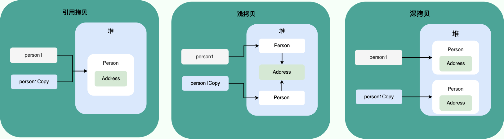

深拷贝实现方案

* <font style="color:rgb(44, 62, 80);background-color:rgb(227, 242, 253);">实现 Cloneable 接口并重写 clone() 方法</font>
* <font style="color:rgb(44, 62, 80);background-color:rgb(227, 242, 253);">使用序列化和反序列化</font>
* <font style="color:rgb(44, 62, 80);background-color:rgb(227, 242, 253);">手动递归复制</font>

# ♥♥♥ Object

## Object 类的常见方法有哪些？

**Object 类是一个特殊的类，是所有类的父类。**

```java
/**
 * native 方法，用于返回当前运行时对象的 Class 对象，使用了 final 关键字修饰，故不允许子类重写。
 */
public final native Class<?> getClass()
/**
 * native 方法，用于返回对象的哈希码，主要使用在哈希表中，比如 JDK 中的HashMap。
 */
public native int hashCode()
/**
 * 用于比较 2 个对象的内存地址是否相等，String 类对该方法进行了重写以用于比较字符串的值是否相等。
 */
public boolean equals(Object obj)
/**
 * native 方法，用于创建并返回当前对象的一份拷贝。
 */
protected native Object clone() throws CloneNotSupportedException
/**
 * 返回类的名字实例的哈希码的 16 进制的字符串。建议 Object 所有的子类都重写这个方法。
 */
public String toString()
/**
 * native 方法，并且不能重写。唤醒一个在此对象监视器上等待的线程(监视器相当于就是锁的概念)。如果有多个线程在等待只会任意唤醒一个。
 */
public final native void notify()
/**
 * native 方法，并且不能重写。跟 notify 一样，唯一的区别就是会唤醒在此对象监视器上等待的所有线程，而不是一个线程。
 */
public final native void notifyAll()
/**
 * native方法，并且不能重写。暂停线程的执行。注意：sleep 方法没有释放锁，而 wait 方法释放了锁 ，timeout 是等待时间。
 */
public final native void wait(long timeout) throws InterruptedException
/**
 * 多了 nanos 参数，这个参数表示额外时间（以纳秒为单位，范围是 0-999999）。 所以超时的时间还需要加上 nanos 纳秒。。
 */
public final void wait(long timeout, int nanos) throws InterruptedException
/**
 * 跟之前的2个wait方法一样，只不过该方法一直等待，没有超时时间这个概念
 */
public final void wait() throws InterruptedException
/**
 * 实例被垃圾回收器回收的时候触发的操作
 */
protected void finalize() throws Throwable { }
```

## == 和 equals() 的区别

> 答：
>
> * **对于基本数据类型来说，**  `==`  **比较的是值。**
> * **对于引用数据类型来说，**  `==`  **比较的是对象的内存地址。**
> * <code>**equals()**</code> **只能用来判断两个对象是否相等**，**若equals()方法没有被重写，则等价 ==，重写了一般比较值相等**

> 因为 \*\* Java 只有值传递\*\*，所以，对于 == 来说，不管是比较基本数据类型，还是引用数据类型的变量，其**本质比较的都是值**，**只是引用类型变量存的值是对象的地址。**

<code>**equals()**</code>  **不能用于判断基本数据类型的变量，只能用来判断两个对象是否相等。** `equals()`**方法存在于**`Object`**类中，而**`Object`**类是所有类的直接或间接父类，因此所有的类都有**`equals()`**方法。**

`Object` 类 `equals()` 方法：

```java
public boolean equals(Object obj) {
     return (this == obj);
}
```

`equals()` 方法存在两种使用情况：

* \*\*类没有重写 \*\*<code>**equals()**</code> **方法**：通过`equals()`比较该类的两个对象时，等价于通过 **“==”** 比较这两个对象，使用的默认是 `Object`类`equals()`方法。
* \*\*类重写了 \*\*<code>**equals()**</code> **方法**：\*\*一般我们都重写 \*\*`equals()`**方法来比较两个对象中的属性是否相等** **；若它们的属性相等，则返回 true(即，认为这两个对象相等)。**

案例

```java
String a = new String("ab"); // a 为一个引用
String b = new String("ab"); // b为另一个引用,对象的内容一样
String aa = "ab"; // 放在常量池中
String bb = "ab"; // 从常量池中查找
System.out.println(aa == bb);// true
System.out.println(a == b);// false
System.out.println(a.equals(b));// true
System.out.println(42 == 42.0);// true
```

`String` \*\* 中的 **`equals` \*\* 方法是被重写过的**，因为 `Object` 的 `equals` 方法是比较的对象的内存地址，而 `String` 的 `equals` 方法比较的是对象的值。

## hashCode() 有什么用？

`hashCode()` 的作用是获取哈希码（`int` 整数），也称为散列码。这个**哈希码的作用是确定该对象在哈希表中的索引位置。**


`hashCode()` 定义在 JDK 的 `Object` 类中，这就意味着 Java 中的任何类都包含有 `hashCode()` 函数。`Object` \*\* 的 \*\* `hashCode()`  \*\* 方法是本地native方法。\*\*

## 为什么要有 hashCode？

`hashCode()` 和 `equals()`都是用于比较两个对象是否相等。

在一些容器（比如 `HashMap`、`HashSet`）中，\*\*有了 **`hashCode()` \*\* 之后，判断元素是否在对应容器中的效率会更高（参考添加元素进**`HashSet`**的过程）！**

> 当你把对象加入 `HashSet` 时，`HashSet` 会\*\*先计算对象的 **`hashCode` \*\* 值来判断对象加入的位置，同时也会与其他已经加入的对象的 **`hashCode` \*\* 值作比较，如果没有相符的 **`hashCode` **，**`HashSet` \*\* 会假设对象没有重复出现。** 但是如果发现有相同 `hashCode` 值的对象，这时会调用 `equals()` 方法来检查 `hashCode` 相等的对象是否真的相同。如果两者相同，`HashSet` 就不会让其加入操作成功。如果不同的话，就会重新散列到其他位置。这样我们就大大**减少了 \*\* `equals` \*\* 的次数，相应就大大提高了执行速度。**

**两个对象的**`hashCode` **值相等并不代表两个对象就相等。**

总结：

* 如果两个对象的`hashCode` 值相等，那这两个对象不一定相等（哈希碰撞）。
* 如果**两个对象的**`hashCode`  **值相等并且**`equals()` **方法也返回**  `true`，我们才认为这两个对象相等。
* 如果两个对象的`hashCode` 值不相等，我们就可以直接认为这两个对象不相等。

## 为什么重写  equals() 时必须重写 hashCode() 方法？

**两个相等的对象的 \*\* `hashCode` \*\* 值必须是相等** \*\*。也就是说如果 \*\*`equals` \*\* 方法判断两个对象是相等的，那这两个对象的 **`hashCode` \*\* 值也要相等。**

**如果重写 \*\* `equals()`  \*\* 时没有重写 \*\* `hashCode()`  \*\* 方法的话就可能会导致 \*\* `equals` \*\* 方法判断是相等的两个对象，** `hashCode` \*\* 值却不相等。\*\*

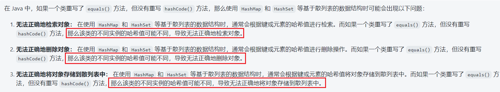

# String

## ♥String、StringBuffer、StringBuilder 的区别？

**可变性**

* `String` \*\* 是不可变的\*\*
* `StringBuilder` 与 `StringBuffer` 都继承自 `AbstractStringBuilder` 类，在 `AbstractStringBuilder` 中也是**使用字符数组保存字符串**，不过没有使用 `final` 和 `private` 关键字修饰，最关键的是这个 `AbstractStringBuilder` 类还提供了很多修改字符串的方法比如 `append` 方法。
*

```java
abstract class AbstractStringBuilder implements Appendable, CharSequence {
    char[] value;
    public AbstractStringBuilder append(String str) {
        if (str == null)
            return appendNull();
        int len = str.length();
        ensureCapacityInternal(count + len);
        str.getChars(0, len, value, count);
        count += len;
        return this;
    }
  	//...
}
```

**线程安全性**

* `String` 中的对象是不可变的，也就可以理解为常量，线程安全。
* `StringBuffer` \*\* 对方法加了同步锁或者对调用的方法加了同步锁，所以是线程安全的。\*\*
* `StringBuilder` \*\* 并没有对方法进行加同步锁，所以是非线程安全的。\*\*

**性能**

每次对 `String` 类型进行改变的时候，都会生成一个新的 `String` 对象，然后将指针指向新的 `String` 对象。`StringBuffer` 每次都会对 `StringBuffer` 对象本身进行操作，而不是生成新的对象并改变对象引用。相同情况下使用 `StringBuilder` 相比使用 `StringBuffer` 仅能获得 10%~15% 左右的性能提升，但却要冒多线程不安全的风险。

**对于三者使用的总结：**

1. 操作少量的数据: 适用 `String`
2. 单线程操作字符串缓冲区下操作大量数据: 适用 `StringBuilder`
3. 多线程操作字符串缓冲区下操作大量数据: 适用 `StringBuffer`

> **String不可变，用final修饰了。其他二者可变，底层用字符数组保存。**
>
> **StringBuilder线程不安全，StringBuffer线程安全**

## String 为什么是不可变的?

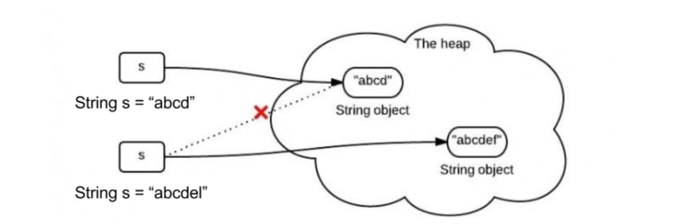

`String` 类中使用 `final` 关键字修饰字符数组来保存字符串。

```java
public final class String implements java.io.Serializable, Comparable<String>, CharSequence {
    private final char value[];
	//...
}
```

> 被 `final` 关键字\*\*<font style="color:#DF2A3F;">修饰的类不能被继承，修饰的方法不能被重写，修饰的变量是基本数据类型则值不能改变，修饰的变量是引用类型则不能再指向其他对象。</font>\*\*
>
> <font style="color:#DF2A3F;"> </font>
>
> `final` 关键字修饰的数组保存字符串并不是 `String` 不可变的根本原因，因为这个数组保存的字符串是可变的（`final` 修饰引用类型变量的情况）。

<code><font style="color:#DF2A3F;">String</font></code><font style="color:#DF2A3F;"> </font>**<font style="color:#DF2A3F;"> 真正不可变有下面几点原因：</font>**

1. **保存字符串的数组被**  <code><font style="color:#DF2A3F;background-color:#FBDE28;">final</font></code><font style="color:#DF2A3F;background-color:#FBDE28;">  </font>\*\*<font style="color:#DF2A3F;background-color:#FBDE28;">修饰且为私有</font>\*\***的，并且**`String`  **类没有暴露修改这个字符串的方法。**
2. `String`  **类被**  `final`  **修饰导致其不能被继承，进而避免了子类破坏**  `String`  **不可变。**
3. **声明所有的域都是 final 的。**
4. **声明所有的域都为私有的。**
5. **确保对于任何可变组件的互斥访问**

**在 Java 9 之后，**`String` **、**`StringBuilder` \*\* 与 \*\*`StringBuffer` \*\* 的实现改用 **`byte` \*\* 数组存储字符串。**

```java
public final class String implements java.io.Serializable,Comparable<String>, CharSequence {
    // @Stable 注解表示变量最多被修改一次，称为“稳定的”。
    @Stable
    private final byte[] value;
}
abstract class AbstractStringBuilder implements Appendable, CharSequence {
    byte[] value;
}
```

## 字符串拼接用“+” 还是 StringBuilder?

**Java 语言本身并不支持运算符重载，“+”和“+=”是专门为 String 类重载过的运算符，也是 Java 中仅有的两个重载过的运算符。**

```java
String str1 = "he";
String str2 = "llo";
String str3 = "world";
String str4 = str1 + str2 + str3;
```

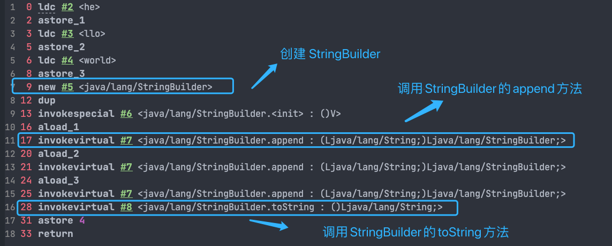

**字符串对象通过“+”的字符串拼接方式，实际上是通过** `StringBuilder` \*\* 调用 \*\* `append()`  \*\* 方法实现的，拼接完成之后调用 \*\* `toString()`  \*\* 得到一个 \*\* `String` \*\* 对象 。\*\*

**在循环内使用“+”进行字符串的拼接的话，存在比较明显的缺陷**：**编译器\*\*\*\*不会创建单个 \*\* `**StringBuilder**` \*\* 以复用** \*\*，会导致创建过多的 **`**StringBuilder**` \*\* 对象**。

```java
String[] arr = {"he", "llo", "world"};
String s = "";
for (int i = 0; i < arr.length; i++) {
    s += arr[i];
}
System.out.println(s);
```

> `StringBuilder` \*\* 对象是在循环内部被创建的，意味着每循环一次就会创建一个 \*\* `StringBuilder` \*\* 对象。\*\*

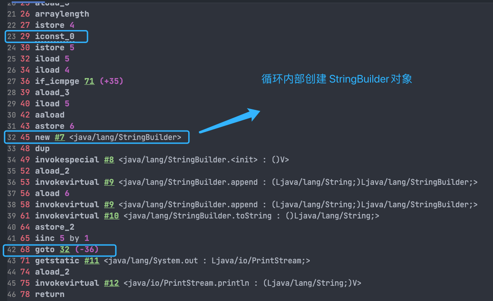

如果直接使用 `StringBuilder` 对象进行字符串拼接的话，就不会存在这个问题了。

```java
String[] arr = {"he", "llo", "world"};
StringBuilder s = new StringBuilder();
for (String value : arr) {
    s.append(value);
}
System.out.println(s);
```

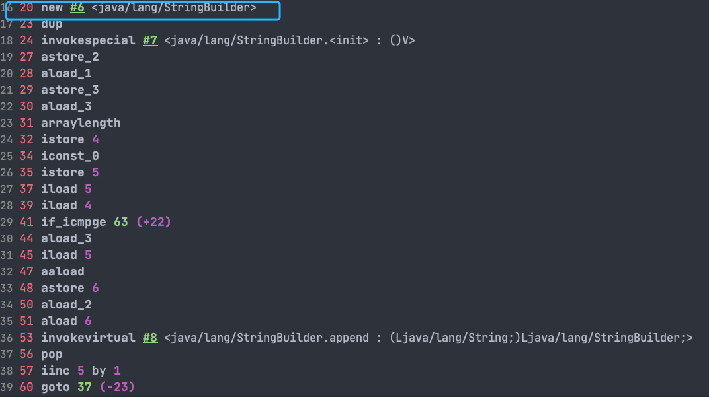

> 使用 “+” 进行字符串拼接会产生大量的临时对象的问题在 JDK9 中得到了解决。**在 JDK9 当中，字符串相加 “+” 改为了用动态方法**  `makeConcatWithConstants()`  来实现，而不是大量的 `StringBuilder` 了。这个改进是 JDK9 的 [JEP 280](https://openjdk.org/jeps/280)提出的，这也意味着 JDK 9 之后，你可以放心使用“+” 进行字符串拼接了。**默认会准确计算长度，只进行一次内存分配**
>
> 还在无脑用 [StringBuilder？来重温一下字符串拼接吧](https://juejin.cn/post/7182872058743750715)

* **Java 8 里的字符串拼接：**`a + b + c` \*\* 编译为 \*\*`new StringBuilder()...`
* **Java 9 里的字符串拼接：**`a + b + c` \*\* 编译为 \*\*`动态生成的拼接函数(a, b, c)`

## String#equals() 和 Object#equals() 有何区别？

`String` \*\* 中的 \*\*`equals` \*\* 方法是被重写过的，比较的是 String 字符串的值是否相等。 \*\*`Object` \*\* 的 **`equals` \*\* 方法是比较的对象的内存地址。**

## 字符串常量池的作用了解吗？

> **原本在方法区内 - JDK6，后续改到堆中 - JDK7**

**字符串常量池** **是 JVM 为了提升性能和减少内存消耗针对字符串（String 类）专门开辟的一块区域，主要目的是为了\*\*\*\*避免字符串的重复创建**。

```java
// 在堆中创建字符串对象”ab“
// 将字符串对象”ab“的引用保存在字符串常量池中
String aa = "ab";
// 直接返回字符串常量池中字符串对象”ab“的引用
String bb = "ab";
System.out.println(aa==bb);// true
```

## String s1 = new String("abc");这句话创建了几个字符串对象？

**会创建 1 或 2 个字符串对象。**

**如果字符串常量池中不存在字符串对象“abc”的引用，那么它会在堆上创建两个字符串对象，其中一个字符串对象的引用会被保存在字符串常量池中。**

```java
String s1 = new String("abc");
```

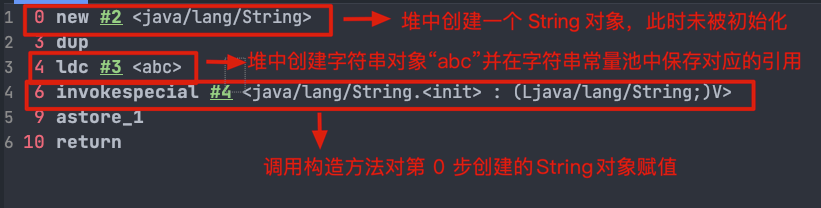

`ldc` \*\* 命令用于判断字符串常量池中是否保存了对应的字符串对象的引用，如果保存了的话直接返回，如果没有保存的话，会在堆中创建对应的字符串对象并将该字符串对象的引用保存到字符串常量池中。\*\*

**如果字符串常量池中已存在字符串对象“abc”的引用，则只会在堆中创建 1 个字符串对象“abc”。**

```java
// 字符串常量池中已存在字符串对象“abc”的引用
String s1 = "abc";
// 下面这段代码只会在堆中创建 1 个字符串对象“abc”
String s2 = new String("abc");
```

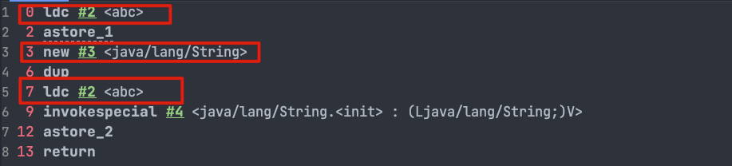

## String#intern 方法有什么作用?

intern（)的使用 JDK6 vs JDK7/8

`String.intern()` 是一个 native（本地）方法，其作用是**将指定的字符串对象的引用保存在字符串常量池中，可以简单分为两种情况：**

* **如果字符串常量池中保存了对应的字符串对象的引用，就直接返回该引用。**
* **如果字符串常量池中没有保存了对应的字符串对象的引用，那就在常量池中创建一个指向该字符串对象的引用并返回。**

```java
// 在堆中创建字符串对象”Java“
// 将字符串对象”Java“的引用保存在字符串常量池中
String s1 = "Java";
// 直接返回字符串常量池中字符串对象”Java“对应的引用
String s2 = s1.intern();
// 会在堆中在单独创建一个字符串对象
String s3 = new String("Java");
// 直接返回字符串常量池中字符串对象”Java“对应的引用
String s4 = s3.intern();
// s1 和 s2 指向的是堆中的同一个对象
System.out.println(s1 == s2); // true
// s3 和 s4 指向的是堆中不同的对象
System.out.println(s3 == s4); // false
// s1 和 s4 指向的是堆中的同一个对象
System.out.println(s1 == s4); //true
```

## String 类型的变量和常量做“+”运算时发生了什么？

```java
String str1 = "str";
String str2 = "ing";
String str3 = "str" + "ing";
String str4 = str1 + str2;
String str5 = "string";
System.out.println(str3 == str4);//false
System.out.println(str3 == str5);//true
System.out.println(str4 == str5);//false
```

> **注意**：比较 String 字符串的值是否相等，可以使用 `equals()` 方法。 `String` \*\* 中的 \*\* `equals` \*\* 方法是被重写过的。\*\*  `Object` 的 `equals` 方法是比较的对象的内存地址，而 `String` 的 `equals` 方法比较的是字符串的值是否相等。如果你使用 `==` 比较两个字符串是否相等的话，IDEA 还是提示你使用 `equals()` 方法替换

**对于编译期可以确定值的字符串，也就是常量字符串 ，jvm 会将其存入字符串常量池。并且，字符串常量拼接得到的字符串常量在编译阶段就已经被存放字符串常量池，这个得益于编译器的优化。**

\*\*对于 \*\*`String str3 = "str" + "ing";` \*\* 编译器会给你优化成 **`String str3 = "string";` \*\* 。**

并不是所有的常量都会进行折叠，只有编译器在程序编译期就可以确定值的常量才可以：

* **基本数据类型** \*\*( \*\*`byte` **、**`boolean` **、**`short` **、**`char` **、**`**int**` **、**`**float**` **、**`**long**` **、**`**double**` **)以及字符串常量。**
* `**final**` \*\* 修饰\*\*\*\*的基本数据类型和字符串变量\*\*
* **字符串通过 “+”拼接得到的字符串、基本数据类型之间算数运算（加减乘除）、基本数据类型的位运算（<<、>>、>>> ）**

\*\*对象引用和“+”的字符串拼接方式，实际上是通过 \*\*`**StringBuilder**` \*\* 调用 \*\*`**append()**` \*\* 方法实现的，拼接完成之后调用 \*\*`**toString()**` \*\* 得到一个 **`**String**` \*\* 对象 。**

```java
String str4 = new StringBuilder().append(str1).append(str2).toString();
```

**字符串使用 \*\* `final` \*\* 关键字声明之后，可以让编译器当做常量来处理。**

```java
final String str1 = "str";
final String str2 = "ing";
// 下面两个表达式其实是等价的
String c = "str" + "ing";// 常量池中的对象
String d = str1 + str2; // 常量池中的对象
System.out.println(c == d);// true
```

被 `final` 关键字修饰之后的 `String` 会被编译器当做常量来处理，编译器在程序编译期就可以确定它的值，其效果就相当于访问常量。

如果 ，编译器在运行时才能知道其确切值的话，就无法对其优化。

示例代码（`str2` 在运行时才能确定其值）：

```java
final String str1 = "str";
final String str2 = getStr();
String c = "str" + "ing";// 常量池中的对象
String d = str1 + str2; // 在堆上创建的新的对象
System.out.println(c == d);// false
public static String getStr() {
      return "ing";
}
```

‍


> 更新: 2025-06-23 18:18:10  
> 原文: <https://www.yuque.com/nibiwanxiamei/yrd6t1/4493142a17e684de692f1476520d92c9>