# JAVA基础 - 下

***

# 异常 java异常

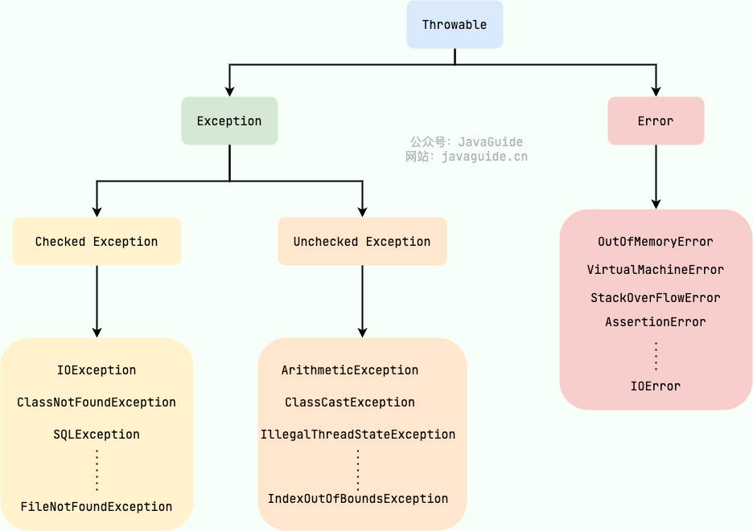

## ♥Exception 和 Error 有什么区别？

\*\*在 Java 中，所有的异常都有一个共同的父类 **`java.lang` \*\* 包中的 **`Throwable` \*\* 类。** `Throwable` \*\* 类有两个重要的子类:**

* <code>**Exception**</code> :**程序本身可以处理的异常**，\*\*可以通过 **`catch` \*\* 来进行捕获。**`Exception` 又可以分为 Checked Exception (受检查异常，必须处理) 和 Unchecked Exception (不受检查异常，可以不处理)。
* <code>**Error**</code>：`Error` \*\* 属于程序无法处理的错误 \*\* ，**不建议通过**`catch`**捕获 。** 例如 Java 虚拟机运行错误（`Virtual MachineError`）、虚拟机内存不够错误(`OutOfMemoryError`)、类定义错误（`NoClassDefFoundError`）等 。这些异常发生时，Java 虚拟机（JVM）一般会选择线程终止。

> 一种是程序相关的错误，另一种涉及到了内存，设备相关。

## ♥Checked Exception 和 Unchecked Exception 有什么区别？

**Checked Exception** **即受检查异常 ，Java 代码在编译过程中，如果受检查异常没有被 \*\* `catch`**或者**`throws` \*\* 关键字处理的话，就没办法通过编译。**

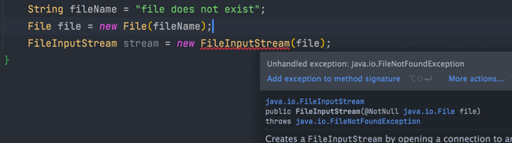

> 还有很多，涉及到资源相关的，线程相关的很多都是受检查的异常

除了`RuntimeException`**及其子类以外**，其他的`Exception`类及其子类都属于受检查异常 。常见的受检查异常有：IO 相关的异常、`ClassNotFoundException`、`SQLException`...。

**Unchecked Exception** 即 **不受检查异常** ，Java 代码在编译过程中 ，我们即使不处理不受检查异常也可以正常通过编译。

`RuntimeException` \*\* 及其子类都统称为非受检查异常\*\*，常见的有：

* `NullPointerException`(空指针错误)
* `IllegalArgumentException`(参数错误比如方法入参类型错误)
* `NumberFormatException`（字符串转换为数字格式错误，`IllegalArgumentException`的子类）
* `ArrayIndexOutOfBoundsException`（数组越界错误）
* `ClassCastException`（类型转换错误）
* `ArithmeticException`（算术错误）
* `SecurityException` （安全错误比如权限不够）
* `UnsupportedOperationException`(不支持的操作错误比如重复创建同一用户)

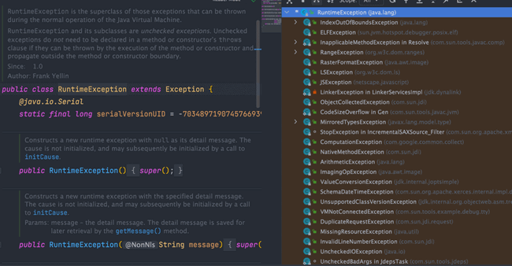

## Throwable 类常用方法有哪些？

* `String getMessage()`: 返回异常发生时的简要描述
* `String toString()`: 返回异常发生时的详细信息
* `String getLocalizedMessage()`: 返回异常对象的本地化信息。使用 `Throwable` 的子类覆盖这个方法，可以生成本地化信息。如果子类没有覆盖该方法，则该方法返回的信息与 `getMessage()`返回的结果相同
* `void printStackTrace()`: 在控制台上打印 `Throwable` 对象封装的异常信息

## try-catch-finally 如何使用？

* `try`\*\*块：用于捕获异常。其后可接零个或多个 \*\*`catch` \*\* 块，如果没有 \*\*`catch` \*\* 块，则必须跟一个 **`finally` \*\* 块。**
* `catch`**块：用于处理 try 捕获到的异常。**
* `finally` \*\* 块：无论是否捕获或处理异常，**`finally` \*\* 块里的语句都会被执行。当在**`try` \*\* 块或 \*\* `catch` \*\* 块中遇到 \*\* `return` \*\* 语句时，\*\* `finally` \*\* 语句块将在方法返回之前被执行。\*\*

```java
try {
    System.out.println("Try to do something");
    throw new RuntimeException("RuntimeException");
} catch (Exception e) {
    System.out.println("Catch Exception -> " + e.getMessage());
} finally {
    System.out.println("Finally");
}
```

> **注意：不要在 finally 语句块中使用 return!**  \*\*当 try 语句和 finally 语句中都有 return 语句时，try 语句块中的 return 语句会被忽略。 \*\***<font style="color:#DF2A3F;">因为 try 语句中的 return 返回值会先被暂存在一个本地变量中，当执行到 finally 语句中的 return 之后，这个本地变量的值就变为了 finally 语句中的 return 返回值。当然如果finally没有return而是对返回值修改，返回的还是try中的结果。	</font>**

## finally 中的代码一定会执行吗？

正常情况下finally代码是会被执行的，但是有一些情况是不被执行的

**finally 之前虚拟机被终止运行的话，finally 中的代码就不会被执行。**

```java
try {
    System.out.println("Try to do something");
    throw new RuntimeException("RuntimeException");
} catch (Exception e) {
    System.out.println("Catch Exception -> " + e.getMessage());
    // 终止当前正在运行的Java虚拟机
    System.exit(1);
} finally {
    System.out.println("Finally");
}

Try to do something
Catch Exception -> RuntimeException
```

另外，在以下 2 种特殊情况下，`finally` 块的代码也不会被执行：

1. 程序所在的线程死亡。
2. 关闭 CPU。

## 如何使用 `try-with-resources` 代替`try-catch-finally`？

* **适用范围（资源的定义）：**  任何实现 `java.lang.AutoCloseable`或者 `java.io.Closeable` 的对象
* **关闭资源和 finally 块的执行顺序：**  **在 \*\* `try-with-resources` \*\* 语句中，任何 catch 或 finally 块在声明的资源关闭后运行**

> 其实就是代码简化了

Java 中类似于`InputStream`、`OutputStream`、`Scanner`、`PrintWriter`等的资源都需要我们调用`close()`方法来手动关闭，一般情况下我们都是通过`try-catch-finally`语句来实现这个需求，如下：

```java
//读取文本文件的内容
Scanner scanner = null;
try {
    scanner = new Scanner(new File("D://read.txt"));
    while (scanner.hasNext()) {
        System.out.println(scanner.nextLine());
    }
} catch (FileNotFoundException e) {
    e.printStackTrace();
} finally {
    if (scanner != null) {
        scanner.close();
    }
}
```

使用 Java 7 之后的 `try-with-resources` 语句改造上面的代码:

```java
try (Scanner scanner = new Scanner(new File("test.txt"))) {
    while (scanner.hasNext()) {
        System.out.println(scanner.nextLine());
    }
} catch (FileNotFoundException fnfe) {
    fnfe.printStackTrace();
}
```

> 总结：资源定义到try（）中，不再需要finally，自动关闭

多个资源共同使用

```java
try (BufferedInputStream bin = new BufferedInputStream(new FileInputStream(new File("test.txt")));
     BufferedOutputStream bout = new BufferedOutputStream(new FileOutputStream(new File("out.txt")))) {
    int b;
    while ((b = bin.read()) != -1) {
        bout.write(b);
    }
}
catch (IOException e) {
    e.printStackTrace();
}
```

## 异常使用有哪些需要注意的地方？

* 不要把异常定义为静态变量，因为这样会导致异常栈信息错乱。每次手动抛出异常，我们都需要手动 new 一个异常对象抛出。
* 抛出的异常信息一定要有意义。
* 建议抛出更加具体的异常比如字符串转换为数字格式错误的时候应该抛出`NumberFormatException`而不是其父类`IllegalArgumentException`。
* **使用日志打印异常之后就不要再抛出异常了**（两者不要同时存在一段代码逻辑中）。

# 泛型java泛型

## 什么是泛型？有什么作用？

> **泛型**：**允许在定义类、接口时通过一个**`标识`**表示类中某个**`属性的类型`**或者是某个方法的**`返回值或参数的类型` **。这个类型参数将在使用时** **（例如，继承或实现这个接口、创建对象或调用方法时）确定** **（即传入实际的类型参数，也称为类型实参）。**
>
> **<font style="color:#DF2A3F;">泛型的主要目的是在编译时提供更强的类型检查，并且在编译后能够保留类型信息，避免了在运行时出现类型转换异常。</font>**

**编译器可以对泛型参数进行检测，并且通过泛型参数可以指定传入的对象类型。** 比如 `ArrayList<Person> persons = new ArrayList<Person>()` **指明了该 **<code>**ArrayList**</code>** 对象只能传入 **<code>**Person**</code>** 对象，如果传入其他类型的对象就会报错。**

**Java 泛型（Generics）**  是 JDK 5 中引入的一个新特性。使用泛型参数，可以增强代码的可读性以及稳定性。

## 泛型的使用方式有哪几种？

泛型一般有三种使用方式:**泛型类**、**泛型接口**、**泛型方法**。

**1.泛型类**：

```java
//此处T可以随便写为任意标识，常见的如T、E、K、V等形式的参数常用于表示泛型
//在实例化泛型类时，必须指定T的具体类型
public class Generic<T>{

    private T key;

    public Generic(T key) {
        this.key = key;
    }

    public T getKey(){
        return key;
    }
}
```

```java
Generic<Integer> genericInteger = new Generic<Integer>(123456);
```

**2.泛型接口**：

```java
public interface Generator<T> {
    public T method();
}
```

实现泛型接口，不指定类型：

```java
class GeneratorImpl<T> implements Generator<T>{
    @Override
    public T method() {
        return null;
    }
}
```

实现泛型接口，指定类型：

```java
class GeneratorImpl<T> implements Generator<String>{
    @Override
    public String method() {
        return "hello";
    }
}
```

**3.泛型方法**：

```java
   public static < E > void printArray( E[] inputArray )
   {
         for ( E element : inputArray ){
            System.out.printf( "%s ", element );
         }
         System.out.println();
    }
```

使用：

```java
// 创建不同类型数组：Integer, Double 和 Character
Integer[] intArray = { 1, 2, 3 };
String[] stringArray = { "Hello", "World" };
printArray( intArray  );
printArray( stringArray  );
```

> 注意: `public static < E > void printArray( E[] inputArray )` 一般被称为静态泛型方法;在 java 中泛型只是一个占位符，必须在传递类型后才能使用。类在实例化时才能真正的传递类型参数，由于静态方法的加载先于类的实例化，也就是说类中的泛型还没有传递真正的类型参数，静态的方法的加载就已经完成了，所以静态泛型方法是没有办法使用类上声明的泛型的。只能使用自己声明的 `<E>`

## ♥ 项目中哪里用到了泛型？

* **自定义接口通用返回结果**  `CommonResult<T>`   **通过参数**  `T`  **可根据具体的返回类型动态指定结果的数据类型**
* 定义 `Excel` 处理类 `ExcelUtil<T>` 用于动态指定 `Excel` 导出的数据类型
* 构建集合工具类（参考 `Collections` 中的 `sort`, `binarySearch` 方法）。

# java反射

**Reflection反射机制允许程序在**`运行期间`**取得任何类的内部信息，并能直接操作任意对象的内部属性及方法。**

**加载完类之后，在方法区中就产生了一个Class类型的对象** **（一个类只有一个Class对象），这个对象就包含了完整的类的结构信息。可以通过这个对象得到类的结构。**

* **Class本身也是一个类**
* **Class 对象只能由系统建立对象**
* \*\*一个加载的类在 JVM 中只会有一个Class实例 \*\*
* **一个Class对象对应的是一个加载到JVM中的一个.class文件**
* **每个类的实例都会记得自己是由哪个 Class 实例所生成**
* \*\*通过Class可以完整地得到一个类中的所有被加载的结构 \*\*
* **Class类是Reflection的根源，针对任何你想动态加载、运行的类，唯有先获得相应的Class对象**

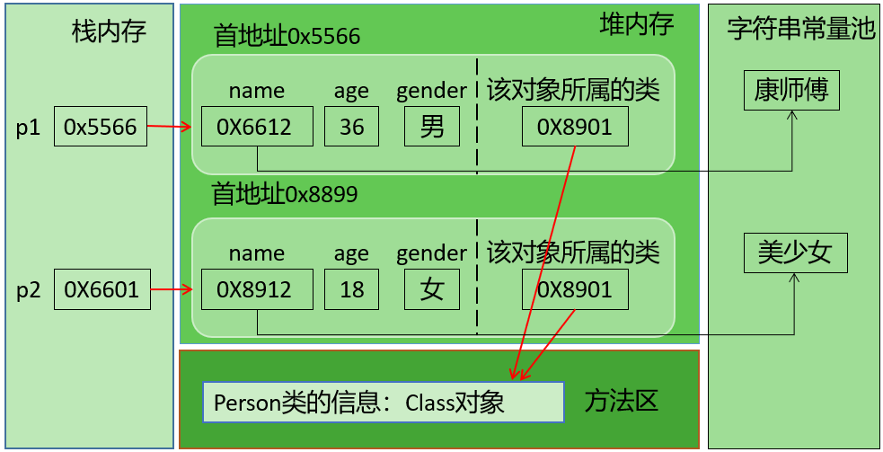

## 反射获取Class的方式

```java
Class alunbarClass = TargetObject.class;
Class alunbarClass1 = Class.forName("cn.javaguide.TargetObject");

TargetObject o = new TargetObject();
Class alunbarClass2 = o.getClass();

ClassLoader.getSystemClassLoader().loadClass("cn.javaguide.TargetObject");

```

## 创建对象的方式

* **<font style="color:rgb(48, 79, 254);">使用new关键字</font>**<font style="color:rgb(44, 62, 80);">：通过new关键字直接调用类的构造方法来创建对象。</font>
* **<font style="color:rgb(48, 79, 254);">使用Class类的newInstance()方法</font>**<font style="color:rgb(44, 62, 80);">：通过反射机制，可以使用Class类的newInstance()方法创建对象。</font>
* **<font style="color:rgb(48, 79, 254);">使用Constructor类的newInstance()方法</font>**<font style="color:rgb(44, 62, 80);">：同样是通过反射机制，可以使用Constructor类的newInstance()方法创建对象。</font>
* **<font style="color:rgb(48, 79, 254);">使用clone()方法</font>**<font style="color:rgb(44, 62, 80);">：如果类实现了Cloneable接口，可以使用clone()方法复制对象。</font>
* **<font style="color:rgb(48, 79, 254);">使用反序列化</font>**<font style="color:rgb(44, 62, 80);">：通过将对象序列化到文件或流中，然后再进行反序列化来创建对象。</font>

# 注解（Annotation）

> **<font style="color:#DF2A3F;">注解是用于提供元数据，注解可以用来为类、方法、字段等元素提供某些信息供程序在编译或者运行时使用</font>**<font style="color:#DF2A3F;">。</font>

`Annotation` \*\* （注解） 是 Java5 开始引入的新特性，可以看作是一种特殊的注释，主要用于修饰类、方法或者变量，提供某些信息供程序在编译或者运行时使用\*\* **。**

**<font style="color:#DF2A3F;">注解本质是一个继承了</font>**<code><font style="color:#DF2A3F;">Annotation</font></code><font style="color:#DF2A3F;"> </font>**<font style="color:#DF2A3F;"> 的特殊接口：</font>\*\*\*\*<font style="color:#DF2A3F;">其具体实现类是Java运行时生成的动态代理类。</font>**

```java
@Target(ElementType.METHOD)
@Retention(RetentionPolicy.SOURCE)
public @interface Override {

}
public interface Override extends Annotation{

}
```

<font style="color:rgb(44, 62, 80);"></font>

<font style="color:rgb(44, 62, 80);">通过反射获取注解时，返回的是Java运行时生成的动态代理对象。通过代理对象调用自定义注解的方法，会最终调用AnnotationInvocationHandler的invoke方法。该方法会从memberValues这个Map中索引出对应的值。而memberValues的来源是Java常量池。</font>

## 注解的解析方法有哪几种？

注解只有被解析之后才会生效，常见的解析方法有两种：

* **编译期直接扫描**：**编译器在编译 Java 代码的时候扫描对应的注解并处理，比如某个方法使用** `@Override` \*\* 注解，编译器在编译的时候就会检测当前的方法是否重写了父类对应的方法。\*\*
* **运行期通过反射处理**：\*\*像框架中自带的注解(比如 Spring 框架的 \*\* `@Value` **、** `@Component` **)都是通过反射来进行处理的。**

## @Contended注解的作用

[6.volatile与JMM](https://www.yuque.com/nibiwanxiamei/yrd6t1/226aa15eb7800364bab700544f5ea3e1)

**<font style="color:#DF2A3F;">此注解是java中避免CPU多核心cache之间变量伪共享的，可以将单个数据填充或者隔离数据到不同cache行</font>**

# SPI

SPI 即 \*\* Service Provider Interface\*\* ，字面意思就是：“服务提供者的接口”：**专门提供给服务提供者或者扩展框架功能的开发者去使用的一个接口。**

**SPI &#x5C06;****服务接口和具体的服务实现分离开****&#x6765;，将服务调用方和服务实现者解耦，能够提升程序的扩展性、可维护性。修改或者替换服务实现并不需要修改调用方。**

**很多框架都使用了 Java 的 SPI 机制，比如：Spring 框架、数据库加载驱动、日志接口、以及 Dubbo 的扩展实现等等。**

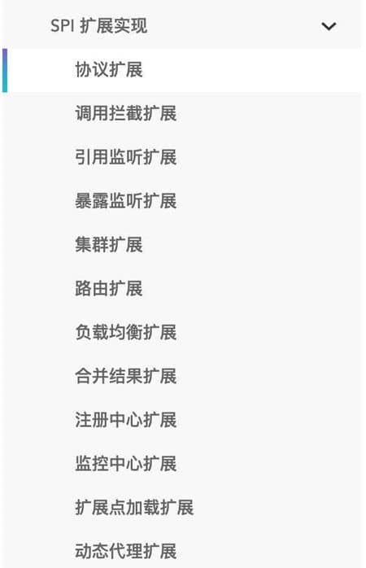

## SPI 和 API 有什么区别？

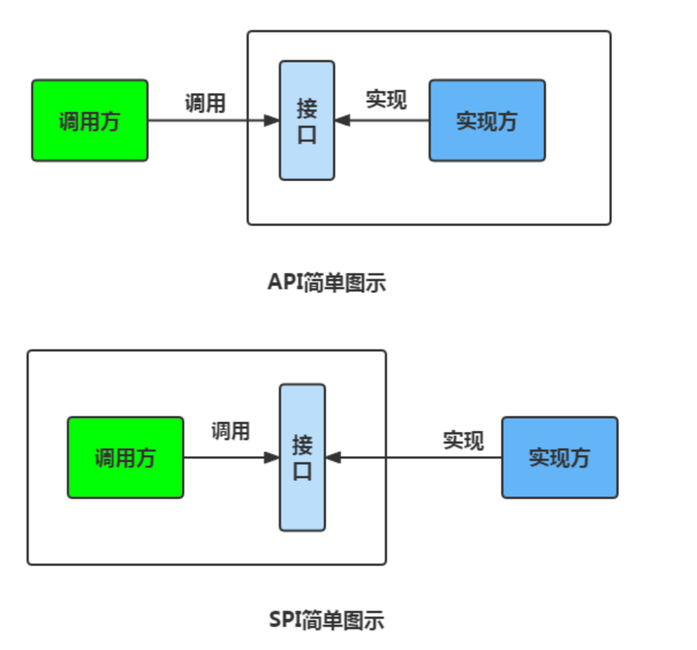

* **当实现方提供了接口和实现，我们可以通&#x8FC7;****调用实现方的接口****&#x4ECE;而拥有实现方给我们提供的能力，这就是 API ，这种接口和实现都是放在实现方的。**
* **&#x5F53;****接口存在于调用方****&#x8FD9;边时，就是 SPI ，由接口调用方确定接口规则，然后由不同的厂商去根据这个规则对这个接口进行实现，从而提供服务。**

> **API：A给B提供服务，A给B一个接口，这个接口是API，B调用A的接口**
>
> **SPI：A给B提供服务，B给A一个接口，A提供服务并实现B给的接口，B调用自己的接口，这个接口是SPI**

## SPI 的优缺点？

通过 SPI 机制能够大大地提高接口设计的灵活性，但是 SPI 机制也存在一些缺点，比如：

* 需要遍历加载所有的实现类，不能做到按需加载，这样效率还是相对较低的。
* 当多个 `ServiceLoader` 同时 `load` 时，会有并发问题。

# 序列化和反序列化对象序列化机制

`对象序列化机制`**允许把内存中的Java对象转换成平台无关的二进制流** **，从而允许把这种二进制流持久地保存在磁盘上，或通过网络将这种二进制流传输到另一个网络节点。**

简单来说：

* **序列化**：**将数据结构或对象转换成二进制字节流的过程**
* **反序列化**：**将在序列化过程中所生成的二进制字节流还原成数据结构或者对象的过程**

> **序列化和反序列化针对对象**

对于 Java 这种面向对象编程语言来说，序列化的都是对象（Object）也就是实例化后的类(Class)，但是在 C++这种半面向对象的语言中，struct(结构体)定义的是数据结构类型，而 class 对应的是对象类型。

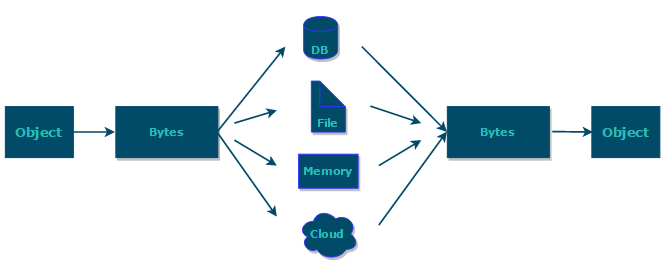

## 如果有些字段不想进行序列化怎么办？

\*\*对于不想进行序列化的变量，使用 **<code>**<font style="color:#DF2A3F;">transient</font>**</code>**<font style="color:#DF2A3F;"> </font>\*\***关键字修饰。**

`transient` 关键字的作用是：阻止实例中那些用此关键字修饰的的变量序列化；当对象被反序列化时，被 `transient` 修饰的变量值不会被持久化和恢复。

关于 `transient` 还有几点注意：

* `transient` 只能修饰变量，不能修饰类和方法。
* `transient` 修饰的变量，在反序列化后变量值将会被置成类型的默认值。例如，如果是修饰 `int` 类型，那么反序列后结果就是 `0`。
* <code><font style="color:#DF2A3F;">static</font></code><font style="color:#DF2A3F;">  </font>**<font style="color:#DF2A3F;">变量因为不属于任何对象(Object)，所以无论有没有</font>**<font style="color:#DF2A3F;">  </font><code><font style="color:#DF2A3F;">transient</font></code><font style="color:#DF2A3F;">  </font>**<font style="color:#DF2A3F;">关键字修饰，均不会被序列化</font>\*\*\*\*。** **- 类变量属于类不属于对象。**

## 常见序列化协议有哪些？

JDK 自带的序列化方式一般不会用 ，因为序列化效率低并且存在安全问题。比较常用的序列化协议有 **Hessian、Kryo、****<font style="color:#DF2A3F;">Protobuf</font>****、ProtoStuff**，这些都是基于二进制的序列化协议。

像 JSON 和 XML 这种属于文本类序列化方式。虽然可读性比较好，但是性能较差，一般不会选择。

## 为什么不推荐使用 JDK 自带的序列化？

* **不支持跨语言调用** : 如果调用的是其他语言开发的服务的时候就不支持了。
* **性能差**：相比于其他序列化框架性能更低，主要原因是序列化之后的字节数组体积较大，导致传输成本加大。
* **存在安全问题**：序列化和反序列化本身并不存在问题。但当输入的反序列化的数据可被用户控制，那么攻击者即可通过构造恶意输入，让反序列化产生非预期的对象，在此过程中执行构造的任意代码。相关阅读：[应用安全：JAVA 反序列化漏洞之殇](https://cryin.github.io/blog/secure-development-java-deserialization-vulnerability/)。

# I/O File类与IO流

[JAVA - IO](https://www.yuque.com/nibiwanxiamei/yrd6t1/e06f560db172014c9c33148cda9b7cad)

## Java IO 流了解吗？

IO 即 `Input/Output`，输入和输出。数据输入到计算机内存的过程即输入，反之输出到外部存储（比如数据库，文件，远程主机）的过程即输出。数据传输过程类似于水流，因此称为 IO 流。**IO 流在 Java 中分为输入流和输出流，而根据数据的处理方式又分为字节流和字符流。**

Java IO 流的 40 多个类都是从如下 4 个抽象类基类中派生出来的。

* `InputStream`/`Reader`: 所有的输入流的基类，前者是字节输入流，后者是字符输入流。
* `OutputStream`/`Writer`: 所有输出流的基类，前者是字节输出流，后者是字符输出流

## I/O 流为什么要分为字节流和字符流呢?

* **字符流是由 Java 虚拟机将字节转换得到的，这个过程还算是比较耗时；**
* **如果我们不知道编码类型的话，使用字节流的过程中很容易出现乱码问题。**

# 语法糖

**语法糖（Syntactic sugar）** ：**编程语言为了方便程序员开发程序而设计的一种特殊语法**，**这种语法对编程语言的功能并没有影响。实现相同的功能，基于语法糖写出来的代码往往更简单简洁且更易阅读。**

\*\*Java 中的 **`for-each` \*\* 就是一个常用的语法糖，其原理其实就是基于普通的 for 循环和迭代器。**

```java
String[] strs = {"JavaGuide", "公众号：JavaGuide", "博客：https://javaguide.cn/"};
for (String s : strs) {
  System.out.println(s);
}
```

## Java 中有哪些常见的语法糖？


**Java 中最常用的语法糖主要&#x6709;****泛型、自动拆装箱、变长参数、枚举、内部类、增强 for 循环、try-with-resources 语法、lambda 表达式****&#x7B49;。**

**Java 虚拟机并不支持这些语法糖。这些语法糖在编译阶段就会被还原成简单的基础语法结构，这个过程就是解语法糖。在**`compile()`**中有一个步骤就是调用**`desugar()` **，这个方法就是负责解语法糖的实现的。**

## switch 支持 String 与枚举

Java 中的`switch`自身原本就支持基本类型。比如`int`、`char`等。**对于**`int`**类型，直接进行数值的比较。对于**`char`**类型则是比较其 ascii 码。** 所以，对于编译器来说，`switch`中其实只能使用整型，任何类型的比较都要转换成整型。比如`byte`。`short`，`char`(ascii 码是整型)以及`int`。

**Java7之后switch支持String类型的比较**

```java
public class switchDemoString {
    public static void main(String[] args) {
        String str = "world";
        switch (str) {
        case "hello":
            System.out.println("hello");
            break;
        case "world":
            System.out.println("world");
            break;
        default:
            break;
        }
    }
}
```

反编译后内容如下

```java
public class switchDemoString
{
    public switchDemoString()
    {
    }
    public static void main(String args[])
    {
        String str = "world";
        String s;
        switch((s = str).hashCode())
        {
        default:
            break;
        case 99162322:
            if(s.equals("hello"))
                System.out.println("hello");
            break;
        case 113318802:
            if(s.equals("world"))
                System.out.println("world");
            break;
        }
    }
}
```

**字符串的 switch 是通过**<code>**equals()**</code> **和**<code>**hashCode()**</code> **方法来实现的。**

## 泛型java泛型

**对于 Java 虚拟机来说，他根本不认识**<code>**Map<String, String> map**</code>**这样的语法。需要在编译阶段通过类型擦除的方式进行解语法糖。**

**类型擦除的主要过程如下：**

**1.将所有的泛型参数用其最左边界（最顶级的父类型）类型替换。 2.移除所有的类型参数。**

```java
Map<String, String> map = new HashMap<String, String>();
//解开语法糖
Map map = new HashMap();
```

\*\*虚拟机中没有泛型，只有普通类和普通方法，\*\***所有泛型类的类型参数在编译时都会被擦除** **，泛型类并没有自己独有的**<code>**Class**</code>**类对象。比如并不存在**<code>**List<String>.class**</code>**或是**<code>**List<Integer>.class**</code> **，而只有**<code>**List.class**</code> **。**

## 自动装箱与拆箱

自动装箱就是 Java 自动将原始类型值转换成对应的对象，比如将 int 的变量转换成 Integer 对象，这个过程叫做装箱，反之将 Integer 对象转换成 int 类型值，这个过程叫做拆箱。

自动装箱：

```java
 public static void main(String[] args) {
    int i = 10;
    Integer n = i;
}
```

反编译后代码如下:

```java
public static void main(String args[])
{
    int i = 10;
    Integer n = Integer.valueOf(i);
}
```

自动拆箱：

```java
public static void main(String[] args) {

    Integer i = 10;
    int n = i;
}
```

反编译后代码如下：

```java
public static void main(String args[])
{
    Integer i = Integer.valueOf(10);
    int n = i.intValue();
}
```

\*\*装箱过程是通过调用包装器的 \*\*\*\*valueOf（） \*\* \*\*方法实现的，而拆箱过程是通过调用包装器的 \*\***xxxValue （）** **方法实现的。**

## 可变长参数

```java
public static void main(String[] args)
    {
        print("Holis", "公众号:Hollis", "博客：www.hollischuang.com", "QQ：907607222");
    }

public static void print(String... strs)
{
    for (int i = 0; i < strs.length; i++)
    {
        System.out.println(strs[i]);
    }
}
```

反编译后

```java
 public static void main(String args[])
{
    print(new String[] {
        "Holis", "\u516C\u4F17\u53F7:Hollis", "\u535A\u5BA2\uFF1Awww.hollischuang.com", "QQ\uFF1A907607222"
    });
}

public static transient void print(String strs[])
{
    for(int i = 0; i < strs.length; i++)
        System.out.println(strs[i]);
}
```

> 可变参数实际上就是用数组装入所有参数

## 枚举枚举类

**关键字**`**enum**`可以将一组具名的值的有限集合创建为一种新的类型，而这些具名的值可以作为常规的程序组件使用，这是一种非常有用的功能。

```java
public enum t {
    SPRING,SUMMER;
}
```

反编译后

```java
public final class T extends Enum
{
    private T(String s, int i)
    {
        super(s, i);
    }
    public static T[] values()
    {
        T at[];
        int i;
        T at1[];
        System.arraycopy(at = ENUM$VALUES, 0, at1 = new T[i = at.length], 0, i);
        return at1;
    }

    public static T valueOf(String s)
    {
        return (T)Enum.valueOf(demo/T, s);
    }

    public static final T SPRING;
    public static final T SUMMER;
    private static final T ENUM$VALUES[];
    static
    {
        SPRING = new T("SPRING", 0);
        SUMMER = new T("SUMMER", 1);
        ENUM$VALUES = (new T[] {
            SPRING, SUMMER
        });
    }
}
```

通过反编译后代码我们可以看到，`**public final class T extends Enum**`，说明，该类是继承了`Enum`类的，同时`final`关键字告诉我们，这个类也是不能被继承的。

**当我们使用**`**enum**`**来定义一个枚举类型的时候，编译器会自动帮我们\*\*\*\*创建一个**<code>**final**</code>**类型的类继承**<code>**Enum**</code>**类** **，所以枚举类型不能被继承。**

## 内部类内部类（InnerClass)

**内部类之所以也是语法糖，是因为它仅仅是一个编译时的概念，**<code>**outer.java**</code>**里面定义了一个内部类**<code>**inner**</code> **，一旦编译成功，就会生成两个完全不同的** <code>**.class**</code>**文件了，分别是**<code>**outer.class**</code>**和**<code>**outer$inner.class**</code> **。所以内部类的名字完全可以和它的外部类名字相同。**

## 条件编译

—般情况下，程序中的每一行代码都要参加编译。但有时候出于对程序代码优化的考虑，**希望只对其中一部分内容进行编译**，此时就需要在程序中加上条件，让编译器只对满足条件的代码进行编译，将不满足条件的代码舍弃，这就是条件编译。

如在 C 或 CPP 中，可以通过预处理语句来实现条件编译。其实在 Java 中也可实现条件编译。

```java
public class ConditionalCompilation {
    public static void main(String[] args) {
        final boolean DEBUG = true;
        if(DEBUG) {
            System.out.println("Hello, DEBUG!");
        }
        final boolean ONLINE = false;
        if(ONLINE){
            System.out.println("Hello, ONLINE!");
        }
    }
}
```

反编译后代码如下：

```java
public class ConditionalCompilation
{
    public ConditionalCompilation()
    {
    }
    public static void main(String args[])
    {
        boolean DEBUG = true;
        System.out.println("Hello, DEBUG!");
        boolean ONLINE = false;
    }
}
```

在反编译后的代码中没有`System.out.println("Hello, ONLINE!");`。当`**if(ONLINE)**`**为 false 的时候，编译器就没有对其内的代码进行编译**。

\*\*Java 语法的条件编译，是通过判断条件为常量的 if 语句实现的。其原理也是 Java 语言的语法糖。\*\***根据 if 判断条件的真假，编译器直接把分支为 false 的代码块消除** **。通过该方式实现的条件编译，必须在方法体内实现，而无法在正整个 Java 类的结构或者类的属性上进行条件编译，这与 C/C++的条件编译相比，确实更有局限性。**

## 断言

`assert`关键字是从 JAVA SE 1.4 引入的，为了**避免和老版本的 Java 代码中使用了**`**assert**`**关键字导致错误**，**Java 在执行的时候默认是不启动断言检查的**（**所有的断言语句都将忽略！** ）**如果要开启断言检查，则需要用开关** `**-enableassertions**`**或** `**-ea**`**来开启。**

```java
public class AssertTest {
    public static void main(String args[]) {
        int a = 1;
        int b = 1;
        assert a == b;
        System.out.println("公众号：Hollis");
        assert a != b : "Hollis";
        System.out.println("博客：www.hollischuang.com");
    }
}
```

反编译后代码如下：

```java
public class AssertTest {
   public AssertTest()
    {
    }
    public static void main(String args[])
{
    int a = 1;
    int b = 1;
    if(!$assertionsDisabled && a != b)
        throw new AssertionError();
    System.out.println("\u516C\u4F17\u53F7\uFF1AHollis");
    if(!$assertionsDisabled && a == b)
    {
        throw new AssertionError("Hollis");
    } else
    {
        System.out.println("\u535A\u5BA2\uFF1Awww.hollischuang.com");
        return;
    }
}

static final boolean $assertionsDisabled = !com/hollis/suguar/AssertTest.desiredAssertionStatus();

}
```

很明显，反编译之后的代码要比我们自己的代码复杂的多。所以，使用了 assert 这个语法糖我们节省了很多代码。**其实\*\*\*\*断言的底层实现就是 if 语言，如果断言结果为 true，则什么都不做，程序继续执行，如果断言结果为 false，则程序抛出 AssertError 来打断程序的执行** **。**`-enableassertions`会设置$assertionsDisabled 字段的值。

## 数值字面量

在 java 7 中，数值字面量，不管是整数还是浮点数，都允许**在数字之间插入任意多个下划线。这些下划线不会对字面量的数值产生影响，目的就是方便阅读**。

```java
public class Test {
    public static void main(String... args) {
        int i = 10_000;
        System.out.println(i);
    }
}
//反编译后
public class Test
{
  public static void main(String[] args)
  {
    int i = 10000;
    System.out.println(i);
  }
}
```

## for-each

```java
public static void main(String... args) {
    String[] strs = {"Hollis", "公众号：Hollis", "博客：www.hollischuang.com"};
    for (String s : strs) {
        System.out.println(s);
    }
    List<String> strList = ImmutableList.of("Hollis", "公众号：Hollis", "博客：www.hollischuang.com");
    for (String s : strList) {
        System.out.println(s);
    }
}
//反编译之后如下
public static transient void main(String args[])
{
    String strs[] = {
        "Hollis", "\u516C\u4F17\u53F7\uFF1AHollis", "\u535A\u5BA2\uFF1Awww.hollischuang.com"
    };
    String args1[] = strs;
    int i = args1.length;
    for(int j = 0; j < i; j++)
    {
        String s = args1[j];
        System.out.println(s);
    }
    List strList = ImmutableList.of("Hollis", "\u516C\u4F17\u53F7\uFF1AHollis", "\u535A\u5BA2\uFF1Awww.hollischuang.com");
    String s;
    for(Iterator iterator = strList.iterator(); iterator.hasNext(); System.out.println(s))
        s = (String)iterator.next();
}
```

**for-each 的实现原理其实就是使用了普通的 for 循环和迭代器。**

## try-with-resource()如何使用 try-with-resources 代替try-catch-finally？

## Lambda 表达式Lambda语法格式

**Lambda 表达式\*\*\*\*不是匿名内部类的语法糖** **，但是他也是一个语法糖。实现方式其实是依赖了几个 JVM 底层提供的 lambda 相关 api。**

```java
public static void main(String... args) {
    List<String> strList = ImmutableList.of("Hollis", "公众号：Hollis", "博客：www.hollischuang.com");

    strList.forEach( s -> { System.out.println(s); } );
}
```

**内部类在编译之后会有两个 class 文件，但是，包含 lambda 表达式的类编译后只有一个文件。**

```java
public static /* varargs */ void main(String ... args) {
    ImmutableList strList = ImmutableList.of((Object)"Hollis", (Object)"\u516c\u4f17\u53f7\uff1aHollis", (Object)"\u535a\u5ba2\uff1awww.hollischuang.com");
    strList.forEach((Consumer<String>)LambdaMetafactory.metafactory(null, null, null, (Ljava/lang/Object;)V, lambda$main$0(java.lang.String ), (Ljava/lang/String;)V)());
}

private static /* synthetic */ void lambda$main$0(String s) {
    System.out.println(s);
}
```

> **lambda 表达式的实现其实是依赖了一些底层的 api，在编译阶段，编译器会把 lambda 表达式进行解糖，转换成调用内部 api 的方式**

# UnsafeCAS底层原理？谈谈对Unsafe类的理解？

`**Unsafe**` \*\* 是位于 **`**sun.misc**` \*\* 包下的一个类**，**主要提供一些用于\*\*\*\*执行低级别、不安全操作的方法，如直接访问系统内存资源、自主管理内存资源等** \*\*，这些方法在提升 Java 运行效率、增强 Java 语言底层资源操作能力方面起到了很大的作用。但由于 **`**Unsafe**` \*\* 类使 Java 语言拥有了类似 C 语言指针一样操作内存空间的能力，这无疑也增加了程序发生相关指针问题的风险。** 在程序中过度、不正确使用 `Unsafe` 类会使得程序出错的概率变大，使得 Java 这种安全的语言变得不再“安全”，因此对 `Unsafe` 的使用一定要慎重。

另外，`**Unsafe**` \*\* 提供的这些功能的实现需要依赖本地方法（Native Method）\*\* 。你可以将本地方法看作是 Java 中使用其他编程语言编写的方法。本地方法使用 <code>**native**</code> 关键字修饰，Java 代码中只是声明方法头，具体的实现则交给 **本地代码**。

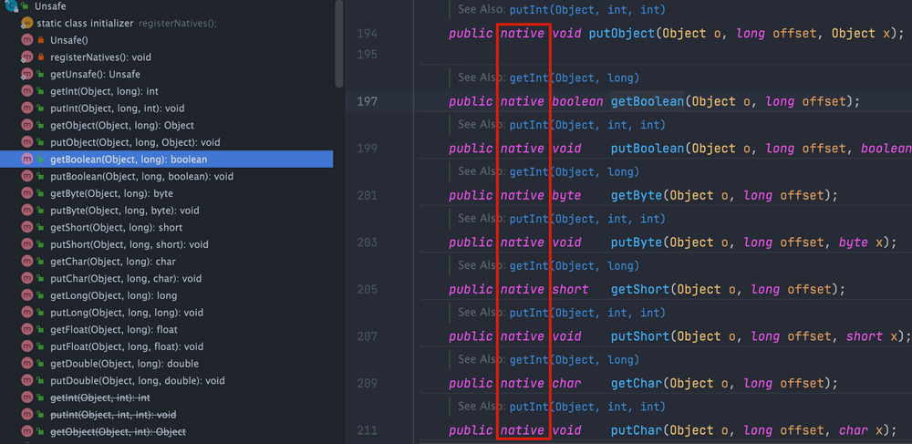

**为什么要使用本地方法呢？**

1. 需要用到 Java 中不具备的依赖于**操作系统的特性**，Java 在实现跨平台的同时要实现对底层的控制，需要借助其他语言发挥作用。
2. 对于其他语言已经完成的一些现成功能，可以使用 Java 直接调用。
3. 程序对时间敏感或对性能要求非常高时，有必要使用更加底层的语言，例如 C/C++甚至是汇编。

在 JUC 包的很多并发工具类在实现并发机制时，都调用了本地方法，通过它们打破了 Java 运行时的界限，能够接触到操作系统底层的某些功能。对于同一本地方法，不同的操作系统可能会通过不同的方式来实现，但是对于使用者来说是透明的，最终都会得到相同的结果。

> **归根到底java本身是不应该接触到操作系统的，只能使用JVM的相关内存空间，如果java需要利用操作系统的功能，或者说java要系统调用，需要借助一下C，C++来调用操作系统的服务**。

## Unsafe 创建

`sun.misc.Unsafe` 部分源码如下：

```java
public final class Unsafe {
  // 单例对象
  private static final Unsafe theUnsafe;
  ......
  private Unsafe() {
  }
  @CallerSensitive
  public static Unsafe getUnsafe() {
    Class var0 = Reflection.getCallerClass();
    // 仅在引导类加载器`BootstrapClassLoader`加载时才合法
    if(!VM.isSystemDomainLoader(var0.getClassLoader())) {
      throw new SecurityException("Unsafe");
    } else {
      return theUnsafe;
    }
  }
}
```

`Unsafe` \*\* 类为一单例实现\*\*，\*\*提供静态方法 \*\*`getUnsafe` \*\* 获取 \*\*`Unsafe`**实例。** 这个看上去貌似可以用来获取 `Unsafe` 实例。但是，当我们直接调用这个静态方法的时候，\*\*会抛出 **`SecurityException` \*\* 异常**

```java
Exception in thread "main" java.lang.SecurityException: Unsafe
 at sun.misc.Unsafe.getUnsafe(Unsafe.java:90)
 at com.cn.test.GetUnsafeTest.main(GetUnsafeTest.java:12)
```

\*\*为什么 **<code>**public static**</code> \*\* 方法无法被直接调用呢？**

**在**`**getUnsafe**`**方法中，会对调用者的**`**classLoader**`**进行检查，判断当前类是否由**`**Bootstrap classLoader**`**加载，如果不是的话那么就会抛出一个**`**SecurityException**`\*\*异常。也就是说，\*\***只有启动类加载器加载的类才能够调用 Unsafe 类中的方法** \*\*，\*\***来防止这些方法在不可信的代码中被调用。**

**为什么要对 Unsafe 类进行这么谨慎的使用限制呢?**

`**Unsafe**` \*\* 提供的功能过于底层（如直接访问系统内存资源、自主管理内存资源等），安全隐患也比较大，使用不当的话，很容易出现很严重的问题\*\*。

**如何获取其实例？**

* ## \*\*利用反射获得 Unsafe 类中已经实例化完成的单例对象 \*\*`**theUnsafe**` \*\* \*\*

```java
private static Unsafe reflectGetUnsafe() {
    try {
      Field field = Unsafe.class.getDeclaredField("theUnsafe");
      field.setAccessible(true);
      return (Unsafe) field.get(null);
    } catch (Exception e) {
      log.error(e.getMessage(), e);
      return null;
    }
}
```

* ## **从**`getUnsafe`**方法的使用限制条件出发，通过 Java 命令行命令** `-Xbootclasspath/a`**把调用 Unsafe 相关方法的类 A 所在 jar 包路径追加到默认的 bootstrap 路径中，使得 A 被引导类加载器加载，从而通过**`Unsafe.getUnsafe`**方法安全的获取 Unsafe 实例。**

```java
java -Xbootclasspath/a: ${path}   // 其中path为调用Unsafe相关方法的类所在jar包路径
```

## Unsafe 功能

概括的来说，`Unsafe` 类实现功能可以被分为下面 8 类：

1. 内存操作
2. 内存屏障
3. 对象操作
4. 数据操作
5. CAS 操作
6. 线程调度
7. Class 操作
8. 系统信息

### 内存操作

\*\*在 Java 中是不允许直接对内存进行操作的，对象内存的分配和回收都是由 JVM 自己实现的。但是在 **`Unsafe` \*\* 中，提供的下列接口可以直接进行内存操作：**

```java
//分配新的本地空间
public native long allocateMemory(long bytes);
//重新调整内存空间的大小
public native long reallocateMemory(long address, long bytes);
//将内存设置为指定值
public native void setMemory(Object o, long offset, long bytes, byte value);
//内存拷贝
public native void copyMemory(Object srcBase, long srcOffset,Object destBase, long destOffset,long bytes);
//清除内存
public native void freeMemory(long address);
```

```java
private void memoryTest() {
    int size = 4;
    long addr = unsafe.allocateMemory(size);
    long addr3 = unsafe.reallocateMemory(addr, size * 2);
    System.out.println("addr: "+addr);
    System.out.println("addr3: "+addr3);
    try {
        unsafe.setMemory(null,addr ,size,(byte)1);
        for (int i = 0; i < 2; i++) {
            unsafe.copyMemory(null,addr,null,addr3+size*i,4);
        }
        System.out.println(unsafe.getInt(addr));
        System.out.println(unsafe.getLong(addr3));
    }finally {
        unsafe.freeMemory(addr);
        unsafe.freeMemory(addr3);
    }
}

addr: 2433733895744
addr3: 2433733894944
16843009
72340172838076673
```

通过这种方式分配的内存属于\*\*<font style="color:#DF2A3F;">堆外内存</font>**<font style="color:#DF2A3F;"> </font>，是**无法进行垃圾回收的\*\*，需要我们把这些内存当做一种资源去**手动调用**`freeMemory`**方法进行释放**，否则会产生内存泄漏。通用的操作内存方式是在`try`中执行对内存的操作，最终在`finally`块中进行内存的释放。

首先使用`allocateMemory`方法申请 4 字节长度的内存空间，调用`setMemory`方法向每个字节写入内容为`byte`类型的 1，当使用 Unsafe 调用`getInt`方法时，因为一个`int`型变量占 4 个字节，会一次性读取 4 个字节，组成一个`int`的值，对应的十进制结果为 16843009。

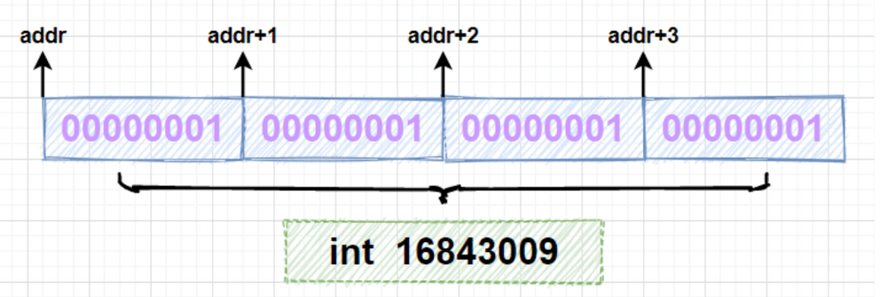

在代码中调用`reallocateMemory`方法重新分配了一块 8 字节长度的内存空间，通过比较`addr`和`addr3`可以看到和之前申请的内存地址是不同的。在代码中的第二个 for 循环里，调用`copyMemory`方法进行了两次内存的拷贝，每次拷贝内存地址`addr`开始的 4 个字节，分别拷贝到以`addr3`和`addr3+4`开始的内存空间上：

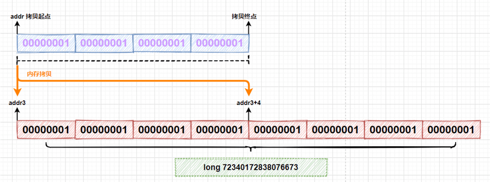

拷贝完成后，使用`getLong`方法一次性读取 8 个字节，得到`long`类型的值为 72340172838076673。

**为什么要使用堆外内存？**

* **对垃圾回收停顿的改善。** 由于堆外内存是直接受操作系统管理而不是 JVM，所以当我们使用堆外内存时，即可保持较小的堆内内存规模。从而在 GC 时减少回收停顿对于应用的影响。
* **提升程序 I/O 操作的性能。** 通常在 I/O 通信过程中，会存在堆内内存到堆外内存的数据拷贝操作，对于需要频繁进行内存间数据拷贝且生命周期较短的暂存数据，都建议存储到堆外内存。

**典型应用**

`DirectByteBuffer` 是 Java 用于实现堆外内存的一个重要类，通常用在通信过程中做缓冲池，如在 Netty、MINA 等 NIO 框架中应用广泛。`DirectByteBuffer` 对于堆外内存的创建、使用、销毁等逻辑均由 Unsafe 提供的堆外内存 API 来实现。

`DirectByteBuffer` 构造函数，创建 `DirectByteBuffer` 的时候，通过 `Unsafe.allocateMemory` 分配内存、`Unsafe.setMemory` 进行内存初始化，而后构建 `Cleaner` 对象用于跟踪 `DirectByteBuffer` 对象的垃圾回收，以实现当 `DirectByteBuffer` 被垃圾回收时，分配的堆外内存一起被释放。

```java
DirectByteBuffer(int cap) {                   // package-private

    super(-1, 0, cap, cap);
    boolean pa = VM.isDirectMemoryPageAligned();
    int ps = Bits.pageSize();
    long size = Math.max(1L, (long)cap + (pa ? ps : 0));
    Bits.reserveMemory(size, cap);

    long base = 0;
    try {
        // 分配内存并返回基地址
        base = unsafe.allocateMemory(size);
    } catch (OutOfMemoryError x) {
        Bits.unreserveMemory(size, cap);
        throw x;
    }
    // 内存初始化
    unsafe.setMemory(base, size, (byte) 0);
    if (pa && (base % ps != 0)) {
        // Round up to page boundary
        address = base + ps - (base & (ps - 1));
    } else {
        address = base;
    }
    // 跟踪 DirectByteBuffer 对象的垃圾回收，以实现堆外内存释放
    cleaner = Cleaner.create(this, new Deallocator(base, size, cap));
    att = null;
}
```

### 内存屏障(Memory Barrier)（面试重点必须拿下）

在介绍内存屏障前，需要知道编译器和 CPU 会在保证程序输出结果一致的情况下，会对代码进行**重排序**，从指令优化角度提升性能。而**指令重排序可能会带来一个不好的结果，导致 CPU 的高速缓存和内存中数据的不一致，而内存屏障（** `Memory Barrier` **）就是通过阻止屏障两边的指令重排序从而避免编译器和硬件的不正确优化情况。**

在硬件层面上，内存屏障是 CPU 为了防止代码进行重排序而提供的指令，不同的硬件平台上实现内存屏障的方法可能并不相同。在 Java8 中，引入了 3 个内存屏障的函数，它屏蔽了操作系统底层的差异，允许在代码中定义、并统一由 JVM 来生成内存屏障指令，来实现内存屏障的功能。

`Unsafe` 中提供了下面三个内存屏障相关方法：

```java
//内存屏障，禁止load操作重排序。屏障前的load操作不能被重排序到屏障后，屏障后的load操作不能被重排序到屏障前
public native void loadFence();
//内存屏障，禁止store操作重排序。屏障前的store操作不能被重排序到屏障后，屏障后的store操作不能被重排序到屏障前
public native void storeFence();
//内存屏障，禁止load、store操作重排序
public native void fullFence();
```

**内存屏障可以看做对内存随机访问的操作中的一个同步点，使得此点之前的所有读写操作都执行后才可以开始执行此点之后的操作。** **以**`loadFence`**方法为例，它会禁止读操作重排序，保证在这个屏障之前的所有读操作都已经完成，并且将缓存数据设为无效，重新从主存中进行加载。**

看到这估计很多小伙伴们会想到`volatile`关键字了，如果在字段上添加了`volatile`关键字，就能够实现字段在多线程下的可见性。基于读内存屏障，我们也能实现相同的功能。下面定义一个线程方法，在线程中去修改`flag`标志位，注意这里的`flag`是没有被`volatile`修饰的：

```java
@Getter
class ChangeThread implements Runnable{
    /**volatile**/ boolean flag=false;
    @Override
    public void run() {
        try {
            Thread.sleep(3000);
        } catch (InterruptedException e) {
            e.printStackTrace();
        }
        System.out.println("subThread change flag to:" + flag);
        flag = true;
    }
}
```

```java
在主线程的while循环中，加入内存屏障，测试是否能够感知到flag的修改变化：
```

```java
public static void main(String[] args){
    ChangeThread changeThread = new ChangeThread();
    new Thread(changeThread).start();
    while (true) {
        boolean flag = changeThread.isFlag();
        unsafe.loadFence(); //加入读内存屏障
        if (flag){
            System.out.println("detected flag changed");
            break;
        }
    }
    System.out.println("main thread end");
}
subThread change flag to:false
detected flag changed
main thread end
```

而如果删掉上面代码中的`loadFence`方法，那么主线程将无法感知到`flag`发生的变化（子线程虽然改变的flag，但是是在自己的工作内存内修改，没有同步到内存），会一直在`while`中循环。可以用图来表示上面的过程：

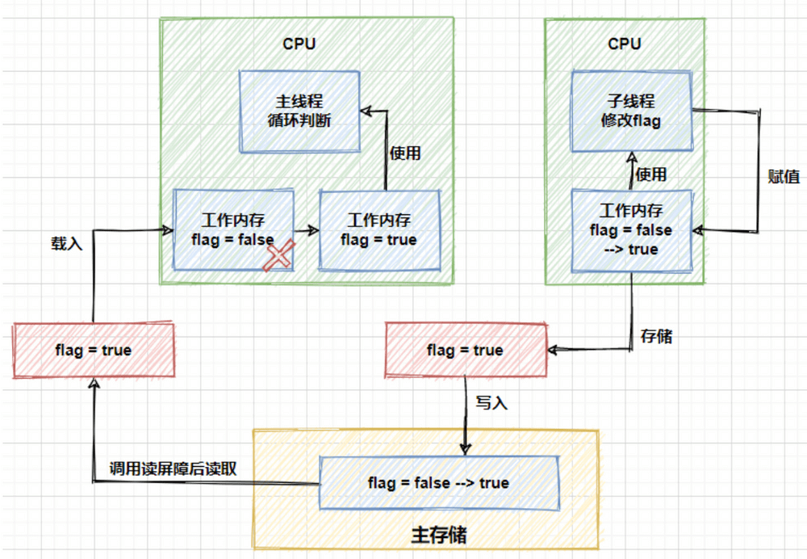

> **运行中的线程不是直接读取主内存中的变量的，只能操作自己工作内存中的变量，然后同步到主内存中，并且线程的工作内存是不能共享的。上面的图中的流程就是子线程借助于主内存，将修改后的结果同步给了主线程，进而修改主线程中的工作空间，跳出循环。**

在 Java 8 中引入了一种锁的新机制——`StampedLock`13.ReentrantLock、ReentrantReadWriteLock、StampedLock讲解，它可以看成是读写锁的一个改进版本。`**StampedLock**` \*\* 提供了一种乐观读锁的实现，这种乐观读锁类似于无锁的操作，完全不会阻塞写线程获取写锁，从而缓解读多写少时写线程“饥饿”现象。\*\* 由于 `StampedLock` 提供的乐观读锁不阻塞写线程获取读锁，当线程共享变量从主内存 load 到线程工作内存时，会存在数据不一致问题。

为了解决这个问题，`StampedLock` 的 `validate` 方法会通过 `Unsafe` 的 `loadFence` 方法加入一个 `load` 内存屏障。

```java
public boolean validate(long stamp) {
   U.loadFence();
   return (stamp & SBITS) == (state & SBITS);
}
```

### 对象操作

```java
import sun.misc.Unsafe;
import java.lang.reflect.Field;

public class Main {

    private int value;

    public static void main(String[] args) throws Exception{
        Unsafe unsafe = reflectGetUnsafe();
        assert unsafe != null;
        long offset = unsafe.objectFieldOffset(Main.class.getDeclaredField("value"));
        Main main = new Main();
        System.out.println("value before putInt: " + main.value);
        unsafe.putInt(main, offset, 42);
        System.out.println("value after putInt: " + main.value);
	System.out.println("value after putInt: " + unsafe.getInt(main, offset));
    }

    private static Unsafe reflectGetUnsafe() {
        try {
            Field field = Unsafe.class.getDeclaredField("theUnsafe");
            field.setAccessible(true);
            return (Unsafe) field.get(null);
        } catch (Exception e) {
            e.printStackTrace();
            return null;
        }
    }
}


value before putInt: 0
value after putInt: 42
value after putInt: 42
```

**对象属性**

**对象成员属性的内存偏移量获取，以及字段属性值的修改**，在上面的例子中我们已经测试过了。除了前面的`putInt`、`getInt`方法外，Unsafe 提供了全部 8 种基础数据类型以及`Object`的`put`和`get`方法，并且所有的`put`方法都可以越过访问权限，**直接修改内存中的数据**。阅读 openJDK 源码中的注释发现，基础数据类型和`Object`的读写稍有不同，**基础数据类型是直接操作的属性值（**`value` **），而**`Object`**的操作则是基于引用值（**`reference value` **）** 。下面是`Object`的读写方法：

```java
//在对象的指定偏移地址获取一个对象引用
public native Object getObject(Object o, long offset);
//在对象指定偏移地址写入一个对象引用
public native void putObject(Object o, long offset, Object x);
```

除了对象属性的普通读写外，`Unsafe` 还提供了 **volatile 读写**和**有序写入**方法。`volatile`读写方法的覆盖范围与普通读写相同，包含了全部基础数据类型和`Object`类型，以`int`类型为例：

```java
//在对象的指定偏移地址处读取一个int值，支持volatile load语义
public native int getIntVolatile(Object o, long offset);
//在对象指定偏移地址处写入一个int，支持volatile store语义
public native void putIntVolatile(Object o, long offset, int x);
```

相对于普通读写来说，`volatile`读写具有更高的成本，因为它需要保证可见性和有序性。在执行`get`操作时，会强制从主存中获取属性值，在使用`put`方法设置属性值时，会强制将值更新到主存中，从而保证这些变更对其他线程是可见的。

有序写入的方法有以下三个：

```java
public native void putOrderedObject(Object o, long offset, Object x);
public native void putOrderedInt(Object o, long offset, int x);
public native void putOrderedLong(Object o, long offset, long x);
```

有序写入的成本相对`volatile`较低，因为它只保证写入时的有序性，而不保证可见性，也就是一个线程写入的值不能保证其他线程立即可见。为了解决这里的差异性，需要对内存屏障的知识点再进一步进行补充，首先需要了解两个指令的概念：

* `Load`：将主内存中的数据拷贝到处理器的缓存中
* `Store`：将处理器缓存的数据刷新到主内存中

顺序写入与`volatile`写入的差别在于，在顺序写时加入的内存屏障类型为`StoreStore`类型，而在`volatile`写入时加入的内存屏障是`StoreLoad`类型，如下图所示：

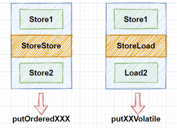

在有序写入方法中，使用的是`**StoreStore**`**屏障，该屏障确保**`**Store1**`**立刻刷新数据到内存，这一操作先于**`**Store2**`**以及后续的存储指令操作**。而在`volatile`写入中，使用的是`StoreLoad`屏障，**该屏障确保**`**Store1**`**立刻刷新数据到内存，这一操作先于**`**Load2**`**及后续的装载指令，并且，**`**StoreLoad**`**屏障会使该屏障之前的所有内存访问指令，包括存储指令和访问指令全部完成之后，才执行该屏障之后的内存访问指令。**

> 第一个是保证先写，然后再继续后续写操作
>
> 第二个是保证前面所有写操作都完成了，才允许读

在上面的三类写入方法中，在写入效率方面，按照`put`、`putOrder`、`putVolatile`的顺序效率逐渐降低。

**对象实例化**

使用 `Unsafe` 的 `allocateInstance` 方法，允许我们使用非常规的方式进行对象的实例化，首先定义一个实体类，并且在构造函数中对其成员变量进行赋值操作：

```java
@Data
public class A {
    private int b;
    public A(){
        this.b =1;
    }
}
```

分别基于构造函数、反射以及 `Unsafe` 方法的不同方式创建对象进行比较：

```java
public void objTest() throws Exception{
    A a1=new A();
    System.out.println(a1.getB());
    A a2 = A.class.newInstance();
    System.out.println(a2.getB());
    A a3= (A) unsafe.allocateInstance(A.class);
    System.out.println(a3.getB());
}
```

打印结果分别为 1、1、0，说明通过`allocateInstance`**方法创建对象过程中，不会调用类的构造方法**。**使用这种方式创建对象时，只用到了**`Class`**对象，所以说如果想要跳过对象的初始化阶段或者跳过构造器的安全检查，就可以使用这种方法。在上面的例子中，如果将 A 类的构造函数改为**`private`**类型，将无法通过构造函数和反射创建对象（可以通过构造函数对象 setAccessible 后创建对象），但**`allocateInstance`**方法仍然有效。**

**典型应用**

* **常规对象实例化方式**：我们通常所用到的创建对象的方式，从本质上来讲，都是通过 new 机制来实现对象的创建。但是，new 机制有个特点就是当类只提供有参的构造函数且无显示声明无参构造函数时，则必须使用有参构造函数进行对象构造，而使用有参构造函数时，必须传递相应个数的参数才能完成对象实例化。
* **非常规的实例化方式**：**而 Unsafe 中提供 allocateInstance 方法，仅通过 Class 对象就可以创建此类的实例对象，而且不需要调用其构造函数、初始化代码、JVM 安全检查等。** 它抑制修饰符检测，也就是即使构造器是 private 修饰的也能通过此方法实例化，只需提类对象即可创建相应的对象。由于这种特性，allocateInstance 在 java.lang.invoke、Objenesis（提供绕过类构造器的对象生成方式）、Gson（反序列化时用到）中都有相应的应用。

### 数组操作

`arrayBaseOffset` 与 `arrayIndexScale` 这两个方法配合起来使用，即可定位数组中每个元素在内存中的位置。

```java
//返回数组中第一个元素的偏移地址
public native int arrayBaseOffset(Class<?> arrayClass);
//返回数组中一个元素占用的大小
public native int arrayIndexScale(Class<?> arrayClass);
```

**典型应用**

这两个与数据操作相关的方法，在 `java.util.concurrent.atomic` 包下的 `AtomicIntegerArray`（可以实现对 `Integer` 数组中每个元素的原子性操作）中有典型的应用，如下图 `AtomicIntegerArray` 源码所示，通过 `Unsafe` 的 `arrayBaseOffset`、`arrayIndexScale` 分别获取数组首元素的偏移地址 `base` 及单个元素大小因子 `scale` 。后续相关原子性操作，均依赖于这两个值进行数组中元素的定位，如下图二所示的 `getAndAdd` 方法即通过 `checkedByteOffset` 方法获取某数组元素的偏移地址，而后通过 CAS 实现原子性操作。

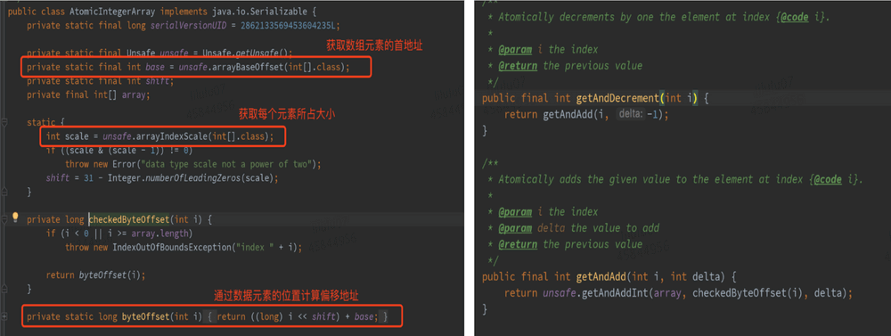

### CAS 操作

这部分主要为 **CAS** 相关操作的方法

```java
/**
	*  CAS
  * @param o         包含要修改field的对象
  * @param offset    对象中某field的偏移量
  * @param expected  期望值
  * @param update    更新值
  * @return          true | false
  */
public final native boolean compareAndSwapObject(Object o, long offset,  Object expected, Object update);

public final native boolean compareAndSwapInt(Object o, long offset, int expected,int update);

public final native boolean compareAndSwapLong(Object o, long offset, long expected, long update);
```

**什么是 CAS?**  **CAS 即比较并替换（Compare And Swap)** ，是实现并发算法时常用到的一种技术。CAS 操作包含三个操作数——**内存位置、预期原值及新值**。执行 CAS 操作的时候，将内存位置的值与预期原值比较，如果相匹配，那么处理器会自动将该位置值更新为新值，否则，处理器不做任何操作。**CAS 是一条 CPU 的原子指令（cmpxchg 指令），不会造成所谓的数据不一致问题**，`Unsafe` 提供的 CAS 方法（如 `compareAndSwapXXX`）底层实现即为 CPU 指令 `cmpxchg` 。

**典型应用**

在 JUC 包的并发工具类中大量地使用了 CAS 操作，像在前面介绍`synchronized`和`AQS`的文章中也多次提到了 CAS，其**作为乐观锁在并发工具类中广泛发挥了作用**。在 `Unsafe` 类中，提供了`compareAndSwapObject`、`compareAndSwapInt`、`compareAndSwapLong`方法来实现的对`Object`、`int`、`long`类型的 CAS 操作。以`compareAndSwapInt`方法为例：

```java
public final native boolean compareAndSwapInt(Object o, long offset,int expected,int x);
```

参数中`o`为需要更新的对象，`offset`是对象`o`中整形字段的偏移量，如果这个字段的值与`expected`相同，则将字段的值设为`x`这个新值，并且此更新是不可被中断的，也就是一个原子操作。下面是一个使用`compareAndSwapInt`的例子：

```java
private volatile int a;
public static void main(String[] args){
    CasTest casTest=new CasTest();
    new Thread(()->{
        for (int i = 1; i < 5; i++) {
            casTest.increment(i);
            System.out.print(casTest.a+" ");
        }
    }).start();
    new Thread(()->{
        for (int i = 5 ; i <10 ; i++) {
            casTest.increment(i);
            System.out.print(casTest.a+" ");
        }
    }).start();
}

private void increment(int x){
    while (true){
        try {
            long fieldOffset = unsafe.objectFieldOffset(CasTest.class.getDeclaredField("a"));
            if (unsafe.compareAndSwapInt(this,fieldOffset,x-1,x))
                break;
        } catch (NoSuchFieldException e) {
            e.printStackTrace();
        }
    }
}
1 2 3 4 5 6 7 8 9
```

使用两个线程去修改`int`型属性`a`的值，并且只有在`a`的值等于传入的参数`x`减一时，才会将`a`的值变为`x`，也就是实现对`a`的加一的操作。流程如下所示：

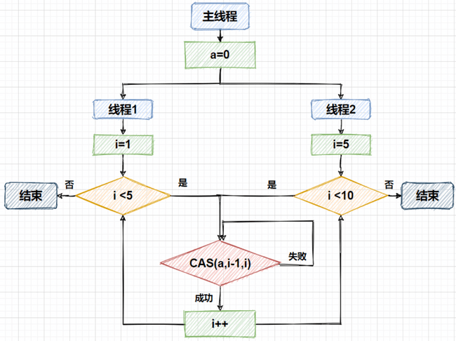

需要注意的是，**在调用**`**compareAndSwapInt**`**方法后，会直接返回**`**true**`**或**`**false**`**的修改结果**，因此需要我们在代码中手动添加自旋的逻辑。在`AtomicInteger`类的设计中，也是采用了将`compareAndSwapInt`的结果作为循环条件，直至修改成功才退出死循环的方式来实现的原子性的自增操作。

### 线程调度

`Unsafe` 类中提供了`park`、`unpark`、`monitorEnter`、`monitorExit`、`tryMonitorEnter`方法进行线程调度。

```java
//取消阻塞线程
public native void unpark(Object thread);
//阻塞线程
public native void park(boolean isAbsolute, long time);
//获得对象锁（可重入锁）
@Deprecated
public native void monitorEnter(Object o);
//释放对象锁
@Deprecated
public native void monitorExit(Object o);
//尝试获取对象锁
@Deprecated
public native boolean tryMonitorEnter(Object o);
```

方法 `park`、`unpark` 即可实现线程的挂起与恢复，将一个线程进行挂起是通过 `park` 方法实现的，调用 `park` 方法后，线程将一直阻塞直到超时或者中断等条件出现；`unpark` 可以终止一个挂起的线程，使其恢复正常。

此外，`Unsafe` 源码中`monitor`相关的三个方法已经被标记为`deprecated`，不建议被使用：

```java
//获得对象锁
@Deprecated
public native void monitorEnter(Object var1);
//释放对象锁
@Deprecated
public native void monitorExit(Object var1);
//尝试获得对象锁
@Deprecated
public native boolean tryMonitorEnter(Object var1);
```

`monitorEnter`方法用于获得对象锁，`monitorExit`用于释放对象锁，如果对一个没有被`monitorEnter`加锁的对象执行此方法，会抛出`IllegalMonitorStateException`异常。`tryMonitorEnter`方法尝试获取对象锁，如果成功则返回`true`，反之返回`false`。

**典型应用**

\*\*Java 锁和同步器框架的核心类 **`AbstractQueuedSynchronizer` \*\* (AQS)** **，就是通过调用**`LockSupport.park()` **和**`LockSupport.unpark()` \*\*实现线程的阻塞和唤醒的，而 \*\*`LockSupport` \*\* 的 \*\*`park` **、**`unpark` \*\* 方法实际是调用 \*\*`Unsafe` \*\* 的 **`park` **、**`unpark` \*\* 方式实现的。**

```java
public static void park(Object blocker) {
    Thread t = Thread.currentThread();
    setBlocker(t, blocker);
    UNSAFE.park(false, 0L);
    setBlocker(t, null);
}
public static void unpark(Thread thread) {
    if (thread != null)
        UNSAFE.unpark(thread);
}
```

`LockSupport` 的`park`方法调用了 `Unsafe` 的`park`方法来阻塞当前线程，此方法将线程阻塞后就不会继续往后执行，直到有其他线程调用`unpark`方法唤醒当前线程。下面的例子对 `Unsafe` 的这两个方法进行测试：

```java
public static void main(String[] args) {
    Thread mainThread = Thread.currentThread();
    new Thread(()->{
        try {
            TimeUnit.SECONDS.sleep(5);
            System.out.println("subThread try to unpark mainThread");
            unsafe.unpark(mainThread);
        } catch (InterruptedException e) {
            e.printStackTrace();
        }
    }).start();

    System.out.println("park main mainThread");
    unsafe.park(false,0L);
    System.out.println("unpark mainThread success");
}

park main mainThread
subThread try to unpark mainThread
unpark mainThread success
```

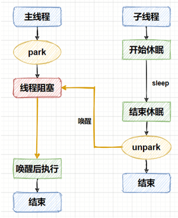

### Class 操作

`Unsafe` 对`Class`的相关操作主要包括**类加载和静态变量的操作方法**。

**静态属性读取相关的方法\`**

```java
//获取静态属性的偏移量
public native long staticFieldOffset(Field f);
//获取静态属性的对象指针
public native Object staticFieldBase(Field f);
//判断类是否需要初始化（用于获取类的静态属性前进行检测）
public native boolean shouldBeInitialized(Class<?> c);
```

```java
@Data
public class User {
    public static String name="Hydra";
    int age;
}
private void staticTest() throws Exception {
    User user=new User();
    // 也可以用下面的语句触发类初始化
    // 1.
    // unsafe.ensureClassInitialized(User.class);
    // 2.
    // System.out.println(User.name);
    System.out.println(unsafe.shouldBeInitialized(User.class));
    Field sexField = User.class.getDeclaredField("name");
    long fieldOffset = unsafe.staticFieldOffset(sexField);
    Object fieldBase = unsafe.staticFieldBase(sexField);
    Object object = unsafe.getObject(fieldBase, fieldOffset);
    System.out.println(object);
}
false
Hydra
```

在 `Unsafe` 的对象操作中，通过`objectFieldOffset`方法获取对象属性偏移量并基于它对变量的值进行存取，但是它不适用于类中的静态属性，这时候就需要使用`staticFieldOffset`方法。在上面的代码中，只有在获取`Field`对象的过程中依赖到了`Class`，而获取静态变量的属性时不再依赖于`Class`。

在上面的代码中首先创建一个`User`对象，这是因为如果一个类没有被初始化，那么它的静态属性也不会被初始化，最后获取的字段属性将是`null`。所以在获取静态属性前，需要调用`shouldBeInitialized`方法，判断在获取前是否需要初始化这个类。如果删除创建 User 对象的语句，运行结果会变为：

```java
true
null
```

**使用**<code>**defineClass**</code>**方法允许程序在运行时\`动态地创建一个类**

```java
public native Class<?> defineClass(String name, byte[] b, int off, int len, ClassLoader loader,ProtectionDomain protectionDomain);
```

在实际使用过程中，可以**只传入字节数组、起始字节的下标以及读取的字节长度**，默认情况下，**类加载器（**`**ClassLoader**` **）和保护域（**`**ProtectionDomain**` **）** 来源于调用此方法的实例。下面的例子中实现了反编译生成后的 class 文件的功能：

```java
private static void defineTest() {
    String fileName="F:\\workspace\\unsafe-test\\target\\classes\\com\\cn\\model\\User.class";
    File file = new File(fileName);
    try(FileInputStream fis = new FileInputStream(file)) {
        byte[] content=new byte[(int)file.length()];
        fis.read(content);
        Class clazz = unsafe.defineClass(null, content, 0, content.length, null, null);
        Object o = clazz.newInstance();
        Object age = clazz.getMethod("getAge").invoke(o, null);
        System.out.println(age);
    } catch (Exception e) {
        e.printStackTrace();
    }
}
```

在上面的代码中，首先读取了一个`class`文件并通过文件流将它转化为字节数组，之后使用`defineClass`方法动态的创建了一个类，并在后续完成了它的实例化工作，流程如下图所示，并且**通过这种方式创建的类，会跳过 JVM 的所有安全检查。**

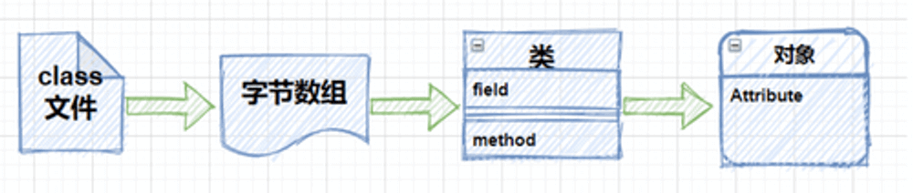

\*\*Lambda 表达式实现需要依赖 \*\*`Unsafe` \*\* 的 **`defineAnonymousClass` \*\* 方法定义实现相应的函数式接口的匿名类。**

### 系统信息

```java
//返回系统指针的大小。返回值为4（32位系统）或 8（64位系统）。
public native int addressSize();
//内存页的大小，此值为2的幂次方。
public native int pageSize();
```


> 更新: 2024-09-24 11:23:16  
> 原文: <https://www.yuque.com/nibiwanxiamei/yrd6t1/a9a26e1610824a45403dea579b9bf677>