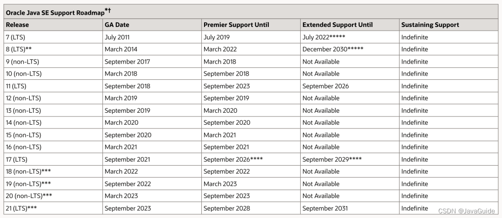

# JAVA新特性

# Java8新特性

## Interface

interface 的设计初衷是面向抽象，提高扩展性。这也留有一点遗憾，\*\*Interface 修改的时候，实现它的类也必须跟着改。\*\*为了解决接口的修改与现有的实现不兼容的问题。**新 interface 的方法可以用**`default` \*\* 或 \*\*`static`**修饰，这样就可以有方法体，实现类也不必重写此方法。**

一个 interface 中可以有多个方法被它们修饰，这 2 个修饰符的区别主要也是普通方法和静态方法的区别。

1. `default`**修饰的方法，是普通实例方法，可以用**`this`**调用，可以被子类继承、重写。**
2. `static`**修饰的方法，使用上和一般类静态方法一样。但它不能被子类继承，只能用**`Interface`**调用。**

```java
public interface InterfaceNew {
    static void sm() {
        System.out.println("interface提供的方式实现");
    }
    static void sm2() {
        System.out.println("interface提供的方式实现");
    }

    default void def() {
        System.out.println("interface default方法");
    }
    default void def2() {
        System.out.println("interface default2方法");
    }
    //须要实现类重写
    void f();
}

public interface InterfaceNew1 {
    default void def() {
        System.out.println("InterfaceNew1 default方法");
    }
}
```

\*\*如果有一个类既实现了 \*\*`InterfaceNew` \*\* 接口又实现了 \*\*`InterfaceNew1`**接口，它们都有**`def()` \*\*，并且 \*\*`InterfaceNew` \*\* 接口和 \*\*`InterfaceNew1`**接口没有继承关系的话，这时就必须重写**`def()` **。不然的话，编译的时候就会报错。**

**在 Java 8 ，接口和抽象类有什么区别的？**

“既然 interface 也可以有自己的方法实现，似乎和 abstract class 没多大区别了。”

其实它们还是有区别的

1. interface 和 class 的区别，好像是废话，主要有：
   * **接口多实现，类单继承**
   * **接口的方法是 public abstract 修饰，变量是 public static final 修饰。 抽象类可以用其他修饰符**
2. **interface 的方法是更像是一个扩展插件。而 abstract class 的方法是要继承的。**

开始我们也提到，interface 新增`default`和`static`修饰的方法，为了解决接口的修改与现有的实现不兼容的问题，并不是为了要替代`abstract class`。在使用上，该用 abstract class 的地方还是要用 abstract class，不要因为 interface 的新特性而将之替换。

## functional interface 函数式接口

**<font style="color:#DF2A3F;">定义</font>**<font style="color:#DF2A3F;">：</font>**<font style="color:#DF2A3F;">也称 SAM 接口，即</font>**<font style="color:#DF2A3F;"> </font>**<font style="color:#DF2A3F;">Single Abstract Method interfaces</font>**<font style="color:#DF2A3F;">，</font>**<font style="color:#DF2A3F;">有且只有一个抽象方法，但可以有多个非抽象方法的接口。</font>**

在 java 8 中专门有一个包放函数式接口`java.util.function`，该包下的所有接口都有 `@FunctionalInterface` 注解，提供函数式编程。

在其他包中也有函数式接口，其中一些没有`@FunctionalInterface` 注解，但是只要符合函数式接口的定义就是函数式接口，与是否有

`@FunctionalInterface`注解无关，注解只是在编译时起到强制规范定义的作用。其在 Lambda 表达式中有广泛的应用。

## Lambda 表达式

使用 Lambda 表达式可以使代码变的更加简洁紧凑。让 java 也能支持简单的\_函数式编程\_。

**Lambda 表达式是一个匿名函数，java 8 允许把函数作为参数传递进方法中。**

```java
(parameters) -> expression 或
(parameters) ->{ statements; }
```

### 替代匿名内部类

```java
new Thread(new Runnable() {
            @Override
            public void run() {
                System.out.println("The runable now is using!");
            }
}).start();
//用lambda
new Thread(() -> System.out.println("It's a lambda function!")).start();
```

```java
List<Integer> strings = Arrays.asList(1, 2, 3);

Collections.sort(strings, new Comparator<Integer>() {
@Override
public int compare(Integer o1, Integer o2) {
    return o1 - o2;}
});

//Lambda
Collections.sort(strings, (Integer o1, Integer o2) -> o1 - o2);
//分解开
Comparator<Integer> comparator = (Integer o1, Integer o2) -> o1 - o2;
Collections.sort(strings, comparator);
```

```java
JButton button = new JButton();
button.addItemListener(new ItemListener() {
@Override
public void itemStateChanged(ItemEvent e) {
   e.getItem();
}
});
//lambda
button.addItemListener(e -> e.getItem());
```

我们发现这些**匿名内部类只重写了接口的一个方法，当然也只有一个方法须要重写**。这就是我们上文提到的**函数式接口**，也就是说只要方法的参数是函数式接口都可以用 Lambda 表达式。

```java
@FunctionalInterface
public interface Comparator<T>{}

@FunctionalInterface
public interface Runnable{}
```

### 集合迭代

```java
void lamndaFor() {
        List<String> strings = Arrays.asList("1", "2", "3");
        //传统foreach
        for (String s : strings) {
            System.out.println(s);
        }
        //Lambda foreach
        strings.forEach((s) -> System.out.println(s));
        //or
        strings.forEach(System.out::println);
     //map
        Map<Integer, String> map = new HashMap<>();
        map.forEach((k,v)->System.out.println(v));
}
```

### 方法的引用

Java 8 允许使用 `::` 关键字来传递方法或者构造函数引用，无论如何，表达式返回的类型必须是 functional-interface。

```java
public class LambdaClassSuper {
    LambdaInterface sf(){
        return null;
    }
}

public class LambdaClass extends LambdaClassSuper {
    public static LambdaInterface staticF() {
        return null;
    }

    public LambdaInterface f() {
        return null;
    }

    void show() {
        //1.调用静态函数，返回类型必须是functional-interface
        LambdaInterface t = LambdaClass::staticF;

        //2.实例方法调用
        LambdaClass lambdaClass = new LambdaClass();
        LambdaInterface lambdaInterface = lambdaClass::f;

        //3.超类上的方法调用
        LambdaInterface superf = super::sf;

        //4. 构造方法调用
        LambdaInterface tt = LambdaClassSuper::new;
    }
}
```

### 访问变量

```java
int i = 0;
Collections.sort(strings, (Integer o1, Integer o2) -> o1 - i);
//i =3;
```

lambda 表达式可以引用外边变量，但是该变量默认拥有 final 属性，不能被修改，如果修改，编译时就报错。

## Stream

java 新增了 `java.util.stream` 包，它和之前的流大同小异。之前接触最多的是资源流，比如`java.io.FileInputStream`，通过流把文件从一个地方输入到另一个地方，它只是内容搬运工，对文件内容不做任何\_CRUD\_。

`**Stream**`**依然不存储数据，不同的是它可以检索(Retrieve)和逻辑处理集合数据、包括筛选、排序、统计、计数等。可以想象成是 Sql 语句。**

它的源数据可以是 `Collection`、`Array` 等。由于它的方法参数都是函数式接口类型，所以一般和 Lambda 配合使用。

### 流分类

1. stream 串行流
2. parallelStream 并行流，可多线程执行

### 常用方法

```java
/**
* 返回一个串行流
*/
default Stream<E> stream()

/**
* 返回一个并行流
*/
default Stream<E> parallelStream()

/**
* 返回T的流
*/
public static<T> Stream<T> of(T t)

/**
* 返回其元素是指定值的顺序流。
*/
public static<T> Stream<T> of(T... values) {
    return Arrays.stream(values);
}


/**
* 过滤，返回由与给定predicate匹配的该流的元素组成的流
*/
Stream<T> filter(Predicate<? super T> predicate);

/**
* 此流的所有元素是否与提供的predicate匹配。
*/
boolean allMatch(Predicate<? super T> predicate)

/**
* 此流任意元素是否有与提供的predicate匹配。
*/
boolean anyMatch(Predicate<? super T> predicate);

/**
* 返回一个 Stream的构建器。
*/
public static<T> Builder<T> builder();

/**
* 使用 Collector对此流的元素进行归纳
*/
<R, A> R collect(Collector<? super T, A, R> collector);

/**
 * 返回此流中的元素数。
*/
long count();

/**
* 返回由该流的不同元素（根据 Object.equals(Object) ）组成的流。
*/
Stream<T> distinct();

/**
 * 遍历
*/
void forEach(Consumer<? super T> action);

/**
* 用于获取指定数量的流，截短长度不能超过 maxSize 。
*/
Stream<T> limit(long maxSize);

/**
* 用于映射每个元素到对应的结果
*/
<R> Stream<R> map(Function<? super T, ? extends R> mapper);

/**
* 根据提供的 Comparator进行排序。
*/
Stream<T> sorted(Comparator<? super T> comparator);

/**
* 在丢弃流的第一个 n元素后，返回由该流的 n元素组成的流。
*/
Stream<T> skip(long n);

/**
* 返回一个包含此流的元素的数组。
*/
Object[] toArray();

/**
* 使用提供的 generator函数返回一个包含此流的元素的数组，以分配返回的数组，以及分区执行或调整大小可能需要的任何其他数组。
*/
<A> A[] toArray(IntFunction<A[]> generator);

/**
* 合并流
*/
public static <T> Stream<T> concat(Stream<? extends T> a, Stream<? extends T> b)
```

### 延迟执行

\*\*在执行返回 \*\*`**Stream**` \*\* 的方法时，并不立刻执行，而是等返回一个非 **`**Stream**` \*\* 的方法后才执行。** 因为拿到 `Stream` 并不能直接用，而是需要处理成一个常规类型。这里的 `Stream` 可以想象成是二进制流（2 个完全不一样的东东），拿到也看不懂。

```java
@Test
public void laziness(){
  List<String> strings = Arrays.asList("abc", "def", "gkh", "abc");
  Stream<Integer> stream = strings.stream().filter(new Predicate() {
      @Override
      public boolean test(Object o) {
        System.out.println("Predicate.test 执行");
        return true;
        }
      });

   System.out.println("count 执行");
   stream.count();
}
/*-------执行结果--------*/
count 执行
Predicate.test 执行
Predicate.test 执行
Predicate.test 执行
Predicate.test 执行
```

并行流测试

```java
@Test
public void parallelStreamTest(){
   List<Integer> numbers = Arrays.asList(1, 2, 5, 4);
   numbers.parallelStream() .forEach(num->System.out.println(Thread.currentThread().getName()+">>"+num));
}
//执行结果
main>>5
ForkJoinPool.commonPool-worker-2>>4
ForkJoinPool.commonPool-worker-11>>1
ForkJoinPool.commonPool-worker-9>>2
```

## Optional

> **<font style="color:#DF2A3F;">防止 NPE（空指针异常）</font>**，是程序员的基本修养，注意 NPE 产生的场景：
>
> * 1） 返回类型为基本数据类型，return 包装数据类型的对象时，自动拆箱有可能产生 NPE。
> * 反例：public int f() { return Integer 对象}， 如果为 null，自动解箱抛 NPE。
> * 2） 数据库的查询结果可能为 null。
> * 3） 集合里的元素即使 isNotEmpty，取出的数据元素也可能为 null。
> * 4） 远程调用返回对象时，一律要求进行空指针判断，防止 NPE。
> * 5） 对于 Session 中获取的数据，建议进行 NPE 检查，避免空指针。
> * 6） 级联调用 obj.getA().getB().getC()；一连串调用，易产生 NPE。
>
> 正例：使用 JDK8 的 Optional 类来防止 NPE 问题。

假设有一个 `Zoo` 类，里面有个属性 `Dog`，需求要获取 `Dog` 的 `age`。

```java
class Zoo {
   private Dog dog;
}

class Dog {
   private int age;
}
```

传统解决 NPE 的办法如下：

```java
Zoo zoo = getZoo();
if(zoo != null){
   Dog dog = zoo.getDog();
   if(dog != null){
      int age = dog.getAge();
      System.out.println(age);
   }
}
```

`Optional` 是这样的实现的：

```java
Optional.ofNullable(zoo).map(o -> o.getDog()).map(d -> d.getAge()).ifPresent(age ->
    System.out.println(age)
);
```

### 如何创建一个 Optional

```java
/**
* Common instance for {@code empty()}. 全局EMPTY对象
*/
private static final Optional<?> EMPTY = new Optional<>();

/**
* Optional维护的值
*/
private final T value;

/**
* 如果value是null就返回EMPTY，否则就返回of(T)
*/
public static <T> Optional<T> ofNullable(T value) {
   return value == null ? empty() : of(value);
}
/**
* 返回 EMPTY 对象
*/
public static<T> Optional<T> empty() {
   Optional<T> t = (Optional<T>) EMPTY;
   return t;
}
/**
* 返回Optional对象
*/
public static <T> Optional<T> of(T value) {
    return new Optional<>(value);
}
/**
* 私有构造方法，给value赋值
*/
private Optional(T value) {
  this.value = Objects.requireNonNull(value);
}
/**
* 所以如果of(T value) 的value是null，会抛出NullPointerException异常，这样貌似就没处理NPE问题
*/
public static <T> T requireNonNull(T obj) {
  if (obj == null)
         throw new NullPointerException();
  return obj;
}
```

`ofNullable` 方法和`of`方法唯一区别就是当 value 为 null 时，`ofNullable` 返回的是`EMPTY`，of 会抛出 `NullPointerException` 异常。如果需要把 `NullPointerException` 暴漏出来就用 `of`，否则就用 `ofNullable`。

<code>**map()**</code>  \*\* 和 **<code>**flatMap()**</code>  \*\* 有什么区别的？**

`map` 和 `flatMap` 都是将一个函数应用于集合中的每个元素，但不同的是`map`**返回一个新的集合，**`flatMap`**是将每个元素都映射为一个集合，最后再将这个集合展平**。

在实际应用场景中，如果`map`返回的是数组，那么最后得到的是一个二维数组，使用`flatMap`就是为了将这个二维数组展平变成一个一维数组。

```java
public class MapAndFlatMapExample {
    public static void main(String[] args) {
        List<String[]> listOfArrays = Arrays.asList(
                new String[]{"apple", "banana", "cherry"},
                new String[]{"orange", "grape", "pear"},
                new String[]{"kiwi", "melon", "pineapple"}
        );

        List<String[]> mapResult = listOfArrays.stream()
                .map(array -> Arrays.stream(array).map(String::toUpperCase).toArray(String[]::new))
                .collect(Collectors.toList());

        System.out.println("Using map:");
        System.out.println(mapResult);

        List<String> flatMapResult = listOfArrays.stream()
                .flatMap(array -> Arrays.stream(array).map(String::toUpperCase))
                .collect(Collectors.toList());

        System.out.println("Using flatMap:");
        System.out.println(flatMapResult);
    }
}

Using map:
[[APPLE, BANANA, CHERRY], [ORANGE, GRAPE, PEAR], [KIWI, MELON, PINEAPPLE]]

Using flatMap:
[APPLE, BANANA, CHERRY, ORANGE, GRAPE, PEAR, KIWI, MELON, PINEAPPLE]
```

### 判断 value 是否为 null

```java
/**
* value是否为null
*/
public boolean isPresent() {
    return value != null;
}
/**
* 如果value不为null执行consumer.accept
*/
public void ifPresent(Consumer<? super T> consumer) {
   if (value != null)
    consumer.accept(value);
}
```

## Date-Time API

这是对`java.util.Date`强有力的补充，解决了 Date 类的大部分痛点：

1. 非线程安全
2. 时区处理麻烦
3. 各种格式化、和时间计算繁琐
4. 设计有缺陷，Date 类同时包含日期和时间；还有一个 java.sql.Date，容易混淆。

我们从常用的时间实例来对比 java.util.Date 和新 Date 有什么区别。用`java.util.Date`的代码该改改了

### java.time 主要类

`java.util.Date` 既包含日期又包含时间，而 `java.time` 把它们进行了分离

```java
LocalDateTime.class //日期+时间 format: yyyy-MM-ddTHH:mm:ss.SSS
LocalDate.class //日期 format: yyyy-MM-dd
LocalTime.class //时间 format: HH:mm:ss
```

### 格式化

**Java 8 之前:**

```java
public void oldFormat(){
    Date now = new Date();
    //format yyyy-MM-dd
    SimpleDateFormat sdf = new SimpleDateFormat("yyyy-MM-dd");
    String date  = sdf.format(now);
    System.out.println(String.format("date format : %s", date));

    //format HH:mm:ss
    SimpleDateFormat sdft = new SimpleDateFormat("HH:mm:ss");
    String time = sdft.format(now);
    System.out.println(String.format("time format : %s", time));

    //format yyyy-MM-dd HH:mm:ss
    SimpleDateFormat sdfdt = new SimpleDateFormat("yyyy-MM-dd HH:mm:ss");
    String datetime = sdfdt.format(now);
    System.out.println(String.format("dateTime format : %s", datetime));
}
```

**Java 8 之后:**

```java
public void newFormat(){
    //format yyyy-MM-dd
    LocalDate date = LocalDate.now();
    System.out.println(String.format("date format : %s", date));

    //format HH:mm:ss
    LocalTime time = LocalTime.now().withNano(0);
    System.out.println(String.format("time format : %s", time));

    //format yyyy-MM-dd HH:mm:ss
    LocalDateTime dateTime = LocalDateTime.now();
    DateTimeFormatter dateTimeFormatter = DateTimeFormatter.ofPattern("yyyy-MM-dd HH:mm:ss");
    String dateTimeStr = dateTime.format(dateTimeFormatter);
    System.out.println(String.format("dateTime format : %s", dateTimeStr));
}
```

### 字符串转日期格式

JDK8之前

```java
//已弃用
Date date = new Date("2021-01-26");
//替换为
SimpleDateFormat sdf = new SimpleDateFormat("yyyy-MM-dd");
Date date1 = sdf.parse("2021-01-26");
```

**Java 8 之后:**

```java
LocalDate date = LocalDate.of(2021, 1, 26);
LocalDate.parse("2021-01-26");

LocalDateTime dateTime = LocalDateTime.of(2021, 1, 26, 12, 12, 22);
LocalDateTime.parse("2021-01-26 12:12:22");

LocalTime time = LocalTime.of(12, 12, 22);
LocalTime.parse("12:12:22");
```

**Java 8 之前** 转换都需要借助 `SimpleDateFormat` 类，而**Java 8 之后**只需要 `LocalDate`、`LocalTime`、`LocalDateTime`的 `of` 或 `parse` 方法。

### 日期计算

**Java 8 之前:**

```java
public void afterDay(){
     //一周后的日期
     SimpleDateFormat formatDate = new SimpleDateFormat("yyyy-MM-dd");
     Calendar ca = Calendar.getInstance();
     ca.add(Calendar.DATE, 7);
     Date d = ca.getTime();
     String after = formatDate.format(d);
     System.out.println("一周后日期：" + after);

   //算两个日期间隔多少天，计算间隔多少年，多少月方法类似
     String dates1 = "2021-12-23";
     String dates2 = "2021-02-26";
     SimpleDateFormat format = new SimpleDateFormat("yyyy-MM-dd");
     Date date1 = format.parse(dates1);
     Date date2 = format.parse(dates2);
     int day = (int) ((date1.getTime() - date2.getTime()) / (1000 * 3600 * 24));
     System.out.println(dates1 + "和" + dates2 + "相差" + day + "天");
     //结果：2021-02-26和2021-12-23相差300天
}
```

**Java 8 之后:**

```java
public void pushWeek(){
     //一周后的日期
     LocalDate localDate = LocalDate.now();
     //方法1
     LocalDate after = localDate.plus(1, ChronoUnit.WEEKS);
     //方法2
     LocalDate after2 = localDate.plusWeeks(1);
     System.out.println("一周后日期：" + after);

     //算两个日期间隔多少天，计算间隔多少年，多少月
     LocalDate date1 = LocalDate.parse("2021-02-26");
     LocalDate date2 = LocalDate.parse("2021-12-23");
     Period period = Period.between(date1, date2);
     System.out.println("date1 到 date2 相隔："
                + period.getYears() + "年"
                + period.getMonths() + "月"
                + period.getDays() + "天");
     //打印结果是 “date1 到 date2 相隔：0年9月27天”
     //这里period.getDays()得到的天是抛去年月以外的天数，并不是总天数
     //如果要获取纯粹的总天数应该用下面的方法
     long day = date2.toEpochDay() - date1.toEpochDay();
     System.out.println(date1 + "和" + date2 + "相差" + day + "天");
     //打印结果：2021-02-26和2021-12-23相差300天
}
```

# Java17新特性



Java 17 将是继 Java 8 以来最重要的长期支持（LTS）版本，是 Java 社区八年努力的成果。Spring 6.x 和 Spring Boot 3.x 最低支持的就是 Java 17。

## JEP 356:增强的伪随机数生成器

JDK 17 之前，我们可以借助 `Random`、`ThreadLocalRandom`和`SplittableRandom`来生成随机数。不过，这 3 个类都各有缺陷，且缺少常见的伪随机算法支持。

Java 17 为伪随机数生成器 （pseudorandom number generator，PRNG，又称为确定性随机位生成器）增加了新的接口类型和实现，使得开发者更容易在应用程序中互换使用各种 PRNG 算法。

> [PRNG](https://ctf-wiki.org/crypto/streamcipher/prng/intro/) 用来生成接近于绝对随机数序列的数字序列。一般来说，PRNG 会依赖于一个初始值，也称为种子，来生成对应的伪随机数序列。只要种子确定了，PRNG 所生成的随机数就是完全确定的，因此其生成的随机数序列并不是真正随机的。

**其实就是有种子，一样的种子生成的随机数是一样的**

```java
RandomGeneratorFactory<RandomGenerator> l128X256MixRandom = RandomGeneratorFactory.of("L128X256MixRandom");
// 使用时间戳作为随机数种子
RandomGenerator randomGenerator = l128X256MixRandom.create(System.currentTimeMillis());
// 生成随机数
randomGenerator.nextInt(10);
```

## JEP 406:switch 的类型匹配（预览）

正如 `instanceof` 一样， `switch` 也紧跟着增加了类型匹配自动转换功能。

```java
// Old code
if (o instanceof String) {
    String s = (String)o;
    ... use s ...
}

// New code
if (o instanceof String s) {
    ... use s ...
}
```

```java
// Old code
static String formatter(Object o) {
    String formatted = "unknown";
    if (o instanceof Integer i) {
        formatted = String.format("int %d", i);
    } else if (o instanceof Long l) {
        formatted = String.format("long %d", l);
    } else if (o instanceof Double d) {
        formatted = String.format("double %f", d);
    } else if (o instanceof String s) {
        formatted = String.format("String %s", s);
    }
    return formattwwed;
}

// New code
static String formatterPatternSwitch(Object o) {
    return switch (o) {
        case Integer i -> String.format("int %d", i);
        case Long l    -> String.format("long %d", l);
        case Double d  -> String.format("double %f", d);
        case String s  -> String.format("String %s", s);
        default        -> o.toString();
    };
}
```

```java
// Old code
static void testFooBar(String s) {
    if (s == null) {
        System.out.println("oops!");
        return;
    }
    switch (s) {
        case "Foo", "Bar" -> System.out.println("Great");
        default           -> System.out.println("Ok");
    }
}

// New code
static void testFooBar(String s) {
    switch (s) {
        case null         -> System.out.println("Oops");
        case "Foo", "Bar" -> System.out.println("Great");
        default           -> System.out.println("Ok");
    }
}
```


> 更新: 2024-07-19 15:12:02  
> 原文: <https://www.yuque.com/nibiwanxiamei/yrd6t1/d111eed05346b043e0e4b642fd1cfbda>