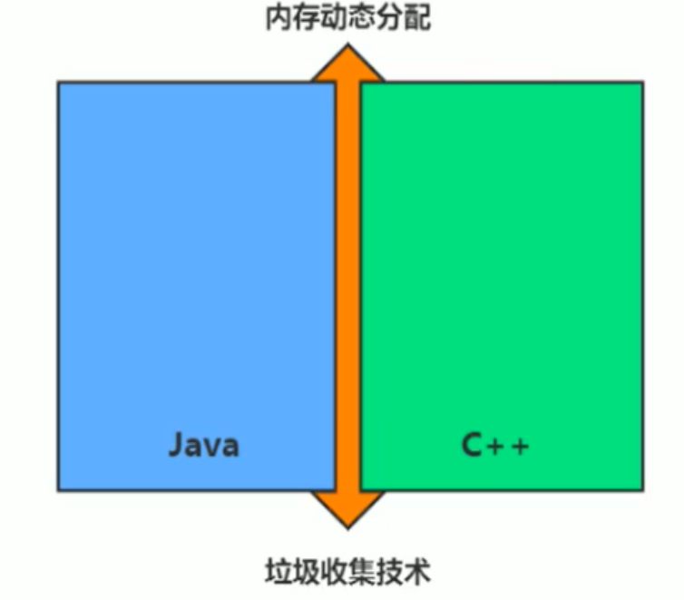
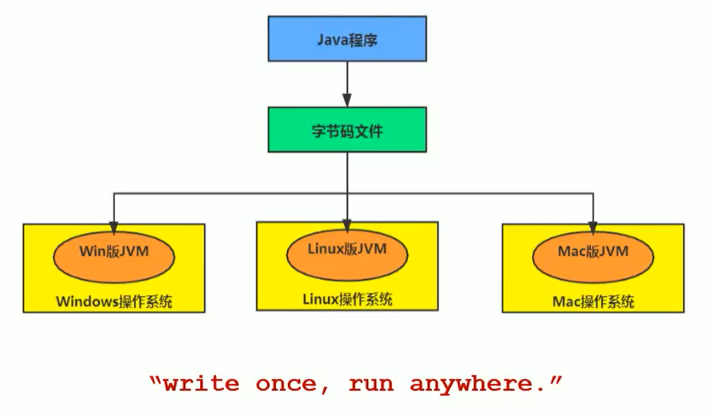
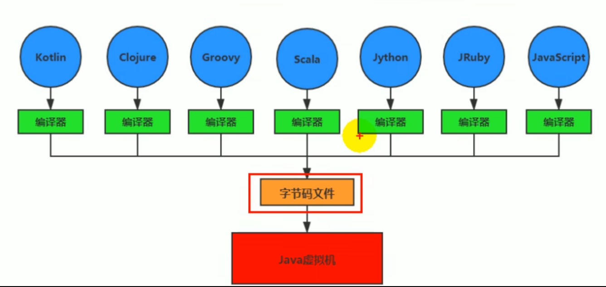
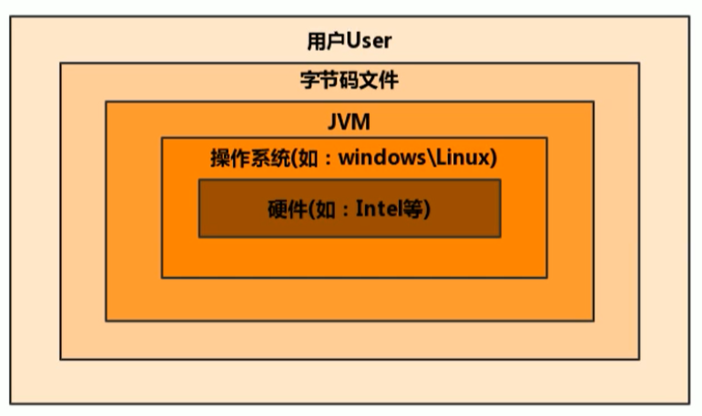
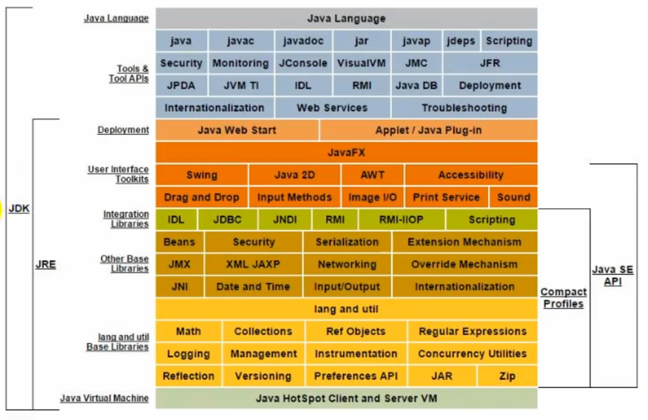
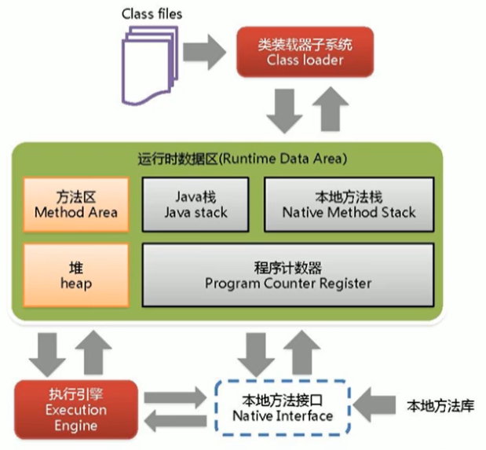
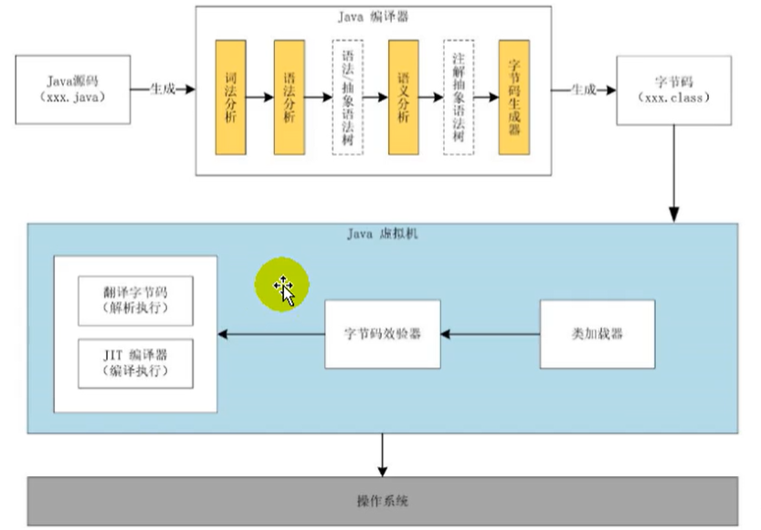

# 1.JVM和Java体系

---


## title: 1.JVM和Java体系  
date: 2023-10-17T16:20:25Z  
lastmod: 2023-11-02T15:25:26Z


# 1.JVM和Java体系





C++是没有垃圾回收机制的


**垃圾收集机制为我们打理了很多繁琐的工作，大大提高了开发的效率，但是，垃圾收集也不是万能的，懂得JVM内部的内存结构、工作机制，是设计高扩展性应用和诊断运行时问题的基础，也是Java工程师进阶的必备能力。**


# JVM：跨语言的平台


**Java是目前应用最为广泛的软件开发平台之一。随着Java以及Java社区的不断壮大Java 也早已不再是简简单单的一门计算机语言了，它更是一个平台、一种文化、一个社区。**


+  **作为一个平台，Java虚拟机扮演着举足轻重的作用** 
    - **Groovy、Scala、JRuby、Kotlin等都是Java平台的一部分**
+  **作为灯种文化，Java几乎成为了“开源”的代名词。** 
    - **第三方开源软件和框架。如Tomcat、Struts，MyBatis，Spring等。**
+  **就连JDK和JVM自身也有不少开源的实现，如openJDK、Harmony。** 





每种语言都需要转换成字节码文件，最后转换的字节码文件都能通过Java虚拟机进行运行和处理





+ **Java虚拟机根本不关心运行在其内部的程序到底是使用何种编程语言编写的，****它只关心“字节码”文件** **。也就是说Java虚拟机拥有语言无关性，并不会单纯地与Java语言“终身绑定”，只要其他编程语言的编译结果满足并包含Java虚拟机的内部指令集、符号表以及其他的辅助信息，它就是一个有效的字节码文件，就能够被虚拟机所识别并装载运行。**


## 字节码


+ **我们平时说的java字节码，指的是用java语言编译成的字节码。准确的说任何能在jvm平台上执行的字节码格式都是一样的。所以应该统称为：****jvm字节码** **。**
+ **不同的编译器，可以编译出相同的字节码文件，字节码文件也可以在不同的JVM上运行。**
+ **Java虚拟机与Java语言并没有必然的联系，它只与特定的二进制文件格式—Class文件格式所关联，Class文件中包含了Java虚拟机指令集（或者称为字节码、Bytecodes）和符号表，还有一些其他辅助信息。**


# 虚拟机和java虚拟机


所谓虚拟机（Virtual Machine），就是一台虚拟的计算机。它是一款软件，用来执行一系列虚拟计算机指令。大体上，虚拟机可以分为**系统虚拟机和程序虚拟机**。


+ 大名鼎鼎的Visual Box，Mware就属于系统虚拟机，它们完全是对物理计算机的仿真，提供了一个可运行完整操作系统的软件平台。
+ 程序虚拟机的典型代表就是**Java虚拟机**，它专门为执行单个计算机程序而设计，在Java虚拟机中执行的指令我们称为Java字节码指令


无论是系统虚拟机还是程序虚拟机，在上面运行的软件都被限制于虚拟机提供的资源中


● Java虚拟机就是二进制字节码的运行环境，负责装载字节码到其内部，解释/编译为对应平台上的机器指令执行。每一条Java指令，Java虚拟机规范中都有详细定义，如怎么取操作数，怎么处理操作数，处理结果放在哪里。


● 一次编译，到处运行  
● 自动内存管理  
● 自动垃圾回收功能


## JVM的位置





JDK的组成





# JVM的整体结构





# java代码的执行流程





Java原码经过编译器（汇编语言一套流程）生成字节码文件，将字节码文件给JVM执行


# JVM的架构流程


ava编译器输入的指令流基本上是一种**基于栈的指令集架构**，另外一种指令集架构则是**基于寄存器的指令集架构**。


**具体来说：这两种架构之间的区别：**


**基于栈式架构的特点**


+ **设计和实现更简单，适用于资源受限的系统**
+ **避开了寄存器的分配难题：使用****零地址指令****方式分配**
+ **指令流中的指令大部分是****零地址指令** **，其执行过程依赖于操作栈。指令集更小，编译器容易实现**
+ **不需要硬件支持，可移植性更好，更好实现跨平台**


**基于寄存器架构的特点**


+ **典型的应用是x86的二进制指令集：比如传统的PC以及Android的Davlik虚拟机**
+ **指令集架构则完全依赖硬件，可移植性差**
+ **性能优秀和执行更高效**
+ **花费更少的指令去完成一项操作**
+ **在大部分情况下，基于寄存器架构的指令集往往都以一地址指令、二地址指令和三地址指令为主，而基于栈式架构的指令集却是以零地址指令为主**


案例


**同样执行2+3这种逻辑操作，其指令分别如下：**


**基于栈的计算流程（以Java虚拟机为例）：**


```java
iconst_2 //常量2入栈
istore_1
iconst_3 // 常量3入栈
istore_2
iload_1
iload_2
iadd //常量2/3出栈，执行相加
istore_0 // 结果5入栈
```


**而基于寄存器的计算流程**


```java
mov eax,2 //将eax寄存器的值设为1
add eax,3 //使eax寄存器的值加3
```


**总结**


**由于跨平台性的设计，Java的指令都是根据栈来设计的。** 不同平台CPU架构不同，所以不能设计为基于寄存器的。优点是跨平台，指令集小，编译器容易实现，缺点是性能下降，实现同样的功能需要更多的指令。


**时至今日，尽管嵌入式平台已经不是Java程序的主流运行平台了（准确来说应该是HotSpotVM的宿主环境已经不局限于嵌入式平台了），那么为什么不将架构更换为基于寄存器的架构呢？**


# JVM的生命周期


**虚拟机的启动**


**Java虚拟机的启动是通过****引导类加载器（bootstrap class loader）** **创建一个初始类（initial class）来完成的，这个类是由虚拟机的****具体实现指定****的。**


**虚拟机的执行**


+ **一个运行中的Java虚拟机有着一个清晰的任务：执行Java程序。**
+ **程序开始执行时他才运行，程序结束时他就停止。**
+ 执行一个所谓的Java程序的时候，真真正正在执行的是一个叫做Java虚拟机的进程。


**虚拟机的退出**


**有如下的几种情况：**


+ 程序正常执行结束
+ 程序在执行过程中遇到了异常或错误而异常终止
+ 由于操作系统用现错误而导致Java虚拟机进程终止
+ 某线程调用Runtime类或system类的exit方法，或Runtime类的halt方法，并且Java安全管理器也允许这次exit或halt操作。
+ 除此之外，JNI（Java Native Interface）规范描述了用JNI Invocation API来加载或卸载 Java虚拟机时，Java虚拟机的退出情况。


‍


> 更新: 2024-06-16 20:21:55  
> 原文: <https://www.yuque.com/nibiwanxiamei/yrd6t1/e86bac6431772a50e66a9dbb9f0c2e8d>