# 11.垃圾回收概述及算法

***

# 垃圾回收概述

**垃圾收集，不是Java语言的伴生产物。早在1960年，第一门开始使用内存动态分配和垃圾收集技术的Lisp语言诞生。**

**关于垃圾收集有三个经典问题：**

* **哪些内存需要回收？**
* **什么时候回收？**
* **如何回收？**

\*\*垃圾收集机制是Java的招牌能力，\*\***极大地提高了开发效率** **。如今，垃圾收集几乎成为现代语言的标配，即使经过如此长时间的发展，Java的垃圾收集机制仍然在不断的演进中，不同大小的设备、不同特征的应用场景，对垃圾收集提出了新的挑战，这当然也是面试的热点。**

## 什么是垃圾

**An object is considered garbag when it can no longer be reached from any pointer in the running program**

**垃圾是指在运行程序中没有任何指针指向的对象，这个对象就是需要被回收的垃圾。**

## 为什么需要垃圾回收

**对于高级语言来说，如果不进行垃圾回收，内存迟早都会被消耗完** **，因为不断地分配内存空间而不进行回收。**

**除了释放没用的对象，垃圾回收也可以清除内存里的记录碎片。碎片整理将所占用的堆内存移到堆的一端，以便JVM将整理出的内存分配给新的对象** **。**

\*\*随着应用程序所应付的业务越来越庞大、复杂，用户越来越多，\*\***没有GC就不能保证应用程序的正常进行** **。而经常造成STW的GC又跟不上实际的需求，所以才会不断地尝试对GC进行优化。**

## 早期垃圾回收

**在早期的C/C++时代，垃圾回收基本上是手工进行的。开发人员可以使用new关键字进行内存申请，并使用delete关键字进行内存释放。比如以下代码：**

```c
MibBridge *pBridge= new cmBaseGroupBridge();
//如果注册失败，使用Delete释放该对象所占内存区域
if (pBridge->Register(kDestroy) != NO ERROR）
	delete pBridge;
```

**这种方式可以灵活控制内存释放的时间，但是会给开发人员带来\*\*\*\*频繁申请和释放内存的管理负担** **。倘若有一处内存区间由于程序员编码的问题忘记被回收，那么就会产生\*\*\*\*内存泄漏** **，垃圾对象永远无法被清除，随着系统运行时间的不断增长，垃圾对象所耗内存可能持续上升，直到出现内存溢出并造成\*\*\*\*应用程序崩溃** **。**

**现在，除了Java以外，C#、Python、Ruby等语言都使用了自动垃圾回收的思想，也是未来发展趋势，可以说这种自动化的内存分配和垃圾回收方式已经成为了现代开发语言必备的标准。**

## java垃圾回收机制

**自动内存管理，无需开发人员手动参与内存的分配与回收，这样降低内存泄漏和内存溢出的风险**

* **没有垃圾回收器，java也会和cpp一样，各种悬垂指针，野指针，泄露问题让你头疼不已。**

**自动内存管理机制，将程序员从繁重的内存管理中释放出来，可以更专心地专注于业务开发**

oracle官网关于垃圾回收的介绍 [https:\_docs.oracle.com\_javase\_8\_docs\_technotes\_guides\_vm\_gctuning\_toc](https://docs.oracle.com/javase/8/docs/technotes/guides/vm/gctuning/toc.html)

> **自动内存管理就像是一个黑匣子，如果过度依赖于“自动”，那么这将会是一场灾难，最严重的就会\*\*\*\*弱化Java开发人员在程序出现内存溢出时定位问题和解决问题的能力** **。**

**了解JVM的自动内存分配和内存回收原理就显得非常重要，只有在真正了解JVM是如何管理内存后，我们才能够在遇见outofMemoryError时，快速地根据错误异常日志定位问题和解决问题。**

**当需要排查各种内存溢出、内存泄漏问题时，当垃圾收集成为系统达到更高并发量的瓶颈时，我们就必须对这些“自动化”的技术\*\*\*\*实施必要的监控和调节。**

### GC主要关注的区域

**GC主要关注于 方法区 和堆中的垃圾收集**

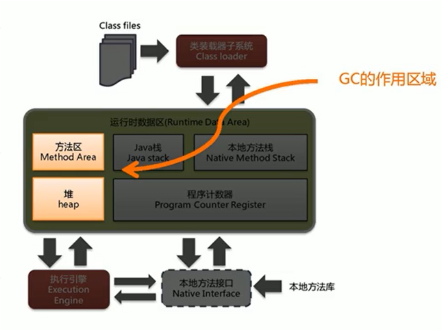

\*\*垃圾收集器可以对年轻代回收，也可以对老年代回收，甚至是全栈和方法区的回收。其中，\*\***Java堆是垃圾收集器的工作重点**

**从次数上讲：**

* **频繁收集Young区**
* **较少收集Old区**
* **基本不收集Perm区（元空间，方法区）**

# 垃圾回收算法

**对象存活判断**

**在堆里存放着几乎所有的Java对象实例，在GC执行垃圾回收之前，首先*****需要区分出内存中哪些是存活对象，哪些是已经死亡的对象*** **。只有被标记为己经死亡的对象，GC才会在执行垃圾回收时，释放掉其所占用的内存空间，因此这个过程我们可以称为垃圾标记阶段** **。当一个对象已经不再被任何的存活对象继续引用时，就可以宣判为已经死亡。**

**<font style="color:#DF2A3F;">判断对象存活一般有两种方式：引用计数算法和可达性分析算法</font>**<font style="color:#DF2A3F;"> </font>**<font style="color:#DF2A3F;">。</font>**

## 标记阶段：引用计数算法

### 引用计数算法

**引用计数算法（Reference Counting）比较简单，对每个对象保存一个整型的引用计数器属性。用于记录对象被引用的情况。**

**对于一个对象A，只要有任何一个对象引用了A，则A的引用计数器就加1；当引用失效时，引用计数器就减1。只要对象A的引用计数器的值为0，即表示对象A不可能再被使用，可进行回收。**

**优点：实现简单，垃圾对象便于辨识；判定效率高，回收没有延迟性。**

**缺点：**

* **它需要单独的字段存储计数器，这样的做法增加了\*\*\*\*存储空间的开销** **。**
* **每次赋值都需要更新计数器，伴随着加法和减法操作，这增加了\*\*\*\*时间开销** **。**
* **引用计数器有一个严重的问题，即**\*\*<font style="color:#DF2A3F;">无法处理循环引用</font>\*\*的情况。这是一条致命缺陷，导致在Java的垃圾回收器中没有使用这类算法。

### 循环引用

**当p的指针断开的时候，内部的引用形成一个循环，这就是循环引用**

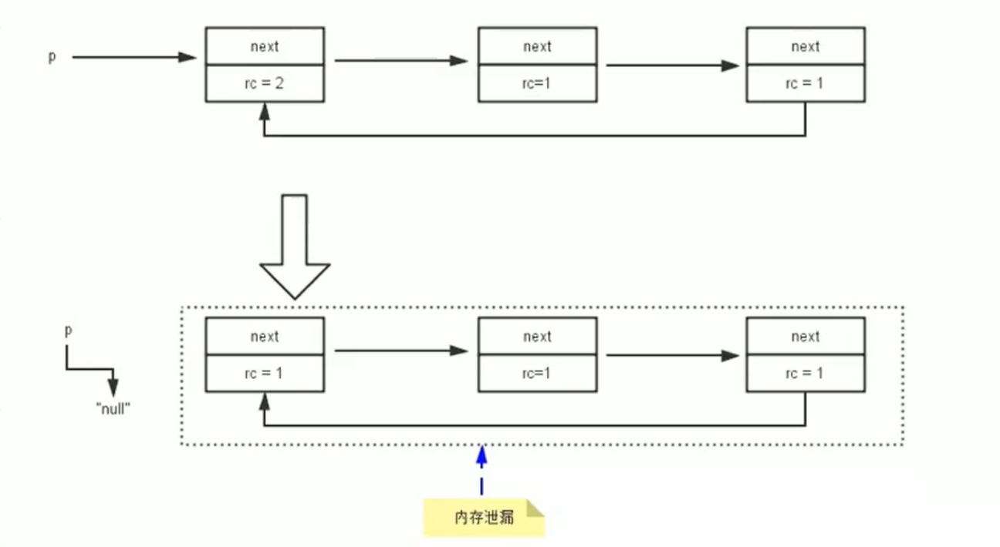

**测试Java中是否采用的是引用计数算法**

```java
public class RefCountGC {
    // 这个成员属性的唯一作用就是占用一点内存
    private byte[] bigSize = new byte[5*1024*1024];
    // 引用
    Object reference = null;

    public static void main(String[] args) {
        RefCountGC obj1 = new RefCountGC();
        RefCountGC obj2 = new RefCountGC();
      
        obj1.reference = obj2;
        obj2.reference = obj1;
      
        obj1 = null;
        obj2 = null;
        // 显示的执行垃圾收集行为
        // 这里发生GC，obj1和obj2是否被回收？
        System.gc();
    }
}
// 运行结果
PSYoungGen: 15490K->808K(76288K)] 15490K->816K(251392K)
```

**上述进行了GC收集的行为，所以可以证&#x660E;****JVM中采用的不是引用计数器****&#x7684;算法**

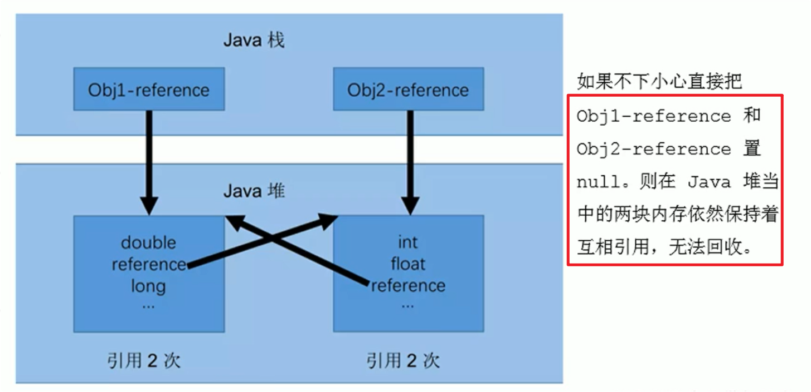

**Python如何解决循环引用？**

* **手动解除：很好理解，就是在合适的时机，解除引用关系。 使用弱引用weakref，weakref是Python提供的标准库，旨在解决循环引用。**

## **标记阶段：可达性分析算法**

### **可达性分析算法（****<font style="color:#DF2A3F;">根搜索算法</font>****、追踪性垃圾收集）**

**相对于引用计数算法而言，可达性分析算法不仅同样具备实现简单和执行高效等特点，更重要的是该算法可以有效地解决在引用计数算法中循环引用的问题，防止内存泄漏的发生** **。**

**相较于引用计数算法，这里的可达性分析就是Java、C#选择的。这种类型的垃圾收集通常也叫作追踪性垃圾收集（Tracing Garbage Collection）**

**所谓**<font style="color:#DF2A3F;"> </font>**<font style="color:#DF2A3F;">"GCRoots”</font>**<font style="color:#DF2A3F;"> </font>**<font style="color:#DF2A3F;">根集合是一组必须活跃的引用</font>\*\*\*\*。**

### **基本思路**

* **可达性分析算法是以根对象集合（GCRoots）为起始点，按照从上至下的方式\*\*\*\*搜索被根对象集合所连接的目标对象是否可达** **。**
* **使用可达性分析算法后，内存中的存活对象都会被根对象集合直接或间接连接着，搜索所走过的路径称为\*\*\*\*引用链（Reference Chain）**
* **若目标对象没有任何引用链相连，则是不可达的，该对象己经死亡，可以标记为垃圾对象。**
* **在可达性分析算法中，只有**\*\*<font style="color:#DF2A3F;">能够被根对象集合直接或者间接连接的对象才是存活对象</font>\*\*\*\*。\*\*

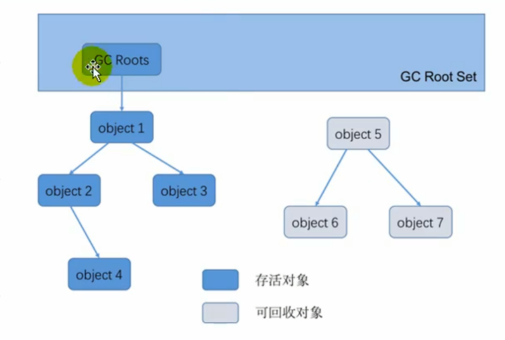

> 图的遍历，使用的对象**直接或者间接链接到GC Roots**下面

**在Java语言中，GC Roots包括以下几类元素：**

* **虚拟机**\*\*<font style="color:#DF2A3F;">栈中引用</font>\*\***的对象**
  * **比如：各个线程被调用的方法中使用到的参数、局部变量等。**
* **本地方法栈内JNI（通常说的本地方法）引用的对象**
* **方法区中**\*\*<font style="color:#DF2A3F;">类静态属性引用的对象</font>\*\*\*\* \*\*
* **比如：Java类的引用类型静态变量**
* \*\*方法区中常量引用的对象 \*\*
* **比如：字符串常量池（String Table）里的引用**
* **所有被同步锁synchronized持有的对象**
* **Java虚拟机内部的引用。**
  * **基本数据类型对应的Class对象，一些常驻的异常对象（如：NullPointerException、OutOfMemoryError），系统类加载器。**
* **反映java虚拟机内部情况的JMXBean、JVMTI中注册的回调、本地代码缓存等。**

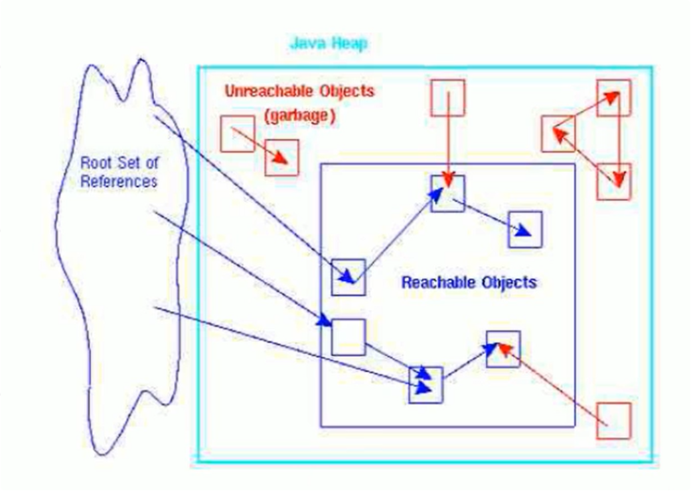

**除了这些固定的GC Roots集合以外，根据用户所选用的垃圾收集器以及当前回收的内存区域不同，还可以有其他对象“临时性”地加入，共同构成完整GC Roots集合。比如：分代收集和局部回收（PartialGC）。**

**如果只针对Java堆中的某一块区域进行垃圾回收（比如：典型的只针对新生代），必须考虑到内存区域是虚拟机自己的实现细节，更不是孤立封闭的，这个区域的对象完全有可能被其他区域的对象所引用，这时候就需要一并&#x5C06;****关联的区域对象****&#x4E5F;加入GCRoots集合中去考虑，才能保证可达性分析的准确性。**

**<font style="color:#DF2A3F;">小技巧：Root采用栈方式存放变量和指针，所以如果一个指针保存了堆内存里面的对象，但是自己不存放在堆内存里面，那它就是一个Root</font>**<font style="color:#DF2A3F;"> </font>**<font style="color:#DF2A3F;">。(单纯的引用)</font>**

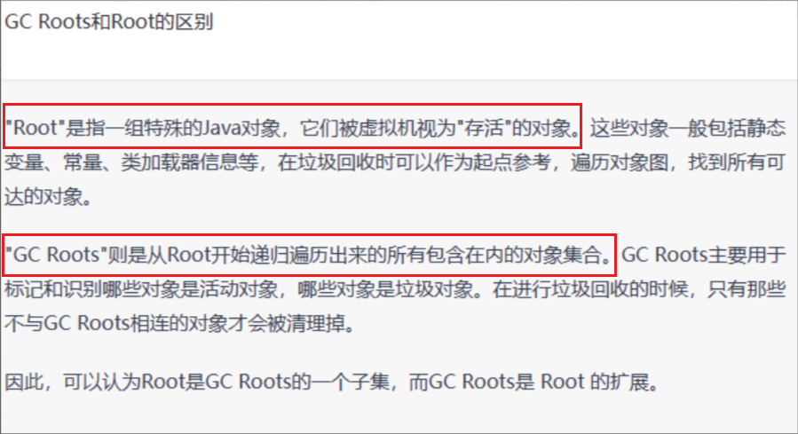

**注意**

**如果要使用可达性分析算法来判断内存是否可回收，那么分析工作必须在一个能保障一致性的快照中进行。这点不满足的话分析结果的准确性就无法保证。**

**这点也是导致GC进行时必须“stop The World”的一个重要原因。**

* \*\*即使是号称（几乎）不会发生停顿的CMS收集器中，\*\***枚举根节点时也是必须要停顿的** **。**

## **对象的finalization机制**

* **Java语言提供了对象终止（finalization）机制来允许开发人员提供\*\*\*\*对象被销毁之前的自定义处理逻辑** **。**
* **垃圾回收器回收垃圾对象之前，总会先调用这个对象的finalize()方法。**
* \*\*finalize() 方法允许在子类中被重写，\*\***用于在对象被回收时进行资源释放** **。通常在这个方法中进行一些资源释放和清理的工作，比如关闭文件、套接字和数据库连接等。**

**永远不要主动调用某个对象的finalize()方法，应该交给垃圾回收机制调用。理由包括下面三点：**

* **在finalize()时可能会导致\*\*\*\*对象复活** **。**
* **finalize()方法的执行时间是没有保障的，它完全由GC线程决定，极端情况下，若不发生GC，则finalize()方法将没有执行机会。**
* **一个糟糕的finalize()会严重影响Gc的性能。**

\*\*由于finalize()方法的存在，\*\***虚拟机中的对象一般处于三种可能的状态** **。**

### 生存还是死亡？

**如果从所有的根节点都无法访问到某个对象，此对象需要被回收。这时候它们暂时处于“缓刑”阶段。垃圾，有可能在某一个条件下“复活”自己** **，如果这样，那么对它的回收就是不合理的，为此，定义虚拟机中的对象可能的三种状态。如下：**

* **可触及的** **：从根节点开始，可以到达这个对象。 --  存活**
* **可复活的** **：对象的所有引用都被释放，但是对象有可能在finalize()中复活。 -- 垃圾**
* **不可触及的** **：对象的finalize()被调用，并且没有复活，那么就会进入不可触及状态。不可触及的对象不可能被复活，因为finalize()只会被调用一次** **。 -- 垃圾**

**以上3种状态中，是由于finalize()方法的存在，进行的区分。只有在对象不可触及时才可以被回收。**

### 具体过程

**判定一个对象objA是否可回收，至少要经历两次标记过程：**

1. **如果对象objA到GC Roots没有引用链，则进&#x884C;****第一次****&#x6807;记。**
2. **进行筛选，判断此对象是否有必要执行finalize()方法**
3. **如果对象objA没有重写finalize()方法，或者finalize()方法已经被虚拟机调用过，则虚拟机视为“没有必要执行”，objA被判定&#x4E3A;****不可触及****&#x7684;。**
4. **如果对象objA重写了finalize()方法，且还未执行过，那么objA会被插入&#x5230;****F-Queue****&#x961F;列中，由一个虚拟机自动创建的、低优先级的Finalizer线程触发其finalize()方法执行。**
5. **finalize()方法是对象逃脱死亡的最后机会** \*\*，稍后GC会对F-Queue队列中的对象进行第二次标记。如果objA在finalize()方法中与引用链上的任何一个对象建立了联系，那么在第二次标记时，objA会被移出“即将回收”集合。之后，对象会再次出现没有引用存在的情况。在这个情况下，finalize方法不会被再次调用，对象会直接变成不可触及的状态，也就是说，\*\***一个对象的finalize方法只会被调用一次** **。**

案例

```java
public class CanReliveObj {
    // 类变量，属于GC Roots的一部分
    public static CanReliveObj canReliveObj;

    @Override
    protected void finalize() throws Throwable {
        super.finalize();
        System.out.println("调用当前类重写的finalize()方法");
        canReliveObj = this;
    }

    public static void main(String[] args) throws InterruptedException {
        canReliveObj = new CanReliveObj();
        canReliveObj = null;
        System.gc();
        System.out.println("-----------------第一次gc操作------------");
        // 因为Finalizer线程的优先级比较低，暂停2秒，以等待它
        Thread.sleep(2000);
        if (canReliveObj == null) {
            System.out.println("obj is dead");
        } else {
            System.out.println("obj is still alive");
        }

        System.out.println("-----------------第二次gc操作------------");
        canReliveObj = null;
        System.gc();
        // 下面代码和上面代码是一样的，但是 canReliveObj却自救失败了
        Thread.sleep(2000);
        if (canReliveObj == null) {
            System.out.println("obj is dead");
        } else {
            System.out.println("obj is still alive");
        }

    }
}
-----------------第一次gc操作------------
调用当前类重写的finalize()方法
obj is still alive
-----------------第二次gc操作------------
obj is dead
```

**在第一次GC时，执行了finalize方法，但finalize()方法只会被调用一次，所以第二次该对象被GC标记并清除了。**

## **MAT与JProfiler的GC Roots溯源**

**MAT是Memory Analyzer的简称，它是一款功能强大的Java堆内存分析器。用于查找内存泄漏以及查看内存消耗情况。**

**MAT是于Eclipse开发的，是一款免费的性能分析工具。**

大家可以在<http://www.eclipse.org/mat/> 下载并使用MAT

**JProfiler的GC Roots溯源**

**我们在实际的开发中，一般不会查找全部的GC Roots，可能只是查找某个对象的整个链路，或者称为GC Roots溯源，这个时候，我们就可以使用JProfiler**

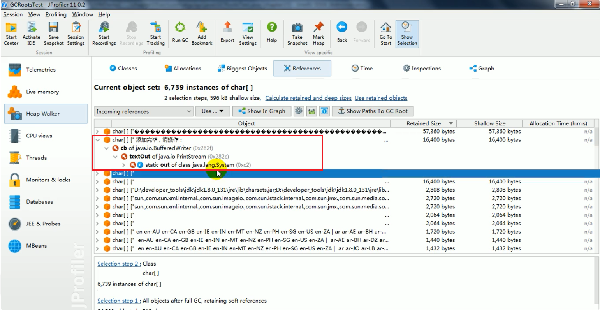

## **清除阶段：标记-清除算法（Mark-Sweep）**

**当成功区分出内存中存活对象和死亡对象后，GC接下来的任务就是执行垃圾回收，释放掉无用对象所占用的内存空间，以便有足够的可用内存空间为新对象分配内存。**

**目前在JVM中比较常见的三种垃圾收集算法是\*\*\*\*标记一清除算法（Mark-Sweep）、复制算法（copying）、标记-压缩算法（Mark-Compact）**

**执行过程**

**当堆中的有效内存空间（available memory）被耗尽的时候，就会停止整个程序（也被称为stop the world），然后进行两项工作，第一项则是标记，第二项则是清除**

* **标记**：Collector从引用根节点开始遍历，标记所有被引用的对象。一般是在**对象的Header中记录为可达对象**。
* **清除**：Collector对堆内存从头到尾进行线性的遍历，如果发现某个对象在其Header中没有标记为可达对象，则将其回收

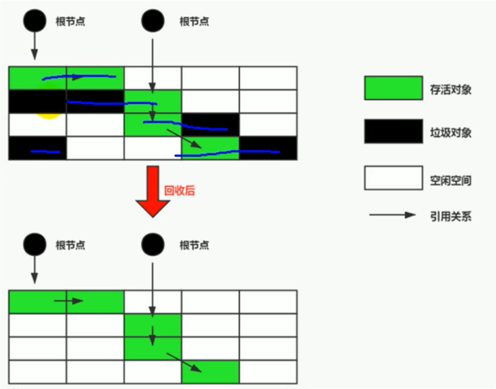

**缺点**

* **标记清除算法的效率不算高**
* **GC时，需要停止整个应用程序，用户体验较差**
* **清理出来的**\*\*<font style="color:#DF2A3F;">空闲内存不连续，产生内碎片</font>\*\*\*\*，需要维护一个空闲列表\*\*

**何为清除？**

**这里所谓的清除并不是真的置空，而是把需要清除的对象地址保存在空闲的地址列表里。下次有新对象需要加载时，判断垃圾的位置空间是否够，如果够，就存放覆盖原有的地址。**

## **清除阶段：复制算法**

**复制（Copying）算法**

**为了解决标记-清除算法在垃圾收集效率方面的缺陷，M.L.Minsky于1963年发表了著名的论文，“****使用双存储区的Lisp语言垃圾收集器****&#x43;A LISP Garbage Collector Algorithm Using Serial Secondary Storage）”。M.L.Minsky在该论文中描述的算法被人们称为复制（Copying）算法。**

**核心思想**

**将活着的内存空间分为两块**\*\*，每次只使用其中一块，在垃圾回收时将正在使用的内存中的存活对象复制到未被使用的内存块中，之后清除正在使用的内存块中的所有对象，交换两个内存的角色，最后完成垃圾回收\*\*

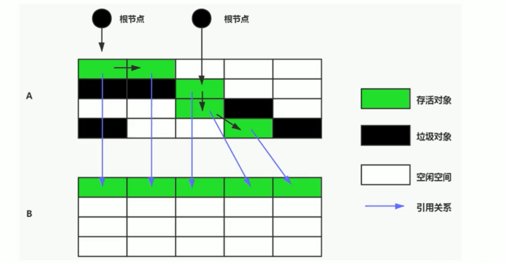

**优点**

* **没有标记和清除过程** **，实现简单，运行高效**
* **复制过去以后\*\*\*\*保证空间的连续性** **，不会出现“碎片”问题。**

**缺点**

* **此算法的缺点也是很明显的，就&#x662F;****需要两倍的内存****&#x7A7A;间。**
* **对于\*\*\*\*G1这种分拆成为大量region的GC**直接指针 **，复制而不是移动，意味着GC需要维护region之间对象引用关系，不管是内存占用或者时间开销也不小**
* \*\*存活对象很多\*\*\*\*的话。复制算法需要复制的存活对象就会很多，\*\***导致不理想** **。**

**应用场景**

**在\*\*\*\*新生代** **，对常规应用的垃圾回收，一次通常可以回收70% - 99% 的内存空间。回收性价比很高。所以现在的商业虚拟机都是用这种收集算法回收新生代。**

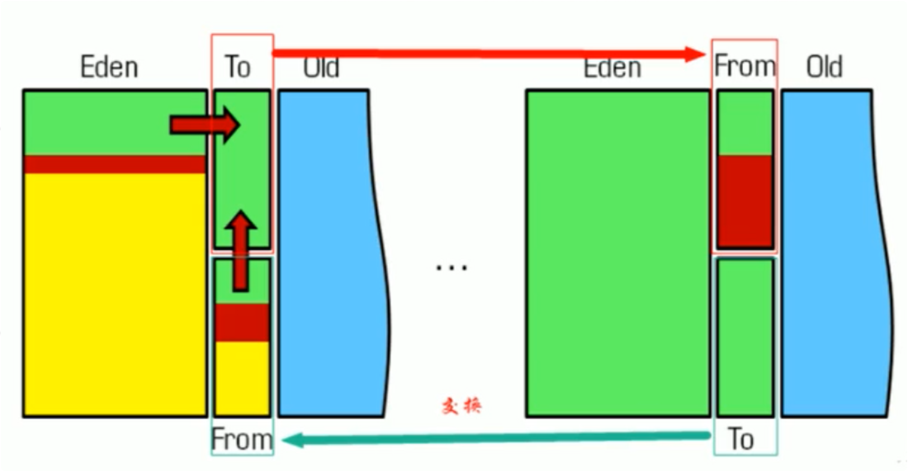

## **清除阶段：标记-压缩（整理）算法 - Mark-Compact**

**标记-压缩（或标记-整理、Mark-Compact）算法**

**复制算法的高效性是建立在存活对象少、垃圾对象多的前提下的。这种情况在新生代经常发生，但是在老年代，更常见的情况是大部分对象都是存活对象。如果依然使用复制算法，由于存活对象较多，复制的成本也将很高。**

**标记一清除算法的确可以应用在老年代中，但是该算法不仅执行效率低下，而且在执行完内存回收后还会产生内存碎片，所以JVM的设计者需要在此基础之上进行改进。标记-压缩（Mark-Compact）算法由此诞生。**

**执行过程**

1. 第一阶段和标记清除算法一样，从根节点开始**标记所有被引用对象**。
2. 第二阶段**将所有的存活对象压缩到内存的一端，按顺序排放**。
3. 之后，**清理边界外所有的空间**。

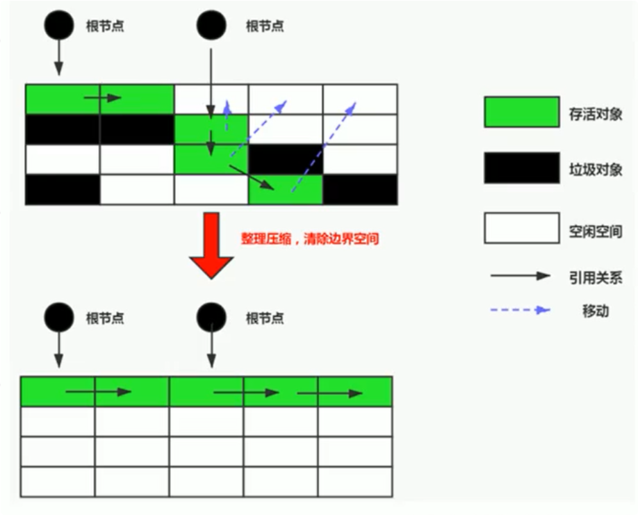

**标记-压缩算法的最终效果等同&#x4E8E;****标记-清除算法****&#x6267;行完成后，再进行一次内存碎片整理，因此，也可以把它称为\*\*\*\*标记-清除-压缩（Mark-Sweep-Compact）算法** **。**

**二者的本质差异在于标记-清除算法是一种非移动式的回收算法** **，标记-压缩是移动式的。是否移动回收后的存活对象是一项优缺点并存的风险决策。可以看到，标记的存活对象将会被整理，按照内存地址依次排列，而未被标记的内存会被清理掉。如此一来，当我们需要给新对象分配内存时，JVM只需要持有一个内存的起始地址即可，这比维护一个空闲列表显然少了许多开销。**

***

\*\*指针碰撞（Bump the Pointer）\*\*如果内存规整：虚拟机将采用的是指针碰撞法（Bump The Point）来为对象分配内存。

**优点**

* **消除了标记-清除算法当中，内存区域分散的缺点** **，我们需要给新对象分配内存时，JVM只需要持有一个内存的起始地址即可。**
* **消除了复制算法当中，内存减半的高额代价。**

**缺点**

* **从效率上来说，标记-整理算法要低于复制算法。**
* **移动对象的同时，如果对象被其他对象引用，则还需要调整引用的地址**
* **移动过程中，需要全程暂停用户应用程序。即：STW**

## 小结

| **Mark-Sweep** | **Mark-Compact** | **Copying** |
| --- | --- | --- |
| **中等** | **最慢** | **最快** |
| **少（但会堆积碎片）** | **少（不堆积碎片）** | **通常需要活对象的2倍空间（不堆积碎片）** |
| **否** | **是** | **是** |

**效率上来说，复制算法是当之无愧的老大，但是却浪费了太多内存。**

**而为了尽量兼顾上面提到的三个指标，标记-整理算法相对来说更平滑一些，但是效率上不尽如人意，它比复制算法多了一个标记的阶段，比标记-清除多了一个整理内存的阶段**

## 分代收集算法

\*\*分代收集算法：不同的对象的生命周期是不一样的。因此，\*\***不同生命周期的对象可以采取不同的收集方式** **，以便提高回收效率。一般是把Java堆分为新生代和老年代，这样就可以根据各个年代的特点使用不同的回收算法，以提高垃圾回收的效率。**

**在Java程序运行的过程中，会产生大量的对象，其中有些对象是与业务信息相关，比如\*\*\*\*Http请求中的Session对象、线程、Socket连接** \*\*，这类对象跟业务直接挂钩，因此生命周期比较长。但是还有一些对象，主要是程序运行过程中生成的临时变量，这些对象生命周期会比较短，比如：\*\***String对象** **，由于其不变类的特性，系统会产生大量的这些对象，有些对象甚至只用一次即可回收。**

**目前几乎所有的GC都采用分代收集算法执行垃圾回收的。**

**在HotSpot中，基于分代的概念，GC所使用的内存回收算法必须结合年轻代和老年代各自的特点。**

### 年轻代（Young Gen）

**年轻代特点：区域相对老年代较小，对象生命周期短、存活率低，回收频繁。**

**这种情&#x51B5;****复制算法****&#x7684;回收整理，速度是最快的。复制算法的效率只和当前存活对象大小有关，因此很适用于年轻代的回收。而复制算法内存利用率不高的问题，通过hotspot中的两个survivor的设计得到缓解。**

### 老年代（Tenured Gen）

**老年代特点：区域较大，对象生命周期长、存活率高，回收不及年轻代频繁。**

**这种情况存在大量存活率高的对象，复制算法明显变得不合适。一般是由\*\*\*\*标记-清除或者是标记-清除与标记-整理的混合实现** **。**

* **Mark阶段的开销与存活对象的数量成正比。**
* **Sweep阶段的开销与所管理区域的大小成正相关。**
* **Compact阶段的开销与存活对象的数据成正比。**

**以HotSpot中&#x7684;****CMS回收器****&#x4E3A;例，CMS是基于Mark-Sweep实现的，对于对象的回收效率很高。而对于碎片问题，CMS采用基于Mark-Compact算法的Serial Old回收器作为补偿措施：当内存回收不佳（碎片导致的Concurrent Mode Failure时），将采用Serial Old执行Full GC以达到对老年代内存的整理。**

**分代的思想被现有的虚拟机广泛使用。几乎所有的垃圾回收器都区分新生代和老年代**

## **增量收集算法、分区算法**

### **增量收集算法**

**上述现有的算法，在垃圾回收过程中，应用软件将处于一种Stop the World的状态。应用程序所有的线程都会挂起，暂停一切正常的工作，等待垃圾回收的完成。如果垃圾回收时间过长，应用程序会被挂起很久，将\*\*\*\*严重影响用户体验或者系统的稳定性** **。为了解决这个问题，即对实时垃圾收集算法的研究直接导致了增量收集（Incremental Collecting）算法的诞生。**

**基本思想**

**如果一次性将所有的垃圾进行处理，需要造成系统长时间的停顿，那么就可以让垃圾收集线程和应用程序线程交替执行。每次，垃圾收集线程只收集一小片区域的内存空间，接着切换到应用程序线程。依次反复，直到垃圾收集完成** **。**

**总的来说，增量收集算法的基础仍是传统的标记-清除和复制算法。增量收集算法通过\*\*\*\*对线程间冲突的妥善处理，允许垃圾收集线程以分阶段的方式完成标记、清理或复制工作**

**缺点**

\*\*使用这种方式，由于在垃圾回收过程中，间断性地还执行了应用程序代码，所以能减少系统的停顿时间。但是，因为线程切换和上下文转换的消耗，会使得垃圾回收的总体成本上升，\*\***造成系统吞吐量的下降** **。**

### 分区算法

**一般来说，在相同条件下，堆空间越大，一次Gc时所需要的时间就越长，有关GC产生的停顿也越长。为了更好地控制GC产生的停顿时间，将一块大的内存区域分割成多个小块，根据目标的停顿时间，每次合理地回收若干个小区间，而不是整个堆空间，从而减少一次GC所产生的停顿。**

**分代算法将按照对象的生命周期长短划分成两个部分，分区算法将整个堆空间划分成连续的不同小区间。**

**每一个小区间都独立使用，独立回收** **。这种算法的好处是可以控制一次回收多少个小区间。**

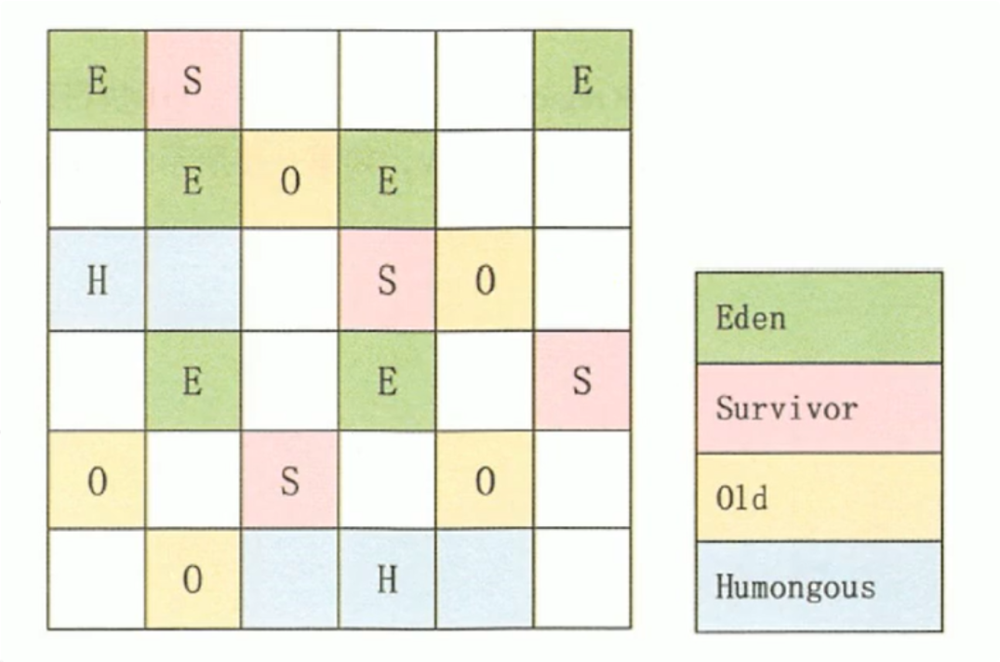

**注意，这些只是基本的算法思路，实际GC实现过程要复杂的多，目前还在发展中的前沿GC都是复合算法，并且并行和并发兼备。**

# 垃圾回收相关概念

## **System.gc()的理解**

\*\*在默认情况下，通过system.gc()或者Runtime.getRuntime().gc() 的调用，\*\***会显式触发Full GC** **，同时对老年代和新生代进行回收，尝试释放被丢弃对象占用的内存。**

**然而System.gc() 调用附带一个免责声明，无法保证对垃圾收集器的调用。(不能确保立即生效)**

\*\*可以通过System.gc() 调用来决定JVM的GC行为。而一般情况下，垃圾回收应该是自动进行的，\*\***无须手动触发** **。在一些特殊情况下，如我们正在编写一个性能基准，我们可以在运行之间调用System.gc()**

```java
public class SystemGCTest {
    public static void main(String[] args) {
        new SystemGCTest();
        System.gc();// 提醒JVM的垃圾回收器执行gc，但是不确定是否马上执行gc
        // 与Runtime.getRuntime().gc();的作用一样
      
        System.runFinalization();//强制执行使用引用的对象的finalize()方法
    }

    @Override
    protected void finalize() throws Throwable {
        super.finalize();
        System.out.println("SystemGCTest 重写了finalize()");
    }
}
```

```java
    public void localvarGC() {
        {
            byte[] buffer = new byte[10 * 1024 * 1024];
        }
        System.gc();
    }
```


这里gc不会回收代码块内的buffer，因为插槽空间还在。虽然他作用域在代码块内，按道理要收集，但是由于slot重写特性关于Slot的理解，所以不会被回收

```java
public void localvarGC() {
        {
            byte[] buffer = new byte[10 * 1024 * 1024];
        }
	int v = 10;
        System.gc();
    }
```

这样就回收，V会复用buffer占用的插槽，buffer就被回收了

## 内存溢出与内存泄露 ♥♥♥

### 内存溢出OOM

**由于GC一直在发展，一般情况下，除非应用程序占用的内存增长速度非常快** **，造成垃圾回收已经跟不上内存消耗的速度，否则不太容易出现OOM的情况。**

**大多数情况下，GC会进行各种年龄段的垃圾回收，实在不行了就来一次独占式的Full GC操作，这时候会回收大量的内存，供应用程序继续使用。**

\*\*javadoc中对OutOfMemoryError的解释是，\*\***没有空闲内存，并且垃圾收集器也无法提供更多内存** **。**

**没有空闲内存的情况说明Java虚拟机的堆内存不够。原因：**

1. \*\*Java虚拟机的堆内存设置不够。**可以通过参数 <code>**-Xms**</code> \*\* 、**  <code>**-Xmx**</code>**来调整 --  初始堆大小，最大堆大小**。
2. **代码中创建了大量大对象，并且长时间不能被垃圾收集器收集（存在被引用）**\
   对于老版本的Oracle JDK，因为永久代的大小是有限的，并且**JVM对永久代垃圾回收（如，常量池回收、卸载不再需要的类型）非常不积极**，所以当我们不断添加新类型的时候，永久代出现OutOfMemoryError也非常多见，尤其是在运行时存在大量动态类型生成的场合；类似intern字符串缓存占用太多空间，也会导致OOM问题。对应的异常信息，会标记出来和永久代相关：`java.lang.OutOfMemoryError: PermGen space` **"。**
3. 随着元数据区的引入，方法区内存已经不再那么窘迫，所以相应的OOM有所改观，出现OOM，异常信息则变成了： **“**`java.lang.OutofMemoryError:Metaspace` **"** 。直接内存不足，也会导致OOM。

**在抛出OutOfMemoryError之前，通常垃圾收集器会被触发，尽其所能去清理出空间。**

* **例如：在引用机制分析中，涉及到JVM会去尝试回收软引用指向的对象等。**
* **在**`java.nio.BIts.reserveMemory()`方法中，我们能清楚的看到，`System.gc()`会被调用，以清理空间。

**当然，也不是在任何情况下垃圾收集器都会被触发的**

* **比如，我们去分配一个超大对象，类似一个超大数组超过堆的最大值，JVM可以判断出垃圾收集并不能解决这个问题，所以直接抛出OutOfMemoryError。**

### 内存泄露

**<font style="color:#DF2A3F;">只有对象不会再被程序用到了，但是GC又不能回收的情况，才叫内存泄漏。</font>**

**但实际情况很多时候一些不太好的实践（或疏忽）会导致对象的生命周期变得很长甚至导致OOM，也可以叫做宽泛意义上的“内存泄漏”**  **。尽管内存泄漏并不会立刻引起程序崩溃，但是一旦发生内存泄漏，程序中的可用内存就会被逐步蚕食，直至耗尽所有内存，最终出现OutOfMemory异常，导致程序崩溃。**

**注意，这里的存储空间并不是指物理内存，而是指虚拟内存大小，这个虚拟内存大小取决于磁盘交换区设定的大小。**

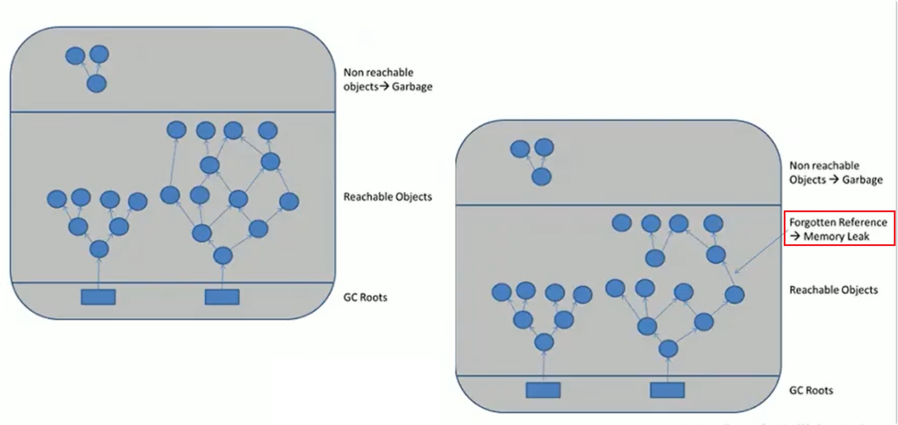

**有可能导致内存泄漏案例：**

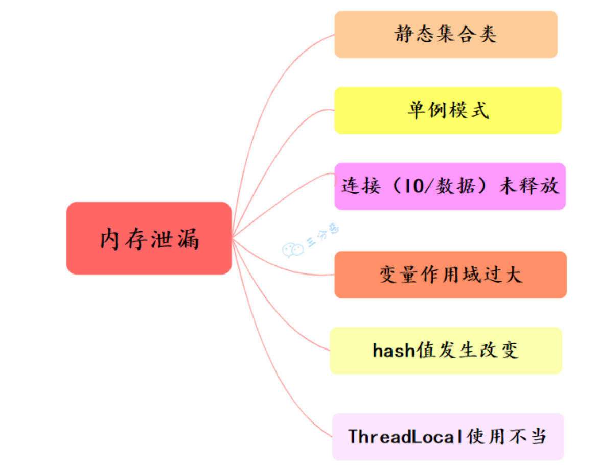

1. **<font style="color:#DF2A3F;">单例模式单例的生命周期和应用程序是一样长的</font>**，所以单例程序中，如果持有**对外部对象的引用**的话，那么这个外部对象是不能被回收的，则会导致内存泄漏的产生。
2. **<font style="color:#DF2A3F;">一些提供close的资源未关闭导致内存泄漏</font>**：数据库连接（dataSourse.getConnection() ），网络连接（socket）和io连接必须手动close，否则是不能被回收的。
3. \*\*<font style="color:#DF2A3F;">静态集合</font>****<font style="color:rgb(51,51,51);">的生命周期和 JVM 一致，所以静态集合引用的对象不能被释放</font>**** \*\*
4. **<font style="color:#DF2A3F;">ThreadLocal使用不当，key删除后没有remove掉对应的value</font>**
5. <font style="color:rgb(51,51,51);">一个变量量的定义作用域大于其使用范围，很可能存在内存泄漏；或不再使用对象没有及时将对象设置为 null，很可能导致内存泄漏的发生。</font>\*\* \*\*

## **Stop The World**

**Stop-the-World，简称STW，指的是GC事件发生过程中，会产生\*\*\*\*应用程序的停顿** \*\*。\*\***停顿产生时整个应用程序线程都会被暂停，没有任何响应** **，有点像卡死的感觉，这个停顿称为STW。**

**可达性分析算法中**\*\*<font style="color:#DF2A3F;">枚举根节点（GC Roots）会导致所有Java执行线程停顿</font>\*\*\*\*。\*\*

* **分析工作必须在一个能确保一致性的快照中进行**
* **一致性指整个分析期间整个执行系统看起来像被冻结在某个时间点上**
* **如果出现分析过程中对象引用关系还在不断变化，则分析结果的准确性无法保证**

**被STW中断的应用程序线程会在完成GC之后恢复，频繁中断会让用户感觉像是网速不快造成电影卡带一样，所以我们需要减少STW的发生。**

**STW事件和采用哪款GC无关，所有的GC都有这个事件。**

**哪怕是G1也不能完全避免Stop-the-World情况发生，只能说垃圾回收器越来越优秀，回收效率越来越高，尽可能地缩短了暂停时间。**

**STW是JVM在后台自动发起和自动完成的**。在用户不可见的情况下，把用户正常的工作线程全部停掉。

**开发中不要用System.gc() 会导致Stop-the-World的发生。**

## **垃圾回收的并行与并发**

* 并发，指的是多个事情，在同一时间段内同时发生了。
* 并行，指的是多个事情，在同一时间点上同时发生了。
* 并发的多个任务之间是互相抢占资源的。
* 并行的多个任务之间是不互相抢占资源的。
* 只有在多CPU或者一个CPU多核的情况中，才会发生并行。
* 否则，看似同时发生的事情，其实都是并发执行的。

**垃圾回收的并发与并行**

**并发和并行，在谈论垃圾收集器的上下文语境中，它们可以解释如下：**

**并行（Parallel）**

**指**\*\*<font style="color:#DF2A3F;">多条垃圾收集线程并行工作</font>\*\*\*\*，但此时用户线程仍处于等待状态。如ParNew、Parallel Scavenge、Parallel Old；\*\*

**串行（Serial）**

**相较于并行的概念，单线程执行。如果内存不够，则程序暂停，启动JM垃圾回收器进行垃圾回收。回收完，再启动程序的线程。**

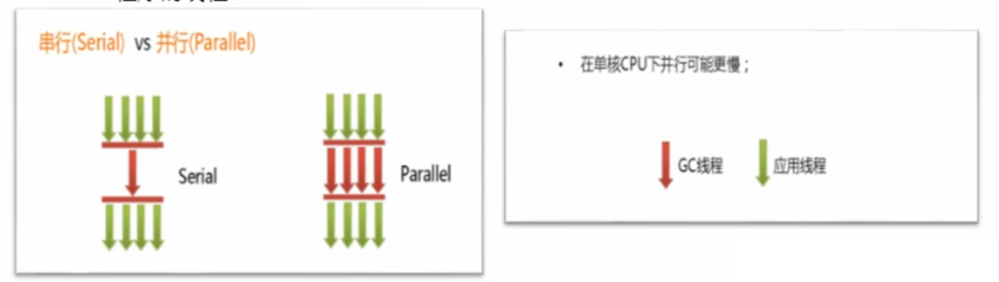

**并发（Concurrent）**

**指**\*\*<font style="color:#DF2A3F;">用户线程与垃圾收集线程同时执行</font>****（但不一定是并行的，可能会交替执行\*\* \*\*），垃圾回收线程在执行时不会停顿用户程序的运行。用户程序在继续运行，而垃圾收集程序线程运行于另一个CPU上；如：****<font style="color:#DF2A3F;">CMS、G1</font>\*\*

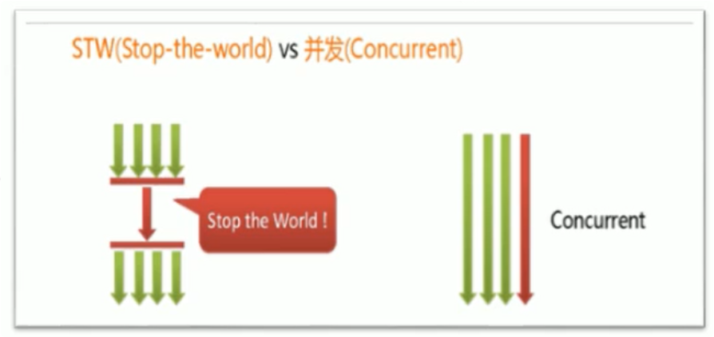

## 安全点和安全区域

### 安全点

**程序执行时并非在所有地方都能停顿下来开始GC，只有在特定的位置才能停顿下来开始GC，这些位置称为“安全点（Safepoint）”。**

\*\*Safe Point的选择很重要，\*\***如果太少可能导致GC等待的时间太长，如果太频繁可能导致运行时的性能问题** \*\*。大部分指令的执行时间都非常短暂，通常会根据“\*\***是否具有让程序长时间执行的特征** **”为标准。比如：选择一些执行时间较长的指令作为Safe Point，如\*\*\*\*方法调用、循环跳转和异常跳转等** **。**

**如何在GC发生时，检查所有线程都跑到最近的安全点停顿下来呢？**

#### 抢先式中断：（目前没有虚拟机采用了）

* **首先中断所有线程。如果还有线程不在安全点，就恢复线程，让线程跑到安全点。**

#### 主动式中断

**设置一个中断标志，各个线程运行到Safe Point的时候主动轮询这个标志，如果中断标志为真，则将自己进行中断挂起。（有轮询的机制）**

### 安全区域（Safe Resion）

**Safepoint 机制保证了程序执行时，在不太长的时间内就会遇到可进入GC的Safepoint。但是，程序“不执行”的时候呢？例如线程处于Sleep 状态或Blocked 状态，这时候线程无法响应JVM的中断请求，“走”到安全点去中断挂起，JVM也不太可能等待线程被唤醒。对于这种情况，就需要安全区域（Safe Region）来解决。**

**<font style="color:#DF2A3F;">安全区域是指在一段代码片段中，对象的引用关系不会发生变化，在这个区域中的任何位置开始Gc都是安全的。 我们也可以把Safe Region看做是被扩展了的Safepoint。</font>**

### 实际执行时：

1. **当线程运行到Safe Region的代码时，首先标识已经进入了Safe Relgion，如果这段时间内发生GC，JVM会忽略标识为Safe Region状态的线程**
2. **当线程即将离开Safe Region时，会检查JVM是否已经完成GC，如果完成了，则继续运行，否则线程必须等待直到收到可以安全离开Safe Region的信号为止**

## **再谈引用：强引用**

**我们希望能描述这样一类对象：当内存空间还足够时，则能保留在内存中；如果内存空间在进行垃圾收集后还是很紧张，则可以抛弃这些对象。**

**【既\*\*\*\*偏门**又非常**高频**的面试题】强引用、软引用、弱引用、虚引用有什么区别？具体使用场景是什么？

**引用分为：强引用（Strong Reference）、软引用（Soft Reference）、弱引用（Weak Reference）、虚引用（Phantom Reference）这4种引用强度依次逐渐减弱。**

***

**除强引用外，其他3种引用均可以在java.lang.ref包中找到它们的身影。如下图，显示了这3种引用类型对应的类，开发人员可以在应用程序中直接使用它们。**

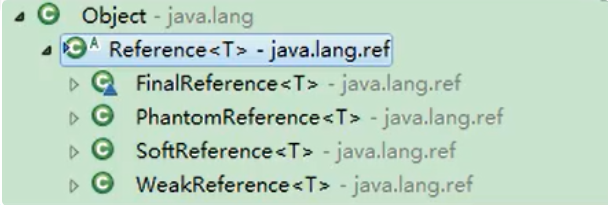

**Reference子类中只有终结器引用是包内可见的，其他3种引用类型均为public，可以在应用程序中直接使用**

* **强引用（StrongReference）**  **：最传统的“引用”的定义，是指在程序代码之中普遍存在的引用赋值，即类似“**`Object obj = new Object()`”这种引用关系。无论任何情况下，只要强引用关系还存在，垃圾收集器就永远不会回收掉被引用的对象。
* **软引用（SoftReference）**  **：在系统将要发生内存溢出之前，将会把这些对象列入回收范围之中进行第二次回收。如果这次回收后还没有足够的内存，才会抛出内存流出异常。**
* **弱引用（WeakReference）**  **：被弱引用关联的对象只能生存到下一次垃圾收集之前。当垃圾收集器工作时，无论内存空间是否足够，都会回收掉被弱引用关联的对象。**
* **虚引用（PhantomReference）**  **：一个对象是否有虚引用的存在，完全不会对其生存时间构成影响，也无法通过虚引用来获得一个对象的实例。为一个对象设置虚引用关联的唯一目的就是能在这个对象被收集器回收时收到一个系统通知。**

### 强引用（Strong Reference）——不回收

**在Java程序中，最常见的引用类型是强引用（普通系统99%以上都是强引用** **），也就是我们最常见的普通对象引用，也是默认的引用类型** **。**

**当在Java语言中使用new操作符创建一个新的对象，并将其赋值给一个变量的时候，这个变量就成为指向该对象的一个强引用。**

**强引用的对象是可触及的，垃圾收集器就永远不会回收掉被引用的对象。**

**对于一个普通的对象，如果没有其他的引用关系，只要超过了引用的作用域或者显式地将相应（强）引用赋值为null，就是可以当做垃圾被收集了，当然具体回收时机还是要看垃圾收集策略。**

\*\*相对的，软引用、弱引用和虚引用的对象是软可触及、弱可触及和虚可触及的，在一定条件下，都是可以被回收的。所以，\*\***强引用是造成Java内存泄漏的主要原因之一** **。**

**强引用例子**

```java
StringBuffer str = new StringBuffer("hello mogublog");
```

**局部变量str指向StringBuffer实例所在堆空间，通过str可以操作该实例，那么str就是StringBuffer实例的强引用**

## **再谈引用： 软引用**

**软引用（Soft Reference）——内存不足即回收**

软引用是用来描述一些**还有用，但非必需**的对象。只被软引用关联着的对象，在系统**将要发生内存溢出异常前，会把这些对象列进回收范围之中进行第二次回收**，**如果这次回收还没有足够的内存，才会抛出内存溢出异常。**

软引用通常用来实现内存敏感的缓存。比如：高速缓存就有用到软引用。如果还有空闲内存，就可以暂时保留缓存，当内存不足时清理掉，这样就保证了使用缓存的同时，不会耗尽内存。

垃圾回收器在某个时刻决定回收软可达的对象的时候，会清理软引用，并可选地把引用存放到一个引用队列（Reference Queue）。

类似弱引用，只不过Java虚拟机会尽量让软引用的存活时间长一些，迫不得已才清理。

在JDK1.2版之后提供了**java.lang.ref.SoftReference**类来实现软引用

```java
Object obj = new Object(); // 声明强引用
SoftReference<Object> sf = new SoftReference<>(obj);
obj = null; //销毁强引用
```

## **再谈引用：弱引用**

### 弱引用（Weak Reference）——发现即回收

**弱引用也是用来描述那些非必需对象，只被弱引用关联的对象只能生存到下一次垃圾收集发生为止** **。在系统GC时，只要发现弱引用，不管系统堆空间使用是否充足，都会回收掉只被弱引用关联的对象。**

\*\*但是，由于垃圾回收器的线程通常优先级很低，因此，并不一定能很快地发现持有弱引用的对象。在这种情况下，\*\***弱引用对象可以存在较长的时间** **。**

**弱引用和软引用一样，在构造弱引用时，也可以指定一个引用队列，当弱引用对象被回收时，就会加入指定的引用队列，通过这个队列可以跟踪对象的回收情况。**

**软引用、弱引用都非常适合来保存那些可有可无的缓存数据** **。如果这么做，当系统内存不足时，这些缓存数据会被回收，不会导致内存溢出。而当内存资源充足时，这些缓存数据又可以存在相当长的时间，从而起到加速系统的作用。**

**在JDK1.2版之后提供了WeakReference类来实现弱引用**

```java
Object obj = new Object(); // 声明强引用
WeakReference<Object> sf = new WeakReference<>(obj);
obj = null; //销毁强引用
```

**弱引用对象与软引用对象的最大不同就在于，当GC在进行回收时，需要通过算法检查是否回收软引用对象，而对于弱引用对象，GC总是进行回收**。**弱引用对象更容易、更快被GC回收** **。**

**面试题：你开发中使用过WeakHashMap吗？**

**WeakHashMap用来存储图片信息，可以在内存不足的时候，及时回收，避免了OOM**

## **再谈引用：虚引用**

### 虚引用（Phantom Reference）——对象回收跟踪

**也称为“幽灵引用”或者“幻影引用”，是所有引用类型中最弱的一个。**

**一个对象是否有虚引用的存在，完全不会决定对象的生命周期。如果一个对象仅持有虚引用，那么它和没有引用几乎是一样的，随时都可能被垃圾回收器回收。**

**它不能单独使用，也无法通过虚引用来获取被引用的对象。当试图通过虚引用的get()方法取得对象时，总是null**

**为一个对象设置虚引用关联的唯一目的在于**\*\*<font style="color:#DF2A3F;">跟踪垃圾回收过程</font>\*\*\*\*。比如：能在这个对象被收集器回收时收到一个系统通知。\*\*

**虚引用必须和引用队列一起使用。虚引用在创建时必须提供一个引用队列作为参数。当垃圾回收器准备回收一个对象时，如果发现它还有虚引用，就会在\*\*\*\*回收对象后，将这个虚引用加入引用队列，以通知应用程序对象的回收情况** **。**

**由于虚引用可以跟踪对象的回收时间，因此，也可以将一些资源释放操作放置在虚引用中执行和记录。**

**在JDK1.2版之后提供了PhantomReference类来实现虚引用。**

```java
Object obj = new Object(); // 声明强引用
ReferenceQueue phantomQueue = new ReferenceQueue();
PhantomReference<Object> sf = new PhantomReference<>(obj, phantomQueue);
obj = null;
```

## **终结器引用**

**它用于实现对象的finalize() 方法，也可以称为终结器引用。无需手动编码，其内部配合引用队列使用。**

**在GC时，终结器引用入队。由Finalizer线程通过终结器引用找到被引用对象调用它的finalize()方法，第二次GC时才回收被引用的对象**

‍


> 更新: 2024-08-20 10:46:17  
> 原文: <https://www.yuque.com/nibiwanxiamei/yrd6t1/e82a4456a3f3182feb307d18aae0bff2>