# 2.类加载子系统

---

# 内存结构概述


+  **Class文件** 
+  **类加载子系统** 
+  **运行时数据区** 
    - **方法区**
    - **堆**
    - **程序计数器**
    - **虚拟机栈**
    - **本地方法栈**
+  **执行引擎** 
+  **本地方法接口** 
+  **本地方法库** 


简图


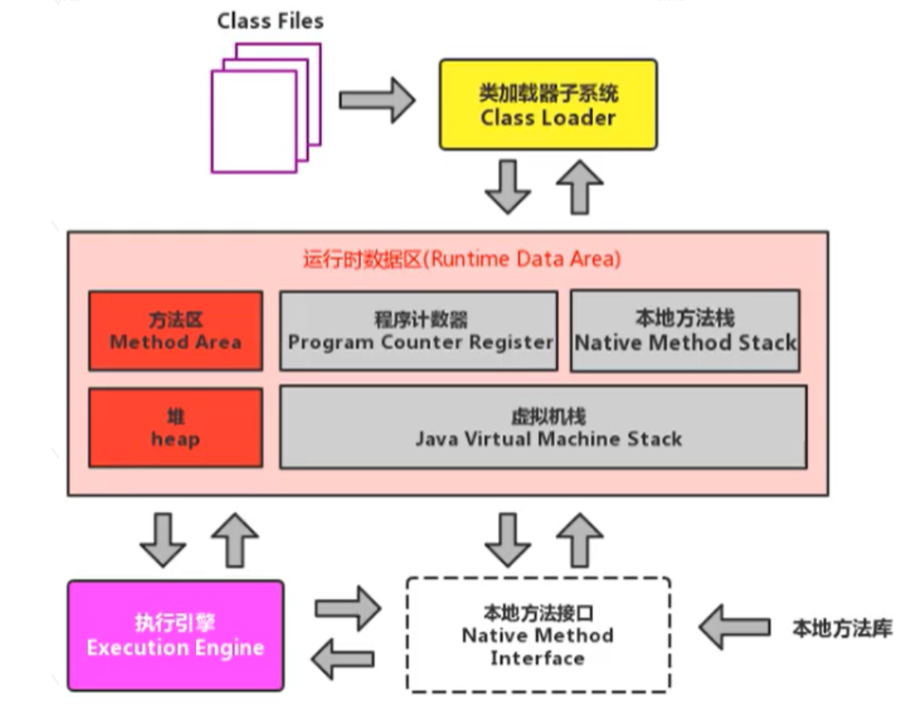


复杂一点的图


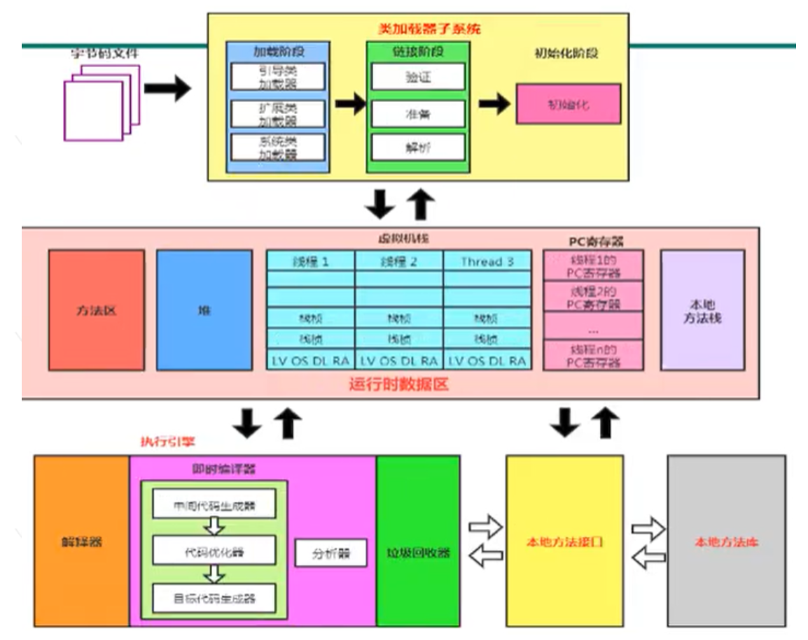


# 类加载器与类的加载过程


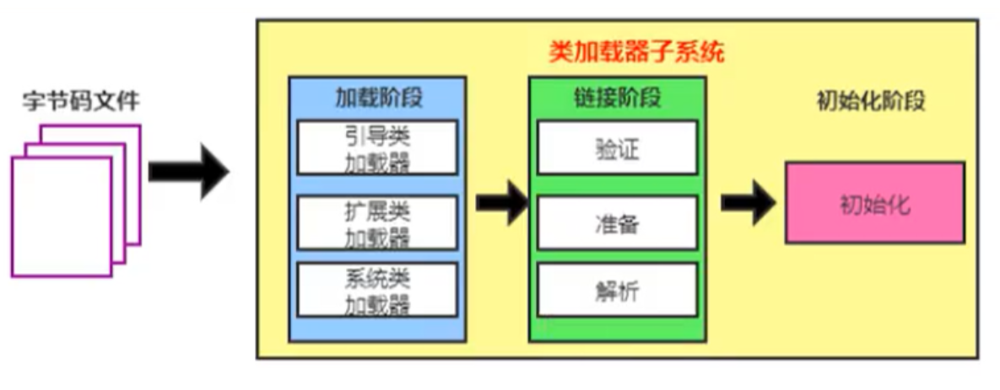


+ 类加载器子系统负责从文件系统或者网络中加载Class文件，class文件在文件开头有特定的文件标识 **。**
+ **ClassLoader只负责class文件的加载，至于它是否可以运行，则由Execution Engine决定。**
+ 加载的类信息存放于一块称为**方法区**的内存空间。除了**类的信息**外，方法区中还会存放**运行时常量池信息，可能还包括字符串字面量和数字常量**（这部分常量信息是Class文件中常量池部分的内存映射)


**类装载器Class Loader**


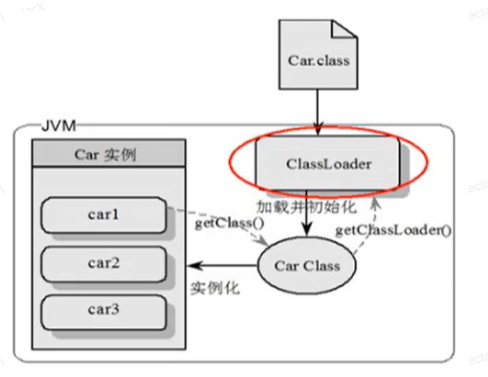


+ **class file存在于本地硬盘上，可以理解为设计师画在纸上的模板，而最终这个模板在执行的时候是要加载到JVM当中来根据这个文件实例化出n个一模一样的实例。**
+ **class file加载到JVM中，被称为DNA元数据模板，放在方法区。**
+ **在.class文件->JVM->最终成为元数据模板，此过程就要一个运输工具（类装载器Class Loader），扮演一个快递员的角色。**


## 加载过程


```java
/**
 *示例代码
 */
public class HelloLoader {
    public static void main(String[] args) {
        System.out.println("Hello World!");
    }
}
```


**用流程图表示上述示例代码：**


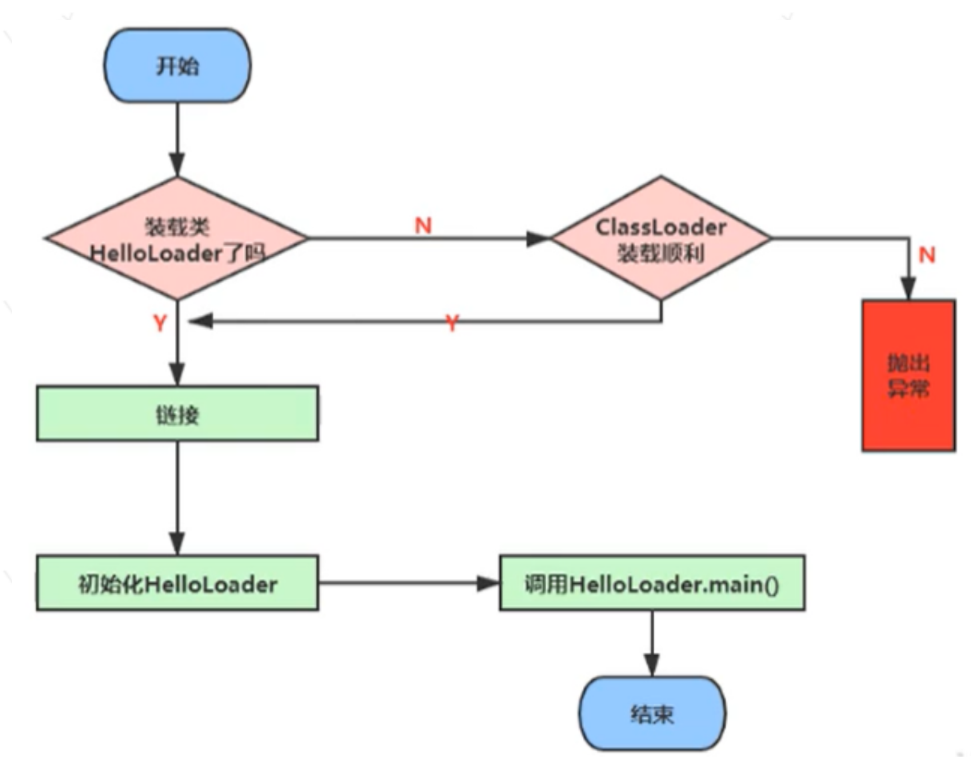


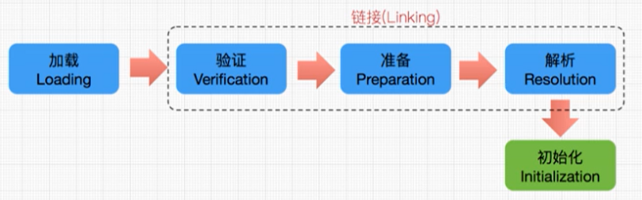


### 加载 - Loading


1.  **通过一个类的全限定名获取定义此类的二进制字节流** 
2.  **将这个字节流所代表的静态存储结构转化为方法区的运行时数据结构** 
3.  **在内存中生成一个代表这个类的java.lang.Class对象** **，作为方法区这个类的各种数据的访问入口** 


### 链接 - Linking


+  **验证（Verify）** ： 
    - **目的在子确保Class文件的字节流中包含信息符合当前虚拟机要求，****保证被加载类的正确性** **，不会危害虚拟机自身安全。**
    - **主要包括四种验证：** 文件格式验证，元数据验证，字节码验证，符号引用验证。

---

+  **准备（Prepare）** ： 
    - **为类变量（****Static** **）分配内存**并且设置该类变量的**默认初始值，即零值。**
    - **这里****不包含用final修饰的static** **，因为****final在编译的时候就会分配了** **，准备阶段会显式初始化；**
    - **这里不会为实例变量分配初始化**，**类变量会分配在方法区中，而实例变量是会随着对象一起分配到Java堆中。** （此时还没有创建对象，因此对象相关的都不会有）

---

+  **解析（Resolve）** ： 
    - **将常量池内的符号引用转换为直接引用的过程。**
    - 事实上，解析操作往往会伴随着JVM在执行完初始化之后再执行。
    - 符号引用就是一组符号来描述所引用的目标。符号引用的字面量形式明确定义在《java虚拟机规范》的Class文件格式中。直接引用就是直接指向目标的指针、相对偏移量或一个间接定位到目标的句柄。
    - 解析动作主要针对类或接口、字段、类方法、接口方法、方法类型等。对应常量池中的CONSTANT_Class_info，CONSTANT_Fieldref_info， CONSTANT_Methodref_info等。


### 初始化 - Initialization


+  **初始化阶段就是执行类构造器方法<clinit>()的过程。此方法不需定义，是javac编译器自动收集类中的****所有类变量的赋值动作和静态代码块中的语句合并****而来。** 
    -  

```java
public class ClassInitTest {
    private static int num = 1;
    static {
        num = 2;
    }

    public static void main(String[] args) {
        System.out.println(ClassInitTest.num);
    }
}
```

 

    - 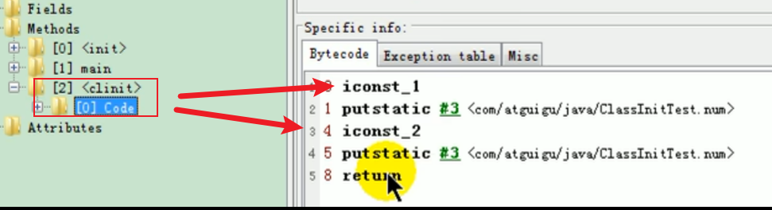
+  **构造器方法中指令按语句在源文件中出现的****顺序执行** **。** 
    - 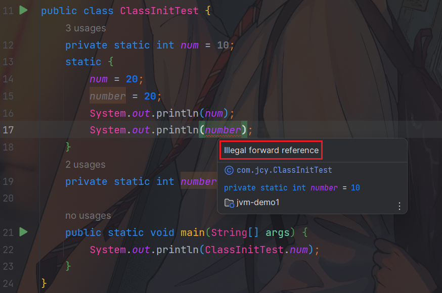
    - 这里**number赋值不会错误**，因为静态常量在链接的**prepared准备阶段**就已经**赋值为0**了，所以在静态代码块先赋值是允许的，这个时候已经有了number，在方法区内，但是不能打印，也就是不能调用，否则就报错非法前向引用。
+  **<clinit>()不同于类的构造器，有相关操作才会有这个方法（static常量定义赋值）。** （关联：构造器是虚拟机视角下的()） 
+  **若该类具有父类，JVM会保证子类的<clinit>()执行前，父类的<clinit>()已经执行完毕。** 
+  **虚拟机必须保证一个类的<clinit>()方法在多线程下被同步加锁。** 


# 类加载器分类


**JVM支持两种类型的类加载器 。** 分别为**引导类加载器（Bootstrap ClassLoader）和自定义类加载器（User-Defined ClassLoader）。**


从概念上来讲，自定义类加载器一般指的是程序中由开发人员自定义的一类类加载器，但是Java虚拟机规范却没有这么定义，而是**将所有派生于抽象类ClassLoader的类加载器都划分为自定义类加载器。**


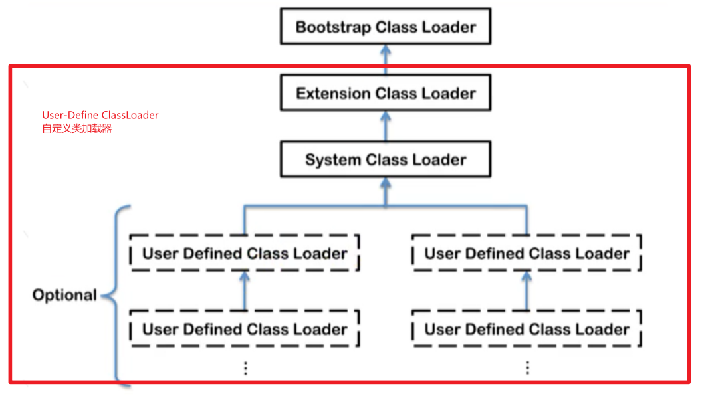


**这里的四者之间的关系是包含关系。不是上层下层，也不是子父类的继承关系**


> 系统类加载器上层是扩展类加载器，扩展类加载器上层是引导类加载器
>


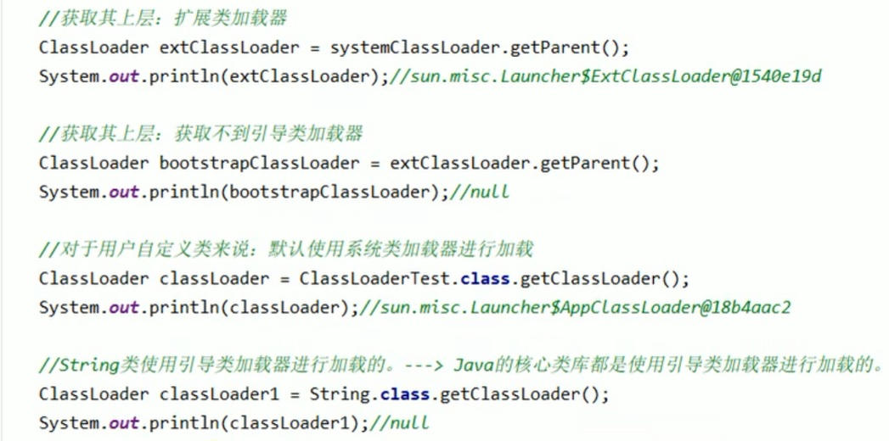


## 虚拟机自带的加载器


### 启动类加载器 - 引导类加载器，Bootstrap ClassLoader


> **此类加载器无法在代码中获取到  输出为null**
>
>  
>
> **java核心类库都是引导类加载器进行加载的**
>


+ **这个类加载使用****C/C++语言****实现的，嵌套在****JVM内部** **。**
+ **它用来加载Java的核心库（JAVA_HOME/jre/lib/rt.jar、resources.jar或sun.boot.class.path路径下的内容），用于提供JVM自身需要的类**
+ **并不继承自java.lang.ClassLoader，没有父加载器。**
+ **加载扩展类和应用程序类加载器，并指定为他们的父类加载器**（也就是上层） **。**
+ **出于安全考虑，Bootstrap启动类加载器只加载包名为****java、javax、sun等开头的类**


### 扩展类加载器 - Extension ClassLoader


+ **Java语言编写** **，由sun.misc.Launcher$ExtClassLoader实现。**
+ **派生于ClassLoader类**
+ **父类加载器为启动类加载器**
+ **从java.ext.dirs系统属性所指定的目录中加载类库，或从JDK的安装目录的jre/1ib/ext子目录（扩展目录）下加载类库。****如果用户创建的JAR放在此目录下，也会自动由扩展类加载器加载。**


### 应用程序类加载器 - 系统类加载器，AppClassLoader


+ **java语言编写** **，由sun.misc.LaunchersAppClassLoader实现**
+ **派生于ClassLoader类**
+ **父类加载器为扩展类加载器**
+ **它负责加载环境变量****classpath或系统属性java.class.path指定路径下的类库**
+ **该类加载是****程序中默认的类加载器**，一般来说，Java应用的类都是由它来完成加载
+ **通过ClassLoader#getSystemclassLoader() 方法可以获取到该类加载器**


## 用户自定义的类的加载器


需要使用自定义类加载器的情况


+ **隔离加载类**
+ **修改类加载的方式**
+ **扩展加载源**
+ **防止源码泄漏**


用户自定义类加载器实现步骤：


1. 开发人员可以通过继承抽象类java.lang.ClassLoader类的方式，实现自己的类加载器，以满足一些特殊的需求
2. 在JDK1.2之前，在自定义类加载器时，总会去继承ClassLoader类并重写loadClass() 方法，从而实现自定义的类加载类，但是在JDK1.2之后已不再建议用户去覆盖loadclass() 方法，而是建议把自定义的类加载逻辑写在findClass()方法中
3. 在编写自定义类加载器时，如果没有太过于复杂的需求，可以直接继承URLClassLoader类，这样就可以避免自己去编写findClass()  方法及其获取字节码流的方式，使自定义类加载器编写更加简洁。


## ClassLoader的使用说明


**ClassLoader类是一个抽象类，其后****所有的类加载器都继承自ClassLoader**（扩展类，应用类） **（不包括启动类加载器）**


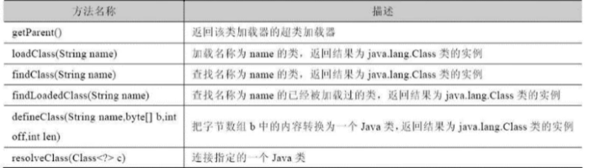


**sun.misc.Launcher 它是一个java虚拟机的入口应用**


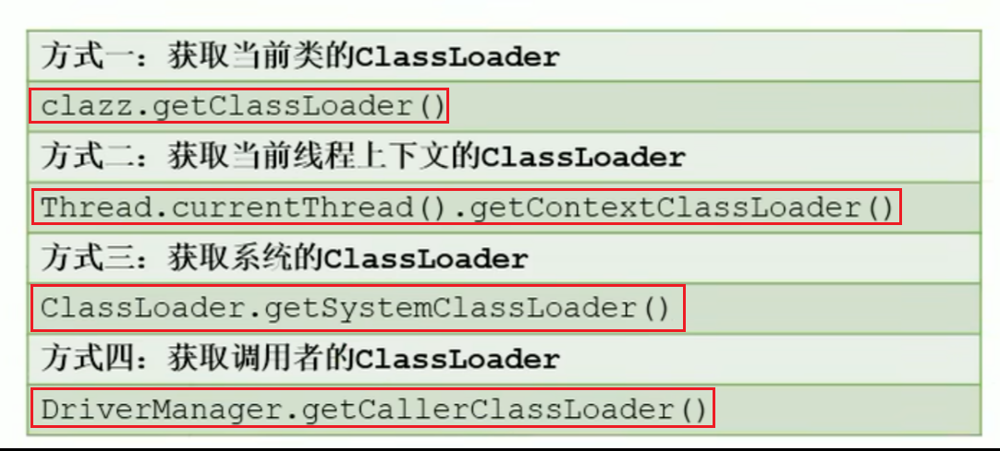


# 双亲委派机制


Java虚拟机对class文件采用的是**按需加载**的方式，也就是说当需要使用该类时才会将它的class文件加载到内存生成class对象。而且加载某个类的class文件时，**Java虚拟机采用的是双亲委派模式，即把请求交由父类处理，它是一种任务委派模式。**


**工作原理**


+ **1）如果一个类加载器收到了类加载请求，它并不会自己先去加载，而是把这个请求委托给父类的加载器去执行；**
+ **2）如果父类加载器还存在其父类加载器，则进一步向上委托，依次递归，请求最终将到达顶层的启动类加载器；**
+ **3）如果父类加载器可以完成类加载任务，就成功返回，倘若父类加载器无法完成此加载任务，子加载器才会尝试自己去加载，这就是双亲委派模式。**


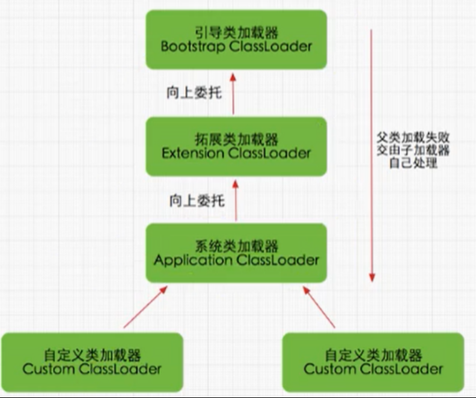


> 先看看爸爸吃不吃，爸爸看看爷爷吃不吃，如果都不吃，自己吃。**孝顺的加载器**
>
> **啃老机制**
>


当我们加载jdbc.jar 用于实现数据库连接的时候，首先我们需要知道的是 jdbc.jar是基于SPI接口进行实现的，所以在加载的时候，会进行双亲委派，最终从根加载器中加载 SPI核心类，然后在加载SPI接口类，接着在进行**反向委派**，通过线程上下文类加载器进行实现类jdbc.jar的加载。


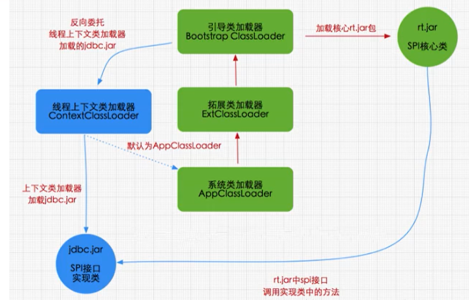


**优势**


+ **避免类的重复加载**
+ **保护程序安全，防止核心API被随意篡改**
+ **自定义类：java.lang.String**
+ **自定义类：java.lang.ShkStart（报错：阻止创建 java.lang开头的类）**

---

**<font style="color:#DF2A3F;">沙箱安全机制</font>**

**自定义String类，但是在加载自定义String类的时候会率先使用引导类加载器加载，而引导类加载器在加载的过程中会先加载jdk自带的文件（rt.jar包中java\lang\String.class），报错信息说没有main方法，就是因为加载的是rt.jar包中的string类。这样可以保证对java核心源代码的保护，这就是沙箱安全机制。**


# 其他问题
## **如何判断两个class对象是否相同 ****♥♥♥**


**在JVM中表示两个class对象是否为同一个类存在两个必要条件：**


+ **类的完整****类名必须一致** **，包括包名。**
+ **加载这个类的****ClassLoader（指ClassLoader实例对象）必须相同** **。**


**换句话说，在JVM中，即使这两个类对象（class对象）来源同一个Class文件，被同一个虚拟机所加载，但只要加载它们的ClassLoader实例对象不同，那么这两个类对象也是不相等的。**


## **对类加载器的引用**


JVM必须知道一个类型是由启动加载器加载的还是由用户类加载器加载的。如果一个类型是由用户类加载器加载的，那么JVM会将**这个类加载器的一个引用作为类型信息的一部分保存在方法区中**。当解析一个类型到另一个类型的引用的时候，JVM需要保证这两个类型的类加载器是相同的。


## **类的主动使用和被动使用**


**Java程序对类的使用方式分为：主动使用和被动使用。**


**主动使用，又分为七种情况：**


+ 创建类的实例
+ 访问某个类或接口的静态变量，或者对该静态变量赋值
+ 调用类的静态方法
+ 反射（比如：Class.forName（"com.atguigu.Test"））
+ 初始化一个类的子类
+ Java虚拟机启动时被标明为启动类的类
+ JDK 7 开始提供的动态语言支持：  
java.lang.invoke.MethodHandle实例的解析结果  
REF_getStatic、REF_putStatic、REF_invokeStatic句柄对应的类没有初始化，则初始化


除了以上七种情况，其他使用Java类的方式都被看作是对类的被动使用，都不会导致类的初始化。


‍


> 更新: 2024-06-24 10:31:44  
> 原文: <https://www.yuque.com/nibiwanxiamei/yrd6t1/41db50e80759c275d78d6f0e951aa3df>