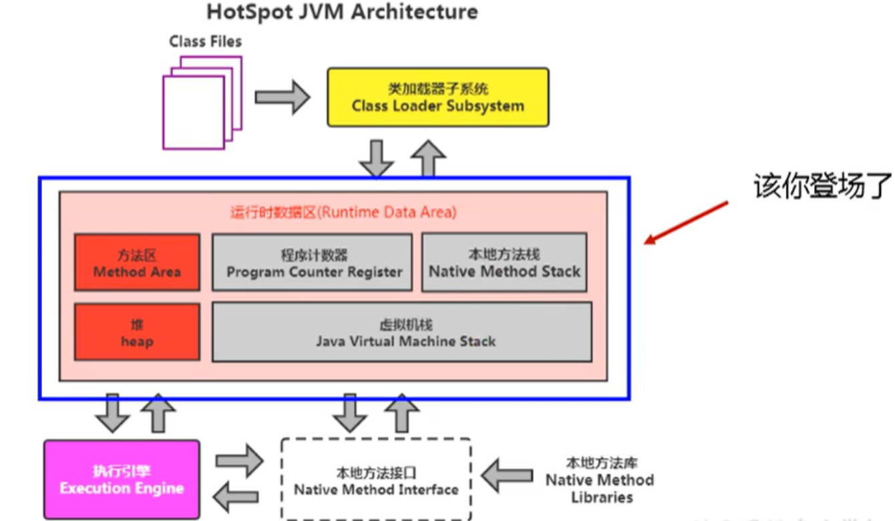
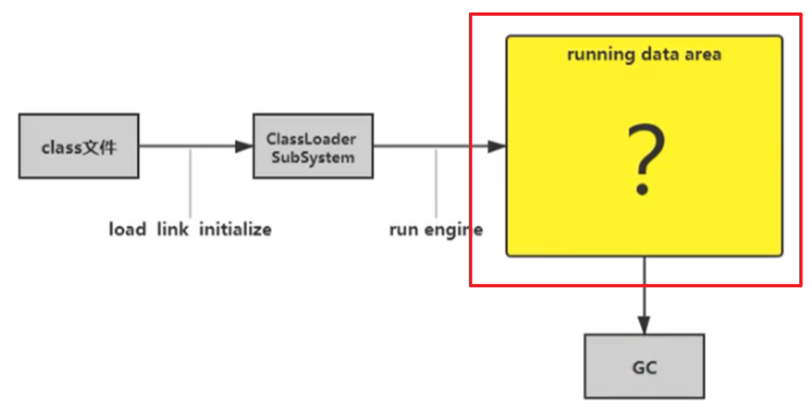
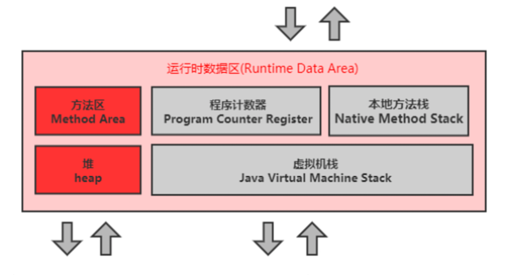
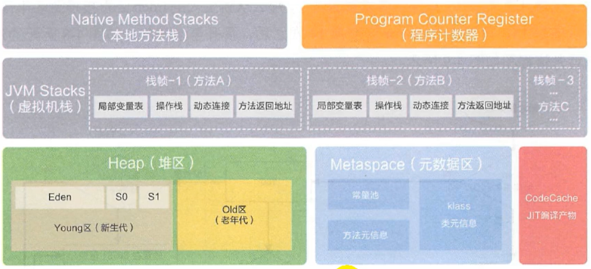
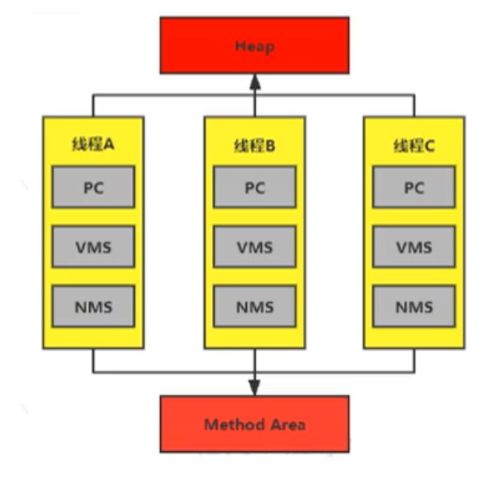
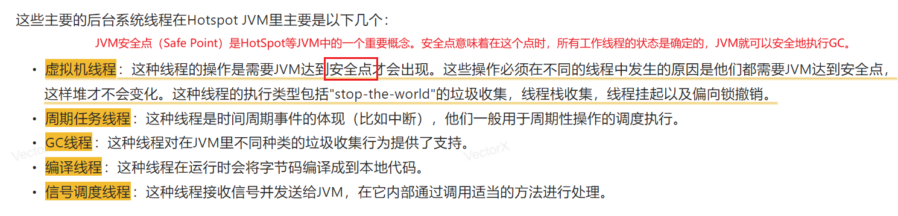
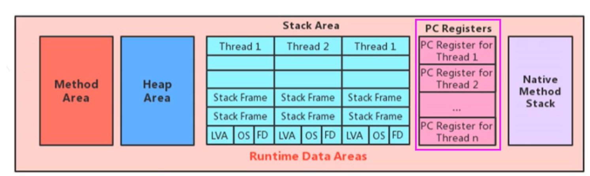
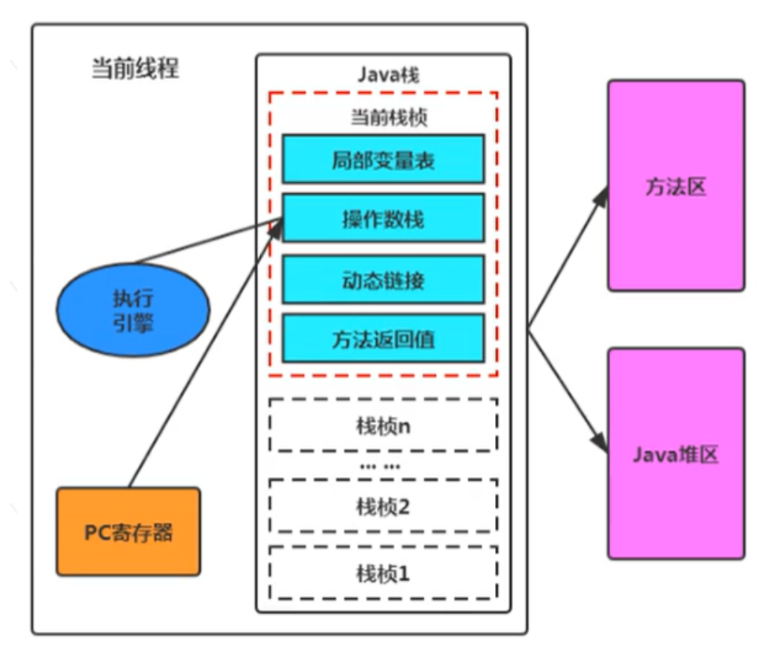

# 3.运行时数据区和PC

***

# 3.运行时数据区和PC

# 运行时数据区

\*\*当我们通过前面的：类的加载-> ****验证 -> 准备 -> 解析** \*\* -> 初始化 这几个阶段完成后，就会用到执行引擎对我们的类进行使用，同时执行引擎将会使用到我们运行时数据区**

JVM对内存的划分

**Java虚拟机定义了若干种程序运行期间会使用到的运行时数据区，其中有一些会随着虚拟机启动而创建，随着虚拟机退出而销毁。另外一些则是与线程一一对应的，这些与线程对应的数据区域会随着线程开始和结束而创建和销毁。**

**灰色的为单独线程私有的，红色的为多个线程共享的。即：**

* **每个线程：独立包括\*\*\*\*程序计数器、栈、本地栈** **。**
* **线程间共享：堆、堆外内存（永久代或元空间、代码缓存）**

**每个JVM只有一个Runtime实例。即为运行时环境，相当于内存结构的中间的那个框框：运行时环境。**

## 线程

**线程是一个程序里的运行单元。JVM允许一个应用有多个线程并行的执行。 在Hotspot JVM里，每个线程都与操作系统的本地线程直接映射** **。**

**当一个Java线程准备好执行以后，此时一个操作系统的本地线程也同时创建。Java线程执行终止后，本地线程也会回收。操作系统负责所有线程的安排调度到任何一个可用的CPU上。一旦本地线程初始化成功，它就会调用Java线程中的run()方法。**

> **java线程信息准备->操作系统线程创建->jvm线程映射到操作系统线程->操作系统线程初始化成功->run**

## JVM系统线程

如果你使用console或者是任何一个调试工具，都能看到在后台有许多线程在运行。这些后台线程不包括调用`public static void main(String[] args)` **的main线程以及所有这个main线程自己创建的线程。**

# 程序计数器 - PC

JVM中的程序计数寄存器（Program Counter Register）中，Register的命名源于CPU的寄存器 **，寄存器存储指令相关的现场信息。CPU只有把数据装载到寄存器才能够运行。这里，并非是广义上所指的物理寄存器，或许将其翻译为PC计数器（或指令计数器）** **会更加贴切（也称为程序钩子** **），并且也不容易引起一些不必要的误会。****JVM中的PC寄存器是对物理PC寄存器的一种抽象模拟**** -- 不是具体的寄存器，是一块主存区域。**

\*\*作用：\*\***PC寄存器用来存储指向下一条指令的地址** **，也即将要执行的指令代码。由执行引擎读取下一条指令 - pc指向哪里，执行引擎就去执行哪里。（下图一个栈帧类似一个方法）**

* 它是一块很小的内存空间，几乎可以忽略不记。也是**运行速度最快的存储区域**。
* 在JVM规范中，**每个线程都有它自己的程序计数器**，是线程私有的，生命周期与线程的生命周期保持一致。
* 任何时间**一个线程都只有一个方法在执行**，也就是所谓的**当前方法**。程序计数器会存储当前线程正在执行的Java方法的JVM指令地址；或者，如果是在执行native方法，则是未指定值（undefined）。
* **它是程序控制流的指示器，分支、循环、跳转、异常处理、线程恢复等基础功能都需要依赖这个计数器来完成。**
* **字节码解释器工作时就是通过改变这个计数器的值来选取\*\*\*\*下一条需要执行的字节码指令** **。**
* \*\*它是唯一一个在Java虚拟机规范&#x4E2D;****没有规定任何OutofMemoryError****&#x60C5;况的区域。\*\***也没有GC**

**使用PC寄存器存储字节码指令地址有什么用呢？为什么使用PC寄存器记录当前线程的执行地址呢？为什么每个线程都需要一个PC寄存器和栈呢？**

* 因为**CPU需要不停的切换各个线程**，这时候切换回来以后，就得知道接着从哪开始继续执行。JVM的字节码解释器就需要通过改变PC寄存器的值来明确下一条应该执行什么样的字节码指令
* **为了能够准确地记录\*\*\*\*各个线程正在执行的当前字节码指令地址** **，最好的办法自然是为\*\*\*\*每一个线程都分配一个PC寄存器** **，这样一来各个线程之间便可以进行独立计算，从而不会出现相互干扰的情况。**
* **由于CPU时间片轮限制，众多线程在并发执行过程中，任何一个确定的时刻，一个处理器或者多核处理器中的一个内核，只会执行某个线程中的一条指令。**

‍

> 更新: 2024-06-20 14:51:29  
> 原文: <https://www.yuque.com/nibiwanxiamei/yrd6t1/937f8731a6fc61ddea6419a750aa0d28>