# 8.对象的实例化内存布局和访问定位

***

# 对象实例化

**面试题**

> **美团**：
>
> \*\*	对象在JVM中是怎么存储的？\*\*
>
> \*\*	对象头信息里面有哪些东西？\*\*
>
> **蚂蚁金服**：
>
> \*\*	Java对象头有什么？\*\*

***

***

***

***

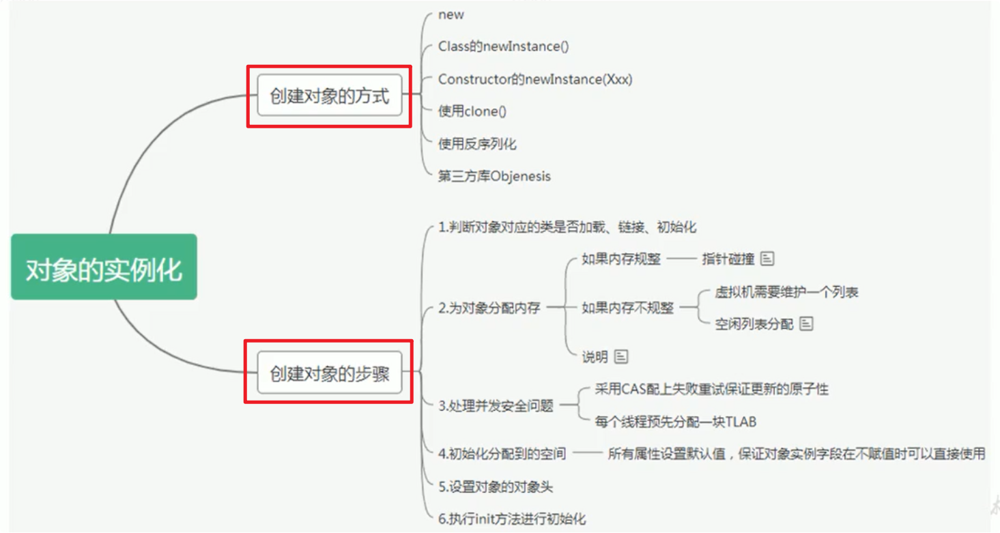

## 创建对象的方式 ♥♥♥

* **new：最常见的方式、Xxx的静态方法，XxxBuilder/XxxFactory的静态方法**
* **Class的newInstance方法：反射的方式，只能调用空参的构造器，权限必须是public**
* **Constructor的newInstance(XXX)：反射的方式，可以调用空参、带参的构造器，权限没有要求**
* **使用clone()：不调用任何的构造器，要求当前的类需要实现Cloneable接口，实现clone()**
* **使用序列化：从文件中、从网络中获取一个对象的二进制流**
* **第三方库 Objenesis**

:::info
**<font style="color:#DF2A3F;">new，反射Class类newInstance（），clone（）方法，序列化和反序列化</font>**

:::

## 创建对象的步骤 ♥♥♥♥

**前面所述是从字节码角度看待对象的创建过程，现在从执行步骤的角度来分析：**

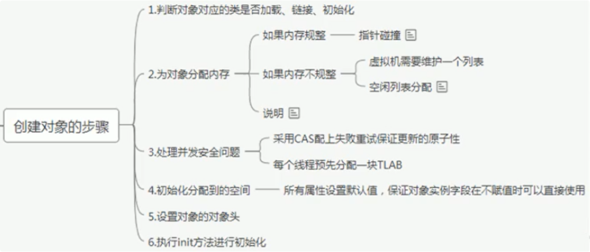

### **step1：判断对象对应的类是否加载、链接、初始化**

**虚拟机遇到一条new指令，首先去检查这个指令的参数能否在Metaspace的常量池中定位到一个类的符号引用，并且检查这个符号引用代表的类是否已经被加载，解析和初始化（即判断类元信息是否存在** **）。**

**如果没有，那么在双亲委派模式下，使用当前类加载器以ClassLoader + 包名 + 类名为key进行查找对应的 .class文件；**

* **如果没有找到文件，则抛出ClassNotFoundException异常**
* **如果找到，则进行类加载，并生成对应的Class对象**

### **step2：为对象分配内存**

**首先计算对象占用空间的大小，接着在堆中划分一块内存给新对象。如果实例成员变量是引用变量，仅分配引用变量空间即可，即4个字节大小**

**如果内存规整：虚拟机将采用的是指针碰撞法（Bump The Point）** **来为对象分配内存。**

* **所有用过的内存在一边，空闲的内存放另外一边，中间放着一个指针作为分界点的指示器，分配内存就把指针指向空闲那边挪动一段与对象大小相等的距离。**
* **如果垃圾收集器选择的是**\*\*<font style="color:#DF2A3F;">Serial ，ParNew</font>\*\***这种基于压缩算法的，虚拟机采用这种分配方式。一般使用带Compact（整理）过程的收集器时，使用指针碰撞。**

**如果内存不规整：虚拟机需要维护一个空闲列表（Free List）** **来为对象分配内存。**

* **已使用的内存和未使用的内存相互交错，虚拟机将采用的是空闲列表来为对象分配内存。虚拟机维护一个列表，记录那些内存块是可用的，再分配的时候从列表中找到一块足够大的空间划分给对象实例，并更新列表上的内容。**

**选择哪种分配方式由Java堆是否规整所决定，****<font style="color:#DF2A3F;">Java堆是否规整由所采用的垃圾收集器是否带有压缩整理功能决定</font>****。**

***

**<font style="color:#DF2A3F;">处理并发问题</font>**

* **采用**\*\*<font style="color:#DF2A3F;">CAS</font>\*\***失败重试、区域加锁保证更新的原子性**
* **每个线程预先分配一块**\*\*<font style="color:#DF2A3F;">TLAB</font>\*\*：通过设置 `-XX:+UseTLAB`参数来设定

### **step3：初始化分配到的内存**

**所有属性设置默认值，保证对象实例字段在不赋值时可以直接使用**

> **属性默认初始化 -> 显式初始化 -> 代码块初始化 -> 构造器根据程序员意愿初始化**

### **step4：设置对象的对象头**

**将对象的所属类（即类的元数据信息）、对象的HashCode和对象的GC信息、锁信息等数据存储在对象的对象头中。这个过程的具体设置方式取决于JVM实现。**

### **step5：执行init方法进行初始化**

**在Java程序的视角看来，初始化才正式开始。初始化成员变量，执行实例化代码块，调用类的构造方法，并把堆内对象的首地址赋值给引用变量。**

**因此一般来说（由字节码中跟&#x968F;****invokespecial****&#x6307;令所决定），new指令之后会接着就是执行方法，把对象按照程序员的意愿进行初始化，这样一个真正可用的对象才算完成创建出来。**

**给对象属性赋值的操作顺序：**

* **属性的默认初始化**
* **显式初始化**
* **代码块中初始化**
* **构造器中初始化**

**对象实例化的过程：**

1. **加载类元信息**
2. **为对象分配内存**
3. **处理并发问题**
4. **属性的默认初始化（零值初始化）**
5. **设置对象头信息**
6. **属性的显示初始化、代码块中初始化、构造器中初始化**

# 对象内存布局

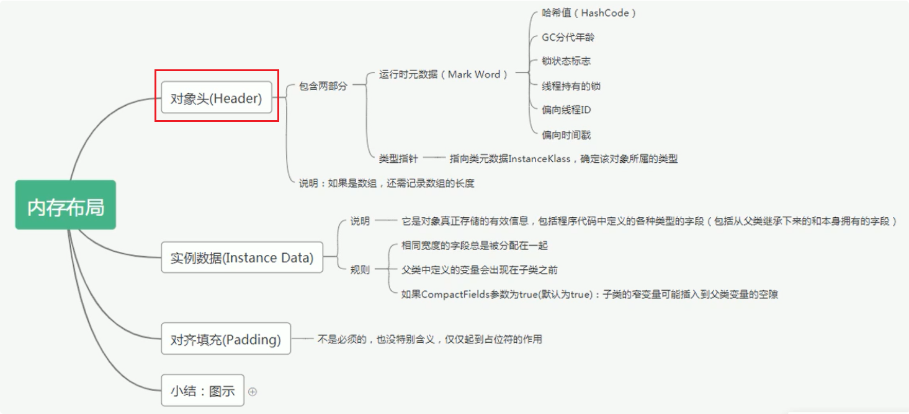

## 对象头

**对象头包含了两部分，分别是**\*\*<font style="color:#DF2A3F;">运行时元数据（Mark Word）</font>**<font style="color:#DF2A3F;"> </font>**<font style="color:#DF2A3F;">和类型指针</font>\*\* **。如果是数组，还需要记录数组的长度。**

### 运行时元数据（Mark Word）

* **哈希值（HashCode）**
* **GC分代年龄**
* **锁状态标志**
* **线程持有的锁**
* **偏向线程ID**
* **偏向时间戳**

### 类型指针

**指向类元数据**\*\*<font style="color:#DF2A3F;">InstanceKlass</font>\*\*\*\*，确定该对象所属的类型。\*\*

## 实例数据（Instance Data）

**它是对象真正存储的有效信息，包括程序代码中定义的各种类型的字段（包括从父类继承下来的和本身拥有的字段）**

* **相同宽度的字段总是被分配在一起**
* **父类中定义的变量会出现在子类之前**
* **如果CompactFields参数为true（默认为true）：子类的窄变量可能插入到父类变量的空隙**

## 对齐填充（Padding）

**不是必须的，也没有特别的含义，仅仅起到占位符的作用**

```java
public class Customer{
    int id = 1001;
    String name;
    Account acct;
    {
        name = "匿名客户";
    }
    public Customer() {
        acct = new Account();
    }
}
public class CustomerTest{
    public static void main(string[] args){
        Customer cust=new Customer();
    }
}
```

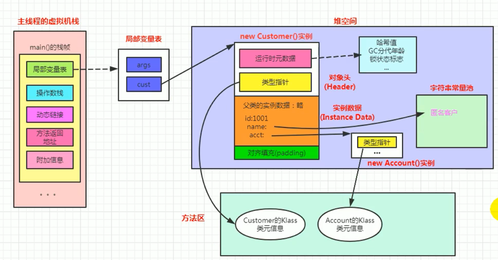

> 1.main方法的栈帧中，局部变量表只有两个元素，因为是**静态方法，如果是非静态的方法还需要有一个this**
>
> 2.customer实例在内存构造如图所示，其对象头包括运行时元数据，类型指针；
>
> 3.JDK7之后字符串常量池在堆中，所以name这个属性值指向字符串常量池
>
> 4.类型元数据在元空间（方法区）中，所以指针指向元空间

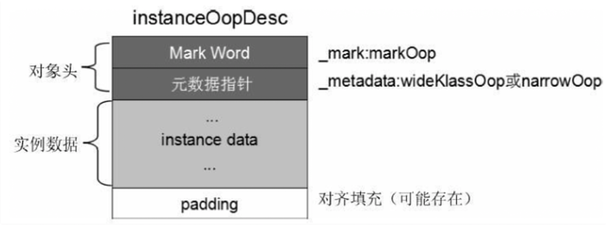

# 对象访问定位

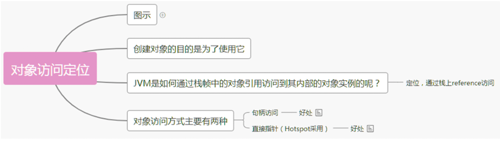

**JVM是如何通过栈帧中的对象引用访问到其内部的对象实例呢？**

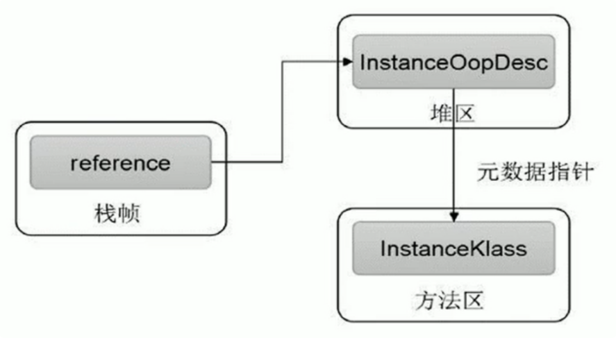

## 句柄访问

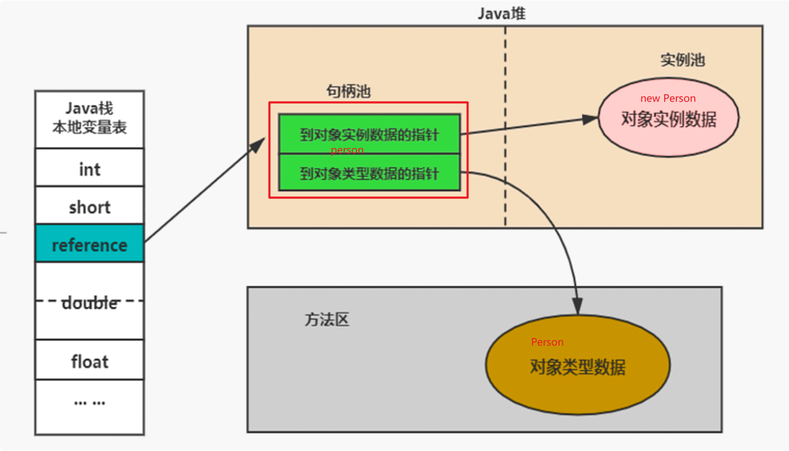

**reference中存储稳定句柄地址，对象被移动（垃圾收集时移动对象很普遍，清除阶段：复算法)** **时只**\*\*<font style="color:#DF2A3F;">会改变句柄池中实例数据指针即可，reference本身不需要被修改</font>\*\*

## 直接指针

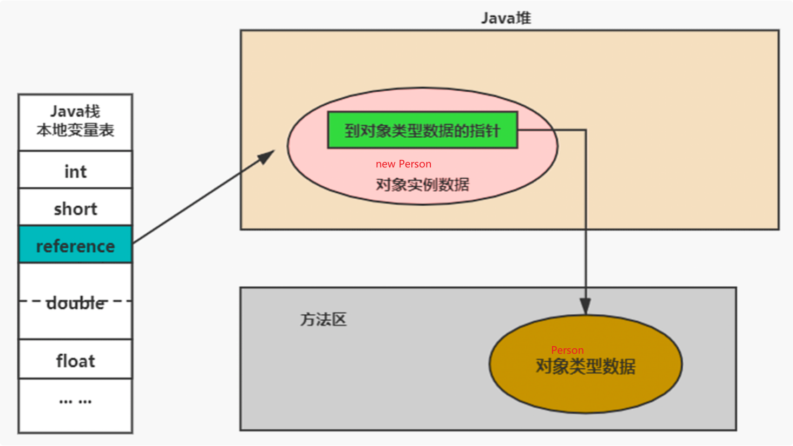

**直接指针是局部变量表中的引用，直接指向堆中的实例，在对象实例中有类型指针，指向的是方法区中的对象类型数据，\*\*\*\*<font style="color:#DF2A3F;">对象移动后，reference也需要修改，好处是只需要一次堆访问。</font>**

# 直接内存（Direct Memery）

## 直接内存概述

**不是JVM运行时数据区的一部分，也不是《Java虚拟机规范》中定义的内存区域。直接内存是在Java堆外的、直接向系统申请的内存区间** **。来源于NIO，通过存在堆中的DirectByteBuffer操作Native内存。通常，访问直接内存的速度会优于Java堆，即读写性能高。**

* **因此出于性能考虑，读写频繁的场合可能会考虑使用直接内存。**
* **Java的NIO库允许Java程序使用直接内存，用于数据缓冲区**

## 非直接缓存区

**使用IO读写文件，需要与磁盘交互，需要由用户态切换到内核态。在内核态时，需要两份内存存储重复数据，效率低。**

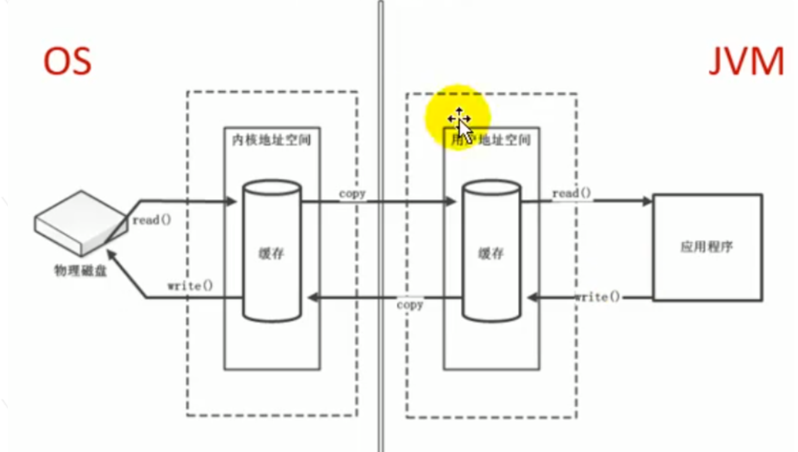

## 直接缓存区

**使用NIO时，操作系统划出的直接缓存区可以被java代码直接访问，只有一份。NIO适合对大文件的读写操作。**

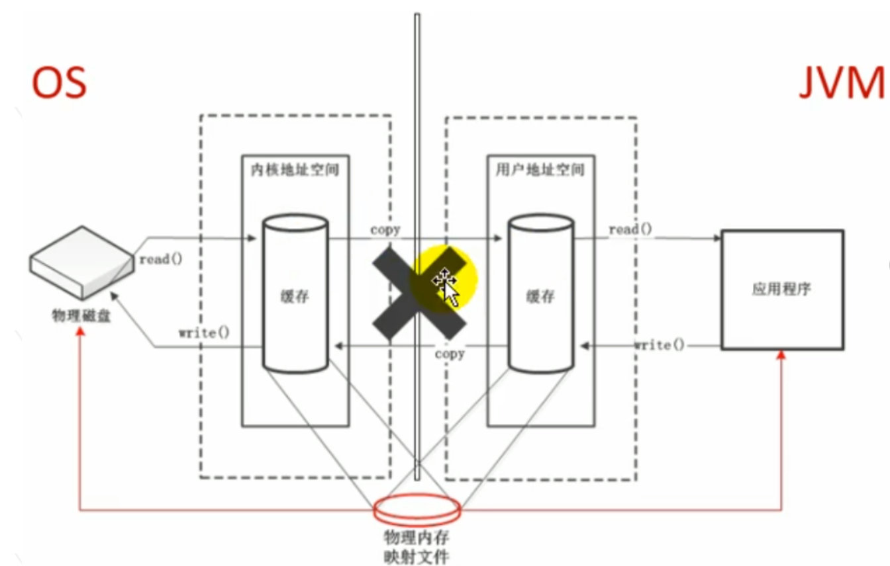

**也可能导致OutOfMemoryError异常**

```java
Exception in thread "main" java.lang.OutOfMemoryError: Direct buffer memory 
    at java.nio.Bits.reserveMemory(Bits.java:693)
    at java.nio.DirectByteBuffer.<init>(DirectByteBuffer.java:123)
    at java.nio.ByteBuffer.allocateDirect(ByteBuffer.java:311)
    at com.atguigu.java.BufferTest2.main(BufferTest2.java:20)
```

**由于直接内存在Java堆外，因此它的大小不会直接受限于-Xmx指定的最大堆大小，但是系统内存是有限的，Java堆和直接内存的总和依然受限于操作系统能给出的最大内存。**

* **分配回收成本较高**
* **不受JVM内存回收管理**

**直接内存大小可以通过**`MaxDirectMemorySize`设置。如果不指定，默认与堆的最大值-Xmx参数值一致

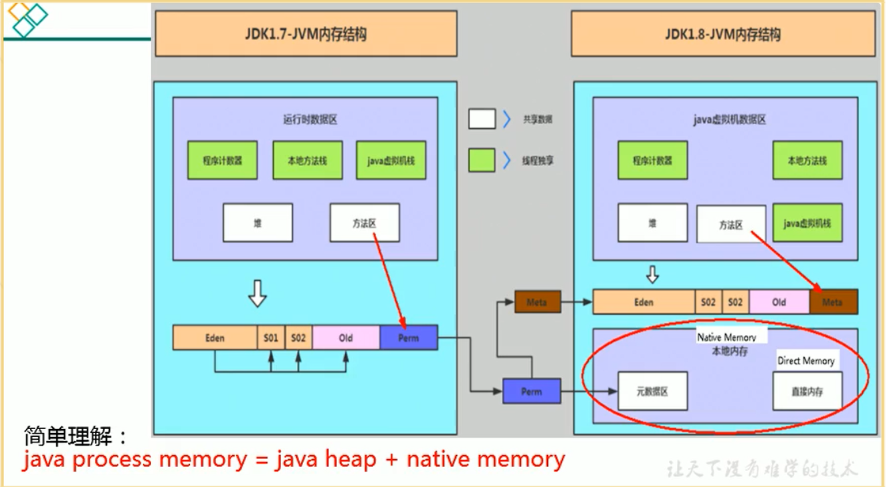


> 更新: 2024-06-22 16:49:06  
> 原文: <https://www.yuque.com/nibiwanxiamei/yrd6t1/9c90c236a4b8c11868ce56a2a1abe1e2>