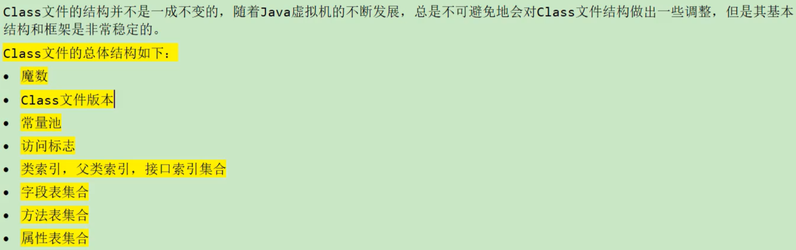
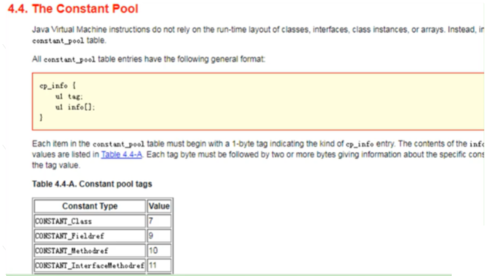
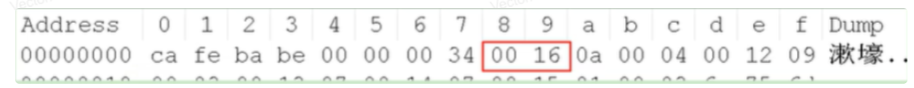
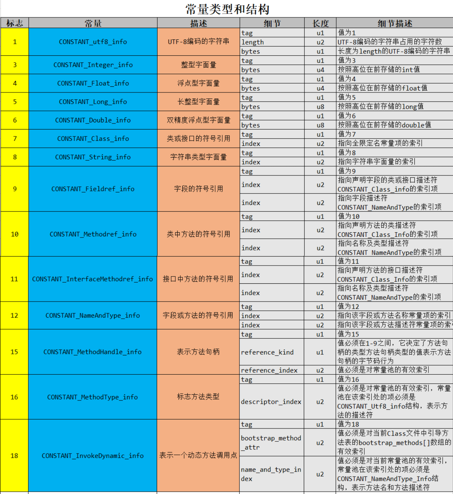
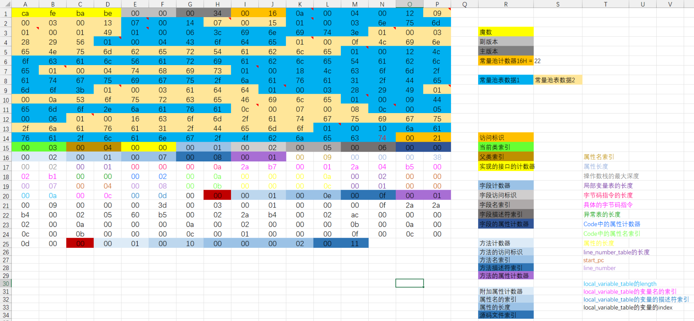

# Class文件结构

***

# **Class字节码文件结构**



| **类型** | **名称** | **说明** | **长度** | **数量** |
| --- | --- | --- | --- | --- |
| **u4** | **magic** | **魔数,识别Class文件格式** | **4个字节** | **1** |
| **u2** | **minor\_version** | **副版本号(小版本)** | **2个字节** | **1** |
| **u2** | **major\_version** | **主版本号(大版本)** | **2个字节** | **1** |
| **u2** | **constant\_pool\_count** | **常量池计数器** | **2个字节** | **1** |
| **cp\_info** | **constant\_pool** | **常量池表** | **n个字节** | **constant\_pool\_count - 1** |
| **u2** | **access\_flags** | **访问标识** | **2个字节** | **1** |
| **u2** | **this\_class** | **类索引** | **2个字节** | **1** |
| **u2** | **super\_class** | **父类索引** | **2个字节** | **1** |
| **u2** | **interfaces\_count** | **接口计数器** | **2个字节** | **1** |
| **u2** | **interfaces** | **接口索引集合** | **2个字节** | **interfaces\_count** |
| **u2** | **fields\_count** | **字段计数器** | **2个字节** | **1** |
| **field\_info** | **fields** | **字段表** | **n个字节** | **fields\_count** |
| **u2** | **methods\_count** | **方法计数器** | **2个字节** | **1** |
| **method\_info** | **methods** | **方法表** | **n个字节** | **methods\_count** |
| **u2** | **attributes\_count** | **属性计数器** | **2个字节** | **1** |
| **attribute\_info** | **attributes** | **属性表** | **n个字节** | **attributes\_count** |

# **Class文件数据类型**

| **数据类型** | **定义** | **说明** |
| --- | --- | --- |
| **无符号数** | **无符号数可以用来描述数字、索引引用、数量值或按照utf-8编码构成的字符串值。** | **其中无符号数属于基本的数据类型。 以u1、u2、u4、u8来分别代表1个字节、2个字节、4个字节和8个字节** |
| **表** | **表是由多个无符号数或其他表构成的复合数据结构。** | **所有的表都以“\_info”结尾。 由于表没有固定长度，所以通常会在其前面加上个数说明。** |

# **魔数**

**Magic Number（魔数）**

* **每个Class文件开头的\*\*\*\*4个字节的无符号整数称为魔数** **（Magic Number）**
* \*\*它的唯一作用是确定这个文件是否为一个能被虚拟机接受的有效合法的Class文件。即：\*\***魔数是Class文件的标识符** **。**
* **魔数值固定为0xCAFEBABE。不会改变。**
* **如果一个Class文件不以0xCAFEBABE开头，虚拟机在进行文件校验的时候就会直接抛出以下错误：**

```java
Error: A JNI error has occurred, please check your installation and try again
Exception in thread "main" java.lang.ClassFormatError: Incompatible magic value 1885430635 in class file StringTest
```

* **使用魔数而不是扩展名来进行识别主要是基于安全方面的考虑，因为文件扩展名可以随意地改动。**

# **文件版本号**

**紧接着魔数的4个字节存储的是Class文件的版本号。同样也是4个字节。第5个和第6个字节所代表的含义就是编译的副版本号minor\_version，而第7个和第8个字节就是编译的主版本号major\_version。**

**它们共同构成了class文件的格式版本号。譬如某个Class文件的主版本号为M，副版本号为m，那么这个Class文件的格式版本号就确定为M.m。**

**版本号和Java编译器的对应关系如下表：**

| **主版本（十进制）** | **副版本（十进制）** | **编译器版本** |
| --- | --- | --- |
| **45** | **3** | **1.1** |
| **46** | **0** | **1.2** |
| **47** | **0** | **1.3** |
| **48** | **0** | **1.4** |
| **49** | **0** | **1.5** |
| **50** | **0** | **1.6** |
| **51** | **0** | **1.7** |
| **52** | **0** | **1.8** |
| **53** | **0** | **1.9** |
| **54** | **0** | **1.10** |
| **55** | **0** | **1.11** |

**Java的版本号是从45开始的，JDK1.1之后的每个JDK大版本发布主版本号向上加1。**

**不同版本的Java编译器编译的Class文件对应的版本是不一样的。目前，高版本的Java虚拟机可以执行由低版本编译器生成的Class文件，但是低版本的Java虚拟机不能执行由高版本编译器生成的Class文件。否则JVM会抛出java.lang.UnsupportedClassVersionError异常。（向下兼容）**

**在实际应用中，由于开发环境和生产环境的不同，可能会导致该问题的发生。因此，需要我们在开发时，特别注意开发编译的JDK版本和生产环境中的JDK版本是否一致。**

* **虚拟机JDK版本为1.k（k>=2）时，对应的class文件格式版本号的范围为45.0 - 44+k.0（含两端）。**

# **常量池集合**

**常量池是Class文件中内容最为丰富的区域之一。常量池对于Class文件中的字段和方法解析也有着至关重要的作用。**

**随着Java虚拟机的不断发展，常量池的内容也日渐丰富。可以说，常量池是整个Class文件的基石。**



**在版本号之后，紧跟着的是常量池的数量，以及若干个常量池表项。**

**常量池中常量的数量是不固定的，所以在常量池的入口需要放置一项u2类型的无符号数，代表常量池容量计数值（constant\_pool\_count）。与Java中语言习惯不一样的是，这个容量计数是\*\*\*\*从1而不是0开始的** **。**

| **类型** | **名称** | **数量** |
| --- | --- | --- |
| **u2（无符号数）** | **constant\_pool\_count** | **1** |
| **cp\_info（表）** | **constant\_pool** | **constant\_pool\_count - 1** |

**由上表可见，Class文件使用了一个前置的容量计数器（constant\_pool\_count）加若干个连续的数据项（constant\_pool）的形式来描述常量池内容。我们把这一系列连续常量池数据称为常量池集合。**

* **常量池表项**中，用于存放编译时期生成的各种**字面量**和**符号引用**，这部分内容将在类加载后进入方法区的**运行时常量池**中存放

## **常量池计数器**

**constant\_pool\_count（常量池计数器）**

* **由于常量池的数量不固定，时长时短，所以需要放置两个字节来表示常量池容量计数值。**
* **常量池容量计数值（u2类型）：** 从1开始 **，表示常量池中有多少项常量。即constant\_pool\_count=1表示常量池中有0个常量项。**
* **Demo的值为：**



**其值为0x0016，掐指一算，也就是22。需要注意的是，这实际上只有21项常量。索引为范围是1-21。为什么呢？**

**通常我们写代码时都是从0开始的，但是这里的常量池却是从1开始，因为它把第0项常量空出来了。这是为了满足后面某些指向常量池的索引值的数据在特定情况下需要表达“不引用任何一个常量池项目”的含义，这种情况可用索引值0来表示。**

## **常量池表**

**constant\_pool是一种表结构，以1 ~ constant\_pool\_count - 1为索引。表明了后面有多少个常量项。**

\*\*常量池主要存放两大类常量：\*\***字面量（Literal）和符号引用（Symbolic References）**

**它包含了class文件结构及其子结构中引用的所有字符串常量、类或接口名、字段名和其他常量。常量池中的每一项都具备相同的特征。第1个字节作为类型标记，用于确定该项的格式，这个字节称为tag byte（标记字节、标签字节）。**

| **类型** | **标志(或标识)** | **描述** |
| --- | --- | --- |
| **CONSTANT\_Utf8\_info** | **1** | **UTF-8编码的字符串** |
| **CONSTANT\_Integer\_info** | **3** | **整型字面量** |
| **CONSTANT\_Float\_info** | **4** | **浮点型字面量** |
| **CONSTANT\_Long\_info** | **5** | **长整型字面量** |
| **CONSTANT\_Double\_info** | **6** | **双精度浮点型字面量** |
| **CONSTANT\_Class\_info** | **7** | **类或接口的符号引用** |
| **CONSTANT\_String\_info** | **8** | **字符串类型字面量** |
| **CONSTANT\_Fieldref\_info** | **9** | **字段的符号引用** |
| **CONSTANT\_Methodref\_info** | **10** | **类中方法的符号引用** |
| **CONSTANT\_InterfaceMethodref\_info** | **11** | **接口中方法的符号引用** |
| **CONSTANT\_NameAndType\_info** | **12** | **字段或方法的符号引用** |
| **CONSTANT\_MethodHandle\_info** | **15** | **表示方法句柄** |
| **CONSTANT\_MethodType\_info** | **16** | **标志方法类型** |
| **CONSTANT\_InvokeDynamic\_info** | **18** | **表示一个动态方法调用点** |

### **字面量和符号引用**

\*\*常量池主要存放两大类常量：字面量（Literal）和符号引用（Symbolic References）。如下表：\*\***字面量不能被修改**

| **常量** | **具体的常量** |
| --- | --- |
| **字面量** | **文本字符串** |
| | **声明为final的常量值** |
| **符号引用** | **类和接口的全限定名** |
| | **字段的名称和描述符** |
| | **方法的名称和描述符** |

**全限定名**

**com/jcy/test/Demo\*\*\*\*这个就是类的全限定名，仅仅是把包名的“.“替换成”/”，为了使连续的多个全限定名之间不产生混淆，在使用时最后一般会加入一个“;”表示全限定名结束。**

**简单名称**

**简单名称是指没有类型和参数修饰的方法或者字段名称，上面例子中的类的add()方法和num字段的简单名称分别是add和num。**

**描述符**

**描述符的作用是用来\*\*\*\*描述字段的数据类型、方法的参数列表（包括数量、类型以及顺序）和返回值**。根据描述符规则，基本数据类型（byte、char、double、float、int、long、short、boolean）以及代表无返回值的void类型都用一个大写字符来表示，而对象类型则用字符L加对象的全限定名来表示，详见下表：

| **标志符** | **含义** |
| --- | --- |
| **B** | **基本数据类型byte** |
| **C** | **基本数据类型char** |
| **D** | **基本数据类型double** |
| **F** | **基本数据类型float** |
| **I** | **基本数据类型int** |
| **J** | **基本数据类型long** |
| **S** | **基本数据类型short** |
| **Z** | **基本数据类型boolean** |
| **V** | **代表void类型** |
| **L** | **对象类型，比如：**`Ljava/lang/Object;`<br/> |
| **\[** | **数组类型，代表一维数组。比如：\`double\[] is \[D** |

\*\*用描述符来描述方法时，按照先参数列表，后返回值的顺序描述，参数列表按照参数的严格顺序放在一组小括号“()”之内。如方法java.lang.String tostring()的描述符为()Ljava/lang/String; ，\*\***方法int abc(int\[]x, int y)的描述符为(\[II)I。**

> （\[LL）L -> ()表示方法，\[L表示int\[], L表示int，括号外面的L表示返回值是int

**补充说明：**

**虚拟机在加载Class文件时才会进行\*\*\*\*动态链接** **，也就是说，Class文件中不会保存各个方法和字段的最终内存布局信息。因此，这些字段和方法的符号引用不经过转换是无法直接被虚拟机使用的。当虚拟机运行时，需要从常量池中获得对应的符号引用，再在\*\*\*\*类加载过程中的解析阶段将其替换为直接引用**，**并翻译到具体的内存地址中。**

**这里说明下符号引用和直接引用的区别与关联：**

* **符号引用：符号引用以一组符号来描述所引用的目标，符号可以是任何形式的字面量，只要使用时能无歧义地定位到目标即可。符号引用与虚拟机实现的内存布局无关，引用的目标并不一定已经加载到了内存中。**
* **直接引用：直接引用可以是直接指向目标的指针、相对偏移量或是一个能间接定位到目标的句柄。直接引用是与虚拟机实现的内存布局相关的，同一个符号引用在不同虚拟机实例上翻译出来的直接引用一般不会相同。如果有了直接引用，那说明引用的目标必定已经存在于内存之中了。**

### **常量类型和结构**

**常量池中每一项常量都是一个表，J0K1.7之后共有14种不同的表结构数据。如下表格所示：**



**根据上图每个类型的描述也可以知道\*\*\*\*每个类型是用来描述常量池中哪些内容** **（主要是字面量、符号引用）的。比如:CONSTANT\_Integer\_info是用来描述常量池中字面量信息的，而且只是整型字面量信息。**

**标志为15、16、18的常量项类型是用来支&#x6301;****动态语言调用****&#x7684;（jdk1.7时才加入的）。**

**细节说明:**

* **CONSTANT\_Class\_info结构用于表示类或接口**
* **CONSTAT\_Fieldref\_info、CONSTAHT\_Methodref\_infoF和lCONSTANIT\_InterfaceMethodref\_info结构表示字段、方法和接口方法**
* **CONSTANT\_String\_info结构用于表示示String类型的常量对象**
* **CONSTANT\_Integer\_info和CONSTANT\_Float\_info表示4字节（int和float）的数值常量**
* \*\*CONSTANT\_Long\_info和CONSTAT\_Double\_info结构表示8字作（long和double）的数值常量 \*\*
  * **在class文件的常最池表中，所行的a字节常借均占两个表成员（项）的空问。如果一个CONSTAHT\_Long\_info和CNSTAHT\_Double\_info结构在常量池中的索引位n，则常量池中一个可用的索引位n+2，此时常量池长中索引为n+1的项仍然有效但必须视为不可用的。**

***

* **CONSTANT\_NameAndType\_info结构用于表示字段或方法，但是和之前的3个结构不同，CONSTANT\_NameAndType\_info结构没有指明该字段或方法所属的类或接口。**
* **CONSTANT\_Utf8\_info用于表示字符常量的值**
* **CONSTANT\_MethodHandle\_info结构用于表示方法句柄**
* **CONSTANT\_MethodType\_info结构表示方法类型**
* **CONSTANT\_InvokeDynamic\_info结构表示invokedynamic指令所用到的引导方法(bootstrap method)、引导方法所用到的动态调用名称(dynamic invocation name)、参数和返回类型，并可以给引导方法传入一系列称为静态参数（static argument）的常量。**

**总结1：**

* **这14种表（或者常量项结构）的共同点是：表开始的第一位是一个\*\*\*\*u1类型的标志位** **（tag），代表当前这个常量项使用的是哪种表结构，即哪种常量类型。**
* **在常量池列表中，CONSTANT\_Utf8\_info常量项是一种使用改进过的UTF-8编码格式来存储诸如文字字符串、类或者接口的全限定名、字段或者方法的简单名称以及描述符等常量字符串信息。**
* **这14种常量项结构还有一个特点是，其中13个常量项占用的字节固定，只有\*\*\*\*CONSTANT\_Utf8\_info占用字节不固定** **，其大小由length决定。为什么呢？因为从常量池存放的内容可知，其存放的是字面量和符号引用，最终这些内容都会是一个字符串，这些字符串的大小是在编写程序时才确定，比如你定义一个类，类名可以取长取短，所以在没编译前，大小不固定，编译后，通过utf-8编码，就可以知道其长度。**

**总结2：**

* **常量池：可以理解为Class文件之中的\*\*\*\*资源仓库** **，它是Class文件结构中与其他项目关联最多的数据类型（后面的很多数据类型都会指向此处），也是占用Class文件空间最大的数据项目之一。**
* **常量池中为什么要包含这些内容？Java代码在进行Javac编译的时候，并不像C和C++那样有“连接”这一步骤，而是在虚拟机加载Class文件的时候进行动态链接。也就是说，在Class文件中不会保存各个方法、字段的最终内存布局信息，因此这些字段、方法的符号引用不经过运行期转换的话无法得到真正的内存入口地址，也就无法直接被虚拟机使用。当虚拟机运行时，需要\*\*\*\*从常量池获得对应的符号引用** \*\*，\*\***再在类创建时或运行时解析、翻译到具体的内存地址之中** **。关于类的创建和动态链接的内容，在虚拟机类加载过程时再进行详细讲解**

# 访问标志

**访问标识（access\_flag、访问标志、访问标记）**

**在常量池后，紧跟着访问标记。该标记使用两个字节表示，用于识别一些类或者接口层次的访问信息，包括：这个Class是类还是接口；是否定义为public类型；是否定义为abstract类型；如果是类的话，是否被声明为final等。各种访问标记如下所示：**

| **标志名称** | **标志值** | **含义** |
| --- | --- | --- |
| **ACC\_PUBLIC** | **0x0001** | **标志为public类型** |
| **ACC\_FINAL** | **0x0010** | **标志被声明为final，只有类可以设置** |
| **ACC\_SUPER** | **0x0020** | **标志允许使用invokespecial字节码指令的新语义，JDK1.0.2之后编译出来的类的这个标志默认为真。（使用增强的方法调用父类方法）** |
| **ACC\_INTERFACE** | **0x0200** | **标志这是一个接口** |
| **ACC\_ABSTRACT** | **0x0400** | **是否为abstract类型，对于接口或者抽象类来说，次标志值为真，其他类型为假** |
| **ACC\_SYNTHETIC** | **0x1000** | **标志此类并非由用户代码产生（即：由编译器产生的类，没有源码对应）** |
| **ACC\_ANNOTATION** | **0x2000** | **标志这是一个注解** |
| **ACC\_ENUM** | **0x4000** | **标志这是一个枚举** |

**类的访问权限通常为\*\*\*\*ACC\_** **开头的常量。**

**每一种类型的表示都是通过设置访问标记的32位中的特定位来实现的。比如，若是public final的类，则该标记为ACC\_PUBLIC | ACC\_FINAL。**

**使用ACC\_SUPER可以让类更准确地定位到父类的方法super.method()，现代编译器都会设置并且使用这个标记。**

**补充说明：**

1. **带有ACC\_INTERFACE标志的class文件表示的是接口而不是类。**
   1. **如果一个class文件被设置了ACC\_INTERFACE标志，那&#x4E48;****同时也得设置ACC\_ABSTRACT标****&#x5FD7;。同时它不能再设置ACC\_FINAL、ACC\_SUPER 或ACC\_ENUM标志。**
   2. **如果没有设置ACC\_INTERFACE标志，那么这个class文件可以具有上表中除ACC\_ANNOTATION外的其他所有标志。当然，ACC\_FINAL和ACC\_ABSTRACT这类互斥的标志除外。这两个标志不得同时设置。**
2. **ACC\_SUPER标志用于确定类或接口里面的invokespecial指令使用的是哪一种执行语义。针对Java虚拟机指令集的编译器都应当设置这个标志。对于Java SE 8及后续版本来说，无论class文件中这个标志的实际值是什么，也不管class文件的版本号是多少，Java虚拟机都认为每个class文件均设置了ACC\_SUPER标志。**

* **ACC\_SUPER标志是为了向后兼容由旧Java编译器所编译的代码而设计的。目前的ACC\_SUPER标志在由JDK1.0.2之前的编译器所生成的access\_flags中是没有确定含义的，如果设置了该标志，那么0racle的Java虚拟机实现会将其忽略。**

3. **ACC\_SYNTHETIC标志意味着该类或接口是由编译器生成的，而不是由源代码生成的**。
4. **注解类型必须设置ACC\_ANNOTATION标志。如果设置了ACC\_ANNOTATION标志，那么也必须设置ACC\_INTERFACE标志。** **（注解是接口的一种）**
5. **ACC\_ENUM标志表明该类或其父类为枚举类型。**

# **类索引、父类索引、接口索引**

> 索引 -》指向某个位置  -》常量池

**在访问标记后，会指定该类的类别、父类类别以及实现的接口，格式如下：**

| **长度** | **含义** |
| --- | --- |
| **u2** | **this\_class** |
| **u2** | **super\_class** |
| **u2** | **interfaces\_count** |
| **u2** | **interfaces\[interfaces\_count]** |

**这三项数据来确定这个类的继承关系：**

* **类索引用于确定这个类的\*\*\*\*全限定名**（**com/jcy/test/Demo**）
* **父类索引用于确定这个类的父类的全限定名。由于Java语言不允许多重继承，所以父类索引只有一个，除了java.lang.Object之外，所有的Java类都有父类，因此除了java.lang.Object外，所有Java类的父类索引都不为e。**
* **接口索引集合就用来描述这个类实现了哪些接口，这些被实现的接口将按implements语句（如果这个类本身是一个接口，则应当是extends语句）后的接口顺序从左到右排列在接口索引集合中。**

## **this\_class**

**2字节无符号整数，指向常量池的索引。它提供了类的\*\*\*\*全限定名** **，如com/jcy/java/Demo。this\_class的值必须是对\*\*\*\*常量池表中某项的一个有效索引值** **。常量池在这个索引处的成员必须为\*\*\*\*CONSTANT\_Class\_info类型结构体** **，该结构体表示这个class文件所定义的类或接口。**

## super\_class（父类索引）

**2字节无符号整数，指向常量池的索引。它提供了当前类的\*\*\*\*父类的全限定名** **。如果我们没有继承任何类，其默认继承的是java/lang/object类。同时，由于Java不支持多继承，所以其父类只有一个。**

**super\_class指向的父类不能是final。**

## **interfaces**

**指向常量池索引集合，它提供了一个符号引用到所有已实现的接口**

**由于一个类可以实现多个接口，因此需要以数组形式保存多个接口的索引，表示接口的每个索引也是一个\*\*\*\*指向常量池的CONSTANT\_Class** **（当然这里就必须是接口，而不是类）。**

**interfaces\_count（接口计数器）:**

\*\*	interfaces\_count项的值表示当前类或接口的直接超\*\*\*\*接口数量\*\* **。**

**interfaces\[]（接口索引集合）:**

\*\*	interfaces\[]中每个成员的值必须是对常量池表中某项的有效索引值，它的长度为interfaces\_count。每个成员interfaces\[i]必须&#x4E3A;****CONSTANT\_Class\_info****&#x7ED3;构，其中0 <= i < interfaces\_count。在interfaces\[]中，各成员所表示的接口顺序和对应的源代码中给定的接口顺序（从左至右）一样，即interfaces\[0]对应的是源代码中最左边的接口。\*\*

# 字段表集合

**fields用于描述接口或类中声明的变量。字段（field）包括\*\*\*\*类级变量以及实例级变量** **，但是不包括方法内部、代码块内部声明的局部变量。**

**字段叫什么名字、字段被定义为什么数据类型，这些都是无法固定的，只&#x80FD;****引用常量池****&#x4E2D;的常量来描述。**

**它指向常量池索引集合，它描述了每个字段的完整信息。比如字段的标识符、访问修饰符（public、private或protected）、是类变量还是实例变量（static修饰符）、是否是常量（final修饰符）等。**

**注意事项：**

* **字段表集合中\*\*\*\*不会列出从父类或者实现的接口中继承而来的字段** **，但有可能列出原本Java代码之中不存在的字段。譬如在内部类中为了保持对外部类的访问性，会自动添加指向外部类实例的字段。**
* **在Java语言中字段是无法重载的，两个字段的数据类型、修饰符不管是否相同，都必须使用不一样的名称，但是对于字节码来讲，如果两个字段的描述符不一致，那字段重名就是合法的。**

## **字段计数器**

**fields\_count的值表示当前class文件fields表的成员个数。使用两个字节来表示。**

**fields表中每个成员都是一个field\_info结构，用于表示该类或接口所声明的所有类字段或者实例字段，不包括方法内部声明的变量，也不包括从父类或父接口继承的那些字段。**

| **标志名称** | **标志值** | **含义** | **数量** |
| --- | --- | --- | --- |
| **u2** | **access\_flags** | **访问标志** | **1** |
| **u2** | **name\_index** | **字段名索引** | **1** |
| **u2** | **descriptor\_index** | **描述符索引** | **1** |
| **u2** | **attributes\_count** | **属性计数器** | **1** |
| **attribute\_info** | **attributes** | **属性集合** | **attributes\_count** |

## **字段表**

### **字段表访问标识（access\_flags）**

**我们知道，一个字段可以被各种关键字去修饰，比如：作用域修饰符（public、private、protected）、static修饰符、final修饰符、volatile修饰符等等。因此，其可像类的访问标志那样，使用一些标志来标记字段。字段的访问标志有如下这些：**

| **标志名称** | **标志值** | **含义** |
| --- | --- | --- |
| **ACC\_PUBLIC** | **0x0001** | **字段是否为public** |
| **ACC\_PRIVATE** | **0x0002** | **字段是否为private** |
| **ACC\_PROTECTED** | **0x0004** | **字段是否为protected** |
| **ACC\_STATIC** | **0x0008** | **字段是否为static** |
| **ACC\_FINAL** | **0x0010** | **字段是否为final** |
| **ACC\_VOLATILE** | **0x0040** | **字段是否为volatile** |
| **ACC\_TRANSTENT** | **0x0080** | **字段是否为transient** |
| **ACC\_SYNCHETIC** | **0x1000** | **字段是否为由编译器自动产生** |
| **ACC\_ENUM** | **0x4000** | **字段是否为enum** |

### **描述符索引（descriptor\_index）**

**描述符的作用是用来描述字段的\*\*\*\*数据类型、方法的参数列表（包括数量、类型以及顺序）和返回值** **。和前面的字面量表示一样**描述符的作用是用来描述字段的数据类型、方法的参数列表（包括数量、类型以及顺序）和返回值。根据描述符规则，基本数据类型（byte、char、double、float、int、long、short...

### **属性表集合（attributes）**

**一个字段还可能拥有一些属性，用于存储更多的额外信息。比如初始化值、一些注释信息等。属性个数存放在attribute\_count中，属性具体内容存放在attributes数组中。**

```java
// 以常量属性为例，结构为：
ConstantValue_attribute{
	u2 attribute_name_index;
	u4 attribute_length;
    	u2 constantvalue_index;
}
```

**说明：对于常量属性而言，attribute\_length值恒为2。**

# **方法表集合**

**methods：指向常量池索引集合，它完整描述了每个方法的签名。**

* **在字节码文件中，每一个method\_info项都对应着一个类或者接口中的方法信息。比如方法的访问修饰符（public、private或protected），方法的返回值类型以及方法的参数信息等。**
* **如果这个方&#x6CD5;****不是抽象的或者不是native****&#x7684;，那么字节码中会体现出来。**
* **一方面，methods表只描述当前类或接口中声明的方法，不包括从父类或父接口继承的方法。另一方面，methods表有可能会出现由编译器自动添加的方法，最典型的便是编译器产生的方法信息（比如：类（接口）初始化方法<clinit>()和实例初始化方法<init>()）。**

**使用注意事项：**

**在Java语言中，要重载（Overload）一个方法，除了要与原方法具有相同的简单名称之外，还要求必须拥有一个与原方法\*\*\*\*不同的特征签名** **，特征签名就是一个方法中各个参数在常量池中的字段符号引用的集合，也就是因为\*\*\*\*返回值不会包含在特征签名之中，因此Java语言里无法仅仅依靠返回值的不同来对一个已有方法进行重载** **。但在Class文件格式中，特征签名的范围更大一些，只要描述符不是完全一致的两个方法就可以共存。也就是说，如果两个方法有相同的名称和特征签名，但返回值不同，那么也是可以合法共存于同一个class文件中。**

**也就是说，尽管Java语法规范并不允许在一个类或者接口中声明多个方法签名相同的方法，但是和Java语法规范相反，字节码文件中却恰恰允许存放多个方法签名相同的方法，唯一的条件就是这些方法之间的返回值不能相同。**

## **方法计数器**

**methods\_count（方法计数器）**

**methods\_count的值表示当前class文件methods表的成员个数。使用两个字节来表示。**

**methods表中每个成员都是一个method\_info结构。**

## **方法表**

**methods\[]（方法表）**

**methods表中的每个成员都必须是一&#x4E2A;****method\_info****&#x7ED3;构，用于表示当前类或接口中某个方法的完整描述。如果某个method\_info结构的access\_flags项既没有设置ACC\_NATIVE标志也没有设置ACC\_ABSTRACT标志，那么该结构中也应包含实现这个方法所用的Java虚拟机指令。**

**method\_info结构可以表示类和接口中定义的所有方法，包括实例方法、类方法、实例初始化方法和类或接口初始化方法**

**方法表的结构实际跟字段表是一样的，方法表结构如下：**

| **标志名称** | **标志值** | **含义** | **数量** |
| --- | --- | --- | --- |
| **u2** | **access\_flags** | **访问标志** | **1** |
| **u2** | **name\_index** | **方法名索引** | **1** |
| **u2** | **descriptor\_index** | **描述符索引** | **1** |
| **u2** | **attributes\_count** | **属性计数器** | **1** |
| **attribute\_info** | **attributes** | **属性集合** | **attributes\_count** |

## **方法表访问标志**

**跟字段表一样，方法表也有访问标志，而且他们的标志有部分相同，部分则不同，方法表的具体访问标志如下：**

| **标志名称** | **标志值** | **含义** |
| --- | --- | --- |
| **ACC\_PUBLIC** | **0x0001** | **public，方法可以从包外访问** |
| **ACC\_PRIVATE** | **0x0002** | **private，方法只能本类访问** |
| **ACC\_PROTECTED** | **0x0004** | **protected，方法在自身和子类可以访问** |
| **ACC\_STATIC** | **0x0008** | **static，静态方法** |

# **属性表集合**

\*\*方法表集合之后的属性表集合，指的是class文件所携带的辅助信息，比如该class文件的源文件的名称。以及任何带有RetentionPolicy.CLASS 或者RetentionPolicy.RUNTIME的注解。这类信息通常被用于Java虚拟机的验证和运行，以及Java程序的调试，\*\*一般无须深入了解 **。**

**此外，字段表、方法表都可以有自己的属性表。用于描述某些场景专有的信息。**

**属性表集合的限制没有那么严格，不再要求各个属性表具有严格的顺序，并且只要不与已有的属性名重复，任何人实现的编译器都可以向属性表中写入自己定义的属性信息，但Java虚拟机运行时会忽略掉它不认识的属性。**

[Demo字节码的解析.xlsx](https://www.yuque.com/attachments/yuque/0/2024/xlsx/27139581/1719130094888-baa0d626-7aae-4454-9999-a6ee489691ed.xlsx)



‍


> 更新: 2024-06-24 10:42:09  
> 原文: <https://www.yuque.com/nibiwanxiamei/yrd6t1/e9fc616d1813584bf6e04bb5e2f3429d>