# 字节码指令集

***

# 概述

## 执行模型

如果不考虑异常处理的话，那么Java虚拟机的解释器可以使用下面这个伪代码当做最基本的执行模型来理解

```java
do{
    自动计算PC寄存器的值加1;
    根据PC寄存器的指示位置，从字节码流中取出操作码;
    if(字节码存在操作数) 从字节码流中取出操作数;
    执行操作码所定义的操作;
}while(字节码长度>0)；
```

## **字节码与数据类型**

**在Java虚拟机的指令集中，大多数的指令都包含了其操作所对应的数据类型信息。例如，iload指令用于从局部变量表中加载int型的数据到操作数栈中，而fload指令加载的则是float类型的数据。**

**对于大部分与数据类型相关的字节码指令，它们的操作码助记符中都有特殊的字符来表明专门为哪种数据类型服务：**

* **i代表对int类型的数据操作，**
* **l代表long**
* **s代表short**
* **b代表byte**
* **c代表char**
* **f代表float**
* **d代表double**

**也有一些指令的助记符中没有明确地指明操作类型的字母**，**&#x5982;****arraylength****&#x6307;令，它没有代表数据类型的特殊字符，但操作数永远只能是一个数组类型的对象。**

**还有另外一些指令**，**如无条件跳转指令goto则是与数据类型无关的**。

**大部分的指令都没有支持整数类型byte、char和short，甚至没有任何指令支持boolean类型。编译器会在编译期或运行期将byte和short类型的数据\*\*\*\*带符号扩展（Sign-Extend）为相应的int类型数据** **，将boolean和char类型数据零位扩展（Zero-Extend）为相应的int类型数据。与之类似，在处理boolean、byte、short和char类型的数组时，也会转换为使用对应的int类型的字节码指令来处理。因此，大多数对于boolean、byte、short和char类型数据的操作，实际上都是使用相应的int类型作为运算类型。**

## **指令分析**

**将JVM中的字节码指令集按用途大致分成9类。**

* **加载与存储指令**
* **算术指令**
* **类型转换指令**
* **对象的创建与访问指令**
* **方法调用与返回指令**
* **操作数栈管理指令**
* **比较控制指令**
* **异常处理指令**
* **同步控制指令**

\=**在做值相关操作时：**

* **一个指令，可以&#x4ECE;****局部变量表、常量池、堆中对象、方法调用、系统调用****&#x4E2D;取得数据，这些数据（可能是值，可能是对象的引用）被\*\*\*\*压入操作数栈** **。**
* **一个指令，也可以从操作数栈中取出一到多个值（pop多次），完成赋值、加减乘除、方法传参、系统调用等等操作。**

# 加载和存储指令

**加载和存储指令用于将数据从栈帧的局部变量表和操作数栈之间来回传递。**

> **加载：数据压入操作数栈中（相关指令：load，push，const，ldc）；存储：数据存入局部变量表中（相关指令：store）**
>
> 可以类比操作系统的load和 store，对栈类比push和 pop

## **常用指令**

1. **【局部变量\*\*\*\*压栈指令** **】将一个局部变量加载到操作数栈：**`xload、xload_`（其中x为i、l、f、d、a，n为0到3）
2. \*\*【\*\***常量入栈指令** **】将一个常量加载到操作数栈：**`bipush、sipush、ldc、ldc_w、ldc2_w、aconst_null、iconst_m1、iconst_<i>、lconst_<l>）、fconst_<f>、dconst_<d>`
3. **【出栈装入局部变量表指令】将一个数值从\*\*\*\*操作数栈存储到局部变量表** **：**`xstore、xstore_<n>`（其中x为i、l、f、d、a，n为0到3）；`xastore`（其中x为i、l、f、d、a、b、c、s）
4. **扩充局部变量表的访问索引的指令：**`wide`。

**上面所列举的指令助记符中，有一部分是以尖括号结尾的（例如iload*****<n>）。这些指令助记符实际上代表了一组指令（例如iload*****<n>代表了**`iload_0、iload_1、iload_2`和`iload_3`这几个指令）。这几组指令都是某个带有一个操作数的通用指令（例如iload）的特殊形式，对于这若干组特殊指令来说，它们表面上没有操作数，不需要进行取操作数的动作，但操作数都隐含在指令中。

**除此之外，它们的语义与原生的通用指令完全一致（例如**`iload_0`的语义与操作数为0时的iload指令语义完全一致）。在尖括号之间的字母指定了指令隐含操作数的数据类型，代表非负的整数，代表是int类型数据，代表long类型，代表float类型，代表double类型。

**操作byte、char、short和boolean类型数据时，经常用int类型的指令来表示。**

## **操作数栈与局部变量表**

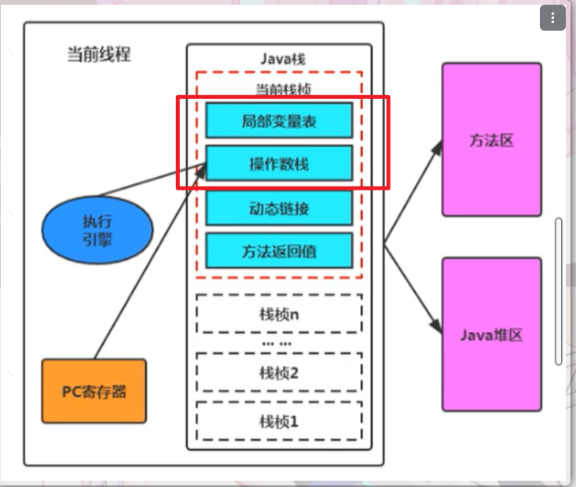

**操作数栈（Operand Stacks）**

**我们知道，Java字节码是Java虚拟机所使用的指令集。因此，它与Java虚拟机基于栈的计算模型是密不可分的。在解释执行过程中，每当为Java方法分配栈桢时，Java虚拟机往往需要开辟一块额外的空间作为操作数栈，来存放计算的操作数以及返回结果。**

**具体来说便是：执行每一条指令之前，Java虚拟机要求该指令&#x7684;****操作数已被压入操作数栈****&#x4E2D;。在执行指令时，Java虚拟机会将该指令所需的操作数弹出，并且将指令的结果重新压入栈中。**

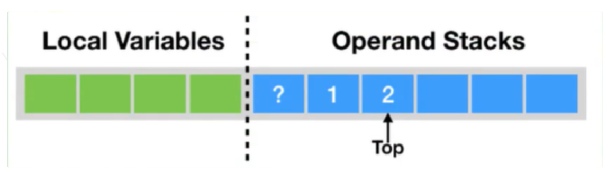

**以加法指令iadd为例。假设在执行该指令前，栈顶的两个元素分别为int值1和int值2，那么iadd指令将弹出这两个int，并将求得的和int值3压入栈中。**


**由于iadd指令只消耗栈顶的两个元素，因此，对于离栈顶距离为2的元素，即图中的问号，iadd 指令并不关心它是否存在，更加不会对其进行修改。**

**局部变量表（Local Variables）**

**Java方法栈桢的另外一个重要组成部分则是局部变量区，字节码程序可以将计算的结果缓存在局部变量区之中。**

**实际上，Java虚拟机将局部变量区当成一个数组，依次存放\*\*\*\*this指针（仅非静态方法），所传入的参数，以及字节码中的局部变量** **。**

**和操作数栈一样，long类型以及double类型的值将占据两个单元，其余类型仅占据一个单元。**

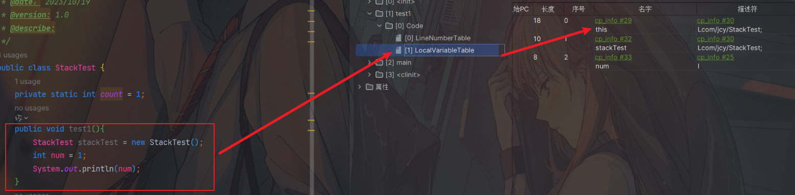

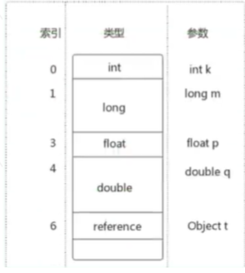

```java
public void foo(long l, float f) {
    {
        int i = e;
    }
    {
        String s = "Hello, World";
    }
}
```


**this表示当前类的引用，l和f的类型的值占两个槽位，i和s变量由于分别在各自代码块中，没有共同的生命周期，所以占同一个槽位（即**\_**槽位复用**\_栈帧中的局部变量表中的槽位是可以重用的，如果一个局部变量过了其作用域，那么在其作用域之后申明的新的局部变就很有可能会复用过期局部变量的槽位，从而达到节省资源的目的。 **）**

**在栈帧中，与性能调优关系最为密切的部分就是局部变量表。局部变量表中的变量也是重要的垃圾回收根节点，只要被局部变量表中直接或间接引用的对象都不会被回收。**

## **局部变量压栈指令**

* iload 从局部变量中装载int类型值\
  lload 从局部变量中装载long类型值\
  fload 从局部变量中装载float类型值\
  dload 从局部变量中装载double类型值\
  **aload 从局部变量中装载引用类型值（refernce）**\
  iload\_x 从局部变量x中装载int类型值 **（x的取值为0，1，2，3）**\
  lload\_x 从局部变量x中装载long类型值\
  fload\_x 从局部变量x中装载float类型值\
  dload\_x从局部变量x中装载double类型值\
  aload\_x 从局部变量x中装载引用类型值\
  **iaload 从数组中装载int类型值**\
  laload 从数组中装载long类型值\
  faload 从数组中装载float类型值\
  daload 从数组中装载double类型值\
  aaload 从数组中装载引用类型值\
  baload 从数组中装载byte类型或boolean类型值\
  caload 从数组中装载char类型值\
  saload 从数组中装载short类型值

**局部变量压栈常用指令集**

| **xload\_n** | **xload\_0** | **xload\_1** | **xload\_2** | **xload\_3** |
| --- | --- | --- | --- | --- |
| **iload\_n** | **iload\_0** | **iload\_1** | **iload\_2** | **iload\_3** |
| **lload\_n** | **lload\_0** | **lload\_1** | **lload\_2** | **lload\_3** |
| **fload\_n** | **fload\_0** | **fload\_1** | **fload\_2** | **fload\_3** |
| **dload\_n** | **dload\_0** | **dload\_1** | **dload\_2** | **dload\_3** |
| **aload\_n** | **aload\_0** | **aload\_1** | **aload\_2** | **aload\_3** |

**局部变量压栈指令剖析**

**局部变量压栈指令将给定的局部变量表中的数据压入操作数栈。**

**这类指令大体可以分为：**

* `xload_<n>`（x为i、l、f、d、a，n为0到3）
* `xload`（x为i、l、f、d、a）

**说明：在这里，x的取值表示数据类型。**

**指令xload\_n表示将第n个局部变量压入操作数栈，比如iload\_1、fload\_0、aload\_0等指令。其中aload\_n表示将一个对象引用压栈。**

**指令xload通过指定参数的形式，把局部变量压入操作数栈，当使用这个命令时，表示局部变量的数量可能超过了4个，比如指令iload、fload等。**

```java
public void load(int num, Object obj, long count, boolean flag, short[] arr) {
    System.out.println(num);
    System.out.println(obj);
    System.out.println(count);
    System.out.println(flag);
    System.out.println(arr);
}
```

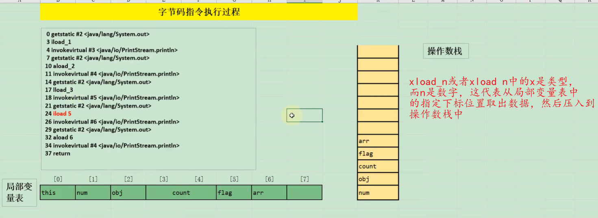

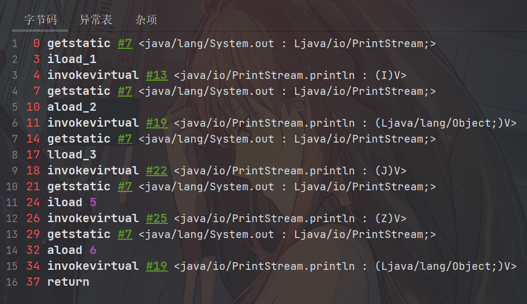

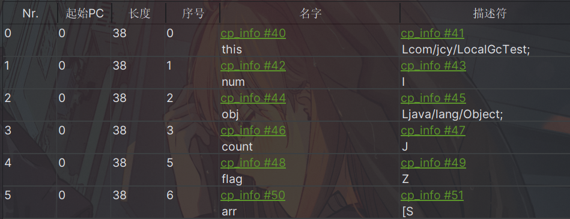

## **常量入栈指令**

* aconst\_null 将null对象引用压入栈\
  iconst\_m1 将int类型常量-1压入栈\
  iconst\_0 将int类型常量0压入栈\
  iconst\_1 将int类型常量1压入栈\
  iconst\_2 将int类型常量2压入栈\
  iconst\_3 将int类型常量3压入栈\
  iconst\_4 将int类型常量4压入栈\
  iconst\_5 将int类型常量5压入栈\
  lconst\_0 将long类型常量0压入栈\
  lconst\_1 将long类型常量1压入栈\
  fconst\_0 将float类型常量0压入栈\
  fconst\_1 将float类型常量1压入栈\
  dconst\_0 将double类型常量0压入栈\
  dconst\_1 将double类型常量1压入栈\
  bipush 将一个8位带符号整数压入栈\
  sipush 将16位带符号整数压入栈\
  ldc 把常量池中的项压入栈\
  ldc\_w 把常量池中的项压入栈（使用宽索引）\
  ldc2\_w 把常量池中long类型或者double类型的项压入栈（使用宽索引）

**常量入栈指令剖析**

**常量入栈指令的功能是将常数压入操作数栈，根据数据类型和入栈内容的不同，又可以分为const系列、push系列和ldc指令。**

**指令const系列**：用于对特定的常量入栈，入栈的常量隐含在指令本身里。指令有：`iconst_<i>（i从-1到5）、lconst_<l>（1从0到1）、fconst_<f>（f从0到2）、dconst_<d>（d从0到1）、aconst_null`。比如，

* **iconst\_m1将-1压入操作数栈；**
* **iconst\_x（x为0到5）将x压入栈；**
* **lconst\_0、lconst\_1分别将长整数0和1压入栈；**
* **fconst\_0、fconst\_1、fconst\_2分别将浮点数0、1、2压入栈；**
* **dconst\_0和dconst\_1分别将double型0和1压入栈；**
* **aconst\_null将null压入操作数栈；**

**从指令的命名上不难找出规律，指令助记符的第一个字符总是喜欢表示数据类型，i表示整数，l表示长整数，f表示浮点数，d表示双精度浮点，习惯上用a表示对象引用。如果指令隐含操作的参数，会以下划线形式给出。**

**指令push系列**：**主要包括bipush和sipush。它们的区别在于接收数据类型的不同，bipush接收8位整数作为参数，sipush接收16位整数，它们都将\*\*\*\*参数压入栈** **。**

```java
 0 bipush 15
 2 istore_1
 3 bipush 8
 5 istore_2
 6 iload_1
 7 iload_2
 8 iadd
 9 istore_3
10 return
```

**指令ldc系列**：**如果以上指令都不能满足需求，那么可以使用万能的**

* \*\*ldc指令，它可以接收一个8位的参数，该参数指向常量池中的int、float或者String的索引，\*\***将指定的内容压入堆栈** **。**
* **类似的还有ldc\_w，它接收两个8位参数，能支持的索引范围大于ldc。**
* **如果要压入的元素是long或者double类型的，则使用ldc2\_w指令，使用方式都是类似的**

**总结如下：**

| **类型** | **常数指令** | **范围** |
| --- | --- | --- |
| **int(boolean,byte,char,short)** | **iconst** | **\[-1, 5]** |
| **bipush** | **\[-128, 127]** | |
| **sipush** | **\[-32768, 32767]** | |
| **ldc** | **any int value** | |
| **long** | **lconst** | **0, 1** |
| **ldc** | **any long value** | |
| **float** | **fconst** | **0, 1, 2** |
| **ldc** | **any float value** | |
| **double** | **dconst** | **0, 1** |
| **ldc** | **any double value** | |
| **reference** | **aconst** | **null** |
| **ldc** | **String literal, Class literal** | |

```plain
​​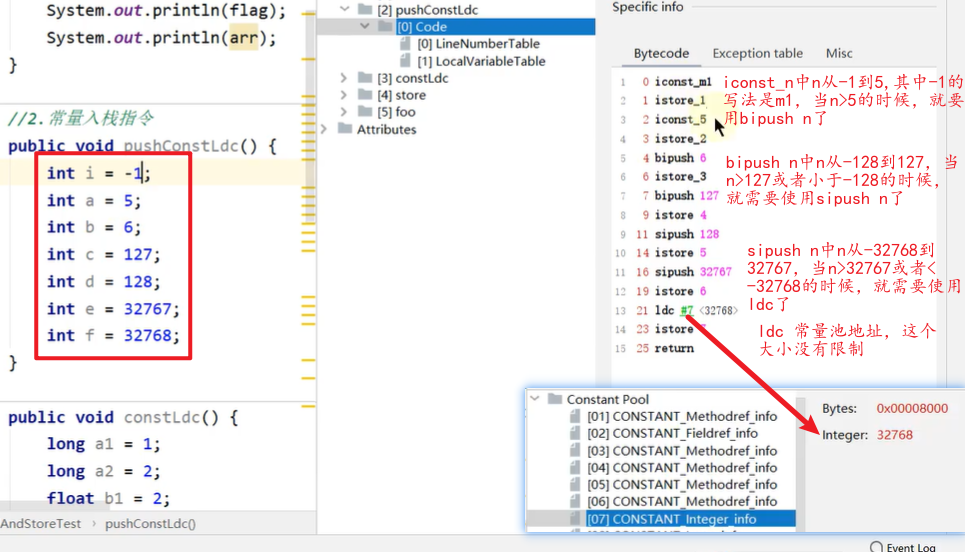
```

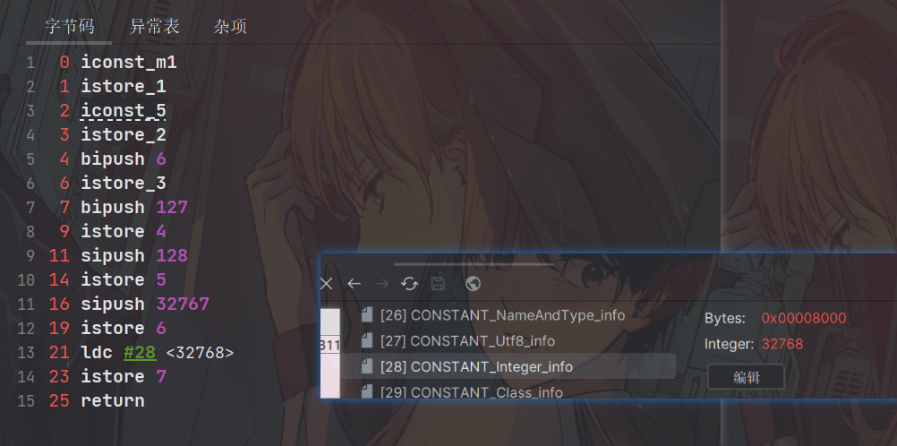

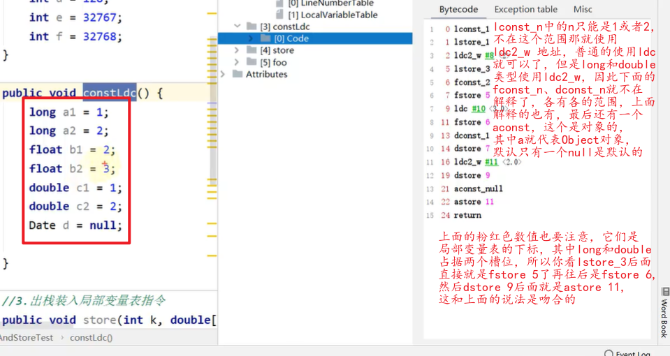

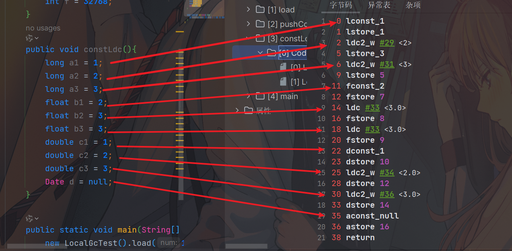

## **出栈装入局部变量表指令**

* istore 将int类型值存入局部变量
* lstore 将long类型值存入局部变量
* fstore 将float类型值存入局部变量
* dstore 将double类型值存入局部变量
* astore 将将引用类型或returnAddress类型值存入局部变量
* istore\_x 将int类型值存入局部变量x  **（x取值为0，1，2，3）**
* lstore\_x 将long类型值存入局部变量x
* fstore\_x 将float类型值存入局部变量x
* dstore\_x 将double类型值存入局部变量x
* astore\_x 将引用类型或returnAddress类型值存入局部变量x
* iastore 将int类型值存入数组中
* lastore 将long类型值存入数组中
* fastore 将float类型值存入数组中
* dastore 将double类型值存入数组中
* aastore 将引用类型值存入数组中
* bastore 将byte类型或者boolean类型值存入数组中
* castore 将char类型值存入数组中
* sastore 将short类型值存入数组中
* wide指令
* wide 使用附加字节扩展局部变量索引

**出栈装入局部变量表常用指令集**

| **xstore\_n** | **xstore\_0** | **xstore\_1** | **xstore\_2** | **xstore\_3** |
| --- | --- | --- | --- | --- |
| **istore\_n** | **istore\_0** | **istore\_1** | **istore\_2** | **istore\_3** |
| **lstore\_n** | **lstore\_0** | **lstore\_1** | **lstore\_2** | **lstore\_3** |
| **fstore\_n** | **fstore\_0** | **fstore\_1** | **fstore\_2** | **fstore\_3** |
| **dstore\_n** | **dstore\_0** | **dstore\_1** | **dstore\_2** | **dstore\_3** |
| **astore\_n** | **astore\_0** | **astore\_1** | **astore\_2** | **astore\_3** |

**出栈装入局部变量表指令剖析**

**出栈装入局部变量表指令用于&#x5C06;****操作数栈中栈顶元素弹出****&#x540E;，装入局部变量表的指定位置，用于给局部变量赋值。这类指令主要&#x4EE5;****store****&#x7684;形式存在，比如**`xstore（x为i、l、f、d、a）、xstore_n（x为i、l、f、d、a，n为0至3）`。

* **其中，指令istore\_n将从操作数栈中弹出一个整数，并把它值给局部变&#x91CF;****索引n****&#x4F4D;置。**
* **指令xstore由于没有隐含参数信息，故需要提供一个byte类型的参数类指定目标局部变量表的位置。**

**说明：一般说来，类似像store这样的命令需要带一个参数，用来指明将弹出的元素放在局部变量表的第几个位置。但是，为了尽可能压缩指令大小，使用专门的istore\_1指令表示将弹出的元素放置在局部变量表第1个位置。类似的还有istore\_0、istore\_2、istore\_3，它们分别表示从操作数栈顶弹出一个元素，存放在局部变量表第0、2、3个位置。由于局部变量表前几个位置总是非常常用，因此这种做法虽然增加了指令数量，但是可以大大压缩生成的字节码的体积。如果局部变量表很大，需要存储的槽位大于3，那么可以使用\*\*\*\*istore指令，外加一个参数** **，用来表示需要存放的槽位位置。**

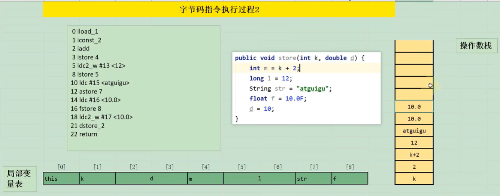

# **算术指令**

**算术指令用于对两个操作数栈上的值进行某种特定运算，并把结果重新压入操作数栈。**

**大体上算术指令可以分为两种：对整型数据进行运算的指令与对浮点类型数据进行运算的指令。**

## byte、short、char和boolean类型说明

**在每一大类中，都有针对Java虚拟机具体数据类型的专用算术指令。但没有直接支持byte、short、char和boolean类型的算术指令，对于这些数据的运算，都使用int类型的指令来处理。此外，在处理boolean、byte、short和char类型的数组时，也&#x4F1A;****转换为使用对应的int类型****&#x7684;字节码指令来处理。**

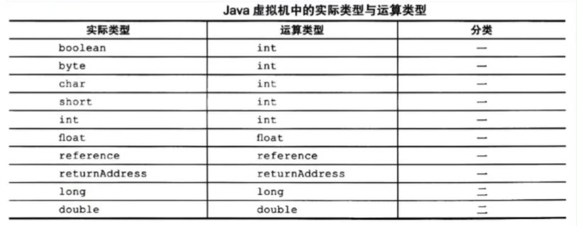

## **运算时的溢出**

**数据运算可能会导致溢出，例如两个很大的正整数相加，结果可能是一个负数。其实Java虚拟机规范并无明确规定过整型数据溢出的具体结果，仅规定了在处理整型数据时，只有除法指令以及求余指令中当出现除数为0时会导致虚拟机抛出异常ArithmeticException。**

## **运算模式**

**向最接近数舍入模式：JVM要求在进行浮点数计算时，所有的运算结果都必须\*\*\*\*舍入到适当的精度** **，非精确结果必须舍入为可被表示的最接近的精确值，如果有两种可表示的形式与该值一样接近，将优先选择最低有效位为零的；**

**向零舍入模式：将浮点数转换为整数时，采用该模式，该模式将在目标数值类型中选择一个最接近但是不大于原值的数字作为最精确的舍入结果；**

## **NaN值使用**

**当一个操作产生溢出时，将会使用有符号的无穷大表示，如果某个操作结果没有明确的数学定义的话，将会使用NaN值来表示。而且所有使用NaN值作为操作数的算术操作，结果都会返回NaN；**

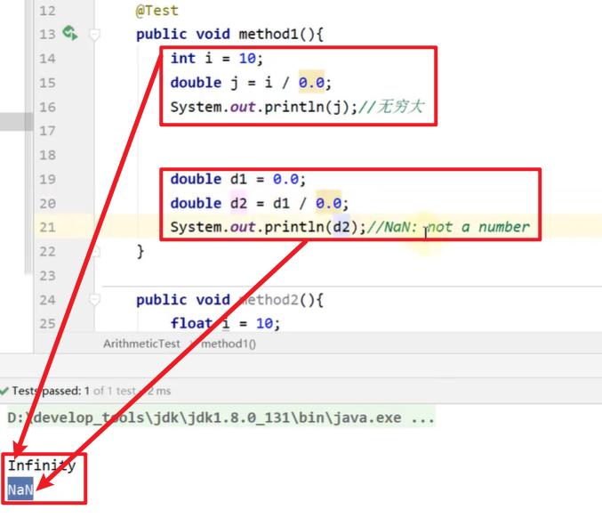

## **所有算术指令**

* 整数运算
  * iadd 执行int类型的加法
  * ladd 执行long类型的加法
  * isub 执行int类型的减法
  * lsub 执行long类型的减法
  * imul 执行int类型的乘法
  * lmul 执行long类型的乘法
  * idiv 执行int类型的除法
  * ldiv 执行long类型的除法
  * irem 计算int类型除法的余数
  * lrem 计算long类型除法的余数
  * ineg 对一个int类型值进行取反操作
  * lneg 对一个long类型值进行取反操作
  * iinc 把一个常量值加到一个int类型的局部变量上
* 逻辑运算
* 移位操作
  * ishl 执行int类型的向左移位操作
  * lshl 执行long类型的向左移位操作
  * ishr 执行int类型的向右移位操作
  * lshr 执行long类型的向右移位操作
  * iushr 执行int类型的向右逻辑移位操作
  * lushr 执行long类型的向右逻辑移位操作
* 按位布尔运算
  * iand 对int类型值进行“逻辑与”操作
  * land 对long类型值进行“逻辑与”操作
  * ior 对int类型值进行“逻辑或”操作
  * lor 对long类型值进行“逻辑或”操作
  * ixor 对int类型值进行“逻辑异或”操作
  * lxor 对long类型值进行“逻辑异或”操作
* 浮点运算
  * fadd 执行float类型的加法
  * dadd 执行double类型的加法
  * fsub 执行float类型的减法
  * dsub 执行double类型的减法
  * fmul 执行float类型的乘法
  * dmul 执行double类型的乘法
  * fdiv 执行float类型的除法
  * ddiv 执行double类型的除法
  * frem 计算float类型除法的余数
  * drem 计算double类型除法的余数
  * fneg 将一个float类型的数值取反
  * dneg 将一个double类型的数值取反

**算术指令集**

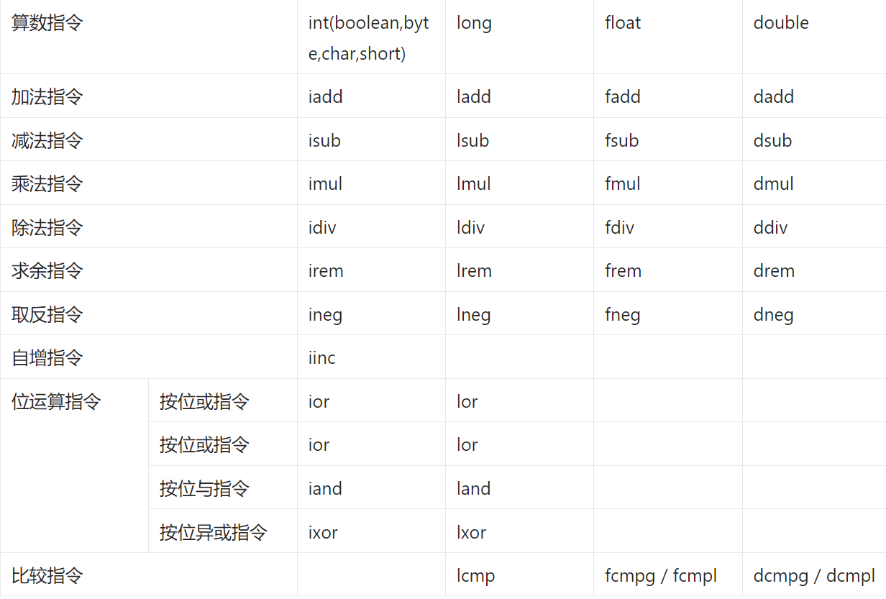

**举例1**

```java
public static int bar(int i) {
	return ((i + 1) - 2) * 3 / 4;
}
```

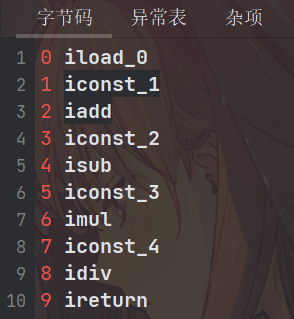

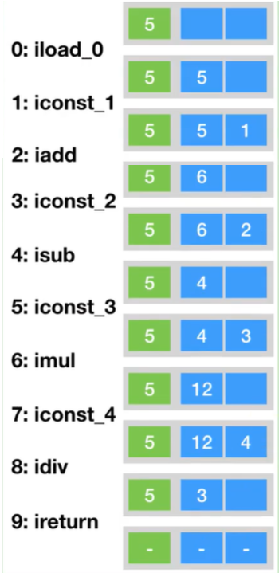

```java
public void add() {
	byte i = 15;
	int j = 8;
	int k = i + j;
}
```

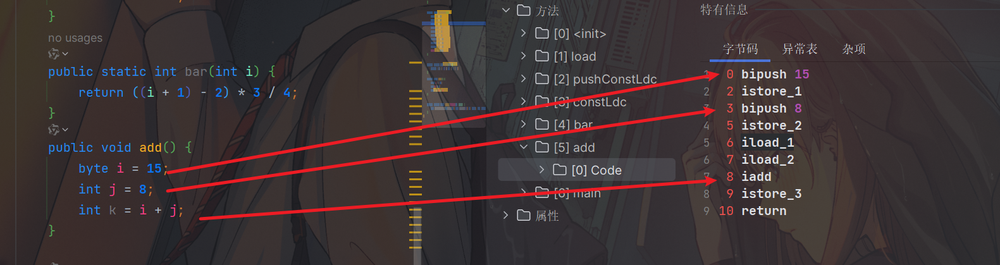

# **类型转换指令**

**类型转换指令可以将两种不同的数值类型进行相互转换。**

**这些转换操作一般用于实现用户代码中的显式类型转换操作，或者用来处理字节码指令集中数据类型相关指令无法与数据类型一一对应的问题。**

* 宽化类型转换
  * i2l 把int类型的数据转化为long类型
  * i2f 把int类型的数据转化为float类型
  * i2d 把int类型的数据转化为double类型
  * l2f 把long类型的数据转化为float类型
  * l2d 把long类型的数据转化为double类型
  * f2d 把float类型的数据转化为double类型
* 窄化类型转换
  * i2b 把int类型的数据转化为byte类型
  * i2c 把int类型的数据转化为char类型
  * i2s 把int类型的数据转化为short类型
  * l2i 把long类型的数据转化为int类型
  * f2i 把float类型的数据转化为int类型
  * f2l 把float类型的数据转化为long类型
  * d2i 把double类型的数据转化为int类型
  * d2l 把double类型的数据转化为long类型
  * d2f 把double类型的数据转化为float类型

**类型转换指令集**

| **byte** | **char** | **short** | **int** | **long** | **float** | **double** |
| --- | --- | --- | --- | --- | --- | --- |
| **i2b** | **i2c** | **i2s** | **○** | **i2l** | **i2f** | **i2d** |
| **l2i i2b** | **l2i i2c** | **l2i i2s** | **l2i** | **○** | **l2f** | **l2d** |
| **f2i i2b** | **f2i i2c** | **f2i i2s** | **f2i** | **f2l** | **○** | **f2d** |
| **d2i i2b** | **d2i i2c** | **d2i i2s** | **d2i** | **d2l** | **d2f** | **○** |

## 宽化类型转换指令

1. **转换规则**

**Java虚拟机直接支持以下数值的宽化类型转换（ widening numeric conversion,小范围类型向大范围类型的安全转换）。也就是说，并不需要指令执行，包括**

* 从int类型到long、float或者 double类型。对应的指令为：i21、i2f、i2d
* 从long类型到float、 double类型。对应的指令为：i2f、i2d
* 从float类型到double类型。对应的指令为：f2d

**简化为：int-->long-->float-> double**

2. **精度损失问题**

* 宽化类型转换是不会因为超过目标类型最大值而丢失信息的，例如，从int转换到long,或者从int转换到double,都不会丢失任何信息，转换前后的值是精确相等的。
* 从int、long类型数值转换到float，或者long类型数值转换到double时，将可能发生精度丢失一一可能丢失掉几个最低有效位上的值，转换后的浮点数值是根据**IEEE754**最接近含入模式所得到的正确整数值。

**尽管宽化类型转换实际上&#x662F;****可能发生精度丢失****&#x7684;，但是这种转换永远\*\*\*\*不会导致Java虚拟机抛出运行时异常**

3. **补充说明**

**从byte、char和 short类型到int类型的宽化类型转换实际上是不存在的**。**对于byte类型转为int,拟机并没有做实质性的转化处理，只是简单地通过操作数栈交換了两个数据。而将byte转为long时，使用的是i2l,可以看到在内部，byte在这里已经等同于int类型处理，类似的还有 short类型，这种处理方式有两个特点：**

**一方面可以减少实际的数据类型，如果为 short和byte都准备一套指令，那么指令的数量就会大増，而虚拟机目前的设计上，只愿意使用一个字节表示指令，因此指令总数不能超过256个，为了节省指令资源，将 short和byte当做int处理也在情理之中。**

**另一方面，由于局部变量表中的槽位固定为32位，无论是byte或者 short存入局部变量表，都会占用32位空间。从这个角度说，也没有必要特意区分这几种数据类型。**

## **窄化类型转换指令**

1. **转换规则**

**Java虚拟机也直接支持以下窄化类型转换：**

* 从主int类型至byte、 short或者char类型。对应的指令有：i2b、i2c、i2s
* 从long类型到int类型。对应的指令有：l2i
* 从float类型到int或者long类型。对应的指令有：f2i、f2l
* 从double类型到int、long或者float类型。对应的指令有：d2i、d2l、d2f

2. **精度损失问题**

**窄化类型转换可能会导致转换结果具备不同的正负号、不同的数量级，因此，转换过程很可能会导致\*\*\*\*数值丢失精度** **。**

**尽管数据类型窄化转换可能会发生上限溢出、下限溢出和精度丢失等情况，但是Java虚拟机规范中明确规定数值类型的窄化转换指令永远不可能导致虚拟机抛出运行时异常**

3. **补充说明**

**当将一个浮点值窄化转换为整数类型T(T限于int或long类型之一)的时候，将遵循以下转换规则：**

* 如果浮点值是NaN,那转换结果就是int或long类型的0.
* 如果浮点值不是无穷大的话，浮点值使用IEEE754的向零含入模式取整，获得整数值v。如果v在目标类型T(int或long)的表示范围之内，那转换结果就是v。否则，将根据v的符号，转换为T所能表示的最大或者最小正数

**当将一个double类型窄化转换为float类型时，将遵循以下转换规则，通过向最接近数舍入模式舍入一个可以使用float类型表示的数字。最后结果根据下面这3条规则判断：**

* 如果转换结果的绝对值太小而无法使用float来表示，将返回float类型的**正负零**
* 如果转换结果的绝对值太大而无法使用float来表示，将返回float类型的**正负无穷大**。
* 对于double类型的NaN值将按规定转换为float类型的**NaN值**。

# **对象的创建与访问指令**

**Java是面向对象的程序设计语言，虚拟机平台从字节码层面就对面向对象做了深层次的支持。有一系列指令专门用于对象操作，可进一步细分为创建指令、字段访问指令、数组操作指令、类型检查指令。**

* 对象操作指令
  * new 创建一个新对象
  * getfield 从对象中获取字段
  * putfield 设置对象中字段的值
  * getstatic 从类中获取静态字段
  * putstatic 设置类中静态字段的值
  * checkcast 确定对象为所给定的类型。后跟目标类，判断栈顶元素是否为目标类 / 接口的实例。如果不是便抛出异常
  * instanceof 判断对象是否为给定的类型。后跟目标类，判断栈顶元素是否为目标类 / 接口的实例。是则压入 1，否则压入 0
* 数组操作指令
  * newarray 分配数据成员类型为基本上数据类型的新数组
  * anewarray 分配数据成员类型为引用类型的新数组
  * arraylength 获取数组长度
  * multianewarray 分配新的多维数组

## **创建指令**

| **创建指令** | **含义** |
| --- | --- |
| **new** | **创建类实例** |
| **newarray** | **创建基本类型数组** |
| **anewarray** | **创建引用类型数组** |
| **multilanewarra** | **创建多维数组** |

**虽然类实例和数组都是对象，但Java虚拟机对类实例和数组的创建与操作使用了不同的字节码指令：**

1. 创建类实例的指令：

* **创建类实例的指令：new**
* **它接收一个操作数，为指向常量池的索引，表示要创建的类型，执行完成后，将对象的引用压入栈。**

2. 创建数组的指令：

* **创建数组的指令：newarray、anewarray、multianewarray**
* **上述创建指令可以用于创建对象或者数组，由于对象和数组在Java中的广泛使用，这些指令的使用频率也非常高。**

## **字段访问指令**

| **字段访问指令** | **含义** |
| --- | --- |
| **getstatic、putstatic** | **访问类字段（static字段，或者称为类变量）的指令** |
| **getfield、 putfield** | **访问类实例字段（非static字段，或者称为实例变量）的指令** |

对象创建后，就可以通过对象访问指令获取对象实例或数组实例中的字段或者数组元素。

* 访问类字段（static字段，或者称为类变量）的指令：getstatic、putstatic\
  访问类实例字段（非static字段，或者称为实例变量）的指令：getfield、putfield

举例：以getstatic指令为例，它含有一个操作数，为指向常量池的Fieldref索引，它的作用就是获取Fieldref指定的对象或者值，并将其压入操作数栈。

```java
public void sayHello() {
    System.out.println("hello"); 
}
```

**对应的字节码指令：**

```shell
0 getstatic #8 <java/lang/System.out>
3 ldc #9 <hello>
5 invokevirtual #10 <java/io/PrintStream.println>
8 return
```

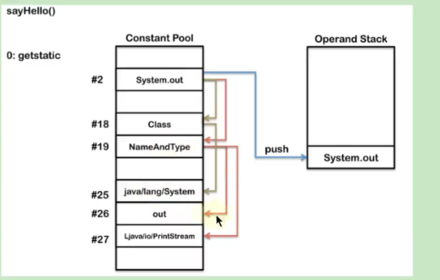

## **数组操作指令**

**数组操作指令主要有：xastore和xaload指令。具体为：**

* **把一个数组元素加载到操作数栈的指令：baload、caload、saload、iaload、laload、faload、daload、aaload**
* **将一个操作数栈的值存储到数组元素中的指令：bastore、castore、sastore、iastore、lastore、fastore、dastore、aastore**

| **数组指令** | **byte(boolean)** | **char** | **short** | **int** | **long** | **float** | **double** | **reference** |
| --- | --- | --- | --- | --- | --- | --- | --- | --- |
| **xaload** | **baload** | **caload** | **saload** | **iaload** | **laload** | **faload** | **daload** | **aaload** |
| **xastore** | **bastore** | **castore** | **sastore** | **iastore** | **lastore** | **fastore** | **dastore** | **aastore** |

**取数组长度的指令：arraylength。该指令弹出栈顶的数组元素，获取数组的长度，将长度压入栈。**

**指令xaload表示将数组的元素压栈，比如saload、caload分别表示压入short数组和char数组。指令xaload在执行时，要求操作数中栈顶元素为数组索引i，栈顶顺位第2个元素为数组引用a，该指令会弹出栈顶这两个元素，并将a\[i]重新压入栈。**

**xastore则专门针对数组操作，以iastore为例，它用于给一个int数组的给定索引赋值。在iastore执行前，操作数栈顶需要以此准备3个元素：值、索引、数组引用，iastore会弹出这3个值，并将值赋给数组中指定索引的位置。**

## 类型检查指令

**检查类实例或数组类型的指令：instanceof、checkcast。**

* **指令instanceof用来判断给定对象是否是某一个类的实例，它会将判断结果压入操作数栈**
* **指令checkcast用于检查类型强制转换是否可以进行。如果可以进行，那么checkcast指令不会改变操作数栈，否则它会抛出ClassCastException异常**

| **类型检查指令** | **含义** |
| --- | --- |
| **instanceof** | **判断给定对象是否是某一个类的实例** |
| **checkcast** | **检查类型强制转换是否可以进行** |

# **方法调用与返回指令**

* 方法调用指令
  * invokcvirtual 运行时按照**对象的类**来调用实例方法
  * invokespecial 根据**编译时类型**来调用实例方法
  * invokestatic 调用**类（静态）方法**
  * invokcinterface 调用**接口方法**
* 方法返回指令
  * ireturn 从方法中返回int类型的数据
  * lreturn 从方法中返回long类型的数据
  * freturn 从方法中返回float类型的数据
  * dreturn 从方法中返回double类型的数据
  * areturn 从方法中返回引用类型的数据
  * return 从方法中返回，返回值为void

## **方法调用指令**

**方法调用指令：invokevirtual、invokeinterface、invokespecial、invokestatic、invokedynamic，以下5条指令用于方法调用：**

* **invokevirtual指令用于调用\*\*\*\*对象的实例方法** **，根据对象的实际类型进行分派（虚方法分派），支持多态。这也是Java语言中最常见的方法分派方式。**
* **invokeinterface指令用于调用\*\*\*\*接口方法** **，它会在运行时搜索由特定对象所实现的这个接口方法，并找出适合的方法进行调用。**
* **invokespecial指令用于调用一些需要\*\*\*\*特殊处理的实例方法，包括实例初始化方法（构造器）、私有方法和父类方法。** **这些方法都是静态类型绑定的，不会在调用时进行动态派发。**
* **invokestatic指令用于调用命名类中的\*\*\*\*类方法** **（static方法）。这是静态绑定的。**
* **invokedynamic指令用于调用\*\*\*\*动态绑定的方法** **，这个是JDK1.7后新加入的指令。用于在运行时动态解析出调用点限定符所引用的方法，并执行该方法。**
* **invokedynamic指令的分派逻辑是由用户所设定的引导方法决定的，而前面4条调用指令的分派逻辑都固化在java虚拟机内部**

| **方法调用指令** | **含义** |
| --- | --- |
| **invokevirtual** | **调用对象的实例方法** |
| **invokeinterface** | **调用接口方法** |
| **invokespecial** | **调用一些需要特殊处理的实例方法，包括实例初始化方法（构造器）、私有方法和父类方法** |
| **invokestatic** | **调用命名类中的类方法（static方法）** |
| **invokedynamic** | **调用动态绑定的方法** |

## **方法返回指令**

**方法调用结束前，需要进行返回。方法返回指令是根据返回值的类型区分的。**

* **包括ireturn（当返回值是boolean、byte、char、short和int 类型时使用）、lreturn、freturn、dreturn和areturn**
* **另外还有一条return 指令供声明为void的方法、实例初始化方法以及类和接口的类初始化方法使用。**

| **方法返回指令** | **void** | **int** | **long** | **float** | **double** | **reference** |
| --- | --- | --- | --- | --- | --- | --- |
| **xreturn** | **return** | **ireturn** | **lreturn** | **freutrn** | **dreturn** | **areturn** |

**通过ireturn指令，将当前函数操作数栈的顶层元素弹出，并将这个元素压入调用者函数的操作数栈中（因为调用者非常关心\*\*\*\*函数的返回值** **），所有在当前函数操作数栈中的其他元素都会被丢弃**

**如果当前返回的是synchronized方法，那么还会执行一个隐含的monitorexit指令，退出临界区。**

**最后，会丢弃当前方法的整个帧，恢复调用者的帧，并将控制权转交给调用者。**

```java
public int methodReturn() {
    int i = 500;
    int j = 200;
    int k = 50;
  
    return (i + j) / k;
}
```

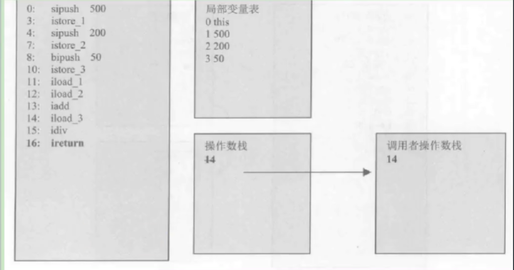

# **操作数栈管理指令**

**如同操作一个普通数据结构中的堆栈那样，JVM提供的操作数栈管理指令，可以用于直接操作操作数栈的指令。**

**这类指令包括如下内容：**

* **将一个或两个元素从栈顶弹出，并且直接废弃：**`pop，pop2`
* **复制栈顶一个或两个数值并将复制值或双份的复制值重新压入栈顶：**`dup，dup2，dup_x1，dup2_×1，dup_×2，dup2_×2`
* **将栈最顶端的两个Slot数值位置交换：**`swap`。Java虚拟机没有提供交换两个64位数据类型（long、double）数值的指令。
* **指令**`nop`，是一个非常特殊的指令，它的字节码为0x00。和汇编语言中的nop一样，它表示什么都不做。这条指令一般可用于调试、占位等。

**这些指令属于通用型，对栈的压入或者弹出无需指明数据类型。**

* **不带\_x的指令是复制栈顶数据并压入栈顶**。包括两个指令，`dup，dup2`。dup的系数代表要复制的Slot个数。dup开头的指令用于复制1个Slot的数据。例如1个int或1个reference类型数据dup2开头的指令用于复制2个Slot的数据。例如1个long，或2个int，或1个int+1个float类型数据
* **带\_x的指令是复制栈顶数据并插入栈顶以下的某个位置**。共有4个指令，`dup_×1，dup2_×1，dup_×2，dup2×2`。对于带*x的复制插入指令，只要将指令的dup和x的系数相加，结果即为需要插入的位置。因此dup* **×1插入位置：1+1=2，即栈顶2个slot下面dup\_×2插入位置：1+2=3，即栈顶3个slot下面；dup2×1插入位置：2+1=3，即栈顶3个Slot下面**
* **pop：将栈顶的1个Slot数值出栈。例如1个short类型数值**
* **pop2：将栈顶的2个slot数值出栈。例如1个double类型数值，或者2个int类型数值**

# **控制转移指令**

**程序流程离不开条件控制，为了支持条件跳转，虚拟机提供了大量字节码指令，大体上可以分为**

* **1）比较指令、**
* **2）条件跳转指令、**
* **3）比较条件跳转指令、**
* **4）多条件分支跳转指令、**
* **5）无条件跳转指令等。**
* 比较指令
  * lcmp 比较long类型值
  * fcmpl 比较float类型值（当遇到NaN时，返回-1）
  * fcmpg 比较float类型值（当遇到NaN时，返回1）
  * dcmpl 比较double类型值（当遇到NaN时，返回-1）
  * dcmpg 比较double类型值（当遇到NaN时，返回1）
* 条件跳转指令
  * ifeq 如果等于0，则跳转
  * ifne 如果不等于0，则跳转
  * iflt 如果小于0，则跳转
  * ifge 如果大于等于0，则跳转
  * ifgt 如果大于0，则跳转
  * ifle 如果小于等于0，则跳转
* 比较条件分支指令
  * if\_icmpeq 如果两个int值相等，则跳转
  * if\_icmpne 如果两个int类型值不相等，则跳转
  * if\_icmplt 如果一个int类型值小于另外一个int类型值，则跳转
  * if\_icmpge 如果一个int类型值大于或者等于另外一个int类型值，则跳转
  * if\_icmpgt 如果一个int类型值大于另外一个int类型值，则跳转
  * if\_icmple 如果一个int类型值小于或者等于另外一个int类型值，则跳转
  * ifnull 如果等于null，则跳转
  * ifnonnull 如果不等于null，则跳转
  * if\_acmpeq 如果两个对象引用相等，则跳转
  * if\_acmpne 如果两个对象引用不相等，则跳转
* 多条件分支跳转指令
  * tableswitch 通过索引访问跳转表，并跳转
  * lookupswitch 通过键值匹配访问跳转表，并执行跳转操作
  * 无条件跳转指令
  * goto 无条件跳转
  * goto\_w 无条件跳转（宽索引）

## **比较指令**

**比较指令的作用是\*\*\*\*比较占栈顶两个元素的大小** **，并将\*\*\*\*比较结果入栈** **。比较指令有： dcmpg,dcmpl、 fcmpg、fcmpl、lcmp。与前面讲解的指令类似，首字符d表示double类型，f表示float,l表示long。**

**对于double和float类型的数字，由于NaN的存在，各有两个版本的比较指令。以float为例，有fcmpg和fcmpl两个指令，它们的区别在于在数字比较时，若遇到NaN值，处理结果不同。**

**指令dcmpl和 dcmpg也是类似的，根据其命名可以推测其含义，在此不再赘述。**

**数值类型的数据，才可以谈大小！boolean、引用数据类型不能比较大小。**

**举例**

**指令 fcmp和fcmpl都从中弹出两个操作数，并将它们做比较，设栈顶的元素为v2，顶顺位第2位的元素为v1：若v1=v2，则压入0；若v1>v2，则压入1；若v1\<v2，则压入-1。**

**两个指令的不同之处在于，如果遇到NaN值， fcmpg会压入1,而fcmpl会压入-1**

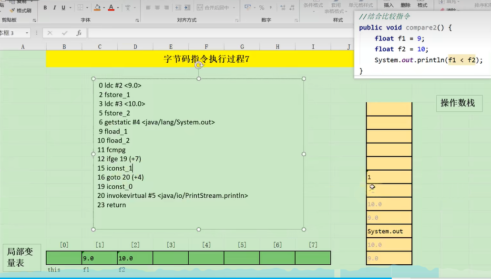

## **条件跳转指令**

**条件跳转指令通常和比较指令结合使用。在条件跳转指令执行前，一般可以先用比较指令进行栈顶元素的准备，然后进行条件跳转。**

**条件跳转指令有：ifeq，iflt，ifle，ifne，ifgt，ifge，ifnull，ifnonnull。这些指令都接收两个字节的操作数，用于计算跳转的位置（16位符号整数作为当前位置的offset）。**

**它们的统一含义为：弹出栈顶元素，测试它是否满足某一条件，** 如果满足条件，则跳转到给定位置 **。**

| **<** | **<=** | **==** | **!=** | **>=** | **>** | **null** | **not null** |
| --- | --- | --- | --- | --- | --- | --- | --- |
| **iflt** | **ifle** | **ifeq** | **ifng** | **ifge** | **ifgt** | **ifnull** | **ifnonnull** |

**与前面运算规则一致：**

* **对于boolean、byte、char、short类型的条件分支比较操作，都是使用int类型的比较指令完成**
* **对于long、float、double类型的条件分支比较操作，则会先执行相应类型的比较运算指令，运算指令会返回一个整型值到操作数栈中，随后再执行int类型的条件分支比较操作来完成整个分支跳转**

**由于各类型的比较最终都会转为int类型的比较操作，所以Java虚拟机提供的int类型的条件分支指令是最为丰富和强大的。**

## **比较条件跳转指令**

**比较条件跳转指令类似于比较指令和条件跳转指令的结合体，它将比较和跳转两个步骤合二为一。**

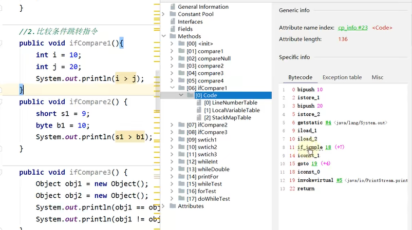

**这些指令都接收两个字节的操作数作为参数，用于计算跳转的位置。同时在执行指令时，栈顶需要准备两个元素进行比较。指令执行完成后，栈顶的这两个元素被清空，且没有任何数据入栈。如果预设条件成立，则执行跳转，否则，继续执行下一条语句。**

## **多条件分支跳转指令**

**多条件分支跳转指令是专为switch-case语句设计的，主要有tableswitch和lookupswitch。**

| **指令名称** | **描述** |
| --- | --- |
| **tableswitch** | **用于switch条件跳转，case值连续** |
| **lookupswitch** | **用于switch条件跳转，case值不连续** |

**从助记符上看，两者都是switch语句的实现，它们的区别：**

* **tableswitch要求多个条件分支值是连续的**，它内部只存放起始值和终止值，以及若干个跳转偏移量，通过给定的操作数index，可以立即定位到跳转偏移量位置，因此**效率比较高**。
* **lookupswitch内部存放着各个离散的case-offset对**，每次执行都要搜索全部的case-offset对，找到匹配的case值，并根据对应的offset计算跳转地址，因此**效率较低**。

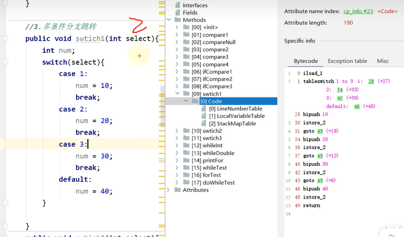

**指令tableswitch的示意图如下图所示。由于tableswitch的case值是连续的，因此只需要记录最低值和最高值，以及每一项对应的offset偏移量，根据给定的index值通过简单的计算即可直接定位到offset。**

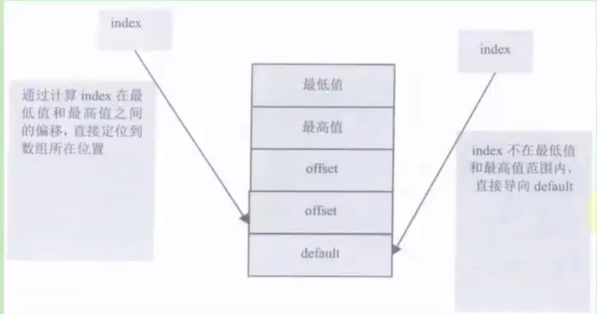

**指令lookupswitch处理的是离散的case值，但是出于效率考虑，将case-offset对按照case值大小排序，给定index时，需要查找与index相等的case，获得其offset，如果找不到则跳转到default。指令lookupswitch如下图所示。**

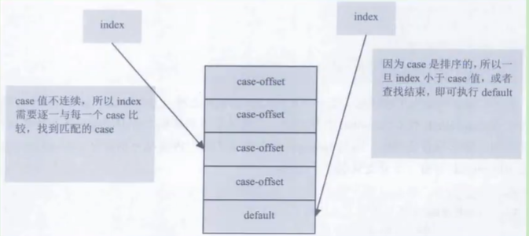

## **无条件跳转指令**

**目前主要的无条件跳转指令为goto。指令goto接收两个字节的操作数，共同组成一个带符号的整数，用于指定指令的偏移量，指令执行的目的就是跳转到偏移量给定的位置处。**

**如果指令偏移量太大，超过双字节的带符号整数的范围，则可以使用指令goto\_w，它和goto有相同的作用，但是它接收4个字节的操作数，可以表示更大的地址范围。**

**指令jsr、jsr\_w、ret虽然也是无条件跳转的，但主要用于try-finally语句，且已经被虚拟机逐渐废弃，故不在这里介绍这两个指令。**

| **指令名称** | **描述** |
| --- | --- |
| **goto** | **无条件跳转** |
| **goto\_w** | **无条件跳转（宽索引）** |
| **jsr** | **跳转至指定16位offset位置，并将jsr下一条指令地址压入栈顶** |
| **jsr\_w** | **跳转至指定32位offer位置，并将jsr\_w下一条指令地址压入栈顶** |
| **ret** | **返回至由指定的局部变量所给出的指令位置（一般与jsr、jsr\_w联合使用）** |

# **异常处理指令**

* 异常处理指令
* athrow 抛出异常或错误。将栈顶异常抛出
* jsr 跳转到子例程
* jsr\_w 跳转到子例程（宽索引）
* ret 从子例程返回

**athrow指令**

**在Java程序中显示\*\*\*\*抛出异常的操作（throw语句）** **都是由athrow指令来实现。**

**除了使用throw语句显示抛出异常情况之外，JVM规范还规定了许多运行时异常会在其他Java虚拟机指令检测到异常状况时自动抛出。例如，在之前介绍的整数运算时，当除数为零时，虚拟机会在idiv或1div指令中抛出ArithmeticException异常。**

**正常情况下，操作数栈的压入弹出都是一条条指令完成的。唯一的例外情况是**在抛异常时，Java虚拟机会清除操作数栈上的所有内容，而后将异常实例压入调用者操作数栈上 **。**

**处理异常**

**在Java虚拟机中，处理异常（catch语句）不是由字节码指令来实现的（早期使用jsr、ret指令），而是采用异常表来完成的。**

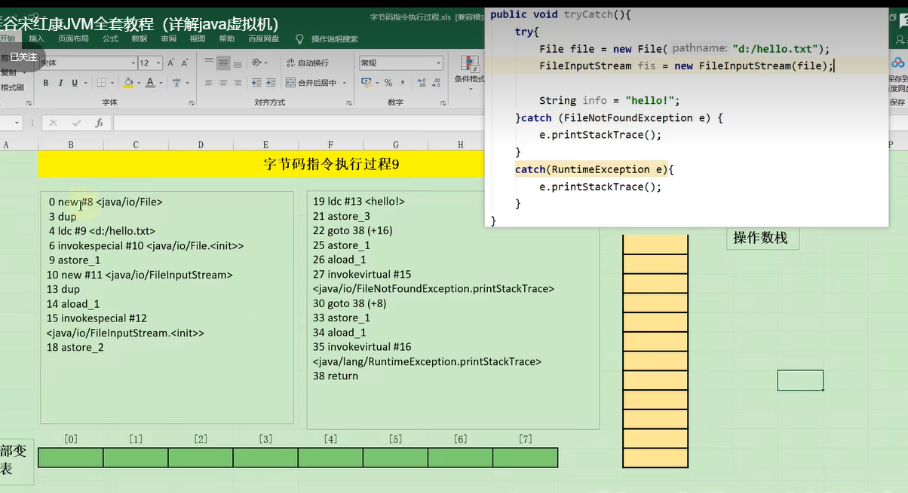

**异常表**

**如果一个方法定义了一个try-catch 或者try-finally的异常处理，就会创建一个异常表。它包含了每个异常处理或者finally块的信息。异常表保存了每个异常处理信息。比如：**

* **起始位置**
* **结束位置**
* **程序计数器记录的代码处理的偏移地址**
* **被捕获的异常类在常量池中的索引**

**当一个异常被抛出时，JVM会在当前的方法里寻找一个匹配的处理，如果没有找到，这个方法会强制结束并弹出当前栈帧**，并且异常会重新抛给上层调用的方法（在调用方法栈帧）。如果在所有栈帧弹出前仍然没有找到合适的异常处理，这个线程将终止。如果这个异常在最后一个非守护线程里抛出，将会导致JVM自己终止，比如这个线程是个main线程。

**不管什么时候抛出异常，如果异常处理最终匹配了所有异常类型，代码就会继续执行**。在这种情况下，如果方法结束后没有抛出异常，仍然执行finally块，在return前，它直接跳到finally块来完成目标

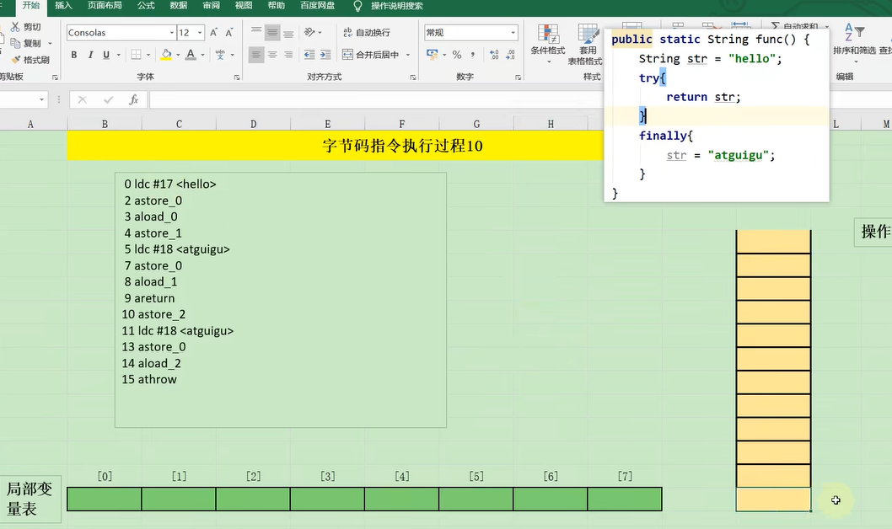

# **同步控制指令**

**java虚拟机支持两种同步结构：方法级的同步和方法内部一段指令序列的同步，这两种同步都是使用monitor来支持的**

## **方法级的同步**

**方法级的同步：是隐式的**，**即无须通过字节码指令来控制，它实现在方法调用和返回操作之中。虚拟机可以从方法常量池的方法表结构中的ACC\_SYNCHRONIZED访问标志得知一个方法是否声明为同步方法；**

**当调用方法时，调用指令将会检查方法的ACC\_SYNCHRONIZED访问标志是否设置。**

* **如果设置了，执行线程将先持有同步锁，然后执行方法。最后在方法完成（无论是正常完成还是非正常完成）时释放同步锁。**
* **在方法执行期间，执行线程持有了同步锁，其他任何线程都无法再获得同一个锁。**
* **如果一个同步方法执行期间抛出了异常，并且在方法内部无法处理此异常，那这个同步方法所持有的锁将在异常抛到同步方法之外时自动释放。**

```java
private int i = 0;
public synchronized void add() {
	i++;
}
```

**对应的字节码：**

```java
0  aload_0
1  dup
2  getfield #2 <com/atguigu/java1/SynchronizedTest.i>
5  iconst_1 
6  iadd
7  putfield #2 <com/atguigu/java1/SynchronizedTest.i>
10 return
```

**这段代码和普通的无同步操作的代码没有什么不同，没有使用monitorenter和monitorexit进行同步区控制。**

**这是因为，对于同步方法而言，** 当虚拟机通过方法的访问标示符判断是一个同步方法时，会自动在方法调用前进行加锁 **，当同步方法执行完毕后，不管方法是正常结束还是有异常抛出，均会由虚拟机释放这个锁。**

**因此，对于同步方法而言，monitorenter和monitorexit指令是隐式存在的，并未直接出现在字节码中。**

## **方法内指令指令序列的同步**

**同步一段指令集序列：通常是由java中的synchronized语句块来表示的。jvm的指令集有monitorenter和monitorexit 两条指令来支持synchronized关键字的语义。**

**当一个线程进入同步代码块时，它使用monitorenter指令请求进入**。如果当前对象的监视器计数器为0，则它会被准许进入，若为1，则判断持有当前监视器的线程是否为自己，如果是，则进入，否则进行等待，直到对象的监视器计数器为0，才会被允许进入同步块。

**当线程退出同步块时，需要使用monitorexit声明退出**。在Java虚拟机中，任何对象都有一个监视器与之相关联，用来判断对象是否被锁定，当监视器被持有后，对象处于锁定状态。

**指令monitorenter和monitorexit在执行时，都需要在操作数栈顶压入对象，之后monitorenter和monitorexit的锁定和释放都是针对这个对象的监视器进行的。**

**下图展示了监视器如何保护临界区代码不同时被多个线程访问，只有当线程4离开临界区后，线程1、2、3才有可能进入·。**

```java
 0: aloade
 1: dup
 2: astore_1
 3: monitorenter
 4: aload_0
 5: dup
 6: getfield #2 //Field i:I
 9: iconst_1
10: isub
11: putfield #2 //Field i:I
14: aload_1
15: monitorexit
16: goto 24
19: astore_2
26: aload_1
21: monitorexit
22: aload_2
23: athrow
24: return

Exception table:
	from to target type
	4	 16	   19  any
	19	 22    19  any
```

**编译器必须确保无论方法通过何种方式完成，方法中调用过的每条monitorenter指令都必须执行其对应的monitorexit指令，而无论这个方法是正常结束还是异常结束。**

**为了保证在方法异常完成时monitorenter和monitorexit指令依然可以正确配对执行，编译器会自动产生一个异常处理器，这个异常处理器声明可处理所有的异常，它的目的就是用来执行monitorexit指令**


> 更新: 2024-06-24 10:32:12  
> 原文: <https://www.yuque.com/nibiwanxiamei/yrd6t1/32a8ef8bcd2412a7077989290ffe8489>