# JVM

***

# **Java内存区域详解**

# 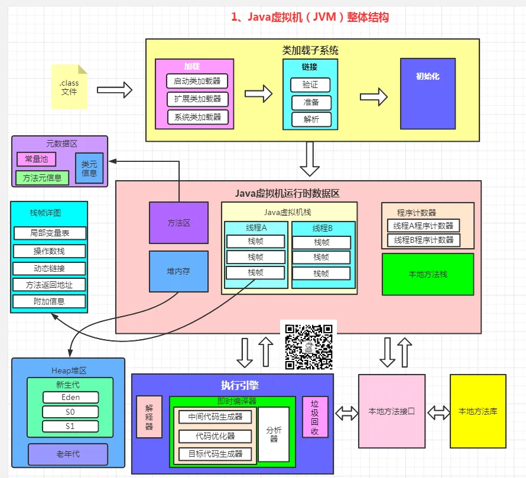

基本流程:

**<font style="color:#DF2A3F;">.class字节码文件经过加载,链接,初始化之后会生成运行时数据区的动态数据结构,包括堆,方法区,栈,PC,本地方法栈.之后执行引擎执行对应的逻辑,运行代码.</font>**

## 运行时数据区域

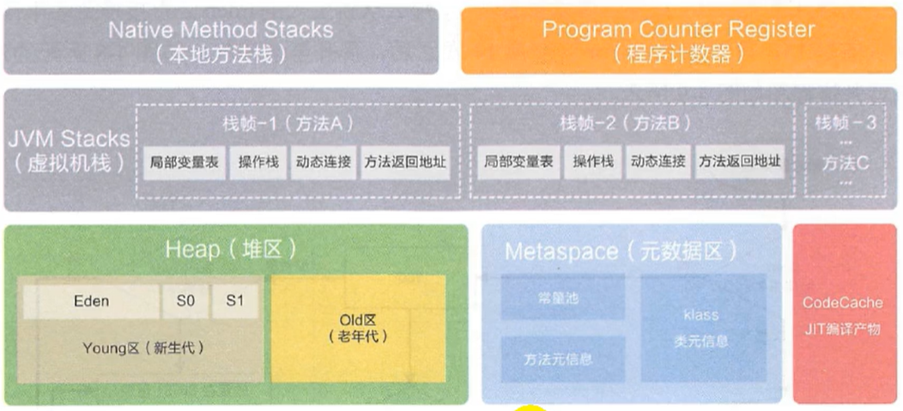

**JDK8之后将方法区改为元空间,放入到本地内存中;**

* **<font style="color:#DF2A3F;">本地内存空间更大,能够存放更多的类信息;</font>**
* **<font style="color:#DF2A3F;">并且本地内存更大,溢出的可能性变得更低;</font>**
* **<font style="color:#DF2A3F;">合并HotSpot和JRockit后,JRockit没有永久代,也就不需要设置永久代;</font>**

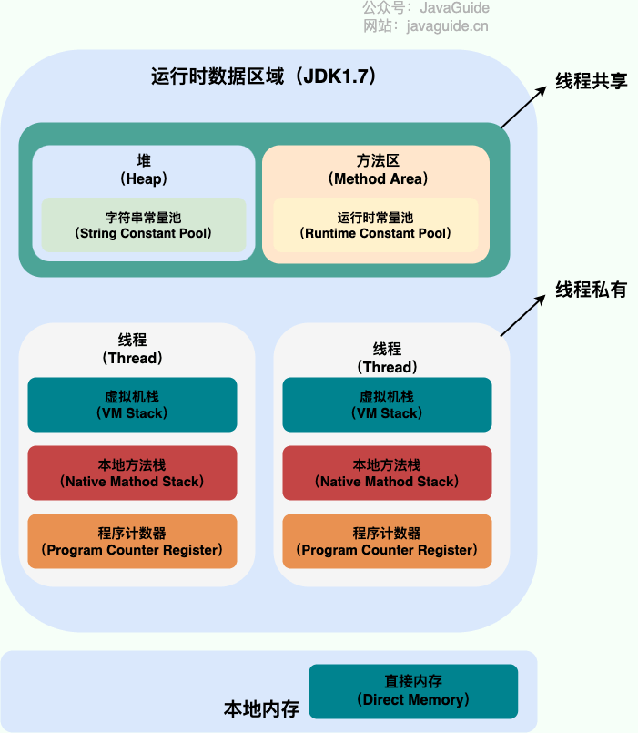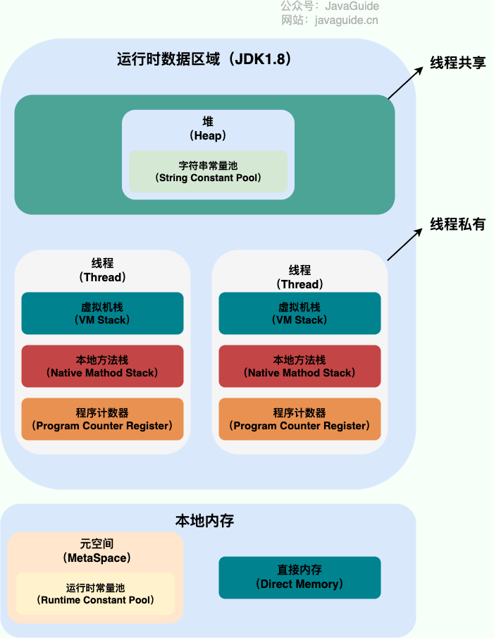

**线程私有的：**

* 程序计数器
* 虚拟机栈
* 本地方法栈

**线程共享的：**

* 堆
* 方法区 -- 元空间
* 本地内存 (非运行时数据区的一部分)

### 程序计数器

[3.运行时数据区和PC](https://www.yuque.com/nibiwanxiamei/yrd6t1/937f8731a6fc61ddea6419a750aa0d28)

程序计数器主要有两个作用：

* 字节码解释器通过改变程序计数器来依次读取指令，从而实现**代码的流程控制**，如：顺序执行、选择、循环、异常处理。
* 在多线程的情况下，程序计数器用于\*\*<font style="color:#DF2A3F;">记录当前线程执行的位置</font>\*\*，从而当线程被切换回来的时候能够知道该线程上次运行到哪儿了。

⚠️ ⚠️ ⚠️注意：程序计数器是**唯一一个不会出现 \*\* <code><font style="color:#DF2A3F;background-color:#FBDE28;">OutOfMemoryError</font></code> \*\* 的内存区域**，它的生命周期随着线程的创建而创建，随着线程的结束而死亡。

> **总结：****<font style="color:#DF2A3F;">PC是一块内存区域，是硬件PC的一种虚拟化，每个线程独有不可共享，指向下一条指令的地址。控制代码的执行流程，保存线程上下文，</font>****<font style="color:#DF2A3F;background-color:#FBDE28;">不会出现</font>**<code><font style="color:#DF2A3F;background-color:#FBDE28;">OutOfMemoryError</font></code><font style="color:#DF2A3F;background-color:#FBDE28;"> </font>**<font style="color:#DF2A3F;background-color:#FBDE28;">，也不需要GC。</font>**

### Java 虚拟机栈

[4.虚拟机栈 ♥](https://www.yuque.com/nibiwanxiamei/yrd6t1/d9a4825f114fc93e408495d6ab2b7c9b)

**与程序计数器一样，Java 虚拟机栈也是线程私有的**，它的生命周期和线程相同，随着线程的创建而创建，随着线程的死亡而死亡。除了一些 Native 方法调用是通过本地方法栈实现的，其他\*\*<font style="color:#DF2A3F;">所有的 Java 方法调用都是通过栈来实现的</font>\*\*（也需要和其他运行时数据区域比如程序计数器配合）。

\*\*方法调用的数据需要通过栈进行传递，每一次方法调用都会有一个对应的栈帧被压入栈中，每一个方法调用结束后，都会有一个栈帧被弹出。 -- \*\***<font style="color:#DF2A3F;background-color:#FBDE28;">一个栈帧对应一个方法</font>**

栈由一个个栈帧组成，而每个栈帧中都拥有：**局部变量表、操作数栈、动态链接、方法返回地址。**

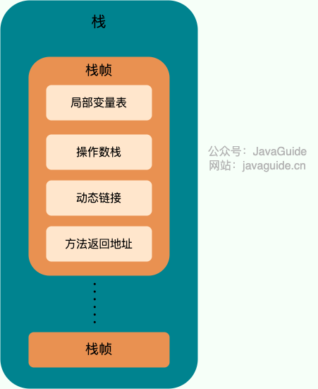

**局部变量表**: 主要存放了编译期可知的各种**基本数据类型**（boolean、byte、char、short、int、float、long、double）、**对象引用**（reference 类型，它不同于对象本身，可能是一个指向对象起始地址的引用指针，也可能是指向一个代表对象的句柄或其他与此对象相关的位置）。

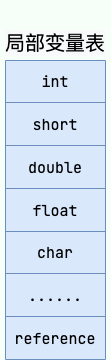

**操作数栈**: 主要作为方法调用的中转站使用，用于存放方法执行过程中产生的中间计算结果。另外，计算过程中产生的临时变量也会放在操作数栈中。

**动态链接**: 主要服务一个方法需要调用其他方法的场景。Class 文件的常量池里保存有大量的符号引用比如方法引用的符号引用。当一个方法要调用其他方法，**<font style="color:#DF2A3F;">将常量池中指向方法的符号引用转化为其在内存地址中的直接引用</font>**。**动态链接的作用就是为了将符号引用转换为调用方法的直接引用，这个过程也被称为动态连接** 。

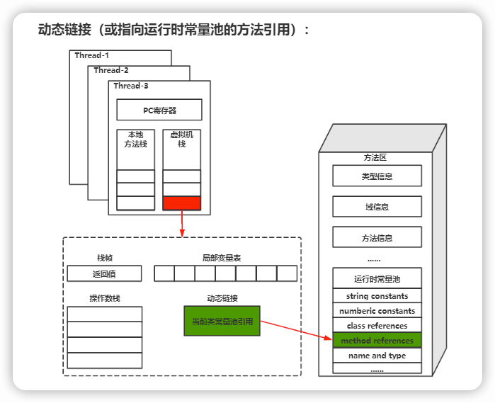

栈空间虽然不是无限的，但一般正常调用的情况下是不会出现问题的。不过，如果函数调用陷入无限循环的话，就会导致栈中被压入太多栈帧而占用太多空间，导致栈空间过深。那么当线程请求栈的深度超过当前 Java 虚拟机栈的最大深度的时候，就抛出 <code>**StackOverFlowError**</code> 错误。

Java 方法有两种返回方式，一种是 return 语句正常返回，一种是抛出异常。不管哪种返回方式，都会导致栈帧被弹出。也就是说， **<font style="color:#DF2A3F;">栈帧随着方法调用而创建，随着方法结束而销毁</font>\*\*\*\*。无论方法正常完成还是异常完成都算作方法结束。**

除了 `StackOverFlowError` 错误之外，栈还可能会出现`OutOfMemoryError`错误，这是因为如果栈的内存大小可以动态扩展， 如果虚拟机在动态扩展栈时无法申请到足够的内存空间，则抛出`OutOfMemoryError`异常。

**<font style="color:#DF2A3F;">通过</font>**<font style="color:#DF2A3F;"> </font>**<font style="color:#DF2A3F;"> -Xss设置栈的大小</font>**

程序运行中栈可能会出现两种错误：

* <code>**StackOverFlowError**</code> **：**  若栈的内存大小不允许动态扩展，那么当线程请求栈的深度超过当前 Java 虚拟机栈的最大深度的时候，就抛出 `StackOverFlowError` 错误。
* <code>**OutOfMemoryError**</code> **：**  如果栈的内存大小可以动态扩展， 如果虚拟机在动态扩展栈时无法申请到足够的内存空间，则抛出`OutOfMemoryError`异常。

> **总结：线程独有栈，每个栈包含多个栈帧，一个栈帧对应一个方法;**
>
> \*\*   栈帧包含: 局部变量表(插槽组成),操作数栈(栈上分配, 逃逸分析),动态链接,方法返回地址;\*\*

### 本地方法栈

[5.本地方法接口和本地方法栈](https://www.yuque.com/nibiwanxiamei/yrd6t1/e917326fd64c4a0902a6fbbe98754986)

和虚拟机栈所发挥的作用非常相似，区别是：**虚拟机栈为虚拟机执行 Java 方法 （也就是字节码）服务，而本地方法栈则为虚拟机使用到的 Native 方法服务** **。**  在 HotSpot 虚拟机中和 Java 虚拟机栈合二为一。

本地方法被执行的时候，在本地方法栈也会创建一个栈帧，用于存放该本地方法的局部变量表、操作数栈、动态链接、出口信息。方法执行完毕后相应的栈帧也会出栈并释放内存空间，**也会出现 **<code>**StackOverFlowError**</code>** 和 **<code>**OutOfMemoryError**</code>** 两种错误**。

### 堆 ♥♥♥♥

[6.堆](https://www.yuque.com/nibiwanxiamei/yrd6t1/c7eb3a969cfc46a6e2b7ec0f2b333a19)

Java 虚拟机所管理的内存中最大的一块，Java 堆是所有\*\*<font style="color:#DF2A3F;">线程共享</font>**的一块内存区域，在虚拟机启动时创建。**此内存区域的唯一目的就是****<font style="color:#DF2A3F;">存放对象实例</font>\*\*\*\*，几乎所有的对象实例以及数组都在这里分配内存。\*\*

Java 世界中“几乎”所有的对象都在堆中分配，但是，随着 **JIT 编译器的发展与逃逸分析技术**逐渐成熟逃逸分析概述，**栈上分配、标量替换优化技术**栈上分配将会导致一些微妙的变化，所有的对象都分配到堆上也渐渐变得不那么“绝对”了。

从 JDK 1.7 开始已经默认开启**逃逸分析**，如果**某些方法中的对象引用没有被返回或者未被外面使用（也就是未逃逸出去），那么对象可以直接在栈上分配内存**。

Java 堆是垃圾收集器管理的主要区域，因此也被称作 **GC 堆（Garbage Collected Heap）** 。从垃圾回收的角度，由于现在收集器基本都采用分代垃圾收集算法，所以 Java 堆还可以细分为：新生代和老年代；再细致一点有：Eden、Survivor、Old 等空间。进一步划分的目的是更好地回收内存，或者更快地分配内存。

在 JDK 7 版本及 JDK 7 版本之前，堆内存被通常分为下面三部分：

1. 新生代内存(Young Generation)
2. 老年代(Old Generation)
3. 永久代(Permanent Generation)

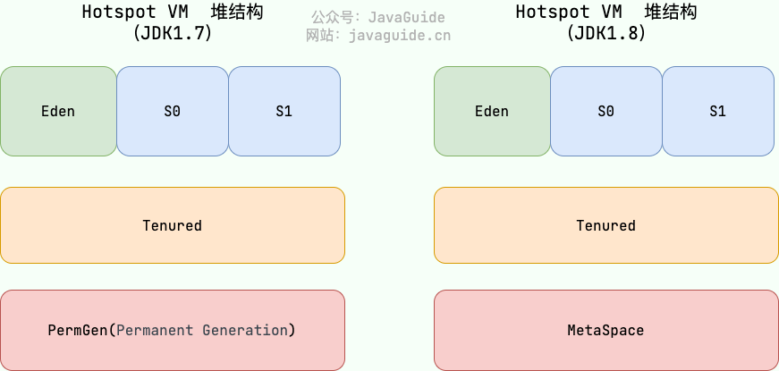

**<font style="color:#DF2A3F;">JDK 8 版本之后 PermGen(永久代) 已被 Metaspace(元空间) 取代，元空间使用的是本地内存。</font>**

大部分情况，对象都会首先在 Eden 区域分配，在一次新生代垃圾回收后，如果对象还存活，则会进入 S0 或者 S1，并且对象的年龄还会加 1(Eden 区->Survivor 区后对象的初始年龄变为 1)，当它的年龄增加到一定程度（默认为 15 岁），就会被晋升到老年代中。对象晋升到老年代的年龄阈值，可以通过参数  `-XX:MaxTenuringThreshold` 来设置。

> 修正：Hotspot 遍历所有对象时，按照年龄从小到大对其所占用的大小进行累积，**当累积的某个年龄大小超过了 survivor 区的一半时，取这个年龄和 MaxTenuringThreshold 中更小的一个值，作为新的晋升年龄阈值**”。
>
> **动态对象年龄判断：如果survivor区中相同年龄的所有对象大小的总和大于Survivor空间的一半，年龄大于或等于该年龄的对象可以直接进入老年代，无须等到**`MaxTenuringThreshold`中要求的年龄。
>
> **<font style="color:#DF2A3F;">类似于超过平均年龄且总空间大于Survivor的一半就可以到老年代</font>**

```java
uint ageTable::compute_tenuring_threshold(size_t survivor_capacity) {
	//survivor_capacity是survivor空间的大小
  size_t desired_survivor_size = (size_t)((((double) survivor_capacity)*TargetSurvivorRatio)/100);
  size_t total = 0;
  uint age = 1;
  while (age < table_size) {
    total += sizes[age];//sizes数组是每个年龄段对象大小
    if (total > desired_survivor_size) break;
    age++;
  }
  uint result = age < MaxTenuringThreshold ? age : MaxTenuringThreshold;
	...
}
```

堆这里最容易出现的就是 `OutOfMemoryError` 错误，并且出现这种错误之后的表现形式还会有几种，比如：

1. <code>**java.lang.OutOfMemoryError: GC Overhead Limit Exceeded**</code>：当 JVM 花太多时间执行垃圾回收并且只能回收很少的堆空间时，就会发生此错误。
2. <code>**java.lang.OutOfMemoryError: Java heap space**</code> :假如在创建新的对象时, 堆内存中的空间不足以存放新创建的对象, 就会引发此错误。(和配置的最大堆内存有关，且受制于物理内存大小。最大堆内存可通过 `-Xmx`  参数配置，若没有特别配置，将会使用默认值，详见：[Default Java 8 max heap size](https://stackoverflow.com/questions/28272923/default-xmxsize-in-java-8-max-heap-size))

### 方法区 ♥♥♥

[7.方法区](https://www.yuque.com/nibiwanxiamei/yrd6t1/b3208ace1a427439b485f4b7dde91c3f)

方法区属于是 JVM 运行时数据区域的一块逻辑区域，是各个线程共享的内存区域。

当虚拟机要使用一个类时，它需要读取并解析 Class 文件获取相关信息，再将信息存入到方法区。方法区会存储已被虚拟机加载的 **类信息、字段信息、方法信息、****<font style="color:#DF2A3F;">常量、静态变量</font>****、即时编译器编译后的代码缓存等数据**。

**方法区和永久代以及元空间是什么关系呢？**  方法区和永久代以及元空间的关系很像 Java 中接口和类的关系，类实现了接口，这里的类就可以看作是永久代和元空间，接口可以看作是方法区，永久代以及元空间是 HotSpot 虚拟机对虚拟机规范中方法区的两种实现方式。并且，永久代是 JDK 1.8 之前的方法区实现，JDK 1.8 及以后方法区的实现变成了元空间。

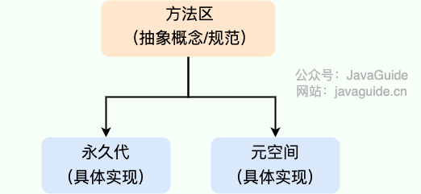

**为什么要将永久代 (PermGen) 替换为元空间 (MetaSpace) 呢?**

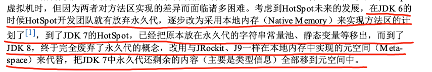

1、整个永久代有一个 JVM 本身设置的固定大小上限，无法进行调整，而元空间使用的是本地内存，受本机可用内存的限制，**溢出出现的几率会更小**。

> 当元空间溢出时会得到如下错误：`java.lang.OutOfMemoryError: MetaSpace`

你可以使用 `-XX：MaxMetaspaceSize` 标志设置最大元空间大小，默认值为 unlimited，这意味着它只受系统内存的限制。`-XX：MetaspaceSize` 调整标志定义元空间的初始大小如果未指定此标志，则 Metaspace 将根据运行时的应用程序需求动态地重新调整大小。

2、元空间里面存放的是类的元数据，这样加载多少类的元数据就不由 `MaxPermSize` 控制了, 而由系统的实际可用空间来控制，这样**能加载的类就更多了**。

3、在 JDK8，合并 HotSpot 和 JRockit 的代码时, JRockit 从来没有一个叫永久代的东西, 合并之后就没有必要额外的设置这么一个永久代的地方了。

**方法区常用参数有哪些？**

JDK 1.8 之前永久代还没被彻底移除的时候通常通过下面这些参数来调节方法区大小。

```java
-XX:PermSize=N //方法区 (永久代) 初始大小
-XX:MaxPermSize=N //方法区 (永久代) 最大大小,超过这个值将会抛出 OutOfMemoryError 异常:java.lang.OutOfMemoryError: PermGen
```

JDK 1.8 的时候，方法区（HotSpot 的永久代）被彻底移除了（JDK1.7 就已经开始了），取而代之是元空间，元空间使用的是本地内存。下面是一些常用参数：

```java
-XX:MetaspaceSize=N //设置 Metaspace 的初始（和最小大小）
-XX:MaxMetaspaceSize=N //设置 Metaspace 的最大大小
```

### 运行时常量池♥♥

Class 文件中除了有类的版本、字段、方法、接口等描述信息外，还有用于存放编译期生成的各种字面量（Literal）和符号引用（Symbolic Reference）的 **常量池表(Constant Pool Table)**  。

字面量是源代码中的固定值的表示法，即通过字面我们就能知道其值的含义。字面量包括整数、浮点数和字符串字面量。常见的符号引用包括类符号引用、字段符号引用、方法符号引用、接口方法符号。

常量池表会在类加载后存放到方法区的运行时常量池中。

运行时常量池的功能类似于传统编程语言的符号表，尽管它包含了比典型符号表更广泛的数据。

既然运行时常量池是方法区的一部分，自然受到方法区内存的限制，当常量池无法再申请到内存时会抛出 `OutOfMemoryError` 错误。

### 字符串常量池 ♥♥♥

[10.StringTable - 字符串常量池](https://www.yuque.com/nibiwanxiamei/yrd6t1/f704162cf632dce581d230b7f1381932)

**字符串常量池** 是 JVM 为了提升性能和减少内存消耗针对字符串（String 类）专门开辟的一块区域，主要目的是为了避免字符串的重复创建。

```java
// 在堆中创建字符串对象”ab“
// 将字符串对象”ab“的引用保存在字符串常量池中
String aa = "ab";
// 直接返回字符串常量池中字符串对象”ab“的引用
String bb = "ab";
System.out.println(aa==bb);// true
```

HotSpot 虚拟机中字符串常量池的实现是 `src/hotspot/share/classfile/stringTable.cpp` ,`StringTable` 可以简单理解为一个固定大小的`HashTable` ，容量为 `StringTableSize`（可以通过 `-XX:StringTableSize` 参数来设置），保存的是字符串（key）和 字符串对象的引用（value）的映射关系，字符串对象的引用指向堆中的字符串对象。

JDK1.7 之前，字符串常量池存放在永久代。JDK1.7 **<font style="color:#DF2A3F;background-color:#FBDE28;">字符串常量池和静态变量从永久代移动了 Java 堆中</font>**。

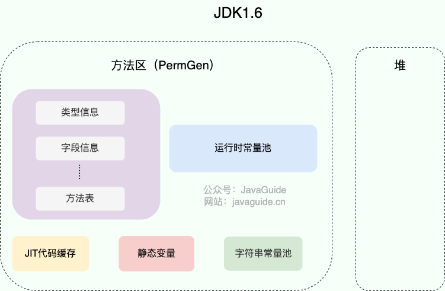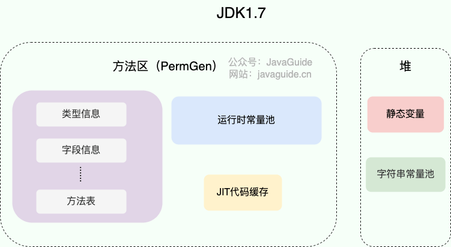

**JDK 1.7 为什么要将字符串常量池移动到堆中？**

**<font style="color:#DF2A3F;">永久代（方法区实现）的 GC 回收效率太低，只有在整堆收集 (Full GC)的时候才会被执行 GC。Java 程序中通常会有大量的被创建的字符串等待回收，将字符串常量池放到堆中，能够更高效及时地回收字符串内存</font>**<font style="color:#DF2A3F;"> </font>**<font style="color:#DF2A3F;">。</font>**

**<font style="color:#DF2A3F;"></font>**

相关问题：[JVM 常量池中存储的是对象还是引用呢？ - RednaxelaFX - 知乎](https://www.zhihu.com/question/57109429/answer/151717241) - **存放引用,对象在堆中.**

最后再来分享一段周志明老师在[《深入理解 Java 虚拟机（第 3 版）》样例代码&勘误](https://github.com/fenixsoft/jvm_book)GitHub 仓库的 [issue#112](https://github.com/fenixsoft/jvm_book/issues/112)中说过的话：

> **运行时常量池、方法区、字符串常量池这些都是不随虚拟机实现而改变的逻辑概念，是公共且抽象的，Metaspace、Heap 是与具体某种虚拟机实现相关的物理概念，是私有且具体的。**

### 直接内存

直接内存是一种特殊的内存缓冲区，并不在 Java 堆或方法区中分配的，而是通过 JNI 的方式在\*\*<font style="color:#DF2A3F;">本地内存上分配的</font>\*\*。直接内存并不是虚拟机运行时数据区的一部分，也不是虚拟机规范中定义的内存区域，但是这部分内存也被频繁地使用。而且也可能导致 `OutOfMemoryError` 错误出现。

JDK1.4 中新加入的 **NIO（Non-Blocking I/O，也被称为 New I/O）** ，引入了一种基于**通道（Channel）** 与**缓存区（Buffer）** 的 I/O 方式，它可以直接使用 Native 函数库直接分配堆外内存，然后通过一个存储在 Java 堆中的 DirectByteBuffer 对象作为这块内存的引用进行操作。这样就能在一些场景中显著提高性能，因为**避免了在 Java 堆和 Native 堆之间来回复制数据**。

直接内存的分配不会受到 Java 堆的限制，但是，既然是内存就会受到本机总内存大小以及处理器寻址空间的限制类似的. 概念还有**堆外内存** 。在一些文章中将直接内存等价于堆外内存，个人觉得不是特别准确。

堆外内存就是把内存对象分配在堆（新生代+老年代+永久代）以外的内存，这些内存直接受操作系统管理（而不是虚拟机），这样做的结果就是能够在一定程度上减少垃圾回收对应用程序造成的影响

## HotSpot 虚拟机对象探秘

### 对象的创建 ♥ ♥ ♥ ♥

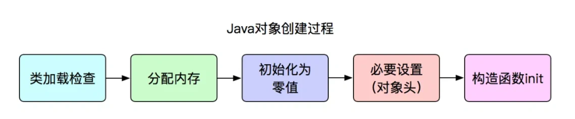

**(类加载过程：加载，验证，准备，解析，初始化)**

**<font style="color:#DF2A3F;">创建对象的步骤: Java 对象的创建过程我建议最好是能默写出来，并且要掌握每一步在做什么。</font>**

#### <font style="color:#DF2A3F;">Step1:类加载检查</font>

**虚拟机遇到一条 new 指令时，首先将去检查指令的参数是否能在常量池中定位到类的符号引用，并且检查这个符号引用代表的类是否已被加载过、解析和初始化过。如果没有，那必须先执行相应的类加载过程。**

#### <font style="color:#DF2A3F;">Step2:分配内存</font>

**类加载检查**后，虚拟机将为新生对象**分配内存**。对象所需的内存大小在类加载完成后便可确定，为对象分配空间的任务等同于把一块确定大小的内存从 Java 堆中划分出来。**分配方式**有  **“指针碰撞”**  和  **“空闲列表”**  两种，**选择哪种分配方式由 Java 堆是否规整决定，而 Java 堆是否规整又由所采用的垃圾收集器是否带有压缩整理功能决定**。

**内存分配的两种方式内存分配策略 （补充内容，需要掌握）**：

* **指针碰撞**：
  * 适用场合：**堆内存规整**（即没有内存碎片）。
  * 原理：用过的内存全部整合到一边，没有用过的内存放在另一边，中间有一个分界指针，只需要向着没用过的内存方向将该指针移动对象内存大小位置即可。
  * **使用该分配方式的 GC 收集器：Serial, ParNew**
* **空闲列表**：
  * 适用场合：**堆内存不规整**。
  * 原理：虚拟机会维护一个列表，该列表中会记录哪些内存块是可用的，在分配的时候，找一块儿足够大的内存块儿来划分给对象实例，最后更新列表记录。
  * **使用该分配方式的 GC 收集器：CMS**

选择以上两种方式中的哪一种，取决于 Java 堆内存是否规整。而 Java 堆内存是否规整，取决于 GC 收集器的算法是"标记-清除"，还是"标记-整理"（也称作"标记-压缩"），值得注意的是，复制算法内存也是规整的。

**<font style="color:#DF2A3F;">内存分配并发问题（补充内容，需要掌握）</font>**

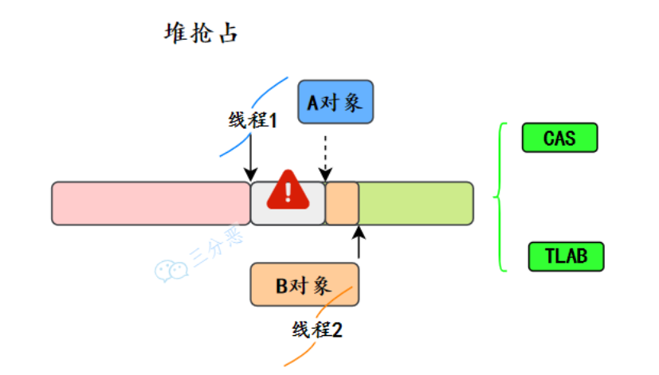

在创建对象的时候有一个很重要的问题，就是线程安全，因为在实际开发过程中，创建对象是很频繁的事情，作为虚拟机来说，必须要保证线程是安全的，通常来讲，**虚拟机采用两种方式来保证线程安全**：

* **<font style="color:#DF2A3F;">CAS+失败重试</font>\*\*\*\*：**  CAS 是乐观锁的一种实现方式。所谓乐观锁就是，每次不加锁而是假设没有冲突而去完成某项操作，如果因为冲突失败就重试，直到成功为止。**虚拟机采用 CAS 配上失败重试的方式保证更新操作的原子性。**
* **<font style="color:#DF2A3F;">TLAB</font>\*\*\*\*：**  为每一个线程预先在 Eden 区分配一块儿内存，JVM 在给线程中的对象分配内存时，首先在 TLAB 分配，当对象大于 TLAB 中的剩余内存或 TLAB 的内存已用尽时，再采用上述的 CAS 进行内存分配

#### Step3:初始化零值

内存分配完成后，虚拟机需要将分配到的内存空间都初始化为零值（不包括对象头），这一步操作保证了对象的实例字段在 Java 代码中可以不赋初始值就直接使用，程序能访问到这些字段的数据类型所对应的零值。

#### <font style="color:#DF2A3F;">Step4:设置对象头</font>

[8.对象的实例化内存布局和访问定位](https://www.yuque.com/nibiwanxiamei/yrd6t1/9c90c236a4b8c11868ce56a2a1abe1e2)

初始化零值完成之后，**虚拟机要对对象进行必要的设置**：\*\*<font style="color:#DF2A3F;">类的元数据信息、对象的哈希码、对象的 GC 分代年龄</font>\*\*等信息。 **这些信息存放在对象头中。**  另外，根据虚拟机当前运行状态的不同，如是否启用偏向锁等，对象头会有不同的设置方式。

#### Step5:执行 init 方法

在上面工作都完成之后，从虚拟机的视角来看，一个新的对象已经产生了，但从 Java 程序的视角来看，对象创建才刚开始，`<init>` 方法还没有执行，所有的字段都还为零。所以一般来说，执行 new 指令之后会接着执行 `<init>` 方法，把对象按照程序员的意愿进行初始化，这样一个真正可用的对象才算完全产生出来。

:::info
**<font style="color:#DF2A3F;background-color:#FBDE28;">类加载检查 -> 分配内存 -> （初始化零值）-> （设置对象头）-> （执行init方法）</font>**

:::

### 对象的内存布局 🌟🌟🌟

在 Hotspot 虚拟机中，对象在内存中的布局可以分为 3 块区域：**对象头**、**实例数据**和**对齐填充**。

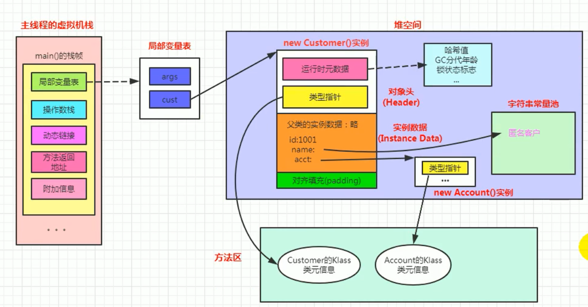

* **Hotspot 虚拟机的对象头包括两部分信息**，**第一部分用于存储**\*\*<font style="color:#DF2A3F;">对象自身的运行时数据</font>**<font style="color:#DF2A3F;">（</font>**<font style="color:#DF2A3F;">哈希码、GC 分代年龄、锁状态标志等等</font>**<font style="color:#DF2A3F;">）</font>，**另一部分是****<font style="color:#DF2A3F;">类型指针</font>\*\*\*\*，即对象指向它的类元数据的指针\*\*，通过这个指针来确定这个对象是哪个类的实例。
* **实例数据部分是对象真正存储的有效信息**。
* **对齐填充部分不是必然存在的，也没有什么特别的含义，仅仅起占位作用。**  因为 Hotspot 虚拟机的自动内存管理系统要求对象起始地址必须是 8 字节的整数倍，换句话说就是对象的大小必须是 8 字节的整数倍。而对象头部分正好是 8 字节的倍数（1 倍或 2 倍），因此，当对象实例数据部分没有对齐时，就需要通过对齐填充来补全。

**<font style="color:#DF2A3F;">运行时元数据（Mark Word）</font>**

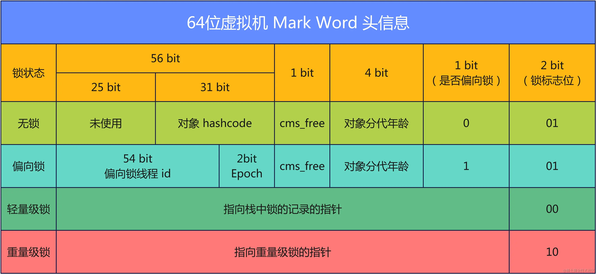

### 对象的访问定位

Java 程序通过栈上的 reference 数据来操作堆上的具体对象。对象的访问方式由虚拟机实现而定，目前主流的访问方式有：**<font style="color:#DF2A3F;">使用句柄</font>**<font style="color:#DF2A3F;">、</font>**<font style="color:#DF2A3F;">直接指针</font>**<font style="color:#DF2A3F;">。</font>

#### 句柄

Java 堆中将会划分出一块内存来作为句柄池，reference 中存储的是对象的句柄地址，而句柄中包含了对象实例数据与对象类型数据各自的具体地址信息。

#### 直接指针

如果使用直接指针访问，reference 中存储的直接就是对象的地址。

:::color4
**<font style="color:#DF2A3F;">句柄 reference 中存储的是稳定的句柄地址，在对象被移动时只会改变句柄中的实例数据指针，而 reference 本身不需要修改。而直接指针访问速度快，节省了一次指针定位的时间开销。</font>**

:::

# JVM垃圾回收详解

> 常见面试题：
>
> * \*\* 如何判断对象是否死亡（两种方法）。\*\*
>   * 1.引用计数法 - 无法解决循环引用
>
>   * 2.可达性分析法 - "GC Roots"的根对象开始遍历
> * 强引用、软引用、弱引用、虚引用（虚引用与软引用和弱引用的区别、软引用能带来的好处）。
>   * **强引用是最常见的引用类型，即使内存不足，只要强引用还有效，垃圾回收器也不会回收强引用**
>
>   * **软引用相比强引用来说弱化了一点，内存不足的时候会回收软引用，它可以用作高速缓存，可以防止内存溢出。**
>
>   * **弱引用就更弱，只能存活到下一次垃圾回收，只要垃圾回收发现弱引用就会回收弱引用。也可以用于缓存。**
>
>   * **虚引用相当于不存在这个引用，主要用于跟踪那个对象被垃圾回收的状态。**
> * 如何判断一个常量是废弃常量
>   * **<font style="color:#DF2A3F;">没有任何对象引用常量</font>**
> * 如何判断一个类是无用的类
>   * **<font style="color:#DF2A3F;">无任何实例对象，ClassLoader被回收，Class对象没有被引用</font>**
> * 垃圾收集有哪些算法，各自的特点？
>   * **标记清除**
>
>   * **复制算法**
>
>   * **标记整理**
>
>   * **分代收集**
> * HotSpot 为什么要分为新生代和老年代？
>   * **为了优化垃圾回收的效率和内存分配的性能。**
> * 常见的垃圾回收器有哪些？
> * 介绍一下 CMS,G1 收集器。
> * Minor Gc 和 Full GC 有什么不同呢？

## 堆空间的基本结构

Java 的自动内存管理主要是针对**对象内存的回收和对象内存的分配**。同时，Java 自动内存管理最核心的功能是 **<font style="color:#DF2A3F;">堆内存中对象的分配与回收</font>\*\*\*\*。**

Java 堆是垃圾收集器管理的主要区域，因此也被称作 **GC 堆（Garbage Collected Heap）** 。

从垃圾回收的角度来说，由于现在收集器基本都采用分代垃圾收集算法，所以 Java 堆被划分为了几个不同的区域，这样我们就可以根据各个区域的特点选择合适的垃圾收集算法。

在 JDK 7 版本及 JDK 7 版本之前，堆内存被通常分为下面三部分：

1. 新生代内存(Young Generation)
2. 老生代(Old Generation)
3. 永久代(Permanent Generation)


**<font style="color:#DF2A3F;">JDK 8 版本之后 PermGen(永久) 已被 Metaspace(元空间) 取代，元空间使用的是直接内存</font>**<font style="color:#DF2A3F;"> 。</font>

## 内存分配和回收原则 ♥♥♥

### 对象优先在 Eden 区分配

大多数情况下，对象在新生代中 Eden 区分配。

当 Eden 区没有足够空间进行分配时，虚拟机将发起一次 **Minor GC**。GC 期间虚拟机又发现 `allocation1` 无法存入 Survivor 空间，所以只好通过 **分配担保机制** 把新生代的对象提前转移到老年代中去，老年代上的空间足够存放 `allocation1`，所以不会出现 Full GC。

执行 Minor GC 后，后面分配的对象如果能够存在 Eden 区的话，还是会在 Eden 区分配内存。

### 大对象直接进入老年代

大对象就是需要大量连续内存空间的对象（比如：字符串、数组）。

**大对象直接进入老年代的行为是由虚拟机动态决定的，它与具体使用的垃圾回收器和相关参数有关**。大对象直接进入老年代是一种优化策略，旨在避免将大对象放入新生代，从而减少新生代的垃圾回收频率和成本。

* G1 垃圾回收器会根据 `-XX:G1HeapRegionSize` 参数设置的堆区域大小和 `-XX:G1MixedGCLiveThresholdPercent` 参数设置的阈值，来决定哪些对象会直接进入老年代。
* Parallel Scavenge 垃圾回收器中，默认情况下，并没有一个固定的阈值(`XX:ThresholdTolerance`是动态调整的)来决定何时直接在老年代分配大对象。而是由虚拟机根据当前的堆内存情况和历史数据动态决定。

### 长期存活的对象将进入老年代

既然虚拟机采用了分代收集的思想来管理内存，那么内存回收时就必须能识别哪些对象应放在新生代，哪些对象应放在老年代中。为了做到这一点，虚拟机给每个对象一个**对象年龄（Age）计数器**。

大部分情况，对象都会首先在 Eden 区域分配。如果对象在 Eden 出生并经过第一次 Minor GC 后仍然能够存活，并且能被 Survivor 容纳的话，将被移动到 Survivor 空间（s0 或者 s1）中，并将对象年龄设为 1(Eden 区->Survivor 区后对象的初始年龄变为 1)。对象在 Survivor 中每熬过一次 MinorGC,年龄就增加 1 岁，当它的年龄增加到一定程度（默认为 15 岁），就会被晋升到老年代中。对象晋升到老年代的年龄阈值，可以通过参数  `-XX:MaxTenuringThreshold` 来设置。

> 修正（[issue552](https://github.com/Snailclimb/JavaGuide/issues/552)）：“Hotspot 遍历所有对象时，按照年龄从小到大对其所占用的大小进行累积，**<font style="color:#DF2A3F;">当累积的某个年龄大小之和超过了 survivor 区的 50% 时</font>**（默认值是 50%，可以通过 `-XX:TargetSurvivorRatio=percent` 来设置，参见 [issue1199](https://github.com/Snailclimb/JavaGuide/issues/1199) ），取这个年龄和 **<font style="color:#DF2A3F;">MaxTenuringThreshold</font>** 中更小的一个值，作为新的晋升年龄阈值”。

### 主要进行 gc 的区域

针对 HotSpot VM 的实现，它里面的 GC 其实准确分类只有两大种：

**部分收集 (Partial GC)** ：

* 新生代收集（Minor GC / Young GC）：只对新生代进行垃圾收集；
* 老年代收集（Major GC / Old GC）：只对老年代进行垃圾收集。需要注意的是 Major GC 在有的语境中也用于指代整堆收集；
* 混合收集（Mixed GC）：对**整个新生代和部分老年代**进行垃圾收集。

**整堆收集 (Full GC)** ：收集整个 Java 堆和方法区。

### 空间分配担保

**<font style="color:#DF2A3F;">空间分配担保是为了确保在 Minor GC 之前老年代本身还有容纳新生代所有对象的剩余空间。</font>**

> 在发生 Minor GC 之前，虚拟机必须先**检查老年代最大可用的连续空间是否大于新生代所有对象总空间**，如果这个条件成立，那这一次 Minor GC 可以确保是安全的。
>
> 如果不成立，则虚拟机会先查看 `-XX:HandlePromotionFailure` 参数的设置值是否允许担保失败(Handle Promotion Failure);
>
> 如果允许，那会继续检查老年代最大可用的连续空间是否大于历次晋升到老年代对象的平均大小，
>
> 如果大于，将尝试进行一次 Minor GC，尽管这次 Minor GC 是有风险的;
>
> 如果小于，或者 `-XX: HandlePromotionFailure` 设置不允许冒险，那这时就要改为进行一次 Full GC。
>
> JDK 6 Update 24 之后的规则变为只要\*\*<font style="color:#DF2A3F;">老年代的连续空间大于新生代对象总大小或者历次晋升的平均大小，就会进行 Minor GC ，否则将进行 Full GC</font>\*\*\*\*。\*\*

## 死亡对象判断方法 ♥♥♥

### 引用计数法

给对象中添加一个引用计数器：

* 每当有一个地方引用它，计数器就加 1；
* 当引用失效，计数器就减 1；
* 任何时候计数器为 0 的对象就是不可能再被使用的。

**<font style="color:#DF2A3F;">它很难解决对象之间循环引用的问题</font>**

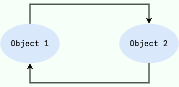

除了对象 `objA` 和 `objB` 相互引用着对方之外，这两个对象之间再无任何引用。但是他们因为互相引用对方，导致它们的引用计数器都不为 0，于是引用计数算法无法通知 GC 回收器回收他们。

```java
public class ReferenceCountingGc {
    Object instance = null;
    public static void main(String[] args) {
        ReferenceCountingGc objA = new ReferenceCountingGc();
        ReferenceCountingGc objB = new ReferenceCountingGc();
        objA.instance = objB;
        objB.instance = objA;
        objA = null;
        objB = null;
    }
}
```

### 可达性分析算法

这个算法的基本思想就是通过**一系列**的称为  \*\*“\*\***GC Roots** **”**  的对象作为起点，从这些节点开始向下搜索，节点所走过的路径称为引用链，当一个对象到 GC Roots 没有任何引用链相连的话，则证明此对象是不可用的，需要被回收。

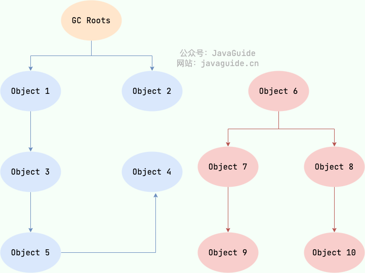

**哪些对象可以作为 GC Roots 呢？**

* 虚拟机**栈(栈帧中的局部变量表)中引用**的对象
* 本地方法**栈(Native 方法)中引用**的对象
* 方法区中**类静态属性引用**的对象
* 方法区中**常量引用**的对象
* 所有被**同步锁持有的**对象

> **<font style="color:#DF2A3F;">栈、静态引用、常量引用、锁持有、本地方法引用</font>**

### <font style="color:#DF2A3F;">对象可以被回收，就代表一定会被回收吗？</font>

***

要真正宣告一个对象死亡，至少要经历**两次标记过程**；

可达性分析法中不可达的对象被第一次标记并且进行一次筛选，筛选的条件是此对象是否有必要执行 <code>**<font style="color:#DF2A3F;">finalize</font>**</code> 方法。**当对象没有覆盖**`finalize` **方法，或** `finalize` **方法已经被虚拟机调用过时，虚拟机将这两种情况视为没有必要执行。**

被判定为需要执行的对象将会被放在一个队列中进行第二次标记，除非这个对象与引用链上的任何一个对象建立关联（复活），否则就会被真的回收。

### 强、软、弱、虚四大引用

**无论是通过引用计数法判断对象引用数量，还是通过可达性分析法判断对象的引用链是否可达，判定对象的存活都与“引用”有关。**

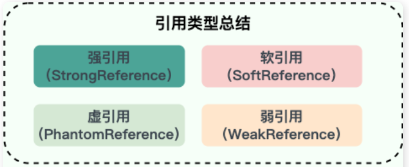

**1．强引用（StrongReference）**

\*\*使用的大部分引用实际上都是强引用，这是使用最普遍的引用。\*\*\*\*<font style="color:#DF2A3F;">如果一个对象具有强引用，垃圾回收器绝不会回收它。</font>\*\***当内存空间不足，Java 虚拟机宁愿抛出 OutOfMemoryError 错误，使程序异常终止，也不会靠随意回收具有强引用的对象来解决内存不足问题。**

**2．软引用（SoftReference）**

**<font style="color:#DF2A3F;">如果内存空间足够，垃圾回收器就不会回收它，如果垃圾回收后，内存空间还是不足，就会回收这些对象的内存。</font>** **只要垃圾回收器没有回收它，该对象就可以被程序使用。\*\*\*\*<font style="color:#DF2A3F;">软引用可用来实现内存敏感的高速缓存</font>**。

软引用可以和一个引用队列（ReferenceQueue）联合使用，如果软引用所引用的对象被垃圾回收，JAVA 虚拟机就会把这个软引用加入到与之关联的引用队列中。

**3．弱引用（WeakReference）**

弱引用与软引用的区别在于：只具有弱引用的对象拥有更短暂的生命周期。**<font style="color:#DF2A3F;">一旦发现了只具有弱引用的对象，不管当前内存空间足够与否，都会回收它的内存</font>**<font style="color:#DF2A3F;">。</font>

弱引用可以和一个引用队列（ReferenceQueue）联合使用，如果弱引用所引用的对象被垃圾回收，Java 虚拟机就会把这个弱引用加入到与之关联的引用队列中。

**4．虚引用（PhantomReference）**

"虚引用"顾名思义，就是形同虚设，与其他几种引用都不同，虚引用并不会决定对象的生命周期。**<font style="color:#DF2A3F;">如果一个对象仅持有虚引用，那么它就和没有任何引用一样，在任何时候都可能被垃圾回收。虚引用主要用来跟踪对象被垃圾回收的活动</font>**<font style="color:#DF2A3F;">。</font>

**虚引用与软引用和弱引用的一个区别在于：**  **虚引用**\*\*<font style="color:#DF2A3F;">必须</font>\*\*\*\*和引用队列（ReferenceQueue）联合使用。\*\*当垃圾回收器准备回收一个对象时，如果发现它还有虚引用，就会在回收对象的内存之前，把这个虚引用加入到与之关联的引用队列中。程序可以通过判断引用队列中是否已经加入了虚引用，来了解被引用的对象是否将要被垃圾回收。那么就可以在所引用的对象的内存被回收之前采取必要的行动。

特别注意，在程序设计中一般很少使用弱引用与虚引用，使用软引用的情况较多，**软引用可以加速 JVM 对垃圾内存的回收速度，可以维护系统的运行安全，防止内存溢出（OutOfMemory）等问题的产生**。

### 如何判断一个常量是废弃常量？

1. **JDK1.7 之前运行时常量池逻辑包含字符串常量池存放在方法区, 此时 hotspot 虚拟机对方法区的实现为永久代**
2. **JDK1.7 字符串常量池被从方法区拿到了堆中, 这里没有提到运行时常量池,也就是说字符串常量池被单独拿到堆,运行时常量池剩下的东西还在方法区, 也就是 hotspot 中的永久代** 。
3. **JDK1.8 hotspot 移除了永久代用元空间(Metaspace)取而代之, 这时候\*\*\*\*字符串常量池还在堆, 运行时常量池还在方法区** **, 只不过方法区的实现从永久代变成了元空间(Metaspace)**

**假如在字符串常量池中存在字符串 "abc"，如果当前没有任何 String 对象引用该字符串常量的话，就说明常量 "abc" 就是废弃常量，如果这时发生内存回收的话而且有必要的话，"abc" 就会被系统清理出常量池了。**

### 如何判断一个类是无用的类？

**<font style="color:#DF2A3F;">方法区主要回收的是无用的类</font>**

判定一个常量是否是“废弃常量”比较简单，而要判定一个类是否是“无用的类”的条件则相对苛刻许多。类需要同时满足下面 3 个条件才能算是  **“无用的类”** ：

* 该类**所有的实例都已经被回收**，也就是 Java 堆中不存在该类的任何实例。
* 加载该类的 `ClassLoader` \*\* 已经被回收\*\*。
* 该类对应的 `java.lang.``Class` \*\* 对象没有在任何地方被引用\*\*，无法在任何地方通过反射访问该类的方法。

虚拟机可以对满足上述 3 个条件的无用类进行回收，这里说的仅仅是“可以”，而并不是和对象一样不使用了就会必然被回收。

## 垃圾收集算法  ♥♥♥

[11.垃圾回收概述及算法](https://www.yuque.com/nibiwanxiamei/yrd6t1/e82a4456a3f3182feb307d18aae0bff2)

### 标记-清除算法

标记-清除（Mark-and-Sweep）算法分为“标记（Mark）”和“清除（Sweep）”阶段：首先标记出所有不需要回收的对象，在标记完成后统一回收掉所有没有被标记的对象。

它是最基础的收集算法，后续的算法都是对其不足进行改进得到。这种垃圾收集算法会带来两个明显的问题：

1. **效率问题**：标记和清除两个过程效率都不高。
2. **空间问题**：标记清除后会产生大量不连续的内存碎片。

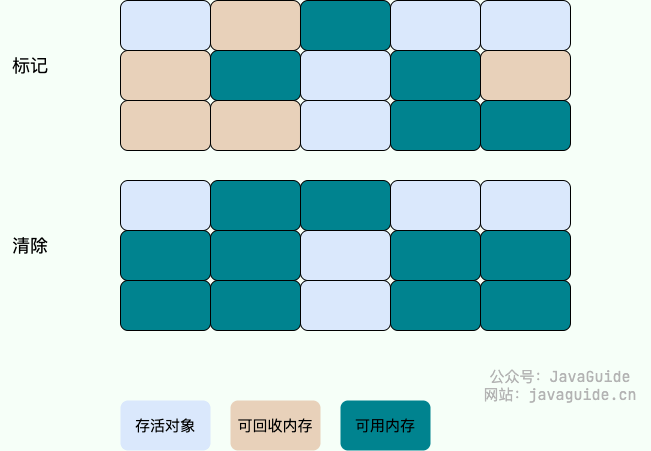

### 复制算法

**<font style="color:rgb(44, 62, 80);">复制算法的原理是，将内存分成两块，每次申请内存时都使用其中的一块，当内存不够时，将这一块内存中所有存活的复制到另一块上。然后将然后再把已使用的内存整个清理掉。复制算法解决了空间碎片的问题。</font>**

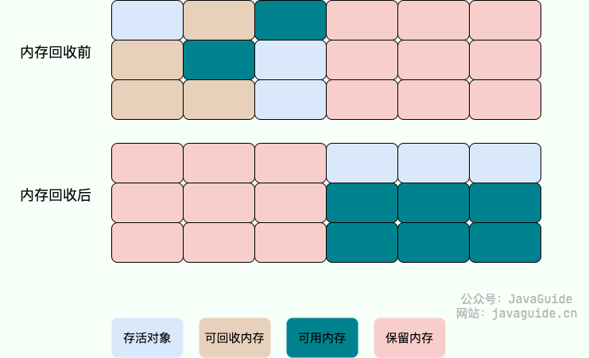

虽然改进了标记-清除算法，但依然存在下面这些问题：

* **可用内存变小**：可用内存缩小为原来的一半。
* **不适合老年代**：如果存活对象数量比较大，复制性能会变得很差。

### 标记-整理算法

**<font style="color:#DF2A3F;">清除阶段：标记-压缩（整理）算法 - Mark-Compact</font>**

标记-整理（Mark-and-Compact）算法是根据\*\*<font style="color:#DF2A3F;">老年代</font>\*\*的特点提出的一种标记算法，**标记过程仍然与“标记-清除”算法一样，但后续步骤不是直接对可回收对象回收，而是让所有存活的对象向一端移动，然后直接清理掉端边界以外的内存。**

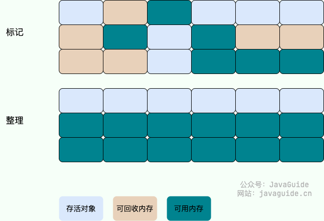

**由于多了整理这一步，因此效率也不高，适合老年代这种垃圾回收频率不是很高的场景。**

### 分代收集算法

当前虚拟机的垃圾收集都采用分代收集算法，根据对象存活周期的不同将内存分为几块。一般将 Java 堆分为新生代和老年代，这样我们就可以根据各个年代的特点选择合适的垃圾收集算法。

**<font style="color:#DF2A3F;">在新生代中，每次收集都会有大量对象死去，所以可以选择”标记-复制“算法，只需要付出少量对象的复制成本就可以完成每次垃圾收集。而老年代的对象存活几率是比较高的，而且没有额外的空间对它进行分配担保，所以我们必须选择“标记-清除”或“标记-整理”算法进行垃圾收集。</font>**

**延伸面试问题：**  HotSpot 为什么要分为新生代和老年代？

根据上面的对分代收集算法的介绍回答

## 垃圾收集器 ♥♥♥

[12.垃圾回收器](https://www.yuque.com/nibiwanxiamei/yrd6t1/81490ab60b29a3648a9aa5130d638b6e)

JDK 默认垃圾收集器（使用 `java -XX:+PrintCommandLineFlags -version` 命令查看）：

* JDK 8：**<font style="color:#DF2A3F;">Parallel Scavenge（新生代）+ Parallel Old（老年代）</font>**
* JDK 9 ~ JDK20: **<font style="color:#DF2A3F;">G1</font>**

### Serial 收集器

Serial（串行）收集器是最基本、历史最悠久的垃圾收集器了。这个收集器是一个单线程收集器。  **<font style="color:#DF2A3F;">“单线程</font>**<font style="color:#DF2A3F;"> </font>**<font style="color:#DF2A3F;">”</font>**  不仅仅意味着只会使用一条垃圾收集线程去完成垃圾收集工作，更重要的是它在**进行垃圾收集工作的时候必须暂停其他所有的工作线程**（  **"Stop The World"**  ），直到它收集结束。

**<font style="color:#DF2A3F;">新生代采用标记-复制算法，老年代采用标记-整理算法。</font>**

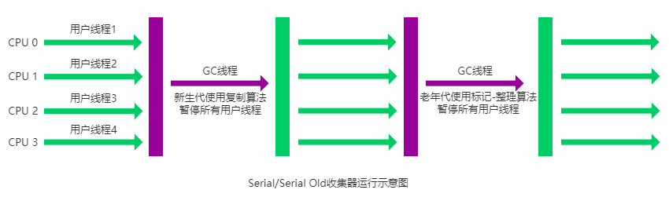

**简单而高效（与其他收集器的单线程相比）** 。Serial 收集器由于没有线程交互的开销，自然可以获得很高的单线程收集效率。Serial 收集器对于运行在 Client 模式下的虚拟机来说是个不错的选择。

### ParNew 收集器

**ParNew 收集器其实就是 Serial 收集器的多线程版本**，除了使用多线程进行垃圾收集外，其余行为（控制参数、收集算法、回收策略等等）和 Serial 收集器完全一样。

**<font style="color:#DF2A3F;">新生代采用标记-复制算法，老年代采用标记-整理算法。 </font>**

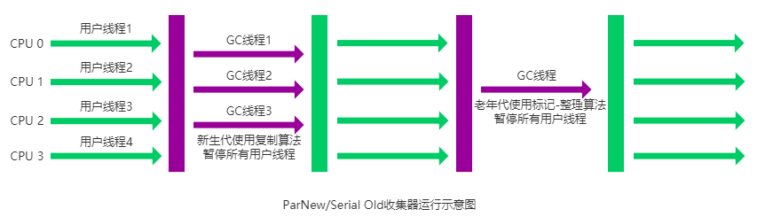

它是许多运行在 Server 模式下的虚拟机的首要选择，除了 Serial 收集器外，只有它能与 CMS 收集器（真正意义上的并发收集器，后面会介绍到）配合工作。

**并行和并发概念补充：**

* **并行（Parallel）** ：指多条垃圾收集线程并行工作，但此时用户线程仍然处于等待状态。
* **并发（Concurrent）** ：指用户线程与垃圾收集线程同时执行（但不一定是并行，可能会交替执行），用户程序在继续运行，而垃圾收集器运行在另一个 CPU 上。

### Parallel Scavenge 收集器

Parallel Scavenge 收集器也是使用标记-复制算法的多线程收集器，它看上去几乎和 ParNew 都一样

```java
-XX:+UseParallelGC
    使用 Parallel 收集器+ 老年代串行
-XX:+UseParallelOldGC
    使用 Parallel 收集器+ 老年代并行
```

**Parallel Scavenge 收集器关注点是吞吐量（高效率的利用 CPU）** 。CMS 等垃圾收集器的关注点更多的是用户线程的停顿时间（提高用户体验）。所谓吞吐量就是 CPU 中用于运行用户代码的时间与 CPU 总消耗时间的比值。 Parallel Scavenge 收集器提供了很多参数供用户找到最合适的停顿时间或最大吞吐量，如果对于收集器运作不太了解，手工优化存在困难的时候，使用 Parallel Scavenge 收集器配合自适应调节策略，把内存管理优化交给虚拟机去完成也是一个不错的选择。

**<font style="color:#DF2A3F;">新生代采用标记-复制算法，老年代采用标记-整理算法。</font>**

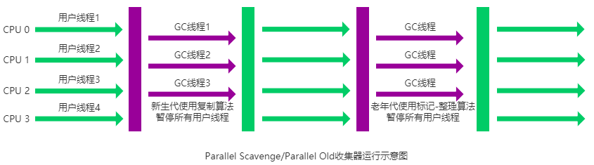

**这是 JDK1.8 默认收集器**

使用 `java -XX:+PrintCommandLineFlags -version` 命令查看

```java
-XX:InitialHeapSize=262921408 -XX:MaxHeapSize=4206742528 -XX:+PrintCommandLineFlags -XX:+UseCompressedClassPointers -XX:+UseCompressedOops -XX:+UseParallelGC
java version "1.8.0_211"
Java(TM) SE Runtime Environment (build 1.8.0_211-b12)
Java HotSpot(TM) 64-Bit Server VM (build 25.211-b12, mixed mode)
```

JDK1.8 默认使用的是 Parallel Scavenge + Parallel Old，如果指定了-XX:+UseParallelGC 参数，则默认指定了-XX:+UseParallelOldGC，可以使用-XX:-UseParallelOldGC 来禁用该功能

### Serial Old 收集器

**Serial 收集器的老年代版本**，它同样是一个单线程收集器。它主要有两大用途：一种用途是在 JDK1.5 以及以前的版本中与 **Parallel Scavenge** 收集器搭配使用，另一种用途是作为 CMS 收集器的后备方案。


### Parallel Old 收集器

**Parallel Scavenge 收集器的老年代版本**。使用多线程和“标记-整理”算法。在注重吞吐量以及 CPU 资源的场合，都可以优先考虑 Parallel Scavenge 收集器和 Parallel Old 收集器。


[垃圾回收算法、垃圾回收器CMS、G1、ZGC详解\_cms g1 zgc-CSDN博客](https://blog.csdn.net/earlybird_xiong/article/details/127246478)

### CMS 收集器

**CMS（Concurrent Mark Sweep）收集器是一种以**\*\*<font style="color:#DF2A3F;">获取最短回收停顿时间为目标</font>\*\***的收集器。它非常符合在注重用户体验的应用上使用。**

**CMS是 HotSpot 虚拟机第一款真正意义上的**\*\*<font style="color:#DF2A3F;">并发收集器</font>\*\*\*\*，第一次实现了让垃圾收集线程与用户线程（基本上）同时工作\*\* **。**

从名字中的**Mark Sweep**这两个词可以看出，CMS 收集器是一种  \*\*<font style="color:#DF2A3F;">“标记-清除”算法</font>\*\*实现的。整个过程分为四个步骤：

* **初始标记：**  需要STW，并记录下直接与 GCroot 相连的对象，速度很快 ；
* **并发标记：**  同时开启 GC 和用户线程，用一个闭包结构去记录可达对象。但在这个阶段结束，这个闭包结构并不能保证包含当前所有的可达对象。因为用户线程可能会不断的更新引用域，所以 GC 线程无法保证可达性分析的实时性。所以这个算法里会跟踪记录这些发生引用更新的地方。
* **重新标记：**  重新标记阶段就是为了修正并发标记期间因为用户程序继续运行而导致标记产生变动的那一部分对象的标记记录，这个阶段的停顿时间一般会比初始标记阶段的时间稍长，比并发标记阶段时间短
* **并发清除：**  开启用户线程，同时 GC 线程开始对未标记的区域做清扫。

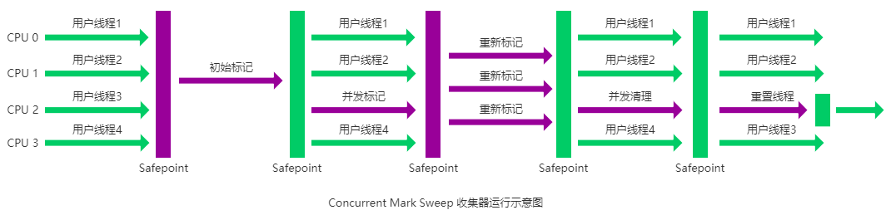

### G1 收集器

**G1 (Garbage-First) 是一款面向服务器的并发垃圾回收器，****<font style="color:#DF2A3F;">针对多处理器及大容量内存的机器</font>****。以极高概率满足 GC 停顿时间要求的同时,还具备高吞吐量性能特征。**

**把堆内存分割为很多不相关的区域**\*\*<font style="color:#DF2A3F;">（ Region</font>**<font style="color:#DF2A3F;"> </font>**<font style="color:#DF2A3F;">）</font>****（物理上不连续的）。使用不同的Region来表示Eden、幸存者0区，幸存者1区，老年代等。G1 收集器在后台维护了一个优先列表，每次根据允许的收集时间，****<font style="color:#DF2A3F;">优先选择回收价值最大的 Region</font>\*\*\*\*(这也就是它的名字 Garbage-First 的由来)  。这种使用 Region 划分内存空间以及有优先级的区域回收方式，保证了 G1 收集器在有限时间内可以尽可能高的收集效率（把内存化整为零）。\*\*

***

**它具备以下特点：**

* **并行与并发**：G1 能充分利用 CPU、多核环境下的硬件优势，使用多个 CPU（CPU 或者 CPU 核心）来**缩短 Stop-The-World 停顿时间**。部分其他收集器原本需要停顿 Java 线程执行的 GC 动作，G1 收集器仍然可以通过并发的方式让 java 程序继续执行。
* **分代收集**：虽然 G1 可以不需要其他收集器配合就能独立管理整个 GC 堆，但是还是保留了分代的概念。
* **空间整合**：**与 CMS 的“标记-清除”算法不同，G1 从整体来看是基于“标记-整理”算法实现的收集器；从局部上来看是基于“标记-复制”算法实现的。**
* **可预测的停顿**：这是 G1 相对于 CMS 的另一个大优势，降低停顿时间是 G1 和 CMS 共同的关注点，但 G1 除了追求低停顿外，还能建立可预测的停顿时间模型，能让使用者明确指定在一个长度为 M 毫秒的时间片段内，消耗在垃圾收集上的时间不得超过 N 毫秒。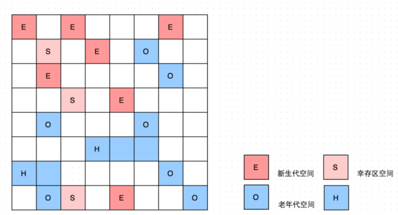

G1 收集器的运作大致分为以下几个步骤：

* **初始标记**
* **并发标记**
* **最终标记**
* **筛选回收**

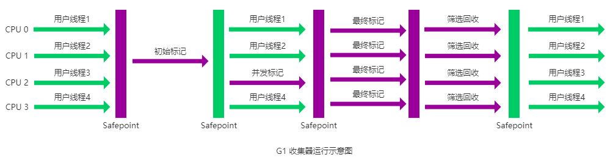

**<font style="color:#DF2A3F;">从 JDK9 开始，G1 垃圾收集器成为了默认的垃圾收集器。</font>**

**<font style="color:#DF2A3F;"></font>**

| **垃圾收集器** | **分类** | **作用位置** | **使用算法** | **特点** | **适用场景** |
| --- | --- | --- | --- | --- | --- |
| **Serial** | **串行运行** | **作用于新生代** | **复制算法** | **响应速度优先** | **适用于单CPU环境下的client模式** |
| **ParNew** | **并行运行** | **作用于新生代** | **复制算法** | **响应速度优先** | **多CPU环境Server模式下与CMS配合使用** |
| **Parallel** | **并行运行** | **作用于新生代** | **复制算法** | **吞吐量优先** | **适用于后台运算而不需要太多交互的场景** |
| **Serial Old** | **串行运行** | **作用于老年代** | **标记-压缩算法** | **响应速度优先** | **适用于单CPU环境下的Client模式** |
| **Parallel Old** | **并行运行** | **作用于老年代** | **标记-压缩算法** | **吞吐量优先** | **适用于后台运算而不需要太多交互的场景** |
| **CMS** | **并发运行** | **作用于老年代** | **标记-清除算法** | **响应速度优先** | **适用于互联网或B／S业务** |
| **G1** | **并发、并行运行** | **作用于新生代、老年代** | **标记-压缩算法、复制算法** | **响应速度优先** | **面向服务端应用** |

### 线上垃圾回收器如何选择的？

**java8默认的垃圾回收器是**\*\*<font style="color:rgb(51,51,51);">Parallel Scavenge + Parallel Old，这样可以保证较高的吞吐量，如果响应速度要快一点，比如在1秒以内，可以使用Parallel New + CMS。如果是多核大内存使用G1。</font>\*\*

### ZGC

<font style="color:rgb(77, 77, 77);">ZGC（Z Garbage Collector）是</font>[Java平台](https://so.csdn.net/so/search?q=Java%E5%B9%B3%E5%8F%B0\&spm=1001.2101.3001.7020)<font style="color:rgb(77, 77, 77);">上的一种垃圾收集器，它是由Oracle开发的，旨在解决大堆的低延迟垃圾收集问题。ZGC是一种并发的分代垃圾收集器，它主要针对具有大内存需求和低停顿时间要求的应用程序</font>

<font style="color:rgb(77, 77, 77);">G1 VS ZGC</font>

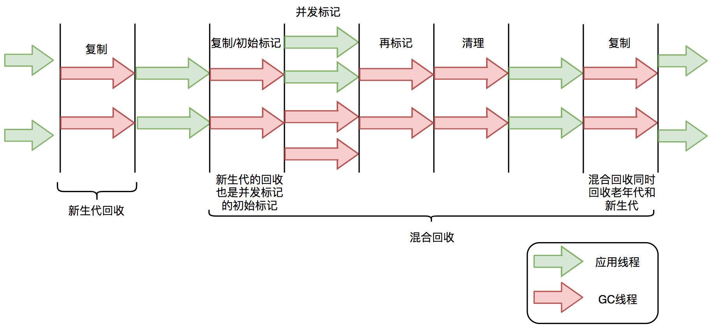

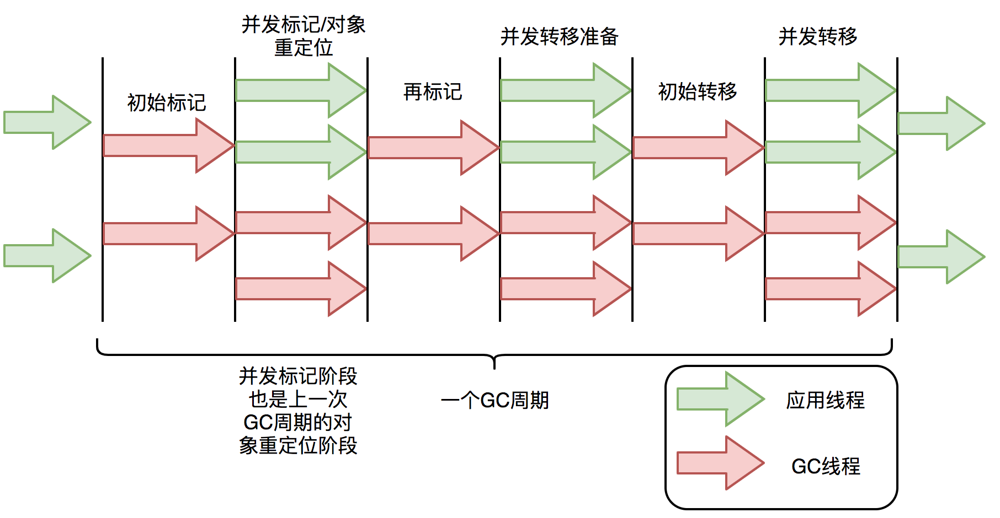

<font style="color:rgb(77, 77, 77);">ZGC使用了一种称为并发压缩的技术，在垃圾回收过程中进行垃圾对象的压缩和内存整理。下面是ZGC垃圾回收的大致过程：</font>

1. **<font style="color:rgba(0, 0, 0, 0.75);">初始标记</font>**<font style="color:rgba(0, 0, 0, 0.75);">：ZGC会标记出所有的根对象，包括线程栈上的引用、静态变量和一些特殊的对象。初始标记的目的是确定一组初始的存活对象，以便在后续的并发标记和重定位阶段中进行处理</font>
2. **<font style="color:rgba(0, 0, 0, 0.75);">并发标记/对象重定位</font>**<font style="color:rgba(0, 0, 0, 0.75);">：并发地遍历堆中的对象，并标记出这些对象的存活状态。同时，ZGC会将存活对象从旧的内存区域重定位到新的内存区域，以便为后续的对象分配提供更大的连续空间。这个阶段的并发执行可以减少垃圾回收对应用程序的停顿时间</font>
3. **<font style="color:rgba(0, 0, 0, 0.75);">再标记</font>**<font style="color:rgba(0, 0, 0, 0.75);">：在并发标记阶段期间，应用程序可能会继续产生新的对象，而这些新对象也需要被标记为存活。因此，ZGC需要进行一次再标记阶段，以标记并更新在并发标记期间产生的新对象</font>
4. **<font style="color:rgba(0, 0, 0, 0.75);">并发转移准备</font>**<font style="color:rgba(0, 0, 0, 0.75);">：在并发转移准备阶段，ZGC会准备进行并发的对象转移。这包括处理与并发标记阶段重叠的一些操作，例如更新引用和处理根对象。这个阶段的目的是为并发转移阶段做准备，以确保在该阶段的并发执行期间，应用程序的执行不会受到过多的停顿。</font>
5. **<font style="color:rgba(0, 0, 0, 0.75);">初始转移</font>**<font style="color:rgba(0, 0, 0, 0.75);">：ZGC会将剩余的存活对象从旧的内存区域转移到新的内存区域。</font>
6. **<font style="color:rgba(0, 0, 0, 0.75);">并发转移</font>**<font style="color:rgba(0, 0, 0, 0.75);">：ZGC会在后台并发地处理剩余的存活对象，并将它们从旧的内存区域转移到新的内存区域。与并发标记/对象重定位阶段一样，这个阶段的并发执行可以最大程度地减少应用程序的停顿时间</font>

:::info
**<font style="color:rgb(85, 86, 102);background-color:rgb(238, 240, 244);">ZGC只有三个STW阶段：初始标记，再标记，初始转移。</font>**<font style="color:rgb(85, 86, 102);background-color:rgb(238, 240, 244);"> 其中，初始标记和初始转移分别都只需要扫描所有GC Roots，其处理时间和GC Roots的数量成正比，一般情况耗时非常短；再标记阶段STW时间很短，最多1ms，超过1ms则再次进入并发标记阶段。</font><font style="color:red;background-color:rgb(238, 240, 244);">ZGC几乎所有暂停都只依赖于GC Roots集合大小，停顿时间不会随着堆的大小或者活跃对象的大小而增加</font>

:::

## 什么是STW、OopMap、SafePoint

**<font style="color:#262626;">垃圾回收的过程中，会涉及对象的移动。为保证对象引用更新的正确性，必须暂停所有的用户线程，也就是 </font>****<font style="color:#DF2A3F;">Stop The World </font>****<font style="color:#262626;">。</font>**

<font style="color:rgb(77, 77, 77);">扫描所有的对象就可以获取到gc roots。但是内存中的类，对象，常量数不胜数，每次gc都去扫描一遍，性能损耗是不可能接受的。同时为了保证内存的一致性，获取这些gc roots过程中，必须暂停用户线程。用户线程在这个阶段内不能工作，所以能做的就是尽量要缩短用户线程的停顿时间，也就是要尽快完成gc roots的扫描。</font>**<font style="color:rgb(77, 77, 77);">通过OopMap提前记录类、方法的引用信息，查找gc roots时，直接通过OopMap去获取，而不必扫描整个对象。</font>**

<font style="color:rgb(77, 77, 77);">虽然OopMap避免了大量扫描内存的消耗，但是内存中对象繁多，对象之间的引用关系也时刻在发生变化，如果每条指令都去记录OopMap，将会消耗大量内存和cpu资源，垃圾回收反而变成了系统的负担，为了解决这个问题，引入了</font>**<font style="color:rgb(77, 77, 77);">安全点（safe point）</font>**<font style="color:rgb(77, 77, 77);">的概念。</font>**<font style="color:rgb(77, 77, 77);">只在指令流的特定位置记录OopMap</font>**<font style="color:rgb(77, 77, 77);">，</font>**<font style="color:rgb(77, 77, 77);">垃圾回收行为发生后，线程如果没有到达安全点，将继续执行，直到到达最近的一个安全点才停下来，等待</font>**[**垃圾回收器**](https://so.csdn.net/so/search?q=%E5%9E%83%E5%9C%BE%E5%9B%9E%E6%94%B6%E5%99%A8\&spm=1001.2101.3001.7020)**<font style="color:rgb(77, 77, 77);">完成gc roots的选取。</font>**

**<font style="color:rgb(77, 77, 77);"></font>**

安全区位置主要在：

* 循环的末尾（非counted循环）
* 方法临返回前/调用方法的call指令后
* 可能抛异常的位置

##

# 类文件结构详解

## 回顾字节码

在 Java 中，**JVM 可以理解的代码就叫做**`字节码`（即扩展名为 `.class` 的文件），它不面向任何特定的处理器，只面向虚拟机。Java 语言通过字节码的方式，在一定程度上解决了传统解释型语言执行效率低的问题，同时又保留了解释型语言可移植的特点。所以 Java 程序运行时比较高效，而且，由于字节码并不针对一种特定的机器，因此，Java 程序无须重新编译便可在多种不同操作系统的计算机上运行。

Clojure（Lisp 语言的一种方言）、Groovy、Scala、JRuby、Kotlin 等语言都是运行在 Java 虚拟机之上。

> **字节码于JVM而言就类似机器语言于计算机而言**

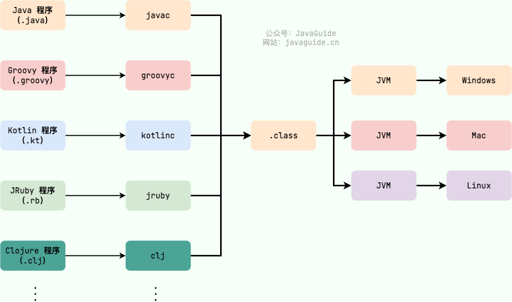

## Class 文件结构总结

Class 文件通过 `ClassFile` 定义，有点类似 C 语言的结构体。

`ClassFile` 的结构如下：

```java
ClassFile {
    u4             magic; //Class 文件的标志
    u2             minor_version;//Class 的小版本号
    u2             major_version;//Class 的大版本号
    u2             constant_pool_count;//常量池的数量
    cp_info        constant_pool[constant_pool_count-1];//常量池
    u2             access_flags;//Class 的访问标记
    u2             this_class;//当前类
    u2             super_class;//父类
    u2             interfaces_count;//接口数量
    u2             interfaces[interfaces_count];//一个类可以实现多个接口
    u2             fields_count;//字段数量
    field_info     fields[fields_count];//一个类可以有多个字段
    u2             methods_count;//方法数量
    method_info    methods[methods_count];//一个类可以有个多个方法
    u2             attributes_count;//此类的属性表中的属性数
    attribute_info attributes[attributes_count];//属性表集合
}
```

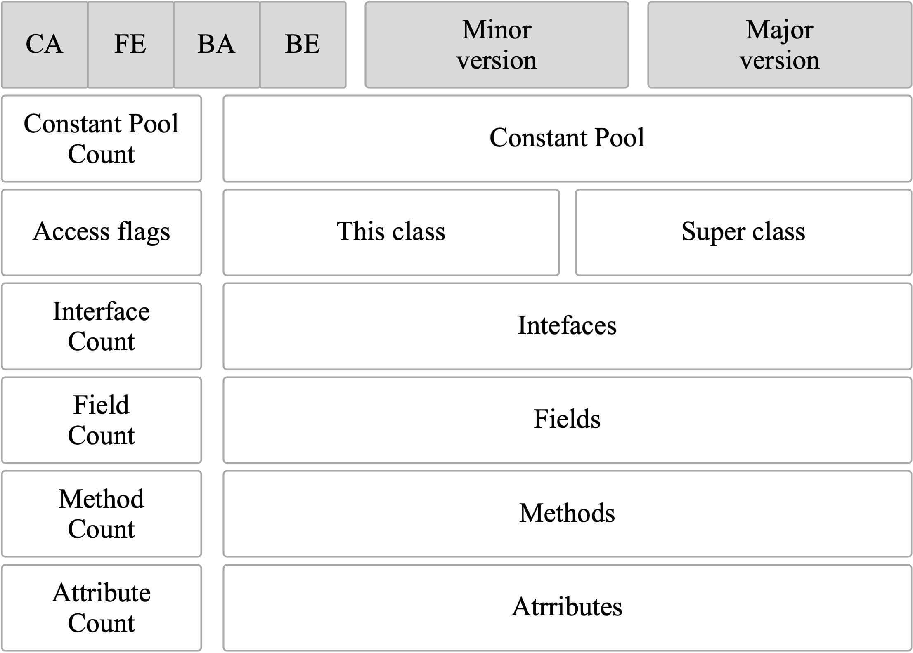

### 魔数（Magic Number）

```java
    u4             magic; //Class 文件的标志
```

每个 Class 文件的头 4 个字节称为魔数（Magic Number）,它的唯一作用是\*\*<font style="color:#DF2A3F;">确定这个文件是否为一个能被虚拟机接收的 Class 文件</font>\*\*。Java 规范规定魔数为固定值：0xCAFEBABE。如果读取的文件不是以这个魔数开头，Java 虚拟机将拒绝加载它。

### Class 文件版本号（Minor\&Major Version）

```java
    u2             minor_version;//Class 的小版本号
    u2             major_version;//Class 的大版本号
```

紧接着魔数的四个字节存储的是 Class 文件的版本号：第 5 和第 6 个字节是**次版本号**，第 7 和第 8 个字节是**主版本号**。

每当 Java 发布大版本（比如 Java 8，Java9）的时候，主版本号都会加 1。你可以使用 `javap -v` 命令来快速查看 Class 文件的版本号信息。

高版本的 Java 虚拟机可以执行低版本编译器生成的 Class 文件，但是低版本的 Java 虚拟机不能执行高版本编译器生成的 Class 文件。所以，我们在实际开发的时候要确保开发的的 JDK 版本和生产环境的 JDK 版本保持一致。

### 常量池（Constant Pool）

```java
    u2             constant_pool_count;//常量池的数量
    cp_info        constant_pool[constant_pool_count-1];//常量池
```

紧接着主次版本号之后的是常量池，常量池的数量是 `constant_pool_count-1`（**常量池计数器是从 1 开始计数的，将第 0 项常量空出来是有特殊考虑的，索引值为 0 代表“不引用任何一个常量池项”** ）。

常量池主要存放两大常量：**字面量和符号引用**。字面量比较接近于 Java 语言层面的的常量概念，如文本字符串、声明为 final 的常量值等。而符号引用则属于编译原理方面的概念。包括下面三类常量：

* 类和接口的全限定名
* 字段的名称和描述符
* 方法的名称和描述符

常量池中每一项常量都是一个表，这 14 种表有一个共同的特点：**开始的第一位是一个 u1 类型的标志位 -tag 来标识常量的类型，代表当前这个常量属于哪种常量类型．**

| 类型 | 标志（tag） | 描述 |
| --- | --- | --- |
| CONSTANT\_utf8\_info | 1 | UTF-8 编码的字符串 |
| CONSTANT\_Integer\_info | 3 | 整形字面量 |
| CONSTANT\_Float\_info | 4 | 浮点型字面量 |
| CONSTANT\_Long\_info | 5 | 长整型字面量 |
| CONSTANT\_Double\_info | 6 | 双精度浮点型字面量 |
| CONSTANT\_Class\_info | 7 | 类或接口的符号引用 |
| CONSTANT\_String\_info | 8 | 字符串类型字面量 |
| CONSTANT\_FieldRef\_info | 9 | 字段的符号引用 |
| CONSTANT\_MethodRef\_info | 10 | 类中方法的符号引用 |
| CONSTANT\_InterfaceMethodRef\_info | 11 | 接口中方法的符号引用 |
| CONSTANT\_NameAndType\_info | 12 | 字段或方法的符号引用 |
| CONSTANT\_MethodType\_info | 16 | 标志方法类型 |
| CONSTANT\_MethodHandle\_info | 15 | 表示方法句柄 |
| CONSTANT\_InvokeDynamic\_info | 18 | 表示一个动态方法调用点 |

`.class` 文件可以通过`javap -v class类名` 指令来看一下其常量池中的信息(`javap -v class类名-> temp.txt`：将结果输出到 temp.txt 文件)。

### 访问标志(Access Flags)

```java
    u2             access_flags;//Class 的访问标记
```

在常量池结束之后，紧接着的两个字节代表访问标志，这个标志用于识别一些类或者接口层次的访问信息，包括：这个 Class 是类还是接口，是否为 `public` 或者 `abstract` 类型，如果是类的话是否声明为 `final` 等等。

类访问和属性修饰符:

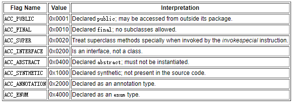

### 当前类（This Class）、父类（Super Class）、接口（Interfaces）索引集合

```java
    u2             this_class;//当前类
    u2             super_class;//父类
    u2             interfaces_count;//接口数量
    u2             interfaces[interfaces_count];//一个类可以实现多个接口
```

Java 类的继承关系由类索引、父类索引和接口索引集合三项确定。类索引、父类索引和接口索引集合按照顺序排在访问标志之后，

类索引用于确定这个类的全限定名，父类索引用于确定这个类的父类的全限定名，由于 Java 语言的单继承，所以父类索引只有一个，除了 `java.lang.Object` 之外，所有的 Java 类都有父类，因此除了 `java.lang.Object` 外，所有 Java 类的父类索引都不为 0。

接口索引集合用来描述这个类实现了那些接口，这些被实现的接口将按 `implements` (如果这个类本身是接口的话则是`extends`) 后的接口顺序从左到右排列在接口索引集合中。

### 字段表集合（Fields）

```java
    u2             fields_count;//字段数量
    field_info     fields[fields_count];//一个类会可以有个字段
```

字段表（field info）用于描述接口或类中声明的变量。字段包括类级变量以及实例变量，但不包括在方法内部声明的局部变量。

**field info(字段表) 的结构:**

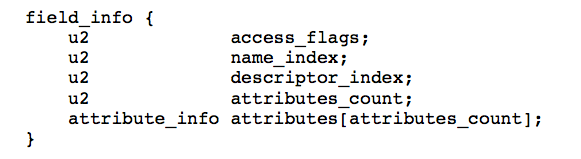

* **access\_flags:**  字段的作用域（`public` ,`private`,`protected`修饰符），是实例变量还是类变量（`static`修饰符）,可否被序列化（transient 修饰符）,可变性（final）,可见性（volatile 修饰符，是否强制从主内存读写）。
* **name\_index:**  对常量池的引用，表示的字段的名称；
* **descriptor\_index:**  对常量池的引用，表示字段和方法的描述符；
* **attributes\_count:**  一个字段还会拥有一些额外的属性，attributes\_count 存放属性的个数；
* **attributes\[attributes\_count]:**  存放具体属性具体内容。

**字段的 access\_flag 的取值:**

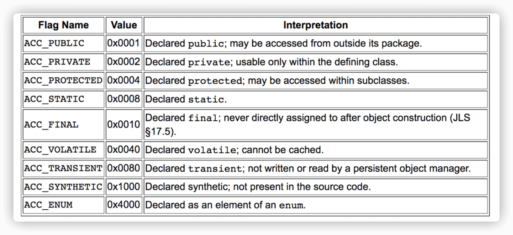

### 方法表集合（Methods）

```java
    u2             methods_count;//方法数量
    method_info    methods[methods_count];//一个类可以有个多个方法
```

methods\_count 表示方法的数量，而 method\_info 表示方法表。

Class 文件存储格式中**对方法的描述与对字段的描述几乎采用了完全一致的方式**。方法表的结构如同字段表一样，依次包括了访问标志、名称索引、描述符索引、属性表集合几项。

**method\_info(方法表的) 结构:**

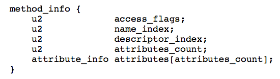

**方法表的 access\_flag 取值：**

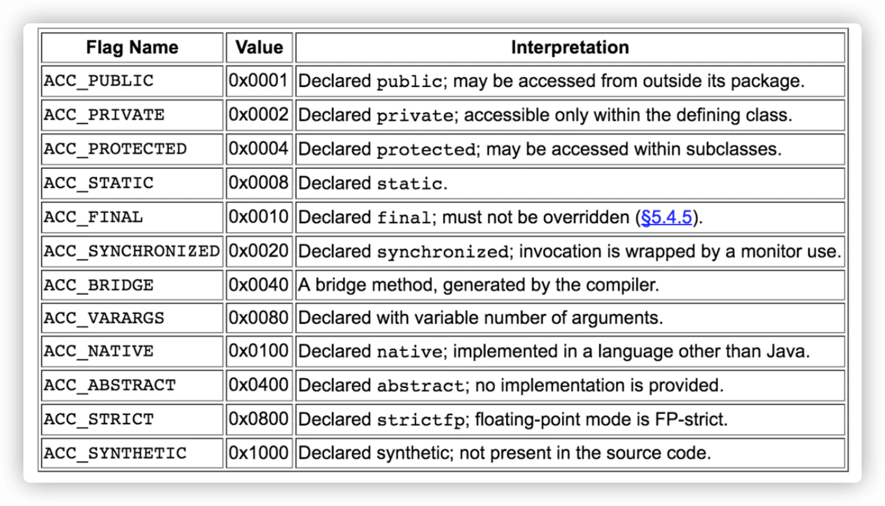

注意：因为`volatile`修饰符和`transient`修饰符不可以修饰方法，所以方法表的访问标志中没有这两个对应的标志，但是增加了`synchronized`、`native`、`abstract`等关键字修饰方法，所以也就多了这些关键字对应的标志。

### 属性表集合（Attributes）

```java
   u2             attributes_count;//此类的属性表中的属性数
   attribute_info attributes[attributes_count];//属性表集合
```

在 Class 文件，字段表，方法表中都可以携带自己的属性表集合，以用于描述某些场景专有的信息。与 Class 文件中其它的数据项目要求的顺序、长度和内容不同，属性表集合的限制稍微宽松一些，不再要求各个属性表具有严格的顺序，并且只要不与已有的属性名重复，任何人实现的编译器都可以向属性表中写 入自己定义的属性信息，Java 虚拟机运行时会忽略掉它不认识的属性。

# 类加载过程

类从被加载到虚拟机内存中开始到卸载出内存为止，它的整个生命周期可以简单概括为 7 个阶段：**加载（Loading）、验证（Verification）、准备（Preparation）、解析（Resolution）**  **、初始化（Initialization）、使用（Using）和卸载（Unloading）**。其中，验证、准备和解析这三个阶段可以统称为链接（Linking）。

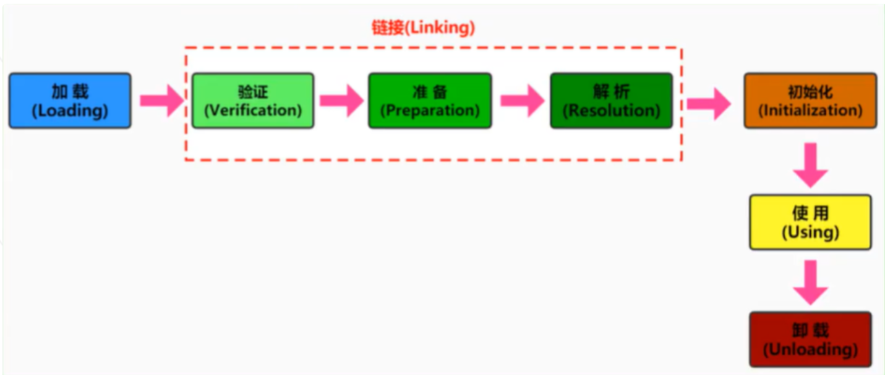

系统加载 Class 类型的文件主要三步：**加载->链接->初始化**。**链接**过程又可分为三步：**验证->准备->解析**。

## 加载

类加载过程的第一步，主要完成下面 3 件事情：

1. **<font style="color:#DF2A3F;">通过全类名获取定义此类的二进制字节流。</font>**
2. **<font style="color:#DF2A3F;">将字节流所代表的静态存储结构转换为方法区的运行时数据结构。</font>**
3. **<font style="color:#DF2A3F;">在内存中生成一个代表该类的</font>**<code><font style="color:#DF2A3F;">Class</font></code><font style="color:#DF2A3F;"> </font>**<font style="color:#DF2A3F;"> 对象，作为方法区数据的访问入口。</font>**

虚拟机规范上面这 3 点并不具体，因此是非常灵活的。比如："通过全类名获取定义此类的二进制字节流" 并没有指明具体从哪里获取（ `ZIP`、 `JAR`、`EAR`、`WAR`、网络、动态代理技术运行时动态生成、其他文件生成比如 `JSP`...）、怎样获取。

加载这一步主要是通过我们后面要讲到的 **类加载器** 完成的。类加载器有很多种，当我们想要加载一个类的时候，具体是哪个类加载器加载由 **双亲委派模型** 决定（不过，我们也能打破由双亲委派模型）。

每个 Java 类都有一个引用指向加载它的 `ClassLoader`。不过，数组类不是通过 `ClassLoader` 创建的，而是 JVM 在需要的时候自动创建的，数组类通过`getClassLoader()`方法获取 `ClassLoader` 的时候和该数组的元素类型的 `ClassLoader` 是一致的。

一个非数组类的加载阶段（加载阶段获取类的二进制字节流的动作）是可控性最强的阶段，这一步我们可以去完成还可以自定义类加载器去控制字节流的获取方式（重写一个类加载器的 `loadClass()` 方法）。

加载阶段与连接阶段的部分动作(如一部分字节码文件格式验证动作)是交叉进行的，加载阶段尚未结束，连接阶段可能就已经开始了

## 链接

### 验证

**验证是链接阶段的第一步，这一阶段的目的是确保 Class 文件的字节流中包含的信息符合《Java 虚拟机规范》的全部约束要求，保证这些信息被当作代码运行后不会危害虚拟机自身的安全。**

验证阶段这一步在整个类加载过程中耗费的资源还是相对较多的，但很有必要，可以有效防止恶意代码的执行。任何时候，程序安全都是第一位。不过，验证阶段也不是必须要执行的阶段。如果程序运行的全部代码(包括自己编写的、第三方包中的、从外部加载的、动态生成的等所有代码)都已经被反复使用和验证过，在生产环境的实施阶段就可以考虑使用 `-Xverify:none` 参数来关闭大部分的类验证措施，以缩短虚拟机类加载的时间。

验证阶段主要由四个检验阶段组成：

1. 文件格式验证（Class 文件格式检查）
2. 元数据验证（字节码语义检查）
3. 字节码验证（程序语义检查）
4. 符号引用验证（类的正确性检查）

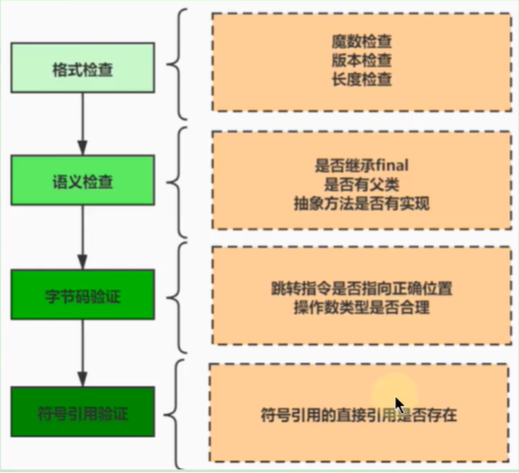

文件格式验证这一阶段是基于该类的二进制字节流进行的，主要目的是保证输入的字节流能正确地解析并存储于方法区之内，格式上符合描述一个 Java 类型信息的要求。除了这一阶段之外，其余三个验证阶段都是基于方法区的存储结构上进行的，不会再直接读取、操作字节流了。

> 方法区属于是 JVM 运行时数据区域的一块逻辑区域，是各个线程共享的内存区域。当虚拟机要使用一个类时，它需要读取并解析 Class 文件获取相关信息，再将信息存入到方法区。方法区会存储已被虚拟机加载的 **类信息、字段信息、方法信息、常量、静态变量、即时编译器编译后的代码缓存等数据**。

符号引用验证发生在类加载过程中的解析阶段，具体点说是 JVM 将符号引用转化为直接引用的时候（解析阶段会介绍符号引用和直接引用）。

符号引用验证的主要目的是确保解析阶段能正常执行，如果无法通过符号引用验证，JVM 会抛出异常，比如：

* `java.lang.IllegalAccessError`：当类试图访问或修改它没有权限访问的字段，或调用它没有权限访问的方法时，抛出该异常。
* `java.lang.NoSuchFieldError`：当类试图访问或修改一个指定的对象字段，而该对象不再包含该字段时，抛出该异常。
* `java.lang.NoSuchMethodError`：当类试图访问一个指定的方法，而该方法不存在时，抛出该异常。

### 准备

**准备阶段是正式为**\*\*<font style="color:#DF2A3F;">类变量分配内存并设置类变量初始值的阶段</font>\*\*，这些内存都将在方法区中分配。对于该阶段有以下几点需要注意：

1. 这时候进行内存分配的仅包括类变量（ Class Variables ，即静态变量，被 `static` 关键字修饰的变量，只与类相关，因此被称为类变量），而不包括实例变量。实例变量会在对象实例化时随着对象一块分配在 Java 堆中。
2. 从概念上讲，类变量所使用的内存都应当在 **方法区** 中进行分配。不过有一点需要注意的是：JDK 7 之前，HotSpot 使用永久代来实现方法区的时候，实现是完全符合这种逻辑概念的。 **而在 JDK 7 及之后，HotSpot 已经把原本放在永久代的**\*\*<font style="color:#DF2A3F;">字符串常量池、静态变量等移动到堆中</font>\*\*\*\*，这个时候类变量则会随着 Class 对象一起存放在 Java 堆中。\*\*相关阅读：[《深入理解 Java 虚拟机（第 3 版）》勘误#75](https://github.com/fenixsoft/jvm_book/issues/75)
3. 这里所设置的初始值"通常情况"下是数据类型默认的零值（如 0、0L、null、false 等），比如我们定义了`public static int value=111` ，那么 value 变量在准备阶段的初始值就是 0 而不是 111（初始化阶段才会赋值）。特殊情况：比如给 value 变量加上了 final 关键字`public static final int value=111` ，那么准备阶段 value 的值就被赋值为 111。**<font style="color:#DF2A3F;">（编译器优化）</font>**

**基本数据类型的零值**：(图片来自《深入理解 Java 虚拟机》第 3 版 7.33 )

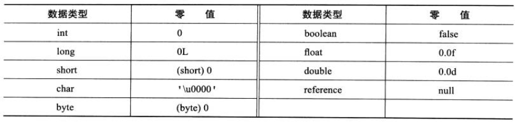

### 解析

**解析阶段是虚拟机将常量池内的**\*\*<font style="color:#DF2A3F;">符号引用替换为直接引用</font>\*\***的过程。**  解析动作主要针对类或接口、字段、类方法、接口方法、方法类型、方法句柄和调用限定符 7 类符号引用进行。

举个例子：在程序执行方法时，系统需要明确知道这个方法所在的位置。Java 虚拟机为每个类都准备了一张方法表来存放类中所有的方法。当需要调用一个类的方法的时候，只要知道这个方法在方法表中的偏移量就可以直接调用该方法了。通过解析操作符号引用就可以直接转变为目标方法在类中方法表的位置，从而使得方法可以被调用。

综上，解析阶段是虚拟机将常量池内的符号引用替换为直接引用的过程，也就是得到类或者字段、方法在内存中的指针或者偏移量。

## 初始化

\*\*初始化阶段是执行初始化方法 \*\* <code>**<clinit> ()**</code> **方法的过程，是类加载的最后一步，这一步 JVM 才开始真正执行类中定义的 Java 程序代码(字节码)。**

> 说明：`<clinit> ()`方法是编译之后自动生成的。

对于`<clinit> ()` 方法的调用，虚拟机会自己确保其在多线程环境中的安全性。因为 <code>**<clinit> ()**</code>\*\* 方法是带锁线程安全\*\*，所以在多线程环境下进行类初始化的话可能会引起多个线程阻塞，并且这种阻塞很难被发现。

对于初始化阶段，虚拟机严格规范了有且只有 6 种情况下，必须对类进行初始化(只有主动去使用类才会初始化类)：

1. 当遇到 `new`、 `getstatic`、`putstatic` 或 `invokestatic` 这 4 条字节码指令时，比如 `new` 一个类，读取一个静态字段(未被 final 修饰)、或调用一个类的静态方法时。
   * 当 jvm 执行 `new` 指令时会初始化类。即当程序创建一个类的实例对象。
   * 当 jvm 执行 `getstatic` 指令时会初始化类。即程序访问类的静态变量(不是静态常量，常量会被加载到运行时常量池)。
   * 当 jvm 执行 `putstatic` 指令时会初始化类。即程序给类的静态变量赋值。
   * 当 jvm 执行 `invokestatic` 指令时会初始化类。即程序调用类的静态方法。
2. 使用 `java.lang.reflect` 包的方法对类进行反射调用时如 `Class.forname("...")`, `newInstance()` 等等。如果类没初始化，需要触发其初始化。
3. 初始化一个类，如果其父类还未初始化，则先触发该父类的初始化。
4. 当虚拟机启动时，用户需要定义一个要执行的主类 (包含 `main` 方法的那个类)，虚拟机会先初始化这个类。
5. `MethodHandle` 和 `VarHandle` 可以看作是轻量级的反射调用机制，而要想使用这 2 个调用，\
   就必须先使用 `findStaticVarHandle` 来初始化要调用的类。
6. **「补充，来自**[**issue745open in new window**](https://github.com/Snailclimb/JavaGuide/issues/745) **」**  当一个接口中定义了 JDK8 新加入的默认方法（被 default 关键字修饰的接口方法）时，如果有这个接口的实现类发生了初始化，那该接口要在其之前被初始化。

## 类卸载

**卸载类即该类的 Class 对象被 GC。**

卸载类需要满足 3 个要求:

1. 该类的所有的实例对象都已被 GC，也就是说堆不存在该类的实例对象。
2. 该类没有在其他任何地方被引用
3. 该类的类加载器的实例已被 GC

所以，在 JVM 生命周期内，由 jvm 自带的类加载器加载的类是不会被卸载的。但是由我们自定义的类加载器加载的类是可能被卸载的。

只要想通一点就好了，JDK 自带的 `BootstrapClassLoader`, `ExtClassLoader`, `AppClassLoader` 负责加载 JDK 提供的类，所以它们(类加载器的实例)肯定不会被回收。而我们自定义的类加载器的实例是可以被回收的，所以使用我们自定义加载器加载的类是可以被卸载掉的。

# **类加载器详解**

## 类加载时机 - 初始化时机

* <font style="color:rgb(77, 77, 77);">遇到new、getstatic、putstatic或invokestatic这四条字节码指令</font>
* <font style="color:rgb(77, 77, 77);">使用java.lang.reflect包的方法对类进行</font>**<font style="color:rgb(254, 44, 36);">反射</font>**<font style="color:rgb(77, 77, 77);">调用的时候，如果类没有进行过初始化，则需要先触发其初始化。</font>
* <font style="color:rgb(77, 77, 77);">当初始化一个类的时候，如果发现其父类还没有进行过初始化，则需要</font>**<font style="color:rgb(254, 44, 36);">先触发其父类的初始化。</font>**
* <font style="color:rgb(77, 77, 77);">当虚拟机启动时，用户需要指定一个要执行的主类（包含main()方法的那个类），虚拟机会</font>**<font style="color:rgb(254, 44, 36);">先初始化这个主类</font>**<font style="color:rgb(77, 77, 77);">。</font>
* <font style="color:rgb(77, 77, 77);">当使用jdk1.7动态语言支持时，如果一个java.lang.invoke.MethodHandle实例最后的解析结果REF\_getstatic,REF\_putstatic,REF\_invokeStatic的方法句柄，并且这个方法句柄所对应的类没有进行初始化，则需要先出触发其初始化。</font>

<font style="color:rgb(77, 77, 77);">对于这五种会触发类进行初始化的场景，虚拟机规范中使用了一个很强烈的限定语：“有且只有”，这</font>**<font style="color:rgb(77, 77, 77);">五种场景中的行为称为对一个类进行 </font>\*\*\*\*<font style="color:#DF2A3F;">主动引用</font>**<font style="color:rgb(77, 77, 77);">。</font>**<font style="color:rgb(149, 111, 231);">除此之外，所有引用类的方式，都不会触发初始化，称为 被动引用</font>**<font style="color:rgb(77, 77, 77);">。</font>

## 类加载器

再谈类的加载器

* 类加载过程：**加载->链接->初始化**。
* **链接**过程又可分为三步：**验证->准备->解析**

加载是类加载过程的第一步，主要完成下面 3 件事情：

1. 通过全类名获取定义此类的二进制字节流
2. 将字节流所代表的静态存储结构转换为方法区的运行时数据结构
3. 在内存中生成一个代表该类的 `Class` 对象，作为方法区这些数据的访问入口

**将类的字节码从磁盘或网络加载到内存中**，**并在Java虚拟机中创建对应的Class对象的过程**

> 类加载器是一个负责加载类的对象。`ClassLoader` 是一个抽象类。给定类的二进制名称，类加载器应尝试定位或生成构成类定义的数据。典型的策略是将名称转换为文件名，然后从文件系统中读取该名称的“类文件”。
>
> 每个 Java 类都有一个引用指向加载它的 `ClassLoader`。不过，数组类不是通过 `ClassLoader` 创建的，而是 JVM 在需要的时候自动创建的，数组类通过`getClassLoader()`方法获取 `ClassLoader` 的时候和该数组的元素类型的 `ClassLoader` 是一致的。

从上面的介绍可以看出:

* 类加载器是一个负责加载类的对象，用于实现类加载过程中的加载这一步。
* 每个 Java 类都有一个引用指向加载它的 `ClassLoader`。
* 数组类不是通过 `ClassLoader` 创建的（数组类没有对应的二进制字节流），是由 JVM 直接生成的。

```java
class Class<T> {
  ...
  private final ClassLoader classLoader;
  @CallerSensitive
  public ClassLoader getClassLoader() {
     //...
  }
  ...
}
```

简单来说，\*\*类加载器的主要作用就是加载 Java 类的字节码（ \*\* <code>**.class**</code> \*\* 文件）到 JVM 中（在内存中生成一个代表该类的 **<code>**Class**</code> \*\* 对象）。**  字节码可以是 Java 源程序（`.java`文件）经过 `javac` 编译得来，也可以是通过工具动态生成或者通过网络下载得来。

其实除了加载类之外，类加载器还可以加载 Java 应用所需的资源如文本、图像、配置文件、视频等等文件资源。本文只讨论其核心功能：加载类。

### 类加载器加载规则

JVM 启动的时候，并不会一次性加载所有的类，而是根据需要去动态加载。也就是说，大部分类在具体用到的时候才会去加载，这样对内存更加友好。

对于已经加载的类会被放在 `ClassLoader` 中。在类加载的时候，系统会首先判断当前类是否被加载过。已经被加载的类会直接返回，否则才会尝试加载。也就是说，**对于一个类加载器来说，相同二进制名称的类只会被加载一次**。

### 类加载器总结

JVM 中内置了三个重要的 `ClassLoader`：

1. <code>**BootstrapClassLoader**</code> **(启动类加载器)** ：最顶层的加载类，由 C++实现，通常表示为 null，并且没有父级，主要用来加载 JDK 内部的核心类库（ `%JAVA_HOME%/lib`目录下的 `rt.jar`、`resources.jar`、`charsets.jar`等 jar 包和类）以及被 `-Xbootclasspath`参数指定的路径下的所有类。
2. <code>**ExtensionClassLoader**</code> **(扩展类加载器)** ：主要负责加载 `%JRE_HOME%/lib/ext` 目录下的 jar 包和类以及被 `java.ext.dirs` 系统变量所指定的路径下的所有类。
3. <code>**AppClassLoader**</code> **(应用程序类加载器)** ：面向我们用户的加载器，负责加载当前应用 classpath 下的所有 jar 包和类。

除了这三种类加载器之外，用户还可以加入自定义的类加载器来进行拓展，以满足自己的特殊需求。就比如说，我们可以对 Java 类的字节码（ `.class` 文件）进行加密，加载时再利用自定义的类加载器对其解密。

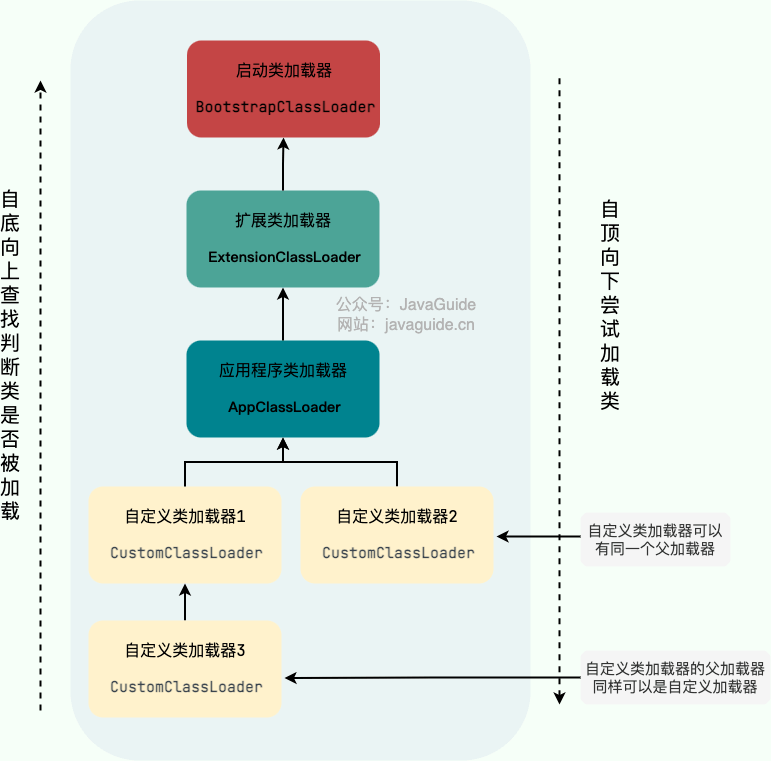

除了 `BootstrapClassLoader` 是 JVM 自身的一部分之外，其他所有的类加载器都是在 JVM 外部实现的，并且全都继承自 `ClassLoader`抽象类。这样做的好处是用户可以自定义类加载器，以便让应用程序自己决定如何去获取所需的类。

每个 `ClassLoader` 可以通过`getParent()`获取其父 `ClassLoader`，如果获取到 `ClassLoader` 为`null`的话，那么该类是通过 `BootstrapClassLoader` 加载的。

\*\*为什么 获取到 **<code>**ClassLoader**</code> \*\* 为**<code>**null**</code>\*\*就是 **<code>**BootstrapClassLoader**</code> \*\* 加载的呢？**  这是因为`BootstrapClassLoader` 由 C++ 实现，由于这个 **C++ 实现的类加载器在 Java 中是没有与之对应的类的，所以拿到的结果是 null。**

自定义类的加载器

## 双亲委派模型

双亲委派机制

* `ClassLoader` 类使用委托模型来搜索类和资源。
* 双亲委派模型要求除了顶层的启动类加载器外，其余的类加载器都应有自己的父类加载器。
* `ClassLoader` \*\* 实例会在试图亲自查找类或资源之前，将搜索类或资源的任务委托给其父类加载器。\*\*


**类加载器之间的父子关系一般不是以继承的关系来实现的，而是通常使用组合关系来复用父加载器的代码。**

```java
public abstract class ClassLoader {
  ...
  // 组合
  private final ClassLoader parent;
  protected ClassLoader(ClassLoader parent) {
       this(checkCreateClassLoader(), parent);
  }
  ...
}
```

**组合优于继承，多用组合少用继承。**

### 基本流程

* 在类加载的时候，系统会首先判断当前类是否被加载过。已经被加载的类会直接返回，否则才会尝试加载（每个父类加载器都会走一遍这个流程）。
* 类加载器在进行类加载的时候，它首先不会自己去尝试加载这个类，而是把这个请求委派给父类加载器去完成（调用父加载器 `loadClass()`方法来加载类）。这样的话，所有的请求最终都会传送到顶层的启动类加载器 `BootstrapClassLoader` 中。
* 只有当父加载器反馈自己无法完成这个加载请求（它的搜索范围中没有找到所需的类）时，子加载器才会尝试自己去加载（调用自己的 `findClass()` 方法来加载类）。
* 如果子类加载器也无法加载这个类，那么它会抛出一个 `ClassNotFoundException` 异常。

**JVM 判定两个 Java 类是否相同的具体规则**：JVM 不仅要看**类的全名**是否相同，还要看**加载此类的类加载器**是否一样。只有两者都相同的情况，才认为两个类是相同的。

### 双亲委派模型的好处

**双亲委派模型保证了 Java 程序的稳定运行，可以避免类的重复加载**（JVM 区分不同类的方式不仅仅根据类名，相同的类文件被不同的类加载器加载产生的是两个不同的类），也保证了 Java 的核心 API 不被篡改。

如果没有使用双亲委派模型，而是每个类加载器加载自己的话就会出现一些问题，比如我们编写一个称为 `java.lang.Object` 类的话，那么程序运行的时候，系统就会出现两个不同的 `Object` 类。双亲委派模型可以保证加载的是 JRE 里的那个 `Object` 类，而不是你写的 `Object` 类。这是因为 `AppClassLoader` 在加载你的 `Object` 类时，会委托给 `ExtClassLoader` 去加载，而 `ExtClassLoader` 又会委托给 `BootstrapClassLoader`，`BootstrapClassLoader` 发现自己已经加载过了 `Object` 类，会直接返回，不会去加载你写的 `Object` 类

> **避免重复加载，保证jvm核心类库加载，不被用户自定义的类影响**

# 重要的JVM参数总结

## 堆内存相关

> Java 虚拟机所管理的内存中最大的一块，Java 堆是所有线程共享的一块内存区域，在虚拟机启动时创建。**此内存区域的唯一目的就是存放对象实例，几乎所有的对象实例以及数组都在这里分配内存。**

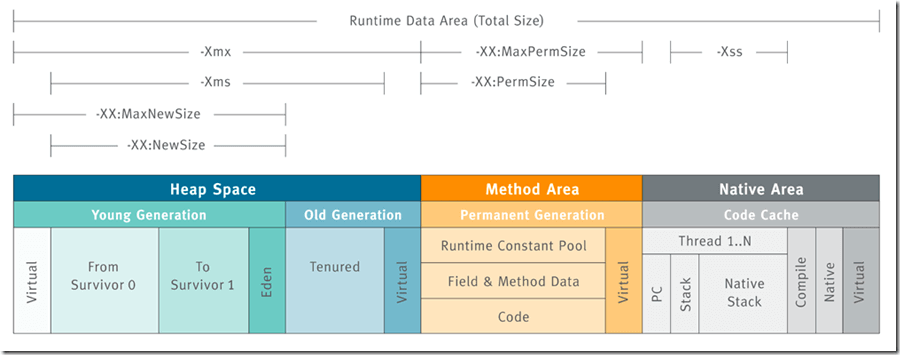

### 显式指定堆内存`–Xms`和`-Xmx`

与性能有关的最常见实践之一是根据应用程序要求初始化堆内存。如果我们需要指定最小和最大堆大小（推荐显示指定大小），以下参数可以帮助你实现：

```java
-Xms<heap size>[unit] -- 初始堆大小
-Xmx<heap size>[unit] -- 最大堆大小
```

* **heap size** 表示要初始化内存的具体大小。
* **unit** 表示要初始化内存的单位。单位为  ***“ g”***  (GB)、 ***“ m”*** （MB）、 ***“ k”*** （KB）。

举个栗子 🌰，如果我们要为 JVM 分配最小 2 GB 和最大 5 GB 的堆内存大小，我们的参数应该这样来写：

```java
-Xms2G -Xmx5G
```

### 显式新生代内存(Young Generation)

默认情况下，YG 的最小大小为 1310 *MB*，最大大小为\_无限制\_

**1.通过** <code>**-XX:NewSize**</code>**和** <code>**-XX:MaxNewSize**</code>**指定**

```java
-XX:NewSize=<young size>[unit]
-XX:MaxNewSize=<young size>[unit]
```

举个栗子 🌰，如果我们要为 新生代分配 最小 256m 的内存，最大 1024m 的内存我们的参数应该这样来写：

```java
-XX:NewSize=256m -- 初始大小
-XX:MaxNewSize=1024m -- 最大大小
```

2.**通过** <code>**-Xmn<young size>[unit]**</code> **指定**

举个栗子 🌰，如果我们要为 新生代分配 256m 的内存（NewSize 与 MaxNewSize 设为一致），我们的参数应该这样来写：

```java
-Xmn256m
```

```java
将新对象预留在新生代，由于 Full GC 的成本远高于 Minor GC，因此尽可能将对象分配在新生代是明智的做法，实际项目中根据 GC 日志分析新生代空间大小分配是否合理，适当通过“-Xmn”命令调节新生代大小，最大限度降低新对象直接进入老年代的情况。
```

### 显式指定永久代/元空间的大小

**从 Java 8 开始，如果我们没有指定 Metaspace 的大小，随着更多类的创建，虚拟机会耗尽所有可用的系统内存（永久代并不会出现这种情况）。**

> **元空间使用的是本地内存**

JDK 1.8 之前永久代还没被彻底移除的时候通常通过下面这些参数来调节方法区大小

```bash
-XX:PermSize=N #方法区 (永久代) 初始大小
-XX:MaxPermSize=N #方法区 (永久代) 最大大小,超过这个值将会抛出 OutOfMemoryError 异常:java.lang.OutOfMemoryError: PermGen
```

相对而言，垃圾收集行为在这个区域是比较少出现的，但并非数据进入方法区后就“永久存在”了。

**JDK 1.8 的时候，方法区（HotSpot 的永久代）被彻底移除了（JDK1.7 就已经开始了），取而代之是元空间，元空间使用的是本地内存。**

下面是一些常用参数：

```bash
-XX:MetaspaceSize=N #设置 Metaspace 的初始大小（是一个常见的误区，后面会解释）
-XX:MaxMetaspaceSize=N #设置 Metaspace 的最大大小
```

**修正：Metaspace 的初始容量并不是 \*\* `-XX:MetaspaceSize` \*\* 设置，无论 \*\* `-XX:MetaspaceSize` \*\* 配置什么值，对于 64 位 JVM 来说，Metaspace 的初始容量都是 21807104（约 20.8m）。**

Metaspace 由于使用不断扩容到`-XX:MetaspaceSize`参数指定的量，就会发生 FGC，且之后每次 Metaspace 扩容都会发生 Full GC。

**MetaspaceSize 表示 Metaspace 使用过程中触发 Full GC 的阈值，只对触发起作用。**

垃圾搜集器内部是根据变量 `_capacity_until_GC`来判断 Metaspace 区域是否达到阈值的，初始化代码如下

## 垃圾收集相关

为了提高应用程序的稳定性，选择正确的[垃圾收集open in new window](java_http:_www.oracle.com_webfolder_technetwork_tutorials_obe_java_gc01_index)算法至关重要。

JVM 具有四种类型的 GC 实现：

* 串行垃圾收集器
* 并行垃圾收集器
* CMS 垃圾收集器
* G1 垃圾收集器

```java
-XX:+UseSerialGC
-XX:+UseParallelGC
-XX:+UseParNewGC
-XX:+UseG1GC
```

### GC 日志记录

```shell
# 必选
# 打印基本 GC 信息
-XX:+PrintGCDetails
-XX:+PrintGCDateStamps
# 打印对象分布
-XX:+PrintTenuringDistribution
# 打印堆数据
-XX:+PrintHeapAtGC
# 打印Reference处理信息
# 强引用/弱引用/软引用/虚引用/finalize 相关的方法
-XX:+PrintReferenceGC
# 打印STW时间
-XX:+PrintGCApplicationStoppedTime

# 可选
# 打印safepoint信息，进入 STW 阶段之前，需要要找到一个合适的 safepoint
-XX:+PrintSafepointStatistics
-XX:PrintSafepointStatisticsCount=1

# GC日志输出的文件路径
-Xloggc:/path/to/gc-%t.log
# 开启日志文件分割
-XX:+UseGCLogFileRotation
# 最多分割几个文件，超过之后从头文件开始写
-XX:NumberOfGCLogFiles=14
# 每个文件上限大小，超过就触发分割
-XX:GCLogFileSize=50M
```

## 处理 OOM

```shell
-XX:+HeapDumpOnOutOfMemoryError
-XX:HeapDumpPath=./java_pid<pid>.hprof
-XX:OnOutOfMemoryError="< cmd args >;< cmd args >"
-XX:+UseGCOverheadLimit
```

这里有几点需要注意:

* **HeapDumpOnOutOfMemoryError** 指示 JVM 在遇到 **OutOfMemoryError** 错误时将 heap 转储到物理文件中。
* **HeapDumpPath** 表示要写入文件的路径; 可以给出任何文件名; 但是，如果 JVM 在名称中找到一个 `<pid>` 标记，则当前进程的进程 id 将附加到文件名中，并使用`.hprof`格式
* **OnOutOfMemoryError** 用于发出紧急命令，以便在内存不足的情况下执行; 应该在 `cmd args` 空间中使用适当的命令。例如，如果我们想在内存不足时重启服务器，我们可以设置参数: `-XX:OnOutOfMemoryError="shutdown -r"` 。
* **UseGCOverheadLimit** 是一种策略，它限制在抛出 OutOfMemory 错误之前在 GC 中花费的 VM 时间的比例

## 其他

* `-server` : 启用“ Server Hotspot VM”; 此参数默认用于 64 位 JVM
* `-XX:+UseStringDeduplication` : *Java 8u20* 引入了这个 JVM 参数，通过创建太多相同 String 的实例来减少不必要的内存使用; 这通过将重复 String 值减少为单个全局 `char []` 数组来优化堆内存。
* `-XX:+UseLWPSynchronization`: 设置基于 LWP (轻量级进程)的同步策略，而不是基于线程的同步。
* `-XX:LargePageSizeInBytes`: 设置用于 Java 堆的较大页面大小; 它采用 GB/MB/KB 的参数; 页面大小越大，我们可以更好地利用虚拟内存硬件资源; 然而，这可能会导致 PermGen 的空间大小更大，这反过来又会迫使 Java 堆空间的大小减小。
* `-XX:MaxHeapFreeRatio` : 设置 GC 后, 堆空闲的最大百分比，以避免收缩。
* `-XX:SurvivorRatio` : eden/survivor 空间的比例, 例如`-XX:SurvivorRatio=6` 设置每个 survivor 和 eden 之间的比例为 1:6。
* `-XX:+UseLargePages` : 如果系统支持，则使用大页面内存; 请注意，如果使用这个 JVM 参数，OpenJDK 7 可能会崩溃。
* `-XX:+UseStringCache` : 启用 String 池中可用的常用分配字符串的缓存。
* `-XX:+UseCompressedStrings` : 对 String 对象使用 `byte []` 类型，该类型可以用纯 ASCII 格式表示。
* `-XX:+OptimizeStringConcat` : 它尽可能优化字符串串联操作。


> 更新: 2025-07-14 14:53:51  
> 原文: <https://www.yuque.com/nibiwanxiamei/yrd6t1/java_jvm>