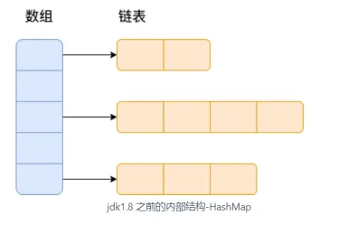
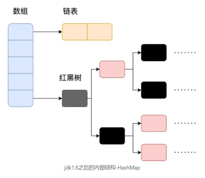
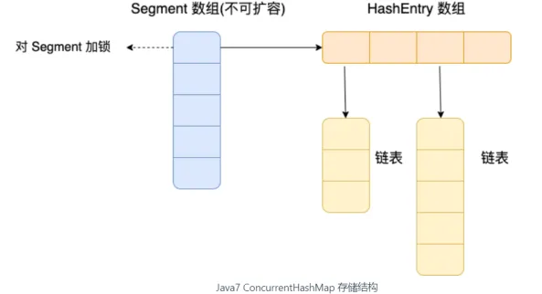
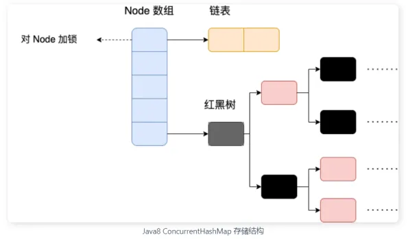
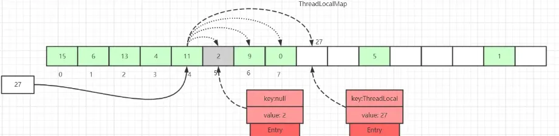
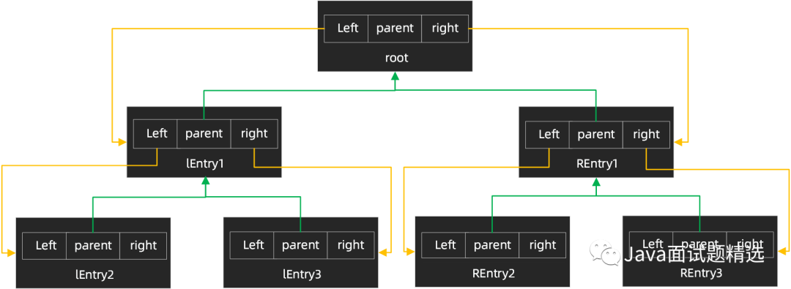
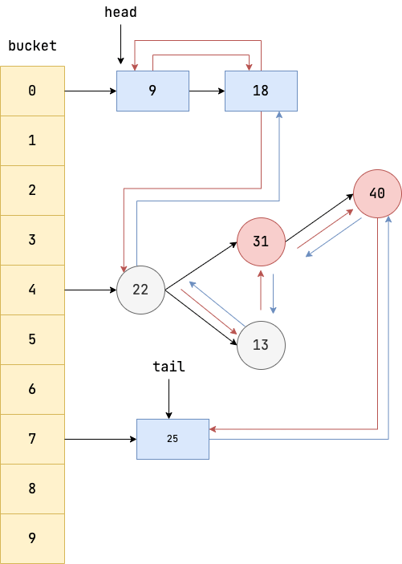
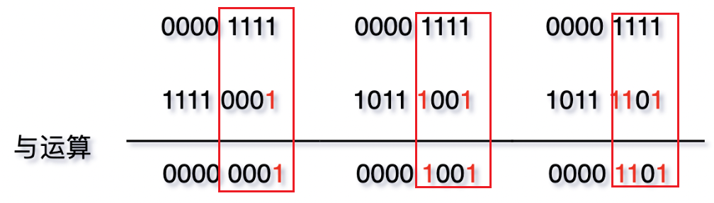

# HashMap，TreeMap，LinkedHashMap，concurrentHashMap，ThreadLocalMap













[Java集合](https://www.yuque.com/nibiwanxiamei/yrd6t1/4e4c87fd7480bbcafd4ef7dc4f757637)

[9.聊聊ThreadLocal](https://www.yuque.com/nibiwanxiamei/yrd6t1/83fb6387326387e72a6f0920e8813217)

# 对比
## 底层结构：
+ HashMap：数组 + 链表 + 红黑树
+ HashTable：数组 + 链表
+ LinkedHashMap：数组（链表 + 红黑树） + 双向链表
+ TreeMap：红黑树
+ ThreadLocalMap：entry数组
+ concurrentHashMap：Node数组 + 链表 + 红黑树
+ Redis Hash：entry数组 + 链表

## 扩容机制
**HashMap & LinkedHashMap：初始容量16，每次扩容是原来的两倍；当size >= 负载因子*容量就需要进行扩容。扩容过程中需要重新计算每个节点的hash桶位置，当然可以把取余运算替换为&运算提高效率，要不放入原位置，要不放在原位置+旧hash的容量。**

**HashTable：****<font style="color:rgb(44, 62, 80);">默认初始容量为11，每次扩容变为原来的2n+1。</font>**

**TreeMap：TreeMap在插入新元素时会根据元素的比较规则进行排序，并将元素按顺序插入到树结构中。在插入新元素时，****<font style="color:#DF2A3F;">TreeMap会对树结构进行平衡操作，以保持树的平衡性</font>****。**

**ThreadLocalMap：有扩容阈值，如果size达到**<font style="color:rgb(255, 80, 44);background-color:rgb(255, 245, 245);">threshold = </font>**2/3 * 容量，就会出发rehash，rehash会把一些过期的key删掉，若rehash后size >= 3/4 * **<font style="color:rgb(255, 80, 44);background-color:rgb(255, 245, 245);">threshold，就进行扩容；申请容量为原本的2倍，然后数据迁移。</font>

<font style="color:rgb(255, 80, 44);background-color:rgb(255, 245, 245);">concurrentHashMap：</font>

+ <font style="color:rgb(77, 77, 77);">首先，检查当前数组（称为oldTab）是否已经初始化，如果没有，则初始化一个默认大小（16）的数组，并将其赋值给当前数组。</font>
+ <font style="color:rgb(77, 77, 77);">然后，检查当前数组是否需要扩容，如果需要，则尝试更新一个变量（称为sizeCtl）来表示扩容状态，并创建一个新的数组（称为newTab），其大小是当前数组的两倍。</font>
+ <font style="color:rgb(77, 77, 77);">接着，遍历当前数组中的每个元素（称为f），如果f是一个普通节点，则将其复制到新数组中相应的位置；如果f是一个转移节点（ForwardingNode），则说明已经有其他线程在进行扩容，那么就跳转到新数组中继续处理；如果f是一个树节点，则将其拆分为两个链表或树，并分别复制到新数组中。</font>
+ <font style="color:rgb(77, 77, 77);">最后，当所有元素都复制完毕后，将新数组赋值给当前数组，并更新sizeCtl变量来结束扩容状态。</font>

<font style="color:rgb(25, 27, 31);">当某个线程进行put时，如果发现ConcurrentHashMap正在进行扩容那么该线程一起进行扩容</font>

<font style="color:rgb(25, 27, 31);">如果某个线程put时，发现没有正在进行扩容，则将key-value添加到ConcurrentHashMap中，然后判断是否超过阈值，找过了进行扩容。</font>

<font style="color:rgb(25, 27, 31);">Redis Hash：根据负载因子判断，负载因子大于1且没有在RDB | AOF刷盘，可以扩容。负载因子大于5强制扩容。Redis会创建两个Hash，一个使用一个空闲，当需要扩容，会把另一个容量设置为2倍，然后渐进式迁移到新的表格中。若此时有查询或者更新删除，两个hash都查看。新增只会新增到新hash中。</font>

# HashMap扩容机制
**<font style="color:#DF2A3F;">扩容时机：</font>**

+ **<font style="color:#DF2A3F;">达到负载因子*size</font>**
+ **<font style="color:#DF2A3F;">初始化容量不是2次幂</font>**
+ **<font style="color:#DF2A3F;">链表长度大于8但是数组小于64的时候不会树化，而是扩容</font>**

```java
final Node<K,V>[] resize() {
    Node<K,V>[] oldTab = table;
    int oldCap = (oldTab == null) ? 0 : oldTab.length;
    int oldThr = threshold;
    int newCap, newThr = 0;
    if (oldCap > 0) {
        // 超过最大值就不再扩充了，就只好随你碰撞去吧
        if (oldCap >= MAXIMUM_CAPACITY) {
            threshold = Integer.MAX_VALUE;
            return oldTab;
        }
        // 没超过最大值，就扩充为原来的2倍
        else if ((newCap = oldCap << 1) < MAXIMUM_CAPACITY && oldCap >= DEFAULT_INITIAL_CAPACITY)
            newThr = oldThr << 1; // double threshold
    }
    else if (oldThr > 0) // initial capacity was placed in threshold
        // 创建对象时初始化容量大小放在threshold中，此时只需要将其作为新的数组容量
        newCap = oldThr;
    else {
        // signifies using defaults 无参构造函数创建的对象在这里计算容量和阈值
        newCap = DEFAULT_INITIAL_CAPACITY;
        newThr = (int)(DEFAULT_LOAD_FACTOR * DEFAULT_INITIAL_CAPACITY);
    }
    if (newThr == 0) {
        // 创建时指定了初始化容量或者负载因子，在这里进行阈值初始化，
    	// 或者扩容前的旧容量小于16，在这里计算新的resize上限
        float ft = (float)newCap * loadFactor;
        newThr = (newCap < MAXIMUM_CAPACITY && ft < (float)MAXIMUM_CAPACITY ? (int)ft : Integer.MAX_VALUE);
    }
    threshold = newThr;
    @SuppressWarnings({"rawtypes","unchecked"})
        Node<K,V>[] newTab = (Node<K,V>[])new Node[newCap];
    table = newTab;
    if (oldTab != null) {
        // 把每个bucket都移动到新的buckets中
        for (int j = 0; j < oldCap; ++j) {
            Node<K,V> e;
            if ((e = oldTab[j]) != null) {
                oldTab[j] = null;
                if (e.next == null)
                    // 只有一个节点，直接计算元素新的位置即可
                    newTab[e.hash & (newCap - 1)] = e;
                else if (e instanceof TreeNode)
                    // 将红黑树拆分成2棵子树，如果子树节点数小于等于 UNTREEIFY_THRESHOLD（默认为 6），则将子树转换为链表。
                    // 如果子树节点数大于 UNTREEIFY_THRESHOLD，则保持子树的树结构。
                    ((TreeNode<K,V>)e).split(this, newTab, j, oldCap);
                else {
                    Node<K,V> loHead = null, loTail = null;
                    Node<K,V> hiHead = null, hiTail = null;
                    Node<K,V> next;
                    do {
                        next = e.next;
                        // 原索引
                        if ((e.hash & oldCap) == 0) {
                            if (loTail == null)
                                loHead = e;
                            else
                                loTail.next = e;
                            loTail = e;
                        }
                        // 原索引+oldCap
                        else {
                            if (hiTail == null)
                                hiHead = e;
                            else
                                hiTail.next = e;
                            hiTail = e;
                        }
                    } while ((e = next) != null);
                    // 原索引放到bucket里
                    if (loTail != null) {
                        loTail.next = null;
                        newTab[j] = loHead;
                    }
                    // 原索引+oldCap放到bucket里
                    if (hiTail != null) {
                        hiTail.next = null;
                        newTab[j + oldCap] = hiHead;
                    }
                }
            }
        }
    }
    return newTab;
}
```

## 拆分细节
<font style="color:rgb(77, 77, 77);">hash %(取模) 数组大小，但这么做效率较低，HashMap的get()调用的方法，通过(n - 1) & hash来计算下标，n为数组大小。</font>

<font style="color:rgb(77, 77, 77);">假设数组size=16。16对应二进制 0001 0000。16-1对应二进制 0000 1111。</font>



<font style="color:rgb(77, 77, 77);">后面四位就是计算出最终的数组下标（0 - 15）</font>

**<font style="color:#DF2A3F;">扩容rehash无需重新计算数组下标，原理如下</font>**

<font style="color:rgb(77, 77, 77);">正常情况下新数组size=老数组size*2。HashMap的底层结构为数组+链表/红黑树，当hash冲突的情况下，数组会指向链表或红黑树，当扩容时，链表或红黑树数据也需要拆分，挂靠在新数组下。</font>

<font style="color:rgb(77, 77, 77);">数组16扩容到32，32大小的下标计算跟16大小对比，差异点在于</font>**<font style="color:#DF2A3F;">倒数第五位是否为1，如果等于1，结果倒数第五位值为1，否则为0，而其他位置跟16大小时完全相等。</font>**

**<font style="color:#DF2A3F;background-color:#FBDE28;">(e.hash & oldCap) == 0</font>**

+ **<font style="color:#000000;">等于0，新数组的下标等于旧数组下标</font>**
+ **<font style="color:#000000;">等于1，新数组的下标等于旧数组下标+旧数组size</font>**

## <font style="color:rgb(79, 79, 79);">树节点split</font>
<font style="color:rgb(77, 77, 77);">树节点拆分思想跟链表节点类似，通过 e.hash & bit == 0来拆分成两部分。</font>

```java
final void split(HashMap<K,V> map, Node<K,V>[] tab, int index, int bit) {
            TreeNode<K,V> b = this;
            TreeNode<K,V> loHead = null, loTail = null;
            TreeNode<K,V> hiHead = null, hiTail = null;
            int lc = 0, hc = 0;
            //遍历树节点
            for (TreeNode<K,V> e = b, next; e != null; e = next) {
                next = (TreeNode<K,V>)e.next;
                e.next = null;
                //通过hash值和bit与操作，结果=0则数据存放在loHead
                if ((e.hash & bit) == 0) {
                    if ((e.prev = loTail) == null)
                        loHead = e;
                    else
                        loTail.next = e;
                    loTail = e;
                    ++lc;
                }
                //此处结果=1则数据存放在hiHead
                else {
                    if ((e.prev = hiTail) == null)
                        hiHead = e;
                    else
                        hiTail.next = e;
                    hiTail = e;
                    ++hc;
                }
            }
			//树节点拆分的两部分数据，放入对应位置
			//此处有点特殊，如果节点数量小于非树化阀值（6），需要转换成链表
			//否则继续放入树结构
            if (loHead != null) {
                if (lc <= UNTREEIFY_THRESHOLD)
                    tab[index] = loHead.untreeify(map);
                else {
                    tab[index] = loHead;
                    if (hiHead != null)
                        loHead.treeify(tab);
                }
            }
            if (hiHead != null) {
                if (hc <= UNTREEIFY_THRESHOLD)
                    tab[index + bit] = hiHead.untreeify(map);
                else {
                    tab[index + bit] = hiHead;
                    if (loHead != null)
                        hiHead.treeify(tab);
                }
            }
        }

```

<font style="color:rgb(77, 77, 77);">树节点的拆分代码跟链表拆分类似，唯一有区别的在于会判断拆分出两部分的大小，数量小于6则转换成链表，否则放入红黑树。</font>  
<font style="color:rgb(77, 77, 77);">原本节点A指向一颗红黑树，数据大小为10。拆分后loHead大小为7，hiHead大小为3。</font>

+ <font style="color:rgb(77, 77, 77);">loHead大于6，转换成红黑树，放入A位置。</font>
+ <font style="color:rgb(77, 77, 77);">hiHead小于6，转换成链表，放入A+原数组size处。</font>

# <font style="color:rgb(77, 77, 77);">ConcurrentHashMap扩容机制</font>
[浅析Java中ConcurrentHashMap的存储流程_java_脚本之家](https://www.jb51.net/article/284572nbh.htm)

[Java面试常考之ConcurrentHashMap多线程扩容机制详解_java_脚本之家](https://www.jb51.net/program/285233mq2.htm)

<font style="color:rgb(254, 44, 36);">CHM</font><font style="color:rgb(77, 77, 77);">的扩容条件和</font><font style="color:rgb(254, 44, 36);">HashMap</font><font style="color:rgb(77, 77, 77);">一样，</font><font style="color:rgb(73, 73, 73);">集合内元素达到阈值或者链表长度达到8时扩容，</font><font style="color:rgb(77, 77, 77);">不同的是</font><font style="color:rgb(254, 44, 36);">CHM</font><font style="color:rgb(77, 77, 77);">是线程安全的，支持多线程扩容，考虑的更多，也更为复杂。</font>

<font style="color:rgb(77, 77, 77);">在JDK1.8中 </font><font style="color:rgb(254, 44, 36);">CHM</font><font style="color:rgb(77, 77, 77);">采用了CAS（CompareAndSwap，比较置换）+ synchronized 的方法来保证并发安全。CAS主要用到的主要属性</font><font style="color:rgb(255, 153, 0);">sizeCtl</font><font style="color:rgb(73, 73, 73);">，sizeCtl默认为0，</font>**<font style="color:rgb(73, 73, 73);">当sizeCtl为负数时代表正在扩容或者初始化，当sizeCtl为正数时代表当前集合的扩容阈值，table为当前集合的数组。</font>**

```java

 private transient volatile int sizeCtl;
 transient volatile Node<K,V>[] table;
```

总结：扩容时，线程判断是否要扩容，要就扩容。如果已经在扩容，线程就会加入扩容，可以多线程扩容，核心会计算出每个线程扩容的区域，迁移的过程和HashMap是一样的


> 更新: 2024-10-19 10:06:11  
> 原文: <https://www.yuque.com/nibiwanxiamei/yrd6t1/gn3674zoo52nc5kt>