# Java集合

***

# 集合概述

Java 集合， 也叫作容器，主要是由两大接口派生而来：一个是 `Collection`**接口**，主要用于存放单一元素；另一个是 `Map` \*\* 接口\*\*，主要用于存放键值对。对于`Collection` 接口，下面又有三个主要的子接口：`List`、`Set` 和 `Queue`。

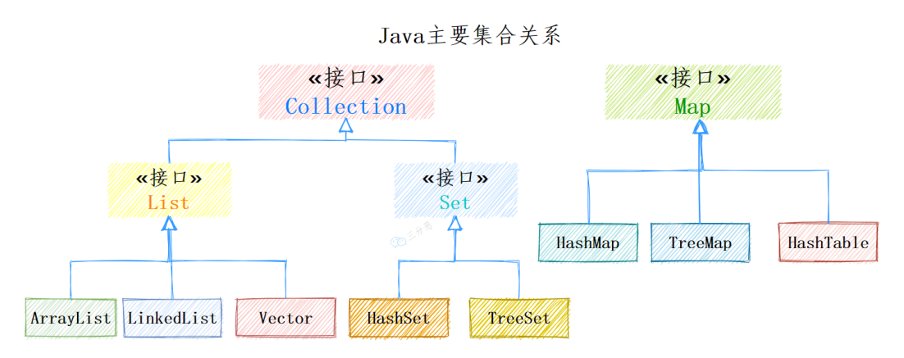

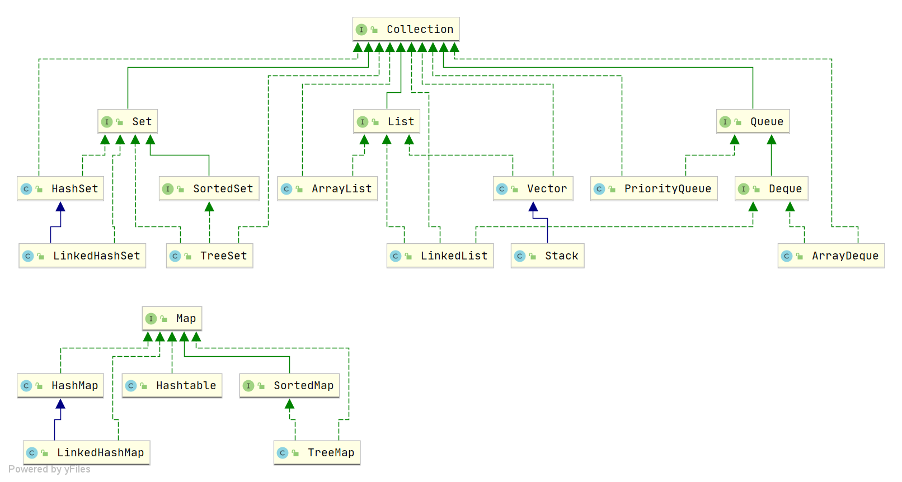

## 说说 List, Set, Queue, Map 四者的区别？

* `List`(对付顺序的好帮手): 存储的**元素是有序的、可重复的。**
* `Set`(注重独一无二的性质): 存储的**元素不可重复的**。
* `Queue`(实现排队功能的叫号机): 按特定的排队规则来确定先后顺序（**先进先出**），存储的元素是有序的、可重复的。
* `Map`(用 key 来搜索的专家): 使用**键值对（key-value）存储**，key 是无序的、不可重复的，value 是无序的、可重复的，每个键最多映射到一个值。

## 集合框架底层数据结构总结

### ListList接口分析

* `ArrayList`：`Object[]` 数组。
* `Vector`：`Object[]` 数组。
* `LinkedList`：双向链表(JDK1.6 之前为循环链表，JDK1.7 取消了循环)。

### SetSet接口

* `HashSet`(无序，唯一): 基于 `HashMap` 实现的，底层采用 `HashMap` 来保存元素。
* `LinkedHashSet`: `LinkedHashSet` 是 `HashSet` 的子类，并且其内部是通过 `LinkedHashMap` 来实现的。
* `TreeSet`(有序，唯一): 红黑树(自平衡的排序二叉树)。

### Queue队列

* `PriorityQueue`: `Object[]` 数组来实现小顶堆。
* `DelayQueue`:`PriorityQueue`。
* `ArrayDeque`: 可扩容动态双向数组。

### Map接口

* `HashMap`：JDK1.8 之前 `HashMap` 由**数组+链表**组成的，数组是 `HashMap` 的主体，链表则是主要为了解决哈希冲突而存在的（“拉链法”解决冲突）。JDK1.8 以后在解决哈希冲突时有了较大的变化，**当链表长度大于阈值（默认为 8）（将链表转换成红黑树前会判断，如果当前数组的长度小于 64，那么会选择先进行数组扩容，而不是转换为红黑树）时，将链表转化为红黑树，以减少搜索时间**。
* `LinkedHashMap`：`LinkedHashMap` 继承自 `HashMap`，所以它的底层仍然是基于拉链式散列结构即由**数组和链表或红黑树组成**。另外，`LinkedHashMap` 在上面结构的基础上，增加了一条双向链表，使得上面的结构可以保持键值对的插入顺序。同时通过对链表进行相应的操作，实现了访问顺序相关逻辑。
* `Hashtable`：数组+链表组成，数组是 `Hashtable` 的主体，链表则是主要为了解决哈希冲突而存在的。
* `TreeMap`：红黑树（自平衡的排序二叉树）
* <font style="color:rgb(44, 62, 80);">ConcurrentHashMap：Node数组+链表+红黑树实现，线程安全的（jdk1.8以前Segment锁，1.8以后volatile + CAS 或者 synchronized）</font>

<font style="color:rgb(44, 62, 80);"></font>

## <font style="color:rgb(44, 62, 80);">java线程安全集合</font>

<font style="color:rgb(44, 62, 80);">在 java.util 包中的线程安全的类主要 2 个，其他都是非线程安全的。</font>

* **<font style="color:rgb(48, 79, 254);">Vector</font>**<font style="color:rgb(44, 62, 80);">：线程安全的动态数组，其内部方法基本都经过synchronized修饰，如果不需要线程安全，并不建议选择，毕竟同步是有额外开销的。Vector 内部是使用对象数组来保存数据，可以根据需要自动的增加容量，当数组已满时，会创建新的数组，并拷贝原有数组数据。</font>
* **<font style="color:rgb(48, 79, 254);">Hashtable</font>**<font style="color:rgb(44, 62, 80);">：线程安全的哈希表，HashTable 的加锁方法是给每个方法加上 synchronized 关键字，这样锁住的是整个 Table 对象，不支持 null 键和值，由于同步导致的性能开销，所以已经很少被推荐使用，如果要保证线程安全的哈希表，可以用ConcurrentHashMap。</font>

<font style="color:rgb(44, 62, 80);">java.util.concurrent 包提供的都是线程安全的集合：</font>

**<font style="color:rgb(44, 62, 80);">并发Map：</font>**

* **<font style="color:rgb(48, 79, 254);">ConcurrentHashMap</font>**<font style="color:rgb(44, 62, 80);">：与 HashTable 的主要区别是加锁粒度不同，在</font>**<font style="color:rgb(48, 79, 254);">JDK1.7</font>**<font style="color:rgb(44, 62, 80);">，ConcurrentHashMap加的是分段锁 - </font>**<font style="color:#DF2A3F;">Segment锁</font>**<font style="color:rgb(44, 62, 80);">，每个Segment 含有整个 table 的一部分，不同分段之间的并发操作就互不影响。在</font>**<font style="color:rgb(48, 79, 254);">JDK 1.8</font>**<font style="color:rgb(44, 62, 80);"> ，取消了Segment字段，</font>**<font style="color:#DF2A3F;">直接在table元素（Node节点）上加锁</font>**<font style="color:rgb(44, 62, 80);">，实现对每一行进行加锁，进一步减小了并发冲突的概率。对于put操作，如果Key对应的数组元素为null，则通过</font>**<font style="color:rgb(44, 62, 80);">CAS</font>**<font style="color:rgb(44, 62, 80);">操作（Compare and Swap）将其设置为当前值。如果Key对应的数组元素（也即链表表头或者树的根元素）不为null，则对该元素使用 synchronized 关键字申请锁，然后进行操作。如果该 put 操作使得当前链表长度超过一定阈值，则将该链表转换为红黑树，从而提高寻址效率。</font>
* **<font style="color:rgb(48, 79, 254);">ConcurrentSkipListMap</font>**<font style="color:rgb(44, 62, 80);">：实现了一个基于</font>**<font style="color:rgb(44, 62, 80);">SkipList（跳表）</font>**<font style="color:rgb(44, 62, 80);">算法的可排序的并发集合，SkipList是一种可以在对数预期时间内完成搜索、插入、删除等操作的数据结构，通过维护多个指向其他元素的“跳跃”链接来实现高效查找。</font>

<font style="color:rgb(44, 62, 80);">并发Set：</font>

* **<font style="color:rgb(48, 79, 254);">ConcurrentSkipListSet</font>**<font style="color:rgb(44, 62, 80);">：是线程安全的有序的集合。底层是使用ConcurrentSkipListMap实现。</font>
* **<font style="color:rgb(48, 79, 254);">CopyOnWriteArraySet</font>**<font style="color:rgb(44, 62, 80);">：是线程安全的Set实现，可以将它理解成线程安全的HashSet。CopyOnWriteArraySet和HashSet虽然都继承于共同的父类AbstractSet；HashSet是通过HashMap实现的，而CopyOnWriteArraySet是通过“动态数组(</font>**<font style="color:rgb(44, 62, 80);">CopyOnWriteArrayList</font>**<font style="color:rgb(44, 62, 80);">)”实现的，并不是散列表。</font>

<font style="color:rgb(44, 62, 80);">并发List：</font>

* **<font style="color:rgb(48, 79, 254);">CopyOnWriteArrayList</font>**<font style="color:rgb(44, 62, 80);">：是 ArrayList 的线程安全的变体，其中所有写操作（add，set等）都通过</font>**<font style="color:rgb(44, 62, 80);">对底层数组进行全新复制</font>**<font style="color:rgb(44, 62, 80);">来实现，允许存储 null 元素。即当对象进行写操作时，使用了Lock锁做同步处理，内部拷贝了原数组，并在新数组上进行添加操作，最后将新数组替换掉旧数组；若进行的读操作，则直接返回结果，操作过程中不需要进行同步。</font>

<font style="color:rgb(44, 62, 80);">并发 Queue：</font>

* **<font style="color:rgb(48, 79, 254);">ConcurrentLinkedQueue</font>**<font style="color:rgb(44, 62, 80);">：是一个适用于高并发场景下的队列，它通过无锁的方式(CAS)，实现了高并发状态下的高性能。通常，ConcurrentLinkedQueue 的性能要好于 BlockingQueue 。</font>
* **<font style="color:rgb(48, 79, 254);">BlockingQueue</font>**<font style="color:rgb(44, 62, 80);">：与 ConcurrentLinkedQueue 的使用场景不同，BlockingQueue 的主要功能并不是在于提升高并发时的队列性能，而在于简化多线程间的数据共享。BlockingQueue 提供一种读写阻塞等待的机制，即如果消费者速度较快，则 BlockingQueue 则可能被清空，此时消费线程再试图从 BlockingQueue 读取数据时就会被阻塞。反之，如果生产线程较快，则 BlockingQueue 可能会被装满，此时，生产线程再试图向 BlockingQueue 队列装入数据时，便会被阻塞等待。</font>

<font style="color:rgb(44, 62, 80);">并发 Deque：</font>

* **<font style="color:rgb(48, 79, 254);">LinkedBlockingDeque</font>**<font style="color:rgb(44, 62, 80);">：是线程安全的双端队列实现。它的内部使用链表结构，每一个节点都维护了一个前驱节点和一个后驱节点。LinkedBlockingDeque 没有进行读写锁的分离，因此同一时间只能有一个线程对其进行操作</font>
* **<font style="color:rgb(48, 79, 254);">ConcurrentLinkedDeque</font>**<font style="color:rgb(44, 62, 80);">：ConcurrentLinkedDeque是一种基于链接节点的无限并发链表。可以安全地并发执行插入、删除和访问操作。当许多线程同时访问一个公共集合时，ConcurrentLinkedDeque是一个合适的选择。</font>

## 如何选择集合

* **Map -> 要根据键值获取到元素值时**
  * `TreeMap` -> 需要排序
  * `HashMap` -> 不需要排序
  * `ConcurrentHashMap` -> 保证线程安全
* `Collection` \*\* -> 只需要存放元素值\*\*
  * `Set` -> 保证元素唯一
  * `List` -> 不需要保证元素唯一

# List

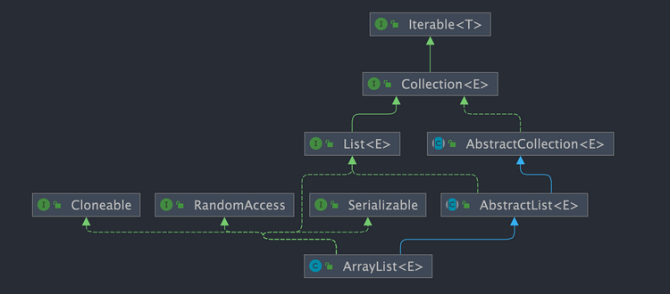

**ArrayList 继承于 AbstractList ，实现了 List, RandomAccess, Cloneable, java.io.Serializable 这些接口。**

```java

public class ArrayList<E> extends AbstractList<E>
        implements List<E>, RandomAccess, Cloneable, java.io.Serializable{

  }

```

## ArrayList 和 Array（数组）的区别？

`ArrayList` \*\* 内部基于动态数组实现，比 **`Array`**（静态数组\*\* **）**  **使用起来更加灵活**：

* `ArrayList`会根据实际存储的元素**动态地扩容或缩容**，而 `Array` 被创建之后就**不能改变它的长度**了。
* `ArrayList` \*\* 允许使用泛型来确保类型安全\*\*，`Array` 则不可以。
* `ArrayList` 中**只能存储对象**。对于基本类型数据，需要使用其对应的包装类（如 Integer、Double 等）。`Array` 可以**直接存储基本类型数据，也可以存储对象。**
* `ArrayList` 支持插入、删除、遍历等常见操作，并且提供了丰富的 API 操作方法，比如 `add()`、`remove()`等。`Array` 只是一个固定长度的数组，只能按照下标访问其中的元素，不具备动态添加、删除元素的能力。
* `ArrayList`**创建时不需要指定大小，而**`Array`**创建时必须指定大小。**

> - **<font style="color:#DF2A3F;">ArrayList是动态数组实现的，可以动态扩容缩容，可以使用泛型，只能存储对象，有很多API，创建不需要指定大小。</font>**
> - **<font style="color:#DF2A3F;">Array是静态数组，无法改变长度，无法使用泛型，可以存储对象和基本数据类型，API少，创建需要指定大小。</font>**

## Vector 和 Stack 的区别?（了解即可）

* `Vector` 和 `Stack` 两者都是**线程安全**的，都是使用 `synchronized` 关键字进行同步处理。
* `Stack` 继承自 `Vector`，是一个后进先出的栈，而 `Vector` 是一个列表。

随着 Java 并发编程的发展，`Vector` 和 `Stack` 已经被淘汰，推荐使用**并发集合类（例如 \*\* <code>**ConcurrentHashMap**</code>** 、 **<code>**CopyOnWriteArrayList**</code> \*\* 等）** 或者手动实现线程安全的方法来提供安全的多线程操作支持。

## ArrayList 可以添加 null 值吗？

`ArrayList` \*\* 中可以存储任何类型的对象，包括 \*\* `null` \*\* 值\*\*。不过，不建议向`ArrayList` 中添加 `null` 值， `null` 值无意义，会让代码难以维护比如忘记做判空处理就会导致空指针异常。

## ArrayList 插入和删除元素的时间复杂度？

> **和数组很类似（底层是数组来实现的）**

对于插入：

* **头部插入**：由于需要将所有元素都依次向后移动一个位置，因此**时间复杂度是 O(n)。**
* **尾部插入**：当 `ArrayList` 的容量**未达到极限时**，往列表末尾插入元素的时间复杂度是 **O(1)** ，因为它只需要在数组末尾添加一个元素即可；当容量已**达到极限并且需要扩容时**，则需要**执行一次 O(n) 的操作将原数组复制到新的更大的数组中**，**然后再执行 O(1) 的操作添加元素。**
* 指定位置插入：需要将目标位置之后的所有**元素都向后移动一个位置**，然后再把新元素放入指定位置。这个过程需要移动平均 n/2 个元素，因此**时间复杂度为 O(n)** 。

对于删除：

* **头部删除**：由于需要将所有元素依次**向前移动**一个位置，因此时间复杂度是 \*\* O(n)\*\* 。
* **尾部删除**：当删除的元素位于列表末尾时，时间复杂度为 **O(1)** 。
* **指定位置删除**：需要将目标元素之后的所有元素向前移动一个位置以填补被删除的空白位置，因此需要移动平均 n/2 个元素，时间复杂度为 \*\* O(n)\*\* 。

## LinkedList 插入和删除元素的时间复杂度？

> **和链表一样，底层是链表实现的**

* 头部插入/删除：只需要修改头结点的指针即可完成插入/删除操作，因此时间复杂度为 O(1)。
* 尾部插入/删除：只需要修改尾结点的指针即可完成插入/删除操作，因此时间复杂度为 O(1)。
* 指定位置插入/删除：需要先移动到指定位置，再修改指定节点的指针完成插入/删除，因此需要移动平均 n/2 个元素，时间复杂度为 O(n)。

## LinkedList 为什么不能实现 RandomAccess 接口？

`RandomAccess` \*\* 是一个标记接口，用来表明实现该接口的\*\*\*\*<font style="color:#DF2A3F;">类支持随机访问</font>\*\*（即可以通过索引快速访问元素）。由于 `LinkedList` 底层数据结构是链表，内存地址不连续，只能通过指针来定位，不支持随机快速访问，所以不能实现 `RandomAccess` 接口。

## ArrayList 与 LinkedList 区别?

* **是否保证线程安全：**  `ArrayList` 和 `LinkedList` 都是不同步的，也就是不保证线程安全；
* **底层数据结构：**  `ArrayList` 底层使用的是 <code>**Object**</code> \*\* 数组\*\*；`LinkedList` 底层使用的是 **双向链表** 数据结构（JDK1.6 之前为循环链表，JDK1.7 取消了循环。注意双向链表和双向循环链表的区别）
* **插入和删除是否受元素位置的影响：**
  * `ArrayList` \*\* 采用数组存储，所以插入和删除元素的时间复杂度受元素位置的影响。\*\*
  * `LinkedList` \*\* 采用链表存储，所以在头尾插入或者删除元素不受元素位置的影响\*\*（`add(E e)`、`addFirst(E e)`、`addLast(E e)`、`removeFirst()`、 `removeLast()`），时间复杂度为 O(1)，如果是要在指定位置 `i` 插入和删除元素的话（`add(int index, E element)`，`remove(Object o)`,`remove(int index)`）， 时间复杂度为 O(n) ，因为需要先移动到指定位置再插入和删除。
* **是否支持快速随机访问：**  `LinkedList` \*\* 不支持高效的随机元素访问，而 \*\* `ArrayList` **（实现了 \*\* `RandomAccess` \*\* 接口） 支持。** 快速随机访问就是通过元素的序号快速获取元素对象(对应于`get(int index)`方法)。
* **内存空间占用：**  `ArrayList` \*\* 的空间浪费主要体现在在 list 列表的结尾会预留一定的容量空间，而 LinkedList 的空间花费则体现在它的每一个元素都需要消耗比 ArrayList 更多的空间（因为要存放直接后继和直接前驱以及数据）。\*\*

## <font style="color:rgb(44, 62, 80);">为什么ArrayList不是线程安全的，具体来说是哪里不安全？</font>

* <font style="color:rgb(44, 62, 80);">部分值为null：当线程1扩容当前size是9，而数组容量是10，所以不用扩容，这时候cpu让出执行权，线程2进来，发现size是9，而数组容量是10，所以不用扩容，这时候线程1继续执行，将数组下标索引为9的位置set值了，还没有来得及执行size++，这时候线程2也来执行了，又把数组下标索引为9的位置set了一遍，这时候两个先后进行size++，导致下标索引10的地方就为null了。</font>
* <font style="color:rgb(44, 62, 80);">索引越界异常：线程1扩容当前size是9，数组容量是10不用扩容，cpu让出执行权，线程2也发现不用扩容，这时候数组的容量就是10，而线程1 set完之后size++，这时候线程2再进来size就是10，数组的大小只有10，而你要设置下标索引为10的就会越界（数组的下标索引从0开始）；</font>

## ArrayList核心源码 🔞🔞🔞

```java
public class ArrayList<E> extends AbstractList<E>
        implements List<E>, RandomAccess, Cloneable, java.io.Serializable {
    private static final long serialVersionUID = 8683452581122892189L;

    /**
     * 默认初始容量大小
     */
    private static final int DEFAULT_CAPACITY = 10;

    /**
     * 空数组（用于空实例）。
     */
    private static final Object[] EMPTY_ELEMENTDATA = {};

    //用于默认大小空实例的共享空数组实例。
    //我们把它从EMPTY_ELEMENTDATA数组中区分出来，以知道在添加第一个元素时容量需要增加多少。
    private static final Object[] DEFAULTCAPACITY_EMPTY_ELEMENTDATA = {};

    /**
     * 保存ArrayList数据的数组
     */
    transient Object[] elementData; // non-private to simplify nested class access

    /**
     * ArrayList 所包含的元素个数
     */
    private int size;

    /**
     * 带初始容量参数的构造函数（用户可以在创建ArrayList对象时自己指定集合的初始大小）
     */
    public ArrayList(int initialCapacity) {
        if (initialCapacity > 0) {
            //如果传入的参数大于0，创建initialCapacity大小的数组
            this.elementData = new Object[initialCapacity];
        } else if (initialCapacity == 0) {
            //如果传入的参数等于0，创建空数组
            this.elementData = EMPTY_ELEMENTDATA;
        } else {
            //其他情况，抛出异常
            throw new IllegalArgumentException("Illegal Capacity: " +
                    initialCapacity);
        }
    }

    /**
     * 默认无参构造函数
     * DEFAULTCAPACITY_EMPTY_ELEMENTDATA 为0.初始化为10，也就是说初始其实是空数组 当添加第一个元素的时候数组容量才变成10
     */
    public ArrayList() {
        this.elementData = DEFAULTCAPACITY_EMPTY_ELEMENTDATA;
    }

    /**
     * 构造一个包含指定集合的元素的列表，按照它们由集合的迭代器返回的顺序。
     */
    public ArrayList(Collection<? extends E> c) {
        //将指定集合转换为数组
        elementData = c.toArray();
        //如果elementData数组的长度不为0
        if ((size = elementData.length) != 0) {
            // 如果elementData不是Object类型数据（c.toArray可能返回的不是Object类型的数组所以加上下面的语句用于判断）
            if (elementData.getClass() != Object[].class)
                //将原来不是Object类型的elementData数组的内容，赋值给新的Object类型的elementData数组
                elementData = Arrays.copyOf(elementData, size, Object[].class);
        } else {
            // 其他情况，用空数组代替
            this.elementData = EMPTY_ELEMENTDATA;
        }
    }

    /**
     * 修改这个ArrayList实例的容量是列表的当前大小。 应用程序可以使用此操作来最小化ArrayList实例的存储。
     */
    public void trimToSize() {
        modCount++;
        if (size < elementData.length) {
            elementData = (size == 0)
                    ? EMPTY_ELEMENTDATA
                    : Arrays.copyOf(elementData, size);
        }
    }
//下面是ArrayList的扩容机制
//ArrayList的扩容机制提高了性能，如果每次只扩充一个，
//那么频繁的插入会导致频繁的拷贝，降低性能，而ArrayList的扩容机制避免了这种情况。

    /**
     * 如有必要，增加此ArrayList实例的容量，以确保它至少能容纳元素的数量
     *
     * @param minCapacity 所需的最小容量
     */
    public void ensureCapacity(int minCapacity) {
        //如果是true，minExpand的值为0，如果是false,minExpand的值为10
        int minExpand = (elementData != DEFAULTCAPACITY_EMPTY_ELEMENTDATA)
                // any size if not default element table
                ? 0
                // larger than default for default empty table. It's already
                // supposed to be at default size.
                : DEFAULT_CAPACITY;
        //如果最小容量大于已有的最大容量
        if (minCapacity > minExpand) {
            ensureExplicitCapacity(minCapacity);
        }
    }

    // 根据给定的最小容量和当前数组元素来计算所需容量。
    private static int calculateCapacity(Object[] elementData, int minCapacity) {
        // 如果当前数组元素为空数组（初始情况），返回默认容量和最小容量中的较大值作为所需容量
        if (elementData == DEFAULTCAPACITY_EMPTY_ELEMENTDATA) {
            return Math.max(DEFAULT_CAPACITY, minCapacity);
        }
        // 否则直接返回最小容量
        return minCapacity;
    }

    // 确保内部容量达到指定的最小容量。
    private void ensureCapacityInternal(int minCapacity) {
        ensureExplicitCapacity(calculateCapacity(elementData, minCapacity));
    }

    //判断是否需要扩容
    private void ensureExplicitCapacity(int minCapacity) {
        modCount++;
        // overflow-conscious code
        if (minCapacity - elementData.length > 0)
            //调用grow方法进行扩容，调用此方法代表已经开始扩容了
            grow(minCapacity);
    }

    /**
     * 要分配的最大数组大小
     */
    private static final int MAX_ARRAY_SIZE = Integer.MAX_VALUE - 8;

    /**
     * ArrayList扩容的核心方法。
     */
    private void grow(int minCapacity) {
        // oldCapacity为旧容量，newCapacity为新容量
        int oldCapacity = elementData.length;
        //将oldCapacity 右移一位，其效果相当于oldCapacity /2，
        //我们知道位运算的速度远远快于整除运算，整句运算式的结果就是将新容量更新为旧容量的1.5倍，
        int newCapacity = oldCapacity + (oldCapacity >> 1);
        //然后检查新容量是否大于最小需要容量，若还是小于最小需要容量，那么就把最小需要容量当作数组的新容量，
        if (newCapacity - minCapacity < 0)
            newCapacity = minCapacity;
        //再检查新容量是否超出了ArrayList所定义的最大容量，
        //若超出了，则调用hugeCapacity()来比较minCapacity和 MAX_ARRAY_SIZE，
        //如果minCapacity大于MAX_ARRAY_SIZE，则新容量则为Integer.MAX_VALUE，否则，新容量大小则为 MAX_ARRAY_SIZE。
        if (newCapacity - MAX_ARRAY_SIZE > 0)
            newCapacity = hugeCapacity(minCapacity);
        // minCapacity is usually close to size, so this is a win:
        elementData = Arrays.copyOf(elementData, newCapacity);
    }

    //比较minCapacity和 MAX_ARRAY_SIZE
    private static int hugeCapacity(int minCapacity) {
        if (minCapacity < 0) // overflow
            throw new OutOfMemoryError();
        return (minCapacity > MAX_ARRAY_SIZE) ?
                Integer.MAX_VALUE :
                MAX_ARRAY_SIZE;
    }

    /**
     * 返回此列表中的元素数。
     */
    public int size() {
        return size;
    }

    /**
     * 如果此列表不包含元素，则返回 true 。
     */
    public boolean isEmpty() {
        //注意=和==的区别
        return size == 0;
    }

    /**
     * 如果此列表包含指定的元素，则返回true 。
     */
    public boolean contains(Object o) {
        //indexOf()方法：返回此列表中指定元素的首次出现的索引，如果此列表不包含此元素，则为-1
        return indexOf(o) >= 0;
    }

    /**
     * 返回此列表中指定元素的首次出现的索引，如果此列表不包含此元素，则为-1
     */
    public int indexOf(Object o) {
        if (o == null) {
            for (int i = 0; i < size; i++)
                if (elementData[i] == null)
                    return i;
        } else {
            for (int i = 0; i < size; i++)
                //equals()方法比较
                if (o.equals(elementData[i]))
                    return i;
        }
        return -1;
    }

    /**
     * 返回此列表中指定元素的最后一次出现的索引，如果此列表不包含元素，则返回-1。.
     */
    public int lastIndexOf(Object o) {
        if (o == null) {
            for (int i = size - 1; i >= 0; i--)
                if (elementData[i] == null)
                    return i;
        } else {
            for (int i = size - 1; i >= 0; i--)
                if (o.equals(elementData[i]))
                    return i;
        }
        return -1;
    }

    /**
     * 返回此ArrayList实例的浅拷贝。 （元素本身不被复制。）
     */
    public Object clone() {
        try {
            ArrayList<?> v = (ArrayList<?>) super.clone();
            //Arrays.copyOf功能是实现数组的复制，返回复制后的数组。参数是被复制的数组和复制的长度
            v.elementData = Arrays.copyOf(elementData, size);
            v.modCount = 0;
            return v;
        } catch (CloneNotSupportedException e) {
            // 这不应该发生，因为我们是可以克隆的
            throw new InternalError(e);
        }
    }

    /**
     * 以正确的顺序（从第一个到最后一个元素）返回一个包含此列表中所有元素的数组。
     * 返回的数组将是“安全的”，因为该列表不保留对它的引用。 （换句话说，这个方法必须分配一个新的数组）。
     * 因此，调用者可以自由地修改返回的数组。 此方法充当基于阵列和基于集合的API之间的桥梁。
     */
    public Object[] toArray() {
        return Arrays.copyOf(elementData, size);
    }

    /**
     * 以正确的顺序返回一个包含此列表中所有元素的数组（从第一个到最后一个元素）;
     * 返回的数组的运行时类型是指定数组的运行时类型。 如果列表适合指定的数组，则返回其中。
     * 否则，将为指定数组的运行时类型和此列表的大小分配一个新数组。
     * 如果列表适用于指定的数组，其余空间（即数组的列表数量多于此元素），则紧跟在集合结束后的数组中的元素设置为null 。
     * （这仅在调用者知道列表不包含任何空元素的情况下才能确定列表的长度。）
     */
    @SuppressWarnings("unchecked")
    public <T> T[] toArray(T[] a) {
        if (a.length < size)
            // 新建一个运行时类型的数组，但是ArrayList数组的内容
            return (T[]) Arrays.copyOf(elementData, size, a.getClass());
        //调用System提供的arraycopy()方法实现数组之间的复制
        System.arraycopy(elementData, 0, a, 0, size);
        if (a.length > size)
            a[size] = null;
        return a;
    }

    // Positional Access Operations

    @SuppressWarnings("unchecked")
    E elementData(int index) {
        return (E) elementData[index];
    }

    /**
     * 返回此列表中指定位置的元素。
     */
    public E get(int index) {
        rangeCheck(index);

        return elementData(index);
    }

    /**
     * 用指定的元素替换此列表中指定位置的元素。
     */
    public E set(int index, E element) {
        //对index进行界限检查
        rangeCheck(index);

        E oldValue = elementData(index);
        elementData[index] = element;
        //返回原来在这个位置的元素
        return oldValue;
    }

    /**
     * 将指定的元素追加到此列表的末尾。
     */
    public boolean add(E e) {
        ensureCapacityInternal(size + 1);  // Increments modCount!!
        //这里看到ArrayList添加元素的实质就相当于为数组赋值
        elementData[size++] = e;
        return true;
    }

    /**
     * 在此列表中的指定位置插入指定的元素。
     * 先调用 rangeCheckForAdd 对index进行界限检查；然后调用 ensureCapacityInternal 方法保证capacity足够大；
     * 再将从index开始之后的所有成员后移一个位置；将element插入index位置；最后size加1。
     */
    public void add(int index, E element) {
        rangeCheckForAdd(index);

        ensureCapacityInternal(size + 1);  // Increments modCount!!
        //arraycopy()这个实现数组之间复制的方法一定要看一下，下面就用到了arraycopy()方法实现数组自己复制自己
        System.arraycopy(elementData, index, elementData, index + 1,
                size - index);
        elementData[index] = element;
        size++;
    }

    /**
     * 删除该列表中指定位置的元素。 将任何后续元素移动到左侧（从其索引中减去一个元素）。
     */
    public E remove(int index) {
        rangeCheck(index);

        modCount++;
        E oldValue = elementData(index);

        int numMoved = size - index - 1;
        if (numMoved > 0)
            System.arraycopy(elementData, index + 1, elementData, index,
                    numMoved);
        elementData[--size] = null; // clear to let GC do its work
        //从列表中删除的元素
        return oldValue;
    }

    /**
     * 从列表中删除指定元素的第一个出现（如果存在）。 如果列表不包含该元素，则它不会更改。
     * 返回true，如果此列表包含指定的元素
     */
    public boolean remove(Object o) {
        if (o == null) {
            for (int index = 0; index < size; index++)
                if (elementData[index] == null) {
                    fastRemove(index);
                    return true;
                }
        } else {
            for (int index = 0; index < size; index++)
                if (o.equals(elementData[index])) {
                    fastRemove(index);
                    return true;
                }
        }
        return false;
    }

    /*
     * Private remove method that skips bounds checking and does not
     * return the value removed.
     */
    private void fastRemove(int index) {
        modCount++;
        int numMoved = size - index - 1;
        if (numMoved > 0)
            System.arraycopy(elementData, index + 1, elementData, index,
                    numMoved);
        elementData[--size] = null; // clear to let GC do its work
    }

    /**
     * 从列表中删除所有元素。
     */
    public void clear() {
        modCount++;

        // 把数组中所有的元素的值设为null
        for (int i = 0; i < size; i++)
            elementData[i] = null;

        size = 0;
    }

    /**
     * 按指定集合的Iterator返回的顺序将指定集合中的所有元素追加到此列表的末尾。
     */
    public boolean addAll(Collection<? extends E> c) {
        Object[] a = c.toArray();
        int numNew = a.length;
        ensureCapacityInternal(size + numNew);  // Increments modCount
        System.arraycopy(a, 0, elementData, size, numNew);
        size += numNew;
        return numNew != 0;
    }

    /**
     * 将指定集合中的所有元素插入到此列表中，从指定的位置开始。
     */
    public boolean addAll(int index, Collection<? extends E> c) {
        rangeCheckForAdd(index);

        Object[] a = c.toArray();
        int numNew = a.length;
        ensureCapacityInternal(size + numNew);  // Increments modCount

        int numMoved = size - index;
        if (numMoved > 0)
            System.arraycopy(elementData, index, elementData, index + numNew,
                    numMoved);

        System.arraycopy(a, 0, elementData, index, numNew);
        size += numNew;
        return numNew != 0;
    }

    /**
     * 从此列表中删除所有索引为fromIndex （含）和toIndex之间的元素。
     * 将任何后续元素移动到左侧（减少其索引）。
     */
    protected void removeRange(int fromIndex, int toIndex) {
        modCount++;
        int numMoved = size - toIndex;
        System.arraycopy(elementData, toIndex, elementData, fromIndex,
                numMoved);

        // clear to let GC do its work
        int newSize = size - (toIndex - fromIndex);
        for (int i = newSize; i < size; i++) {
            elementData[i] = null;
        }
        size = newSize;
    }

    /**
     * 检查给定的索引是否在范围内。
     */
    private void rangeCheck(int index) {
        if (index >= size)
            throw new IndexOutOfBoundsException(outOfBoundsMsg(index));
    }

    /**
     * add和addAll使用的rangeCheck的一个版本
     */
    private void rangeCheckForAdd(int index) {
        if (index > size || index < 0)
            throw new IndexOutOfBoundsException(outOfBoundsMsg(index));
    }

    /**
     * 返回IndexOutOfBoundsException细节信息
     */
    private String outOfBoundsMsg(int index) {
        return "Index: " + index + ", Size: " + size;
    }

    /**
     * 从此列表中删除指定集合中包含的所有元素。
     */
    public boolean removeAll(Collection<?> c) {
        Objects.requireNonNull(c);
        //如果此列表被修改则返回true
        return batchRemove(c, false);
    }

    /**
     * 仅保留此列表中包含在指定集合中的元素。
     * 换句话说，从此列表中删除其中不包含在指定集合中的所有元素。
     */
    public boolean retainAll(Collection<?> c) {
        Objects.requireNonNull(c);
        return batchRemove(c, true);
    }


    /**
     * 从列表中的指定位置开始，返回列表中的元素（按正确顺序）的列表迭代器。
     * 指定的索引表示初始调用将返回的第一个元素为next 。 初始调用previous将返回指定索引减1的元素。
     * 返回的列表迭代器是fail-fast 。
     */
    public ListIterator<E> listIterator(int index) {
        if (index < 0 || index > size)
            throw new IndexOutOfBoundsException("Index: " + index);
        return new ListItr(index);
    }

    /**
     * 返回列表中的列表迭代器（按适当的顺序）。
     * 返回的列表迭代器是fail-fast 。
     */
    public ListIterator<E> listIterator() {
        return new ListItr(0);
    }

    /**
     * 以正确的顺序返回该列表中的元素的迭代器。
     * 返回的迭代器是fail-fast 。
     */
    public Iterator<E> iterator() {
        return new Itr();
    }

```

### 为什么用transient修饰元素数组？不能序列化吗？

```java
transient Object[] elementData; // non-private to simplify nested class access
```

ArrayList的序列化不太一样，它使用transient修饰存储元素的elementData的数组，transient关键字的作

用是让被修饰的成员属性不被序列化。

为什么最ArrayList不直接序列化元素数组呢？

**效率的考虑，数组可能长度100，但实际只用了50，剩下的50不用其实不用序列化，这样可以提高序列化和反**

**序列化的效率，还可以节省内存空间。**

那ArrayList:怎么序列化呢？

ArrayListi通过两个方法readObject、writeObject自定义序列化和反序列化策略，实际直接使用两个

流ObjectOutputStream和ObjectInputStream来进行序列化和反序列化。

## ArrayList扩容机制 🔞🔞🔞

* **默认如果没有给定size，则创建空集合，第一次插入元素初始化为长度为10的集合。**
* **若给定了size，直接根据size创建集合**
* **ArrayList的扩容是创建一个1.5倍的新数组，然后把原数组的值拷贝过去。**

## 快速失败和安全失败 🔞🔞🔞

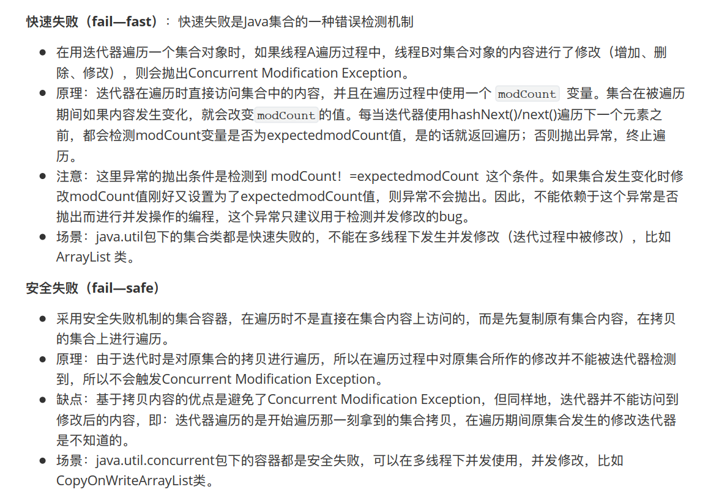

## CopyOnWriteArrayList 🔞🔞🔞🔞

<details class="lake-collapse"><summary id="u0acae3f9"><span class="ne-text">背景介绍</span></summary><p id="uec93e5ec" class="ne-p"><span class="ne-text">JDK1.5 引入了 Java.util.concurrent（JUC）包，其中提供了很多</span><strong><span class="ne-text">线程安全</span></strong><span class="ne-text">且</span><strong><span class="ne-text">并发性能良好</span></strong><span class="ne-text">的容器，其中唯一的线程安全 List 实现就是</span><strong><span class="ne-text"> CopyOnWriteArrayList。vector都是加锁操作，比较重量级，性能差。</span></strong></p><p id="ufaa4c93d" class="ne-p"><span class="ne-text">对于大部分业务场景来说，读取操作往往是远大于写入操作的。由于读取操作不会对原有数据进行修改，因此，对于每次读取都进行加锁其实是一种资源浪费。相比之下，我们应该允许多个线程同时访问 </span><span class="ne-text">List</span><span class="ne-text"> 的内部数据，毕竟对于读取操作来说是安全的。</span></p><p id="u352feffc" class="ne-p"><strong><span class="ne-text">这种思路与 ReentrantReadWriteLock 读写锁的设计思想非常类似，即读读不互斥、读写互斥、写写互斥（只有读读不互斥）。CopyOnWriteArrayList 更进一步地实现了这一思想。为了将读操作性能发挥到极致，</span></strong></p></details>
**<font style="color:#DF2A3F;"></font>**

**<font style="color:#DF2A3F;">CopyOnWriteArrayList 中的读取操作是完全无需加锁的。写入操作也不会阻塞读取操作，只有写写才会互斥</font>\*\*\*\*。**

**CopyOnWriteArrayList 线程安全的核心在于其采用了**\*\*<font style="color:#DF2A3F;">写时复制（Copy-On-Write）</font>\*\*\*\*的策略。\*\*当需要修改（ add，set、remove ） CopyOnWriteArrayList 的内容时，不会直接修改原数组，而是会先创建底层数组的副本，对副本数组进行修改，修改完之后再将修改后的数组赋值回去，这样就可以保证写操作不会影响读操作了。

**可以看出，写时复制机制非常适合读多写少的并发场景，能够极大地提高系统的并发性能。**

```java
private transient volatile Object[] array;
```

<font style="color:rgb(44, 62, 80);">在写入操作时，加了一把互斥锁ReentrantLock以保证线程安全。</font>

```java
public boolean add(E e) {
    //获取锁
    final ReentrantLock lock = this.lock;
    //加锁
    lock.lock();
    try {
        //获取到当前List集合保存数据的数组
        Object[] elements = getArray();
        //获取该数组的长度（这是一个伏笔，同时len也是新数组的最后一个元素的索引值）
        int len = elements.length;
        //将当前数组拷贝一份的同时，让其长度加1
        Object[] newElements = Arrays.copyOf(elements, len + 1);
        //将加入的元素放在新数组最后一位，len不是旧数组长度吗，为什么现在用它当成新数组的最后一个元素的下标？建议自行画图推演，就很容易理解。
        newElements[len] = e;
        //替换引用，将数组的引用指向给新数组的地址
        setArray(newElements);
        return true;
    } finally {
        //释放锁
        lock.unlock();
    }
}
```

## 写时复制 🔞🔞🔞🔞

:::info
**<font style="color:#DF2A3F;">写时复制（操作系统父进程fork子进程）：其核心思想是，如果有多个调用者（callers）同时请求相同资源（如内存或磁盘上的数据存储），他们会共同获取相同的指针指向相同的资源，直到某个调用者试图修改资源的内容时，系统才会真正复制一份专用副本（private copy）给该调用者，而其他调用者所见到的最初的资源仍然保持不变。</font>**

:::

<details class="lake-collapse"><summary id="u6c10548a"><span class="ne-text" style="color: rgb(44, 62, 80); font-size: 16px">主进程在执行 fork 的时候，操作系统会把主进程的「</span><strong><span class="ne-text" style="color: rgb(48, 79, 254); font-size: 16px">页表</span></strong><span class="ne-text" style="color: rgb(44, 62, 80); font-size: 16px">」复制一份给子进程，这个页表记录着虚拟地址和物理地址映射关系，而不会复制物理内存，也就是说，两者的虚拟空间不同，但其对应的物理空间是同一个。</span></summary><p id="u8bebf418" class="ne-p"><strong><span class="ne-text" style="color: rgb(48, 79, 254); font-size: 16px">在发生写操作的时候，操作系统才会去复制物理内存</span></strong><span class="ne-text" style="color: rgb(44, 62, 80); font-size: 16px">，这样是为了防止 fork 创建子进程时，由于物理内存数据的复制时间过长而导致父进程长时间阻塞的问题。</span></p></details>
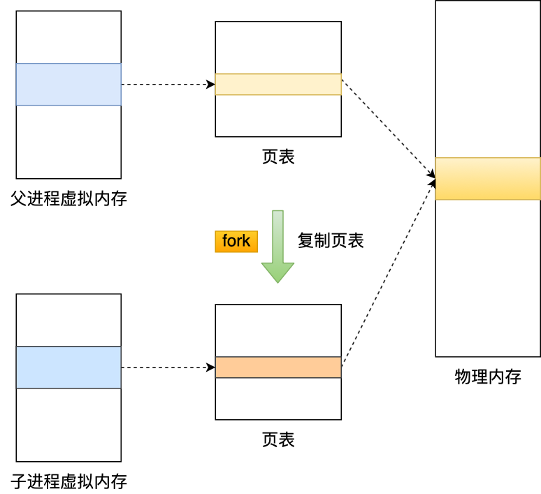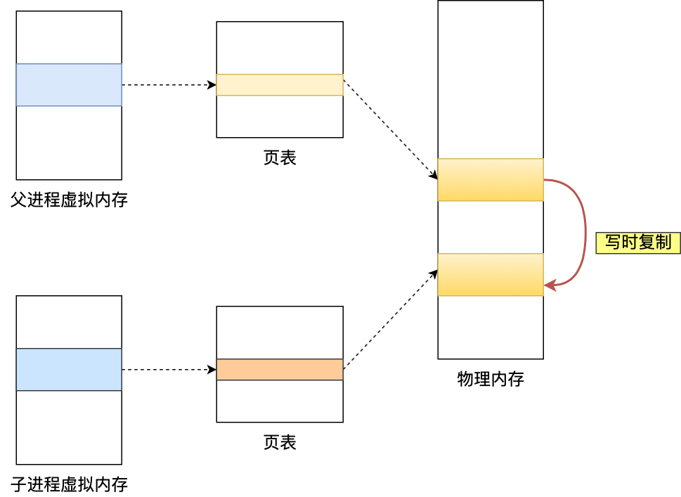

# Set

## Comparable 和 Comparator 的区别 🙋🙋🙋

`Comparable` \*\* 接口和 **`Comparator` \*\* 接口都是 Java 中用于排序的接口**，它们在实现类对象之间比较大小、排序等方面发挥了重要作用：

* `Comparable` \*\* 接口实际上是出自\*\*`java.lang`\*\*包 它有一个 \*\*`compareTo` `(Object obj)` **方法用来排序。** `Comparable`**接口是一个内部比较器，定义了对象自身的自然顺序。当一个类实现了**`Comparable`**接口，并重写了**`compareTo()`**方法时，该类的对象可以进行自我比较。可以直接使用**`Collections.sort()`**或**`Arrays.sort()`**等方法对该类的对象进行排序。**
* `Comparator`\*\*接口实际上是出自 **`java.util` \*\* 包它有一**`compare` `(Object obj1, Object obj2)` **方法用来排序。**`Comparator`**接口是一个外部比较器，用于定义一种特定的比较规则来对对象进行排序。通过实现**`Comparator`**接口，并重写**`compare()`**方法，可以创建多个不同的比较器。这样，在需要根据不同的比较规则对对象进行排序时，可以选择使用不同的比较器。**

> `Comparable`**接口是对象自身的比较规则，**`Comparator`**接口是外部提供的比较规则。**`Comparable`**接口只能应用于对象自身的排序，而**`Comparator`**接口可以创建多个不同的比较规则。**
>
> **如果对象已经有了自然顺序，可以使用**`Comparable`**接口进行排序。如果需要根据不同的比较规则进行排序，可以实现**`Comparator`**接口，并创建相应的比较器。**

```java
// 定制排序的用法
Collections.sort(arrayList, new Comparator<Integer>() {
    @Override
    public int compare(Integer o1, Integer o2) {
        return o2.compareTo(o1);
    }
});
```

```java
//重写 compareTo 方法实现按年龄来排序
// person对象没有实现Comparable接口，所以必须实现，这样才不会出错，才可以使treemap中的数据按顺序排列
// 前面一个例子的String类已经默认实现了Comparable接口，详细可以查看String类的API文档，另外其他
// 像Integer类等都已经实现了Comparable接口，所以不需要另外实现了
@Data
public  class Person implements Comparable<Person> {
    private String name;
    private int age;
    public Person(String name, int age) {
        super();
        this.name = name;
        this.age = age;
    }
    /**
     * T重写compareTo方法实现按年龄来排序
     */
    @Override
    public int compareTo(Person o) {
        if (this.age > o.getAge()) {
            return 1;
        }
        if (this.age < o.getAge()) {
            return -1;
        }
        return 0;
    }
}
```

> 总结：
>
> **<font style="color:#DF2A3F;">Comparable类自己实现，这样就能比较类本身，可以直接调用Sort方法</font>\*\*\*\*。** 比如原本类是名字+年龄无法排序，实现接口重写compareTo方法后就可以排序了
>
> **<font style="color:#DF2A3F;">Comparator可以自己定义怎么比较，一般在类外部实现。</font>**<font style="color:#DF2A3F;"> </font>**<font style="color:#DF2A3F;">原本类是名字+年龄无法排序</font>\*\*\*\*，** 在sort内实现Comparator接口重写compare方法后，就可以排序了

## 比较 HashSet、LinkedHashSet 和 TreeSet 三者的异同

* `HashSet`、`LinkedHashSet` 和 `TreeSet` 都是 `Set` 接口的实现类，**都能保证元素唯一，并且都不是线程安全的。**
* `HashSet`、`LinkedHashSet` 和 `TreeSet` 的主要**区别在于底层数据结构不同**。`HashSet` \*\* 的底层数据结构是哈希表（基于 \*\* `HashMap` \*\* 实现）\*\*  **。**`LinkedHashSet` \*\* 的底层数据结构是链表和哈希表\*\* **，元素的插入和取出顺序满足 FIFO** **。**`TreeSet` \*\* 底层数据结构是红黑树\*\* **，元素是有序的** **，排序的方式有自然排序和定制排序。**
* 底层数据结构不同又导致这三者的应用场景不同。`HashSet` 用于不需要保证元素插入和取出顺序的场景，`LinkedHashSet` 用于保证元素的插入和取出顺序**满足 FIFO \*\* 的场景，`TreeSet` 用于支持对**元素自定义排序规则\*\*的场景。

# Queue

## Queue 与 Deque 的区别

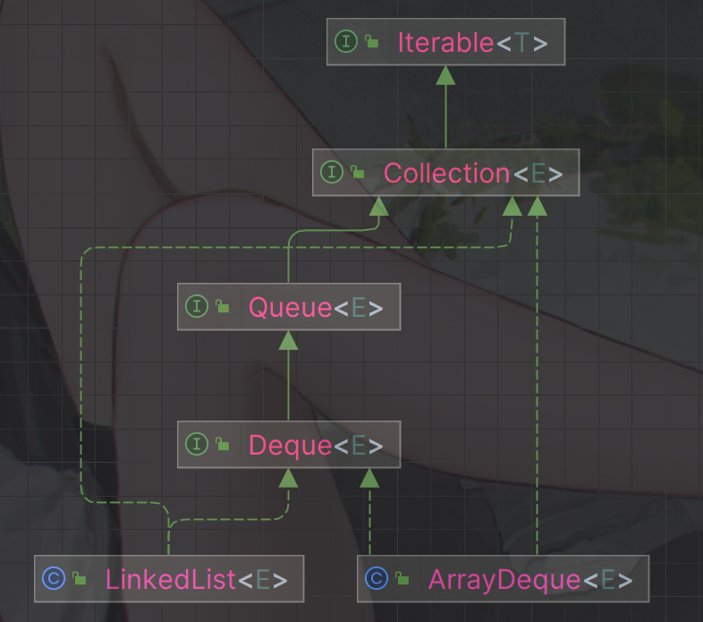

`Queue` \*\* 是单端队列\*\*，只能从一端插入元素，另一端删除元素，实现上一般遵循 **先进先出（FIFO）**  规则。

`Queue` \*\* 扩展了 **`Collection` \*\* 的接口**，根据**因为容量问题而导致操作失败后处理方式的不同** 可以分为两类方法: 一种在操作失败后会抛出异常，另一种则会返回特殊值。

| `Queue`<br/> 接口 | 抛出异常 | 返回特殊值 |
| --- | --- | :---: |
| 插入队尾 | add(E e) | offer(E e) |
| 删除队首 | remove() | poll() |
| 查询队首元素 | element() | peek() |

`Deque` \*\* 是双端队列\*\*，在队列的两端均可以插入或删除元素。

`Deque` \*\* 扩展了 **`Queue` \*\* 的接口**, 增加了在队首和队尾进行插入和删除的方法，同样根据失败后处理方式的不同分为两类：

| `Deque`<br/> 接口 | 抛出异常 | 返回特殊值 |
| --- | --- | --- |
| 插入队首 | addFirst(E e) | offerFirst(E e) |
| 插入队尾 | addLast(E e) | offerLast(E e) |
| 删除队首 | removeFirst() | pollFirst() |
| 删除队尾 | removeLast() | pollLast() |
| 查询队首元素 | getFirst() | peekFirst() |
| 查询队尾元素 | getLast() | peekLast() |

<code>**Deque**</code>\*\* 还提供有 **<code>**push()**</code>** 和 **<code>**pop()**</code>** 等其他方法，可用于模拟栈。\*\*

## ArrayDeque 与 LinkedList 的区别

`ArrayDeque` 和 `LinkedList` 都实现了 `Deque` 接口，两者都具有队列的功能，但两者有什么区别呢？

* `ArrayDeque` \*\* 是基于可变长的数组和双指针来实现，而 **`LinkedList` \*\* 则通过链表来实现。**
* `ArrayDeque` \*\* 不支持存储 \*\*`NULL` \*\* 数据，但 **`LinkedList` \*\* 支持。**
* `ArrayDeque` 是在 JDK1.6 才被引入的，而`LinkedList` 早在 JDK1.2 时就已经存在。
* `ArrayDeque` 插入时可能存在扩容过程, 不过均摊后的插入操作依然为 O(1)。虽然 `LinkedList` 不需要扩容，但是每次插入数据时均需要申请新的堆空间，均摊性能相比更慢。

**从性能的角度上，选用 \*\* <code>**<font style="color:#DF2A3F;">ArrayDeque</font>**</code>**<font style="color:#DF2A3F;">  </font>\*\*\*\*来实现队列要比 \*\* <code>**<font style="color:#DF2A3F;">LinkedList</font>**</code>\*\*<font style="color:#DF2A3F;">  </font>****更好。此外，** `ArrayDeque` \*\* 也可以用于实现栈。**

## 说一说 PriorityQueue

`PriorityQueue` 是在 JDK1.5 中被引入的, **其与 **`Queue` \*\* 的区别在于元素****<font style="color:#DF2A3F;">出队顺序是与优先级相关</font>****的，即总是优先级最高的元素先出队。****<font style="color:#DF2A3F;">（堆）</font>\*\*

这里列举其相关的一些要点：

* `PriorityQueue` 利用了**二叉堆**的数据结构来实现的，底层使用**可变长的数组**来存储数据
* `PriorityQueue` 通过堆元素的上浮和下沉，实现了在 O(logn) 的时间复杂度内插入元素和删除堆顶元素。
* `PriorityQueue` 是**非线程安全**的，且\*\*不支持存储 \*\*`NULL` \*\* 和 \*\*`non-comparable` 的对象。
* `PriorityQueue` **默认是小顶堆**，但可以接收一个 `Comparator` 作为构造参数，从而来自定义元素优先级的先后。

`PriorityQueue` 在面试中可能更多的会出现在手撕算法的时候，典型例题包括堆排序、求第 K 大的数、带权图的遍历等。

> **总结：\*\*\*\*<font style="color:#DF2A3F;">默认是小根堆，接收一个 </font>**<code><font style="color:#DF2A3F;">Comparator</font></code><font style="color:#DF2A3F;"> </font>**<font style="color:#DF2A3F;"> 作为构造参数改变规则，线程不安全。</font>**

```java
 PriorityQueue<Integer> maxHeap = new PriorityQueue<>((o1, o2) -> o2 - o1);
```

## 什么是 BlockingQueue？

`BlockingQueue` \*\* （阻塞队列）\*\* 是一个接口，继承自 `Queue`。`BlockingQueue`阻塞的原因是其**支持当队列没有元素时一直阻塞，直到有元素**；还支持如果队列已满，一直等到队列可以放入新元素时再放入。

```java
public interface BlockingQueue<E> extends Queue<E> {
  // ...
}
```

`BlockingQueue` \*\* 常用于生产者-消费者模型中，生产者线程会向队列中添加数据，而消费者线程会从队列中取出数据进行处理。\*\*

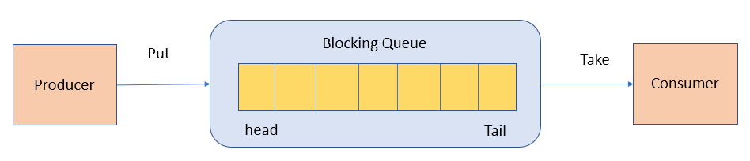

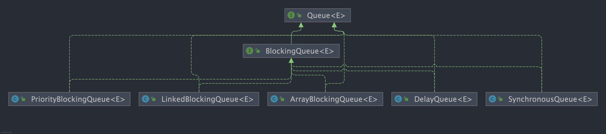

Java 中常用的阻塞队列实现类有以下几种：

1. `ArrayBlockingQueue`：使用数组实现的有界阻塞队列。在创建时需要指定容量大小，并支持公平和非公平两种方式的锁访问机制。
2. `LinkedBlockingQueue`：使用单向链表实现的可选有界阻塞队列。在创建时可以指定容量大小，如果不指定则默认为`Integer.MAX_VALUE`。和`ArrayBlockingQueue`类似， 它也支持公平和非公平的锁访问机制。-\*\* FixedThreadPool 和 SingleThreadExecutor\*\*
3. `PriorityBlockingQueue`：支持优先级排序的无界阻塞队列。元素必须实现`Comparable`接口或者在构造函数中传入`Comparator`对象，并且不能插入 null 元素。
4. `SynchronousQueue`：同步队列，是一种不存储元素的阻塞队列。每个插入操作都必须等待对应的删除操作，反之删除操作也必须等待插入操作。因此，`SynchronousQueue`通常用于线程之间的直接传递数据。 - **CachedThreadPool**
5. `DelayQueue`：延迟队列，其中的元素只有到了其指定的延迟时间，才能够从队列中出队。- **ScheduledThreadPool**

# Map

## HashMap 和 Hashtable 的区别

* **线程是否安全：**  `HashMap` \*\* 是非线程安全的，\*\* `Hashtable` \*\* 是线程安全的\*\*，因为 `Hashtable` 内部的方法基本都经过`synchronized` 修饰。（**线程安全更建议使用**`ConcurrentHashMap`）；
* **效率：**  因为线程安全的问题，`HashMap` \*\* 要比 \*\* `Hashtable` \*\* 效率高一点\*\*。另外，`Hashtable` \*\* 基本被淘汰\*\*，不要在代码中使用它；
* **Null key 和 Null value ：**  `HashMap` \*\* 可以存储 null 的 key 和 value\*\* **，但 null 作为键只能有一个，null 作为值可以有多个；Hashtable 不允许有 null 键和 null 值** \*\*，否则会抛出 \*\*`NullPointerException` **。**
* **初始容量大小和每次扩充容量大小的不同：**
  * ① 创建时如果不指定容量初始值，`Hashtable` \*\* 默认的初始大小为 11\*\* **，之后每次扩充，容量变为原来的 2n+1** **。**`HashMap` \*\* 默认的初始化大小为\*\* \*\* 16\*\* **。之后每次扩充，容量变为原来的 2 倍** **。**
    * 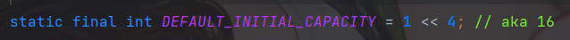
    * 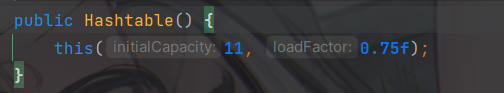
  * ② 创建时如果给定了容量初始值，那么 `Hashtable` 会直接使用你给定的大小，而 `HashMap` 会将其扩充为 2 的幂次方大小（`HashMap` 中的`tableSizeFor()`方法保证，下面给出了源代码）。也就是说 `HashMap` \*\* 总是使用 2 的幂作为哈希表的大小\*\*。
* **底层数据结构：**  JDK1.8  `HashMap`**当链表长度大于阈值（默认为 8），数组长度大于64时，将链表转化为红黑树（将链表转换成红黑树前会判断，如果当前数组的长度小于 64，那么会选择先进行数组扩容，而不是转换为红黑树），以减少搜索时间。**<code>**Hashtable**</code>\*\* 没有这样的机制。 \*\*

```java
static final int MAXIMUM_CAPACITY = 1 << 30;

public HashMap(int initialCapacity, float loadFactor) {
        if (initialCapacity < 0)
            throw new IllegalArgumentException("Illegal initial capacity: " +
                                               initialCapacity);
        if (initialCapacity > MAXIMUM_CAPACITY)
	    //极限容量不能被超过
            initialCapacity = MAXIMUM_CAPACITY;
        if (loadFactor <= 0 || Float.isNaN(loadFactor))
            throw new IllegalArgumentException("Illegal load factor: " +
                                               loadFactor);
        this.loadFactor = loadFactor;
        this.threshold = tableSizeFor(initialCapacity);
 }
public HashMap(int initialCapacity) {
        this(initialCapacity, DEFAULT_LOAD_FACTOR);
 }
```

`HashMap` 总是使用 2 的幂作为哈希表的大小。

```java
    /**
     * Returns a power of two size for the given target capacity.
     */
    static final int tableSizeFor(int cap) {
        int n = cap - 1;
        n |= n >>> 1;
        n |= n >>> 2;
        n |= n >>> 4;
        n |= n >>> 8;
        n |= n >>> 16;
        return (n < 0) ? 1 : (n >= MAXIMUM_CAPACITY) ? MAXIMUM_CAPACITY : n + 1;
    }
    //jdk17
    static final int tableSizeFor(int cap) {
        int n = -1 >>> Integer.numberOfLeadingZeros(cap - 1);
        return (n < 0) ? 1 : (n >= MAXIMUM_CAPACITY) ? MAXIMUM_CAPACITY : n + 1;
    }
```

## HashMap 和 HashSet 区别

`HashSet` \*\* 底层就是基于 \*\* `HashMap` \*\* 实现的。\*\* （`HashSet` 的源码非常非常少，因为除了 `clone()`、`writeObject()`、`readObject()`是 `HashSet` 自己不得不实现之外，其他方法都是直接调用 `HashMap` 中的方法。

| `HashMap`<br/> | `HashSet`<br/> |
| --- | --- |
| 实现了 `Map`<br/> 接口 | 实现 `Set`<br/> 接口 |
| 存储键值对 | 仅存储对象 |
| 调用 `put()`<br/>向 map 中添加元素 | 调用 `add()`<br/>方法向 `Set`<br/> 中添加元素 |
| `HashMap`<br/> 使用键（Key）计算 `hashcode`<br/> | `HashSet`<br/> 使用成员对象来计算 `hashcode`<br/> 值，对于两个对象来说 `hashcode`<br/> 可能相同，所以`equals()`<br/>方法用来判断对象的相等性 |

## HashMap 和 TreeMap 区别

`TreeMap` 和`HashMap` 都继承自`AbstractMap` ，但是需要注意的是`TreeMap`它还实现了`NavigableMap`**接口和**`SortedMap` \*\* 接口\*\*。

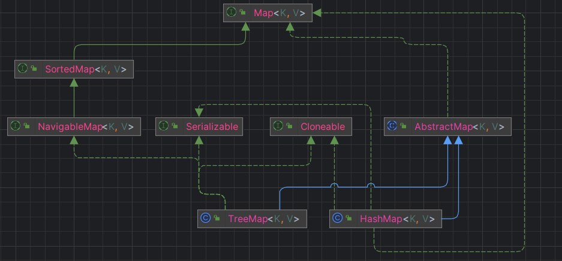

* 实现 `NavigableMap` 接口让 `TreeMap` 有了\*\*<font style="color:#DF2A3F;">对集合内元素的搜索</font>\*\*的能力。
* 实现`SortedMap`接口让 `TreeMap` 有了\*\*<font style="color:#DF2A3F;">对集合中的元素根据键排序的能力</font>\*\*。默认是按 key 的升序排序

```java
TreeMap<Person, String> treeMap = new TreeMap<>(new Comparator<Person>() {
            @Override
            public int compare(Person person1, Person person2) {
                int num = person1.getAge() - person2.getAge();
                return Integer.compare(num, 0);
            }
        });
```

> <code>**TreeMap**</code> \*\* 主要多了对集合中的元素根据键排序的能力以及对集合内元素的搜索的能力。\*\*
>
> **<font style="color:#DF2A3F;">如果对键值对的顺序没有要求，而且需要快速的插入、删除和查找操作，可以选择</font>**<code><font style="color:#DF2A3F;">HashMap</font></code><font style="color:#DF2A3F;"> </font>**<font style="color:#DF2A3F;">。如果需要按照键的顺序进行遍历或查找，或者需要对键进行范围查询，可以选择</font>**<code><font style="color:#DF2A3F;">TreeMap</font></code><font style="color:#DF2A3F;"> </font>**<font style="color:#DF2A3F;">。</font>**
>
> **<font style="color:#DF2A3F;">TreeMap底层结构是红黑树！ 对比Redis的Zset</font>**

## HashSet 如何检查重复?

**把对象加入**`HashSet`**时，**`HashSet` \*\* 会先计算对象的\*\*`hashcode`\*\*值来判断对象加入的位置，同时也会与其他加入的对象的 \*\*`hashcode` \*\* 值作比较，如果没有相符的 **`hashcode` **，**`HashSet` \*\* 会假设对象没有重复出现。但是如果发现有相同 **`hashcode` \*\* 值的对象，这时会调用**`equals()` **方法来检查 \*\* `hashcode` \*\* 相等的对象是否真的相同** **。如果两者相同，**`HashSet` \*\* 就不会让加入操作成功。**

> **<font style="color:#DF2A3F;">总结：计算HashCode值，如果对应值没有相同，则放入。如果有HashCode值相同的，调用equals()方法查看是否想同，相同则不插入。</font>**

`HashSet`的`add()`方法只是简单的调用了`HashMap`的`put()`方法，并且判断了一下返回值以确保是否有重复元素。

```java
// Returns: true if this set did not already contain the specified element
// 返回值：当 set 中没有包含 add 的元素时返回真
public boolean add(E e) {
        return map.put(e, PRESENT)==null;
}
```

在`HashMap`的`putVal()`方法中也能看到如下说明：

```java
// Returns : previous value, or null if none
// 返回值：如果插入位置没有元素返回null，否则返回上一个元素
final V putVal(int hash, K key, V value, boolean onlyIfAbsent,
                   boolean evict) {
...
}
```

## HashMap 的底层实现

### JDK1.8 之前

`HashMap` 底层是 **数组和链表** 结合在一起使用也就是 **链表散列**。

HashMap 通过 key 的 <code>**hashcode**</code>\*\* **经过**扰动函数**处理过后得到 \*\* hash 值**，然后通过 `(n - 1) & hash` 判断当前元素存放的位置（这里的 n 指的是数组的长度），如果当前位置存在元素的话，就判断该元素与要存入的元素的 hash 值以及 key 是否相同，如果相同的话，直接覆盖，不相同就通过**拉链法解决冲突**。

> 扰动函数指的就是 HashMap 的 `hash` \*\* 方法\*\*。使用 `hash` 方法是为了防止一些实现比较差的 `hashCode()` 方法 。换句话说使用扰动函数之后可以减少碰撞。

```java
//JDK1.8  
static final int hash(Object key) {
      int h;
      // key.hashCode()：返回散列值也就是hashcode
      // ^：按位异或
      // >>>:无符号右移，忽略符号位，空位都以0补齐
      return (key == null) ? 0 : (h = key.hashCode()) ^ (h >>> 16);
  }
```

**JDK1.7 的 HashMap 的 hash 方法源码.**

```java
static int hash(int h) {
    // This function ensures that hashCodes that differ only by
    // constant multiples at each bit position have a bounded
    // number of collisions (approximately 8 at default load factor).

    h ^= (h >>> 20) ^ (h >>> 12);
    return h ^ (h >>> 7) ^ (h >>> 4);
}
```

**JDK1.8 的 hash 方法 ，JDK 1.7 的 hash 方法的性能会稍差一点点，因为毕竟扰动了 4 次**

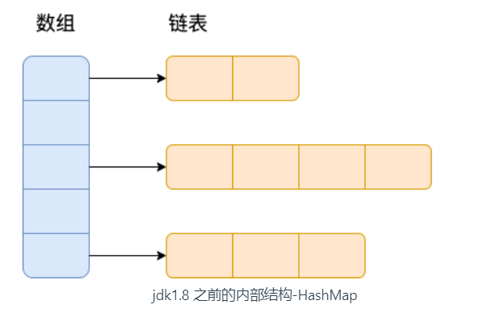

### JDK1.8 之后

JDK1.8 之后在**解决哈希冲突时有了较大的变化**，**当链表长度大于阈值（默认为 8）且数组长度大于64（将链表转换成红黑树前会判断，如果当前数组的长度小于 64，那么会选择先进行数组扩容，而不是转换为红黑树）时**，**将链表转化为红黑树**，**以减少搜索时间。**

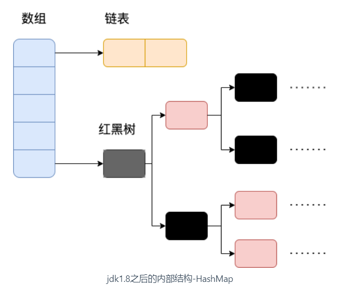

### 结合源码分析 `HashMap` 链表到红黑树的转换

[原码分析](https://www.yuque.com/nibiwanxiamei/yrd6t1/189addf580e530b8776febb7efa82895)

<code>**putVal**</code> \*\* 方法中执行链表转红黑树的判断逻辑\*\*

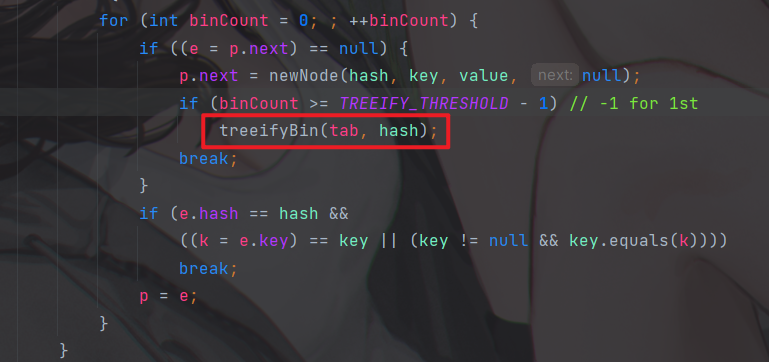

```java
// 遍历链表
for (int binCount = 0; ; ++binCount) {
    // 遍历到链表最后一个节点
    if ((e = p.next) == null) {
        p.next = newNode(hash, key, value, null);
        // 如果链表元素个数大于等于TREEIFY_THRESHOLD（8）
        if (binCount >= TREEIFY_THRESHOLD - 1) // -1 for 1st
            // 红黑树转换（并不会直接转换成红黑树）
            treeifyBin(tab, hash);
        break;
    }
    if (e.hash == hash &&
        ((k = e.key) == key || (key != null && key.equals(k))))
        break;
    p = e;
}
```

<code>**treeifyBin**</code> \*\* 方法中判断是否真的转换为红黑树。\*\*

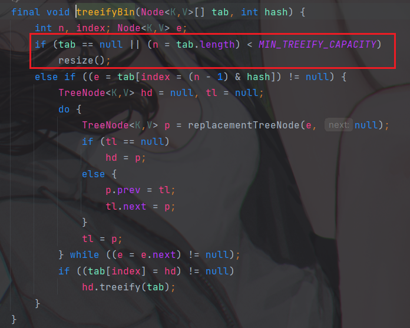

```java
final void treeifyBin(Node<K,V>[] tab, int hash) {
    int n, index; Node<K,V> e;
    // 判断当前数组的长度是否小于 64
    if (tab == null || (n = tab.length) < MIN_TREEIFY_CAPACITY)
        // 如果当前数组的长度小于 64，那么会选择先进行数组扩容
        resize();
    else if ((e = tab[index = (n - 1) & hash]) != null) {
        // 否则才将列表转换为红黑树
        TreeNode<K,V> hd = null, tl = null;
        do {
            TreeNode<K,V> p = replacementTreeNode(e, null);
            if (tl == null)
                hd = p;
            else {
                p.prev = tl;
                tl.next = p;
            }
            tl = p;
        } while ((e = e.next) != null);
        if ((tab[index] = hd) != null)
            hd.treeify(tab);
    }
}
```

## HashMap 的长度为什么是 2 的幂次方

**<font style="color:#DF2A3F;">为了能让 HashMap 减少冲突，提高性能。尽量较少碰撞，也就是要尽量把数据分配均匀。</font>**

这个数组下标的计算方法是 \*\*“ \*\*  `(n - 1) & hash` **”**

**“取余(%)操作中如果除数是 2 的幂次则等价于与其除数减一的与(&)操作（也就是说 hash%length==hash&(length-1)** **的前提是 length 是 2 的 n 次方；）。”**  \*\*<font style="color:#DF2A3F;">采用二进制位操作 &， 位运算比取模运算更高效</font>\*\*\*\*。  \*\*

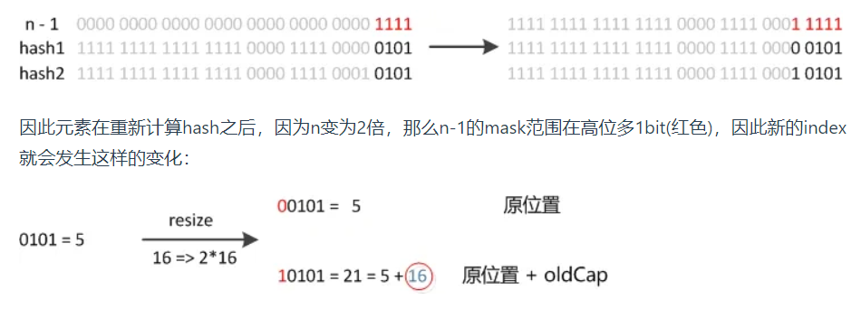

> **以上是原理。实际体现在于初始化时若没有指定长度，默认是16** **，之后扩展容量为原本的两倍。如果给定容量，代码也会把容量转为2的幂次**

## HashMap 多线程操作导致死循环问题

**JDK1.7 及之前版本的**`HashMap` \*\* 在多线程环境下扩容操作可能存在死循环问题\*\*，\*\*当一个桶位中有多个元素需要进行扩容时，多个线程同时对链表进行操作，\*\*\*\*<font style="color:#DF2A3F;">头插法</font>\*\***可能会导致链表中的节点指向错误的位置，从而形成一个环形链表，进而使得查询元素的操作陷入死循环无法结束。**

**JDK1.8 版本的 HashMap 采用了尾插法而不是头插法来避免链表倒置**，**使得插入的节点永远都是放在链表的末尾，避免了链表中的环形结构。** 但是还是不建议在多线程下使用 `HashMap`，因为**多线程下使用 \*\* `HashMap`** 还是会存在数据覆盖的问题\*\*。并发环境下，推荐使用 `ConcurrentHashMap` 。

## ♥♥♥ HashMap 为什么线程不安全？

JD**K1.7 及之前版本，在多线程环境下，**<code>**HashMap**</code>\*\* 扩容时会造成\*\*\*\*<font style="color:#DF2A3F;">死循环和数据丢失</font>\*\***的问题。**

数据丢失这个在 JDK1.7 和 JDK 1.8 中都存在，这里以 JDK 1.8 为例进行介绍。

JDK 1.8 后，在 `HashMap` 中，多个键值对可能会被分配到同一个桶（bucket），并以链表或红黑树的形式存储。\*\*多个线程对 \*\*`HashMap` \*\* 的 **`put` \*\* 操作会导致线程不安全，具体来说会有数据覆盖的风险。**

举个例子：

* **两个线程 1,2 同时进行 put 操作，并且发生了哈希冲突**（hash 函数计算出的插入下标是相同的）。
* 不同的线程可能在不同的时间片获得 CPU 执行的机会，**当前线程 1 执行完哈希冲突判断后，由于时间片耗尽挂起。线程 2 先完成了插入操作。**
* 随后，**线程 1 获得时间片，由于之前已经进行过 hash 碰撞的判断，所有此时会直接进行插入，这就导致线程 2 插入的数据被线程 1 覆盖了。**

```java
public V put(K key, V value) {
    return putVal(hash(key), key, value, false, true);
}
final V putVal(int hash, K key, V value, boolean onlyIfAbsent,
                   boolean evict) {
    // ...
    // 判断是否出现 hash 碰撞
    // (n - 1) & hash 确定元素存放在哪个桶中，桶为空，新生成结点放入桶中(此时，这个结点是放在数组中)
    if ((p = tab[i = (n - 1) & hash]) == null)
        tab[i] = newNode(hash, key, value, null);
    // 桶中已经存在元素（处理hash冲突）
    else {
    // ...
}
```

两个线程同时 `put` 操作导致 `size` 的值不正确，进而导致数据覆盖的问题：

1. 线程 1 执行 `if(++size > threshold)` 判断时，假设获得 `size` 的值为 10，由于时间片耗尽挂起。
2. 线程 2 也执行 `if(++size > threshold)` 判断，获得 `size` 的值也为 10，并将元素插入到该桶位中，并将 `size` 的值更新为 11。
3. 随后，线程 1 获得时间片，它也将元素放入桶位中，并将 size 的值更新为 11。
4. **线程 1、2 都执行了一次 \*\* `put` \*\* 操作，但是 \*\* `size` \*\* 的值只增加了 1，也就导致实际上只有一个元素被添加到了 \*\* `HashMap` \*\* 中。**

```java
public V put(K key, V value) {
    return putVal(hash(key), key, value, false, true);
}

final V putVal(int hash, K key, V value, boolean onlyIfAbsent,
                   boolean evict) {
    // ...
    // 实际大小大于阈值则扩容
    if (++size > threshold)
        resize();
    // 插入后回调
    afterNodeInsertion(evict);
    return null;
}
```

## HashMap 常见的遍历方式?

[HashMap 的7种遍历方式-腾讯云开发者社区-腾讯云](https://cloud.tencent.com/developer/article/1810016)

**<font style="color:#DF2A3F;">存在阻塞时 parallelStream 性能最高, 非阻塞时 parallelStream 性能最低</font>**<font style="color:#DF2A3F;"> 。</font>

## ConcurrentHashMap 和 Hashtable 的区别

`ConcurrentHashMap` 和 `Hashtable` 的区别主要体现在**实现线程安全的方式上不同**。

* **底层数据结构：**  JDK1.7 的 `ConcurrentHashMap` 底层采用 **分段的数组+链表** 实现，JDK1.8 采用的数据结构跟 `HashMap1.8` 的结构一样，**数组+链表/红黑二叉树**。`Hashtable` 和 JDK1.8 之前的 `HashMap` 的底层数据结构类似都是采用 **数组+链表** 的形式，数组是 HashMap 的主体，链表则是主要为了解决哈希冲突而存在的；
* **实现线程安全的方式（重要）：**
  * 在 JDK1.7 的时候，`ConcurrentHashMap` 对整个桶数组进行了分割分段(`Segment`，分段锁)，每一把锁只锁容器其中一部分数据（下面有示意图），多线程访问容器里不同数据段的数据，就不会存在锁竞争，提高并发访问率。
  * 到了 JDK1.8 的时候，`ConcurrentHashMap` 已经摒弃了 `Segment` 的概念，而是直接用 `Node` \*\* 数组+链表+红黑树\*\*的数据结构来实现，**并发控制使用 \*\* `synchronized` \*\* 和 CAS 来操作**。（JDK1.6 以后 `synchronized` 锁做了很多优化） 整个看起来就像是优化过且线程安全的 `HashMap`，虽然在 JDK1.8 中还能看到 `Segment` 的数据结构，但是已经简化了属性，只是为了兼容旧版本；
  * <code>**Hashtable**</code> **(同一把锁)**  :**使用 \*\* `synchronized` \*\* 来保证线程安全，效率非常低下**。当一个线程访问同步方法时，其他线程也访问同步方法，可能会进入阻塞或轮询状态，如使用 put 添加元素，另一个线程不能使用 put 添加元素，也不能使用 get，竞争会越来越激烈效率越低。

**JDK1.7 的 ConcurrentHashMap**：

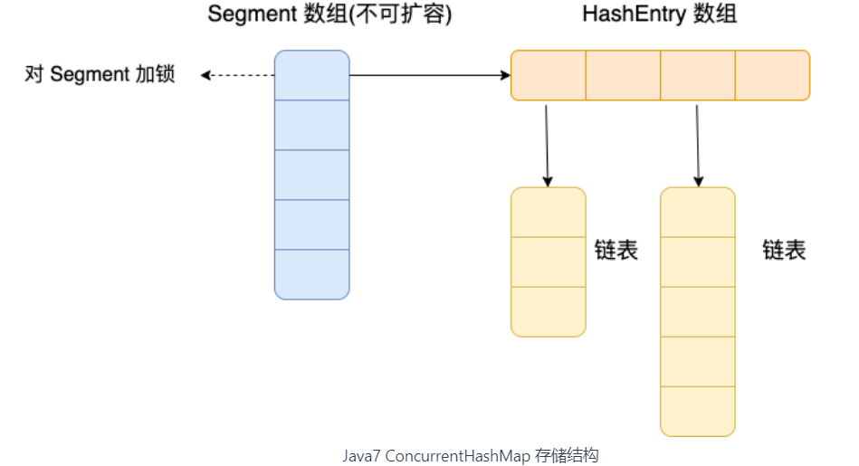

**JDK1.8 的 ConcurrentHashMap**：

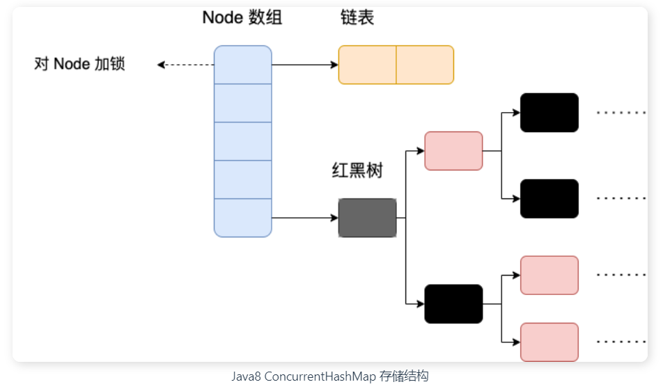

JDK1.8 的 `ConcurrentHashMap` 不再是 **Segment 数组 + HashEntry 数组 + 链表**，而是 **Node 数组 + 链表 / 红黑树**。不过，Node 只能用于链表的情况，红黑树的情况需要使用 <code>**TreeNode**</code>。

## ConcurrentHashMap 线程安全的具体实现方式/底层具体实现

**JDK1.8 之前**

将数据分为一段一段（这个“段”就是 `Segment`）的存储，然后给**每一段数据配一把锁**，当一个线程占用锁访问其中一个段数据时，其他段的数据也能被其他线程访问。

<code>**ConcurrentHashMap**</code> \*\* 是由 \*\*<code>**Segment**</code> \*\* 数组结构和 **<code>**HashEntry**</code> \*\* 数组结构组成**。

`Segment` \*\* 继承了 **`ReentrantLock`，**所以 **<code>**<font style="color:#DF2A3F;">Segment</font>**</code><font style="color:#DF2A3F;"> </font>**<font style="color:#DF2A3F;">是一种可重入锁</font>** **，扮演锁的角色。**`HashEntry` \*\* 用于存储键值对数据。**

```java
static class Segment<K,V> extends ReentrantLock implements Serializable {
}
```

一个 `ConcurrentHashMap` 里包含一个 `Segment` 数组，`Segment` 的个数一旦**初始化就不能改变**。 `Segment` 数组的大小默认是 16，也就是说**默认可以同时支持 16 个线程并发写。**

`Segment` 的结构和 `HashMap` 类似，是一种数组和链表结构，\*\*一个 \*\*`Segment` \*\* 包含一个 \*\*`HashEntry` \*\* 数组，每个 **`HashEntry` \*\* 是一个链表结构的元素**，\*\*每个 \*\*`Segment` \*\* 守护着一个 **`HashEntry` \*\* 数组里的元素**，当对 `HashEntry` 数组的数据进行修改时，必须首先获得对应的 `Segment` 的锁。也就是说，对同一 `Segment` 的并发写入会被阻塞，不同 `Segment` 的写入是可以并发执行的。

**JDK1.8 之后**

Java 8 几乎完全重写了 `ConcurrentHashMap`

`ConcurrentHashMap` 取消了 `Segment` 分段锁，采用 <code>**<font style="color:#DF2A3F;">Node + CAS volatile + synchronized</font>**</code> \*\* 来保证并发安全\*\*。数据结构跟 `HashMap` 1.8 的结构类似，数组+链表/红黑二叉树。Java 8 在链表长度超过一定阈值（8）时将链表（寻址时间复杂度为 O(N)）转换为红黑树（寻址时间复杂度为 O(log(N))）。

Java 8 中，**<font style="color:#DF2A3F;">锁粒度更细，</font>**<font style="color:#DF2A3F;"> </font><code><font style="color:#DF2A3F;">synchronized</font></code><font style="color:#DF2A3F;"> </font>**<font style="color:#DF2A3F;"> 只锁定当前链表或红黑二叉树的首节点</font>**，这样只要 hash 不冲突，就不会产生并发，就不会影响其他 Node 的读写，效率大幅提升。

## JDK 1.7 和 JDK 1.8 的 ConcurrentHashMap 实现有什么不同？

* **线程安全实现方式**：JDK 1.7 采用 `Segment` \*\* 分段锁\*\*来保证安全， `Segment` 是继承自 `ReentrantLock`。JDK1.8 放弃了 `Segment` 分段锁的设计，采用 `Node + CAS + synchronized` 保证线程安全，锁粒度更细，`synchronized` 只锁定当前链表或红黑二叉树的首节点。
* **Hash 碰撞解决方法** : JDK 1.7 采用拉链法，JDK1.8 采用拉链法结合红黑树（链表长度超过一定阈值时，将链表转换为红黑树）。
* **并发度**：JDK 1.7 最大并发度是 Segment 的个数，默认是 16。JDK 1.8 最大并发度是 Node 数组的大小，并发度更大。

## ConcurrentHashMap 为什么 key 和 value 不能为 null？

`ConcurrentHashMap` 的 key 和 value 不能为 null 主要是\*\*<font style="color:#DF2A3F;">为了避免二义性</font>**。null 是一个特殊的值，表示没有对象或没有引用。如果**用 null 作为键，那么你就无法区分这个键是否存在于 **`ConcurrentHashMap` \*\* 中，还是根本没有这个键。** 同样，如果你用 null 作为值，那么你就无法区分这个值是否是真正存储在 `ConcurrentHashMap` 中的，还是因为找不到对应的键而返回的。

拿 get 方法取值来说，返回的结果为 null 存在两种情况：

* **值没有在集合中 ；**
* **值本身就是 null。**

这也就是二义性的由来。

\*\*多线程环境下，存在一个线程操作该 \*\*`ConcurrentHashMap` \*\* 时，其他的线程将该 **`ConcurrentHashMap` \*\* 修改的情况，所以无法通过 \*\* `containsKey(key)`  \*\* 来判断否存在这个键值对，也就没办法解决二义性问题了。**

如果确实需要在 ConcurrentHashMap 中使用 null 的话，可以使用一个特殊的静态空对象来代替 null。

```java
public static final Object NULL = new Object();
```

## ConcurrentHashMap 能保证复合操作的原子性吗？

`ConcurrentHashMap` 是线程安全的，意味着它可以保证多个线程同时对它进行读写操作时，不会出现数据不一致的情况，也不会导致 JDK1.7 及之前版本的 `HashMap` 多线程操作导致死循环问题。但是，**这并不意味着它可以保证所有的复合操作都是原子性的**

**复合操作是指由多个基本操作(如**`put` **、**`get` **、**`remove` **、**`containsKey`**等)组成的操作，例如先判断某个键是否存在**`containsKey(key)` **，然后根据结果进行插入或更新**`put(key, value)` **。这种操作在执行过程中可能会被其他线程打断，导致结果不符合预期。**

> **<font style="color:#DF2A3F;">ConcurrentHashMap是无法实现复合操作的原子性的</font>**

例如，有两个线程 A 和 B 同时对 `ConcurrentHashMap` 进行复合操作，如下：

```java
// 线程 A
if (!map.containsKey(key)) {
	map.put(key, value);
}
// 线程 B
if (!map.containsKey(key)) {
	map.put(key, anotherValue);
}
```

如果线程 A 和 B 的执行顺序是这样：

1. 线程 A 判断 map 中不存在 key
2. 线程 B 判断 map 中不存在 key
3. 线程 B 将 (key, anotherValue) 插入 map
4. 线程 A 将 (key, value) 插入 map

那么**最终的结果是 (key, value)** ，**而不是预期的 (key, anotherValue)。这就是复合操作的非原子性导致的问题。**

> **ConcurrentHashMap保证的是单个操作的原子性**

`ConcurrentHashMap` 提供了一些**原子性的复合操作，如 \*\* `putIfAbsent` **、** `compute` **、** `computeIfAbsent` \*\* 、** `computeIfPresent` **、** `merge`**等**。这些方法都可以接受一个函数作为参数，根据给定的 key 和 value 来计算一个新的 value，并且将其更新到 map 中。

```java
// 线程 A
map.putIfAbsent(key, value);
// 线程 B
map.putIfAbsent(key, anotherValue);
```

或者：

```java
// 线程 A
map.computeIfAbsent(key, k -> value);
// 线程 B
map.computeIfAbsent(key, k -> anotherValue);
```

\*\*不建议使用加锁的同步机制，违背了使用 \*\*`ConcurrentHashMap` \*\* 的初衷。在使用 **`ConcurrentHashMap` \*\* 的时候，尽量使用这些原子性的复合操作方法来保证原子性** **。**

# Java集合使用注意事项总结

## 集合判空

\*\*判断所有集合内部的元素是否为空，使用 \*\*<code>**isEmpty()**</code>  \*\* 方法，而不是 **<code>**size()==0**</code> \*\* 的方式**

绝大部分我们使用的集合的 `size()` 方法的时间复杂度也是 O(1)，不过，也有很多复杂度不是 O(1) 的，比如 `java.util.concurrent` 包下的某些集合（`ConcurrentLinkedQueue`、`ConcurrentHashMap`...）。

下面是 `ConcurrentHashMap` 的 `size()` 方法和 `isEmpty()` 方法的源码。

```java
public int size() {
    long n = sumCount();
    return ((n < 0L) ? 0 :
            (n > (long)Integer.MAX_VALUE) ? Integer.MAX_VALUE :
            (int)n);
}
final long sumCount() {
    CounterCell[] as = counterCells; CounterCell a;
    long sum = baseCount;
    if (as != null) {
        for (int i = 0; i < as.length; ++i) {
            if ((a = as[i]) != null)
                sum += a.value;
        }
    }
    return sum;
}
public boolean isEmpty() {
    return sumCount() <= 0L; // ignore transient negative values
}
```

## 集合转 Map

\*\*在使用 \*\*<code>**java.util.stream.Collectors**</code> \*\* 类的 \*\*<code>**toMap()**</code>  \*\* 方法转为 **<code>**Map**</code> \*\* 集合时，一定要注意当 value 为 null 时会抛 NPE 异常。**

```java
class Person {
    private String name;
    private String phoneNumber;
     // getters and setters
}
List<Person> bookList = new ArrayList<>();
bookList.add(new Person("jack","18163138123"));
bookList.add(new Person("martin",null));
// 空指针异常
bookList.stream().collect(Collectors.toMap(Person::getName, Person::getPhoneNumber));
```

## 集合遍历

\*\*不要在 foreach 循环里进行元素的 \*\*<code>**remove/add**</code> \*\* 操作。remove 元素请使用 \*\*<code>**Iterator**</code> \*\* 方式，如果并发操作，需要对 **<code>**Iterator**</code> \*\* 对象加锁。**

> \*\*foreach 语法底层其实还是依赖 \*\*`Iterator` \*\* 。不过， \*\*`remove/add` \*\* 操作直接调用的是集合自己的方法，而不是 \*\*`Iterator` \*\* 的 \*\*`remove/add`**方法**

\*\*在遍历过程中，不通过Iterator，而是通过集合类自身的方法对集合进行添加/删除操作，这就导致 **`Iterator` \*\* 莫名其妙地发现自己有元素被 **`remove/add` ，**那么在Iterator进行下一次的遍历时，经检测发现有一次集合的修改操作并未通过自身进行，那么可能是发生了并发被其他线程执行的，这时候就会抛出异常 **`ConcurrentModificationException` **，来提示用户可能发生了并发修改，这就是所谓的****<font style="color:#DF2A3F;">fail-fast机制</font>**<font style="color:#DF2A3F;"> </font>**<font style="color:#DF2A3F;">(快速失败)</font>\*\*\*\*。**

> 就好比你在for循环的时候，长度缩短了，下标对应的元素改变了，再次遍历就不一致了
>
> <code>**<font style="color:#DF2A3F;">remove</font>**</code>**<font style="color:#DF2A3F;">和</font>**<code>**<font style="color:#DF2A3F;">add</font>**</code>**<font style="color:#DF2A3F;">操作会导致</font>**<code>**<font style="color:#DF2A3F;">modCount</font>**</code>**<font style="color:#DF2A3F;">和迭代器中的</font>**<code>**<font style="color:#DF2A3F;">expectedModCount</font>**</code>**<font style="color:#DF2A3F;">不一致。</font>**

## 集合去重

\*\*可以利用 \*\*<code>**Set**</code> \*\* 元素唯一的特性，可以快速对一个集合进行去重操作，避免使用 \*\*<code>**List**</code> \*\* 的 **<code>**contains()**</code>  \*\* 进行遍历去重或者判断包含操作。**

```java
// Set 去重代码示例
public static <T> Set<T> removeDuplicateBySet(List<T> data) {

    if (CollectionUtils.isEmpty(data)) {
        return new HashSet<>();
    }
    return new HashSet<>(data);
}

// List 去重代码示例
public static <T> List<T> removeDuplicateByList(List<T> data) {

    if (CollectionUtils.isEmpty(data)) {
        return new ArrayList<>();

    }
    List<T> result = new ArrayList<>(data.size());
    for (T current : data) {
        if (!result.contains(current)) {
            result.add(current);
        }
    }
    return result;
}
```

`HashSet` \*\* 的 \*\* `contains()`  \*\* 方法底部依赖的 \*\* `HashMap` \*\* 的 \*\* `containsKey()`  \*\* 方法\*\*，时间复杂度接近于 O（1）（没有出现哈希冲突的时候为 O（1））。

## 集合转数组

\*\*集合转数组的方法，必须使用集合的 \*\* <code>**toArray(T[] array)**</code>  **，****<font style="color:#DF2A3F;">传入的是类型完全一致、长度为 0 的空数组</font>****。**

`toArray(T[] array)` \*\* 方法的参数是一个泛型数组，如果 \*\*`toArray` \*\* 方法中没有传递任何参数的话返回的是 \*\*`Object`**类 型数组。**

```java
String [] s= new String[]{
    "dog", "lazy", "a", "over", "jumps", "fox", "brown", "quick", "A"
};
List<String> list = Arrays.asList(s);
Collections.reverse(list);
//没有指定类型的话会报错
s=list.toArray(new String[0]);
```

**由于 JVM 优化，**`new String[0]`**作为**`Collection.toArray()`**方法的参数现在使用更好，**`new String[0]`**就是起一个模板的作用，指定了返回数组的类型，0 是为了节省空间，因为它只是为了说明返回的类型**

## 数组转集合

> \*\*使用工具类 \*\*<code>**Arrays.asList()**</code>  \*\* 把数组转换成集合时，不能使用其修改集合相关的方法， 它的 \*\*<code>**add/remove/clear**</code> \*\* 方法会抛出 **<code>**UnsupportedOperationException**</code> \*\* 异常。**

```java
String[] myArray = {"Apple", "Banana", "Orange"};
List<String> myList = Arrays.asList(myArray);
//上面两个语句等价于下面一条语句
List<String> myList = Arrays.asList("Apple","Banana", "Orange");
```

JDK 源码对于这个方法的说明：

```java
/**
  *返回由指定数组支持的固定大小的列表。此方法作为基于数组和基于集合的API之间的桥梁，
  * 与 Collection.toArray()结合使用。返回的List是可序列化并实现RandomAccess接口。
  */
public static <T> List<T> asList(T... a) {
    return new ArrayList<>(a);
}
```

<code>**Arrays.asList()**</code> **是泛型方法，传递的数组必须是对象数组，而不是基本类型。**

```java
int[] myArray = {1, 2, 3};
List myList = Arrays.asList(myArray);
System.out.println(myList.size());//1
System.out.println(myList.get(0));//数组地址值
System.out.println(myList.get(1));//报错：ArrayIndexOutOfBoundsException
int[] array = (int[]) myList.get(0);
System.out.println(array[0]);//1
```

`Arrays.asList()` \*\* 的真正得到的参数就不是数组中的元素，而是数组对象本身\*\* \*\*！此时 **`List` \*\* 的唯一元素就是这个数组**

\*\*使用集合的修改方法: \*\* <code>**add()**</code>  **、** <code>**remove()**</code>  **、** <code>**clear()**</code> **会抛出异常。**

```java
List myList = Arrays.asList(1, 2, 3);
myList.add(4);//运行时报错：UnsupportedOperationException
myList.remove(1);//运行时报错：UnsupportedOperationException
myList.clear();//运行时报错：UnsupportedOperationException
```

<code><font style="color:#DF2A3F;">Arrays.asList()</font></code><font style="color:#DF2A3F;"> </font>**<font style="color:#DF2A3F;"> 方法返回的并不是 </font>**<code><font style="color:#DF2A3F;">java.util.ArrayList</font></code><font style="color:#DF2A3F;"> </font>**<font style="color:#DF2A3F;"> ，而是 </font>**<code><font style="color:#DF2A3F;">java.util.Arrays</font></code><font style="color:#DF2A3F;"> </font>**<font style="color:#DF2A3F;"> 的一个内部类</font>**<font style="color:#DF2A3F;"> </font>**<font style="color:#DF2A3F;">,这个内部类并没有实现集合的修改方法或者说并没有重写这些方法。</font>**

```java
List myList = Arrays.asList(1, 2, 3);
System.out.println(myList.getClass());//class java.util.Arrays$ArrayList
```

\*\*正确的将数组转换为 \*\* <code>**ArrayList**</code>

* 最简便的方法
  * **List list = new ArrayList<>(Arrays.asList("a", "b", "c"))**
* ## 使用 Java8 的 `Stream`(推荐)

```java
Integer [] myArray = { 1, 2, 3 };
List myList = Arrays.stream(myArray).collect(Collectors.toList());
//基本类型也可以实现转换（依赖boxed的装箱操作）
int [] myArray2 = { 1, 2, 3 };
List myList = Arrays.stream(myArray2).boxed().collect(Collectors.toList());
```

* ## 使用工具类

```java
List<String> list = new ArrayList<String>();
CollectionUtils.addAll(list, str);
```

* ## 使用 Java9 的 `List.of()`方法

```java
Integer[] array = {1, 2, 3};
List<Integer> list = List.of(array);
```

‍


> 更新: 2025-06-30 22:50:51  
> 原文: <https://www.yuque.com/nibiwanxiamei/yrd6t1/4e4c87fd7480bbcafd4ef7dc4f757637>