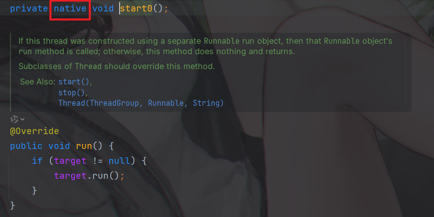

# 1.线程基础知识复习

---

## title: 1.线程基础知识复习  
date: 2023-11-27T19:18:30Z  
lastmod: 2023-11-27T20:06:01Z
# 1.线程基础知识复习
# 线程复习
```java
    public static void main(String[] args) {
        new Thread(new Runnable() {
            @Override
            public void run() {
                System.out.println("子线程");
            }
        }, "t1").start();

        new Thread(()->{}, "t2").start();
    }
```

start（）方法原码

```java
    public synchronized void start() {
        /**
         * This method is not invoked for the main method thread or "system"
         * group threads created/set up by the VM. Any new functionality added
         * to this method in the future may have to also be added to the VM.
         *
         * A zero status value corresponds to state "NEW".
         */
        if (threadStatus != 0)
            throw new IllegalThreadStateException();

        /* Notify the group that this thread is about to be started
         * so that it can be added to the group's list of threads
         * and the group's unstarted count can be decremented. */
        group.add(this);

        boolean started = false;
        try {
            start0();
            started = true;
        } finally {
            try {
                if (!started) {
                    group.threadStartFailed(this);
                }
            } catch (Throwable ignore) {
                /* do nothing. If start0 threw a Throwable then
                  it will be passed up the call stack */
            }
        }
    }
```

其中调用了start0()方法



**native方法调用的是本地的C++库内的本地方法 -- 对应操作系统的线程**

+ **1把锁：synchronized（后面细讲）**
+ **2个并：**
    - **并发（concurrent）：是在同一实体上的多个事件，是在一台机器**上“**同时”处理多个任务，同一时刻，其实是只有一个事情再发生**。
    - **并行（parallel）：是在不同实体上的多个事件，是在多台处理器上同时处理多个任务，同一时刻，大家都在做事情，你做你的，我做我的，各干各的。**
+ **3个程：**
    - **进程：在系统中运行的一个应用程序，每个进程都有它自己的内存空间和系统资源**
    - **线程：也被称为****轻量级进程** **，在同一个进程内会有1个或多个线程，是大多数操作系统进行时序调度的基本单元。**
    - **管程：Monitor（锁），也就是我们平时所说的锁。Monitor其实是一种同步机制，它的义务是保证（同一时间）只有一个线程可以访问被保护的数据和代码，JVM中同步是基于进入和退出监视器（Monitor管程对象）来实现的，每个对象实例都会有一个Monitor对象，Monitor对象和Java对象一同创建并销毁，底层由C++语言实现。**
+ **线程分类（一般不做特别说明配置，********默认都是用户线程** **）：**
    - **用户线程：是系统的工作线程，它会完成这个程序需要完成的业务操作。**
    - **守护线程：是一种特殊的线程****为其他线程服务的** **，在后台默默地完成一些系统性的任务，比如垃圾回收线程就是最典型的例子。守护线程作为一个服务线程，没有服务对象就没有必要继续运行了，如果用户线程全部结束了，意味着程序需要完成的业务操作已经结束了，系统可以退出了。所以假如当系统只剩下守护线程的时候，守护线程伴随着JVM一同结束工作。**

```java
public class DaemonDemo {
    public static void main(String[] args) {
        Thread t1 = new Thread(() -> {
            System.out.println(Thread.currentThread().getName() + " 开始运行," + (Thread.currentThread().isDaemon() ? "守护线程" : "用户线程"));
            while (true) {

            }
        }, "t1");
        t1.setDaemon(true);//通过设置属性Daemon来设置当前线程是否为守护线程
        t1.start();
        try {
            TimeUnit.SECONDS.sleep(3);
        } catch (InterruptedException e) {
            e.printStackTrace();
        }

        System.out.println(Thread.currentThread().getName() + " 主线程结束");
    }
}

输出：t1 开始运行,守护线程
main 主线程结束--->在main主线程结束后，守护线程会伴随着JVM一同结束工作，即使还有循环没有结束

```


> 更新: 2024-07-19 15:19:42  
> 原文: <https://www.yuque.com/nibiwanxiamei/yrd6t1/96de338c51b431c2b9c1d9f51e2decf8>