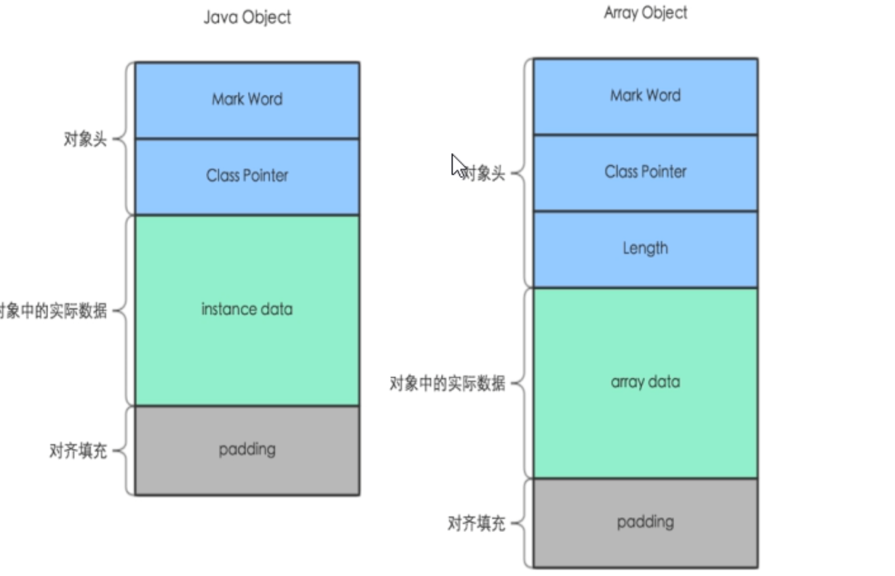
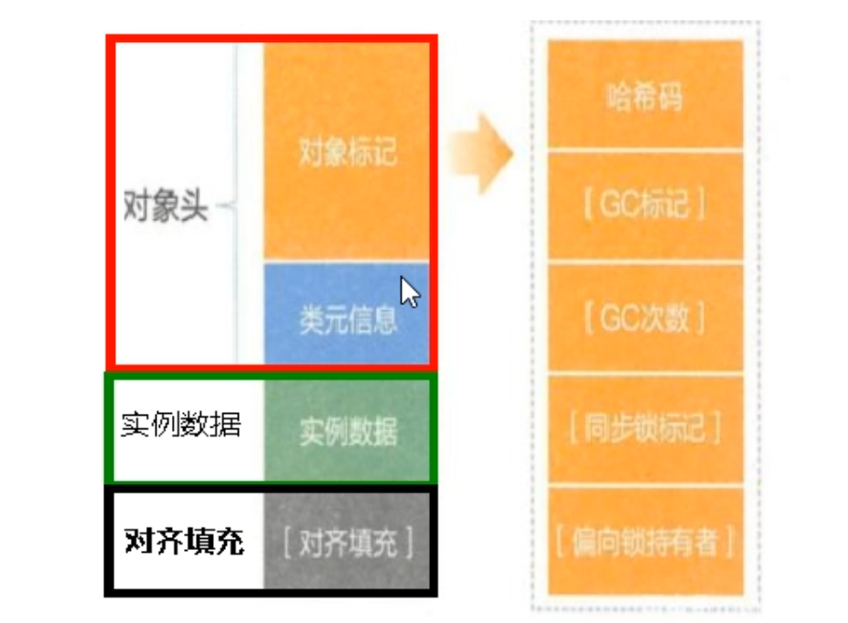
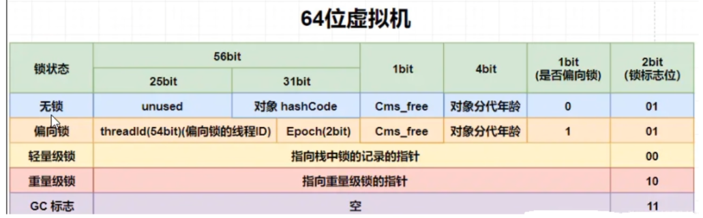
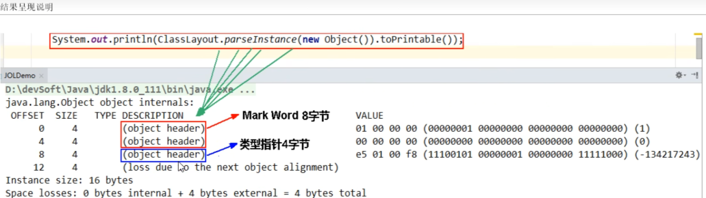
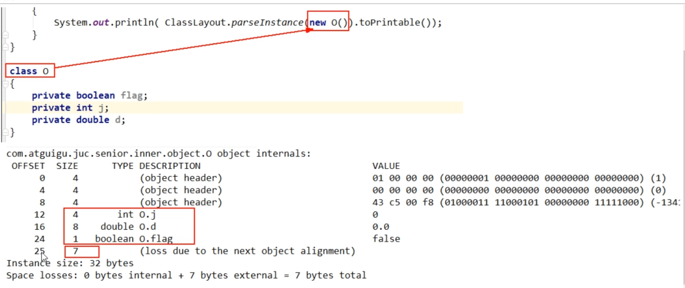

# 10.Java对象内存布局和对象头

---

## title: 10.Java对象内存布局和对象头  
date: 2023-12-02T11:36:12Z  
lastmod: 2023-12-02T17:30:04Z
# 10.Java对象内存布局和对象头
+ **说下JUC，AQS的大致流程**
+ **CAS自旋锁，是获取不到锁就一直自旋吗？CAS和synchronized区别在哪里，为什么CAS好，具体优势在哪里？**
+ **sychronized底层是如何实现的，实现同步的时候用到了CAS 了吗？具体哪里用到了？**
+ **对象头存储那些信息？长度是多少位存储？**

# **Object object = new Object()谈谈你对这句话的理解？**
+ **位置所在-------->JVM堆->新生区->伊甸园区**
+ **构成布局-------->对象头+实例数据+对齐填充**

# **对象在堆内存中布局**
## **权威定义----周志明老师JVM**
**在HotSpot虚拟机里，对象在堆内存的存储布局可以划分为三个部分：********对象头（Header）、实例数据（Instance Data） 和对齐填充（Padding）**  **。**对象头

## **对象在堆内存中的存储布局**
+ **对象头（在64位系统中，Mark Word占了8个字节，类型指针占了8个字节，一共是16个字节）**
    - **对象标记（Mark Word）**
    - 
    - **默认****存储对象的HashCode、分代年龄和锁标志****等信息。**

**类元信息（类型指针）**

        * **这些信息都是与对象自身定义无关的数据，所以Mark Word被设计成一个非固定的数据结构以便在极小的空间内存存储尽量多的数据。**
        * **它会根据对象的状态复用自己的存储空间，也就是说在运行期间MarkWord里存储的数据会随着锁标志位的变化而变化。**
        * **对象指向它的类元数据的指针** **，虚拟机通过这个指针来确定这个对象哪个类的实例**
+ **实例数据**
    - **存放****类的属性（Field）数据信息，包括父类的属性信息**
+ **对齐填充（保证8个字节的倍数）**
    - **虚拟机要求****对象起始地址必须是8字节的整数倍** **，填充数据不是必须存在的，仅仅是为了字节对齐，这部分内存按8字节补充对齐。**

# **再说对象头的MarkWord**

# **聊聊Object obj = new Object()**
## **运行结果展示**

## **压缩指针**
+ **Java -XX:+PrintCommandLineFlags -version 查看当前虚拟机信息**
+ **默认开启压缩指针，开启后将上述类型指针压缩为4字节，以节约空间**
+ **手动关闭压缩指针： -XX: -UseCompressedClassPointers**

# **换成其他对象试试**

> 更新: 2024-06-25 15:05:50  
> 原文: <https://www.yuque.com/nibiwanxiamei/yrd6t1/20bf6308f9c4792bb865d022a6f79d5d>