# 11.Synchronized与锁升级

---

# **面试题**
+ **<font style="color:#DF2A3F;">谈谈你对Synchronized的理解</font>**

:::info
**Synchronized是JVM提供的关键字，可以修饰方法和代码块，用于实现多线程访问共享资源的同步性，可以保证同一时刻只有一个线程访问共享资源，同时Synchronized是可重入的，一个线程可以多次获取同一个锁，底层是基于对象监控锁（Monitor）实现的，是非公平锁的一种。**

:::

+ **<font style="color:#DF2A3F;">聊聊Sychronized的锁升级</font>**

:::color3
**<font style="color:rgb(0,0,0);">总结一下synchronized的执行过程：</font>**

**<font style="color:rgb(0,0,0);">（1）线程抢锁时，JVM首先检测内置锁对象Mark Word中的biased_lock（偏向锁标识）是否设置成1，lock（锁标志位）是否为01，如果都满足，确认内置锁对象为可偏向状态。</font>**

**<font style="color:rgb(0,0,0);">（2）在内置锁对象确认为可偏向状态之后，JVM检查Mark Word中的线程ID是否为抢锁线程ID，如果是，就表示抢锁线程处于偏向锁状态，抢锁线程快速获得锁，开始执行临界区代码。</font>**

**<font style="color:rgb(0,0,0);">（3）如果Mark Word中的线程ID并未指向抢锁线程，就通过CAS操作竞争锁。如果竞争成功，就将Mark Word中的线程ID设置为抢锁线程，偏向标志位设置为1，锁标志位设置为01，然后执行临界区代码，此时内置锁对象处于偏向锁状态。</font>**

**<font style="color:rgb(0,0,0);">（4）如果CAS操作偏向锁竞争失败，就说明发生了竞争，撤销偏向锁，进而升级为轻量级锁。</font>**

**<font style="color:rgb(0,0,0);">（5）JVM使用CAS将锁对象的Mark Word替换为抢锁线程的锁记录指针，如果成功，抢锁线程就获得锁。如果替换失败，就表示其他线程竞争锁，JVM尝试使用CAS自旋替换抢锁线程的锁记录指针，如果自旋成功（抢锁成功），那么锁对象依然处于轻量级锁状态。</font>**

**<font style="color:rgb(0,0,0);">（6）如果JVM的CAS替换锁记录指针自旋失败（自旋多次），轻量级锁就膨胀为重量级锁，后面等待锁的线程也要进入阻塞状态。</font>**** **

:::

+ **<font style="color:#DF2A3F;">Synchronized实现原理，monitor对象什么时候生成的？知道monitor的monitorenter和monitorexit这两个是怎么保证同步的嘛？或者说这两个操作计算机底层是如何执行的</font>**

:::color2
Synchronized底层是基于**<font style="color:#DF2A3F;">对象监控锁Monitor</font>**实现的，可以保证多线程下共享资源的同步性。每个java对象都有一个与之关联的Monitor对象，随着java对象的创建而创建。

monitorenter和monitorexit底层是**<font style="color:#DF2A3F;">基于操作系统的Mutex互斥原语</font>**实现的，在进入同步语句的时候，执行monitorenter语句，若Monitor对象进入数为0则获取到锁，执行同步代码，若为1则阻塞。

执行完同步代码后，执行monitorexit，无论是正常退出还是异常退出，都有对应的monitorexit语句执行，保证正常释放锁。将Monitor进入对象数 - 1。

:::

+ **偏向锁和轻量级锁有什么区别**

:::success
偏向锁在无竞争情况下，消除锁同步的过程，而轻量级锁使用CAS操作来消除同步阻塞。偏向锁只有第一次设置需要CAS操作，轻量级锁每次获取释放🔒都需要CAS操作。<font style="color:rgb(36, 41, 47);background-color:rgb(244, 246, 248);">偏向锁针对的是只有一个线程访问同步块的场景，而轻量级锁则是针对少量线程竞争同步块的场景</font>

:::

# **Synchronized的性能变化**
+ **Java5以前，只有Synchronized，这个是操作系统级别的重量级操作**
    - **重量级锁，假如锁的竞争比较激烈的话，性能下降**
    - **Java 5之前 用户态和内核态之间的转换**
    - 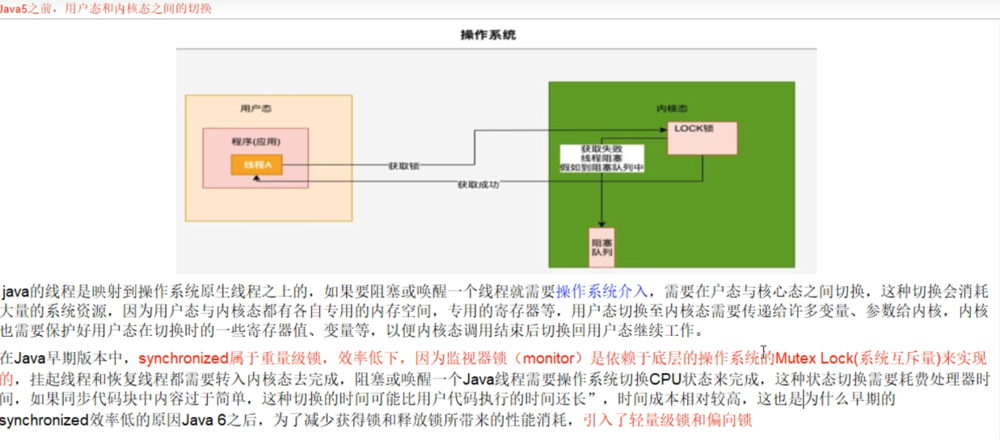
+ **<font style="color:#DF2A3F;">Java6 之后为了减少获得锁和释放锁所带来的性能消耗，引入了轻量级锁和偏向锁</font>**

# **Synchronized锁种类及升级步骤**
## **多线程访问情况**
+ **只有一个线程来访问，有且唯一Only One**
+ **有两个线程（2个线程交替访问）**
+ **竞争激烈，更多线程来访问**

## **升级流程**
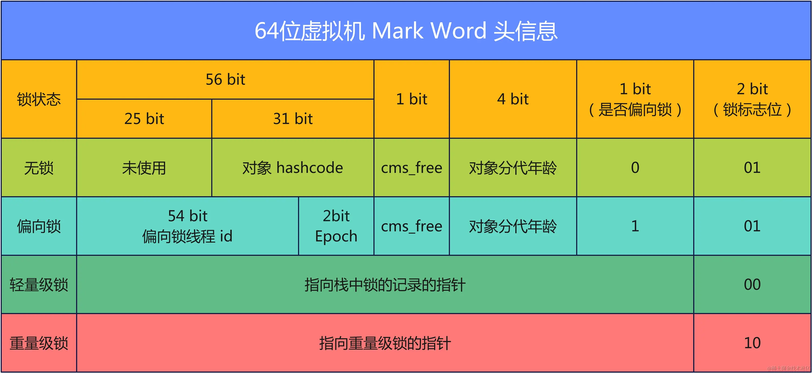

+ **Synchronized用的锁是存在Java对象头里的MarkWord中，****<font style="color:#DF2A3F;">锁升级功能主要依赖MarkWord中锁标志位和释放偏向锁标志位</font>**
+ 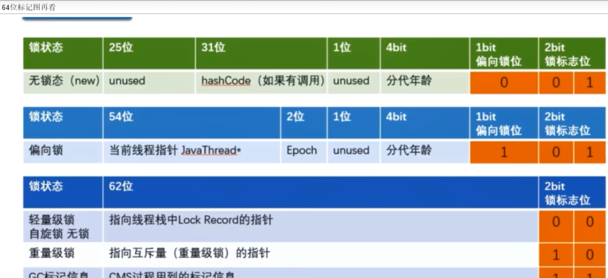
+ **锁指向，请牢记**
    - **偏向锁：MarkWord存储的是****偏向的线程ID**
    - **轻量锁：MarkWord存储的是指向****线程栈中Lock Record的指针**
    - **重量锁：MarkWord存储的是指向****堆中的monitor对象** **（系统互斥量指针）**

## **无锁 -- 0 01**
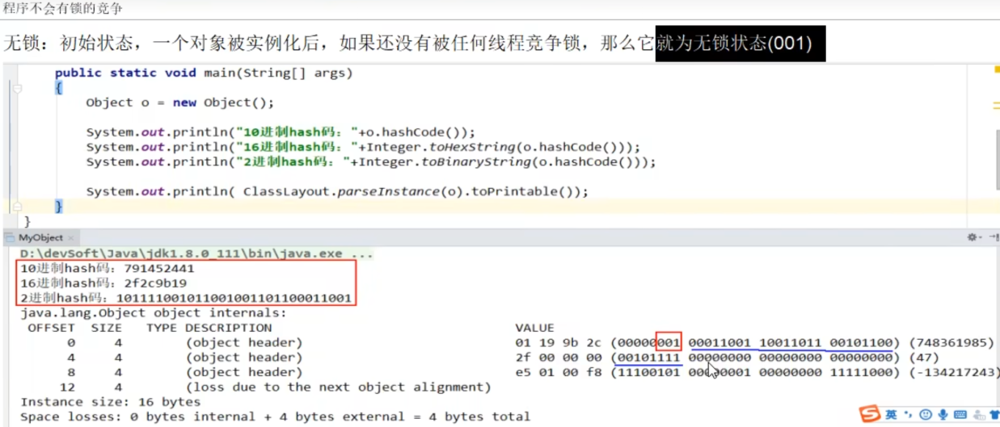

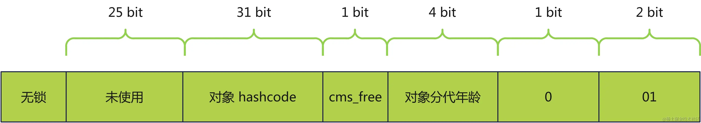

> 采用**小端存储**，所以最前面放的是低字节的
>
> hashcode刚开始是全0，需要调用一次函数才会生成（native本地方法）
>

## **偏锁 -- 1 01**
**偏向锁：单线程竞争**，**当线程A第一次竞争到锁时，通过修改MarkWord中的偏向线程ID、偏向模式。如果不存在其他线程竞争，那么持有偏向锁的线程将永远不需要进行同步。**

**主要作用：**

+ **当一段同步代码一直被同一个线程多次访问，由于只有一个线程那么该线程在****后续访问时便会自动获得锁**
+ **同一个老顾客来访，直接老规矩行方便**

**结论：**

+ **HotSpot的作者经过研究发现，大多数情况下：在多线程情况下，锁不仅不存在多线程竞争，********还存在由同一个线程多次获得的情况** **，偏向锁就是在这种情况下出现的，它的出现是为了解决****只有一个线程执行同步时提高性能** **。**
+ **偏向锁会偏向于第一个访问锁的线程，如果在接下来的运行过程中，该锁没有被其他线程访问，则持有偏向锁的线程将永远不需要出发同步。** **也即偏向锁在资源在没有竞争情况下消除了同步语句，懒得连CAS操作都不做了，直接提高程序性能。**

**理论落地：**

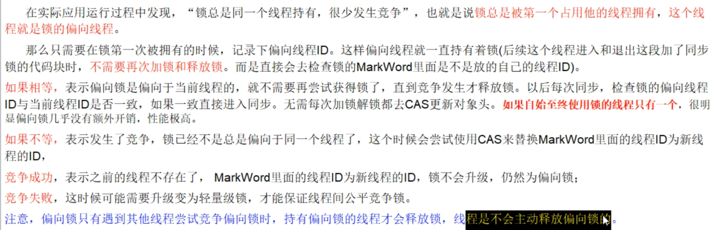

> **<font style="color:#DF2A3F;">偏向锁被竞争只有两种情况：A占有，B竞争的时候A刚好不需要了，那么直接改为B，依旧是偏向锁。如果A没结束，B来竞争，偏向锁被释放，升级为轻量级锁</font>**
>

**技术实现：**

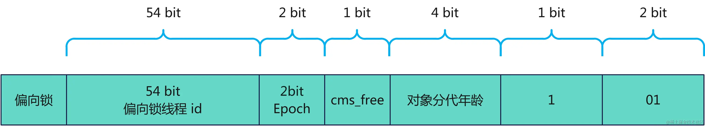

**偏向锁JVM命令：**

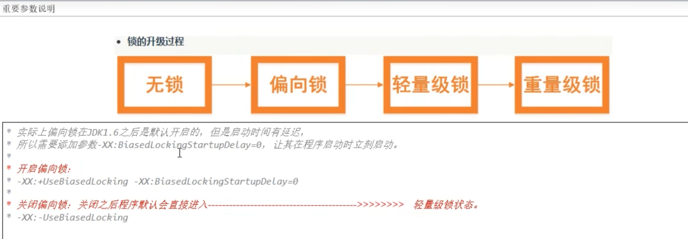

**案例演示：**

+ **偏向锁默认情况演示---只有一个线程**

```java
public class SynchronizedUpDemo {

    public static void main(String[] args) {
        /**
         * 这里偏向锁在JDK6以上默认开启，开启后程序启动几秒后才会被激活，可以通过JVM参数来关闭延迟 -XX:BiasedLockingStartupDelay=0
         */
//        try { TimeUnit.SECONDS.sleep(5); } catch (InterruptedException e) { e.printStackTrace(); }
        Object o = new Object();
        synchronized (o) {
            System.out.println(ClassLayout.parseInstance(o).toPrintable());
        }
    }
}
```

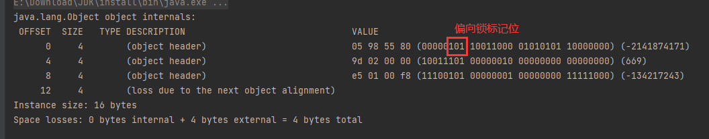

**偏向锁的撤销：**

+ **当有另外一个线程逐步来竞争锁的时候，就不能再使用偏向锁了，要升级为轻量级锁，使用的是等到竞争出现才释放锁的机制**
+ **竞争线程尝试CAS更新对象头失败，会等到****全局安全点（此时不会执行任何代码）** **撤销偏向锁，同时检查持有偏向锁的线程是否还在执行：**
    - **第一个线程正在执行Synchronized方法**（**处于同步块**） **，它还没有执行完，其他线程来抢夺，该偏向锁会被取消掉并出现锁升级** **，此时轻量级锁由原来持有偏向锁的线程持有，继续执行同步代码块，而正在竞争的线程会自动进入自旋等待获得该轻量级锁**
    - **第一个线程执行完Synchronized**（**退出同步块**） **，则将对象头设置为无所状态并撤销偏向锁，重新偏向。**

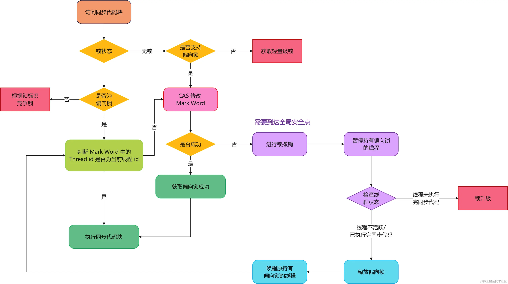

**题外话：********Java15以后逐步废弃偏向锁** **，需要手动开启------->维护成本高**

## **轻锁 -- 0 00**
**概念：多线程竞争，但是任意时候最多只有一个线程竞争**，**即不存在锁竞争太激烈的情况，也就没有线程阻塞。** 

**主要作用：有线程来参与锁的竞争，但是获取锁的冲突时间极短---------->本质是 -- 比较并交换CAS**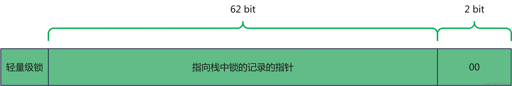

**轻量锁的获取：**

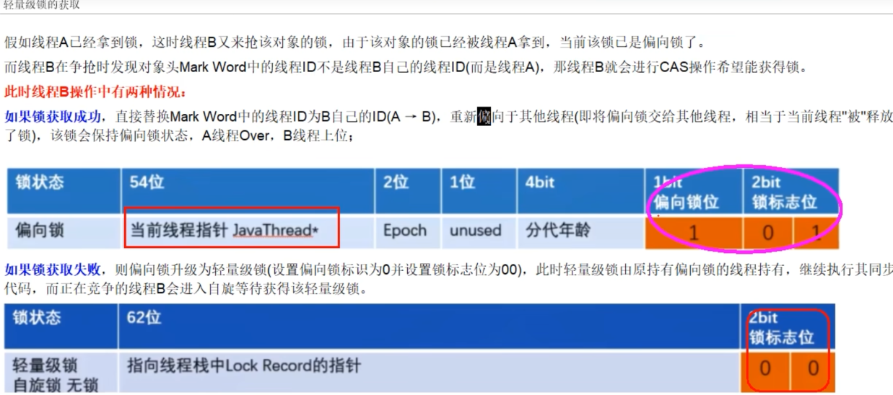

**案例演示：**

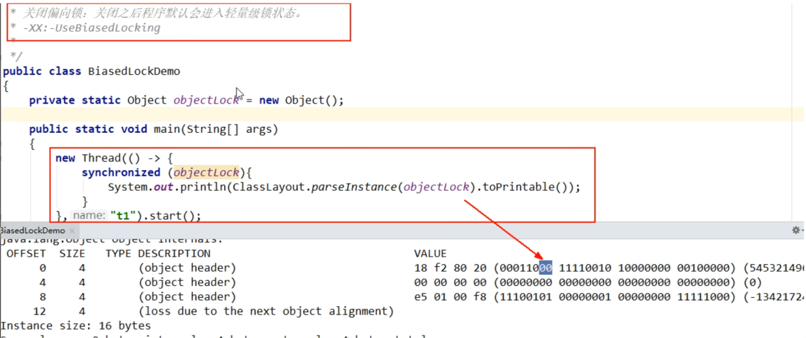

**自旋一定程度和次数（Java8 之后是自适应自旋锁------意味着自旋的次数不是固定不变的）：**

+ **线程如果自旋成功了，那下次自旋的最大次数会增加，因为JVM认为既然上次成功了，那么这一次也大概率会成功**
+ **如果很少会自选成功，那么下次会减少自旋的次数甚至不自旋，避免CPU空转**

**轻量锁和偏向锁的区别：**

+ **争夺轻量锁失败时，自旋尝试抢占锁**
+ **轻量级锁每次退出同步块都需要释放锁，而偏向锁是在竞争发生时才释放锁**

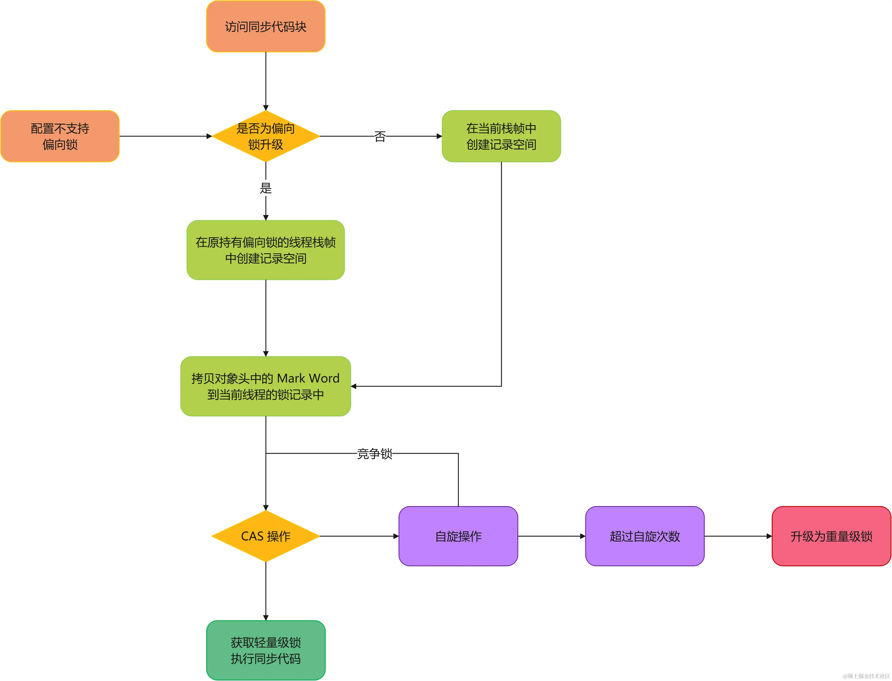

## **重量级锁 -- 0 10**
**有大量线程参与锁的竞争，冲突性很高**

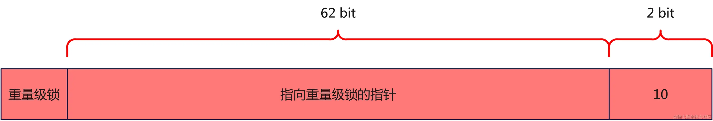

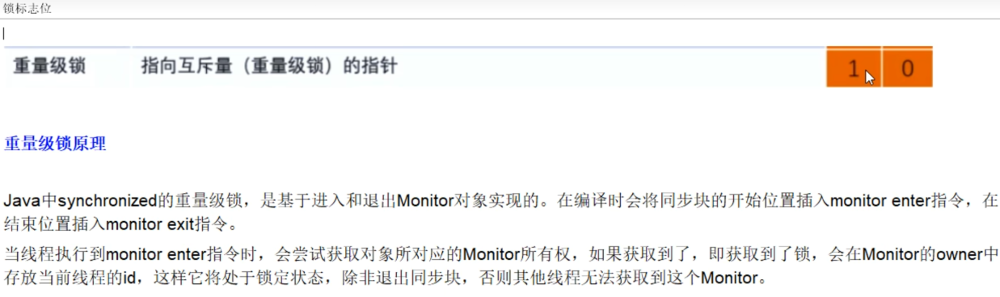

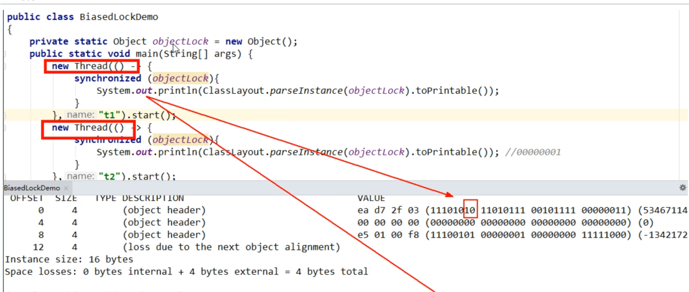

## **小总结**
+ **锁升级的过程**
+ 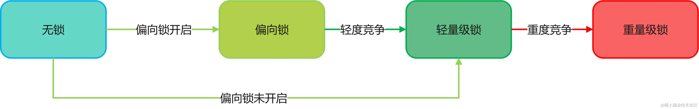

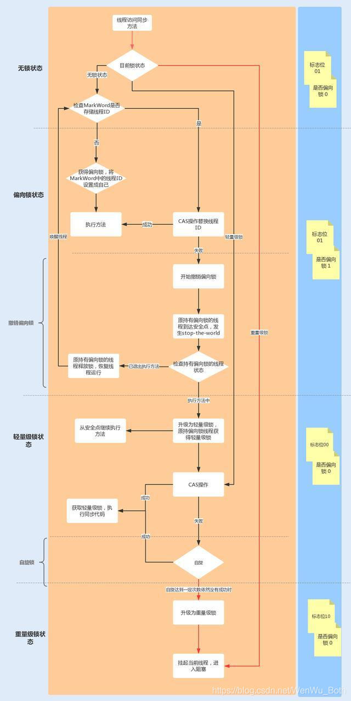

+ 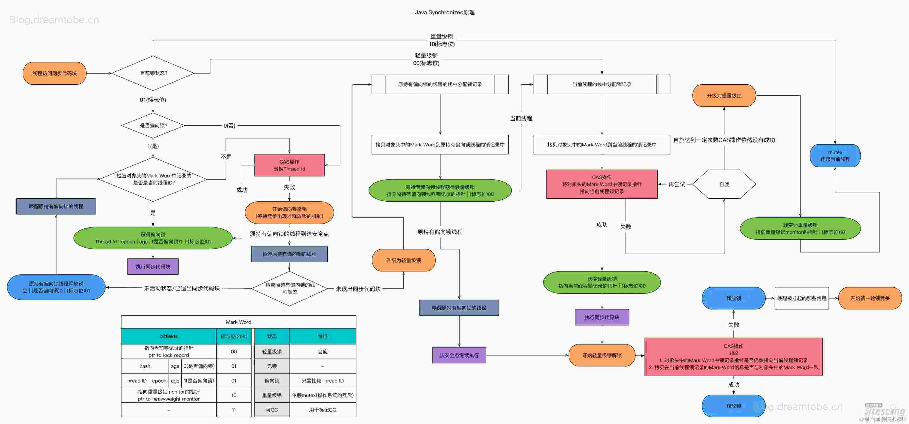
+ **<font style="color:#DF2A3F;">锁升级后，hashcode去哪儿了?</font>**
    - **在无锁状态下，Mark Word中可以存储对象的identity hash code值。当对象的nashCode(O方法第一次被调用时，JVM会生成对应的identity hash code值并将该值存储到Mark Word中。**
    - **对于偏向锁，在线程获取偏向锁时，会用Thread ID和epoch值覆盖identity hash code.所在的位置。如果一个对象的hashCode()方法己经被调用过一次之后，这个对象不能被设置偏向锁。因为如果可以的化，那Mark Word中的identity hash code必然会被偏向线程Id给覆盖，这就会造成同一个对象前后两次调用hashCode()方法得到的结果不一致。**
    - **升级为轻量级锁时，JVM会在当前线程的栈帧中创建一个锁记录(Lock Record)空间，用于存储锁对象的Mark Word拷贝，该拷贝中可以包含identity hash code,所以轻量级锁可以和identity hash code.共存，哈希码和GC年龄自然保存在此，释放锁后会将这些信息写回到对象头。**
    - **升级为重量级锁后，Mark Word保存的重量级锁指针代表重量级锁的ObjectMonitor类里有字段记录非加锁状态下的Mark Word,锁释放后也会将信息写回到对象头。**

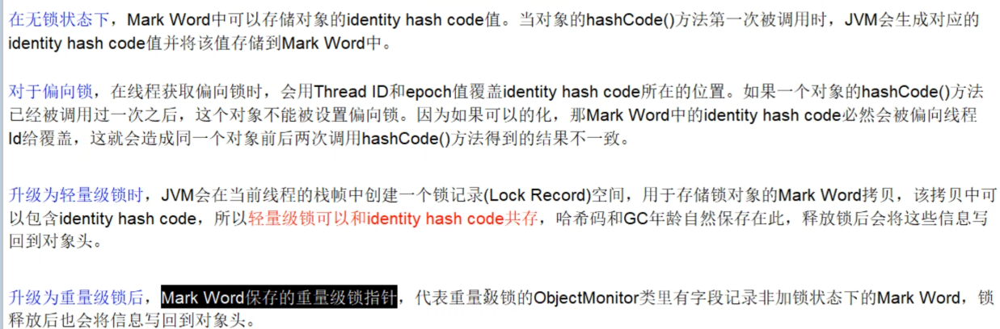

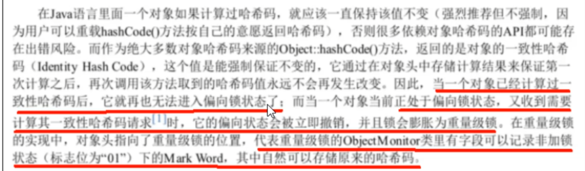

+ **各种锁优缺点、synchronized锁升级和实现原理**

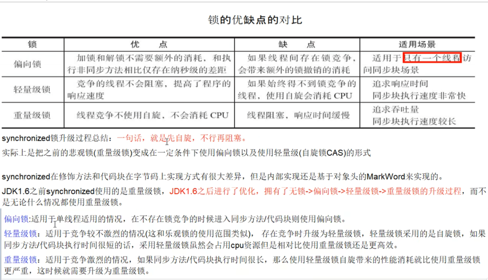

# **JIT编译器对锁的优化**
**JJT：Just In Time Compiler 即时编译器**

## **锁消除**
```java
/**
 * 锁消除
 * 从JIT角度看想相当于无视他，synchronized(o)不存在了
 * 这个锁对象并没有被共用扩散到其他线程使用
 * 极端的说就是根本没有加锁对象的底层机器码，消除了锁的使用
 */

public class LockClearUpDemo {
    static Object object = new Object();

    public void m1() {
        //锁消除问题，JIT会无视它，synchronized(o)每次new出来的，都不存在了，非正常的
        Object o = new Object();
        synchronized (o) {
            System.out.println("-----------hello LockClearUpDemo" + "\t" + o.hashCode() + "\t" + object.hashCode());
        }
    }

    public static void main(String[] args) {
        LockClearUpDemo lockClearUpDemo = new LockClearUpDemo();
        for (int i = 0; i < 10; i++) {
            new Thread(() -> {
                lockClearUpDemo.m1();
            }, String.valueOf(i)).start();
        }
    }
}
/**
 * -----------hello LockClearUpDemo	229465744	57319765
 * -----------hello LockClearUpDemo	219013680	57319765
 * -----------hello LockClearUpDemo	1109337020	57319765
 * -----------hello LockClearUpDemo	94808467	57319765
 * -----------hello LockClearUpDemo	973369600	57319765
 * -----------hello LockClearUpDemo	64667370	57319765
 * -----------hello LockClearUpDemo	1201983305	57319765
 * -----------hello LockClearUpDemo	573110659	57319765
 * -----------hello LockClearUpDemo	1863380256	57319765
 * -----------hello LockClearUpDemo	1119787251	57319765
 */
```

## **锁粗化**
```java
/**
 * 锁粗化
 * 假如方法中首尾相接，前后相邻的都是同一个锁对象，那JIT编译器会把这几个synchronized块合并为一个大块
 * 加粗加大范围，一次申请锁使用即可，避免次次的申请和释放锁，提高了性能
 */
public class LockBigDemo {
    static Object objectLock = new Object();

    public static void main(String[] args) {
        new Thread(() -> {
            synchronized (objectLock) {
                System.out.println("111111111111");
            }
            synchronized (objectLock) {
                System.out.println("222222222222");
            }
            synchronized (objectLock) {
                System.out.println("333333333333");
            }
            synchronized (objectLock) {
                System.out.println("444444444444");
            }
            //底层JIT的锁粗化优化
            synchronized (objectLock) {
                System.out.println("111111111111");
                System.out.println("222222222222");
                System.out.println("333333333333");
                System.out.println("444444444444");
            }
        }, "t1").start();
    }
}
```

# **小总结**
+ **没有锁：自由自在**
+ **偏向锁：唯我独尊**
+ **轻量锁：楚汉争霸**
+ **重量锁：群雄逐鹿**


> 更新: 2024-06-22 20:05:44  
> 原文: <https://www.yuque.com/nibiwanxiamei/yrd6t1/3b31e72fc7250b87c964c4cccb1b387f>