# 12.AbstractQueuedSynchronizer之AQS

---

# **前置知识**
+ **公平锁和非公平锁**
    - **公平锁：锁被释放以后，先申请的线程先得到锁** **。性能较差一些，因为公平锁为了保证时间上的绝对顺序，上下文切换更频繁。**
    - **非公平锁：锁被释放以后，后申请的线程可能会先获取到锁** **，是随机或者按照其他优先级排序的。性能更好，但可能会导致某些线程永远无法获取到锁（饥饿）**
+ **可重入锁**
    - **也叫做递归锁，线程可以再次获取自己的内部锁，比如一个线程获取到了对象锁，此时这个对象锁还没有释放，当其想再次获取这个对象锁的时候还是可以获取的，如果不可重入的话，会导致死锁。**
+ **自旋思想**
    - **当线程请求锁时，如果锁已经被其他线程持有，那么该线程会****不断地重试获取锁，而不是被挂起等待** **，这种不断尝试获取锁的行为称为自旋**
+ **LockSupport**
    - **一个工具类，用于线程的阻塞和唤醒操作，类似于wait()和notify()方法，但是更加灵活和可控**
    - **提供了park()和unpark()两个静态方法用于线程阻塞和唤醒操作。**
    - **优点在于可以在任意时刻阻塞和唤醒线程而不需要事先获取锁或监视器对象。**
+ **数据结构之双向链表**
    - **双向链表（Doubly Linked List）是一种常见的数据结构，它是由一系列结点（Node）组成的，每个结点包含三个部分：数据域、前驱指针和后继指针。其中，数据域存储结点的数据，前驱指针指向前一个结点，后继指针指向后一个结点。通过这种方式，双向链表可以实现双向遍历和插入、删除操作。**
+ **设计模式之模板设计模式**
    - **模板设计模式是一种行为型设计模式，定义了一种算法的框架，并将某些步骤延迟到子类中事先，这种设计模式的主要目的是允许子类在不改变算法结构的情况下重新定义算法中的某些步骤。**
    - **优点是能够提高代码复用性和可维护性。**

# **AQS入门级别理论知识**
## **是什么？**
**抽象的队列同步器**

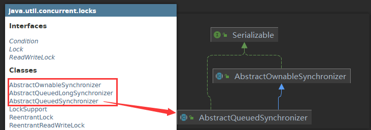

**技术解释**

+ **是用来实现锁或者其他同步器组件的公共基础部分的****抽象实现**
+ **是重量级基础框架及整个JUC体系的基石，只要用于解决锁分配给”谁“的问题。**
+ **<font style="color:#DF2A3F;">整体就是一个抽象的FIFO队列来完成资源获取线程的排队工作，并通过一个int类变量表示持有锁的状态</font>**

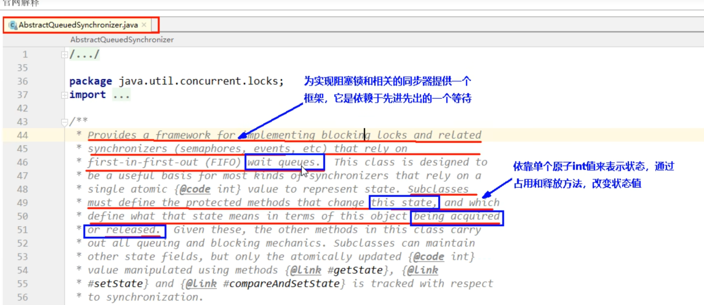

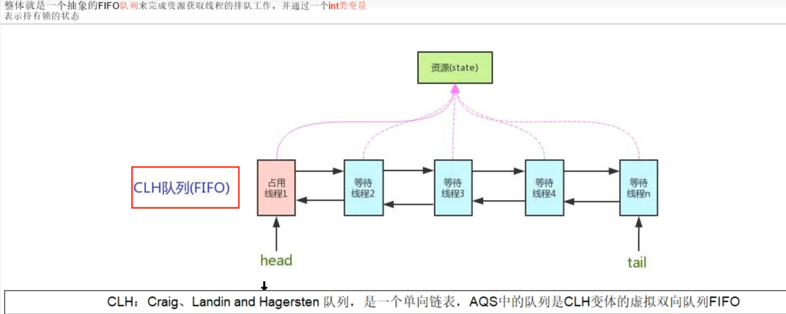

## **AQS为什么是JUC内容中最重要的基石**
+ **和AQS有关的**
    - 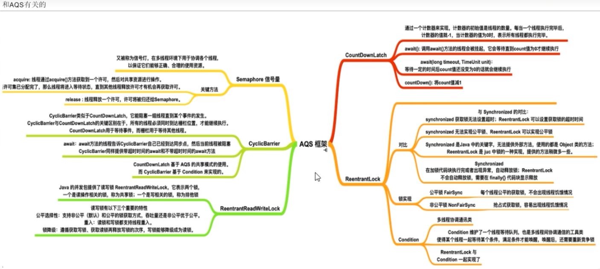
    - **ReentrantLock**
    - 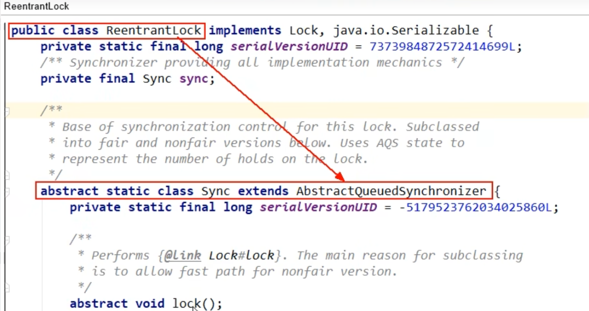
    - **CountDownLatch**
    - 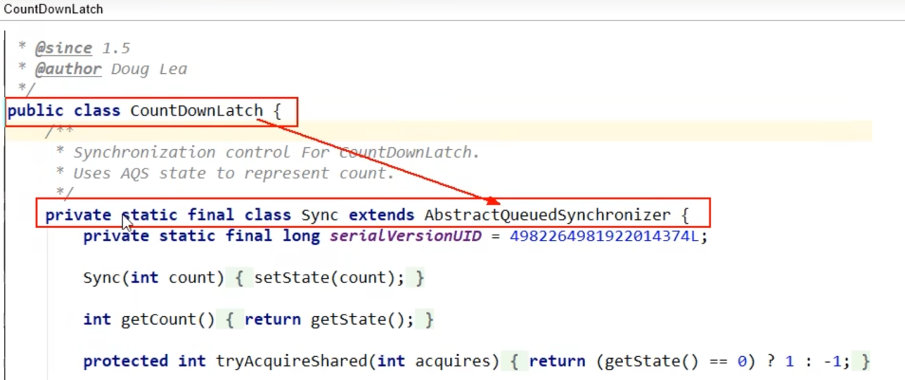
    - **ReentrantReadWriteLock**
    - 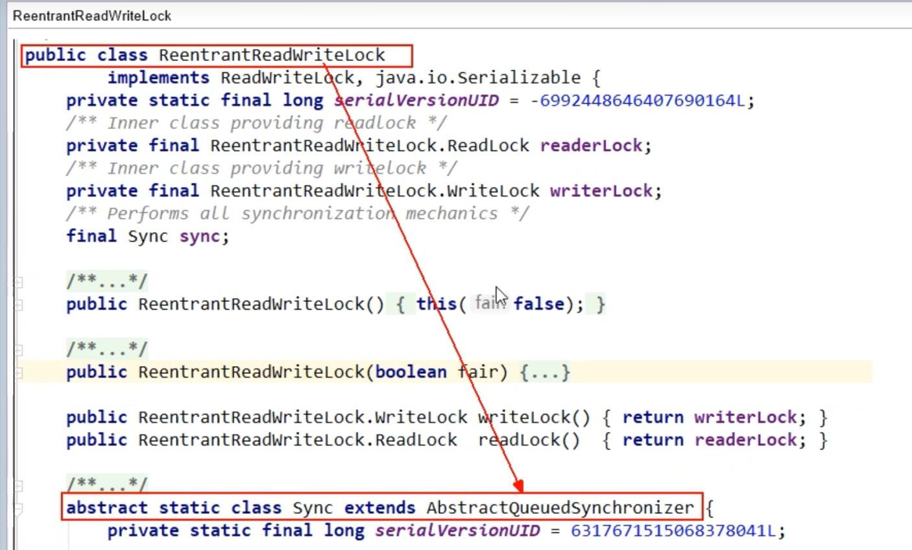
    - **Semaphore**
    - 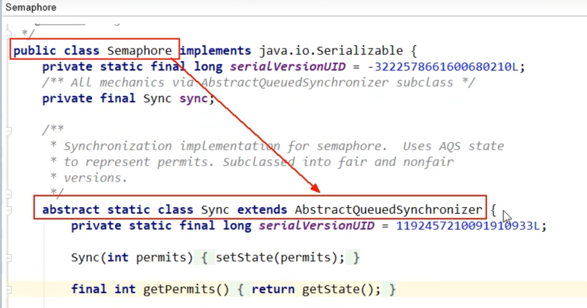
+ **进一步理解锁和同步器的关系**
    - **锁，面向锁的使用者：定义了程序员和锁交互的使用层API，隐藏了实现细节，你调用即可**
    - **<font style="color:#DF2A3F;">同步器，面向锁的实现者</font>****：Java并发大神DoungLee，提出了统一规范并简化了锁的实现** **，将其抽象出来** **，屏蔽了同步状态管理、同步队列的管理和维护、阻塞线程排队和通知、唤醒机制等，是一切锁和同步组件实现的----公共基础部分**

## **能干嘛？**
**加锁会导致阻塞**------**有阻塞就需要排队，实现排队必然需要队列**

+ **抢到资源的线程直接使用处理业务，抢不到资源的必然涉及一种****排队等候机制** **。抢占失败的线程继续去等待（类似于银行办理窗口都满了，暂时没有受理窗口的顾客只能去****候客区排队等待** **），但等候线程仍然保留获取锁的可能且获取锁流程仍在继续（候客区的顾客也在等着叫号，轮到了再去受理窗口办理业务）**
+ **既然说到了****排队等候机制** **，那么就一定会有某种队列形成，这样的队列是什么数据结构呢？**
    - **如果共享资源被占用，********就需要一定的阻塞等待唤醒机制来保证锁分配** **。这个机制主要用的是CLH队列的变体实现的，将暂时获取不到锁的线程加入到队列中，这个队列就是****AQS同步队列的抽象表现** **。它将要请求共享资源的线程及自身的等待状态封装成队列的节点对象（********Node** **）**

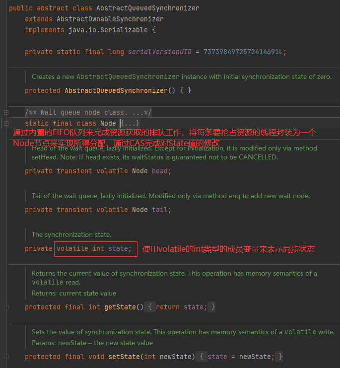

## **小总结**
**AQS同步队列的基本结构**

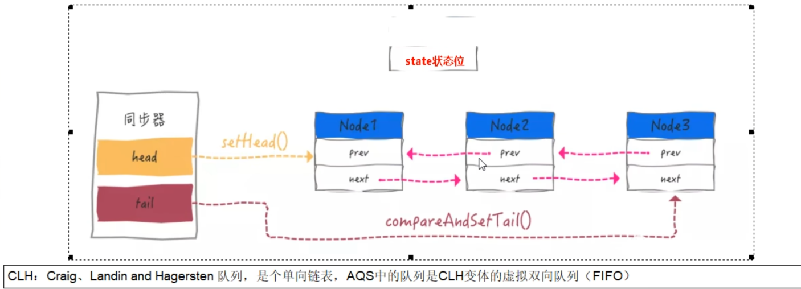

# 深入AQS原理案例分析
[【深入AQS原理】我画了35张图就是为了让你深入 AQS - 掘金](https://juejin.cn/post/6844904146127044622#heading-2)

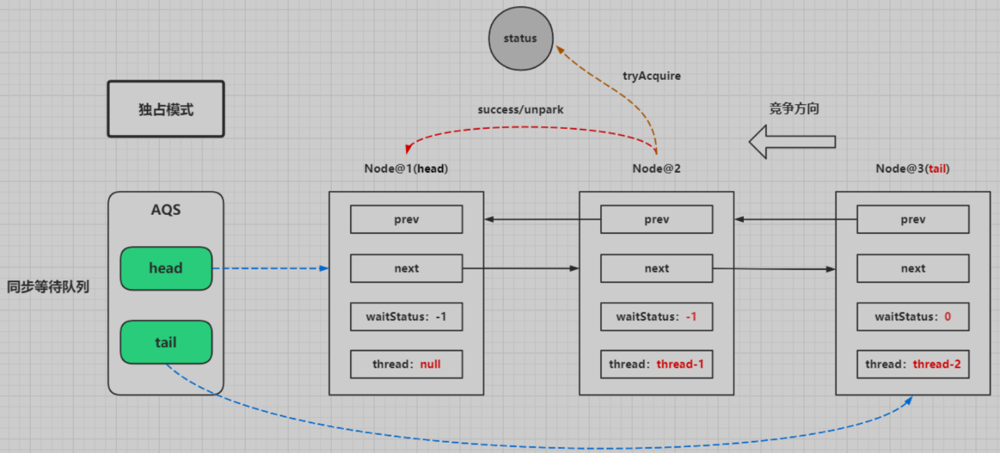

## 同步状态管理
AQS内部内部定义了一个32位整型的state变量用于保存同步状态：

```java
/**
 * The synchronization state.（同步状态值）
 */
private volatile int state;

// 获取state
protected final int getState() {
    return state;
}

// 直接覆盖设置state
protected final void setState(int newState) {
    state = newState;
}

// CAS设置state
protected final boolean compareAndSetState(int expect, int update) {
    return STATE.compareAndSet(this, expect, update);
}
```

## 线程的阻塞和唤醒
线程的阻塞和唤醒在JDK1.5之前，只能依赖于**Object类提供的wait()、notify()和notifyAll()方法**，它们都是JNI方法，由JVM提供实现，并且它们必须运行在获取监视器锁的代码块内（synchronized代码块中），这个局限性先不谈性能上的问题，代码的简洁性和灵活性是比较低的。

JDK1.5引入了**LockSupport**，**底层是基于Unsafe类的park()和unpark()方法**，提供了线程阻塞和唤醒的功能，它的机制有点像只有一个允许使用资源的信号量java.util.concurrent.Semaphore，也就是一个线程只能通过park()方法阻塞一次，只能调用unpark()方法解除调用阻塞一次，线程就会唤醒（多次调用unpark()方法也只会唤醒一次），可以想象是内部维护了一个0-1的计数器。

## Node节点
```java
static final class Node {
   // 标记一个节点处于共享模式下的等待
   static final Node SHARED = new Node();
   // 标记一个节点处于独占模式下的等待
   static final Node EXCLUSIVE = null;
   // 取消状态
   static final int CANCELLED =  1;
   // 唤醒状态
   static final int SIGNAL    = -1;
   // 条件等待状态
   static final int CONDITION = -2;
   // 传播状态
   static final int PROPAGATE = -3;
   // 等待状态，初始值为0，其他可选值是上面的4个值
   volatile int waitStatus;
   // 当前节点前驱节点的引用
   volatile Node prev;
   // 当前节点后继节点的引用
   volatile Node next;
   // 当前节点持有的线程，可能是阻塞中等待唤醒的线程
   volatile Thread thread;
   // 下一个等待节点
   Node nextWaiter;
   // 当前操作的节点是否处于共享模式
   final boolean isShared() {
      return nextWaiter == SHARED;
   }
   // 获取当前节点的前驱节点，确保前驱节点必须存在，否则抛出NPE  
   final Node predecessor() {
        Node p = prev;
        if (p == null)
            throw new NullPointerException();
        else
            return p;
    }
    
    // 空节点，主要是首次创建队列的时候创建的头和尾节点使用
    Node() {}

    // 设置下一个等待节点，设置持有线程为当前线程
    Node(Node nextWaiter) {
        this.nextWaiter = nextWaiter;
        THREAD.set(this, Thread.currentThread());
    }

    // 设置waitStatus，设置持有线程为当前线程
    Node(int waitStatus) {
        WAITSTATUS.set(this, waitStatus);
        THREAD.set(this, Thread.currentThread());
    }

    // CAS更新waitStatus  
    final boolean compareAndSetWaitStatus(int expect, int update) {
        return WAITSTATUS.compareAndSet(this, expect, update);
    }
    // CAS设置后继节点
    final boolean compareAndSetNext(Node expect, Node update) {
        return NEXT.compareAndSet(this, expect, update);
    }
    // 设置前驱节点
    final void setPrevRelaxed(Node p) {
        PREV.set(this, p);
    }

    // 下面是变量句柄的实现，在VarHandle出现之前使用的是Unsafe，其实底层还是照样使用Unsafe
    private static final VarHandle NEXT;
    private static final VarHandle PREV;
    private static final VarHandle THREAD;
    private static final VarHandle WAITSTATUS;
    static {
        try {
            MethodHandles.Lookup l = MethodHandles.lookup();
            NEXT = l.findVarHandle(Node.class, "next", Node.class);
            PREV = l.findVarHandle(Node.class	, "prev", Node.class);
            THREAD = l.findVarHandle(Node.class, "thread", Thread.class);
            WAITSTATUS = l.findVarHandle(Node.class, "waitStatus", int.class);
        } catch (ReflectiveOperationException e) {
            throw new ExceptionInInitializerError(e);
        }
    }	  
}	
```

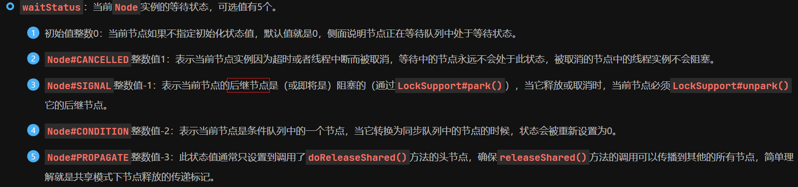

**AQS中一共存在两种等待队列，其中一种是普通的同步等待队列，这里命名为Sync Queue，另一种是基于Sync Queue实现的条件等待队列，这里命名为Condition Queue。**

## addWaiter（Node mode）
当前线程加入同步等待队列和同步等待队列的初始化是同一个方法

```java
// 添加等待节点到同步等待队列，实际上初始化队列也是这个方法完成的
private Node addWaiter(Node mode) {
    // 基于当前线程创建一个新节点，节点的模式由调用者决定
    Node node = new Node(mode);
    for (;;) {
        Node oldTail = tail;
       // 尾节点不为空说明队列已经初始化过，则把新节点加入到链表中，作为新的尾节点，建立和前驱节点的关联关系
        if (oldTail != null) {
            node.setPrevRelaxed(oldTail);
            if (compareAndSetTail(oldTail, node)) {
                oldTail.next = node;
                return node;
            }
        } else {
	    // 尾节点为空说明队列尚未初始化过，进行一次初始化操作
            initializeSyncQueue();
        }
    }
}
```


在首次调用addWaiter()方法，死循环至少执行两轮再跳出，因为同步队列必须初始化完成后（第一轮循环），然后再把当前线程所在的新节点实例添加到等待队列中再返（第二轮循环）当前的节点，这里需要注意的是**新加入同步等待队列的节点一定是添加到队列的尾部并且会更新AQS中的tail属性为最新入队的节点实例。**

假设我们使用Node.EXCLUSIVE模式把新增的等待线程加入队列，有三个线程分别是thread-1、thread-2和thread-3，线程入队的时候都处于阻塞状态，依次调用上面的入队方法的同步队列的整个链表的状态。

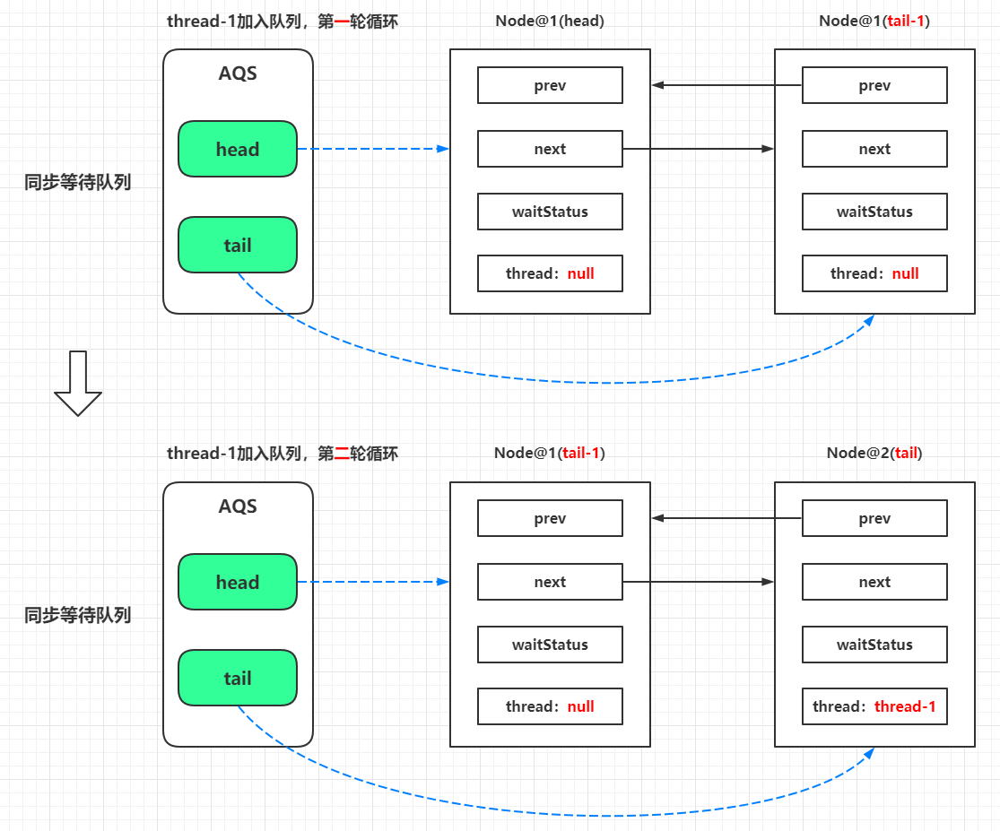

thread-2加入队列中

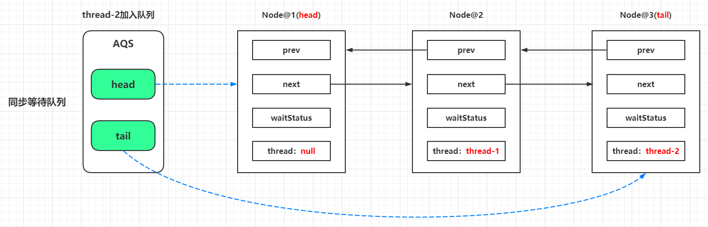

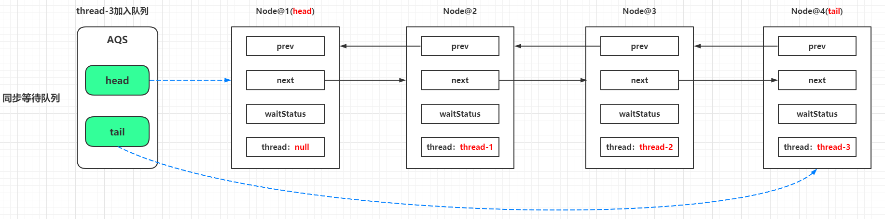

**如果所有的入队线程都处于阻塞状态的话，新入队的线程总是添加到队列的tail节点，阻塞的线程总是”争抢”着成为head节点**

## addConditionWaiter（）
```java
 // 添加条件等待节点
    private Node addConditionWaiter() {
        // 这里做一次判断，当前线程必须步入此同步器实例
        if (!isHeldExclusively())
            throw new IllegalMonitorStateException();
        // 临时节点t赋值为lastWaiter引用
        Node t = lastWaiter;
        // If lastWaiter is cancelled, clean out.
        // 最后一个节点不为条件等待状态，则是取消状态
        if (t != null && t.waitStatus != Node.CONDITION) {
            // 解除所有取消等待的节点的连接
            unlinkCancelledWaiters();
            t = lastWaiter;
        }
        // 基于当前线程新建立一个条件等待类型的节点
        Node node = new Node(Node.CONDITION);
        // 首次创建Condition的时候，最后一个节点临时引用t为null，则把第一个节点置为新建的节点
        if (t == null)
            firstWaiter = node;
        else
            // 已经存在第一个节点，则通过nextWaiter连接新的节点
            t.nextWaiter = node;
        // 最后一个节点的引用更新为新节点的引用    
        lastWaiter = node;
        return node;
    } 
```

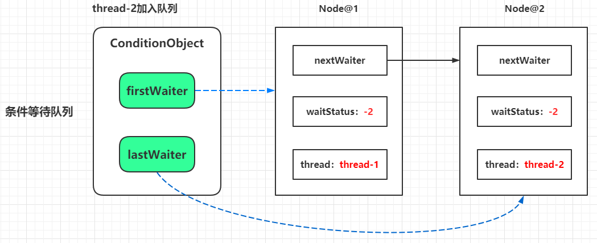

## 线程阻塞示例图
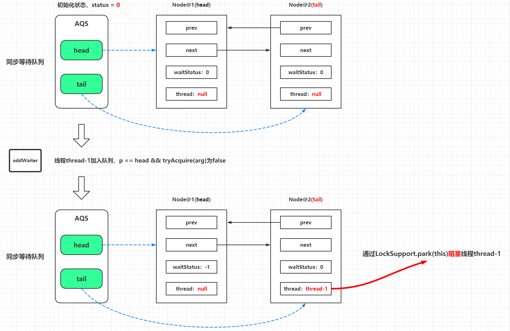


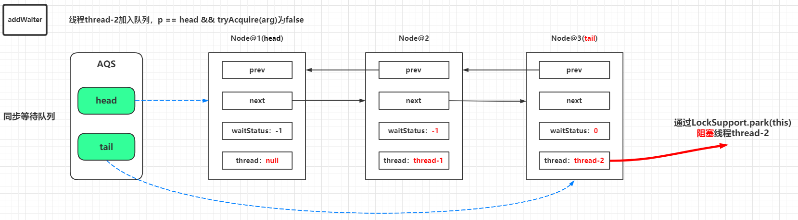

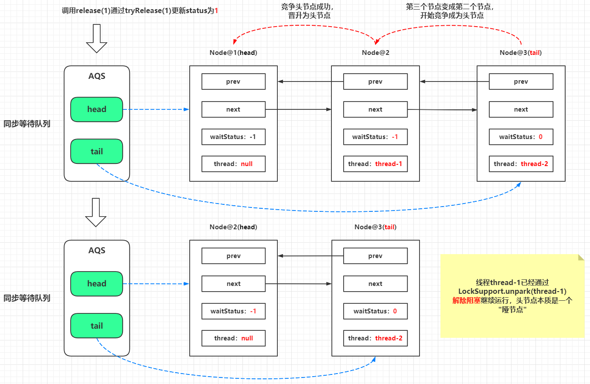

独占模式的同步器的一个显著特点就是：头节点的第一个有效（非取消）的后继节点，总是尝试获取资源，一旦获取资源成功就会解除阻塞并且晋升为头节点，原来所在节点会移除出同步等待队列，原来的队列长度就会减少1，然后头结点的第一个有效的后继节点继续开始竞争资源。

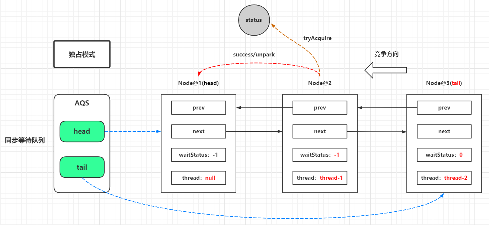

共享模式和独占略微不同的是，如果头节点获取锁成功，就会向后传播，唤醒队列后面的其他节点。

共享模式的同步器的一个显著特点就是：头节点的第一个有效（非取消）的后继节点，总是尝试获取资源，一旦获取资源成功就会解除阻塞并且晋升为头节点，原来所在节点会移除出同步等待队列，原来的队列长度就会减少1，重新设置头节点的过程会传播唤醒的状态，简单来说就是**唤醒一个有效的后继节点，只要一个节点可以晋升为头节点，它的后继节点就能被唤醒，以此类推。**

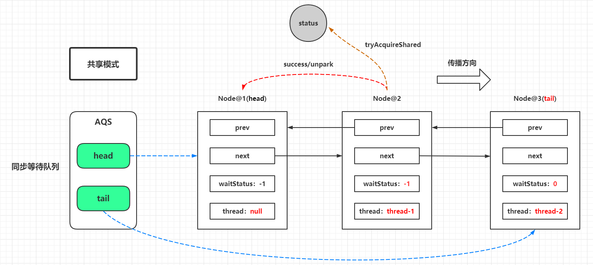

## Condition接口特点
1、同时依赖两个同步等待队列，一个是AQS提供，另一个是ConditionObject提供的。

**2、await()方法会释放AQS同步等待队列中的阻塞节点，这些节点会加入到条件等待队列中进行阻塞。**

3、signal()或者signalAll()会把条件等待队列中的节点重新加入AQS同步等待队列中，不解除节点的阻塞状态。

4、接第3步，这些进入到AQS同步等待队列的节点会重新竞争成为头节点，接下来的步骤其实也就是前面分析过的独占模式下的AQS的运作原理。


# **AQS源码分析前置知识储备**
## **AQS内部体系架构图**
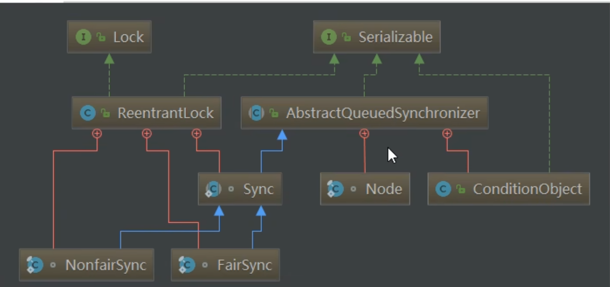

## **AQS内部体系架构----AQS自身**
+ **AQS的int类型变量state**
    - **AQS的同步状态State成员变量**
        * 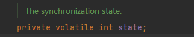
+ **AQS的CLH队列**
+ **CLH（三个大牛的名字组成）队列为一个双向队列**
    - 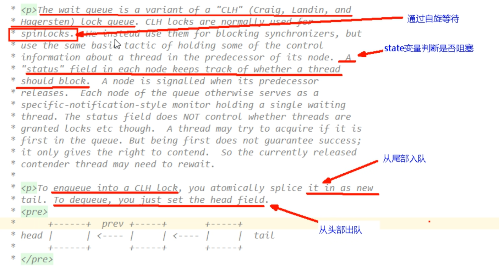
+ **有阻塞就需要排队，实现排队必然需要队列**
+ **<font style="color:#DF2A3F;">State变量+CLH双端队列</font>**

## **AQS内部体系架构----内部类Node**
+ **Node的int变量 - waitStatus**
    - **Node的等待状态waitState成员变量**
        * 
    - **说人话**
        * **等候区其他线程的等待状态**
        * **队列中每个排队的线程会被封装为一个Node**
+ **Node此类的讲解**
    - **内部结构**
    - 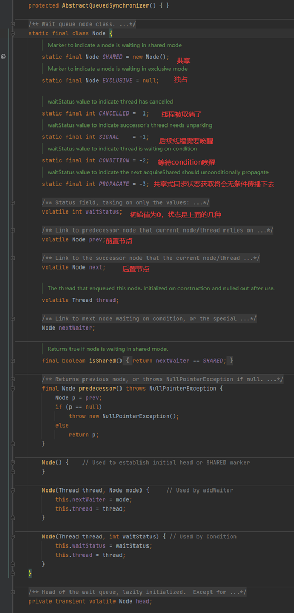
    - **属性说明、**
    - 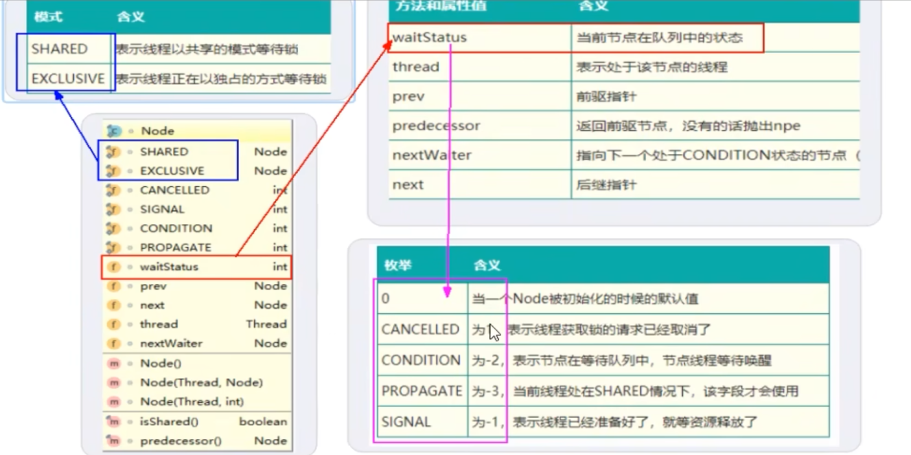

# **AQS源码深度讲解和分析**
## **ReentrantLock的原理**
**Lock接口的实现类，基本都是通过聚合了一个队列同步器的子类完成线程访问控制的**

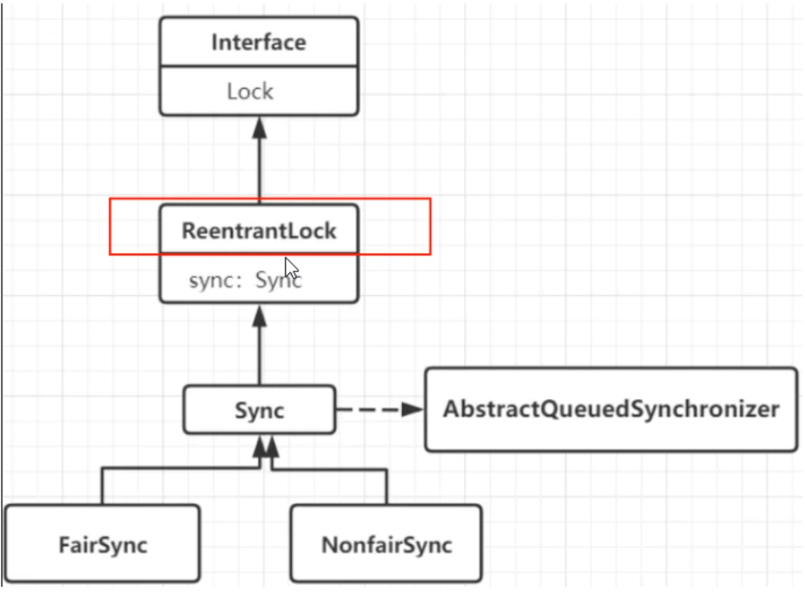

## **从最简单的lock方法开始看看公平和非公平**
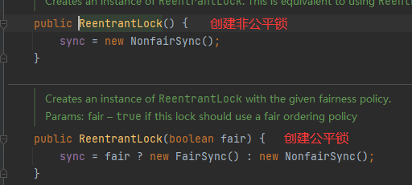

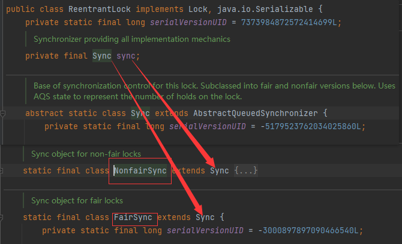

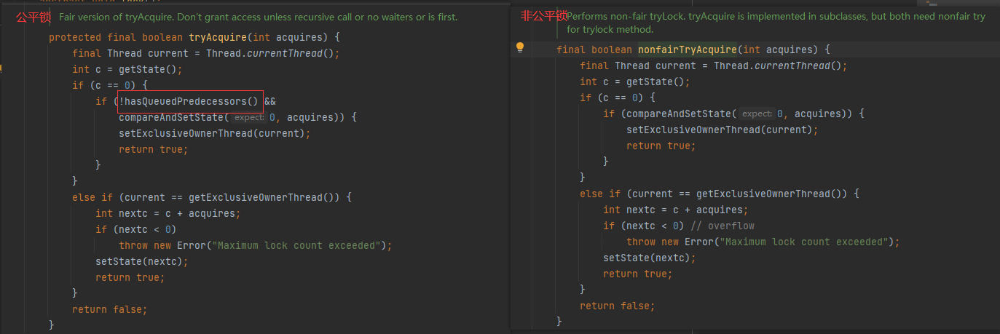

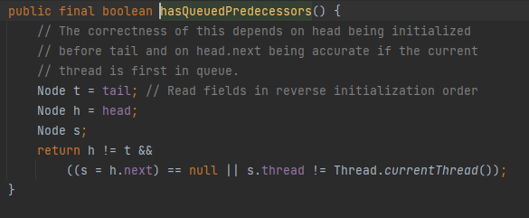

**公平锁和非公平锁的lock()方法唯一的区别就在于公平锁在获取同步状态时多了一个限制条件：hasQueuedPredecessors()-----****<font style="color:#DF2A3F;">公平锁加锁时判断等待队列中是否存在有效节点的方法</font>**

## **以非公平锁ReentrantLock()为例作为突破走起---方法lock()**
**对比公平锁和非公平锁的tryAcquire()方法的实现代码，其实差异就在于非公平锁获取锁时比公平锁中少了一个判断**!hasQueuedPredecessors() **，hasQueuedPredecessors()中判断了是否需要排队，导致公平锁和非公平锁的差异如下：**

+ **公平锁**：**公平锁讲究先来后到，线程在获取锁时，如果这个锁的等待队列中已经有线程在等待，那么当前线程就会进入到等待队列中；**
+ **非公平锁**：**不管是否有等待队列，如果可以获取到锁，则立刻占有锁对象。也就是说队列的第一个排队线程苏醒后，不一定就是排头的这个线程获得锁，它还需要参加竞争锁（存在线程竞争的情况下），后来的线程可能不讲武德插队夺锁了。**

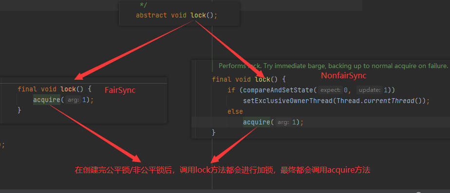

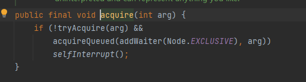

**正式开始源码解读：**

+ **lock()**

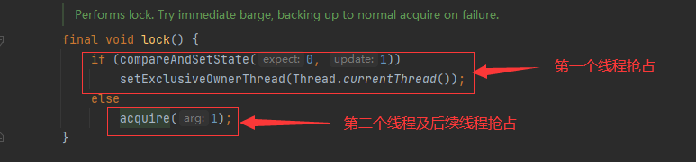	

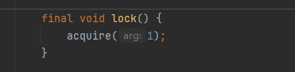

+ **acquire()**

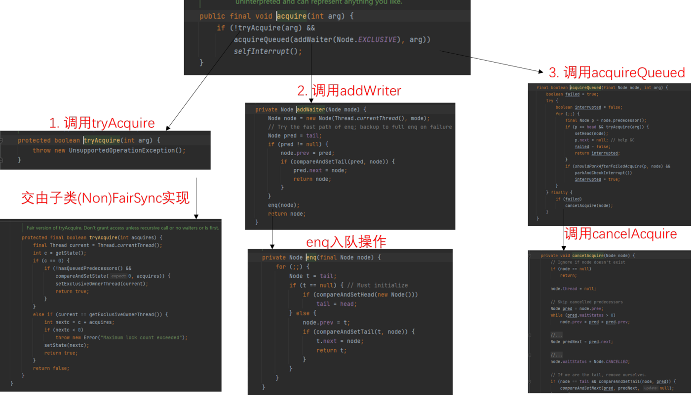

+ **tryAcquire(arg)**
    - 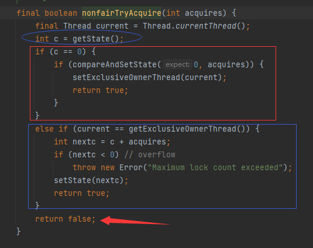
    - **return false：继续推进条件，走下一个方法**
    - **return true：结束**
+ **addwaiter(Node.EXCLUSIVE)** 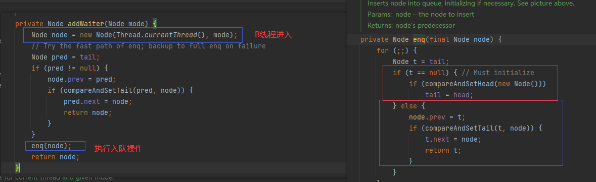
+ 
    - **注意：在双向链表中，** **第一个节点为虚节点（也叫做哨兵节点）** **，其实不存储任何信息，只是占位。真正的第一个有数据的节点，是从第二个节点开始的**
    - **假如此时有线程C进入：**
    - 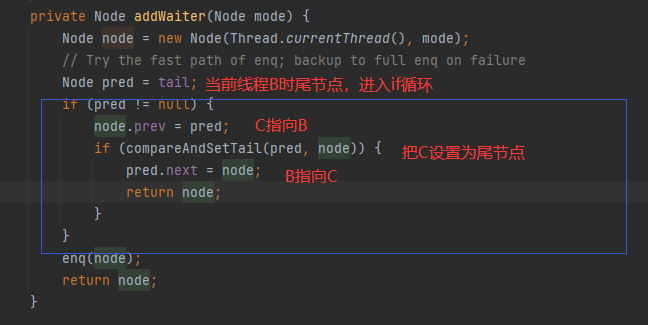
+ **acquireQueued(addWeiter(Node.EXCLUSIVE), arg)-----坐稳队列**

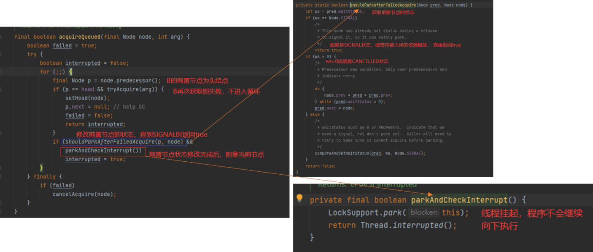

## **unlock()**
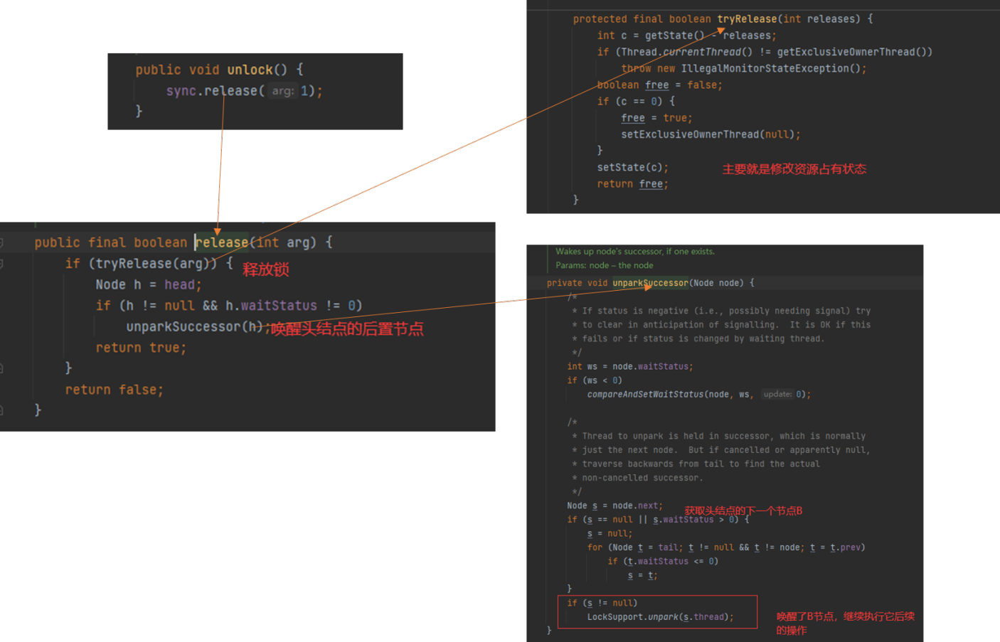


> 更新: 2024-09-02 16:52:07  
> 原文: <https://www.yuque.com/nibiwanxiamei/yrd6t1/54e71355958010230793cec1b53581a2>