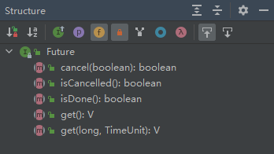
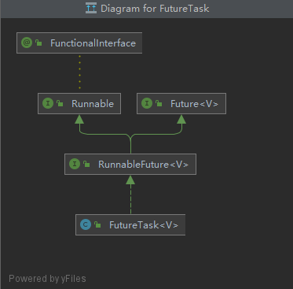
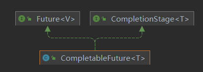
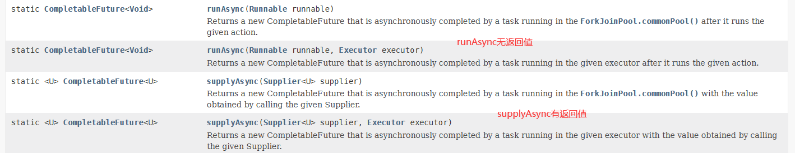
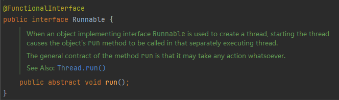
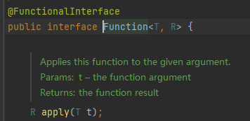
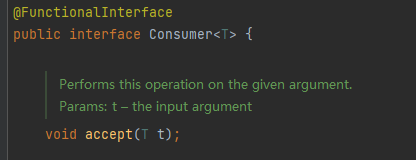
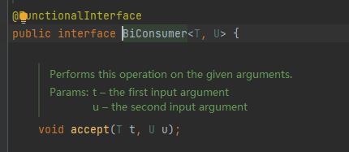
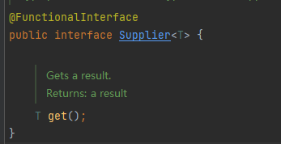

# 2.CompletableFuture

---

# **Future接口理论知识复习**
**Future接口（FutureTask实现类** **）定义了操作异步任务执行一些方法，如获取异步任务的执行结果、取消异步任务的执行、判断任务是否被取消、判断任务执行是否完毕等。**

**举例：比如主线程让一个子线程去执行任务，子线程可能比较耗时，启动子线程开始执行任务后，主线程就去做其他事情了，忙完其他事情或者先执行完，过了一会再才去获取子任务的执行结果或变更的任务状态。**



> **<font style="color:#DF2A3F;">Future接口为主线程开一个分支任务（子线程），为主线程处理耗时和费力的复杂业务</font>**
>

# **Future接口常用实现类FutureTask异步任务**
**Future是Java5新加的一个接口，它提供一种异步并行计算的功能，如果主线程需要执行一个很耗时的计算任务，我们会就可以通过Future把这个任务放进异步线程中执行，主线程继续处理其他任务或者先行结束，再通过Future获取计算结果。**

## **Future接口相关架构**
+ **目的：异步多线程任务执行且返回有结果，三个特点：****<font style="color:#DF2A3F;">多线程、有返回、异步任务</font>** ****
+ **代码实现：Runnable接口+Callable接口+Future接口和FutureTask实现类。**



```java
public class CompletableFutureDemo {
    public static void main(String[] args) throws ExecutionException, InterruptedException {
    //创建一个异步线程thread
        FutureTask<String> futureTask = new FutureTask<>(new MyThread());
        Thread thread = new Thread(futureTask, " t1 ");
        thread.start();
        //get方法获取返回值
        System.out.println(futureTask.get());
    }
}
class MyThread implements Callable<String> {
    public String call() throws Exception {
        System.out.println("call is running");
        return "call";
    }
}
输出结果：
call is running
call
```

## **Future编码实战和优缺点分析**
+ **优点：****<font style="color:#DF2A3F;">Future+线程池异步多线程任务配合，能显著提高程序的运行效率。</font>**
+ **缺点：**
    - **get() 阻塞** **--- 一旦调用get()方法求结果，非要等到结果才会离开，不管你是否计算完成，如果没有计算完成容易程序堵塞。**
        * **futureTask.get(3,TimeUnit.SECONDS)，** **只愿意等待三秒，计算未完成直接抛出异常**
    - **isDone()轮询** **---轮询的方式会耗费无谓的cpu资源，而且也不见得能及时得到计算结果，如果想要异步获取结果，通常会以轮询的方式去获取结果，尽量不要阻塞。**
+ **结论：********Future对于结果的获取不是很友好，只能通过阻塞或轮询的方式得到任务的结果。**

```java
public class FutureApiDemo {
    public static void main(String[] args) throws ExecutionException, InterruptedException, TimeoutException {
        FutureTask<String> futureTask = new FutureTask<>(() -> {
            System.out.println(Thread.currentThread().getName() + "--------come in");
            try {
                TimeUnit.SECONDS.sleep(5);
            } catch (InterruptedException e) {
                e.printStackTrace();
            }
            return "task over";
        });

        Thread t1 = new Thread(futureTask, "t1");
        t1.start();

//        System.out.println(futureTask.get());//这样会有阻塞的可能，在程序没有计算完毕的情况下。
        System.out.println(Thread.currentThread().getName() + " ------忙其他任务");
//        System.out.println(futureTask.get(3,TimeUnit.SECONDS));//只愿意等待三秒，计算未完成直接抛出异常
        while (true) {//轮询
            if(futureTask.isDone()){
                System.out.println(futureTask.get());
                break;
            }else{
                TimeUnit.MILLISECONDS.sleep(500);
                System.out.println("正在处理中，不要催了，越催越慢");
            }
        }
        /* 轮询结果
        * main ------忙其他任务
        t1--------come in
        正在处理中，不要催了，越催越慢
        正在处理中，不要催了，越催越慢
        正在处理中，不要催了，越催越慢
        正在处理中，不要催了，越催越慢
        正在处理中，不要催了，越催越慢
        正在处理中，不要催了，越催越慢
        正在处理中，不要催了，越催越慢
        正在处理中，不要催了，越催越慢
        正在处理中，不要催了，越催越慢
        正在处理中，不要催了，越催越慢
        task over
        Process finished with exit code 0
        * */
    }
}

```

## **完成一些复杂的任务**
+ **对于简单的业务场景使用Future完全ok**
+ **回调通知：**
    - **应对Future的完成时间，完成了可以告诉我，也就是****<font style="color:#DF2A3F;">回调通知</font>**
    - **通过轮询的方式去判断任务是否完成这样非常占cpu并且代码也不优雅**
+ **创建异步任务：********Future+线程池组合**
+ **多个任务前后依赖（********同步** **）可以组合处理（水煮鱼--->买鱼--->调料--->下锅） ：**
    - **想将多个异步任务的结果组合起来，后一个异步任务的计算结果需要前一个异步任务的值**
    - **想将两个或多个异步计算合并成为一个异步计算，这几个异步计算互相独立，同时后面这个又依赖前一个处理的结果**
+ **对计算速度选最快的：**
    - **当Future集合中某个任务最快结束时，返回结果，返回第一名处理结果**
+ **结论：**
    - **使用Future之前提供的那点API就囊中羞涩，处理起来不够优雅，这时候还是让****CompletableFuture以声明式的方式优雅的处理这些需求** **。**
    - **从i到i++**
    - **Future能干的，CompletableFuture都能干**

# **CompletableFuture对Future的改进**
## **CompletableFuture为什么会出现**
+ **get()方法在Future计算完成之前会一直处在阻塞状态下，阻塞的方式和异步编程的设计理念相违背。**
+ **isDene()方法容易耗费cpu资源（cpu空转），**
+ **对于****<font style="color:#DF2A3F;">真正的异步处理是可以通过传入回调函数</font>**<font style="color:#DF2A3F;"> </font>**<font style="color:#DF2A3F;">，在Future结束时自动调用该回调函数</font>****，这样，我们就不用等待结果**

**jdk8设计出CompletableFuture，CompletableFuture提供了一种观察者模式类似的机制，可以让任务执行完成后通知监听的一方。**

## **CompletableFuture和CompletionStage介绍**
**类架构说明**



+ **接口CompletionStage**
    - **代表异步计算过程中的****某一个阶段** **，一个阶段完成以后可能会触发另外一个阶段。**
    - **一个阶段的执行可能是被单个阶段的完成触发，也可能是由多个阶段一起触发**
+ **类CompletableFuture**
    - **提供了非常强大的Future的扩展功能，可以帮助我们简化异步编程的复杂性，并且提供了函数式编程的能力，可以通过****回调的方式处理计算结果** **，也提供了转换和组合CompletableFuture的方法**
    - **它可能代表一个****明确完成的Future** **，也可能代表****一个完成阶段** **（CompletionStage），它支持在计算完成以后****触发一些函数或执行某些动作**

## **核心的四个静态方法，来创建一个异步任务**


**对于上述Executor参数说明：若没有指定，则使用****默认的ForkJoinPoolcommonPool（）** **作为它的线程池执行异步代码，如果指定线程池，则使用我们自定义的或者特别指定的线程池执行异步代码**

```java
public class CompltetableFutureBulderDemo {
    public static void main(String[] args) throws ExecutionException, InterruptedException {
        ExecutorService executorService = Executors.newFixedThreadPool(3);
        CompletableFuture<Void> completableFuture = CompletableFuture.runAsync(() -> {
            System.out.println(Thread.currentThread().getName());
            try {
                TimeUnit.SECONDS.sleep(1);
            } catch (InterruptedException e) {
                throw new RuntimeException(e);
            }
        }, executorService);
        //由于runAsync无返回值，所以下面得到的是null
        System.out.println(completableFuture.get());
        CompletableFuture<String> completableFuture1 = CompletableFuture.supplyAsync(() -> {
            System.out.println(Thread.currentThread().getName());
            try {
                TimeUnit.SECONDS.sleep(1);
            } catch (InterruptedException e) {
                throw new RuntimeException(e);
            }
            return "supplyAsync";
        }, executorService);
        //由于supplyAsync有返回值，所以下面得到的是supplyAsync
        System.out.println(completableFuture1.get());
    }
}
```

**CompletableFuture减少阻塞和轮询，可以****传入回调对象** **，当异步任务完成或者发生异常时，自动调用回调对象的回调方法。**

```java
public class CompletableFutureUseDemo {
    public static void main(String[] args) throws ExecutionException, InterruptedException {
        ExecutorService executorService = Executors.newFixedThreadPool(3);
        CompletableFuture<Integer> completableFuture = CompletableFuture.supplyAsync(() -> {
            System.out.println(Thread.currentThread().getName() + "---come in");
            int result = ThreadLocalRandom.current().nextInt(10);
            try {
                TimeUnit.SECONDS.sleep(1);
            } catch (InterruptedException e) {
                e.printStackTrace();
            }
            if (result > 5) { //模拟产生异常情况
                int i = 10 / 0;
            }
            System.out.println("----------1秒钟后出结果" + result);
            return result;
        }, executorService).whenComplete((v, e) -> {
            if (e == null) {
                System.out.println("计算完成 更新系统" + v);
            }
        }).exceptionally(e -> {
            e.printStackTrace();
            System.out.println("异常情况：" + e.getCause() + " " + e.getMessage());
            return null;
        });
        System.out.println(Thread.currentThread().getName() + "先去完成其他任务");
        executorService.shutdown();
    }
}

/**
 * 无异常情况
 * pool-1-thread-1---come in
 * main先去完成其他任务
 * ----------1秒钟后出结果9
 * 计算完成 更新系统9
 */

/**
 * 有异常情况
 *pool-1-thread-1---come in
 * main先去完成其他任务
 * java.util.concurrent.CompletionException: java.lang.ArithmeticException: / by zero
 * 异常情况：java.lang.ArithmeticException: / by zero java.lang.ArithmeticException: / by zero
 */
```

**CompletableFuture优点：**

+ **异步任务结束时**，**会自动回调某个对象的方法**
+ **主线程设置好回调后，不用关心异步任务的执行，异步任务之间可以****顺序执行**
+ **异步任务出错时**，**会自动回调某个对象的方法**

# **案例精讲-从电商网站的比价需求展开**
## **函数式编程**
**Lambda表达式+Stream流式调用+Chain链式调用+Java8函数式编程**

> 函数是接口（Functional Interface）的定义非常容易理解：**<font style="color:#DF2A3F;">只有一个抽象方法的接口，就是函数式接口</font>****。** 可以通过Lambda表达式来创建函数式接口的对象。
>

**函数时接口：**

+ **Runnable：无参数、无返回值**



+ **Function：接受一个参数，并且有返回值**



+ **Consumer：接受一个参数，没有返回值**



+ **BiConsumer：接受两个参数，没有返回值**



+ **Supplier：没有参数，有返回值**



**小结：**


**chain链式调用：**

```java
public class CompletableFutureMallDemo {
    public static void main(String[] args) {
        //老版
        Student student = new Student();
        student.setId(1);
        student.setName("张三");
        student.setMajor("cs");
        //新版
        Student student1 = new Student();
        student1.setId(2).setName("李四").setMajor("cs");
    }
}

@AllArgsConstructor
@NoArgsConstructor
@Data
//开启链式调用
@Accessors(chain = true)
class Student{
    private Integer id;
    private String name;
    private String major;
}
```

## **大厂业务需求说明**
**切记：功能--->性能（完成--->完美）**

**电商网站比价需求分析：**

1. **需求说明：**
    1. **同一款产品，同时搜索出****同款产品在各大电商平台的售价**
    2. **同一款产品，同时搜索出本产品在同一个电商平台下，各个入驻卖家售价是多少**
2. **输出返回：**
    1. **出来结果希望是****同款产品的在不同地方的价格清单列表** **，返回一个List<String>**

**例如：《Mysql》 in jd price is 88.05  《Mysql》 in taobao price is 90.43**

3. **解决方案，对比同一个产品在各个平台上的价格，要求获得一个清单列表**
    1. **step by step，按部就班，查完淘宝查京东，查完京东查天猫....**
    2. **all in，万箭齐发，一口气多线程异步任务同时查询**

## **一波流Java8函数式编程带走-比价案例实战Case**
```java
public class CompletableFutureMallDemo {
    static List<NetMall> list = Arrays.asList(new NetMall("jd"), new NetMall("taobao"), new NetMall("dangdang"));

    /**
     * @param list 平台集合
     * @param productName 商品名称
     * @return：按顺序获取各个平台价格并返回
     */
    public static List<String> getPrice(List<NetMall> list, String productName){
        return list
                .stream()
                .map(netMall
                        ->
            String.format(productName + " in %s price is %.2f", netMall.getName(), netMall.calcPrice(productName)))
                .collect(Collectors.toList());
    }

    /**
     * @param list 平台集合
     * @param productName 商品名称
     * @return：异步处理获取各个平台价格并返回
     */
    public static List<String> getPriceByCompletableFuture(List<NetMall> list, String productName){
        return list
                .stream()
                .map(netMall
                        ->
                        CompletableFuture.supplyAsync(
                () -> String.format(productName + " in %s price is %.2f", netMall.getName(), netMall.calcPrice(productName))
        ))
                .collect(Collectors.toList())
                .stream()
                .map(s -> s.join())
                .collect(Collectors.toList());
    }
    public static void main(String[] args) {
        /*
        *   mysql in jd price is 109.55
            mysql in taobao price is 110.37
            mysql in dangdang price is 110.80
            ------costTime: 3035 毫秒
        * */
        long StartTime = System.currentTimeMillis();
        List<String> list1 = getPrice(list, "mysql");
        for (String element : list1) {
            System.out.println(element);
        }
        long endTime = System.currentTimeMillis();
        System.out.println("------costTime: " + (endTime - StartTime) + " 毫秒");
        /**
         * mysql in jd price is 110.62
         * mysql in taobao price is 109.17
         * mysql in dangdang price is 110.60
         * ------costTime：1011 毫秒
         **/
        long StartTime2 = System.currentTimeMillis();
        List<String> list2 = getPriceByCompletableFuture(list, "mysql");
        for (String element : list2) {
            System.out.println(element);
        }
        long endTime2 = System.currentTimeMillis();
        System.out.println("------costTime" + (endTime2 - StartTime2) + " 毫秒");

    }
}
@NoArgsConstructor
@AllArgsConstructor
@Data
class NetMall {

    private String name;
    public double calcPrice(String productName){
        try {
            TimeUnit.SECONDS.sleep(1);
        } catch (InterruptedException e) {
            e.printStackTrace();
        }
        //返回书的价格
        return ThreadLocalRandom.current().nextDouble() * 2 + productName.charAt(0);
    }
}
```

# **CompletableFuture常用方法**
+ **获得结果和触发计算**
    - **获取结果**
        * **public T get()**
        * **public T get(long timeout,TimeUnit unit)**
        * **public T join() --->和get一样的作用，只是不需要抛出异常**
        * **public T getNow(T valuelfAbsent) --->计算完成就返回正常值，否则返回备胎值（传入的参数），立即获取结果不阻塞**
    - **主动触发计算**
        * **public boolean complete(T value) ---->是否打断get方法立即返回括号值**

```java
    public static void main(String[] args) throws Exception {
        CompletableFuture<String> com = CompletableFuture.supplyAsync(() -> {
            try {
                TimeUnit.SECONDS.sleep(3);
            } catch (InterruptedException e) {
                throw new RuntimeException(e);
            }
            return "abc";
        });
        //一直等，直到结果完成
//        System.out.println(com.get());
        //最多等待2S，超时不候
//        System.out.println(com.get(2L, TimeUnit.SECONDS));
        //和get一样
//        System.out.println(com.join());
        //无异常抛出，准备好了就用结果，没有就用备胎
//        System.out.println(com.getNow("xxx"));
        //如果还没准备好直接打断计算，并把默认值赋
        System.out.println(com.complete("completeValue") + "  " + com.join());
    }
```

+ **对计算结果进行处理**
    - **thenApply --->计算结果存在依赖关系，这两个线程****串行化---->** **由于存在依赖关系（当前步错，不走下一步），当前步骤有异常的话就叫停**
    - **handle --->计算结果存在依赖关系，这两个线程****串行化---->** **有异常也可以往下走一步**

```java
public class CompletableFutureApiDemo {
    public static void main(String[] args) throws Exception {
        ExecutorService executorService = Executors.newFixedThreadPool(3);
        CompletableFuture<Integer> completableFuture = CompletableFuture.supplyAsync(() -> {
            try {
                TimeUnit.SECONDS.sleep(1);
            } catch (InterruptedException e) {
                throw new RuntimeException(e);
            }
            System.out.println("①");
            return 1;
        }, executorService).thenApply(
                f -> {
                    System.out.println("②");
                    return f + 2;
                }
        ).thenApply(
                f -> {
                    System.out.println("③");
                    return f + 2;
                }
        ).whenComplete((v, e) -> {
            if (e == null) {
                System.out.println("计算结束，结果为： " + v);
            }
        }).exceptionally(e -> {
            e.printStackTrace();
            System.out.println(e.getMessage());
            return null;
        });
        System.out.println(Thread.currentThread().getName() + " thread : executor other thread");
        executorService.shutdown();
    }
}
输出结果
main thread : executor other thread
①
②
③
计算结束，结果为： 5

```

```java
public static void main(String[] args) throws Exception {
        ExecutorService executorService = Executors.newFixedThreadPool(3);
        CompletableFuture<Integer> completableFuture = CompletableFuture.supplyAsync(() -> {
            try {
                TimeUnit.SECONDS.sleep(1);
            } catch (InterruptedException e) {
                throw new RuntimeException(e);
            }
            System.out.println("①");
            return 1;
        }, executorService).handle(
                (f, e) -> {
                    int i = 1 / 0;
                    System.out.println("②");
                    return f + 2;
                }
        ).handle(
                (f, e)  -> {
                    System.out.println("③");
                    return f + 2;
                }
        ).whenComplete((v, e) -> {
            if (e == null) {
                System.out.println("计算结束，结果为： " + v);
            }
        }).exceptionally(e -> {
            e.printStackTrace();
            System.out.println(e.getMessage());
            return null;
        });
        System.out.println(Thread.currentThread().getName() + " thread : executor other thread");
        executorService.shutdown();
    }
//即使第二部出错，依旧能运行第三步。正常结果和上面一样
```

+ **对计算结果进行消费**
    - **接受任务的处理结果，并消费处理，无返回结果**
    - **thenAccept**

```java
    public static void main(String[] args) {
        ExecutorService executorService = Executors.newFixedThreadPool(3);
        CompletableFuture.supplyAsync(() -> {
                    return 1;
                }, executorService)
                .thenApply(
                        f -> {
                            return f + 2;
                        }
                ).thenApply(
                        f -> {
                            return f + 3;
                        }
                ).thenAccept(r -> {
                    System.out.println(r);
                });
        executorService.shutdown();
    }
输出：6
```

+ **对比补充**
    - **thenRun(Runnable runnable) :任务A执行完执行B，并且不需要A的结果**
    - **thenAccept(Consumer action): 任务A执行完执行B，B需要A的结果，但是任务B****没有返回值**
    - **thenApply(Function fn): 任务A执行完执行B，B需要A的结果，同时任务B****有返回值**

```java
public class CompletableFutureApi2Demo {
    public static void main(String[] args) {
        System.out.println(CompletableFuture.supplyAsync(() -> "result").thenRun(() -> {}).join());//null
        System.out.println(CompletableFuture.supplyAsync(() -> "result").thenAccept(r -> System.out.println(r)).join());//result null
        System.out.println(CompletableFuture.supplyAsync(() -> "result").thenApply(f -> f + 2).join());//result2
    }
}
```

+ **CompletableFuture和线程池说明**
    - **如果没有传入自定义线程池，都用默认线程池ForkJoinPool**
    - **传入一个线程池，如果你执行第一个任务时，传入了一个自定义线程池**
        * **调用thenRun方法执行第二个任务时，则第二个任务和第一个任务时共用同一个线程池**
        * **调用thenRunAsync执行第二个任务时，则第一个任务使用的是你自定义的线程池，第二个任务使用的是ForkJoin线程池**
    - **备注：可能是线程处理太快，系统优化切换原则， 直接使用main线程处理，thenAccept和thenAcceptAsync，thenApply和thenApplyAsync等，之间的区别同理。**
+ **对计算速度进行选用**
    - **谁快用谁**
    - **applyToEither**

```java
public static void main(String[] args) {
        ExecutorService threadPool = Executors.newFixedThreadPool(3);
        CompletableFuture<String> playA = CompletableFuture.supplyAsync(() -> {
            try {
                System.out.println("A come in");
                TimeUnit.SECONDS.sleep(2);
            } catch (InterruptedException e) {
                e.printStackTrace();
            }
            return "playA";
        }, threadPool);
        CompletableFuture<String> playB = CompletableFuture.supplyAsync(() -> {
            try {
                System.out.println("B come in");
                TimeUnit.SECONDS.sleep(3);
            } catch (InterruptedException e) {
                e.printStackTrace();
            }
            return "playB";
        }, threadPool);
        CompletableFuture<String> res = playA.applyToEither(playB, f -> {
            return f + " is winner ";
        });
        System.out.println(Thread.currentThread().getName() + " ---- " +  res.join());
        threadPool.shutdown();
    }
//结果a是winner
```

+ **对计算结果进行合并**
    - **两个CompletableStage任务都完成后，最终能把两个任务的结果一起交给thenCombine来处理**
    - **先完成的先等着，等待其他分支任务**

```java
public class CompletableFutureApi3Demo {
    public static void main(String[] args) {
        CompletableFuture<Integer> completableFuture1 = CompletableFuture.supplyAsync(() -> {
            System.out.println(Thread.currentThread().getName() + " 启动");
            try {
                TimeUnit.SECONDS.sleep(1);
            } catch (InterruptedException e) {
                e.printStackTrace();
            }
            return 10;
        });

        CompletableFuture<Integer> completableFuture2 = CompletableFuture.supplyAsync(() -> {
            System.out.println(Thread.currentThread().getName() + " 启动");
            try {
                TimeUnit.SECONDS.sleep(2);
            } catch (InterruptedException e) {
                e.printStackTrace();
            }
            return 20;
        });

        CompletableFuture<Integer> finalResult = completableFuture1.thenCombine(completableFuture2, (x, y) -> {
            System.out.println("----------开始两个结果合并");
            return x + y;
        });
        System.out.println(finalResult.join());

    }
}
```


> 更新: 2024-08-08 15:02:21  
> 原文: <https://www.yuque.com/nibiwanxiamei/yrd6t1/2.completablefuture>