# 3.java 锁

---

# **从轻松的乐观锁和悲观锁开讲**
+ **悲观锁： 认为自己在使用数据的时候****一定有别的线程来修改数据** **，因此在获取数据的时候会先加锁，确保数据不会被别的线程修改，synchronized和Lock的实现类都是悲观锁，********适合写操作多的场景** **，先加锁可以保证写操作时数据正确，显示的锁定之后再操作同步资源-----狼性锁**
+ **乐观锁： 认为自己在使用数据的时候不会有别的线程修改数据或资源** **，不会添加锁，Java中使用无锁编程来实现，只是在更新的时候去判断，之前有没有别的线程更新了这个数据，如果这个数据没有被更新，当前线程将自己修改的数据成功写入，如果已经被其他线程更新，则根据不同的实现方式执行不同的操作，比如：放弃修改、重试抢锁等等。**
+ **判断规则有：版本号机制Version，********最常采用的是CAS算法，Java原子类中的递增操作就通过CAS自旋实现的。-----适合读操作多的场景** **，不加锁的特性能够使其读操作的性能大幅提升，乐观锁则直接去操作同步资源，是一种无锁算法，得之我幸不得我命---佛系锁**

# **通过8种情况演示锁运行案例，看看锁到底是什么**
## **锁相关的8种案例演示code**
```java
public class LockDemo {
    public static void main(String[] args) {
        Phone phone = new Phone();
        Phone phone1 = new Phone();
        new Thread(() -> {
            phone.sendEmail();
        }, "a").start();
        try {
            TimeUnit.MILLISECONDS.sleep(200);
        } catch (InterruptedException e) {
            e.printStackTrace();
        }
        new Thread(() -> phone1.sendSms(), "b").start();
    }
}
class Phone{
    public synchronized void sendSms(){
        System.out.println("sendSms");
    }
    public synchronized void sendEmail(){
        try {
            TimeUnit.SECONDS.sleep(2);
        } catch (InterruptedException e) {
            e.printStackTrace();
        }
        System.out.println("sendEmail");
    }
    public void hello(){
        System.out.println("hello");
    }
}
```

+ 1.标准访问ab两个线程，先打印邮件还是短信？--------先邮件，后短信  共用一个对象锁,
+ 2.sendEmail钟加入暂停3秒钟，先打印邮件还是短信？---------先邮件，后短信  共用一个对象锁
    - **上述两种都一样，公用一个对象锁this（new phone()），谁先拿到谁就获取到资源**，**所以不管sendEmail休眠多久，一直都是email先，因为线程1会先拿到锁**
+ 3.添加一个普通的hello方法，先打印普通方法还是邮件？--------先hello，再邮件，**hello不需要锁，速度更快**
+ 4.有两部手机，先打印邮件还是短信？----先短信后邮件  资源没有争抢；**不是同一个对象锁** **，就按照执行顺序执行，邮件延迟了，所以先短信**
+ 5.有两个**静态同步**方法，一部手机， 先打印邮件还是短信？---------先邮件后短信  **共用一个类锁（Phone）**
+ 6.有两个静态同步方法，两部手机， 先打印邮件还是短信？----------先邮件后短信 **共用一个类锁（Phone）** 
    - 上述两种情况都是公用一个类锁（Phone），谁先获取谁拿到锁
+ 7.有一个静态同步方法 一个普通同步方法，先打印邮件还是短信？---------先短信后邮件   **一个用类锁一个用对象锁**，谁快谁先
+ 8.有一个静态同步方法，一个普通同步方法，两部手机，先打印邮件还是短信？-------先短信后邮件 ** 一个类锁一个对象锁**

**结论：**

+ **对于****普通同步方法，锁的是当前实例对象，通常指this** **，所有的同步方法用的都是同一把锁--->实例对象本身**
+ **对于****静态同步方法，锁的时当前类的Class对象**
+ **对于****同步方法块，锁的时synchronized括号内的对象**

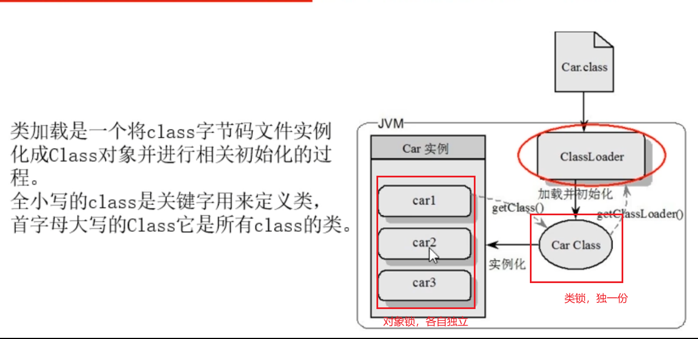

## **synchronized有三种应用方式**
+ **作用于****实例方法** **，当前实例加锁，进入同步代码块前要获得当前实例的锁；**
+ **作用于****代码块** **，对括号里配置的对象加锁**
+ **作用于****静态方法** **，当前类加锁，进去同步代码前要获得当前类对象的锁**

## **从字节码角度分析synchronized实现**
+ javap -c(v附加信息) .class 文件反编译
+ **synchronized同步代码块**
    - **实现使用的是****monitorenter和monitorexit****指令**
    - 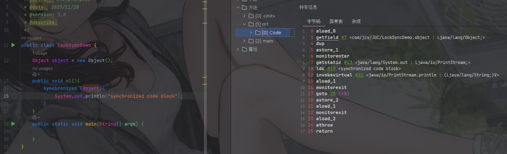
    - 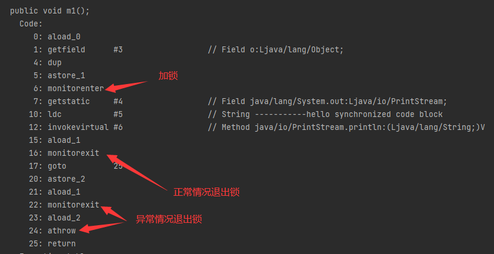
+ **synchronized普通同步方法**
    - **调用指令将会检查方法的****ACC_SYNCHRONIZED访问标志****是否被设置，如果设置了，执行线程会将现持有monitor锁，然后再执行该方法，最后在方法完成（无论是否正常结束）时释放monitor**
    - 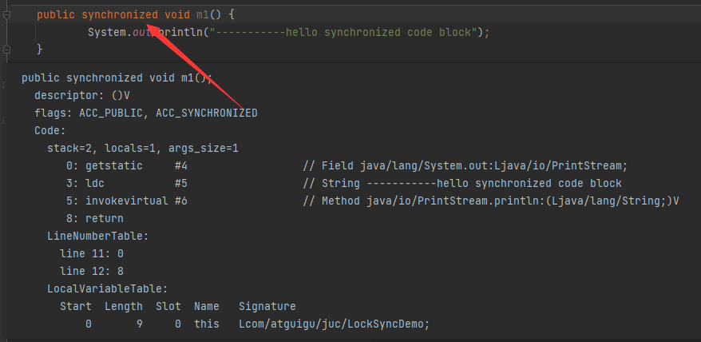
+ **synchronized静态同步方法**
    - **ACC_STATIC、ACC_SYNCHRONIZED****访问标志区分该方法是否是静态同步方法**
    - 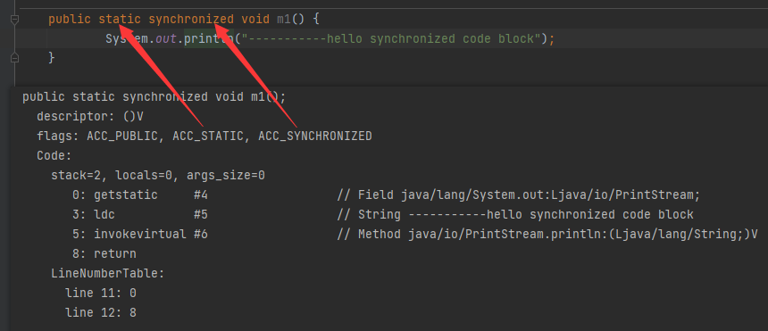

## **反编译synchronized锁的是什么**
**面试题：为什么任何一个对象都可以成为一个锁？**

**C++源码：ObjectMonitor.java--->ObjectMonitor.cpp--->ObjectMonitor.hpp**

**每个对象天生都带着一个对象监视器，每一个被锁住的对象都会和Monitor关联起来**

**总结：指针指向Monitor对象（也称为管程或监视器）的真实地址。每个对象都存在着一个monitor与之关联，当一个monitor被某个线程持有后，它便处于锁定状态。在Java虚拟机（HotSpot）中，monitor是由ObjectMonitor实现的，其主要的数据结构如下（位于HotSpot虚拟机源码ObjectMonitor.hpp文件，C++实现）：**

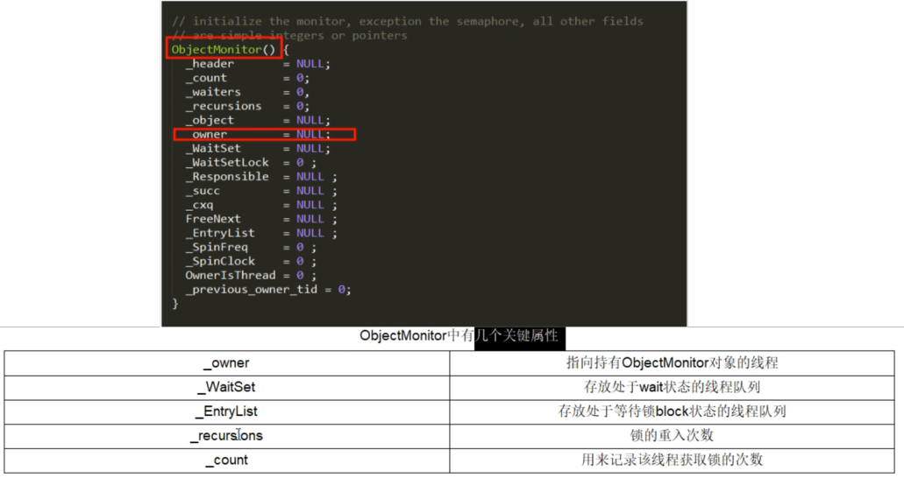

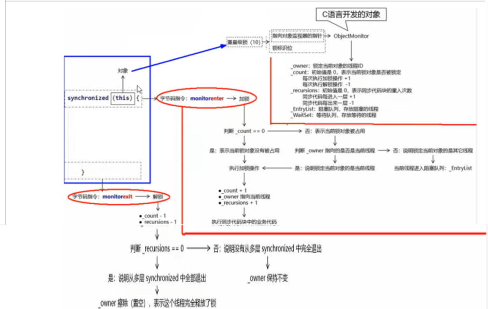

# **公平锁和非公平锁**
## **何为公平锁/非公平锁**
+ **公平锁：是指多个线程按照***_申请锁的顺序_***来获取锁，这里类似于排队买票，先来的人先买，后来的人再队尾排着，这是公平的-----** ** Lock lock = new ReentrantLock(true)**  **---表示公平锁，先来先得。**
+ **非公平锁：是指多个线程获取锁的顺序并不是按照申请的顺序，有可能后申请的线程比先申请的线程优先获取锁，在高并发环境下，有可能造成优先级反转或者饥饿的状态（某个线程一直得不到锁）---- ********Lock lock = new  ReentrantLock(false)**  **---表示非公平锁，后来的也可能先获得锁，********默认为非公平锁** **。**
+ 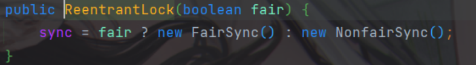

```java
public class SaleTicketDemo {
    public static void main(String[] args) {
        Ticket ticket = new Ticket();
        new Thread(()->{
            for (int i = 0; i < 55; i++) {
                ticket.sale();
            }
        },"A").start();
        new Thread(()->{
            for (int i = 0; i < 55; i++) {
                ticket.sale();
            }
        },"B").start();
        new Thread(()->{
            for (int i = 0; i < 55; i++) {
                ticket.sale();
            }
        }, "C").start();
    }
}
class Ticket{
    private int number=50;
    //默认非公平锁
    ReentrantLock lock = new ReentrantLock();
    public void sale(){
        lock.lock();
        try {
            if(number>0){
                System.out.println(Thread.currentThread().getName()+"卖出一张票，票号为："+(number--) + "  还剩下：" + number + "张票");
            }else{
                System.out.println(Thread.currentThread().getName()+"票已经售罄");
            }
        }finally {
            lock.unlock();
        }
    }
}
//非公平的情况下可能某个线程一家独占了
//公平锁雨露均沾
```

**面试题：**

+ **为什么会有公平锁/非公平锁的设计？********为什么默认非公平**？
    - **恢复挂起的线程到真正锁的获取还是有时间差的，从开发人员来看这个时间微乎其微，但是从CPU的角度来看，这个时间差存在的还是很明显的。********所以非公平锁能更充分地利用CPU的时间片，尽量减少CPU空间状态时间。**
    - **使用多线程很重要的考量点是线程****切换的开销** **，当采用非公平锁时，********当一个线程请求锁获取同步状态，然后释放同步状态，所以刚释放锁的线程在此刻再次获取同步状态的概率就变得很大，所以就减少了线程的开销。**
+ **什么时候用公平？什么时候用非公平？**
    - **如果为了****更高的吞吐量** **，很显然非公平锁是比较合适的，因为节省了很多线程切换的时间，吞吐量自然就上去了；否则就用公平锁，大家公平使用。**

# 可重入锁（递归锁）
**是指在****同一线程****在外层方法获取到锁的时侯，在进入该线程的内层方法会****自动获取锁** **（前提，锁对象的是同一个对象），不会因为之前已经获取过还没释放而阻塞---------优点之一就是可一定程度避免死锁。**

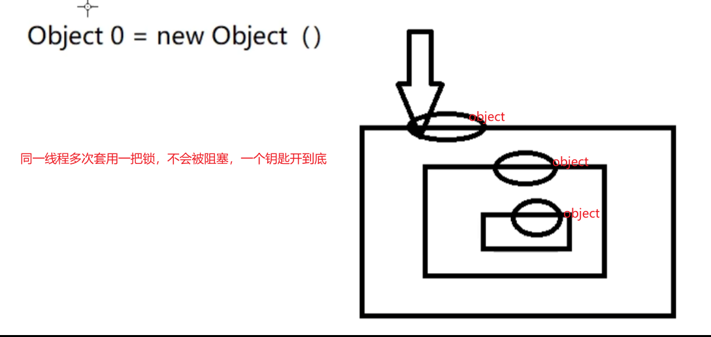

## **可重入锁种类**
+ **隐式锁（即synchronized关键字使用的锁），默认是可重入锁**
    - **在一个synchronized修饰的方法或者代码块的内部调用本类的其他synchronized修饰的方法或者代码块时，********是永远可以得到锁**
+ **显式锁（即Lock）也有ReentrantLock这样的可重入锁**

```java
public class ReEntryLockDemo {

    public static void main(String[] args) {
        final Object o = new Object();
        /**
         * ---------------外层调用
         * ---------------中层调用
         * ---------------内层调用
         */
        new Thread(() -> {
            synchronized (o) {
                System.out.println("---------------外层调用");
                synchronized (o) {
                    System.out.println("---------------中层调用");
                    synchronized (o) {
                        System.out.println("---------------内层调用");
                    }
                }
            }
        }, "t1").start();

        /**
         * 注意：加锁几次就需要解锁几次
         * ---------------外层调用
         * ---------------中层调用
         * ---------------内层调用
         */
        Lock lock = new ReentrantLock();
        new Thread(() -> {
            lock.lock();
            try {
                System.out.println("---------------外层调用");
                lock.lock();
                try {
                    System.out.println("---------------中层调用");
                    lock.lock();
                    try {
                        System.out.println("---------------内层调用");
                    } finally {
                        lock.unlock();
                    }
                } finally {
                    lock.unlock();
                }
            } finally {
                lock.unlock();
            }
        }, "t2").start();
    }
}
```

**每个锁对象拥有一个锁计数器和一个指向持有该锁的线程的指针。** 

**当执行monitorenterl时，如果目标锁对象的计数器为零，那么说明它没有被其他线程所持有，Java虚拟机会将该锁对象的持有线程设置为当前线程并且将其计数器加1。在目标锁对象的计数器不为零的情况下，如果锁对象的持有线程是当前线程，那么java虚拟机可以将其计数器加1，否则需要等待，直至持有线程释放该锁。**

**当执行monitorexit时，Java虚拟机则需将锁对象的计数器减1。计数器为零代表锁已被释放。**

# **死锁及排查**
## **概念**
**死锁是指两个或两个以上的线程在执行过程中，因抢夺资源而造成的一种****互相等待****的现象，若无外力干涉，则它们无法再继续推进下去。**

**产生原因：**

+ **系统资源不足**
+ **进程运行推进顺序不合适**
+ **系统资源分配不当**

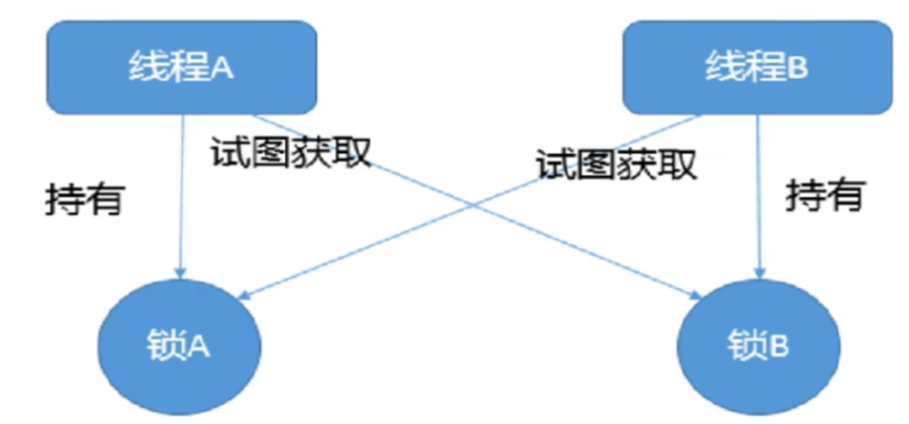

## **写一个死锁代码case**
```java
/**
 * Created with IntelliJ IDEA.
 *
 * @author： ChengYangJie
 * @date： 2023/11/28
 * @version: 1.0
 * @describe: 死锁案例编写
 */
public class DeadLockDemo {
    public static void main(String[] args) {
        Object lock1 = new Object();
        Object lock2 = new Object();
        new Thread(() -> {
            synchronized (lock1){
                System.out.println(Thread.currentThread().getName() + "获取到了lock1");
                try {
                    TimeUnit.SECONDS.sleep(1);
                } catch (InterruptedException e) {
                    e.printStackTrace();
                }
                System.out.println(Thread.currentThread().getName() + "需要获取lock2 ，等待中 ...");
                synchronized (lock2){
                    System.out.println(Thread.currentThread().getName() + "获取到了lock2");
                }
            }
        }, "t1").start();
        new Thread(() -> {
            synchronized (lock2){
                System.out.println(Thread.currentThread().getName() + "获取到了lock2");
                try {
                    TimeUnit.SECONDS.sleep(1);
                } catch (InterruptedException e) {
                    e.printStackTrace();
                }
                System.out.println(Thread.currentThread().getName() + "需要获取lock1 ，等待中 ...");
                synchronized (lock1){
                    System.out.println(Thread.currentThread().getName() + "获取到了lock1");
                }
            }
        }, "t2").start();
    }
}
```


## **如何排查死锁**
+ **纯命令**
    - **jps -l**
    - **jstack 进程编号**
    - 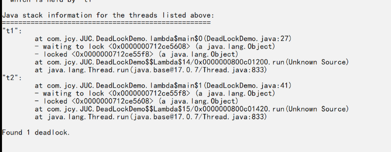
+ **图形化**
    - **jconsole -- 线程模块可以检测死锁**

‍


> 更新: 2024-09-02 16:53:25  
> 原文: <https://www.yuque.com/nibiwanxiamei/yrd6t1/ac3038f2fbf986f96ba997f4c26271e4>