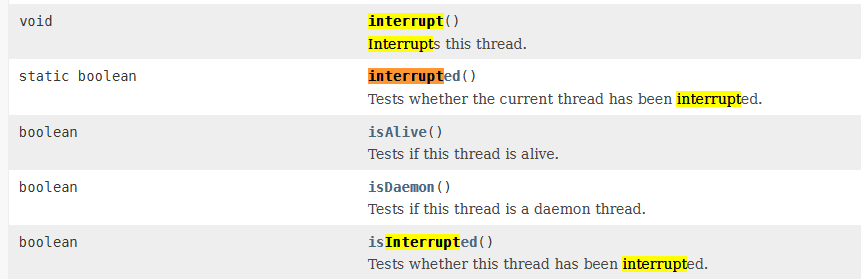
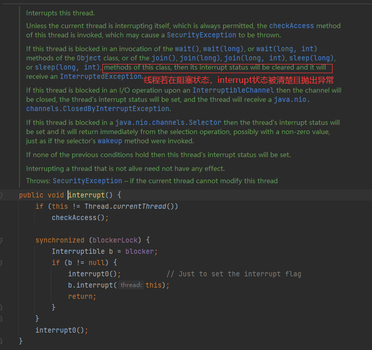
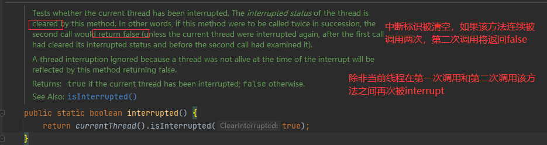
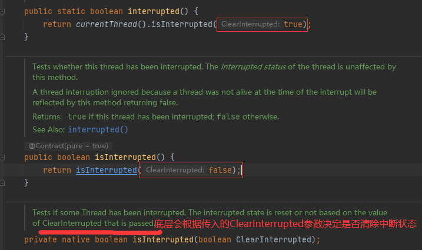

# 4.LockSupport与线程中断

---

## title: 4.LockSupport与线程中断  
date: 2023-11-28T17:28:37Z  
lastmod: 2023-11-29T15:11:48Z
# 4.LockSupport与线程中断
# **线程中断机制**
## **从阿里蚂蚁金服面试题讲起**
**Java.lang.Thread下的三个方法:**



+ **如何****中断****一个运行中的线程？**
+ **如何****停止****一个运行中的线程？**

## **什么是中断机制**
+ **首先，一个线程不应该由其他线程来强制中断或停止，而是应该由****线程自己自行停止** **，自己来决定自己的命运，所以，Thread.stop,Thread.suspend,Thread.resume都已经被废弃了**
+ **其次，在Java中没有办法立即停止一条线程，然而停止线程却显得尤为重要，如取消一个耗时操作。因此，Java提供了一种用于停止线程的****协商****机制----中断，也即中断标识协商机制**
    - **中断只是一种协作协商机制，Java没有给中断增加任何语法，中断的过程完全需要程序员自行实现**。**若要中断一个线程，你需要手动调用该线程interrupt方法，该方法也仅仅是将该线程对象的中断标识设置为true**，**接着你需要自己写代码不断检测当前线程的标识位，********如果为true，表示别的线程请求这条线程中断，此时究竟应该做什么需要你自己写代码实现。**
    - **每个线程对象都有一个中断标识位，用于表示线程是否被中断；该标识位为true表示中断，为false表示未中断；通过调用线程对象的interrupt方法将该线程的标识位设置为true；可以在别的线程中调用，也可以在自己的线程中调用。**

## **中断的相关API方法之三大方法说明**
+ **public void interrupt()**
    - **实例方法 ********Just to set the interrupt flag**
    - **实例方法仅仅是设置线程的中断状态为true，发起一个协商而不会立刻停止线程**
+ **public static boolean interrupted()**
    - **静态方法 Thread.interrupted();**
    - **判断线程是否被中断并清除当前中断状态** **（********做了两件事情** **）**
        * **1.返回当前线程的中断状态，测试当前线程是否已被中断**
        * **2.将当前线程的中断状态清零并****重新设置为false** **，清除线程的中断状态**
        * **3.这个方法有点不好理解在于如果连续两次调用此方法，则第二次返回false，因为连续调用两次的结果可能不一样**
+ **public boolean isInterrupted()**
    - **实例方法**
    - **判断当前线程是否被中断** **（通过检查中断标志位）**

## **大厂面试题中断机制考点**
+ **如何停止中断运行中的线程？**
    - **通过一个volatile变量实现**

```java
public class InterruptDemo {
    //volatile表示的变量具有可见性
    static volatile boolean isStop = false;

    public static void main(String[] args) {
        new Thread(() -> {
            while (true) {
                if (isStop) {
                    System.out.println(Thread.currentThread().getName() + " isStop的值被改为true，t1程序停止 ");
                    break;
                }
                System.out.println("-----------hello volatile-----------");
            }
        }, "t1").start();
        try {
            TimeUnit.MILLISECONDS.sleep(1);
        } catch (InterruptedException e) {
            e.printStackTrace();
        }
        new Thread(() -> {
            //t2希望t1停止
            isStop = true;
        }, "t2").start();
    }
}

/**
-----------hello volatile-----------
-----------hello volatile-----------
-----------hello volatile-----------
-----------hello volatile-----------
-----------hello volatile-----------
-----------hello volatile-----------
-----------hello volatile-----------
-----------hello volatile-----------
-----------hello volatile-----------
 t1 isStop的值被改为true，t1程序停止
 */

```

    - **通过AutomicBoolean**

```java
public class InterruptDemo {
    //原子boolean类型
    static AtomicBoolean atomicBoolean = new AtomicBoolean(false);

    public static void main(String[] args) {
        new Thread(() -> {
            while (true) {
                if (atomicBoolean.get()) {
                    System.out.println(Thread.currentThread().getName() + " atomicBoolean的值被改为true，t1程序停止");
                    break;
                }
                System.out.println("-----------hello atomicBoolean-----------");
            }
        }, "t1").start();
        try {
            TimeUnit.MILLISECONDS.sleep(1);
        } catch (InterruptedException e) {
            e.printStackTrace();
        }

        new Thread(() -> {
            atomicBoolean.set(true);
        }, "t2").start();

    }
}
/*
-----------hello atomicBoolean-----------
-----------hello atomicBoolean-----------
-----------hello atomicBoolean-----------
-----------hello atomicBoolean-----------
-----------hello atomicBoolean-----------
-----------hello atomicBoolean-----------
-----------hello atomicBoolean-----------
-----------hello atomicBoolean-----------
t1 atomicBoolean的值被改为true，t1程序停止

Process finished with exit code 0

*/
```

    - **通过Thread类自带的中断API实例方法实现----在需要中断的线程中****不断监听中断状态** **，一旦发生中断，就执行相应的中断处理业务逻辑stop线程。**

```java
public class InterruptDemo {
    //使用interrupt() 和isInterrupted()组合使用来中断某个线程
    static AtomicBoolean atomicBoolean = new AtomicBoolean(false);


    public static void main(String[] args) {
        Thread t1 = new Thread(() -> {
            while (true) {
                if (Thread.currentThread().isInterrupted()) {
                    System.out.println(Thread.currentThread().getName() + " isInterrupted()的值被改为true，t1程序停止");
                    break;
                }
                System.out.println("-----------hello isInterrupted()-----------");
            }
        }, "t1");
        t1.start();
        try {
            TimeUnit.MILLISECONDS.sleep(1);
        } catch (InterruptedException e) {
            e.printStackTrace();
        }
        //t2向t1放出协商，将t1中的中断标识位设为true，希望t1停下来
        new Thread(() -> t1.interrupt(), "t2").start();
        //当然，也可以t1自行设置
        t1.interrupt();
    }
}
/*
-----------hello isInterrupted()-----------
-----------hello isInterrupted()-----------
-----------hello isInterrupted()-----------
-----------hello isInterrupted()-----------
-----------hello isInterrupted()-----------
-----------hello isInterrupted()-----------
-----------hello isInterrupted()-----------
t1 isInterrupted()的值被改为true，t1程序停止
*/
```

+ **当前线程的中断标识为true，是不是线程就立刻停止？**
    - **答案是不立刻停止，具体来说，当对一个线程，调用interrupt时：**
        * **如果线程处于****正常活动状态** **，那么会将该线程的中断标志设置为true，********仅此而已，被设置中断标志的线程将继续正常运行，不受影响** **，所以interrupt()并不能真正的中断线程，需要被调用的线程自己进行配合才行，对于不活动的线程没有任何影响。**
        * **如果线程处于阻塞状态（例如sleep,wait,join状态等），在别的线程中调用当前线程对象的interrupt方法，那么线程将****立即退出被阻塞状态（interrupt状态也将被清除）**  **，并****抛出一个InterruptedException异常** **。**

```java
public class InterruptDemo2 {
    public static void main(String[] args) {
        //实例方法interrupt()仅仅是设置线程的中断状态位为true，不会停止线程
        Thread t1 = new Thread(() -> {
            for (int i = 1; i <= 300; i++) {
                System.out.println("------: " + i);
            }
            /*
             * ------: 298
             * ------: 299
             * ------: 300
             * t1线程调用interrupt()后的中断标志位02：true，t1不会立刻停止，而是全部输出后才停止
             */ 

            System.out.println("t1线程调用interrupt()后的中断标志位02：" + Thread.currentThread().isInterrupted());
        }, "t1");
        t1.start();
        System.out.println("t1线程默认的中断标志位：" + t1.isInterrupted());//false
        try {
            TimeUnit.MILLISECONDS.sleep(2);
        } catch (InterruptedException e) {
            e.printStackTrace();
        }
        t1.interrupt();//true
        /**
         * ------: 251
         * ------: 252
         * ------: 253
         * t1线程调用interrupt()后的中断标志位01：true
         */
        System.out.println("t1线程调用interrupt()后的中断标志位01：" + t1.isInterrupted());//true

        try {
            TimeUnit.MILLISECONDS.sleep(2000);
        } catch (InterruptedException e) {
            e.printStackTrace();
        }
    t1.interrupt();//true
        //2000毫秒后，t1线程已经不活动了，不会产生任何影响
        System.out.println("t1线程调用interrupt()后的中断标志位03：" + t1.isInterrupted());//false

    }
}
```

```java
/**
 * 1. 中断标志位默认为false
 * 2. t2对t1发出中断协商  t1.interrupt();
 * 3. 中断标志位为true： 正常情况 程序停止
 *     中断标志位为true  异常情况，.InterruptedException ，
    将会把中断状态清除，中断标志位为false
 * 4。需要在catch块中，再次调用interrupt()方法设置中断标志位;
 */
public class InterruptDemo3 {
    public static void main(String[] args) {
        Thread t1 = new Thread(() -> {
            while (true) {
                if (Thread.currentThread().isInterrupted()) {
                    System.out.println(Thread.currentThread().getName() + " 中断标志位为：" + Thread.currentThread().isInterrupted() + " 程序停止");
                    break;
                }
                //sleep方法抛出InterruptedException后，中断标识也被清空置为false，如果没有在
                //catch方法中调用interrupt方法再次将中断标识置为true，这将导致无限循环了
                try {
                    Thread.sleep(200);
                } catch (InterruptedException e) {
                    //todo Thread.currentThread().interrupt(); 
                    e.printStackTrace();
                }
                System.out.println("-------------hello InterruptDemo3");

            }
        }, "t1");
        t1.start();

        try {
            TimeUnit.SECONDS.sleep(1);
        } catch (InterruptedException e) {
            e.printStackTrace();
        }

        new Thread(() -> {
            t1.interrupt();
        }, "t2").start();
    }
}
```

**对于第二种情况的源码分析如下；**



**总之：********中断只是一种协商机制，修改中断标识位仅此而已，不是立刻stop打断**

+ **静态方法Thread.interrupted()，谈谈你的理解？**



```java
public class InterruptDemo4 {
    public static void main(String[] args) {
        /**
         * main	false
         * main	false
         * -----------1
         * -----------2
         * main	true
         * main	false
         */
        System.out.println(Thread.currentThread().getName() + "\t" + Thread.interrupted());//false
        System.out.println(Thread.currentThread().getName() + "\t" + Thread.interrupted());//false
        System.out.println("-----------1");
        Thread.currentThread().interrupt();
        System.out.println("-----------2");
        System.out.println(Thread.currentThread().getName() + "\t" + Thread.interrupted());//true
        System.out.println(Thread.currentThread().getName() + "\t" + Thread.interrupted());//false

    }
}
```

**对于静态方法Thread.interrupted()和实例方法isInterrupted()区别在于：**

+ **静态方法interrupted将会****清除中断状态** **（传入的参数ClearInterrupted为true）**
+ **实例方法isInterrupted则不会（传入的参数ClearInterrupted为false）**



## **总结**
+ **public void interrupt() ********是一个实例方法** **，它****通知目标线程中断** **，也仅仅是设置目标线程的中断标志位为true**
+ **public boolean isInterrupted() ********是一个实例方法** **，它****判断****当前线程是否被中断（通过检查中断标志位）并****获取****中断标志**
+ **public static boolean interrupted() ********是一个静态方法** **，********返回****当前线程的中断真实状态（boolean类型）后会将当前线程的中****断状态设为false** **，此方法调用之后会清楚当前线程的中断标志位的状态（将中断标志置为false了），返回当前值并清零置为false。**

# **LockSupport是什么**
**LockSupport是用来创建锁和其他同步类的基本线程阻塞原语，其中****park()和unpack()而作用分别是阻塞线程和解除阻塞线程.** 

# **线程等待唤醒机制**
## **三种让线程等待和唤醒的方法**
+ **方式一：使用Object中的wait()方法让线程等待，使用Object中的notify()方法唤醒线程**
+ **方式二：使用JUC包中的Condition的await()方法让线程等待，使用signal()方法唤醒线程**
+ **方式三：LockSupport类可以阻塞当前线程以及唤醒指定被阻塞的线程**

## **Object类中的wait和notify方法实现线程等待和唤醒**
+ **wait和notify方法必须要在同步代码块(synchronized)或者方法(synchronized)里面，且成对出现使用**
+ **先wait再notify才ok**

```java
public class LockSupportDemo {

    public static void main(String[] args) {
        Object objectLock = new Object();
        /**
         * t1	 -----------come in
         * t2	 -----------发出通知
         * t1	 -------被唤醒
         */
        new Thread(() -> {
            synchronized (objectLock) {
                System.out.println(Thread.currentThread().getName() + "\t -----------come in");
                try {
                    objectLock.wait();
                } catch (InterruptedException e) {
                    e.printStackTrace();
                }
                System.out.println(Thread.currentThread().getName() + "\t -------被唤醒");
            }
        }, "t1").start();

        try {
            TimeUnit.SECONDS.sleep(1);
        } catch (InterruptedException e) {
            e.printStackTrace();
        }

        new Thread(() -> {
            synchronized (objectLock) {
                objectLock.notify();
                System.out.println(Thread.currentThread().getName() + "\t -----------发出通知");
            }

        }, "t2").start();
    }
}
```

## **Condition接口中的await和signal方法实现线程的等待和唤醒**
+ **Condition中的线程等待和唤醒方法，需要****先获取锁**
+ **一定要****先await - P后signal - V** **，不要反了**

```java
public class LockSupportDemo {

    public static void main(String[] args) {
        Lock lock = new ReentrantLock();
        Condition condition = lock.newCondition();
        /**
         * t1	 -----------come in
         * t2	 -----------发出通知
         * t1	 -----------被唤醒
         */
        new Thread(() -> {
            lock.lock();
            try {
                System.out.println(Thread.currentThread().getName() + "\t -----------come in");
                condition.await();
                System.out.println(Thread.currentThread().getName() + "\t -----------被唤醒");
            } catch (InterruptedException e) {
                e.printStackTrace();
            } finally {
                lock.unlock();
            }
        }, "t1").start();

        try {
            TimeUnit.SECONDS.sleep(1);
        } catch (InterruptedException e) {
            e.printStackTrace();
        }

        new Thread(() -> {
            lock.lock();
            try {
                condition.signal();
                System.out.println(Thread.currentThread().getName() + "\t -----------发出通知");
            } finally {
                lock.unlock();
            }
        }, "t2").start();

    }
}
```

## **上述两个对象Object和Condition使用的限制条件**
+ **线程需要先获得并持有锁，必须在锁块（synchronized或lock）中**
+ **必须要先等待后唤醒，线程才能够被唤醒**

## **LockSupport类中的park等待和unpark唤醒**
+ **是什么**
    - **LockSupport 是用于创建锁和其他同步类的基本线程阻塞原语**
    - **LockSupport类使用了一种名为Permit（许可）的概念来做到**_**阻塞和唤醒线程**_**的功能，每个线程都有一个许可（Permit），********许可证只能有一个，累加上限是1** **。**
+ **主要方法**
    - **阻塞: Peimit许可证默认没有不能放行，所以一开始调用park()方法当前线程会阻塞，直到别的线程给当前线程发放peimit，park方法才会被唤醒。**
    - **park/park(Object blocker)-------阻塞当前线程/阻塞传入的具体线程**
+ **唤醒: 调用unpack(thread)方法后 就会将thread线程的许可证peimit发放，会自动唤醒park线程，即之前阻塞中的LockSupport.park()方法会立即返回。**
    - **unpark(Thread thread)------唤醒处于阻塞状态的指定线程**
+ **代码**

```java

/**
 * Created with IntelliJ IDEA.
 *
 * @author： ChengYangJie
 * @date： 2023/11/29
 * @describe: LockSupport park 和 unpark
 */
public class LockSupportDemo {
    public static void main(String[] args) {
        Thread t1 = new Thread(() -> {
            System.out.println(Thread.currentThread().getName() + " come in ");
            //上锁
            LockSupport.park();
            System.out.println(Thread.currentThread().getName() + " 被唤醒 ");
        }, "t1");
        t1.start();
        try {
            TimeUnit.SECONDS.sleep(1);
        } catch (InterruptedException e) {
            e.printStackTrace();
        }
        new Thread(() -> {
            //解锁
            LockSupport.unpark(t1);
            System.out.println(Thread.currentThread().getName() + " 发出唤醒通知 ");
        }, "t2").start();
    }
}
/*
t1 come in 
t2 发出唤醒通知 
t1 被唤醒
*/
```

+ **重点说明（重要）** 
    - **LockSupport是用来创建锁和其他同步类的基本线程阻塞原语**，**所有的方法都是静态方法，可以让线程在任意位置阻塞，阻塞后也有对应的唤醒方法。归根结底，LockSupport时调用Unsafe中的native代码**
    - **LockSupport提供park()和unpark()方法实现阻塞线程和解除线程阻塞的过程**，**LockSupport和每个使用它的线程都有一个许可（Peimit）关联，每个线程都有一个相关的permit，** **peimit最多只有一个，重复调用unpark也不会积累凭证。**
    - **形象理解：线程阻塞需要消耗凭证（Permit），这个凭证最多只有一个**
+ **当调用park时，如果有凭证，则会直接消耗掉这个凭证然后正常退出。如果没有凭证，则必须阻塞等待凭证可用；**
+ **当调用unpark时，它会增加一个凭证，但凭证最多只能有1各，累加无效。**
+ **面试题**
+ **为什么LockSupport可以突破wait/notify的原有调用顺序？**
    - **因为unpark获得了一个凭证，之后再调用park方法，就可以名正言顺的凭证消费，故不会阻塞，先发放了凭证后续可以畅通无阻。**
+ **为什么唤醒两次后阻塞两次，但最终结果还会阻塞线程？**
    - **因为****凭证的数量最多为1** **，连续调用两次unpark和调用一次unpark效果一样，只会增加一个凭证，而****调用两次park却需要消费两个凭证** **，证不够，不能放行**

‍


> 更新: 2024-09-02 17:04:15  
> 原文: <https://www.yuque.com/nibiwanxiamei/yrd6t1/d9dc051ce545f485554aa800217d4850>