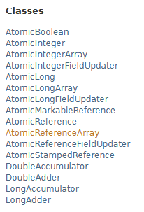
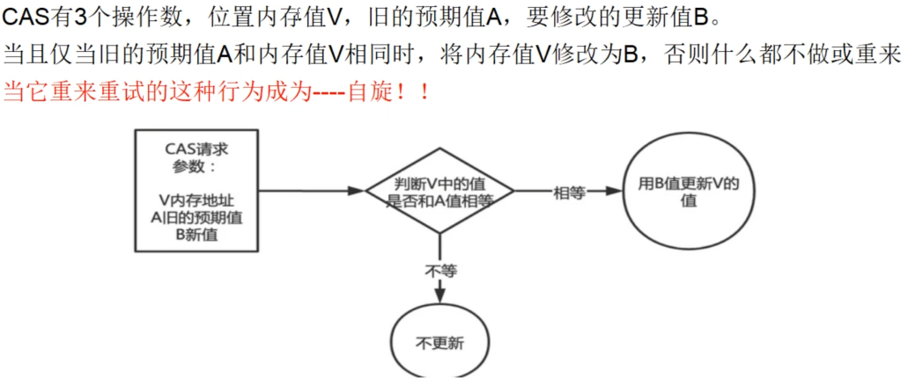
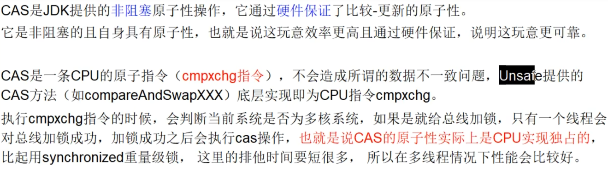
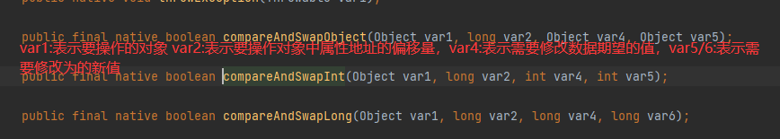
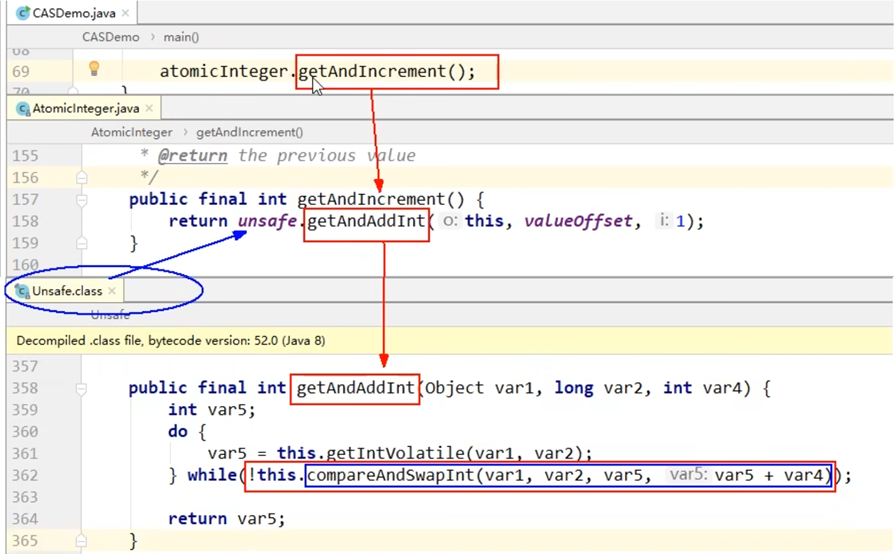
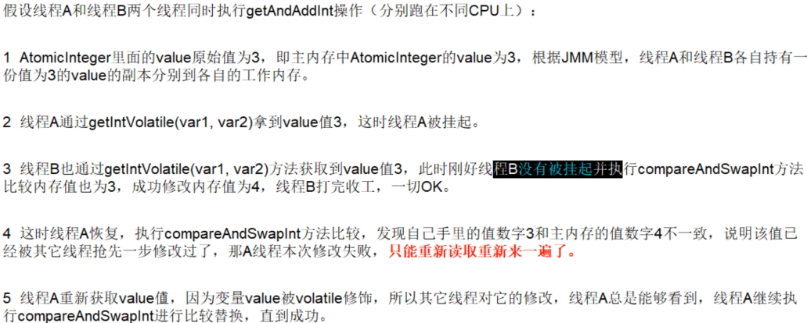
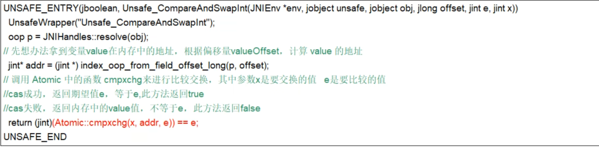
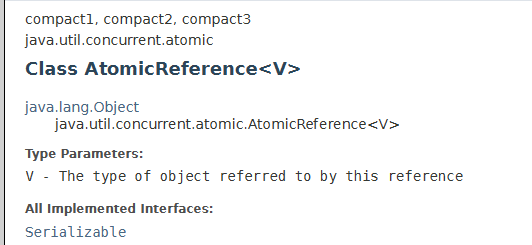
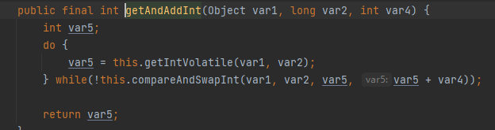
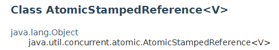

# 7.CAS

# **原子类**
**Java.util.concurrent.atomic**



# **没有CAS之前**
**多线程环境中**不使用原子类保证线程安全i++（基本数据类型）

```java
class Test {
        private volatile int count = 0;
        //若要线程安全执行执行count++，需要加锁
        public synchronized void increment() {
             count++;
        }

        public int getCount() {
             return count;
        }
}
```

# **使用CAS之后**
**多线程环境中**使用原子类保证线程安全i++（基本数据类型）------  **类似于乐观锁**

```java
class Test2 {
        private AtomicInteger count = new AtomicInteger();

        public void increment() {
            count.incrementAndGet();
        }
      //使用AtomicInteger之后，不需要加锁，也可以实现线程安全。
       public int getCount() {
            return count.get();
        }
}
```

# CAS**是什么？**
**CAS(compare and swap** **) - 比较并交换** **，实现并发算法时常用到的一种技术，用于保证共享变量的原子性更新**，**它包含三个操作数 --- ****<font style="color:#DF2A3F;">内存位置、预期原值与更新值。</font>**<font style="color:#DF2A3F;"> </font>

**执行CAS操作的时候，将内存位置的值与预期原值进行比较：**

+ **如果****相匹配** **，那么处理器会自动将该位置更新为新值**
+ **如果不匹配** **，则失败重试，多个线程同时执行CAS操作只有一个会成功。**



```java
public class CASDemo {
    public static void main(String[] args) {
        AtomicInteger atomicInteger = new AtomicInteger(5);
        System.out.println(atomicInteger.compareAndSet(5, 2022) + "\t" + atomicInteger.get());//true	2022
        System.out.println(atomicInteger.compareAndSet(5, 2022) + "\t" + atomicInteger.get());//false	2022
    }
}
```



**compareAndSet 源码**



# **CAS底层原理？谈谈对Unsafe类的理解？**
## **Unsafe**
**Unsafe类是CAS的核心类，由于Java方法无法直接访问底层系统，需要通过本地（native）方法来访问，Unsafe相当于一个后门，基于该类可以直接操作特定内存的数据。********Unsafe类存在于sun.misc包中** **，其内部方法操作可以像C的指针一样直接操作内存，因此Java中CAS操作的执行依赖于Unsafe类的方法。**

**注意：********Unsafe类中的所有方法都是native修饰的，也就是说Unsafe类中的所有方法都直接调用操作系统底层资源执行相应任务。** 

**问题：我们知道i++是线程不安全的，那****AtomicInteger.getAndIncrement()如何保证原子性？** 

**AtomicInteger类主要利用CAS+volatile和native方法来保证原子操作，从而避免synchronized的高开销，执行效率大为提升：**



**CAS并发原语体现在Java语言中就是sun.misc.Unsafe类中的各个方法。调用Unsafe类中的CAS方法，JVM会帮我们实现出CAS汇编指令** **。这是一种完全依赖于硬件的功能，通过它实现了原子操作。再次强调，由于CAS是一种系统原语，原语属于操作系统用语范畴，是由若干条指令组成的，用于完成某个功能的一个过程，并且原语的执行必须是连续的，在执行过程中不允许被中断，也就是说CAS是一条CPU的原子指令，不会造成所谓的数据不一致问题**。

## **源码分析**


## **底层汇编**


**JDK提供的CAS机制，在汇编层级会禁止变量两侧的指令优化，然后使用compxchg指令比较并更新变量值（原子性）** 

**总结：**

+ **CAS是靠硬件实现的从而在硬件层面提升效率，最底层还是交给硬件来保证原子性和可见性**
+ **实现方式是基于硬件平台的汇编指令，在inter的CPU中，使用的是汇编指令compxchg指令**
+ **核心思想就是比较要更新变量V的值和预期值E，相等才会将V的值设为新值N，如果不相等自旋再来**

# **原子引用**


```java
@Data
@AllArgsConstructor
@NoArgsConstructor
class User {
    String userName;
    int age;
}

public class AtomicReferenceDemo {
    public static void main(String[] args) {
        AtomicReference<User> atomicReference = new AtomicReference<>();
        User z3 = new User("z3", 22);
        User li4 = new User("li4", 25);

        atomicReference.set(z3);
        System.out.println(atomicReference.compareAndSet(z3, li4) + "\t" + atomicReference.get().toString());//true	User(userName=li4, age=25)
        System.out.println(atomicReference.compareAndSet(z3, li4) + "\t" + atomicReference.get().toString());//false	User(userName=li4, age=25)

    }
}
```

# **CAS与自旋锁，借鉴CAS思想**
**CAS是实现自旋锁的基础，********CAS利用CPU指令保证了操作的原子性** **，以达到锁的效果，至于自旋锁 --- 字面意思自己旋转。是指尝试获取锁的线程不会立即阻塞，而是****采用循环的方式去尝试获取锁** **，当线程发现锁被占用时，会不断循环判断锁的状态，直到获取。这样的好处是减少线程上下文切换的消耗，缺点是循环会消耗CPU。**

## **自己实现一个自旋锁spinLockDemo**
**题目：实现一个自旋锁，借鉴CAS思想**

**通过CAS完成自旋锁，********A线程先进来调用myLock方法自己持有锁5秒钟，B随后进来后发现当前没有线程持有锁，所以只能通过自旋等待，直到A释放锁后B随后抢到。** 

```java
/**
 * Created with IntelliJ IDEA.
 *
 * @author： ChengYangJie
 * @date： 2023/12/1
 * @version: 1.0
 * @describe: 自旋锁实现
 */
public class SpinLockDemo {
    AtomicReference<Thread> atomicReference = new AtomicReference<Thread>();
    public void lock(){
        Thread thread = Thread.currentThread();
        //如果值是null，线程就自己上，否则自旋
        System.out.println(thread.getName() + " --- come in ---");
        while (!atomicReference.compareAndSet(null,thread)){
            //没获取到锁就一直循环 - 自旋
            System.out.println(thread.getName() + " --- 没抢到锁，自旋in ---");
            try {
                TimeUnit.SECONDS.sleep(1);
            } catch (InterruptedException e) {
                e.printStackTrace();
            }
        }
    }
    public void unLock(){
        Thread thread = Thread.currentThread();
        //解锁，有锁释放
        atomicReference.compareAndSet(thread,null);
        System.out.println(thread.getName() + " --- over unlock ---");
    }
    public static void main(String[] args) {
        SpinLockDemo spinLockDemo = new SpinLockDemo();
        new Thread(() -> {
            spinLockDemo.lock();
            try {
                TimeUnit.SECONDS.sleep(5);
            } catch (InterruptedException e) {
                e.printStackTrace();
            }
            spinLockDemo.unLock();
        }, "A").start();

        try {
            TimeUnit.MILLISECONDS.sleep(500);
        } catch (InterruptedException e) {
            e.printStackTrace();
        }

        new Thread(() -> {
            spinLockDemo.lock();
            spinLockDemo.unLock();
        }, "B").start();
    }
}

A --- come in ---
B --- come in ---
B --- 没抢到锁，自旋in ---
B --- 没抢到锁，自旋in ---
B --- 没抢到锁，自旋in ---
B --- 没抢到锁，自旋in ---
B --- 没抢到锁，自旋in ---
A --- over unlock ---
B --- over unlock ---
```

# **CAS缺点**
## **循环时间长开销很大**


+ **getAndAddInt方法有一个do while**
+ **如果CAS失败，会一直进行尝试，如果CAS长时间一直不成功，可能会给CPU带来很大开销**

## **引出来ABA问题？**
+ **ABA问题怎么产生的？**
    - **CAS算法实现一个重要前提需要提取出内存中某时刻的数据并在当下时刻比较并替换，那么在这个时间差类会导致数据的变化。**
    - **比如说一个线程1从内存位置V中取出A，这时候另一个线程2也从内存中取出A，并且线程2进行了一些操作将值变成了B，然后线程2又将V位置的数据变成A，这时候线程1进行CAS操作发现内存中仍然是A，预期ok，然后线程1操作成功--------********尽管线程1的CAS操作成功，但是不代表这个过程就是没有问题的。**
+ **版本号时间戳原子引用**



```java
@Data
@AllArgsConstructor
@NoArgsConstructor
class Book {
    private int id;
    private String bookName;
}

public class AtomicStampedReferenceDemo {
    public static void main(String[] args) {
        Book javaBook = new Book(1, "javaBook");
        AtomicStampedReference<Book> atomicStampedReference = new AtomicStampedReference<>(javaBook, 1);
        System.out.println(atomicStampedReference.getReference() + "\t" + atomicStampedReference.getStamp());

        Book mysqlBook = new Book(2, "mysqlBook");
        boolean b;
        b = atomicStampedReference.compareAndSet(javaBook, mysqlBook, atomicStampedReference.getStamp(), atomicStampedReference.getStamp() + 1);
        System.out.println(b + "\t" + atomicStampedReference.getReference() + "\t" + atomicStampedReference.getStamp());

        b = atomicStampedReference.compareAndSet(mysqlBook, javaBook, atomicStampedReference.getStamp(), atomicStampedReference.getStamp() + 1);
        System.out.println(b + "\t" + atomicStampedReference.getReference() + "\t" + atomicStampedReference.getStamp());
    }
}
/**
 * Book(id=1, bookName=javaBook)	1
 * true	Book(id=2, bookName=mysqlBook)	2
 * true	Book(id=1, bookName=javaBook)	3
 */
```

**多线程情况下演示AtomicStampedReference解决ABA问题**

```java
public class ABADemo {
    static AtomicInteger atomicInteger = new AtomicInteger(100);
    static AtomicStampedReference<Integer> atomicStampedReference = new AtomicStampedReference<>(100, 1);

    public static void main(String[] args) {
//        abaHappen();//true	2023
        /**
         * t3	首次版本号: 1
         * t4	首次版本号: 1
         * t3	2次版本号: 2
         * t3	3次版本号: 3
         * false	100	3
         */
        abaNoHappen();

    }
    private static void abaNoHappen() {
        new Thread(() -> {
            int stamp = atomicStampedReference.getStamp();
            System.out.println(Thread.currentThread().getName() + "\t" + "首次版本号: " + stamp);
            try {
                TimeUnit.MILLISECONDS.sleep(500);
            } catch (InterruptedException e) {
                e.printStackTrace();
            }
            atomicStampedReference.compareAndSet(100, 101, atomicStampedReference.getStamp(), atomicStampedReference.getStamp() + 1);
            System.out.println(Thread.currentThread().getName() + "\t" + "2次版本号: " + atomicStampedReference.getStamp());
            atomicStampedReference.compareAndSet(101, 100, atomicStampedReference.getStamp(), atomicStampedReference.getStamp() + 1);
            System.out.println(Thread.currentThread().getName() + "\t" + "3次版本号: " + atomicStampedReference.getStamp());
        }, "t3").start();


        new Thread(() -> {
            int stamp = atomicStampedReference.getStamp();
            System.out.println(Thread.currentThread().getName() + "\t" + "首次版本号: " + stamp);
            try {
                TimeUnit.SECONDS.sleep(1);
            } catch (InterruptedException e) {
                e.printStackTrace();
            }
            boolean b = atomicStampedReference.compareAndSet(100, 200, stamp, stamp + 1);
            System.out.println(b + "\t" + atomicStampedReference.getReference() + "\t" + atomicStampedReference.getStamp());
        }, "t4").start();
    }

    private static void abaHappen() {
        new Thread(() -> {
            atomicInteger.compareAndSet(100, 101);
            try {
                TimeUnit.MILLISECONDS.sleep(10);
            } catch (InterruptedException e) {
                e.printStackTrace();
            }
            atomicInteger.compareAndSet(101, 100);
        }, "t1").start();


        new Thread(() -> {
            try {
                TimeUnit.MILLISECONDS.sleep(200);
            } catch (InterruptedException e) {
                e.printStackTrace();
            }
            System.out.println(atomicInteger.compareAndSet(100, 2023) + "\t" + atomicInteger.get());//true	2023
        }, "t2").start();
    }
}
```

**一句话：比较加版本号一起上**

‍


> 更新: 2024-08-02 19:45:37  
> 原文: <https://www.yuque.com/nibiwanxiamei/yrd6t1/7.cas>