# 9.聊聊ThreadLocal

***

# **ThreadLocal简介**

## **面试题**

* **ThreadLocal中ThreadLocalMap的数据结构和关系**

:::success
**ThreadLocal中的map是以ThreadLocal弱引用为key，Object为value的一个hashmap。****<font style="color:rgb(5, 7, 59);background-color:rgb(253, 253, 254);">ThreadLocalMap</font>****<font style="color:rgb(5, 7, 59);background-color:rgb(253, 253, 254);">是</font>****<font style="color:rgb(5, 7, 59);background-color:rgb(253, 253, 254);">ThreadLocal</font>****<font style="color:rgb(5, 7, 59);background-color:rgb(253, 253, 254);">实现线程隔离的关键，它通过在每个线程中维护一个独立的</font>****<font style="color:rgb(5, 7, 59);background-color:rgb(253, 253, 254);">ThreadLocalMap</font>****<font style="color:rgb(5, 7, 59);background-color:rgb(253, 253, 254);">来存储和获取线程局部变量的值。</font>**

:::

* **ThreadLocalMap的Hash算法**？
* **ThreadLocalMap中Hash冲突如何解决？ 线性探测**
* **ThreadLocalMap扩容机制？ 达到阈值 = size \* 2/3，rehash，之后size > 3/4阈值，扩容两倍移动**
* **ThreadLocalMap中过期key的清理机制？\*\*\*\*<font style="color:#DF2A3F;">探测式清理和启发式清理流程（get和set都会清理）</font>**
* **ThreadLocal的key是弱引用，这是为什么？**

:::success
**<font style="color:#DF2A3F;">若theadLocal采用强引用，在栈内有ThreadLocal的强引用，Map内也是强引用，当栈内的栈帧退出后，此ThreadLocal就应该被回收，而map是强引用，就导致此ThreadLocal无法被回收造成内存泄漏；</font>**

:::

* **ThreadLocal的key是弱引用，那么在 threadLocal.get()的时候,发生GC之后，key是否为null？**
* **ThreadLocal内存泄漏问题你知道吗？**
* **ThreadLocal中最后为什么要加remove方法？**

:::success
`ThreadLocalMap` 中使用的 \*\* key 为 **`ThreadLocal` \*\* 的弱引用**，**而 value 是强引用**。所以，如果 `ThreadLocal` 没有被外部强引用的情况下，在垃圾回收的时候，key 会被清理掉，而 value 不会被清理掉。

这样一来，`ThreadLocalMap` 中就会**出现 key 为 null 的 Entry**。假如我们不做任何措施的话，**value 永远无法被 GC 回收，这个时候就可能会产生内存泄露**。`ThreadLocalMap` 实现中已经考虑了这种情况，在调用 `set()`、`get()`、`remove()` 方法的时候，会清理掉 key 为 null 的记录。使用完 `ThreadLocal`方法后最好手动调用`remove()`方法

:::

## **是什么？**

**<font style="color:#DF2A3F;">ThreadLocal -- 线程局部变量</font>** **。每一个线程在访问ThreadLocal实例的时候（通过其get或set方法）都有**\*\*<font style="color:#DF2A3F;">独占初始化的变量副本</font>\*\*\*\*。\*\* **ThreadLocal实例通常是类中的私有静态字段，使用它的目的是希望将状态（例如，用户ID或事物ID）与线程关联起来** **。**

## **能干啥？**

**实现每一个线程都有自己专属的本地变量副本** **。主要解决了让每个线程绑定自己的值，通过使用get()和set()方法，获取默认值或将其改为当前线程所存的副本的值从而**\*\*<font style="color:#DF2A3F;">避免了线程安全问题</font>\*\*

## **API介绍**

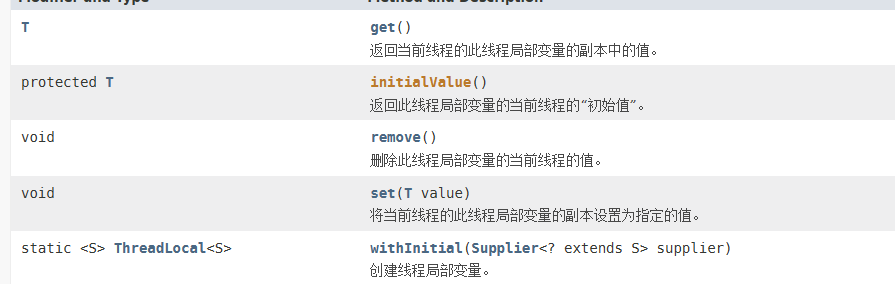

## **helloworld**

* **问题描述：5个销售买房子，集团只关心销售总量的准确统计数，按照总销售额统计，方便集团公司给部分发送奖金--------群雄逐鹿起纷争------为了数据安全只能加锁**

```java
class House {
    //5个销售卖房子，集团只关心销售总量的精确统计数
    int saleCount = 0;
    public synchronized void saleHouse() {
        saleCount++;
    }

}
public class ThreadLocalDemo {
    public static void main(String[] args) {
        House house = new House();
        for (int i = 0; i < 5; i++) {
            new Thread(() -> {
                int size = new Random().nextInt(5) + 1;
                System.out.println(size);
                for (int j = 0; j < size; j++) {
                    house.saleHouse();
                }
            }, String.valueOf(i)).start();
        }
        try {
            TimeUnit.MILLISECONDS.sleep(300);
        } catch (InterruptedException e) {
            e.printStackTrace();
        }
        System.out.println(Thread.currentThread().getName() + "\t" + "共计卖出多少套： " + house.saleCount);
    }
}

5
5
1
1
5
main	共计卖出多少套： 17
```

* **需求变更：希望各自分灶吃饭，各凭销售本事提成，按照出单数各自统计-------比如房产中介销售都有自己的销售额指标，自己专属自己的，不和别人参和。----人手一份天下安**

```java
class House {
    //5个销售卖房子，集团只关心销售总量的精确统计数
    int saleCount = 0;
    public synchronized void saleHouse() {
        saleCount++;
    }
    //ThreadLocal类型的销售额
    ThreadLocal<Integer> saleVolume = ThreadLocal.withInitial(() -> 0);
    public void saleHouseByThreadLocal() {
        //线程独有的销售额
        saleVolume.set(1 + saleVolume.get());
    }

}
public class ThreadLocalDemo {
    public static void main(String[] args) {
        House house = new House();
        for (int i = 0; i < 5; i++) {
            new Thread(() -> {
                int size = new Random().nextInt(5) + 1;
                try {
                    for (int j = 0; j < size; j++) {
                        house.saleHouse();
                        house.saleHouseByThreadLocal();
                    }
                    System.out.println(Thread.currentThread().getName() + "\t" + "号销售共计卖出多少套： " + house.saleVolume.get());
                } finally {
                    //销售额清零,使用完毕后清空，避免内存泄漏
                    house.saleVolume.remove();
                }
            }, String.valueOf(i)).start();
        }
        try {
            TimeUnit.MILLISECONDS.sleep(300);
        } catch (InterruptedException e) {
            e.printStackTrace();
        }
        System.out.println(Thread.currentThread().getName() + "\t" + "共计卖出多少套： " + house.saleCount);
    }
}


1	号销售共计卖出多少套： 2
2	号销售共计卖出多少套： 3
3	号销售共计卖出多少套： 2
4	号销售共计卖出多少套： 3
0	号销售共计卖出多少套： 4
main	共计卖出多少套： 14

```

## **总结**

* **因为每个Thread内有自己的实例副本且该副本只有当前线程自己使用**
* **既然其他ThreadLocal不可访问，那就不存在多线程间共享问题**
* **统一设置初始值，但是每个线程对这个值得修改都是各自线程互相独立得**
* **如何才能不争抢**
  * **加入synchronized或者Lock控制资源的访问顺序**
  * **人手一份，大家各自安好，没有必要争抢**

# \*\*ThreadLocal源码分析 \*\***♥♥♥**

<https://juejin.cn/post/6844904151567040519#heading-0>

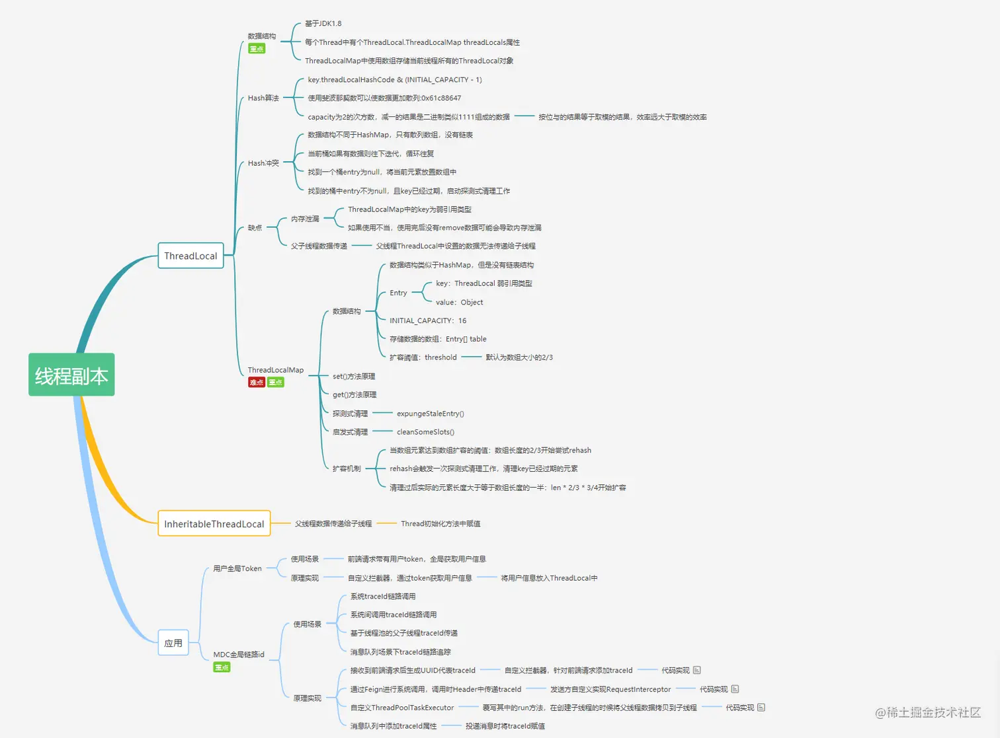

## **Thread、ThreadLocal、ThreadLocalMap关系**

* **Thread和ThreadLocal，人手一份**
  * 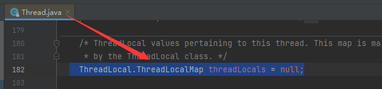
* **ThreadLocal和ThreadLocalMap**
  * 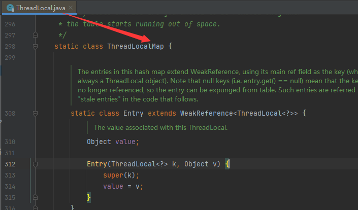
* **三者总概括**
  * 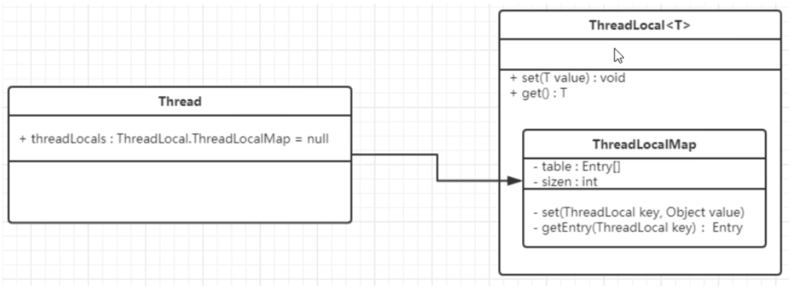
  * **ThreadLocalMap实际上就是一个以ThreadLocal弱引用实例为Key，任意对象为value的Entry对象**
  * **为ThreadLocal变量赋值，实际上就是以当前ThreadLocal实例为Key，值为value的Entry往这个ThreadLocalMap中存放**
  * 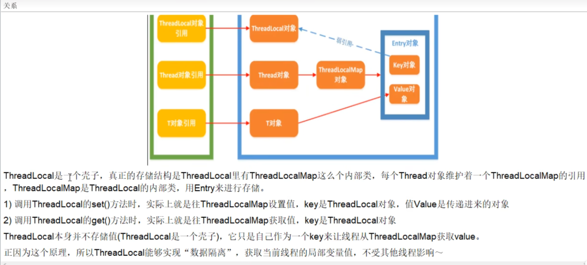

## ♥♥♥ThreadLocal数据结构

<code><font style="color:rgb(255, 80, 44);background-color:rgb(255, 245, 245);">ThreadLocalMap</font></code><font style="color:rgb(37, 41, 51);">有点类似</font><code><font style="color:rgb(255, 80, 44);background-color:rgb(255, 245, 245);">HashMap</font></code><font style="color:rgb(37, 41, 51);">的结构，只是</font><code><font style="color:rgb(255, 80, 44);background-color:rgb(255, 245, 245);">HashMap</font></code><font style="color:rgb(37, 41, 51);">是由</font>**<font style="color:rgb(37, 41, 51);">数组+链表</font>**<font style="color:rgb(37, 41, 51);">实现的，而</font><code><font style="color:rgb(255, 80, 44);background-color:rgb(255, 245, 245);">ThreadLocalMap</font></code><font style="color:rgb(37, 41, 51);">中并没有</font>**<font style="color:rgb(37, 41, 51);">链表</font>**<font style="color:rgb(37, 41, 51);">结构。</font>

## GC之后key是否为null

<code><font style="color:rgb(255, 80, 44);background-color:rgb(255, 245, 245);">ThreadLocal</font></code><font style="color:rgb(37, 41, 51);"> 的</font><code><font style="color:rgb(255, 80, 44);background-color:rgb(255, 245, 245);">key</font></code><font style="color:rgb(37, 41, 51);">是弱引用，那么在</font><code><font style="color:rgb(255, 80, 44);background-color:rgb(255, 245, 245);"> threadLocal.get()</font></code><font style="color:rgb(37, 41, 51);">的时候,发生</font><code><font style="color:rgb(255, 80, 44);background-color:rgb(255, 245, 245);">GC</font></code><font style="color:rgb(37, 41, 51);">之后，</font><code><font style="color:rgb(255, 80, 44);background-color:rgb(255, 245, 245);">key</font></code><font style="color:rgb(37, 41, 51);">是否是</font><code><font style="color:rgb(255, 80, 44);background-color:rgb(255, 245, 245);">null</font></code><font style="color:rgb(37, 41, 51);">？</font>

<code><font style="color:rgb(255, 80, 44);background-color:rgb(255, 245, 245);">hreadlocal.get()</font></code><font style="color:rgb(37, 41, 51);"> 操作，证明其实还是有</font>**<font style="color:rgb(37, 41, 51);">强引用</font>**<font style="color:rgb(37, 41, 51);">存在的，所以 </font><code><font style="color:rgb(255, 80, 44);background-color:rgb(255, 245, 245);">key</font></code><font style="color:rgb(37, 41, 51);"> 并不为 </font><code><font style="color:rgb(255, 80, 44);background-color:rgb(255, 245, 245);">null</font></code><font style="color:rgb(37, 41, 51);">，如下图所示，</font><code><font style="color:rgb(255, 80, 44);background-color:rgb(255, 245, 245);">ThreadLocal</font></code><font style="color:rgb(37, 41, 51);">的</font>**<font style="color:rgb(37, 41, 51);">强引用</font>**<font style="color:rgb(37, 41, 51);">仍然是存在的。那么对应的ThreadLocal对象不会被回收。</font>

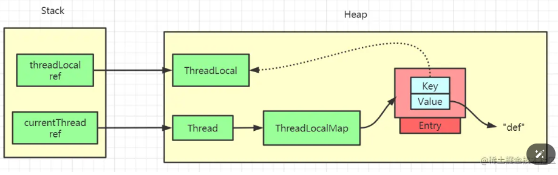

## ThreadLocal set(), get()方法

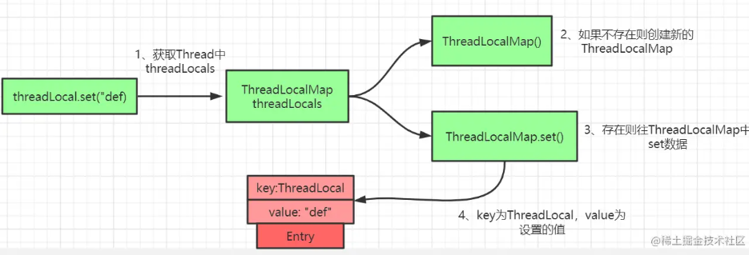

```java
public void set(T value) {
    Thread t = Thread.currentThread();
    ThreadLocalMap map = getMap(t);
    if (map != null)
        map.set(this, value);
    else
        createMap(t, value);
}

void createMap(Thread t, T firstValue) {
    t.threadLocals = new ThreadLocalMap(this, firstValue);
}

```

**ThreadLocal的get方法也是调用ThreadLocalMap的getEntry方法。**

## ♥♥♥ThreadLocalMap详解

### Hash算法

**int i = key.threadLocalHashCode & (len-1);**

<font style="color:rgb(37, 41, 51);">这里最关键的就是</font><code><font style="color:rgb(255, 80, 44);background-color:rgb(255, 245, 245);">threadLocalHashCode</font></code><font style="color:rgb(37, 41, 51);">值的计算，</font><code><font style="color:rgb(255, 80, 44);background-color:rgb(255, 245, 245);">ThreadLocal</font></code><font style="color:rgb(37, 41, 51);">中有一个属性为</font><code><font style="color:rgb(255, 80, 44);background-color:rgb(255, 245, 245);">HASH_INCREMENT = 0x61c88647</font></code>

```java
public class ThreadLocal<T> {
    private final int threadLocalHashCode = nextHashCode();

    private static AtomicInteger nextHashCode = new AtomicInteger();

    private static final int HASH_INCREMENT = 0x61c88647;

    private static int nextHashCode() {
        return nextHashCode.getAndAdd(HASH_INCREMENT);
    }
    
    static class ThreadLocalMap {
        ThreadLocalMap(ThreadLocal<?> firstKey, Object firstValue) {
            table = new Entry[INITIAL_CAPACITY];
            int i = firstKey.threadLocalHashCode & (INITIAL_CAPACITY - 1);

            table[i] = new Entry(firstKey, firstValue);
            size = 1;
            setThreshold(INITIAL_CAPACITY);
        }
    }
}

```

<font style="color:rgb(37, 41, 51);">每当创建一个</font><code><font style="color:rgb(255, 80, 44);background-color:rgb(255, 245, 245);">ThreadLocal</font></code><font style="color:rgb(37, 41, 51);">对象，这个</font><code><font style="color:rgb(255, 80, 44);background-color:rgb(255, 245, 245);">ThreadLocal.nextHashCode</font></code><font style="color:rgb(37, 41, 51);"> 这个值就会增长 </font><code><font style="color:rgb(255, 80, 44);background-color:rgb(255, 245, 245);">0x61c88647</font></code><font style="color:rgb(37, 41, 51);"> 。</font>**<font style="color:rgb(37, 41, 51);">斐波那契数</font>**<font style="color:rgb(37, 41, 51);">：</font>**<font style="color:rgb(37, 41, 51);">黄金分割数</font>**<font style="color:rgb(37, 41, 51);">。带来的好处就是 </font><code><font style="color:rgb(255, 80, 44);background-color:rgb(255, 245, 245);">hash</font></code><font style="color:rgb(37, 41, 51);"> </font>**<font style="color:rgb(37, 41, 51);">分布非常均匀</font>**<font style="color:rgb(37, 41, 51);">。</font>

### <font style="color:rgb(37, 41, 51);">Hash冲突</font>

<code><font style="color:rgb(255, 80, 44);background-color:rgb(255, 245, 245);">HashMap</font></code><font style="color:rgb(37, 41, 51);">中解决冲突的方法是在数组上构造一个</font>**<font style="color:rgb(37, 41, 51);">链表</font>**<font style="color:rgb(37, 41, 51);">结构，冲突的数据挂载到链表上，如果链表长度超过一定数量则会转化成</font>**<font style="color:rgb(37, 41, 51);">红黑树</font>**<font style="color:rgb(37, 41, 51);">。</font><code><font style="color:rgb(255, 80, 44);background-color:rgb(255, 245, 245);">ThreadLocalMap</font></code><font style="color:rgb(37, 41, 51);">中没有链表结构，所以不能适用</font><code><font style="color:rgb(255, 80, 44);background-color:rgb(255, 245, 245);">HashMap</font></code><font style="color:rgb(37, 41, 51);">解决冲突的方式。</font>

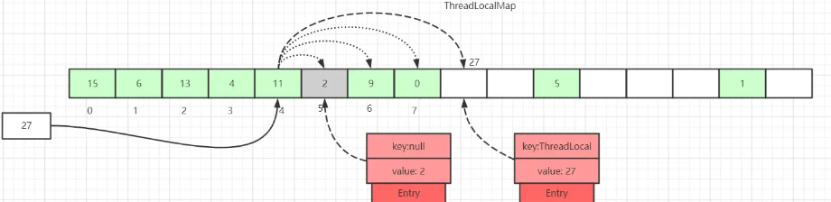

如上图的27，槽位4已经有数据，采用\*\*<font style="color:#DF2A3F;">线性探测法</font>\*\*往后探测，直到找到合适的位置为止，

* <code><font style="color:rgb(255, 80, 44);background-color:rgb(255, 245, 245);">Entry</font></code><font style="color:rgb(37, 41, 51);">为</font><code><font style="color:rgb(255, 80, 44);background-color:rgb(255, 245, 245);">null：直接放置</font></code>
* <code><font style="color:rgb(255, 80, 44);background-color:rgb(255, 245, 245);">Entry</font></code><font style="color:rgb(37, 41, 51);">不为</font><code><font style="color:rgb(255, 80, 44);background-color:rgb(255, 245, 245);">null</font></code><font style="color:rgb(37, 41, 51);">且</font><code><font style="color:rgb(255, 80, 44);background-color:rgb(255, 245, 245);">key</font></code><font style="color:rgb(37, 41, 51);">值相等：覆盖对应的数据</font>
* <code><font style="color:rgb(255, 80, 44);background-color:rgb(255, 245, 245);">Entry</font></code><font style="color:rgb(37, 41, 51);">中的</font><code><font style="color:rgb(255, 80, 44);background-color:rgb(255, 245, 245);">key</font></code><font style="color:rgb(37, 41, 51);">值为</font><code><font style="color:rgb(255, 80, 44);background-color:rgb(255, 245, 245);">null</font></code><font style="color:rgb(37, 41, 51);">：开始清理过期key</font>

### <font style="color:rgb(37, 41, 51);">Set()方法</font>

1. <code><font style="color:rgb(255, 80, 44);background-color:rgb(255, 245, 245);">hash</font></code><font style="color:rgb(37, 41, 51);">计算后槽位对应的</font><code><font style="color:rgb(255, 80, 44);background-color:rgb(255, 245, 245);">Entry</font></code><font style="color:rgb(37, 41, 51);">数据为空</font>
   1. **<font style="color:rgb(37, 41, 51);">直接放到该槽位</font>**
2. <font style="color:rgb(37, 41, 51);">槽位不为空，</font><code><font style="color:rgb(255, 80, 44);background-color:rgb(255, 245, 245);">key</font></code><font style="color:rgb(37, 41, 51);">值与当前</font><code><font style="color:rgb(255, 80, 44);background-color:rgb(255, 245, 245);">ThreadLocal</font>``<font style="color:rgb(255, 80, 44);background-color:rgb(255, 245, 245);">hash</font></code><font style="color:rgb(37, 41, 51);">计算的</font><code><font style="color:rgb(255, 80, 44);background-color:rgb(255, 245, 245);">key</font></code><font style="color:rgb(37, 41, 51);">值一致</font>
   1. **<font style="color:rgb(37, 41, 51);">更新数据</font>**
3. <font style="color:rgb(37, 41, 51);">槽位数据不为空，往后遍历过程中，在找到</font><code><font style="color:rgb(255, 80, 44);background-color:rgb(255, 245, 245);">Entry</font></code><font style="color:rgb(37, 41, 51);">为</font><code><font style="color:rgb(255, 80, 44);background-color:rgb(255, 245, 245);">null</font></code><font style="color:rgb(37, 41, 51);">的槽位之前，没有遇到</font><code><font style="color:rgb(255, 80, 44);background-color:rgb(255, 245, 245);">key</font></code><font style="color:rgb(37, 41, 51);">过期的</font><code><font style="color:rgb(255, 80, 44);background-color:rgb(255, 245, 245);">Entry</font></code><font style="color:rgb(37, 41, 51);"></font>
   1. <font style="color:rgb(37, 41, 51);">找到</font><code><font style="color:rgb(255, 80, 44);background-color:rgb(255, 245, 245);">Entry</font></code><font style="color:rgb(37, 41, 51);">为</font><code><font style="color:rgb(255, 80, 44);background-color:rgb(255, 245, 245);">null</font></code><font style="color:rgb(37, 41, 51);">的槽位，则将数据放入该槽位中</font>
   2. <font style="color:rgb(37, 41, 51);">往后遍历过程中，遇到了</font>**<font style="color:rgb(37, 41, 51);">key值相等</font>**<font style="color:rgb(37, 41, 51);">的数据，直接更新即可。</font>
4. <font style="color:rgb(37, 41, 51);">槽位数据不为空，往后遍历过程中，找到</font><code><font style="color:rgb(255, 80, 44);background-color:rgb(255, 245, 245);">Entry</font></code><font style="color:rgb(37, 41, 51);">为</font><code><font style="color:rgb(255, 80, 44);background-color:rgb(255, 245, 245);">null</font></code><font style="color:rgb(37, 41, 51);">的槽位之前，遇到</font><code><font style="color:rgb(255, 80, 44);background-color:rgb(255, 245, 245);">key</font></code><font style="color:rgb(37, 41, 51);">过期的</font><code><font style="color:rgb(255, 80, 44);background-color:rgb(255, 245, 245);">Entry</font></code>

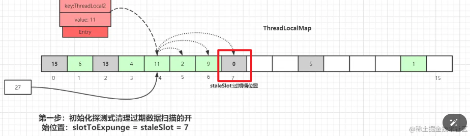

<code><font style="color:rgb(255, 80, 44);background-color:rgb(255, 245, 245);">Entry</font></code><font style="color:rgb(37, 41, 51);">数据</font><code><font style="color:rgb(255, 80, 44);background-color:rgb(255, 245, 245);">key</font></code><font style="color:rgb(37, 41, 51);">为</font><code><font style="color:rgb(255, 80, 44);background-color:rgb(255, 245, 245);">null</font></code><font style="color:rgb(37, 41, 51);">，表明数据</font><code><font style="color:rgb(255, 80, 44);background-color:rgb(255, 245, 245);">key</font></code><font style="color:rgb(37, 41, 51);">值已经被垃圾回收，执行</font><code><font style="color:rgb(255, 80, 44);background-color:rgb(255, 245, 245);">replaceStaleEntry()</font></code><font style="color:rgb(37, 41, 51);">方法，</font>**<font style="color:#DF2A3F;">替换过期数据</font>**<font style="color:rgb(37, 41, 51);">，以</font>**<font style="color:rgb(37, 41, 51);">index=7</font>**<font style="color:rgb(37, 41, 51);">为起点开始遍历，进行探测式数据清理工作。</font>

<font style="color:rgb(37, 41, 51);">初始化探测式清理过期数据扫描的开始位置：</font><code>**<font style="color:rgb(255, 80, 44);background-color:rgb(255, 245, 245);">slotToExpunge</font>**<font style="color:rgb(255, 80, 44);background-color:rgb(255, 245, 245);"> = </font>**<font style="color:rgb(255, 80, 44);background-color:rgb(255, 245, 245);">staleSlot</font>**<font style="color:rgb(255, 80, 44);background-color:rgb(255, 245, 245);"> = 7</font></code><font style="color:rgb(255, 80, 44);background-color:rgb(255, 245, 245);">。</font><font style="color:rgb(37, 41, 51);">以当前</font><code><font style="color:rgb(255, 80, 44);background-color:rgb(255, 245, 245);">staleSlot</font></code><font style="color:rgb(37, 41, 51);">开始</font>**<font style="color:#DF2A3F;">向前</font>**<font style="color:rgb(37, 41, 51);">迭代查找，找其他过期的数据，然后更新过期数据起始扫描下标</font><code><font style="color:rgb(255, 80, 44);background-color:rgb(255, 245, 245);">slotToExpunge</font></code><font style="color:rgb(37, 41, 51);">。</font><code><font style="color:rgb(255, 80, 44);background-color:rgb(255, 245, 245);">for</font></code><font style="color:rgb(37, 41, 51);">循环迭代，直到碰到</font><code><font style="color:rgb(255, 80, 44);background-color:rgb(255, 245, 245);">Entry</font></code><font style="color:rgb(37, 41, 51);">为</font><code><font style="color:rgb(255, 80, 44);background-color:rgb(255, 245, 245);">null</font></code><font style="color:rgb(37, 41, 51);">结束。如果找到了过期的数据，继续向前迭代，直到遇到</font><code><font style="color:rgb(255, 80, 44);background-color:rgb(255, 245, 245);">Entry=null</font></code><font style="color:rgb(37, 41, 51);">的槽位才停止迭代。</font>

**<font style="color:rgb(37, 41, 51);">slotToExpunge被更新为0</font>**<font style="color:rgb(37, 41, 51);">：</font>

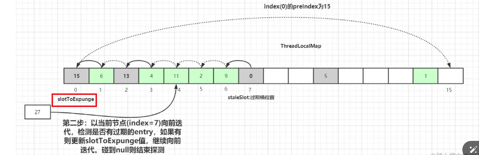

<font style="color:rgb(37, 41, 51);">向前迭代的操作是为了更新探测清理过期数据的起始下标</font><code><font style="color:rgb(255, 80, 44);background-color:rgb(255, 245, 245);">slotToExpunge</font></code><font style="color:rgb(37, 41, 51);">的值，用来判断当前过期槽位</font><code><font style="color:rgb(255, 80, 44);background-color:rgb(255, 245, 245);">staleSlot</font></code><font style="color:rgb(37, 41, 51);">之前是否还有过期元素。</font>

<font style="color:rgb(37, 41, 51);">接着继续以</font><code><font style="color:rgb(255, 80, 44);background-color:rgb(255, 245, 245);">staleSlot</font></code><font style="color:rgb(37, 41, 51);">位置(index=7)向后迭代，</font>**<font style="color:rgb(37, 41, 51);">如果找到了相同key值的Entry数据：</font>**

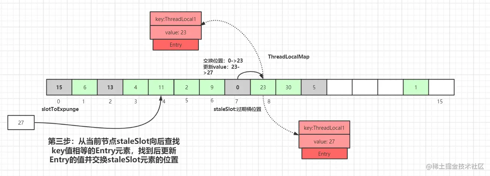

<font style="color:rgb(37, 41, 51);">找到后更新</font><code><font style="color:rgb(255, 80, 44);background-color:rgb(255, 245, 245);">Entry</font></code><font style="color:rgb(37, 41, 51);">的值并交换</font><code><font style="color:rgb(255, 80, 44);background-color:rgb(255, 245, 245);">staleSlot</font></code><font style="color:rgb(37, 41, 51);">元素的位置(</font><code><font style="color:rgb(255, 80, 44);background-color:rgb(255, 245, 245);">staleSlot</font></code><font style="color:rgb(37, 41, 51);">位置为过期元素)，更新</font><code><font style="color:rgb(255, 80, 44);background-color:rgb(255, 245, 245);">Entry</font></code><font style="color:rgb(37, 41, 51);">数据，然后开始进行过期</font><code><font style="color:rgb(255, 80, 44);background-color:rgb(255, 245, 245);">Entry</font></code><font style="color:rgb(37, 41, 51);">的清理工作，如下图所示：</font>

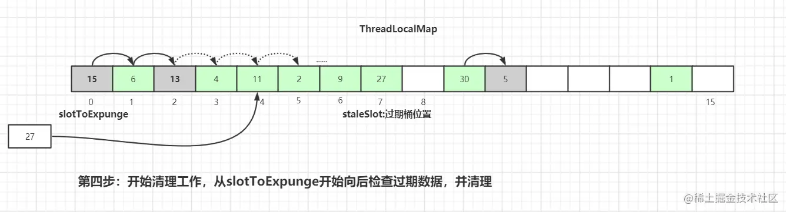

**<font style="color:rgb(37, 41, 51);">向后遍历过程中，如果没有找到相同key值的Entry数据：</font>**

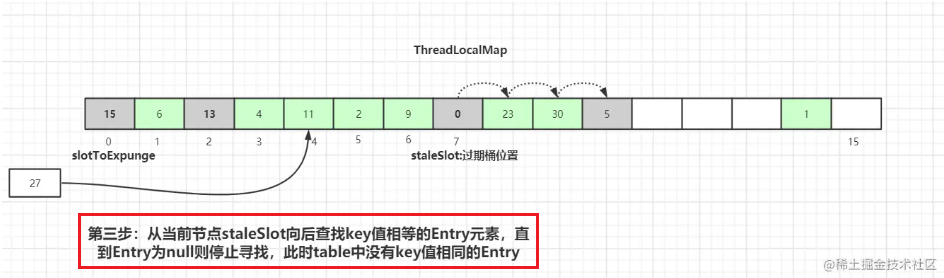

<font style="color:rgb(37, 41, 51);">创建新的</font><code><font style="color:rgb(255, 80, 44);background-color:rgb(255, 245, 245);">Entry</font></code><font style="color:rgb(37, 41, 51);">，替换</font><code><font style="color:rgb(255, 80, 44);background-color:rgb(255, 245, 245);">table[stableSlot]</font></code><font style="color:rgb(37, 41, 51);">位置：</font>

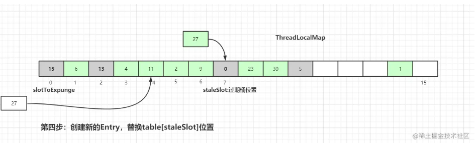

<font style="color:rgb(37, 41, 51);">替换完成后进行过期元素清理工作，清理工作主要是有两个方法：</font><code><font style="color:rgb(255, 80, 44);background-color:rgb(255, 245, 245);">expungeStaleEntry()</font></code><font style="color:rgb(37, 41, 51);">和</font><code><font style="color:rgb(255, 80, 44);background-color:rgb(255, 245, 245);">cleanSomeSlots()</font></code><font style="color:rgb(37, 41, 51);">。</font>

```java
private void set(ThreadLocal<?> key, Object value) {
    Entry[] tab = table;
    int len = tab.length;
    int i = key.threadLocalHashCode & (len-1);

    for (Entry e = tab[i]; e != null; e = tab[i = nextIndex(i, len)]) {
        ThreadLocal<?> k = e.get();
        if (k == key) {
            e.value = value;
            return;
        }
        if (k == null) {
            replaceStaleEntry(key, value, i);
            return;
        }
    }
    // 当前key值对应的桶中Entry数据为空
    tab[i] = new Entry(key, value);
    int sz = ++size;
    if (!cleanSomeSlots(i, sz) && sz >= threshold)
        rehash();
}

```

首先计算出当前key所在的位置，也就是代码前三行

1. <code><font style="color:rgb(255, 80, 44);background-color:rgb(255, 245, 245);">k = key</font></code><font style="color:rgb(37, 41, 51);"> 说明是替换操作，可以使用</font>
2. <font style="color:rgb(37, 41, 51);">碰到一个过期的桶，执行替换逻辑，占用过期桶</font>
3. <font style="color:rgb(37, 41, 51);">查找过程中，碰到桶中</font><code><font style="color:rgb(255, 80, 44);background-color:rgb(255, 245, 245);">Entry=null</font></code><font style="color:rgb(37, 41, 51);">的情况，直接使用</font>

<font style="color:rgb(37, 41, 51);">之后进入for循环</font>

1. <font style="color:rgb(37, 41, 51);">遍历当前</font><code><font style="color:rgb(255, 80, 44);background-color:rgb(255, 245, 245);">key</font></code><font style="color:rgb(37, 41, 51);">值对应的桶中</font><code><font style="color:rgb(255, 80, 44);background-color:rgb(255, 245, 245);">Entry</font></code><font style="color:rgb(37, 41, 51);">数据为空，说明散列数组这里没有数据冲突，跳出</font><code><font style="color:rgb(255, 80, 44);background-color:rgb(255, 245, 245);">for</font></code><font style="color:rgb(37, 41, 51);">循环，直接</font><code><font style="color:rgb(255, 80, 44);background-color:rgb(255, 245, 245);">set</font></code><font style="color:rgb(37, 41, 51);">数据到对应的桶中</font>
2. <font style="color:rgb(37, 41, 51);">如果</font><code><font style="color:rgb(255, 80, 44);background-color:rgb(255, 245, 245);">key</font></code><font style="color:rgb(37, 41, 51);">值对应的桶中</font><code><font style="color:rgb(255, 80, 44);background-color:rgb(255, 245, 245);">Entry</font></code><font style="color:rgb(37, 41, 51);">数据不为空</font>
   1. <font style="color:rgb(37, 41, 51);">如果</font><code><font style="color:rgb(255, 80, 44);background-color:rgb(255, 245, 245);">k = key</font></code><font style="color:rgb(37, 41, 51);">，直接替换对应的value</font>
   2. <font style="color:rgb(37, 41, 51);">如果</font><code><font style="color:rgb(255, 80, 44);background-color:rgb(255, 245, 245);">key = null</font></code><font style="color:rgb(37, 41, 51);">，说明当前桶位置的</font><code><font style="color:rgb(255, 80, 44);background-color:rgb(255, 245, 245);">Entry</font></code><font style="color:rgb(37, 41, 51);">是过期数据，执行</font><code><font style="color:rgb(255, 80, 44);background-color:rgb(255, 245, 245);">replaceStaleEntry()</font></code><font style="color:rgb(37, 41, 51);">方法(核心方法)，然后返回</font>
3. <code><font style="color:rgb(255, 80, 44);background-color:rgb(255, 245, 245);">for</font></code><font style="color:rgb(37, 41, 51);">循环执行完毕，继续往下执行说明向后迭代的过程中遇到了</font><code><font style="color:rgb(255, 80, 44);background-color:rgb(255, 245, 245);">entry</font></code><font style="color:rgb(37, 41, 51);">为</font><code><font style="color:rgb(255, 80, 44);background-color:rgb(255, 245, 245);">null</font></code><font style="color:rgb(37, 41, 51);">的情况 </font>
   1. <font style="color:rgb(37, 41, 51);">在</font><code><font style="color:rgb(255, 80, 44);background-color:rgb(255, 245, 245);">Entry</font></code><font style="color:rgb(37, 41, 51);">为</font><code><font style="color:rgb(255, 80, 44);background-color:rgb(255, 245, 245);">null</font></code><font style="color:rgb(37, 41, 51);">的桶中创建一个新的</font><code><font style="color:rgb(255, 80, 44);background-color:rgb(255, 245, 245);">Entry</font></code><font style="color:rgb(37, 41, 51);">对象 </font>
   2. <font style="color:rgb(37, 41, 51);">执行</font><code><font style="color:rgb(255, 80, 44);background-color:rgb(255, 245, 245);">++size</font></code><font style="color:rgb(37, 41, 51);">操作</font>
4. <font style="color:rgb(37, 41, 51);">调用</font><code><font style="color:rgb(255, 80, 44);background-color:rgb(255, 245, 245);">cleanSomeSlots()</font></code><font style="color:rgb(37, 41, 51);">做一次启发式清理工作，清理散列数组中</font><code><font style="color:rgb(255, 80, 44);background-color:rgb(255, 245, 245);">Entry</font></code><font style="color:rgb(37, 41, 51);">的</font><code><font style="color:rgb(255, 80, 44);background-color:rgb(255, 245, 245);">key</font></code><font style="color:rgb(37, 41, 51);">过期的数据 </font>
   1. <font style="color:rgb(37, 41, 51);">如果清理工作完成后未清理到任何数据，且</font><code><font style="color:rgb(255, 80, 44);background-color:rgb(255, 245, 245);">size</font></code><font style="color:rgb(37, 41, 51);">超过了阈值(</font>**<font style="color:#DF2A3F;">数组长度的2/3</font>**<font style="color:rgb(37, 41, 51);">)，进行</font><code><font style="color:rgb(255, 80, 44);background-color:rgb(255, 245, 245);">rehash()</font></code><font style="color:rgb(37, 41, 51);">操作 </font>
   2. <code><font style="color:rgb(255, 80, 44);background-color:rgb(255, 245, 245);">rehash()</font></code><font style="color:rgb(37, 41, 51);">中会先进行一轮探测式清理，清理过期</font><code><font style="color:rgb(255, 80, 44);background-color:rgb(255, 245, 245);">key</font></code><font style="color:rgb(37, 41, 51);">，清理完成后如果</font>**<font style="color:rgb(37, 41, 51);">size >= threshold - threshold / 4</font>**<font style="color:rgb(37, 41, 51);">，就会执行真正的扩容逻辑。</font>

### <font style="color:rgb(255, 80, 44);background-color:rgb(255, 245, 245);">replaceStaleEntry()方法</font>

```java
 private void replaceStaleEntry(ThreadLocal<?> key, Object value,
                                       int staleSlot) {
            Entry[] tab = table;
            int len = tab.length;
            Entry e;
            // 向前探测找到过期的数据，更新slotToExpunge为过期数据下标
            int slotToExpunge = staleSlot;
            for (int i = prevIndex(staleSlot, len);
                 (e = tab[i]) != null;
                 i = prevIndex(i, len))
                if (e.refersTo(null))
                    slotToExpunge = i;
             
            for (int i = nextIndex(staleSlot, len);
                 (e = tab[i]) != null;
                    i = nextIndex(i, len)) {
                if (e.refersTo(key)) {
                    e.value = value;

                    tab[i] = tab[staleSlot];
                    tab[staleSlot] = e;

                    if (slotToExpunge == staleSlot)
                        slotToExpunge = i;
                    cleanSomeSlots(expungeStaleEntry(slotToExpunge), len);
                    return;
                }

                if (e.refersTo(null) && slotToExpunge == staleSlot)
                    slotToExpunge = i;
            }
     
            tab[staleSlot].value = null;
            tab[staleSlot] = new Entry(key, value);
     
            if (slotToExpunge != staleSlot)
                cleanSomeSlots(expungeStaleEntry(slotToExpunge), len);
        }

```

* <code><font style="color:rgb(255, 80, 44);background-color:rgb(255, 245, 245);">slotToExpunge</font></code><font style="color:rgb(37, 41, 51);">开始探测式清理过期数据的开始下标，从当前的</font><code><font style="color:rgb(255, 80, 44);background-color:rgb(255, 245, 245);">staleSlot</font></code><font style="color:rgb(37, 41, 51);">开始，向前迭代查找，找到没有过期的数据，</font><code><font style="color:rgb(255, 80, 44);background-color:rgb(255, 245, 245);">for</font></code><font style="color:rgb(37, 41, 51);">循环一直碰到</font><code><font style="color:rgb(255, 80, 44);background-color:rgb(255, 245, 245);">Entry</font></code><font style="color:rgb(37, 41, 51);">为</font><code><font style="color:rgb(255, 80, 44);background-color:rgb(255, 245, 245);">null</font></code><font style="color:rgb(37, 41, 51);">才会结束。如果向前找到了过期数据，更新探测清理过期数据的开始下标为i，即</font><code><font style="color:rgb(255, 80, 44);background-color:rgb(255, 245, 245);">slotToExpunge=i</font></code>
* <code><font style="color:rgb(255, 80, 44);background-color:rgb(255, 245, 245);">staleSlot</font></code><font style="color:rgb(37, 41, 51);">向后查找，碰到</font><code><font style="color:rgb(255, 80, 44);background-color:rgb(255, 245, 245);">Entry</font></code><font style="color:rgb(37, 41, 51);">为</font><code><font style="color:rgb(255, 80, 44);background-color:rgb(255, 245, 245);">null</font></code><font style="color:rgb(37, 41, 51);">的桶结束。 </font>**<font style="color:rgb(37, 41, 51);">碰到k == key</font>**<font style="color:rgb(37, 41, 51);">，替换新数据并且交换当前</font><code><font style="color:rgb(255, 80, 44);background-color:rgb(255, 245, 245);">staleSlot</font></code><font style="color:rgb(37, 41, 51);">位置。</font>
  * <font style="color:rgb(37, 41, 51);">如果</font><code><font style="color:rgb(255, 80, 44);background-color:rgb(255, 245, 245);">slotToExpunge == staleSlot</font></code><font style="color:rgb(37, 41, 51);">，说明</font><code><font style="color:rgb(255, 80, 44);background-color:rgb(255, 245, 245);">replaceStaleEntry()</font></code><font style="color:rgb(37, 41, 51);">向前查找过期数据并未找到过期的</font><code><font style="color:rgb(255, 80, 44);background-color:rgb(255, 245, 245);">Entry</font></code><font style="color:rgb(37, 41, 51);">数据，向后查找过程中也未发现过期数据，修改开始探测式清理过期数据的下标为当前循环的index，即</font><code><font style="color:rgb(255, 80, 44);background-color:rgb(255, 245, 245);">slotToExpunge = i</font></code><font style="color:rgb(37, 41, 51);">。</font>
  * <font style="color:rgb(37, 41, 51);">调用</font><code><font style="color:rgb(255, 80, 44);background-color:rgb(255, 245, 245);">cleanSomeSlots(expungeStaleEntry(slotToExpunge), len);</font></code><font style="color:rgb(37, 41, 51);">进行启发式过期数据清理。</font>
* <code><font style="color:rgb(255, 80, 44);background-color:rgb(255, 245, 245);">k == null</font></code><font style="color:rgb(37, 41, 51);">说明当前遍历的</font><code><font style="color:rgb(255, 80, 44);background-color:rgb(255, 245, 245);">Entry</font></code><font style="color:rgb(37, 41, 51);">是一个过期数据，</font><code><font style="color:rgb(255, 80, 44);background-color:rgb(255, 245, 245);">slotToExpunge == staleSlot</font></code><font style="color:rgb(37, 41, 51);">说明，向前查找数据并未找到过期的</font><code><font style="color:rgb(255, 80, 44);background-color:rgb(255, 245, 245);">Entry</font></code><font style="color:rgb(37, 41, 51);">。如果条件成立，则更新</font><code><font style="color:rgb(255, 80, 44);background-color:rgb(255, 245, 245);">slotToExpunge</font></code><font style="color:rgb(37, 41, 51);"> 为当前位置（也就是过期数据后面的一个过期key）。</font>
* <font style="color:rgb(37, 41, 51);">往后迭代的过程中没有找到</font><code><font style="color:rgb(255, 80, 44);background-color:rgb(255, 245, 245);">k == key</font></code><font style="color:rgb(37, 41, 51);">的数据，且碰到</font><code><font style="color:rgb(255, 80, 44);background-color:rgb(255, 245, 245);">Entry</font></code><font style="color:rgb(37, 41, 51);">为</font><code><font style="color:rgb(255, 80, 44);background-color:rgb(255, 245, 245);">null</font></code><font style="color:rgb(37, 41, 51);">的数据，则结束当前的迭代操作。此时说明这里是一个添加的逻辑，将新的数据添加到</font><code><font style="color:rgb(255, 80, 44);background-color:rgb(255, 245, 245);">table[staleSlot]</font></code><font style="color:rgb(37, 41, 51);"> 对应的</font><code><font style="color:rgb(255, 80, 44);background-color:rgb(255, 245, 245);">slot</font></code><font style="color:rgb(37, 41, 51);">中。</font>
* <font style="color:rgb(37, 41, 51);">除了</font><code><font style="color:rgb(255, 80, 44);background-color:rgb(255, 245, 245);">staleSlot</font></code><font style="color:rgb(37, 41, 51);">以外，还发现了其他过期的</font><code><font style="color:rgb(255, 80, 44);background-color:rgb(255, 245, 245);">slot</font></code><font style="color:rgb(37, 41, 51);">数据，就要开启清理数据</font>

### <font style="color:rgb(37, 41, 51);">过期key探测清理</font>

<code><font style="color:rgb(255, 80, 44);background-color:rgb(255, 245, 245);">ThreadLocalMap</font></code><font style="color:rgb(37, 41, 51);">两种过期</font><code><font style="color:rgb(255, 80, 44);background-color:rgb(255, 245, 245);">key</font></code><font style="color:rgb(37, 41, 51);">数据清理方式：</font>**<font style="color:#DF2A3F;">探测式清理（</font>**<font style="color:#DF2A3F;background-color:rgb(255, 245, 245);">expungeStaleEntry()</font>**<font style="color:#DF2A3F;">）</font>**<font style="color:#DF2A3F;">和</font>**<font style="color:#DF2A3F;">启发式清理(cleanSomeSlots())</font>**<font style="color:rgb(37, 41, 51);">。启发式调用的是探测式，探测式默认从最前过期位置开始，启发式则从传入的slot开始往后回收过期key。</font>

<code><font style="color:rgb(255, 80, 44);background-color:rgb(255, 245, 245);">expungeStaleEntry</font></code><font style="color:rgb(37, 41, 51);">方法，遍历散列数组，从开始位置向后探测清理过期数据，将过期数据的</font><code><font style="color:rgb(255, 80, 44);background-color:rgb(255, 245, 245);">Entry</font></code><font style="color:rgb(37, 41, 51);">设置为</font><code><font style="color:rgb(255, 80, 44);background-color:rgb(255, 245, 245);">null</font></code><font style="color:rgb(37, 41, 51);">，沿途中碰到未过期的数据则将此数据</font><code><font style="color:rgb(255, 80, 44);background-color:rgb(255, 245, 245);">rehash</font></code><font style="color:rgb(37, 41, 51);">后重新在</font><code><font style="color:rgb(255, 80, 44);background-color:rgb(255, 245, 245);">table</font></code><font style="color:rgb(37, 41, 51);">数组中定位，如果定位的位置已经有了数据，则线性探测。</font>

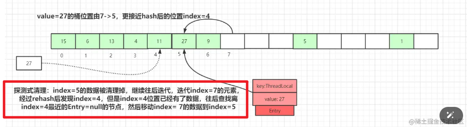

<code>**<font style="color:#DF2A3F;background-color:rgb(255, 245, 245);">key</font>**</code>**<font style="color:#DF2A3F;">过期的数据会被清理掉，没过期的数据经过</font>**<code>**<font style="color:#DF2A3F;background-color:rgb(255, 245, 245);">rehash</font>**</code>**<font style="color:#DF2A3F;">重定位</font>**

### ThreadLocalMap扩容机制

<font style="color:rgb(37, 41, 51);">执行完启发式清理工作后，未清理到任何数据，且当前散列数组中</font><code><font style="color:rgb(255, 80, 44);background-color:rgb(255, 245, 245);">Entry</font></code><font style="color:rgb(37, 41, 51);">的数量已经达到了列表的扩容阈值</font><code><font style="color:rgb(255, 80, 44);background-color:rgb(255, 245, 245);">(len*2/3)</font></code><font style="color:rgb(37, 41, 51);">，就执行</font><code><font style="color:rgb(255, 80, 44);background-color:rgb(255, 245, 245);">rehash</font></code>

```java
private void rehash() {
    expungeStaleEntries();

    if (size >= threshold - threshold / 4)
        resize();
}

private void expungeStaleEntries() {
    Entry[] tab = table;
    int len = tab.length;
    for (int j = 0; j < len; j++) {
        Entry e = tab[j];
        if (e != null && e.get() == null)
            expungeStaleEntry(j);
    }
}

```

先<font style="color:rgb(37, 41, 51);">进行探测式清理工作，之后判断</font><code><font style="color:rgb(255, 80, 44);background-color:rgb(255, 245, 245);">size >= threshold - threshold / 4</font></code><font style="color:rgb(37, 41, 51);"> 也就是</font><code><font style="color:rgb(255, 80, 44);background-color:rgb(255, 245, 245);">size >= threshold * 3/4</font></code><font style="color:rgb(37, 41, 51);">来决定是否扩容。</font>

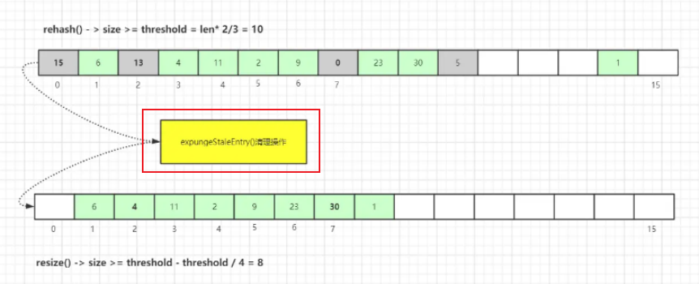

<font style="color:rgb(37, 41, 51);">扩容后的</font><code><font style="color:rgb(255, 80, 44);background-color:rgb(255, 245, 245);">tab</font></code><font style="color:rgb(37, 41, 51);">的大小为</font><code><font style="color:rgb(255, 80, 44);background-color:rgb(255, 245, 245);">oldLen * 2</font></code><font style="color:rgb(37, 41, 51);">，然后遍历老的散列表，重新计算</font><code><font style="color:rgb(255, 80, 44);background-color:rgb(255, 245, 245);">hash</font></code><font style="color:rgb(37, 41, 51);">位置，放到新的</font><code><font style="color:rgb(255, 80, 44);background-color:rgb(255, 245, 245);">tab</font></code><font style="color:rgb(37, 41, 51);">数组中，如果出现</font><code><font style="color:rgb(255, 80, 44);background-color:rgb(255, 245, 245);">hash</font></code><font style="color:rgb(37, 41, 51);">冲突则往后寻找最近的</font><code><font style="color:rgb(255, 80, 44);background-color:rgb(255, 245, 245);">entry</font></code><font style="color:rgb(37, 41, 51);">为</font><code><font style="color:rgb(255, 80, 44);background-color:rgb(255, 245, 245);">null</font></code><font style="color:rgb(37, 41, 51);">的槽位，遍历完成之后，</font><code><font style="color:rgb(255, 80, 44);background-color:rgb(255, 245, 245);">oldTab</font></code><font style="color:rgb(37, 41, 51);">中所有的</font><code><font style="color:rgb(255, 80, 44);background-color:rgb(255, 245, 245);">entry</font></code><font style="color:rgb(37, 41, 51);">数据都已经放入到新的</font><code><font style="color:rgb(255, 80, 44);background-color:rgb(255, 245, 245);">tab</font></code><font style="color:rgb(37, 41, 51);">中了。重新计算</font><code><font style="color:rgb(255, 80, 44);background-color:rgb(255, 245, 245);">tab</font></code><font style="color:rgb(37, 41, 51);">下次扩容的</font>**<font style="color:rgb(37, 41, 51);">阈值。</font>**

### get()方法

* <font style="color:rgb(37, 41, 51);">查找</font><code><font style="color:rgb(255, 80, 44);background-color:rgb(255, 245, 245);">key</font></code><font style="color:rgb(37, 41, 51);">值计算出散列表中</font><code><font style="color:rgb(255, 80, 44);background-color:rgb(255, 245, 245);">slot</font></code><font style="color:rgb(37, 41, 51);">位置中的</font><code><font style="color:rgb(255, 80, 44);background-color:rgb(255, 245, 245);">Entry.key</font></code><font style="color:rgb(37, 41, 51);">和查找的</font><code><font style="color:rgb(255, 80, 44);background-color:rgb(255, 245, 245);">key</font></code><font style="color:rgb(37, 41, 51);">一致，则直接返回。</font>
* <code><font style="color:rgb(255, 80, 44);background-color:rgb(255, 245, 245);">slot</font></code><font style="color:rgb(37, 41, 51);">位置中的</font><code><font style="color:rgb(255, 80, 44);background-color:rgb(255, 245, 245);">Entry.key</font></code><font style="color:rgb(37, 41, 51);">和要查找的</font><code><font style="color:rgb(255, 80, 44);background-color:rgb(255, 245, 245);">key</font></code><font style="color:rgb(37, 41, 51);">不一致：继续向后探测。</font>
  * <font style="color:rgb(37, 41, 51);">若遇到</font><code><font style="color:rgb(255, 80, 44);background-color:rgb(255, 245, 245);">Entry.key=null</font></code><font style="color:rgb(37, 41, 51);">，触发一次探测式数据回收操作,执行</font><code><font style="color:rgb(255, 80, 44);background-color:rgb(255, 245, 245);">expungeStaleEntry()</font></code><font style="color:rgb(37, 41, 51);">方法。继续向后探测</font>
  * <font style="color:rgb(37, 41, 51);">探测到</font><code><font style="color:rgb(255, 80, 44);background-color:rgb(255, 245, 245);">Entry.key</font></code><font style="color:rgb(37, 41, 51);">和查找的</font><code><font style="color:rgb(255, 80, 44);background-color:rgb(255, 245, 245);">key</font></code><font style="color:rgb(37, 41, 51);">一致，则直接返回。</font>

<font style="color:rgb(37, 41, 51);"></font>

# <font style="color:rgb(37, 41, 51);">♥♥♥</font><font style="color:rgb(37, 41, 51);"> ThreadLocal、InheritableThreadLocal，</font><font style="color:rgb(34, 34, 38);">TransmittableThreadLocal</font>

## ThreadLocal

<font style="color:rgba(0, 0, 0, 0.75);">多线程 </font>**<font style="color:rgba(0, 0, 0, 0.75);">访问同一个共享变量</font>**<font style="color:rgba(0, 0, 0, 0.75);">的时候容易出现并发问题，ThreadLocal是除了加锁这种同步方式之外的一种保证规避多线程访问出现线程不安全的方法，在创建一个变量后，如果每个线程访问的都是线程自己的变量就不会存在线程不安全问题。在实际多线程操作的时候，操作的是自己本地内存中的变量，从而规避了线程安全问题。</font>

**<font style="color:rgb(77, 77, 77);">但是同一个ThreadLocal变量在父线程中被设置值后，在子线程中是获取不到的，同时如果启动了线程池，线程池复用线程，也会导致线程池ThreadLocal数据错误，无法使用。</font>**

## <font style="color:rgb(37, 41, 51);">InheritableThreadLocal</font>

<font style="color:rgb(77, 77, 77);">解决子线程获取父线程的数据就要使用InheritableThreadLocal</font>

<font style="color:rgb(77, 77, 77);">InheritableThreadLocal类</font>**<font style="color:rgb(77, 77, 77);">继承</font>**<font style="color:rgb(77, 77, 77);">了ThreadLocal类，并重写了childValue、getMap、createMap方法。\ </font><font style="color:rgb(77, 77, 77);">其中createMap方法在被调用的时候，创建的是</font>**<font style="color:rgb(77, 77, 77);">inheritableThreadLocal</font>**<font style="color:rgb(77, 77, 77);">而不是threadLocals。\ </font><font style="color:rgb(77, 77, 77);">同理，getMap方法在当前调用者线程调用get方法的时候返回的也不是threadLocals而是inheritableThreadLocal。</font>

<font style="color:rgb(85, 86, 102);background-color:rgb(238, 240, 244);">就是创建一个线程的时候，由主线程来创建，那么主线程就一定会有threadLocals和inheritableThreadLocals，在创建子线程的时候，主线程会把自己的</font>**<font style="color:#DF2A3F;background-color:rgb(238, 240, 244);">inheritableThreadLocals复制到子线程的inheritableThreadLocals</font>**<font style="color:rgb(85, 86, 102);background-color:rgb(238, 240, 244);">。</font>

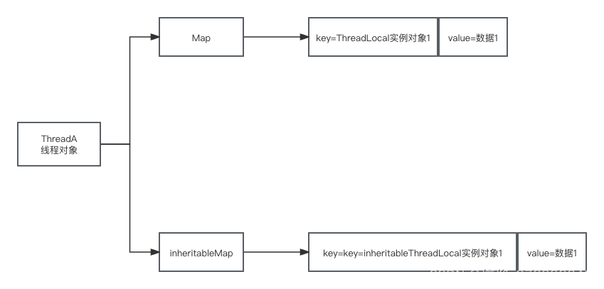

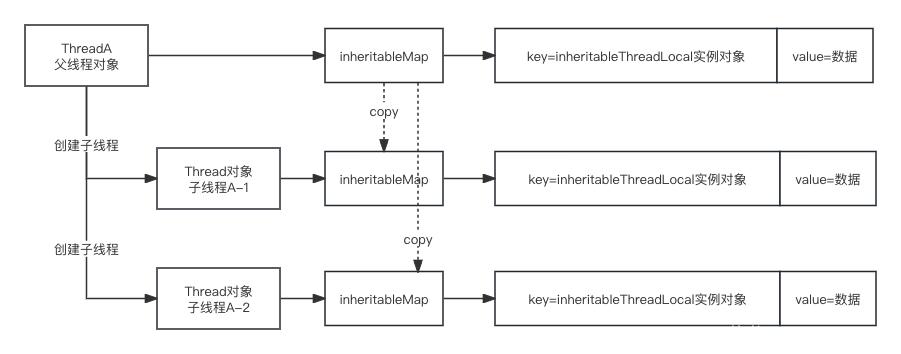

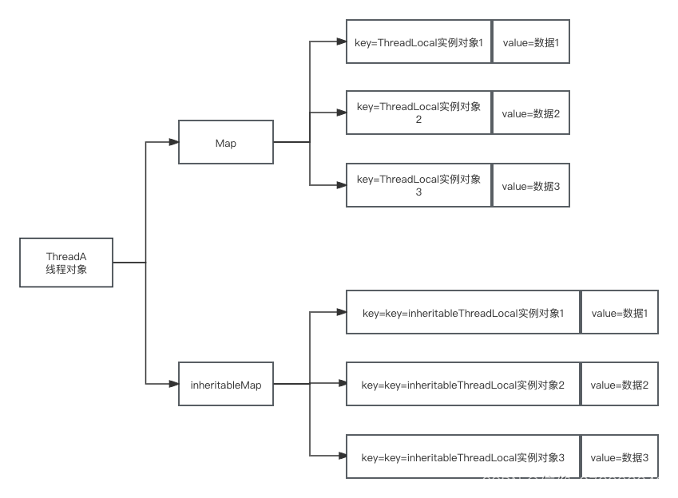

**<font style="color:rgb(77, 77, 77);">子线程的InheritableThreadLocal是从父线程里面深度copy过来的，使用线程池时子线程是核心线程的话，是会被复用的。既然子线程是同一个对象，那么拿到的InheritableThreadLocal也必然是一个。</font>**

## <font style="color:#DF2A3F;">TransmittableThreadLocal</font>

<font style="color:rgb(23, 35, 63);">TransmittableThreadLocal（简称TTL）是alibaba提供的一个工具包中的类，主要作用就是</font>**<font style="color:#DF2A3F;">解决线程池场景下的变量传递问题</font>**<font style="color:rgb(23, 35, 63);">。</font>

<font style="color:rgb(51, 51, 51);">设计模式上采用</font>**<font style="color:#DF2A3F;">装饰器模式</font>**<font style="color:rgb(51, 51, 51);">去增强Runnable等任务，在每次执行任务之前将变量改为当前线程需要的变量</font>

```java
private static final ThreadLocal<UserInfoDTO> USER_THREAD_LOCAL = new TransmittableThreadLocal<>();
```

# **ThreadLocal内存泄漏问题**

**内存泄漏：不再会被使用的对象或者变量占用的内存不能被回收**

## 为什么会产生内存泄露

**ThreadLocalMap：内部类Entry继承了弱引用**（Weak Reference）——**发现即回收** **（强软弱虚四大引用） 只被弱引用关联的对象只能生存到下一次垃圾收集发生为止**

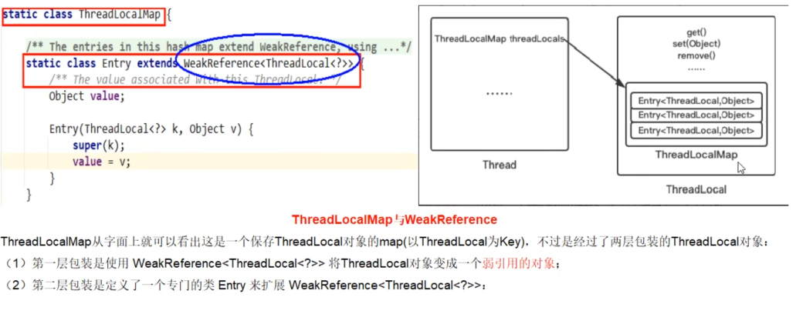

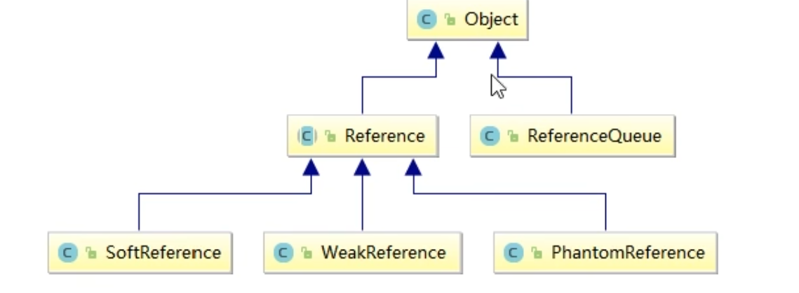

* **强引用：**
  * \*\*对于强引用的对象，\*\*\*\*****就算是出现了OOM也不会对该对象进行回收，死都不收** **，当一个对象被强引用变量引用时，它处于可达状态，是不可能被垃圾回收机制回收的，\*\*\*\*****即使该对象以后永远都不会被用到，JVM也不会回收** \*\*，因此强引用是造成Java内存泄露****&#x7684;主要原因之一**。
* **软引用：**
  * \*\*是一种相对强引用弱化了一些的引用，对于只有软引用的对象而言，\*\*\*\*\*\***当系统内存充足时，不会被回收，当系统内存不足时，他会被回收** \*\*，软引用通常用在对内存敏感的程序中，比如高速缓存，\*\*\*\*\*\***内存够用就保留，不够用就回收。**
* **弱引用：**
  * \*\*比软引用的生命周期更短，对于只有弱引用的对象而言，\*\*\*\*\*\***只要垃圾回收机制一运行，不管JVM的内存空间是否足够，都会回收该对象占用的内存** **。**
  * **软引用和弱引用的使用场景----->假如有一个应用需要读取大量的本地图片：**
    * **如果每次读取图片都从硬盘读取则会严重影响性能**
    * **如果一次性全部加载到内存中又可能会造成内存溢出**
    * **此时使用软应用来解决，设计思路时：用一个HashMap来保存图片的路径和与相应图片对象关联的软引用之间的映射关系，在内存不足时，JVM会自动回收这些缓存图片对象所占用的空间，有效避免了OOM的问题**
* **虚引用：**
  * **虚引用必须和引用队列联合使用**，**如果一个对象仅持有虚引用，那么它就和没有任何引用一样，在任何时候都有可能被垃圾回收器回收，它不能单独使用也不能通过它访问对象。**
  * \*\*虚引用的主要作用是跟踪对象被垃圾回收的状态。\*\*\*\*\*\***仅仅是提供了一种确保对象被finalize后，做某些事情的通知机制** **。换句话说就是在对象被GC的时候会收到一个系统通知或者后续添加进一步的处理，用来实现比finalize机制更灵活的回收操作。**

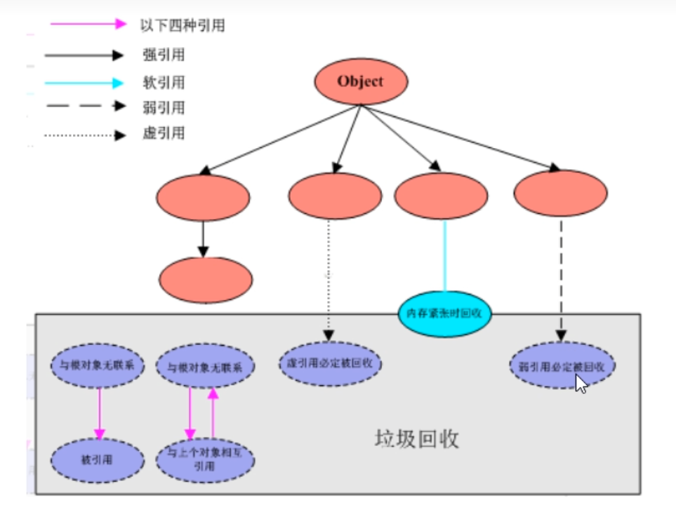

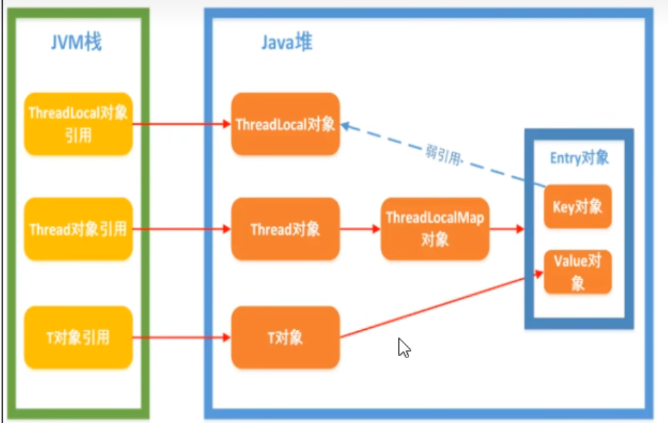

## **为什么要用弱引用？不用如何？**

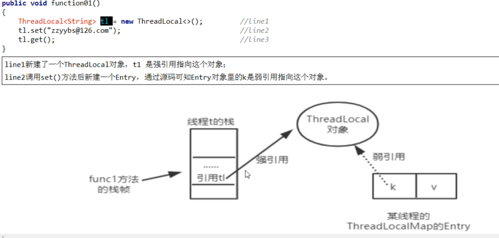

* **为什么要用弱引用：**
  * **当方法执行完毕后，栈帧销毁，强引用t1也就没有了，但此时线程的ThreadLocalMap里某个entry的Key引用还指向这个对象，若这个Key是\*\*\*\*强引用** **，就会\*\*\*\*导致Key指向的ThreadLocal对象即V指向的对象不能被gc回收，造成内存泄露**
  * **若这个引用是弱引用就大概率会减少内存泄漏的问题（当然，还得考虑key为null这个坑** **），使用弱引用就可以使ThreadLocal对象在方法执行完毕后顺利被回收且entry的key引用指向为null**
* **这里有个需要注意的问题：**
  * **ThreadLocalMap使用ThreadLocal的弱引用作为Key，如果一个ThreadLocal没有外部强引用引用他，那么系统gc时，这个ThreadLocal势必会被回收，这样一来，ThreadLocalMap中就会出现Key为null的Entry，就没有办法访问这些Key为null的Entry的value，如果当前线程迟迟不结束的话（好比正在使用线程池），这些key为null的Entry的value就会一直存在一条强引用链**
  * \*\*虽然弱引用，保证了Key指向的ThreadLocal对象能够被及时回收，但是v指向的value对象是需要ThreadLocalMap调用get、set时发现key为null时才会去回收整个entry、value，\*\*\*\*\*\***因此弱引用不能100%保证内存不泄露，我们要在不使用某个ThreadLocal对象后，手动调用remove方法来删除它**，**尤其是在线程池中，不仅仅是内存泄漏的问题，因为线程池中的线程是重复使用的，意味着这个线程的ThreadLocalMap对象也是重复使用的，如果我们不手动调用remove方法，那么后面的线程就有可能获取到上个线程遗留下来的value值，造成bug。**
  * **清除脏Entry----key为null的entry**
* **set()方法**
  * 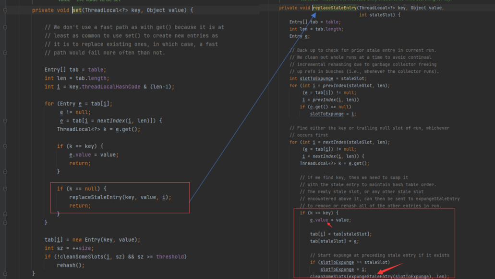
* **get()方法**
  * 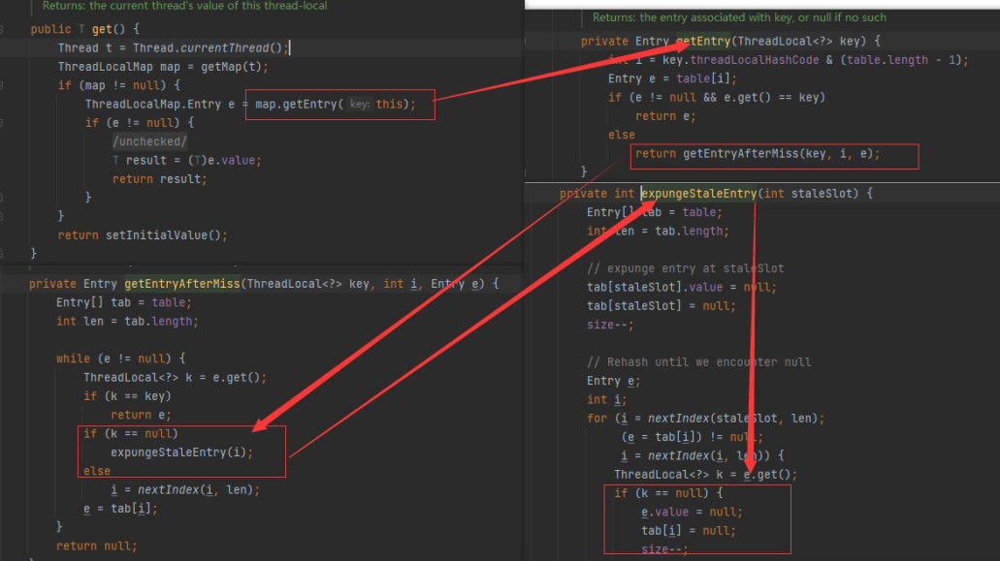
* **remove()**
  * 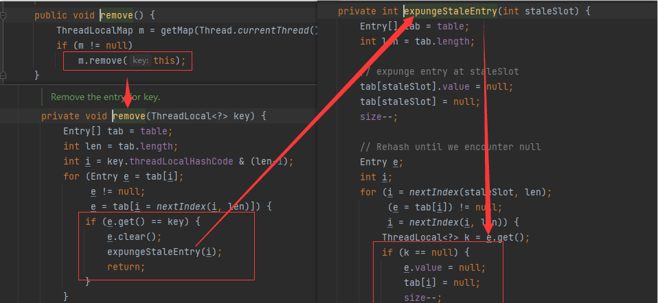

## **最佳实践**

* **ThreadLocal一定要初始化，避免空指针异常。**
* **建议把ThreadLocal修饰为static**
* **用完记得手动remove**

# **小总结**

* **ThreadLocal并不解决线程间共享数据的问题**
* **ThreadLocal适用于变量在线程间隔离且在方法间共享的场景**
* **ThreadLocal通过隐式的在不同线程内创建独立实例副本避免了实例线程安全的问题**
* **每个线程持有一个只属于它自己的专属map并维护了ThreadLocal对象与具体实例的映射，该Map由于只被持有他的线程访问，故不存在线程安全以及锁的问题**
* **ThreadLocalMap的Entry对ThreadLocal的引用为弱引用。避免了ThreadLocal对象无法被回收的问题**
* **都会通过**\*\*<font style="color:#DF2A3F;">expungeStaleEntry，cleanSomeSlots，replaceStaleEntry</font>\*\***这三个方法回收键为null的Entry对象的值（即为具体实例）以及entry对象本身从而防止内存泄漏，属于安全加固的方法**


> 更新: 2025-07-14 18:15:48  
> 原文: <https://www.yuque.com/nibiwanxiamei/yrd6t1/83fb6387326387e72a6f0920e8813217>