# 并发编程

# Java并发常见面试题总结（上）

## 什么是线程和进程?

### 何为进程?

\*\*<font style="color:#DF2A3F;">进程是程序的一次动态执行，是系统运行程序的基本单位，系统资源分配的基本单位。</font>\*\*系统运行一个程序即是一个进程从创建，运行到消亡的过程。在 Java 中，当我们启动 main 函数时其实就是启动了一个 JVM 的进程，而 main 函数所在的线程就是这个进程中的一个线程，也称主线程。

:::color1 <font style="color:rgb(77, 77, 77);"> 一个进程已经终止，但是它的父进程尚未调用 wait() 或 waitpid() 对它进行清理，这时的进程状态称为</font>**<font style="color:rgb(77, 77, 77);">僵尸进程(zombie process)</font>**<font style="color:rgb(77, 77, 77);">。任何进程在刚终止时都是僵尸进程，正常情况下，僵尸进程都立刻被父进程清理了。</font>

<font style="color:rgb(77, 77, 77);">当一个子进程的父进程结束时，子进程还在运行，此时，这个子进程就叫做</font>**<font style="color:rgb(77, 77, 77);">孤儿进程。</font>**

:::

### 何为线程?

**<font style="color:#DF2A3F;">线程是比进程更小的执行单位。一个进程在其执行的过程中可以产生多个线程。多个线程共享进程的堆和方法区资源，每个线程有自己的程序计数器、虚拟机栈和本地方法栈</font>\*\*\*\*，所以系统在产生一个线程，或是在各个线程之间作切换工作时，负担要比进程小得多，也正因为如此，线程也被称为轻量级进程。**

**Java 程序天生就是多线程程序**。**一个 Java 程序的运行是 main 线程和多个其他线程同时运行**

### 何为协程

**<font style="color:rgb(1, 1, 1);">协程是一种用户态的轻量级线程</font>**<font style="color:rgb(1, 1, 1);">，</font>**<font style="color:rgb(1, 1, 1);">其调度完全由用户程序控制，而不需要内核的参与。</font>**<font style="color:rgb(1, 1, 1);">协程拥有自己的寄存器上下文和栈，但与其他协程共享堆内存。协程的切换开销非常小，因为只需要保存和恢复协程的上下文，而无需进行内核级的上下文切换。这使得协程在处理大量并发任务时具有非常高的效率。然而，协程需要程序员显式地进行调度和管理，相对于线程和进程来说，其编程模型更为复杂。</font>

### 线程分类

* **用户线程：是系统的工作线程，它会完成这个程序需要完成的业务操作。**
* **守护线程：是一种特殊的线程，程序运行时在后台提供一种通用服务的线程，比如**\*\*<font style="color:#DF2A3F;">垃圾回收线程、redis中的看门</font>****<font style="color:#DF2A3F;">🐕</font>****。守护线程作为一个服务线程，没有服务对象就没有必要继续运行了，如果用户线程全部结束了，守护线程伴随着JVM一同结束工作。守护线程有自动结束自己生命周期的特性。\*\*

### 进程和线程的区别 ♥♥♥♥

:::color4
**<font style="color:#DF2A3F;">进程是程序的一次动态执行，是操作系统资源分配的最小单位，拥有自己的虚拟内存页表映射物理内存。而线程是进程的一部分，一个进程可以拥有一个或者多个线程，线程是共享进程的堆和方法区空间的，同时每个线程有自己独占的PC和虚拟机栈，因此线程的切换上下文信息更少，并且不一定会触发缺页中断。</font>**

**进程分为子进程和非子进程，非子进程的话是一定会创建新的页表，读取写入一定触发缺页中断的开销，保存的上下文堆栈信息更多，更耗时；而子进程会由于**\*\*<font style="color:#DF2A3F;">linux写时复制</font>\*\***的问题，共享一页表部分空间，只有修改的部分才会复制空间，缺页中断会少很多。**

:::

## Java 线程和操作系统的线程有啥区别？

:::success
**<font style="color:#DF2A3F;">Java 线程采用的是一对一的线程模型，一个 Java 线程对应一个系统内核线程，目前Java 线程的本质其实就是操作系统的线程</font>**<font style="color:#DF2A3F;">。</font>

:::

> **JDK1.2之前java用用户线程实现，JDK1.2之后java用内核线程实现**

* **用户线程：由用户空间程序管理和调度的线程，运行在用户空间（专门给应用程序使用）。**
* **内核线程：由操作系统内核管理和调度的线程，运行在内核空间（只有内核程序可以访问）。**

用户线程和内核线程的区别和特点：用户线程创建和切换成本低，但不可以利用多核。内核态线程，创建和切换成本高，可以利用多核。

Java 线程和操作系统线程的关系：**现在的**\*\*<font style="color:#DF2A3F;"> Java 线程的本质其实就是操作系统的线程</font>\*\*<font style="color:#DF2A3F;">。</font>

线程模型是用户线程和内核线程之间的关联方式，常见的线程模型有这三种：

1. 一对一（一个用户线程对应一个内核线程）
2. 多对一（多个用户线程映射到一个内核线程）
3. 多对多（多个用户线程映射到多个内核线程）

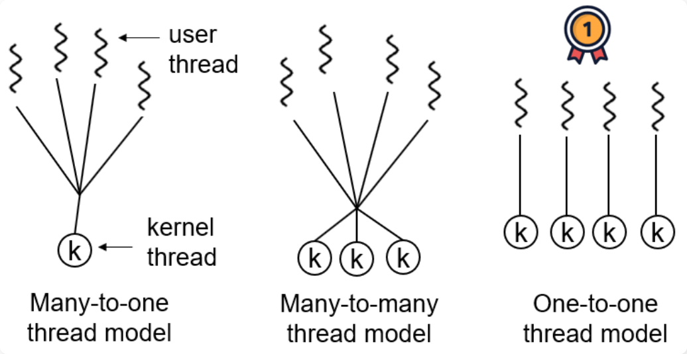

## 进程间通信方式 ♥♥♥♥

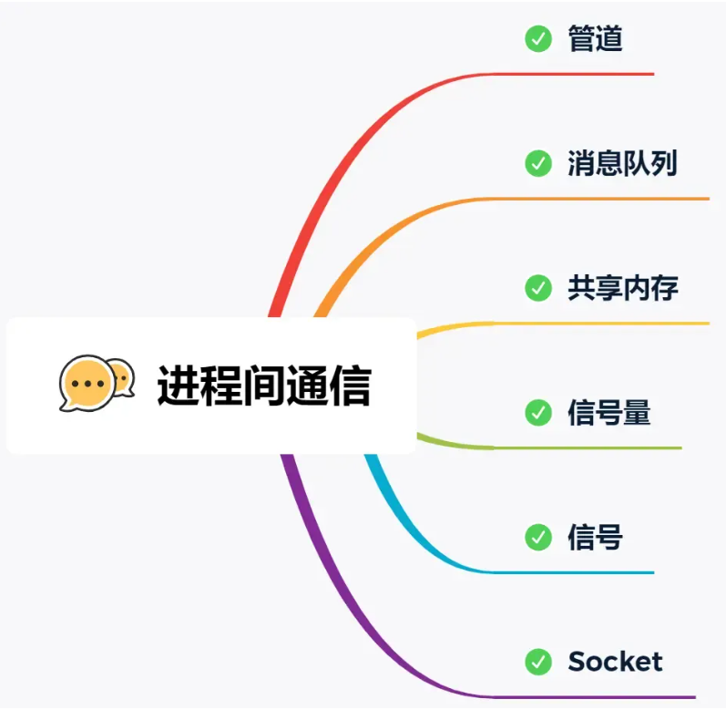

### <font style="color:rgb(74, 74, 74);">管道通信</font>

<font style="color:rgb(74, 74, 74);">Linux 内核提供了不少进程间通信的方式，其中最简单的方式就是管道，管道分为「匿名管道」和「命名管道」。</font>

1. **<font style="color:rgb(48, 79, 254);">匿名管道</font>**<font style="color:rgb(74, 74, 74);">没有名字标识，匿名管道是</font>**<font style="color:rgb(74, 74, 74);">特殊文件只存在于内存，没有存在于文件系统中</font>**<font style="color:rgb(74, 74, 74);">，shell 命令中的「|」竖线就是匿名管道，通信的数据是</font>**<font style="color:rgb(48, 79, 254);">无格式的流并且大小受限</font>**<font style="color:rgb(74, 74, 74);">，通信的方式是</font>**<font style="color:rgb(48, 79, 254);">单向</font>**<font style="color:rgb(74, 74, 74);">的，数据只能在一个方向上流动，如果要双向通信，需要创建两个管道，再来</font>**<font style="color:rgb(48, 79, 254);">匿名管道是只能用于存在父子关系的进程间通信</font>**<font style="color:rgb(74, 74, 74);">，匿名管道的生命周期随着进程创建而建立，随着进程终止而消失。</font>
2. **<font style="color:rgb(48, 79, 254);">命名管道</font>**<font style="color:rgb(74, 74, 74);">突破了匿名管道只能在父子进程间的通信限制，因为使用命名管道的前提，需要在文件系统创建一个类型为 p 的设备文件，那么毫无关系的进程就可以通过这个设备文件进行通信。</font>
3. <font style="color:rgb(74, 74, 74);">不管是匿名管道还是命名管道，进程写入的数据都是</font>**<font style="color:rgb(48, 79, 254);">缓存在内核</font>**<font style="color:rgb(74, 74, 74);">中，另一个进程读取数据时候自然也是从内核中获取，同时通信数据都遵循</font>**<font style="color:rgb(48, 79, 254);">先进先出</font>**<font style="color:rgb(74, 74, 74);">原则，不支持 lseek 之类的文件定位操作。</font>

### <font style="color:rgb(74, 74, 74);">消息队列</font>

**<font style="color:rgb(48, 79, 254);">消息队列</font>**<font style="color:rgb(74, 74, 74);">克服了管道通信的数据是无格式的字节流的问题，消息队列实际上是保存在内核的「消息链表」，</font>**<font style="color:rgb(74, 74, 74);">消息队列的消息体是可以用户自定义的数据类型</font>**<font style="color:rgb(74, 74, 74);">，发送数据时，会被分成一个一个独立的消息体，当然接收数据时，也要与发送方发送的消息体的数据类型保持一致，这样才能保证读取的数据是正确的。消息队列通信的速度不是最及时的，毕竟</font>**<font style="color:rgb(48, 79, 254);">每次数据的写入和读取都需要经过用户态与内核态之间的拷贝过程。</font>**

### <font style="color:#000000;">共享内存</font>

**<font style="color:rgb(48, 79, 254);">共享内存</font>**<font style="color:rgb(74, 74, 74);">可以解决消息队列通信中用户态与内核态之间数据拷贝过程带来的开销，</font>**<font style="color:rgb(48, 79, 254);">它直接分配一个共享空间，每个进程都可以直接访问</font>**<font style="color:rgb(74, 74, 74);">，就像访问进程自己的空间一样快捷方便，不需要陷入内核态或者系统调用，大大提高了通信的速度，享有</font>**<font style="color:rgb(48, 79, 254);">最快</font>**<font style="color:rgb(74, 74, 74);">的进程间通信方式之名。但是便捷高效的共享内存通信，</font>**<font style="color:rgb(48, 79, 254);">带来新的问题，多进程竞争同个共享资源会造成数据的错乱。</font>**

:::success
**<font style="color:#DF2A3F;">java进程用共享内存传递对象必须序列化，否则只是浅拷贝而不是深拷贝</font>**

:::

### 信号量

<font style="color:rgb(74, 74, 74);">需要</font>**<font style="color:rgb(48, 79, 254);">信号量</font>**<font style="color:rgb(74, 74, 74);">来保护共享资源，以确保任何时刻只能有一个进程访问共享资源，这种方式就是互斥访问。</font>**<font style="color:rgb(48, 79, 254);">信号量不仅可以实现访问的互斥性，还可以实现进程间的同步</font>**<font style="color:rgb(74, 74, 74);">，信号量其实是一个计数器，表示的是资源个数，其值可以通过两个原子操作来控制，分别是 </font>**<font style="color:rgb(48, 79, 254);">P 操作和 V 操作</font>**<font style="color:rgb(74, 74, 74);">。</font>

### <font style="color:rgb(74, 74, 74);">信号</font>

<font style="color:rgb(74, 74, 74);">与信号量名字很相似的叫</font>**<font style="color:rgb(48, 79, 254);">信号</font>**<font style="color:rgb(74, 74, 74);">，它俩名字虽然相似，但功能一点儿都不一样。信号是</font>**<font style="color:rgb(48, 79, 254);">异步通信机制</font>**<font style="color:rgb(74, 74, 74);">，信号可以在应用进程和内核之间直接交互，内核也可以利用信号来通知用户空间的进程发生了哪些系统事件，信号事件的来源主要有硬件来源（如键盘 Cltr+C ）和软件来源（如 kill 命令），一旦有信号发生，</font>**<font style="color:rgb(48, 79, 254);">进程有三种方式响应信号 1. 执行默认操作、2. 捕捉信号、3. 忽略信号</font>**<font style="color:rgb(74, 74, 74);">。有两个信号是应用进程无法捕捉和忽略的，即 SIGKILL 和 SIGSTOP，这是为了方便我们能在任何时候结束或停止某个进程。</font>

### <font style="color:rgb(74, 74, 74);">Socket</font>

<font style="color:rgb(74, 74, 74);">前面说到的通信机制，都是工作于同一台主机，如果</font>**<font style="color:rgb(48, 79, 254);">要与不同主机的进程间通信，那么就需要 Socket 通信了</font>**<font style="color:rgb(74, 74, 74);">。Socket 实际上不仅用于不同的主机进程间通信，还可以用于本地主机进程间通信，可根据创建 Socket 的类型不同，分为三种常见的通信方式，一个是基于 TCP 协议的通信方式，一个是基于 UDP 协议的通信方式，一个是本地进程间通信方式。</font>

## 请简要描述线程与进程的关系,区别及优缺点？

[3.运行时数据区和PC](https://www.yuque.com/nibiwanxiamei/yrd6t1/937f8731a6fc61ddea6419a750aa0d28)

[4.虚拟机栈 ♥](https://www.yuque.com/nibiwanxiamei/yrd6t1/d9a4825f114fc93e408495d6ab2b7c9b)

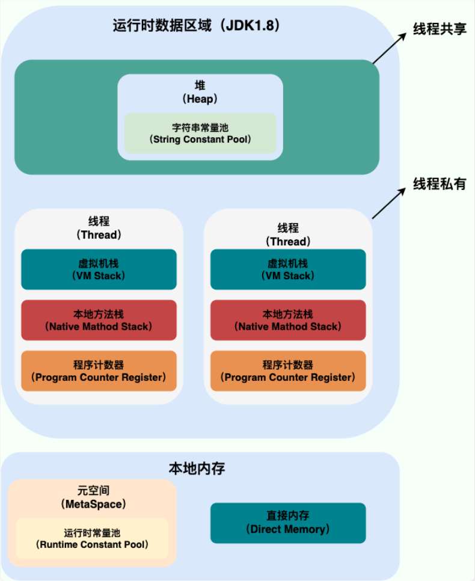

一个进程中可以有多个线程，多个线程共享进程的**堆**和**方法区 (JDK1.8 之后的元空间)** 资源，但是每个线程有自己的**程序计数器**、**虚拟机栈** 和 **本地方法栈**。

> **总结：**  **线程是进程划分成的更小的运行单位。** **线程和进程最大的不同在于基本上各进程是独立的，而各线程则不一定，因为同一进程中的线程极有可能会相互影响。线程执行开销小，但不利于资源的管理和保护；而进程相反。**
>
> **进程是计算机系统资源分配的基本单位，线程是计算机系统调度的基本单位。**

### 程序计数器为什么是私有的?

:::success
**JVM会根据PC的值依次读取指令并执行，PC会记录当前线程执行的位置，当线程被切换再次执行后，根据PC记录的位置继续执行，保证线程切换后能恢复到之前的位置。**

:::

程序计数器私有主要是**为了线程切换后能恢复到正确的执行位置**

### 虚拟机栈和本地方法栈为什么是私有的?

:::success
**栈存放的是一些局部变量，这些局部变量是线程私有的，栈的私有化保证线程中的局部变量不被别的线程访问到，防止出现线程安全问题。**

:::

* **虚拟机栈：**  每个 Java 方法在执行之前会创建一个栈帧用于存储局部变量表、操作数栈、常量池引用等信息。从方法调用直至执行完成的过程，就对应着一个栈帧在 Java 虚拟机栈中入栈和出栈的过程。
* **本地方法栈：**  和虚拟机栈所发挥的作用非常相似，区别是：**虚拟机栈为虚拟机执行 Java 方法 （也就是字节码）服务，而本地方法栈则为虚拟机使用到的 Native 方法服务** **。**  在 HotSpot 虚拟机中和 Java 虚拟机栈合二为一

**堆和方法区是所有线程共享的资源，其中堆是进程中最大的一块内存，主要用于存放新创建的对象 (几乎所有对象都在这里分配内存)，方法区主要用于存放已被加载的类信息、常量、静态变量、即时编译器编译后的代码等数据。**

## 并发与并行的区别

* **并发**：两个及两个以上的作业在同一 **时间段** 内执行。
* **并行**：两个及两个以上的作业在同一 **时刻** 执行。

最关键的点是：是否是 **同时** 执行

## 同步和异步的区别

* **同步**：按照一定的顺序执行程序，程序执行间若存在依赖关系，则后面的操作需要等待前面操作结果返回后才能执行。
* **异步**：调用在发出之后，不用等待返回结果，该调用直接返回。

## 为什么要使用多线程?

* **从计算机底层来说：**  线程可以比作是轻量级的进程，是程序执行的最小单位,线程间的切换和调度的成本远远小于进程。另外，多核 CPU 时代意味着多个线程可以同时运行，这减少了线程上下文切换的开销。
* **从当代互联网发展趋势来说：**  现在的系统动不动就要求百万级甚至千万级的并发量，而多线程并发编程正是开发高并发系统的基础，利用好多线程机制可以大大提高系统整体的并发能力以及性能。

> **进程的切换和调度成本很高，而线程切换和调度的成本更低。多核CPU多线程可以同时执行，也减少了线程上下文切换的开销。**
>
> **多线程并发能力强，性能优秀**

## 使用多线程可能带来什么问题? ♥♥

**内存泄漏、死锁、线程不安全等等**。

多线程环境下内存泄漏举例：

* <font style="color:rgb(5, 7, 59);background-color:rgb(253, 253, 254);">如果采用引用计数的方式来管理内存（如某些智能指针的实现），那么当多个线程同时增加或减少对象的引用计数时，如果没有适当的同步机制（如互斥锁），就可能导致引用计数错误。</font>
* <font style="color:rgb(5, 7, 59);background-color:rgb(253, 253, 254);">静态变量和全局变量使用不恰当：变量被用来存储指向动态分配内存的指针，并且在线程结束时没有适当地清理这些指针指向的内存，就会导致内存泄漏。</font>
* <font style="color:rgb(5, 7, 59);background-color:rgb(253, 253, 254);">线程池内存泄漏：线程池中的线程在执行任务时分配了内存，并且在任务完成后没有释放这些内存，就会导致内存泄漏。</font>

## 如何理解线程安全和不安全？♥♥

线程安全和不安全是在\*\*<font style="color:#DF2A3F;">多线程环境下对于同一份数据的访问是否能够保证其正确性和一致性</font>\*\*。

* 线程安全指的是在多线程环境下，对于同一份数据，不管有多少个线程同时访问，都能保证这份数据的正确性和一致性。
* 线程不安全则表示在多线程环境下，对于同一份数据，多个线程同时访问时可能会导致数据混乱、错误或者丢失。

> **多线程环境下对于同一份数据的访问是否能够保证其正确性和一致性**

## java线程的生命周期和状态? ♥♥♥♥

Java 线程在运行的生命周期中的指定时刻只可能处于下面 6 种不同状态的其中一个状态：

* **NEW:** 初始状态，线程被创建出来但\*\*没有被调用 \*\*`start()`  。
* **RUNNABLE**: 运行状态，线程被\*\*调用了 \*\* `start()` 等待运行的状态。
* **BLOCKED**：阻塞状态，需要等待**锁**释放。
* **WAITING**：等待状态，表示该线程需要等待其他线程做出一些特定动作（通知或中断）。
* **TIME\_WAITING**：超时等待状态，可以在指定的时间后自行返回而不是像 WAITING 那样一直等待。
* **TERMINATED**：终止状态，表示该线程已经运行完毕。

线程在生命周期中并不是固定处于某一个状态而是随着代码的执行在不同状态之间切换。

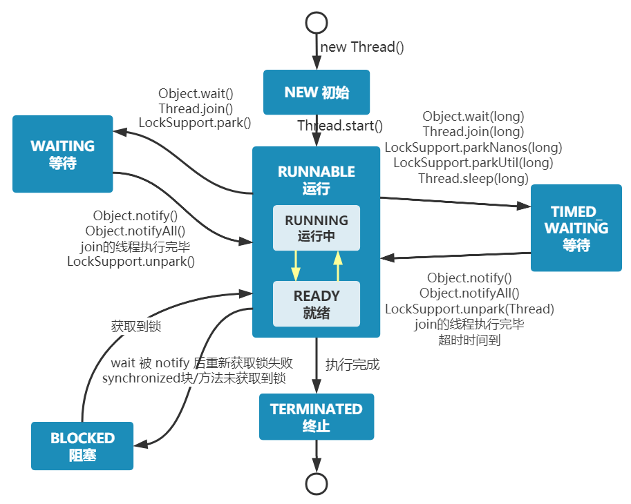

线程创建之后它将处于 **NEW（新建）**  状态，调用 `start()` 方法后开始运行，线程这时候处于 **READY（可运行）**  状态。可运行状态的线程获得了 CPU 时间片（timeslice）后就处于 **RUNNING（运行）**  状态。

> JVM是不会区分运行和就绪的，**只有RUNNABLE这一个状态**

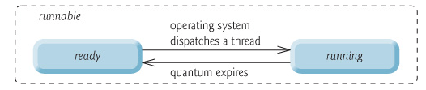

时间分片通常很小，一个线程一次最多只能在 CPU 上运行比如 10-20ms 的时间（此时处于 running 状态），也即大概只有 0.01 秒这一量级，时间片用后就要被切换下来放入调度队列的末尾等待再次调度。（也即回到 ready 状态）。**线程切换的如此之快，区分这两种状态就没什么意义了。**

* 当线程执行 <code>**wait()**</code>方法之后，线程进入 **WAITING（等待）**  状态。**进入等待状态的线程需要依靠其他线程的通知才能够返回到运行状态。**
* **TIMED\_WAITING(超时等待)**  状态相当于**在等待状态的基础上增加了超时限制**，比如通过 `sleep（long millis）` 方法或 `wait（long millis）` 方法可以将线程置于 TIMED\_WAITING 状态。当超时**时间结束后，线程将会返回到 RUNNABLE 状态**。
* 当线程进入 `synchronized` \*\* 方法/块或者调用 \*\*`wait` \*\* 后（被 \*\*`notify` **）** 重新进入 `synchronized` 方法/块，但是锁被其它线程占有，这个时候线程就会进入 **BLOCKED（阻塞）**  状态。
* 线程在执行完了 `run()`方法之后将会进入到 **TERMINATED（终止）**  状态。

> **总结：**
>
> **<font style="color:#DF2A3F;">不设置时间的wait就在WAITING状态，需要其他进程唤醒。</font>**
>
> **<font style="color:#DF2A3F;">如果设置了时间的wait就在TIMED\_WAITING状态，时间到了自己就唤醒或者被其他线程唤醒。</font>**
>
> **<font style="color:#DF2A3F;">如果是因为争取锁导致的阻塞，就会进入BLOCKED状态</font>**

[线程的几种状态你真的了解么](https://mp.weixin.qq.com/s/R5MrTsWvk9McFSQ7bS0W2w)

## 什么是线程上下文切换? ♥♥♥♥

:::success
**线程上下文：是线程执行过程中的**\*\*<font style="color:#DF2A3F;">运行条件和状态</font>**<font style="color:#DF2A3F;"> </font>**<font style="color:#DF2A3F;"></font>**<font style="color:#DF2A3F;">，</font>**<font style="color:#DF2A3F;">比如说程序计数器，栈信息等</font>\*\*\*\*。多线程环境中，需要切换线程上CPU进行运行，就需要保存当前CPU执行线程的上下文信息，将要上CPU运行的线程上下文加载，这个过程就叫上下文切换。\*\*

**保存上下文信息的目的：下次再次调度线程可以接着之前的上下文继续执行。**

:::

当出现如下情况的时候，线程会从占用 CPU 状态中退出。

* 主动让出 CPU，比如调用了 `sleep()` \*\*, \*\*`wait()`  等。
* 时间片用完，因为操作系统要防止一个线程或者进程长时间占用 CPU 导致其他线程或者进程饿死。
* 调用了阻塞类型的系统中断，比如请求 IO，线程被阻塞。
* 被终止或结束运行

这其中前三种都会发生线程切换，**<font style="color:#DF2A3F;">线程切换意味着需要保存当前线程的上下文，留待线程下次占用 CPU 的时候恢复现场。并加载下一个将要占用 CPU 的线程上下文</font>\*\*\*\*。** 这就是所谓的 **上下文切换**。

## 什么是线程死锁?如何避免死锁? ♥♥♥♥

线程死锁：**<font style="color:#DF2A3F;">多个线程互相等待对方释放资源而造成的多个线程阻塞无法正常终止</font>\*\*\*\*。由于线程被无限期地阻塞，因此程序不可能正常终止。**

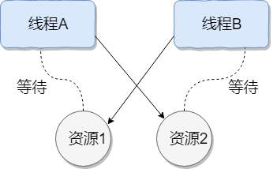

```java
public class DeadLockDemo {
    private static Object resource1 = new Object();//资源 1
    private static Object resource2 = new Object();//资源 2

    public static void main(String[] args) {
        new Thread(() -> {
            synchronized (resource1) {
                System.out.println(Thread.currentThread() + "get resource1");
                try {
                    Thread.sleep(1000);
                } catch (InterruptedException e) {
                    e.printStackTrace();
                }
                System.out.println(Thread.currentThread() + "waiting get resource2");
                synchronized (resource2) {
                    System.out.println(Thread.currentThread() + "get resource2");
                }
            }
        }, "线程 1").start();

        new Thread(() -> {
            synchronized (resource2) {
                System.out.println(Thread.currentThread() + "get resource2");
                try {
                    Thread.sleep(1000);
                } catch (InterruptedException e) {
                    e.printStackTrace();
                }
                System.out.println(Thread.currentThread() + "waiting get resource1");
                synchronized (resource1) {
                    System.out.println(Thread.currentThread() + "get resource1");
                }
            }
        }, "线程 2").start();
    }
}
```

**死锁的四个必要条件：**

1. **互斥条件**：该资源任意一个时刻只由一个线程占用。
2. **请求与保持条件**：一个线程因请求资源而阻塞时，对已获得的资源保持不放。
3. **不剥夺条件**:线程已获得的资源在未使用完之前不能被其他线程强行剥夺，只有自己使用完毕后才释放资源。
4. **循环等待**:若干线程之间形成一种头尾相接的循环等待资源关系。

**如何预防死锁？**  \*\*<font style="color:#DF2A3F;">破坏死锁的产生的必要条件</font>\*\*即可：

1. **破坏请求与保持条件**：一次性申请所有的资源。
2. **破坏不剥夺条件**：占用部分资源的线程进一步申请其他资源申请不到，可以主动释放它占有的资源。
3. **破坏循环等待条件**：按某一顺序申请资源，释放资源则反序释放。破坏循环等待条件。

**如何避免死锁？**

***

避免死锁就是在资源分配时，借助于算法（比如<font style="color:#DF2A3F;">银行家算法</font>）对资源分配进行计算评估，使其进入安全状态。

<font style="color:rgb(74, 74, 74);">银行家算法是一种死锁避免算法。其基本思想是：</font>**<font style="color:rgb(74, 74, 74);">在分配资源之前，先判断系统是否安全，如果安全才会进行资源分配。</font>**

<font style="color:rgb(74, 74, 74);">银行家算法中定义了一系列数据结构来描述系统状态，如 </font>**<font style="color:rgb(74, 74, 74);">Available（系统可用资源量）、Max\[i]（进程 i 最大需求量）、Allocation\[i]（进程 i 已得资源量）、Need\[i]（进程 i 还需资源量）、Request\[i]（进程 i 当次申请量）。</font>**

**如何检测死锁？**

***

* **使用**<code>**jmap**</code>**、**<code>**jstack**</code>**等命令查看 JVM 线程栈和堆内存的情况。如果有死锁，**<code>**jstack**</code>\*\* 的输出中通常会有 **<code>**Found one Java-level deadlock:**</code>**的字样，后面会跟着死锁相关的线程信息。另外，实际项目中还可以搭配使用**<code>**top**</code>**、**<code>**df**</code>**、\*\*<code>**free**</code>**等命令查看操作系统的基本情况，出现死锁可能会导致 CPU、内存等资源消耗过高。**
* **采用 VisualVM、JConsole 等工具进行排查。**

## sleep() 方法和 wait() 方法对比 ♥♥♥

**共同点**：**两者都可以暂停线程的执行。**

**区别**：

* <code><font style="color:#DF2A3F;">sleep()</font></code><font style="color:#DF2A3F;"> </font>**<font style="color:#DF2A3F;"> 是 </font>**<code><font style="color:#DF2A3F;">Thread</font></code><font style="color:#DF2A3F;"> </font>**<font style="color:#DF2A3F;"> 类的静态本地方法，</font>**<code><font style="color:#DF2A3F;">wait()</font></code><font style="color:#DF2A3F;"> </font>**<font style="color:#DF2A3F;"> 则是 </font>**<code><font style="color:#DF2A3F;">Object</font></code><font style="color:#DF2A3F;"> </font>**<font style="color:#DF2A3F;"> 类的本地方法。</font>**
* <code>**<font style="color:#DF2A3F;">sleep()</font>**</code><font style="color:#DF2A3F;">  </font>**<font style="color:#DF2A3F;"> 方法没有释放锁，而 </font>**<font style="color:#DF2A3F;"> </font><code>**<font style="color:#DF2A3F;">wait()</font>**</code><font style="color:#DF2A3F;">  </font>**<font style="color:#DF2A3F;"> 方法释放了锁</font>**<font style="color:#DF2A3F;"> 。</font>
* `wait()` 通常被用于线程间交互/通信，`sleep()`通常被用于暂停执行。
* `wait()` \*\* 方法被调用后，线程不会自动苏醒，需要别的线程调用\*\*\*\*<font style="color:#DF2A3F;">同一个对象上</font>\*\*\*\*（****🔒****）的 \*\*`notify()`\*\*或者 **`notifyAll()` \*\* 方法**。`sleep()`方法执行完成后，线程会自动苏醒，或者也可以使用 `wait(long timeout)` 超时后线程会自动苏醒。

## 为什么 wait() 方法不定义在 Thread 中？ ♥♥♥

<code>**wait()**</code>\*\*  是让获得\*\*\*\*<font style="color:#DF2A3F;">对象锁</font>\*\*\*\*的线程实现等待，会自动释放当前线程占有的对象锁。\*\*每个对象（`Object`）都拥有对象锁，既然要释放当前线程占有的对象锁并让其进入 WAITING 状态，自然是要操作对应的对象（`Object`）而非当前的线程（`Thread`）。

类似的问题：\*\*为什么 \*\*<code>**sleep()**</code>  \*\* 方法定义在 **<code>**Thread**</code> \*\* 中？**

`sleep()`  \*\* 是让当前线程暂停执行，不涉及到对象类，也不需要获得对象锁\*\*。

## 可以直接调用 Thread 类的 run 方法吗？♥♥

new 一个 `Thread`，线程进入了新建状态。\*\*调用 \*\*`start()`**方法，会启动一个线程并使线程进入了就绪状态，当分配到时间片后就可以开始运行了。**  `start()` 会执行线程的相应准备工作，然后自动执行 `run()` 方法的内容，这是真正的多线程工作。 但是，\*\*直接执行 \*\*`run()` \*\* 方法，会把 **`run()` \*\* 方法当成一个 main 线程下的普通方法去执行**，并不会在某个线程中执行它，所以这并不是多线程工作。

**总结：\*\*\*\*<font style="color:#DF2A3F;">调用 </font>**<font style="color:#DF2A3F;"> </font><code>**<font style="color:#DF2A3F;">start()</font>**</code><font style="color:#DF2A3F;">  </font>**<font style="color:#DF2A3F;"> 方法方可启动线程并使线程进入就绪状态，直接执行 </font>**<font style="color:#DF2A3F;"> </font><code>**<font style="color:#DF2A3F;">run()</font>**</code><font style="color:#DF2A3F;">  </font>**<font style="color:#DF2A3F;"> 方法的话不会以多线程的方式执行。</font>**

## 虚拟线程 ♥♥♥

虚拟线程（Virtual Thread）是 JDK 而不是 OS 实现的轻量级线程(Lightweight Process，LWP），由 JVM 调度。许多虚拟线程共享同一个操作系统线程，虚拟线程的数量可以远大于操作系统线程的数量。

<font style="color:rgb(44, 62, 80);">JVM 调度程序通过平台线程（载体线程）来管理虚拟线程，一个平台线程可以在不同的时间执行不同的虚拟线程（多个虚拟线程挂载在一个平台线程上），当虚拟线程被阻塞或等待时，平台线程可以切换到执行另一个虚拟线程。</font>

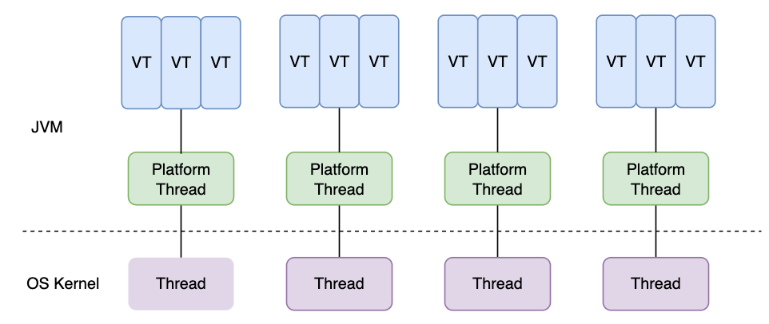

* **<font style="color:rgb(44, 62, 80);">轻量级</font>**<font style="color:rgb(44, 62, 80);">：可以在单个线程中创建成百上千个虚拟线程而不会导致过多的线程创建和上下文切换。</font>
* **<font style="color:rgb(44, 62, 80);">简化异步编程</font>**<font style="color:rgb(44, 62, 80);">： 虚拟线程可以简化异步编程，使代码更易于理解和维护。它可以将异步代码编写得更像同步代码，避免了回调地狱（Callback Hell）。</font>
* **<font style="color:rgb(44, 62, 80);">减少资源开销</font>**<font style="color:rgb(44, 62, 80);">： 由于虚拟线程是由 JVM 实现的，它能够更高效地利用底层资源，例如 CPU 和内存。虚拟线程的上下文切换比平台线程更轻量，因此能够更好地支持高并发场景。</font>
* **<font style="color:rgb(44, 62, 80);">不适用于计算密集型任务</font>**<font style="color:rgb(44, 62, 80);">： 虚拟线程适用于 I/O 密集型任务，但不适用于计算密集型任务，因为密集型计算始终需要 CPU 资源作为支持。</font>
* **<font style="color:rgb(44, 62, 80);">与某些第三方库不兼容</font>**<font style="color:rgb(44, 62, 80);">： 虽然虚拟线程设计时考虑了与现有代码的兼容性，但某些依赖平台线程特性的第三方库可能不完全兼容虚拟线程。</font>

# Java并发常见面试题总结（中）

## JMM(Java 内存模型) ♥♥♥

[5.Java内存模型之JMM](https://www.yuque.com/nibiwanxiamei/yrd6t1/b69d91a549b2e81858ff5f47d569ea56)

[嘿，同学，你要的Java内存模型(JMM)来了\_Java\_Simon郎\_InfoQ写作社区](https://xie.infoq.cn/article/739920a92d0d27e2053174ef2)

### JMM 是如何抽象线程和主内存之间的关系？

:::success
**<font style="color:#DF2A3F;">JMM是抽象定义的规范，定义了多线程环境下各个变量的读写访问方式，实现了线程和主存之间的抽象关系，屏蔽了硬件和操作系统内存访问差异，让java程序在任何平台下都能都达到一致性的内存访问效果。</font>**

:::

**Java 内存模型（JMM）** \*\* 抽象了线程和主内存之间的关系\*\*。线程之间的共享变量必须存储在主内存中。

在 JDK1.2 之前，Java 的内存模型实现总是从 **主存** （即共享内存）读取变量，是不需要进行特别的注意的。而在当前的 Java 内存模型下，线程可以把变量保存 **本地内存** （比如机器的寄存器）中，而不是直接在主存中进行读写。这就可能造成一个线程在主存中修改了一个变量的值，而另外一个线程还继续使用它在寄存器中的变量值的拷贝，造成数据的不一致。

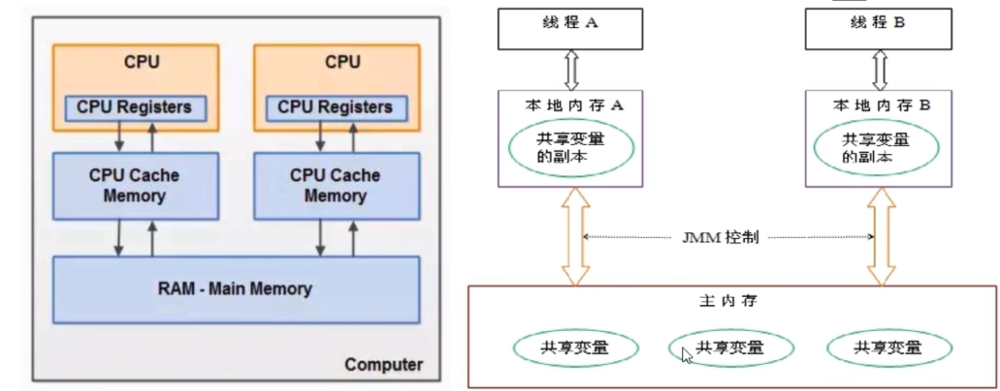

### Java 内存区域（JVM）和 JMM 有何区别？

* JVM 内存结构和 Java 虚拟机的运行时区域相关，**定义了 JVM 在运行时如何分区存储程序数据**，就比如说堆主要用于存放对象实例。
* **<font style="color:#DF2A3F;">JMM是一套抽象定义的规范，定义了多线程环境下各个变量的读写访问方式，实现了线程和主存之间的抽象关系，同时屏蔽了硬件和操作系统内存访问差异，让java程序在任何平台下都能都达到一致性的内存访问效果。</font>**

### JMM规范下多线程先行发生原则之happens-before

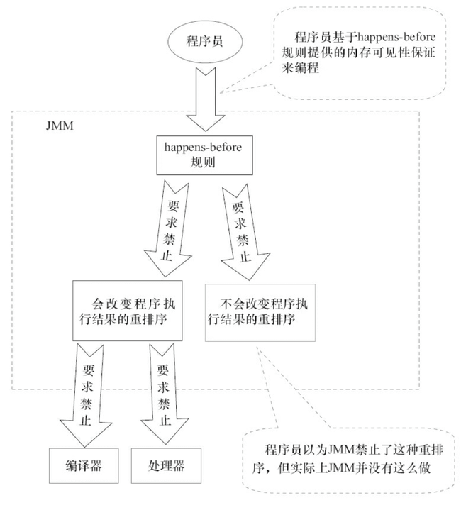

* **如果一个操作 happens-before 另一个操作，那么第一个操作的执行结果将对第二个操作可见，并且第一个操作的执行顺序排在第二个操作之前。**
* 两个操作之间存在 happens-before 关系，并不意味着 Java 平台的具体实现必须要按照 happens-before 关系指定的顺序来执行。**如果重排序之后的执行结果，与按 happens-before 关系来执行的结果一致，那么 JMM 也允许这样的重排序。**

**happens-before 原则表达的意义其实并不是一个操作发生在另外一个操作的前面，虽然这从程序员的角度上来说也并无大碍。更准确地来说，它更想表达的意义是**\*\*<font style="color:#DF2A3F;">前一个操作的结果对于后一个操作是可见的</font>\*\* **，无论这两个操作是否在同一个线程里。**

> 操作 **1 happens-before 操作 2**，即使\*\*操作 1 和操作 2 \*\* 不在同一个线程内，JMM 也会保证操作 1 的结果对操作 2 是可见的

### happens-before 常见规则有哪些？谈谈你的理解？

happens-before之8条

1. **程序顺序规则**：一个线程内，按照代码顺序，书写在前面的操作 happens-before 于书写在后面的操作；
2. **解锁规则**：解锁 happens-before 于加锁；
3. **volatile 变量规则**：对一个 volatile 变量的写操作 happens-before 于后面对这个 volatile 变量的读操作。说白了就是对 volatile 变量的写操作的结果对于发生于其后的任何操作都是可见的。
4. **传递规则**：如果 A happens-before B，且 B happens-before C，那么 A happens-before C；
5. **线程启动规则**：Thread 对象的 `start()`方法 happens-before 于此线程的每一个动作。

随查随看 -- 无需 记忆

### happens-before 和 JMM 什么关系？

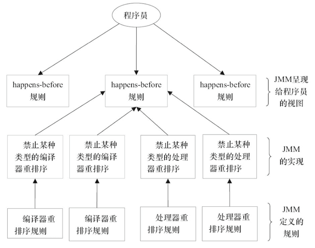

**<font style="color:rgb(5, 7, 59);">happens-before</font>\*\*\*\*<font style="color:rgb(5, 7, 59);background-color:rgb(253, 253, 254);">是JMM中的一个核心概念，它定义了一系列规则来描述多线程程序中的操作之间的可见性和顺序性关系，从而确保了多线程程序的一致性和可预测性。</font>**

## 并发编程三个重要特性 ♥♥♥

### 原子性

一次操作或者多次操作，**要么所有的操作全部都得到执行不会受到任何因素的干扰而中断，要么都不执行。**

在 Java 中，可以借助`synchronized`、各种 `Lock` 以及各种原子类实现原子性。`synchronized` 和各种 `Lock` 可以保证任一时刻只有一个线程访问该代码块，因此可以保障原子性。**各种原子类是利用 CAS (compare and swap) 操作**（可能也会用到 `volatile`或者`final`关键字）来保证原子操作。

### 可见性

**当一个线程对共享变量进行了修改，那么另外的线程都是立即可以看到修改后的最新值**。在 Java 中，可以借助`synchronized`、`volatile` 以及各种 `Lock` 实现可见性。如果我们将变量声明为 `volatile` ，这就指示 JVM，这个变量是共享且不稳定的，每次使用它都到主存中进行读取。

### 有序性

由于指令重排序问题，代码的执行顺序未必就是编写代码时候的顺序。

> **指令重排序可以保证串行语义一致，但是没有义务保证多线程间的语义也一致** ，所以在多线程下，指令重排序可能会导致一些问题。

在 Java 中，`volatile` 关键字可以**禁止指令进行重排序优化**。

## volatile 关键字  ♥♥♥

### 如何保证变量的可见性？

<code>**volatile**</code>\*\* 关键字可以保证变量的可见性，如果我们将变量声明为 **<code>**volatile**</code>** ，这就指示 JVM，这个变量是共享且不稳定的，每次使用它都到主存中进行读取。\*\*

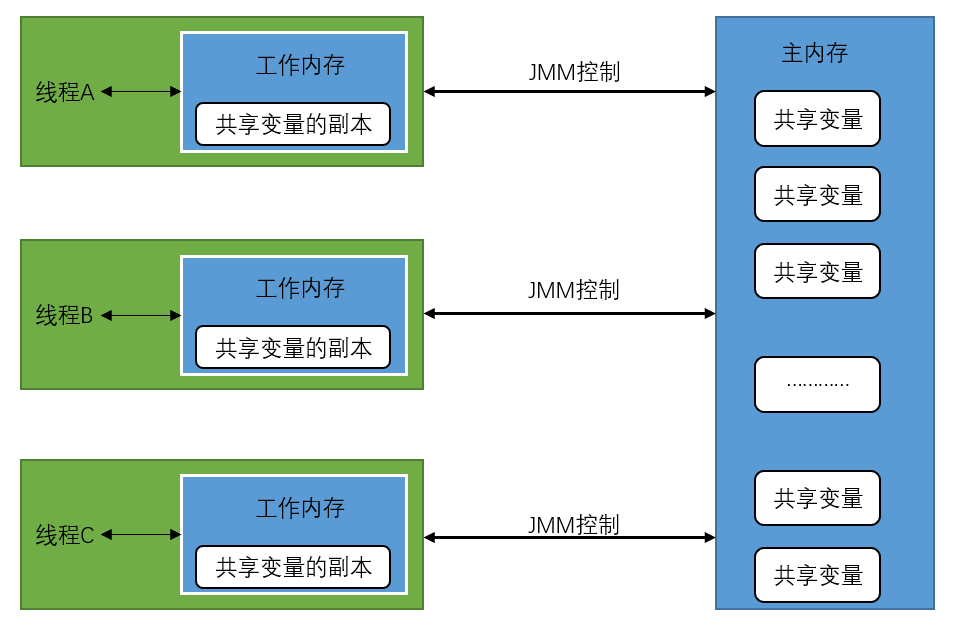

<code><font style="color:#DF2A3F;">volatile</font></code><font style="color:#DF2A3F;"> </font>**<font style="color:#DF2A3F;"> 关键字能保证数据的可见性和指令重排序，但不能保证数据的原子性</font>**<font style="color:#DF2A3F;"> </font>**<font style="color:#DF2A3F;">。</font>**<code><font style="color:#DF2A3F;">synchronized</font></code><font style="color:#DF2A3F;"> </font>**<font style="color:#DF2A3F;"> 关键字两者都能保证。</font>**

### 如何禁止指令重排序？

**在 Java 中，**<code>**volatile**</code> \*\* 关键字除了可以保证变量的可见性，还有一个重要的作用就是防止 JVM 的指令重排序。\*\*  如果我们将变量声明为 <code>**volatile**</code> ，在对这个变量进行读写操作的时候，会通过插入特定的**内存屏障(Memory Barrier)** 的方式来禁止指令重排序。

在 Java 中，`Unsafe` 类提供了三个开箱即用的**内存屏障相关的方法**，屏蔽了操作系统底层的差异：

```java
public native void loadFence();
public native void storeFence();
public native void fullFence();
```

```java
public class Singleton {
    private volatile static Singleton uniqueInstance;

    public  static Singleton getUniqueInstance() {
       //先判断对象是否已经实例过，没有实例化过才进入加锁代码
        if (uniqueInstance == null) {
            //类对象加锁
            synchronized (Singleton.class) {
                if (uniqueInstance == null) {
		    //这里不校验有可能创建多个单例 -- 获取锁阻塞后，别人释放了
                    uniqueInstance = new Singleton();
                }
            }
        }
        return uniqueInstance;
    }
}
```

`uniqueInstance` 采用 `volatile` \*\* 关键字修饰\*\*也是很有必要的， `uniqueInstance = new Singleton();` 这段代码其实是分为三步执行：

1. 为 `uniqueInstance` 分配内存空间
2. 初始化 `uniqueInstance`
3. 将 `uniqueInstance` 指向分配的内存地址

但是由于 **JVM 具有指令重排**的特性，执行顺序有可能变成 1->3->2。指令重排在单线程环境下不会出现问题，但是在多线程环境下会导致一个线程获得还没有初始化的实例。例如，线程 \*\*T1 执行了 1 和 3，此时 T2 调用 \*\*`getUniqueInstance` \*\*() 后发现 \*\*`uniqueInstance` \*\* 不为空，因此返回 \*\*`uniqueInstance` \*\*，但此时 **`uniqueInstance` \*\* 还未被初始化。此时分配的内存地址啥都没有。**

### volatile 可以保证原子性么？

<code>**volatile**</code> \*\* 关键字能保证变量的可见性，但不能保证对变量的操作是原子性的。\*\*

```java
package com.jcy.base;

import java.util.concurrent.ExecutorService;
import java.util.concurrent.Executors;

/**
 * Created with IntelliJ IDEA.
 *
 * @author： ChengYangJie
 * @date： 2023/12/19
 * @version: 1.0
 * @describe:
 */
public class VolatileAtomicityDemo {
    public volatile static int inc = 0;

    public void increase() {
        inc++;
    }
    public static void main(String[] args) throws InterruptedException {
        ExecutorService threadPool = Executors.newFixedThreadPool(5);
        VolatileAtomicityDemo volatoleAtomicityDemo = new VolatileAtomicityDemo();
        for (int i = 0; i < 5; i++) {
            threadPool.execute(() -> {
                for (int j = 0; j < 500; j++) {
                    volatoleAtomicityDemo.increase();
                }
            });
        }
        // 等待1.5秒，保证上面程序执行完成
        Thread.sleep(1500);
        System.out.println(inc);
        threadPool.shutdown();
    }
}
```

正常情况下，运行上面的代码理应输出 `2500`。但你真正运行了上面的代码之后，你会发现很多时候结果都小于 `2500`。

`inc++`  \*\* 其实是一个复合操作\*\*，包括三步：

1. 读取 inc 的值。
2. 对 inc 加 1。
3. 将 inc 的值写回内存。

`volatile` 是无法保证这三个操作是具有原子性的，有可能导致下面这种情况出现：

1. 线程 1 对 `inc` 进行读取操作之后，还未对其进行修改。线程 2 又读取了 `inc`的值并对其进行修改（+1），再将`inc` 的值写回内存。
2. 线程 2 操作完毕后，线程 1 再进行操作，导致两次操作只改变了一次值

这也就导致**两个线程分别对 **`inc`** 进行了一次自增操作后，**`inc` \*\* 实际上只增加了 1。\*\*

**<font style="color:#DF2A3F;">利用 </font>**<code>**<font style="color:#DF2A3F;">synchronized</font>**</code>**<font style="color:#DF2A3F;"> 、</font>**<code>**<font style="color:#DF2A3F;">Lock</font>**</code>**<font style="color:#DF2A3F;">或者</font>**<code>**<font style="color:#DF2A3F;">AtomicInteger</font>**</code>**<font style="color:#DF2A3F;">都可以保证原子性</font>**

```java
public synchronized void increase() {
    inc++;
}
```

```java
public AtomicInteger inc = new AtomicInteger();

public void increase() {
    inc.getAndIncrement();
}
```

```java
Lock lock = new ReentrantLock();
public void increase() {
    lock.lock();
    try {
        inc++;
    } finally {
        lock.unlock();
    }
}
```

### 实现原理

<font style="color:rgb(5, 7, 59);background-color:rgb(253, 253, 254);">volatile的底层原理主要涉及到</font>**<font style="color:rgb(5, 7, 59);background-color:rgb(253, 253, 254);">内存屏障（Memory Barrier）</font>**<font style="color:rgb(5, 7, 59);background-color:rgb(253, 253, 254);">和</font>**<font style="color:rgb(5, 7, 59);background-color:rgb(253, 253, 254);">Java内存模型（Java Memory Model, JMM）。</font>**

1. **<font style="color:rgb(5, 7, 59);background-color:rgb(253, 253, 254);">内存屏障</font>**<font style="color:rgb(5, 7, 59);background-color:rgb(253, 253, 254);">：volatile通过在变量的读写操作前后插入内存屏障来禁止指令重排序，这些屏障会确保在屏障前后的操作按照正确的顺序执行，并且使得变量的修改对其他线程可见。</font>
2. **<font style="color:rgb(5, 7, 59);background-color:rgb(253, 253, 254);">Java内存模型（JMM）</font>**<font style="color:rgb(5, 7, 59);background-color:rgb(253, 253, 254);">：</font>**<font style="color:#DF2A3F;">定义了多线程环境下各个变量的读写访问方式，实现了线程和主存之间的抽象关系，屏蔽了硬件和操作系统内存访问差异，让java程序在任何平台下都能都达到一致性的内存访问效果</font>**<font style="color:rgb(5, 7, 59);background-color:rgb(253, 253, 254);">。在JMM中，所有的变量都存储在主内存中，而每个线程都有自己的工作内存（也称为本地内存或高速缓存）。线程对于变量的读、写都必须在工作内存中进行，而不能直接读、写主内存中的变量。当线程对volatile变量进行写操作时，JMM会把工作内存中的最新变量值强制刷新到主内存；当线程对volatile变量进行读操作时，会先从主内存中读取最新的值到工作内存中。这样，就实现了volatile变量的可见性和顺序性。</font>

## 乐观锁和悲观锁 ♥♥♥

### 什么是悲观锁？

悲观锁总是认为共享资源每次被访问的时候就会出现问题(比如共享数据被修改)，**<font style="color:#DF2A3F;">每次在获取资源操作的时候都会上锁</font>**，这样其他线程想拿到这个资源就会阻塞直到锁被上一个持有者释放。也就是说，**共享资源每次只给一个线程使用，其它线程阻塞，用完后再把资源转让给其它线程。**

像 Java 中`synchronized`和`ReentrantLock`等**独占锁**就是**悲观锁思想**的实现。、

```java
public void performSynchronisedTask() {
    synchronized (this) {
        // 需要同步的操作
    }
}
private Lock lock = new ReentrantLock();
lock.lock();
try {
   // 需要同步的操作
} finally {
    lock.unlock();
}
```

**高并发的场景下，激烈的锁竞争会造成线程阻塞，大量阻塞线程会导致频繁的系统的上下文切换，增加系统的性能开销** **。并且，悲观锁还可能会存在死锁问题，影响代码的正常运行。**

### 什么是乐观锁？

**乐观锁总是假设最好的情况，认为共享资源每次被访问的时候不会出现问题，线程可以不停地执行，无需加锁也无需等待** **，只是在提交修改的时候去验证对应的资源（也就是数据）是否被其它线程修改了（具体方法可以使用版本号机制或 CAS 算法** **）。**

在 Java 中`java.util.concurrent.atomic`包下面的原子变量类（比如`AtomicInteger`、`LongAdder`）就是使用了乐观锁的一种实现方式 **CAS** 。

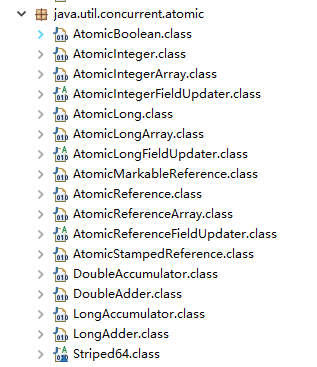

```java
// LongAdder 在高并发场景下会比 AtomicInteger 和 AtomicLong 的性能更好
// 代价就是会消耗更多的内存空间（空间换时间）
LongAdder sum = new LongAdder();
sum.increment();
```

高并发的场景下，乐观锁相比悲观锁来说，**不存在锁竞争造成线程阻塞，也不会有死锁的问题**，在性能上往往会更胜一筹。但是，如果冲突频繁发生（写占比非常多的情况），会频繁失败和重试，这样同样会非常影响性能，导致 CPU 飙升。

理论上来说：

* **<font style="color:#DF2A3F;">悲观锁通常多用于写比较多的情况</font>**（多写场景，竞争激烈），这样可以避免频繁失败和重试影响性能，悲观锁的开销是固定的。不过，如果乐观锁解决了频繁失败和重试这个问题的话（比如`LongAdder`），也是可以考虑使用乐观锁的，要视实际情况而定。
* **<font style="color:#DF2A3F;">乐观锁通常多用于写比较少的情况</font>**（多读场景，竞争较少），这样可以避免频繁加锁影响性能。不过，乐观锁主要针对的对象是单个共享变量（参考`java.util.concurrent.atomic`包下面的原子变量类）。

### 如何实现乐观锁？

乐观锁一般会使用版本号机制或 CAS 算法实现，**CAS 算法相对来说更多一些**

#### 版本号机制

一般是在数据表中加上一个\*\*数据版本号 **`version` \*\* 字段**，**表示数据被修改的次数**。当数据被修改时，`version` 值会加一。当线程 A 要更新数据值时，在读取数据的同时也会读取 `version` 值，在提交更新时，若刚才读取到的 version 值为当前数据库中的 `version` 值相等时才更新，否则重试更新操作，直到更新成功。

**举一个简单的例子**：假设数据库中帐户信息表中有一个 version 字段，当前值为 1 ；而当前帐户余额字段（ `balance` ）为 $100 。

1. 操作员 A 此时将其读出（ `version`=1 ），并从其帐户余额中扣除 $50（$100-$50 ）。
2. 在操作员 A 操作的过程中，操作员 B 也读入此用户信息（ `version`=1 ），并从其帐户余额中扣除 $20 （$100-$20 ）。
3. 操作员 A 完成了修改工作，将数据版本号（ `version`=1 ），连同帐户扣除后余额（ `balance`=$50 ），提交至数据库更新，此时由于提交数据版本等于数据库记录当前版本，数据被更新，数据库记录 `version` 更新为 2 。
4. 操作员 B 完成了操作，也将版本号（ `version`=1 ）试图向数据库提交数据（ `balance`=$80 ），但此时比对数据库记录版本时发现，操作员 B 提交的数据版本号为 1 ，数据库记录当前版本也为 2 ，不满足 “ 提交版本必须等于当前版本才能执行更新 “ 的乐观锁策略，因此，操作员 B 的提交被驳回。

这样就避免了操作员 B 用基于 `version`=1 的旧数据修改的结果覆盖操作员 A 的操作结果的可能。

#### ♥♥♥ CAS 算法

[7.CAS](https://www.yuque.com/nibiwanxiamei/yrd6t1/7.cas)

CAS ： **<font style="color:#DF2A3F;">Compare And Swap（比较与交换）</font>**，\*\*<font style="color:#DF2A3F;">调用的是Unsafe类下的CompareAndSwap()方法，</font>\*\*用于实现乐观锁，被广泛应用于各大框架中。CAS 的思想很简单，**用一个预期值和要更新的变量值进行比较，两值相等才会进行更新。****<font style="color:#DF2A3F;">CAS 是一个原子操作</font>****，底层依赖于一条 CPU 的原子指令。**

> **原子操作即最小不可拆分的操作，也就是说操作一旦开始，就不能被打断，直到操作完成。**

CAS 涉及到三个操作数：

* **V**：要更新的变量值(Var)
* **E**：预期值(Expected)
* **N**：拟写入的新值(New)

当且仅当 V 的值等于 E 时，CAS 通过原子方式用新值 N 来更新 V 的值。如果不等，说明已经有其它线程更新了 V，则当前线程放弃更新。

**当多个线程同时使用 CAS 操作一个变量时，只有一个会胜出，并成功更新，** **其余均会失败，但失败的线程并不会被挂起，允许再次尝试，当然也允许失败的线程放弃操作。**

**Java 语言并没有直接实现 CAS，CAS 相关的实现是通过 C++ 内联汇编的形式实现的**（JNI 调用）。因此， CAS 的具体实现和操作系统以及 CPU 都有关系。

`sun.misc`包下的<code>**<font style="color:#DF2A3F;">Unsafe</font>**</code>类提供了`compareAndSwapObject`、`compareAndSwapInt`、`compareAndSwapLong`方法来实现的对`Object`、`int`、`long`类型的 CAS 操作

```java
/**
	*  CAS
  * @param o         包含要修改field的对象
  * @param offset    对象中某field的偏移量
  * @param expected  期望值
  * @param update    更新值
  * @return          true | false
  */
public final native boolean compareAndSwapObject(Object o, long offset,  Object expected, Object update);
public final native boolean compareAndSwapInt(Object o, long offset, int expected,int update);
public final native boolean compareAndSwapLong(Object o, long offset, long expected, long update);
```

### 乐观锁存在ABA问题

如果一个变量 V 初次读取的时候是 A 值，并且在准备赋值的时候检查到它仍然是 A 值，那我们就能说明它的值没有被其他线程修改过了吗？很明显是不能的，因为在这段时间它的值\*\*<font style="color:#DF2A3F;">可能被改为其他值，然后又改回 A，那 CAS 操作就会误认为它从来没有被修改过</font>\*\*\*\*。\*\* 这个问题被称为 CAS 操作的  **<font style="color:#DF2A3F;">"ABA"问题。</font>**

ABA 问题的解决思路是在变量前面追加上\*\*<font style="color:#DF2A3F;">版本号或者时间戳</font>\*\*。（**记录修改次数**）

JDK 1.5 以后的 `AtomicStampedReference`类就是用来解决 ABA 问题的，其中的 `compareAndSet()` 方法就是首先检查当前引用是否等于预期引用，并且当前标志是否等于预期标志，如果全部相等，则以原子方式将该引用和该标志的值设置为给定的更新值。

```java
public boolean compareAndSet(V   expectedReference,
                             V   newReference,
                             int expectedStamp,
                             int newStamp) {
    Pair<V> current = pair;
    return
        expectedReference == current.reference &&
        expectedStamp == current.stamp &&
        ((newReference == current.reference &&
          newStamp == current.stamp) ||
         casPair(current, Pair.of(newReference, newStamp)));
}
```

**CAS 只对单个共享变量有效，当操作涉及跨多个共享变量时 CAS 无效**。但是从 JDK 1.5 开始，提供了`AtomicReference`类来保证**引用对象之间的原子性**，可以把**多个变量放在一个对象里来进行 CAS 操作.** 所以可以使用锁或者利用`AtomicReference`类把多个共享变量合并成一个共享变量来操作。

## synchronized 关键字  ♥♥♥♥

[11.Synchronized与锁升级](https://www.yuque.com/nibiwanxiamei/yrd6t1/3b31e72fc7250b87c964c4cccb1b387f)

### synchronized 是什么？有什么用？

:::success
**<font style="color:#DF2A3F;">Synchronized是JVM提供的关键字，可以修饰方法和代码块，用于实现多线程访问共享资源的同步性，保证同一时刻只有一个线程访问共享资源，同时Synchronized是可重入的，一个线程可以多次获取同一个锁，底层是基于对象监控锁（Monitor - 管程 | 监视锁）实现的，是非公平锁的一种。</font>**

:::

在 Java 早期版本中，`synchronized` 属于 **重量级锁**，效率低下。**<font style="color:#DF2A3F;">监视器锁（monitor）是依赖于底层的操作系统的 </font>**<code>**<font style="color:#DF2A3F;">Mutex Lock(互斥信号量 - 原语)</font>**</code>**<font style="color:#DF2A3F;"> 来实现的</font>**，Java 的线程是映射到操作系统的内核线程之上的。如果要挂起或者唤醒一个线程，都需要操作系统帮忙完成，而操作系统实现线程之间的切换时需要从用户态转换到内核态，这个状态之间的转换需要相对比较长的时间，时间成本相对较高。

在 Java 6 之后， `synchronized` \*\* 引入了大量的优化：如自旋锁、适应性自旋锁、锁消除、锁粗化、偏向锁、轻量级锁等技术来减少锁操作的开销，这些优化让 **`synchronized` \*\* 锁的效率提升了很多。** 因此， `synchronized` 还是可以在实际项目中使用的，像 JDK 源码、很多开源框架都大量使用了 `synchronized` 。

关于偏向锁：由于偏向锁增加了 JVM 的复杂性，同时也并没有为所有应用都带来性能提升。因此，在 JDK15 中，偏向锁被默认关闭（仍然可以使用 `-XX:+UseBiasedLocking` 启用偏向锁），**在 JDK18 中，偏向锁已经被彻底废弃**（无法通过命令行打开）

### 如何使用 synchronized？

`synchronized` 关键字的使用方式主要有下面 3 种：

1. 修饰实例方法
2. 修饰静态方法
3. 修饰代码块

**1、修饰实例方法** （锁当前对象实例）

给当前对象实例加锁，进入同步代码前要获得 **当前对象实例的锁** 。

```java
synchronized void method() {
    //业务代码
}
```

**2、修饰静态方法** （锁当前类）

给当前类加锁，会作用于类的所有对象实例 ，进入同步代码前要获得 **<font style="color:#DF2A3F;">当前 class 的锁</font>**。

这是因为静态成员不属于任何一个实例对象，归整个类所有，不依赖于类的特定实例，被类的所有实例共享。

```java
synchronized static void method() {
    //业务代码
}
```

静态 `synchronized` 方法和非静态 `synchronized` 方法之间的调用互斥么？不互斥！如果一个线程 A 调用一个实例对象的非静态 `synchronized` 方法，而线程 B 需要调用这个实例对象所属类的静态 `synchronized` 方法，是允许的，不会发生互斥现象，因为访问静态 `synchronized` 方法占用的锁是当前类的锁，而访问非静态 `synchronized` 方法占用的锁是当前实例对象锁。

**3、修饰代码块** （锁指定对象/类）

对括号里指定的对象/类加锁：

* `synchronized(object)` 表示进入同步代码库前要获得 **给定对象的锁**。
* `synchronized(类.class)` 表示进入同步代码前要获得 **给定 Class 的锁**

```java
synchronized(this) {
    //业务代码
}
```

**总结：**

* `synchronized` 关键字加到 `static` 静态方法和 `synchronized(class)` 代码块上都是是给 Class 类上锁；
* `synchronized` 关键字加到实例方法上是给对象实例上锁；
* 尽量不要使用 `synchronized(String a)` 因为 JVM 中，字符串常量池具有缓存功能。

### 构造方法可以用 synchronized 修饰么？

***

**<font style="color:#DF2A3F;">构造方法不能使用 synchronized 关键字修饰</font>**<font style="color:#DF2A3F;"> </font>**<font style="color:#DF2A3F;">。</font>**

**构造方法本身就属于线程安全的**，**不存在同步的构造方法一说。**

### <font style="color:#DF2A3F;">synchronized 底层原理了解吗？</font>

```java
public class SynchronizedDemo {
    public void method() {
        synchronized (this) {
            System.out.println("synchronized 代码块");
        }
    }
}
```

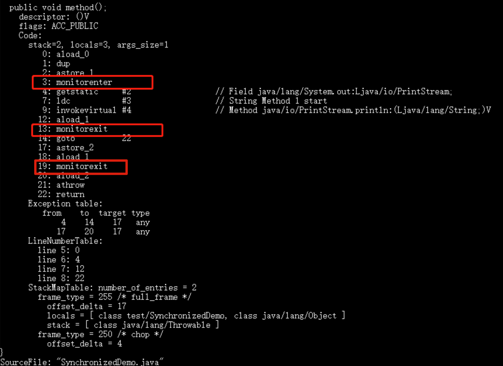

<code>**synchronized**</code> \*\* 同步语句块的实现使用的是 \*\*<code>**monitorenter**</code> \*\* 和 **<code>**monitorexit**</code> \*\* 指令，其中 **<code>**monitorenter**</code> \*\* 指令指向同步代码块的开始位置，**<code>**monitorexit**</code> \*\* 指令则指明同步代码块的结束位置。**

上面的字节码中包含**一个 **`monitorenter` \*\* 指令**以及**两个 **`monitorexit` \*\* 指令**，这是为了保证锁在同步代码块代码**正常执行以及出现异常的这两种情况下都能被正确释放**。

当执行 `monitorenter` 指令时，线程试图获取锁也就是获取 \*\*对象监视器 \*\*<code>**monitor**</code> 的持有权。

> 在 Java 虚拟机(HotSpot)中，Monitor 是基于 C++实现的，由[ObjectMonitor](https://github.com/openjdk-mirror/jdk7u-hotspot/blob/50bdefc3afe944ca74c3093e7448d6b889cd20d1/src/share/vm/runtime/objectMonitor.cpp)实现的。\*\*每个对象中都内置了一个 \*\*<code>**ObjectMonitor**</code>**对象**。
>
> 另外，<code>**wait/notify**</code>**等方法也依赖于**<code>**monitor**</code>**对象**，这就是为什么只有在同步的块或者方法中才能调用`wait/notify`等方法，否则会抛出`java.lang.IllegalMonitorStateException`的异常的原因。

在执行`monitorenter`时，会尝试获取对象的锁，如果锁的计数器为 0 则表示锁可以被获取，获取后将锁计数器设为 1 也就是加 1。

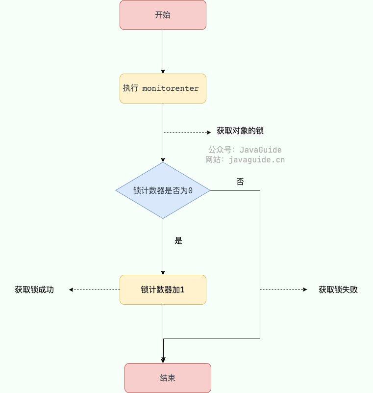

对象锁的的拥有者线程才可以执行 `monitorexit` 指令来释放锁。在执行 `monitorexit` 指令后，将锁计数器设为 0，表明锁被释放，其他线程可以尝试获取锁。

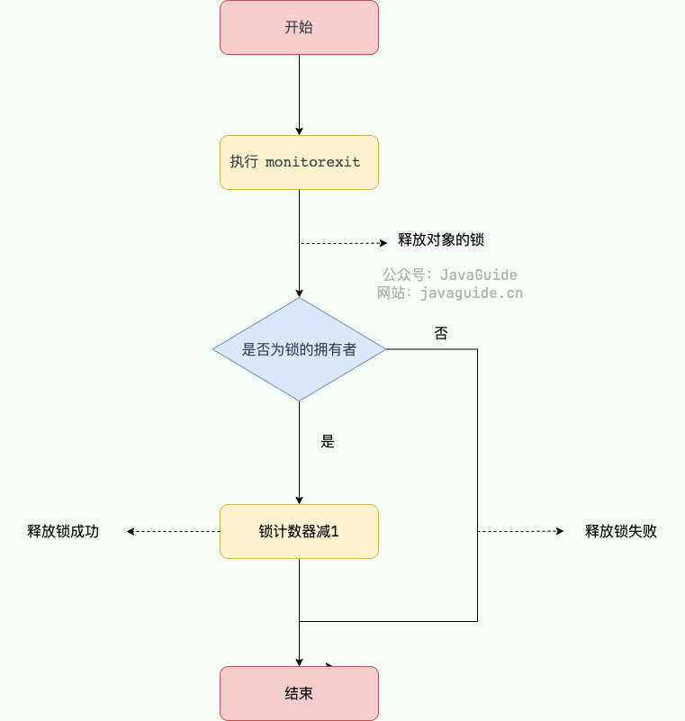

**如果获取对象锁失败，那当前线程就要阻塞等待，直到锁被另外一个线程释放为止**

### synchronized 修饰方法的的情况

```java
public class SynchronizedDemo2 {
    public synchronized void method() {
        System.out.println("synchronized 方法");
    }
}
```

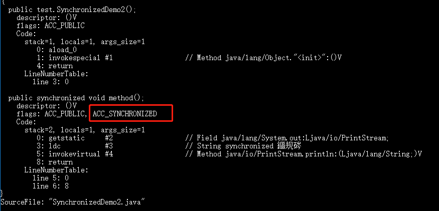

`synchronized` 修饰的方法并没有 `monitorenter` 指令和 `monitorexit` 指令，取得代之的确实是 `ACC_SYNCHRONIZED` \*\* 标识\*\*，**该标识指明了该方法是一个同步方法**。JVM 通过该 <code>**ACC_SYNCHRONIZED**</code> 访问标志来辨别一个方法是否声明为同步方法，从而执行相应的同步调用。

**如果是实例方法，JVM 会尝试获取实例对象的锁。如果是静态方法，JVM 会尝试获取当前 class 的锁**

***

**总结**

* `synchronized` **同步语句块**的实现使用的是 `monitorenter` 和 `monitorexit` 指令，其中 `monitorenter` 指令指向同步代码块的开始位置，`monitorexit` 指令则指明同步代码块的结束位置。
* `synchronized` 修饰的**方法**并没有 `monitorenter` 指令和 `monitorexit` 指令，取得代之的确实是 `ACC_SYNCHRONIZED` 标识，该标识指明了该方法是一个同步方法。

**<font style="color:#DF2A3F;">两者的本质都是对对象监视器 monitor 的获取</font>**<font style="color:#DF2A3F;"> </font>**<font style="color:#DF2A3F;">。</font>**

相关推荐：

[Java锁与线程的那些事](https://tech.youzan.com/javasuo-yu-xian-cheng-de-na-xie-shi/)

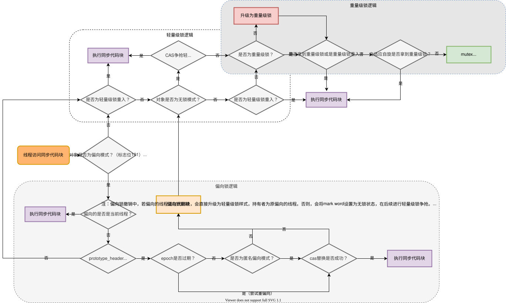

### JDK1.6 之后的 synchronized 底层做了哪些优化？

**偏向锁、轻量级锁、自旋锁、适应性自旋锁、锁消除、锁粗化等技术**来减少锁操作的开销。

锁主要存在四种状态，依次是：**无锁状态、偏向锁状态、轻量级锁状态、重量级锁状态**，会随着竞争的激烈而逐渐升级。锁可以升级不可降级，是为了提高获得锁和释放锁的效率。

### synchronized 和 volatile 有什么区别？

`synchronized` 关键字和 `volatile` 关键字是两个**互补**的存在，而不是对立的存在！

* `volatile` 关键字是线程同步的轻量级实现，所以 `volatile`性能肯定比`synchronized`关键字要好 。但是 `volatile` \*\* 关键字只能用于变量而 **`synchronized` \*\* 关键字可以修饰方法以及代码块** 。
* `volatile` 关键字能保证数据的可见性，但不能保证数据的原子性。`synchronized` 关键字两者都能保证。
* `volatile`关键字主要用于解决变量在多个线程之间的**可见性**，而 `synchronized` 关键字解决的是多个线程之间访问资源的**同步性**

## ReentrantLock

`ReentrantLock` 实现了 `Lock` 接口，是一个\*\*<font style="color:#DF2A3F;">可重入且独占式的锁</font>**，和 `synchronized` 关键字类似。不过，`ReentrantLock` 增加了**<font style="color:#DF2A3F;">轮询、超时、中断、公平锁和非公平锁</font>\*\*等高级功能。

```java
public class ReentrantLock implements Lock, java.io.Serializable {}
```

`ReentrantLock` 里有一个内部类 <code>**<font style="color:#DF2A3F;">Sync</font>**</code>，<code>**<font style="color:#DF2A3F;">Sync</font>**</code>**<font style="color:#DF2A3F;"> 继承 AQS（</font>**<code>**<font style="color:#DF2A3F;">AbstractQueuedSynchronizer</font>**</code>**<font style="color:#DF2A3F;"> ）</font>** ，添加锁和释放锁的大部分操作实际上都是在 `Sync` 中实现的。<code>**Sync**</code>\*\* 有公平锁 **<code>**FairSync**</code>** 和非公平锁 **<code>**NonfairSync**</code>** 两个子类。\*\*

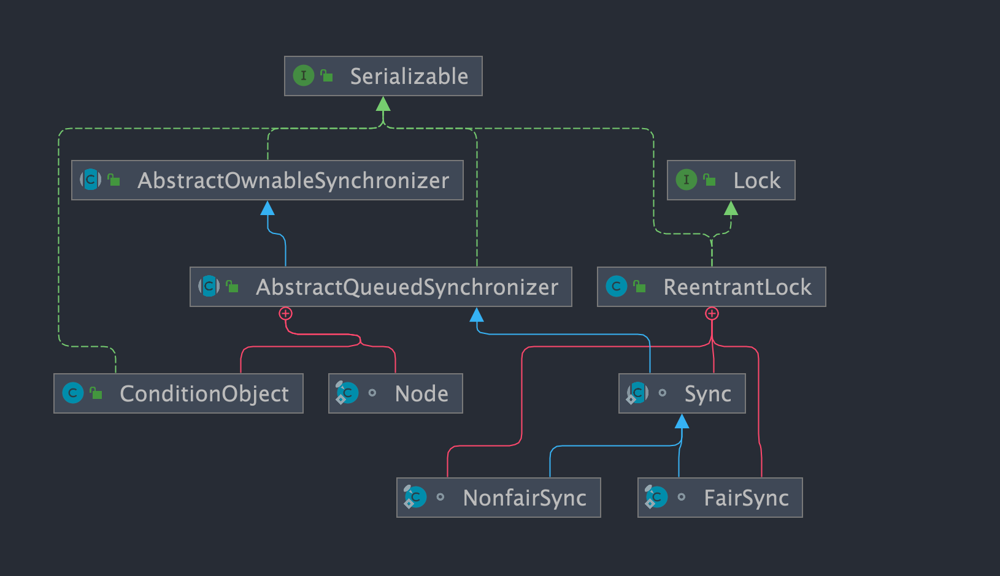

<code>**ReentrantLock**</code>\*\* 默认使用非公平锁，也可以通过构造器来显式的指定使用公平锁。\*\*

```java
// 传入一个 boolean 值，true 时为公平锁，false 时为非公平锁
public ReentrantLock(boolean fair) {
    sync = fair ? new FairSync() : new NonfairSync();
}
```

`ReentrantLock` \*\* 的底层就是由AQS来实现的\*\*

### 公平锁和非公平锁有什么区别？ ♥ ♥ ♥

1. **<font style="color:rgb(0, 0, 0);">公平锁（Fair Lock）</font>**<font style="color:rgb(0, 0, 0);">：</font><font style="color:#DF2A3F;"> </font>**<font style="color:#DF2A3F;">公平锁的特点是按照请求锁的顺序来分配锁，即先到先得</font>**<font style="color:#DF2A3F;">。</font><font style="color:rgb(0, 0, 0);">在ReentrantLock中，通过构造函数可以选择创建一个公平锁。公平锁的底层实现使用了一个FIFO队列（First-In-First-Out），即等待队列。当一个</font>[<font style="color:rgb(0, 0, 0);">线程</font>](https://www.tulingxueyuan.cn/tlzx/jsp/683.html)<font style="color:rgb(0, 0, 0);">请求锁时，如果锁已经被其他线程持有，请求线程会被放入等待队列的末尾，按照请求的顺序等待锁的释放。当锁被释放时，等待队列中的第一个线程会被唤醒并获得锁。</font>
2. **<font style="color:rgb(0, 0, 0);">非公平锁（Non-Fair Lock）</font>**<font style="color:rgb(0, 0, 0);">： </font>**<font style="color:#DF2A3F;">非公平锁不考虑请求锁的顺序</font>**<font style="color:rgb(0, 0, 0);">，</font>**<font style="color:#DF2A3F;">它允许新的请求线程插队并尝试立即获取锁，而不管其他线程是否在等待。</font>**<font style="color:rgb(0, 0, 0);">在ReentrantLock中，默认情况下创建的是非公平锁。非公平锁的底层实现中，有一个等待队列，但它不会严格按照请求的顺序来分配锁，而是根据线程竞争锁的情况来判断是否立即分配给新的请求线程。</font>

**<font style="color:#DF2A3F;background-color:#FBDE28;">源码区别：</font>**

1. **<font style="color:rgb(51, 51, 51);">非公平锁在调用 lock 后，首先就会调用 CAS 进行一次抢锁，如果这个时候恰巧锁没有被占用，那么直接就获取到锁返回了。公平锁第一次也会先看是否队列中有进程，有就不会去获取锁。</font>**
2. **<font style="color:rgb(51, 51, 51);">非公平锁在 CAS 失败后，和公平锁一样都会进入到 tryAcquire 方法，在 tryAcquire 方法中，如果发现锁这个时候被释放了（state == 0），非公平锁会直接 CAS 抢锁，但是公平锁会判断等待队列是否有线程处于等待状态，如果有则不去抢锁。按照顺序等待。</font>**

**<font style="color:rgb(51, 51, 51);">公平锁和非公平锁就这两点区别，如果这两次 CAS 都不成功，那么后面非公平锁和公平锁是一样的，都要进入到阻塞队列等待唤醒。</font>**

```java
    static final class FairSync extends ReentrantLock.Sync {
        final boolean initialTryLock() {
            Thread current = Thread.currentThread();
            int c = getState();
            if (c == 0) {
                // 队列没有等待线程则CAS获取锁
                if (!hasQueuedThreads() && compareAndSetState(0, 1)) {
                    setExclusiveOwnerThread(current);
                    return true;
                }
            } else if (getExclusiveOwnerThread() == current) {
                // 可重入判断
                if (++c < 0) // overflow
                    throw new Error("Maximum lock count exceeded");
                setState(c);
                return true;
            }
            return false;
        }
        protected final boolean tryAcquire(int acquires) {
            // 如果可以获取锁并且队列没有阻塞进程，则尝试CAS获取锁
            if (getState() == 0 && !hasQueuedPredecessors() &&
                    compareAndSetState(0, acquires)) {
                setExclusiveOwnerThread(Thread.currentThread());
                return true;
            }
            return false;
        }
    }
```

```java
    static final class NonfairSync extends ReentrantLock.Sync {
        private static final long serialVersionUID = 7316153563782823691L;

        final boolean initialTryLock() {
            Thread current = Thread.currentThread();
            // 直接尝试CAS获取锁
            if (compareAndSetState(0, 1)) { // first attempt is unguarded
                setExclusiveOwnerThread(current);
                return true;
            } else if (getExclusiveOwnerThread() == current) {
                // 可重入判断
                int c = getState() + 1;
                if (c < 0) // overflow
                    throw new Error("Maximum lock count exceeded");
                setState(c);
                return true;
            } else
                return false;
        }
        protected final boolean tryAcquire(int acquires) {
            // 可以获取锁直接CAS尝试获取锁
            if (getState() == 0 && compareAndSetState(0, acquires)) {
                setExclusiveOwnerThread(Thread.currentThread());
                return true;
            }
            return false;
        }
    }
```

### synchronized 和 ReentrantLock 有什么区别

#### 两者都是可重入锁

**<font style="color:#DF2A3F;">可重入锁</font>**<font style="color:#DF2A3F;"> </font>***<font style="color:#DF2A3F;">也叫递归锁</font>***<font style="color:#DF2A3F;">，</font>**<font style="color:#DF2A3F;">线程在获取到锁之后可以再次获取自己的内部锁</font>**<font style="color:#DF2A3F;">。</font>如果是不可重入锁，就会造成死锁。

JDK 提供的所有现成的 `Lock` 实现类，包括 `synchronized` 关键字锁都是可重入的。

```java
public class SynchronizedDemo {
    public synchronized void method1() {
        System.out.println("方法1");
        method2();
    }
    public synchronized void method2() {
        System.out.println("方法2");
    }
}
```

* 由于 `synchronized`锁是可重入的，**同一个线程在调用**`method1()` \*\* 时可以直接获得当前对象的锁，执行 **`method2()` \*\* 的时候可以再次获取这个对象的锁，不会产生死锁问题**。
* 假如`synchronized`是不可重入锁的话，由于该对象的锁已被当前线程所持有且无法释放，这就导致线程在执行 `method2()`时获取锁失败，会出现死锁问题。

#### synchronized 依赖于 JVM 而 ReentrantLock 依赖于 API

相比`synchronized`，`ReentrantLock`增加了一些高级功能。主要有三点：

* **<font style="color:#DF2A3F;">等待可中断</font>** : `ReentrantLock`提供了一种能够中断等待锁的线程的机制，通过 `lock.lockInterruptibly()` 来实现这个机制。**正在等待的线程可以选择放弃等待，改为处理其他事情。对于ReentrantLock来说，获取到锁的线程是可以响应中断的。在同步队列中的线程默认是不可响应中断的；如果想让同步队列中的线程也响应中断，需要使用lockInterrupt()方法**
* **<font style="color:#DF2A3F;">可实现公平锁</font>** : `ReentrantLock`**可以指定是公平锁还是非公平锁**。而`synchronized`**只能是非公平锁**。`ReentrantLock`默认情况是非公平的，可以通过 `ReentrantLock`类的`ReentrantLock(boolean fair)`构造方法来指定是否是公平的。
* **Lock释放锁是主动的，Synchronized释放锁是被动的**
* **<font style="color:#DF2A3F;">可实现选择性通知</font>\*\*\*\*（锁可以绑定多个条件）** : `synchronized`关键字与`wait()`和`notify()`/`notifyAll()`方法相结合可以实现等待/通知机制。`ReentrantLock`类当然也可以实现，但是需要借助于`Condition`接口与`newCondition()`方法。

关于 `Condition`接口的补充：

> `Condition`是 JDK1.5 之后才有的，它具有很好的灵活性，可以实现多路通知功能：在一个`Lock`对象中可以创建多个`Condition`实例（即对象监视器），**线程对象可以注册在指定的**<code>**Condition**</code>**中，从而可以有选择性的进行线程通知，在调度线程上更加灵活。 在使用**<code>**notify()/notifyAll()**</code> **方法进行通知时，被通知的线程是由 JVM 选择的，用**<code>**ReentrantLock**</code>**类结合**<code>**Condition**</code>**实例可以实现“选择性通知”**  ，这个功能非常重要，而且是 `Condition` 接口默认提供的。
>
> `synchronized`关键字就相当于整个 `Lock` 对象中只有一个`Condition`实例，所有的线程都注册在它一个身上。如果执行`notifyAll()`方法的话就会通知所有处于等待状态的线程，这样会造成很大的效率问题。而`Condition`实例的`signalAll()`方法，只会唤醒注册在该`Condition`实例中的所有等待线程。

```java
public class MultiThread {
    private static int count = 1;
    private static final int MAX_COUNT = 100;
    private static ReentrantLock lock = new ReentrantLock();
    private static Condition[] conditions = new Condition[]{
            lock.newCondition(), lock.newCondition(), lock.newCondition()
    };
    public static void main(String[] args) {
        ExecutorService executor = Executors.newFixedThreadPool(3);
        Runnable task1 = () -> printNumber(0);
        Runnable task2 = () -> printNumber(1);
        Runnable task3 = () -> printNumber(2);
        executor.execute(task1);
        executor.execute(task2);
        executor.execute(task3);
        executor.shutdown();
    }
    public static void printNumber(int threadId) {
        while (count <= MAX_COUNT) {
            lock.lock();
            try {
                while((count - 1) % 3 != threadId){
                    conditions[threadId].await();
                }
                if(count <= MAX_COUNT && (count - 1) % 3 == threadId){
                    System.out.println("线程：" + threadId + "打印：" + count);
                    count ++;
                    conditions[(threadId + 1) % 3].signal();
                }
            } catch (InterruptedException e) {
                throw new RuntimeException(e);
            } finally {
                lock.unlock();
            }
        }
    }
}
```

### 可中断锁和不可中断锁有什么区别？

* **可中断锁**：获取锁的过程中可以被中断，不需要一直等到获取锁之后 才能进行其他逻辑处理。`ReentrantLock` 就属于是可中断锁。
* **不可中断锁**：一旦线程申请了锁，就只能等到拿到锁以后才能进行其他的逻辑处理。 `synchronized` 就属于是不可中断锁。

## ReentrantReadWriteLock

<https://juejin.cn/user/2300640603941710/posts>

JDK 1.8 引入了性能更好的读写锁 <code>**StampedLock**</code> 。

`ReentrantReadWriteLock` 实现了 `ReadWriteLock` ，是一个**可重入的读写锁**，**既可以保证多个线程同时读的效率，同时又可以保证有写入操作时的线程安全。**

```java
public class ReentrantReadWriteLock
        implements ReadWriteLock, java.io.Serializable{
}
public interface ReadWriteLock {
    Lock readLock();
    Lock writeLock();
}
```

读写锁进行并发控制的规则：**读读不互斥**、读写互斥、写写互斥（只有读读不互斥）。

`ReentrantReadWriteLock` 其实是两把锁，`WriteLock` (写锁)， `ReadLock`（读锁） 。**读锁是共享锁，写锁是独占锁**。读锁可以被同时读，可以同时被多个线程持有，而写锁最多只能同时被一个线程持有。

和 `ReentrantLock` 一样，`ReentrantReadWriteLock` 底层也是基于 AQS 实现的。

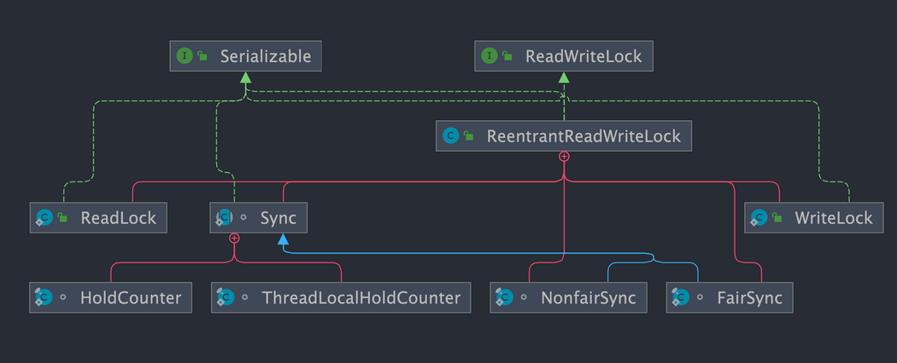

`ReentrantReadWriteLock` 也支持**公平锁和非公平锁**，默认使用非公平锁，可以通过构造器来显示的指定。与 ReentrantLock 的差别在于 **ReentrantReadWriteLock 锁拥有共享锁、排他锁属性。**

```java
// 传入一个 boolean 值，true 时为公平锁，false 时为非公平锁
public ReentrantReadWriteLock(boolean fair) {
    sync = fair ? new FairSync() : new NonfairSync();
    readerLock = new ReadLock(this);
    writerLock = new WriteLock(this);
}
```

实现读写锁与实现普通互斥锁的主要区别在于需要**分别记录读锁状态及写锁状态**，等待队列中需要区别处理两种加锁操作。 ReentrantReadWriteLock 中将 AQS 中的 int 类型的 state 分为**高 16 位与低 16 位**分别记录读锁和写锁的状态

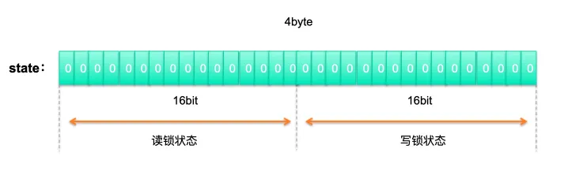

```java
        final boolean tryWriteLock() {
            Thread current = Thread.currentThread();
            int c = getState();
            if (c != 0) {
                // 查看当前写锁独占线程状态
                int w = exclusiveCount(c);
                // 若写锁是0，则说明是读锁被获取了
                if (w == 0 || current != getExclusiveOwnerThread())
                    return false;
                // 若写锁达到最大则报错
                if (w == MAX_COUNT)
                    throw new Error("Maximum lock count exceeded");
            }
            // 尝试获取写锁
            if (!compareAndSetState(c, c + 1))
                return false;
            // 设置独占写线程
            setExclusiveOwnerThread(current);
            return true;
        }

```

```java
private transient ThreadLocalHoldCounter readHolds;
private transient HoldCounter cachedHoldCounter;
static final class HoldCounter {
        int count;        // initially 0
        // Use id, not reference, to avoid garbage retention
        final long tid = LockSupport.getThreadId(Thread.currentThread());
}
final boolean tryReadLock() {
            Thread current = Thread.currentThread();
            for (;;) {
                int c = getState();
                // 读锁被获取但是不是当前线程
                if (exclusiveCount(c) != 0 &&
                    getExclusiveOwnerThread() != current)
                    return false;
                int r = sharedCount(c);
                // 达到最大共享数目
                if (r == MAX_COUNT)
                    throw new Error("Maximum lock count exceeded");
                // 获取读锁
                if (compareAndSetState(c, c + SHARED_UNIT)) {
                    // 第一个获取到读锁的线程
                    if (r == 0) {
                        firstReader = current;
                        firstReaderHoldCount = 1;
                    } else if (firstReader == current) {
                        // 第一个读者多次获取读锁
                        firstReaderHoldCount++;
                    } else {
                        // 获取共享锁重入计数器HoldCounter
                        HoldCounter rh = cachedHoldCounter;
                        if (rh == null ||
                            rh.tid != LockSupport.getThreadId(current))
                            // 如果为空或者不是当前线程的，则创建一个
                            cachedHoldCounter = rh = readHolds.get();
                        else if (rh.count == 0)
                            // 如果计数器空就设置当前计数器
                            readHolds.set(rh);
                        // 设置好当前线程的重入计数器HoldCounter后自增次数
                        rh.count++;
                    }
                    return true;
                }
            }
        }
```

## 读写锁

* \*\*在线程持有读锁的情况下，该线程不能取得写锁 \*\*（获取写锁时，当前的读锁被占用，就马上获取失败，不管读锁是不是被当前线程持有）
* **在线程持有写锁的情况下，该线程可以继续获取读锁**（获取读锁时如果发现写锁被占用，只有写锁没有被当前线程占用的情况才会获取失败）

\*\*<font style="color:#DF2A3F;">写锁可以降级为读锁，但是读锁却不能升级为写锁。</font>\*\*因为读锁升级为写锁会引起线程的争夺，写锁属于是独占锁的。另外，还可能会有死锁问题发生。举个例子：假设两个线程的读锁都想升级写锁，则需要对方都释放自己锁，而双方都不释放，就会产生死锁。

## StampedLock

<code>**StampedLock**</code>\*\* 是 JDK 1.8 引入的性能更好的读写锁，不可重入且不支持条件变量 **<code>**Conditon**</code>**。\*\*

不同于一般的 `Lock` 类，`StampedLock` 并不是直接实现 `Lock`或 `ReadWriteLock`接口，而是基于 **CLH 锁** 独立实现的（AQS 也是基于这玩意）。

```java
public class StampedLock implements java.io.Serializable {
}
```

`StampedLock` 提供了三种模式的读写控制模式：读锁、写锁和乐观读。

* **写锁**：独占锁，一把锁只能被一个线程获得。当一个线程获取写锁后，其他请求读锁和写锁的线程必须等待。类似于 `ReentrantReadWriteLock` 的写锁，不过这里的写锁是不可重入的。
* **读锁** （悲观读）：共享锁，没有线程获取写锁的情况下，多个线程可以同时持有读锁。如果己经有线程持有写锁，则其他线程请求获取该读锁会被阻塞。类似于 `ReentrantReadWriteLock` 的读锁，不过这里的读锁是不可重入的。
* **乐观读**：允许多个线程获取乐观读以及读锁。同时允许一个写线程获取写锁。

**乐观读是**`StampedLock`**比 \*\* `ReadWriteLock` \*\* 性能更好的关键原因**。`StampedLock` 的乐观读允许一个写线程获取写锁，所以不会导致所有写线程阻塞，也就是当读多写少的时候，写线程有机会获取写锁，减少了线程饥饿的问题，吞吐量大大提高。

## Atomic 原子类

[8.原子操作类](https://www.yuque.com/nibiwanxiamei/yrd6t1/7bc54b429c2b1184dd4633b8dc930841)

**Atomic 是指一个操作是不可中断的**。即使是在多个线程一起执行的时候，一个操作一旦开始，就不会被其他线程干扰。原子类说简单点就是**具有原子/原子操作特征的类**

并发包 `java.util.concurrent` 的原子类都存放在`java.util.concurrent.atomic`下


## <font style="color:#DF2A3F;">AQS抽象队列同步器 </font><font style="color:#DF2A3F;">♥♥♥</font>

[12.AbstractQueuedSynchronizer之AQS](https://www.yuque.com/nibiwanxiamei/yrd6t1/54e71355958010230793cec1b53581a2)

**在大量线程激烈&#x4E89;****🔒****，基于CAS自旋的轻量级锁会带来两个问题：**

**1、CAS恶行空自旋导致浪费大量的CPU资源。**

**2、SMP架构的CPU上回导致总线风暴。**

**解决CAS恶性空自旋的有效方式之一是以空间换时间，较为常见的方案有两种：分散操作热点和**\*\*<font style="color:#DF2A3F;">使用队列</font>\*\***削峰。**\
**CLH队列结构：头部是占&#x6709;****🔒****&#x7684;节点，抢占不成功需要等待线程的插入尾部**

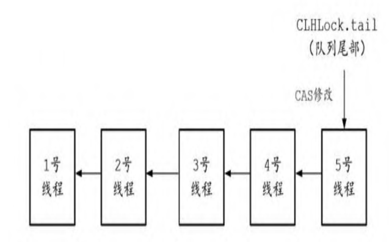

**AQS是JUC提供的一个用于构建锁和同步容器的基础类。JUC包内许多类都是基于AQS构建的，例如ReentrantLock、Semaphore、CountDownLatch、ReentrantReadWriteLock、FutureTask等。**

**AQS的每个节点是由线程封装的，当线程争抢锁失败后会封装成节点加入AQS队列中；当获取锁的线程释放锁以后，会从队列中唤醒一个阻塞的节点（线程）**

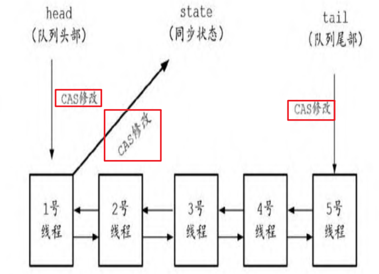

**AQS维持了一个volatile修饰的状态标志位state**

```java
//同步状态，使用 volatile保证线程可见
private volatile int state;
```

### 内部节点类Node

```java
static final class Node {
    
    /**节点等待状态值1：取消状态*/
    static final int CANCELLED = 1;
    /**节点等待状态值-1：标识后继线程处于等待状态*/
    static final int SIGNAL = -1;
    /**节点等待状态值-2：标识当前线程正在进行条件等待 - 用于条件队列*/
    static final int CONDITION = -2;
    /**节点等待状态值-3：标识下一次共享锁的acquireShared操作需要无条件传播 - 用于共享锁*/
    static final int PROPAGATE = -3;
    
    //节点状态：值为SIGNAL、CANCELLED、CONDITION、PROPAGATE、0
    //普通的同步节点的初始值为0，条件等待节点的初始值为CONDITION（-2）
    volatile int waitStatus;

    //节点所对应的线程，为抢锁线程或者条件等待线程
    volatile Thread thread;
    //前驱节点，当前节点会在前驱节点上自旋，循环检查前驱节点的
    waitStatus状态
    volatile Node prev;
    //后继节点
    volatile Node next;
    //若当前Node不是普通节点而是条件等待节点，则节点处于某个条件的等待队列上
    
    //此属性指向下一个条件等待节点，即其条件队列上的后继节点
    Node nextWaiter;
...
}
```

**JDK17版本waitStatus**

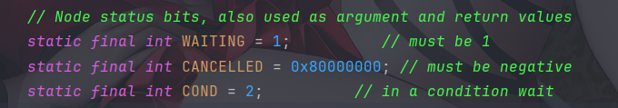

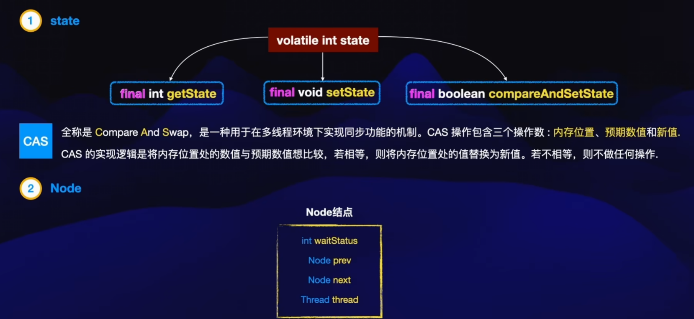

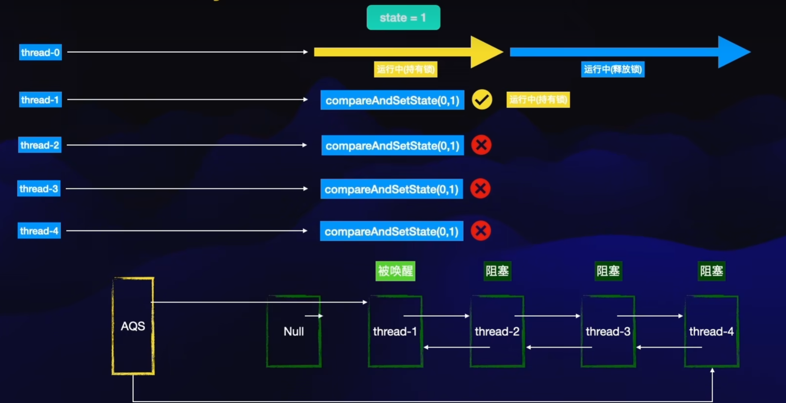

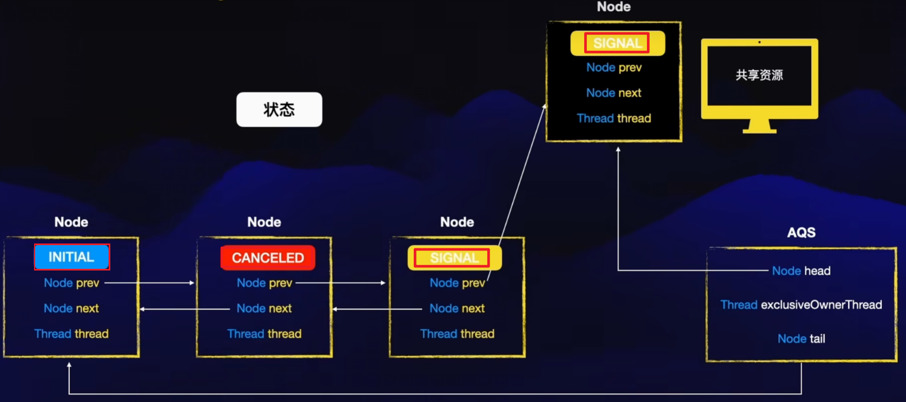

**AQS增加Node节点的过程addWaiter(); - java8版本**

***

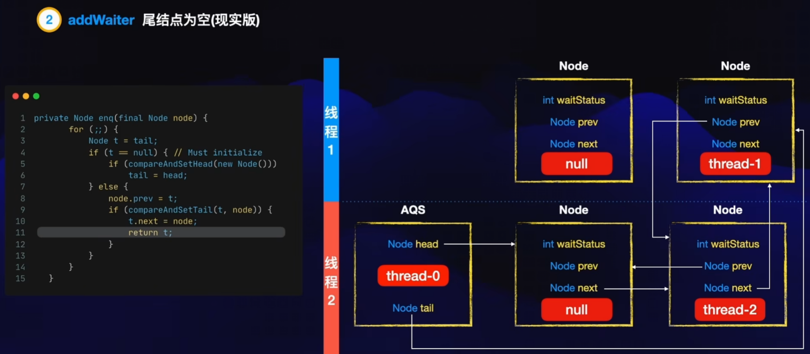

**acquireQueued()**

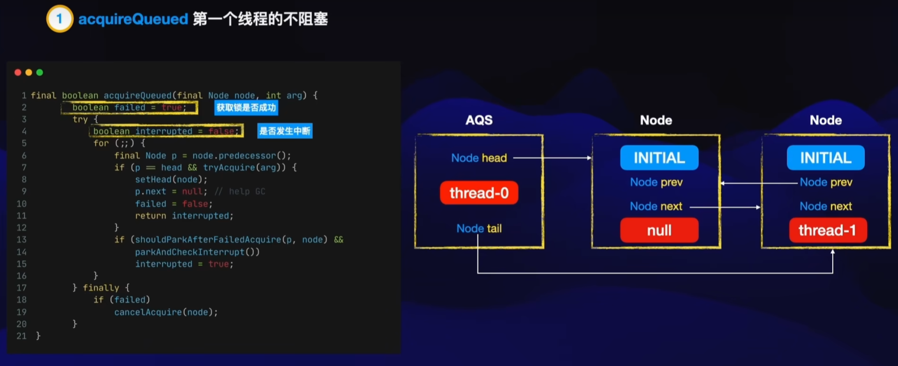

[External Player - 哔哩哔哩嵌入式外链播放器](https://player.bilibili.com/player.html?bvid=BV1zV4y1w7Xd\&p=5\&page=5\&autoplay=0)

**waitStatus在同步队列可能取值：0， -1；**

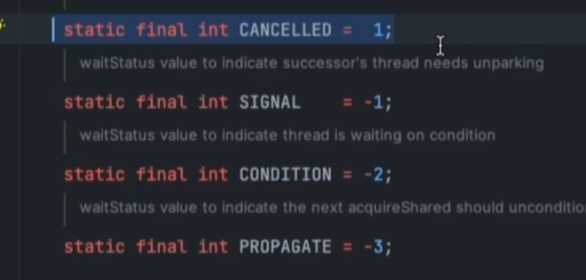

**加入队列的节点是否应该阻塞：取决于前驱节点是否是SIGNAL；前驱是SIGNAL才会唤醒后继节点，如果前驱状态是0，则通过CAS置为-1；只有前驱节点是头节点的Node才能去尝试获取锁；后面节点阻塞后，前驱节点在完成后需要唤醒后继节点。**

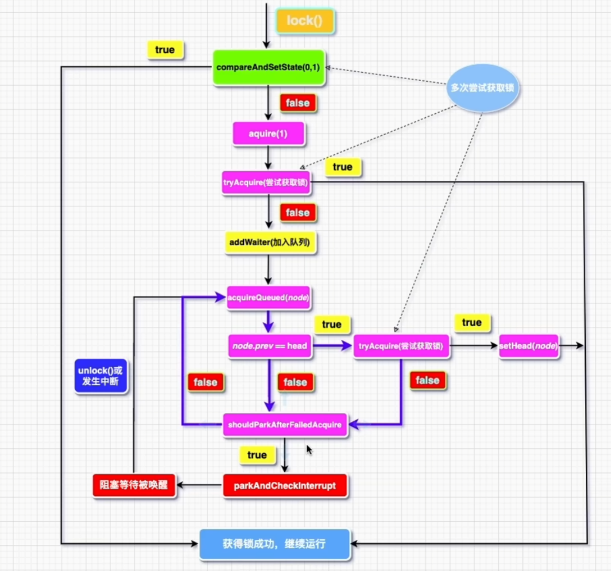

# Java并发常见面试题总结（下）

## ThreadLocal ♥♥♥♥

[9.聊聊ThreadLocal](https://www.yuque.com/nibiwanxiamei/yrd6t1/83fb6387326387e72a6f0920e8813217)

### ThreadLocal 有什么用？

**<font style="color:#DF2A3F;">ThreadLocal -- 线程局部变量</font>** **。每一个线程在访问ThreadLocal实例的时候（通过其get或set方法）都有**\*\*<font style="color:#DF2A3F;">独占初始化的变量副本</font>\*\*\*\*。\*\* **ThreadLocal实例通常是类中的私有静态字段，使用它的目的是希望将状态（例如，用户ID或事物ID）与线程关联起来** **。**

\*\*可以使用 \*\*`get()` \*\* 和 **`set()` \*\* 方法来获取默认值或将其值更改为当前线程所存的副本的值，从而避免了线程安全问题。**

### 如何使用 ThreadLocal？

```java
import java.text.SimpleDateFormat;
import java.util.Random;

public class ThreadLocalExample implements Runnable{

     // SimpleDateFormat 不是线程安全的，所以每个线程都要有自己独立的副本
    private static final ThreadLocal<SimpleDateFormat> formatter = ThreadLocal.withInitial(() -> new SimpleDateFormat("yyyyMMdd HHmm"));

    public static void main(String[] args) throws InterruptedException {
        ThreadLocalExample obj = new ThreadLocalExample();
        for(int i=0 ; i<10; i++){
            Thread t = new Thread(obj, ""+i);
            Thread.sleep(new Random().nextInt(1000));
            t.start();
        }
    }

    @Override
    public void run() {
        System.out.println("Thread Name= "+Thread.currentThread().getName()+" default Formatter = "+formatter.get().toPattern());
        try {
            Thread.sleep(new Random().nextInt(1000));
        } catch (InterruptedException e) {
            e.printStackTrace();
        }
        //formatter pattern is changed here by thread, but it won't reflect to other threads
        formatter.set(new SimpleDateFormat());

        System.out.println("Thread Name= "+Thread.currentThread().getName()+" formatter = "+formatter.get().toPattern());
    }

}
```

```java
Thread Name= 0 default Formatter = yyyyMMdd HHmm
Thread Name= 0 formatter = yy-M-d ah:mm
Thread Name= 1 default Formatter = yyyyMMdd HHmm
Thread Name= 2 default Formatter = yyyyMMdd HHmm
Thread Name= 1 formatter = yy-M-d ah:mm
Thread Name= 3 default Formatter = yyyyMMdd HHmm
Thread Name= 2 formatter = yy-M-d ah:mm
Thread Name= 4 default Formatter = yyyyMMdd HHmm
Thread Name= 3 formatter = yy-M-d ah:mm
Thread Name= 4 formatter = yy-M-d ah:mm
Thread Name= 5 default Formatter = yyyyMMdd HHmm
Thread Name= 5 formatter = yy-M-d ah:mm
Thread Name= 6 default Formatter = yyyyMMdd HHmm
Thread Name= 6 formatter = yy-M-d ah:mm
Thread Name= 7 default Formatter = yyyyMMdd HHmm
Thread Name= 7 formatter = yy-M-d ah:mm
Thread Name= 8 default Formatter = yyyyMMdd HHmm
Thread Name= 9 default Formatter = yyyyMMdd HHmm
Thread Name= 8 formatter = yy-M-d ah:mm
Thread Name= 9 formatter = yy-M-d ah:mm
```

虽然 `Thread-0` 已经改变了 `formatter` 的值，但 `Thread-1` 默认格式化值与初始化值相同，其他线程也一样。

### ThreadLocal 原理了解吗？

从 `Thread`类源代码入手。

```java
public class Thread implements Runnable {
    //......
    //与此线程有关的ThreadLocal值。由ThreadLocal类维护
    ThreadLocal.ThreadLocalMap threadLocals = null;

    //与此线程有关的InheritableThreadLocal值。由InheritableThreadLocal类维护
    ThreadLocal.ThreadLocalMap inheritableThreadLocals = null;
    //......
}
```

可以把 `ThreadLocalMap` 理解为`ThreadLocal` \*\* 类实现的定制化的 \*\*`HashMap`。默认情况下这两个变量都是 null，只有当前线程调用 `ThreadLocal` 类的 `set`或`get`方法时才创建它们，实际上调用这两个方法的时候，我们调用的是`ThreadLocalMap`类对应的 `get()`、`set()`方法。

```java
public void set(T value) {
    //获取当前请求的线程
    Thread t = Thread.currentThread();
    //取出 Thread 类内部的 threadLocals 变量(哈希表结构)
    ThreadLocalMap map = getMap(t);
    if (map != null)
        // 将需要存储的值放入到这个哈希表中
        map.set(this, value);
    else
        createMap(t, value);
}
ThreadLocalMap getMap(Thread t) {
    return t.threadLocals;
}
```

**最终的变量是放在了当前线程的 \*\* <code>**ThreadLocalMap**</code> \*\* 中** **，并不是存在 **<code>**ThreadLocal**</code> \*\* 上，**<code>**ThreadLocal**</code> \*\* 可以理解为只是**<code>**ThreadLocalMap**</code>**的封装，传递了变量值。**  `ThrealLocal` 类中可以通过`Thread.currentThread()`获取到当前线程对象后，直接通过`getMap(Thread t)`可以访问到该线程的`ThreadLocalMap`对象。

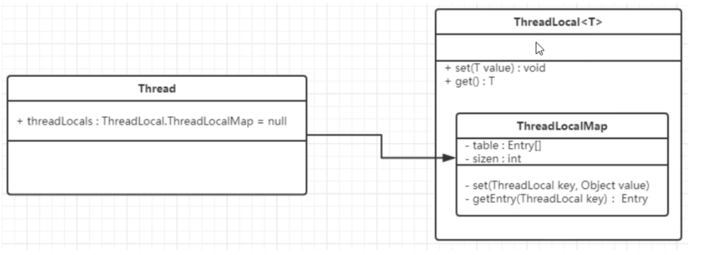

**<font style="color:#DF2A3F;">每个</font>**<code>**<font style="color:#DF2A3F;">Thread</font>**</code>**<font style="color:#DF2A3F;">中都具备一个</font>**<code>**<font style="color:#DF2A3F;">ThreadLocalMap</font>**</code><font style="color:#DF2A3F;"> </font>**<font style="color:#DF2A3F;">，而</font>**<code>**<font style="color:#DF2A3F;">ThreadLocalMap</font>**</code>**<font style="color:#DF2A3F;">可以存储以</font>**<code>**<font style="color:#DF2A3F;">ThreadLocal弱引用</font>**</code>**<font style="color:#DF2A3F;">为 key ，Object 对象为 value </font>**<font style="color:#DF2A3F;"> </font>**<font style="color:#DF2A3F;">的键值对</font>**<font style="color:#DF2A3F;"> </font>**<font style="color:#DF2A3F;">。</font>**

```java
ThreadLocalMap(ThreadLocal<?> firstKey, Object firstValue) {
    //......
}
```

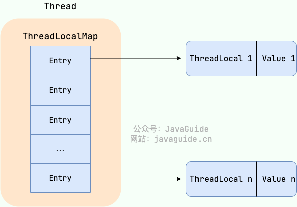

<code>**<font style="color:#DF2A3F;">ThreadLocalMap</font>**</code>**<font style="color:#DF2A3F;">是</font>**<code>**<font style="color:#DF2A3F;">ThreadLocal</font>**</code>**<font style="color:#DF2A3F;">的静态内部类</font>**

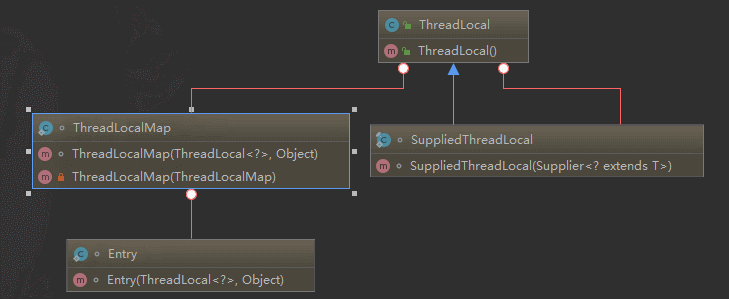

### 为什么ThreadLocalMap要用弱引用作为key

**<font style="color:#DF2A3F;">若ThreadLocal用强引用，在栈内有ThreadLocal的强引用，Map内也是强引用，当栈内的栈帧退出后，此ThreadLocal就应该被回收，而map是强引用，就导致此ThreadLocal无法被回收造成内存泄漏；</font>**

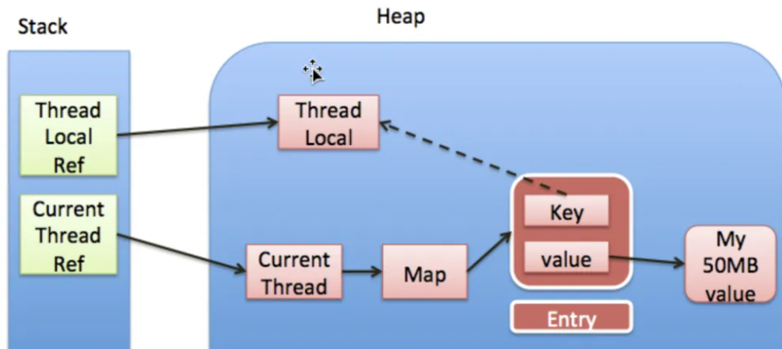

### ThreadLocal 内存泄露问题是怎么导致的？

`ThreadLocalMap` 中使用的 \*\* key 为 **`ThreadLocal` \*\* 的弱引用**，**而 value 是强引用**。所以，如果 `ThreadLocal` 没有被外部强引用的情况下，在垃圾回收的时候，**key 会被清理掉，而 value 不会被清理掉。**

`ThreadLocalMap` 中就会**出现 key 为 null 的 Entry**。假如我们不做任何措施的话，**value 永远无法被 GC 回收，这个时候就可能会产生内存泄露**。`ThreadLocalMap` 实现中已经考虑了这种情况，在调用 `set()`、`get()`、`remove()` 方法的时候，会清理掉 key 为 null 的记录。使用完 `ThreadLocal`方法后最好手动调用`remove()`方法。

```java
static class Entry extends WeakReference<ThreadLocal<?>> {
    /** The value associated with this ThreadLocal. */
    Object value;

    Entry(ThreadLocal<?> k, Object v) {
        super(k);
        value = v;
    }
}
```

## 线程池 ♥♥♥♥

[【线程池】史上最全的ThreadPoolExecutor源码详解-CSDN博客](https://blog.csdn.net/cy973071263/article/details/131484311)

[线程池源码解析](https://www.yuque.com/nibiwanxiamei/yrd6t1/su2h776kddeoy1wu)

### 什么是线程池?

线程池就是**管理一系列线程的资源池**。当有任务要处理时，直接从线程池中获取线程来处理，处理完之后线程并不会立即被销毁，而是等待下一个任务。

### 为什么要用线程池？

线程池、数据库连接池、HTTP 连接池等等都是对这个思想的应用。池化技术的思想\*\*<font style="color:#DF2A3F;">主要是为了减少每次获取资源的消耗，提高对资源的利用率</font>**。线程池提供了一种限制和管理资源（包括执行一个任务）的方式。 每个**线程池\*\*还维护一些基本统计信息，例如已完成任务的数量。

**使用线程池的好处**：

* **<font style="color:#DF2A3F;">降低资源消耗</font>**。通过重复利用已创建的线程\*\*<font style="color:#DF2A3F;">降低线程创建和销毁造成的消耗</font>\*\*。
* **<font style="color:#DF2A3F;">提高响应速度</font>**。当任务到达时，任务可以不需要等到线程创建就能立即执行。
* **<font style="color:#DF2A3F;">提高线程的可管理性</font>**。线程是稀缺资源，如果无限制的创建，不仅会消耗系统资源，还会降低系统的稳定性，使用线程池可以进行统一的分配，调优和监控。

### 如何创建线程池？

**方式一：通过**<code>**ThreadPoolExecutor**</code>**构造函数来创建（****<font style="color:#DF2A3F;">推荐</font>****）。**

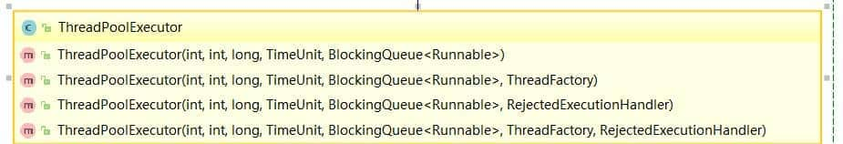

```java
public ThreadPoolExecutor(int corePoolSize,//核心线程数
                          int maximumPoolSize,//最大线程数
                          long keepAliveTime,//线程空闲时间
                          TimeUnit unit,//时间单位
                          BlockingQueue<Runnable> workQueue,//任务队列
                          ThreadFactory threadFactory,//线程工厂
                          RejectedExecutionHandler handler//拒绝策略) 
{
    ...
}
```

\*\*方式二：通过 \*\*<code>**Executor**</code> \*\* 框架的工具类 **<code>**Executors**</code> \*\* 来创建。**

可以创建多种类型的 `ThreadPoolExecutor`：

* <code>**FixedThreadPool**</code>：返回一个**固定线程数量**的线程池。当有一个新的任务提交时，线程池中若有空闲线程，则立即执行。没有则新的任务会被暂存在一个任务队列中，待有线程空闲时处理在任务队列中的任务。
* <code>**SingleThreadExecutor**</code> **：**  返回一个**只有一个线程的线程池**。若多余一个任务被提交到该线程池，任务会被保存在一个任务队列中，待有线程空闲时处理在任务队列中的任务。
* <code>**CachedThreadPool**</code> **：**  返回一个**可根据实际情况调整线程数量的线程池**。初始大小为 0。当有新任务提交时，如果当前线程池中没有线程可用，它会创建一个新的线程来处理该任务。如果在一段时间内（默认为 60 秒）没有新任务提交，核心线程会超时并被销毁，从而缩小线程池的大小。
* <code>**ScheduledThreadPool**</code>：返回一个**用来在给定的延迟后运行任务或者定期执行任务的线程池**。

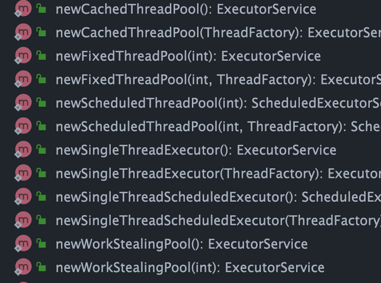

### 为什么不推荐使用内置线程池？

**线程资源必须通过线程池提供，不允许在应用中自行显式创建线程。**

《阿里巴巴 Java 开发手册》中强制线程池**不允许使用 \*\* `Executors` \*\* 去创建**，而是**通过 \*\* `ThreadPoolExecutor` \*\* 构造函数的方式**，这样的处理方式更加明确线程池的运行规则，规避资源耗尽的风险。

`Executors` 返回线程池对象的弊端如下：

* <code>**FixedThreadPool**</code> \*\* 和 \*\*<code>**SingleThreadExecutor**</code>：使用的是无界的 <code>**LinkedBlockingQueue**</code>，任务队列最大长度为 `Integer.MAX_VALUE`,**可能堆积大量的请求，从而导致 OOM**。
* <code>**CachedThreadPool**</code>：使用的是同步队列 `SynchronousQueue`, 允许创建的线程数量为 `Integer.MAX_VALUE` ，如果**任务数量过多且执行速度较慢，可能会创建大量的线程，从而导致 OOM。**
* <code>**ScheduledThreadPool**</code> \*\* 和 \*\*<code>**SingleThreadScheduledExecutor**</code> : 使用的无界的延迟阻塞队列`DelayedWorkQueue`，任务队列最大长度为 `Integer.MAX_VALUE`,**可能堆积大量的请求，从而导致 OOM。**

### 线程池常见参数有哪些？如何解释？

```java
    /**
     * 用给定的初始参数创建一个新的ThreadPoolExecutor。
     */
    public ThreadPoolExecutor(
        int corePoolSize,//线程池的核心线程数量    
        int maximumPoolSize,//线程池的最大线程数          
        long keepAliveTime,//当线程数大于核心线程数时，多余的空闲线程存活的最长时间               
        TimeUnit unit,//时间单位               
        BlockingQueue<Runnable> workQueue,//任务队列，用来储存等待执行任务的队列            
        ThreadFactory threadFactory,//线程工厂，用来创建线程，一般默认即可                
        RejectedExecutionHandler handler//拒绝策略，当提交的任务过多而不能及时处理时，我们可以定制策略来处理任务
) 
    
```

<code>**ThreadPoolExecutor**</code> \*\* 3 个最重要的参数：\*\*

* <code>**corePoolSize**</code> \*\* :\*\*  **任务队列未达到队列容量时，最大可以同时运行的线程数量。**
* <code>**maximumPoolSize**</code> \*\* :\*\*  **任务队列中存放的任务达到队列容量的时候，当前可以同时运行的线程数量变为最大线程数。**
* <code>**workQueue**</code> **:**  **新任务来的时候会先判断当前运行的线程数量是否达到核心线程数，如果达到的话，新任务就会被存放在队列中。**

> 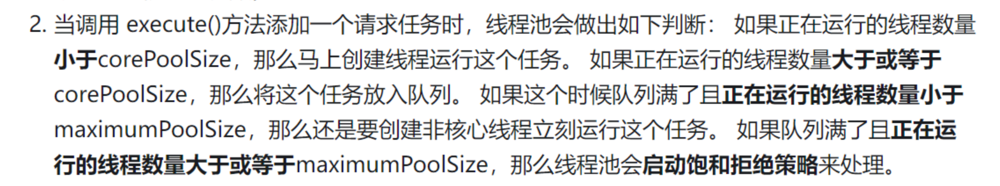

`ThreadPoolExecutor`其他常见参数 :

* <code>**keepAliveTime**</code>:线程池中的线程数量大于 `corePoolSize` 的时候，如果这时没有新的任务提交，\*\*多余的空闲线程不会立即销毁，而是会等待，直到等待的时间超过了 \*\*`keepAliveTime`**才会被回收销毁**，线程池回收线程时，**对核心线程和非核心线程一视同仁，直到线程池中线程的数量等于 **<code>**corePoolSize**</code>** ，回收过程才会停止。**
* <code>**unit**</code> : `keepAliveTime` 参数的时间单位。
* <code>**threadFactory**</code> :executor 创建新线程的时候会用到。
* <code>**handler**</code> :拒绝策略

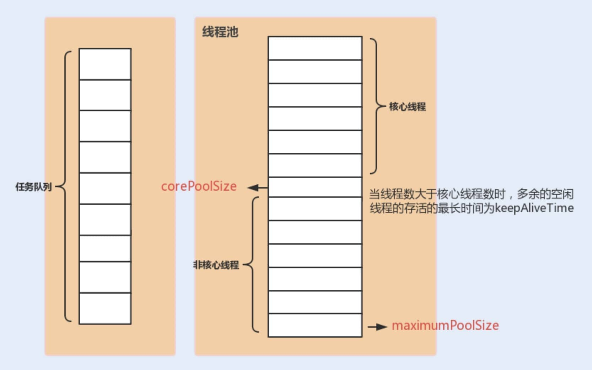

### 线程池的拒绝策略有哪些？

如果当前**同时运行的\*\*\*\*<font style="color:#DF2A3F;">线程数量达到最大线程数量并且队列也已经被放满了任务</font>**，`ThreadPoolTaskExecutor` 定义一些策略:

* <code>**ThreadPoolExecutor.****<font style="color:#DF2A3F;">AbortPolicy</font>**</code> **：**  **抛出**  `RejectedExecutionException`**来拒绝新任务的处理。**
* <code>**ThreadPoolExecutor.****<font style="color:#DF2A3F;">DiscardPolicy</font>**</code> **：**  **不处理新任务，直接丢弃掉**。
* <code>**ThreadPoolExecutor.****<font style="color:#DF2A3F;">DiscardOldestPolicy</font>**</code><font style="color:#DF2A3F;"> </font>**：**  此策略将**丢弃最早的未处理的任务请求**。队列的是“队头”的任务，然后尝试提交新的任务。**对头任务被丢弃**
* <code>**ThreadPoolExecutor****<font style="color:#DF2A3F;">.CallerRunsPolicy</font>**</code> **：**  **调用执行自己的线程运行任务（一般是main线程执行被拒绝的线程）** ，也就是直接在调用`execute`方法的线程中运行(`run`)被拒绝的任务，如果执行程序已关闭，则会丢弃该任务。因此这种策略会降低对于新任务提交速度，影响程序的整体性能。**如果应用程序可以承受此延迟并且你要求任何一个任务请求都要被执行的话，你可以选择这个策略。**
* 用户自定义拒绝策略

### 不允许丢失任务，采用什么拒绝策略

**CallerRunsPolicy不会丢弃任务，而是让调用执行自己的线程运行任务；**

```java
public static class CallerRunsPolicy implements RejectedExecutionHandler {

        public CallerRunsPolicy() { }

        public void rejectedExecution(Runnable r, ThreadPoolExecutor e) {
            //只要当前程序没有关闭，就用执行execute方法的线程执行该任务
            if (!e.isShutdown()) {
                // 直接调用run方法，让调用方执行
                r.run();
            }
        }
    }
```

**走到CallerRunsPolicy的任务是个非常耗时的任务，且处理提交任务的线程是主线程，可能会导致主线程阻塞，影响程序的正常运行。严重的情况下很可能导致 OOM。**

***

**<font style="color:#DF2A3F;">最终方案：自定义拒绝策略，任务持久化</font>**

* **设计一张任务表将任务存储到 MySQL 数据库中。**
* **Redis 缓存任务。**
* **将任务提交到消息队列中。**

1. **实现RejectedExecutionHandler接口**\*\*<font style="color:#DF2A3F;">自定义拒绝策略</font>\*\*\*\*，自定义拒绝策略负责将线程池暂时无法处理（此时阻塞队列已满）的任务入库（保存到 MySQL 中）。注意：线程池暂时无法处理的任务会先被放在阻塞队列中，阻塞队列满了才会触发拒绝策略。\*\*
2. **继承BlockingQueue实现一个**\*\*<font style="color:#DF2A3F;">混合式阻塞队列</font>****，该队列包含 JDK 自带的ArrayBlockingQueue。另外，该混合式阻塞队列需要修改取任务处理的逻辑，也就是重写take()方法，取任务时****<font style="color:#DF2A3F;">优先从数据库中读取最早的任务，数据库中无任务时再从 ArrayBlockingQueue中去取任务</font>\*\*\*\*。\*\*

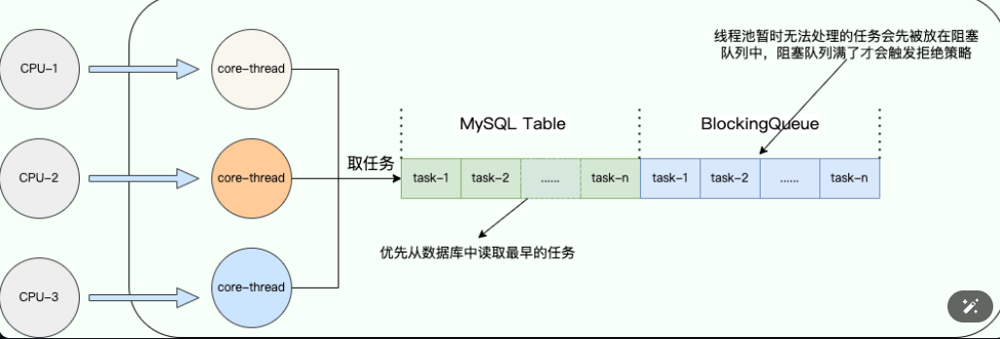

### 线程池常用的阻塞队列有哪些？

新任务来的时候会先判断当前运行的线程数量是否达到核心线程数，如果达到的话，新任务就会被存放在队列中。**不同的线程池会选用不同的阻塞队列**

* 容量为 `Integer.MAX_VALUE` 的 <code>**LinkedBlockingQueue**</code>\*\* （无界队列）：\*\* `FixedThreadPool` 和 `SingleThreadExector` 。`FixedThreadPool`最多只能创建核心线程数的线程（核心线程数和最大线程数相等），`SingleThreadExector`只能创建一个线程（核心线程数和最大线程数都是 1），二者的任务队列永远不会被放满。
* **ArrayBlockingQueue（有界队列）**
* <code>**SynchronousQueue**</code>\*\* （同步队列）\*\* ：`CachedThreadPool` 。`SynchronousQueue` 没有容量，不存储元素，目的是保证对于提交的任务，如果有空闲线程，则使用空闲线程来处理；否则新建一个线程来处理任务。也就是说，`CachedThreadPool` 的最大线程数是 `Integer.MAX_VALUE` ，可以理解为线程数是可以无限扩展的，可能会创建大量线程，从而导致 OOM。
* <code>**DelayedWorkQueue**</code>\*\* （延迟阻塞队列）\*\* ：`ScheduledThreadPool` 和 `SingleThreadScheduledExecutor` 。`DelayedWorkQueue` 的内部元素并不是按照放入的时间排序，而是会按照延迟的时间长短对任务进行排序，内部采用的是“**堆**”的数据结构，可以保证每次出队的任务都是当前队列中执行时间最靠前的。`DelayedWorkQueue` 添加元素满了之后会自动扩容原来容量的 1/2，即永远不会阻塞，最大扩容可达 `Integer.MAX_VALUE`，所以最多只能创建核心线程数的线程。

### 阻塞队列 | 延迟队列如何实现的？

为了实现线程间的等待和唤醒机制，阻塞队列通常使用 ReentrantLock 和 Condition 类。

* ReentrantLock 用于保证对队列的线程安全访问。
* Condition 是用来实现线程的等待/通知机制，使线程无法执行时可以被挂起，而在条件满足时可以被唤醒。

**延迟队列实现：\*\*\*\*<font style="color:rgb(44, 62, 80);">PriorityQueue + ReentrantLock</font>**

[DelayQueue 源码分析](https://javaguide.cn/java/collection/delayqueue-source-code.html)

### 线程池处理任务的流程了解吗？

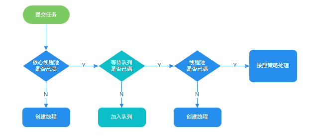

1. 如果当前运行的线程数小于核心线程数，那么就会新建一个线程来执行任务。
2. 如果当前运行的线程数等于或大于核心线程数，但是小于最大线程数，那么就把该任务放入到任务队列里等待执行。
3. 如果向任务队列投放任务失败（任务队列已经满了），但是当前运行的线程数是小于最大线程数的，就新建一个线程来执行任务。
4. 如果当前运行的线程数已经等同于最大线程数了，新建线程将会使当前运行的线程超出最大线程数，那么当前任务会被拒绝，饱和策略会调用`RejectedExecutionHandler.rejectedExecution()`方法。

### 线程池的线程异常后是销毁还是复用

使用\*\*execute()\*\*提交任务：如果异常没有在任务内被捕获，那么该异常终止当前线程，并且异常会被打印到控制台或日志文件中。**线程池检测到这种线程终止，并创建一个新线程来替换它，从而保持配置的线程数不变。**

使用\*\*submit()\*\*提交任务：在任务执行中发生异常，这个异常不会直接打印出来。相反，异常会被封装在由submit()返回的Future对象中。当调用Future.get()方法时，可以捕获到一个ExecutionException。**线程不会因为异常而终止，它会继续存在于线程池中，准备执行后续的任务。**

### 如何给线程池命名？

初始化线程池的时候需要**显示命名**（设置线程池名称前缀），有利于定位问题。

默认情况下创建的线程名字类似 `pool-1-thread-n` 这样的，没有业务含义，不利于我们定位问题。

给线程池里的线程命名通常有下面两种方式：

\*\*1、利用 guava 的 \*\*<code>**ThreadFactoryBuilder**</code>

```java
ThreadFactory threadFactory = new ThreadFactoryBuilder()
                        .setNameFormat(threadNamePrefix + "-%d")
                        .setDaemon(true).build();
ExecutorService threadPool = new ThreadPoolExecutor(corePoolSize, maximumPoolSize, keepAliveTime, TimeUnit.MINUTES, workQueue, threadFactory);
```

\*\*2、自己实现 \*\*<code>**ThreadFactory**</code> **。**

```java
import java.util.concurrent.Executors;
import java.util.concurrent.ThreadFactory;
import java.util.concurrent.atomic.AtomicInteger;
/**
 * 线程工厂，它设置线程名称，有利于我们定位问题。
 */
public final class NamingThreadFactory implements ThreadFactory {

    private final AtomicInteger threadNum = new AtomicInteger();
    private final ThreadFactory delegate;
    private final String name;

    /**
     * 创建一个带名字的线程池生产工厂
     */
    public NamingThreadFactory(ThreadFactory delegate, String name) {
        this.delegate = delegate;
        this.name = name; // TODO consider uniquifying this
    }

    @Override
    public Thread newThread(Runnable r) {
        Thread t = delegate.newThread(r);
        t.setName(name + " [#" + threadNum.incrementAndGet() + "]");
        return t;
    }

}
```

### 如何设定线程池的大小？

> **上下文切换：**
>
> **当一个线程的时间片用完的时候就会重新处于就绪状态让给其他线程使用，这个过程就属于一次上下文切换**。概括来说就是：当前任务在执行完 CPU 时间片切换到另一个任务之前会先保存自己的状态，以便下次再切换回这个任务时，可以再加载这个任务的状态。**任务从保存到再加载的过程就是一次上下文切换**。
>
> 上下文切换通常是计算密集型的。也就是说，它需要相当可观的处理器时间，在每秒几十上百次的切换中，每次切换都需要纳秒量级的时间。所以，上下文切换对系统来说意味着消耗大量的 CPU 时间，事实上，可能是操作系统中时间消耗最大的操作。
>
> Linux 相比与其他操作系统（包括其他类 Unix 系统）有很多的优点，其中有一项就是，其上下文切换和模式切换的时间消耗非常少。

* 如果我们设置的线程池数量太小的话，如果同一时间有大量任务/请求需要处理，可能会导致大量的请求/任务在任务队列中排队等待执行，甚至会出现任务队列满了之后任务/请求无法处理的情况，或者大量任务堆积在任务队列导致 OOM。这样很明显是有问题的，CPU 根本没有得到充分利用。
* 如果我们设置线程数量太大，大量线程可能会同时在争取 CPU 资源，这样会导致大量的上下文切换，从而增加线程的执行时间，影响了整体执行效率。
* **<font style="color:#DF2A3F;">CPU 密集型任务(N+1)</font>**<font style="color:#DF2A3F;"> </font> **：**  这种任务消耗的主要是 CPU 资源，可以将线程数设置为 N（CPU 核心数）+1。比 CPU 核心数多出来的一个线程是为了防止线程偶发的缺页中断，或者其它原因导致的任务暂停而带来的影响。一旦任务暂停，CPU 就会处于空闲状态，而在这种情况下多出来的一个线程就可以充分利用 CPU 的空闲时间。
* <font style="color:#DF2A3F;"></font>**<font style="color:#DF2A3F;">I/O 密集型任务(2N)</font>**  **：**  这种任务应用起来，系统会用大部分的时间来处理 I/O 交互，而线程在处理 I/O 的时间段内不会占用 CPU 来处理，这时就可以将 CPU 交出给其它线程使用。因此在 I/O 密集型任务的应用中，我们可以多配置一些线程，具体的计算方法是 2N。

### 如何设计一个能够根据任务的优先级来执行的线程池？

不同的线程池会选用不同的阻塞队列作为任务队列，比如`FixedThreadPool` 使用的是`LinkedBlockingQueue`（无界队列），由于队列永远不会被放满，因此`FixedThreadPool`最多只能创建核心线程数的线程。

假如需要实现一个优先级任务线程池的话，那可以考虑使用 <code>**<font style="color:#DF2A3F;">PriorityBlockingQueue</font>**</code><font style="color:#DF2A3F;"> </font>**<font style="color:#DF2A3F;"> （优先级阻塞队列）</font>** 作为任务队列（`ThreadPoolExecutor` 的构造函数有一个 `workQueue` 参数可以传入任务队列）。

<code>**PriorityBlockingQueue**</code>\*\*是一个支持优先级的无界阻塞队列，可以看作是线程安全的 **<code>**PriorityQueue**</code>**，两者底层都是使用小顶堆形式的二叉堆，即值最小的元素优先出队。\*\*不过，`PriorityQueue` 不支持阻塞操作。

1. 提交到线程池的任务实现 `Comparable` 接口，重写 `compareTo` 方法指定任务之间的优先级比较规则。
2. 创建 `PriorityBlockingQueue` 时传入一个 `Comparator` 对象来指定任务之间的排序规则(推荐)。

不过，这存在一些风险和问题，比如：

* `PriorityBlockingQueue` 是无界的，可能堆积大量的请求，从而导致 OOM。
* 可能会导致饥饿问题，即低优先级的任务长时间得不到执行。
* 由于需要对队列中的元素进行排序操作以及保证线程安全（并发控制采用的是可重入锁 `ReentrantLock`），因此会降低性能。

### 线程池线程如何复用

* 线程池中的每个线程在执行完一个任务后，会**调用**`getTask()` **方法**从任务队列中获取下一个任务。

```java
private Runnable getTask() {
        boolean timedOut = false; // Did the last poll() time out?
        for (;;) {
            int c = ctl.get();
            // Check if queue empty only if necessary.
            if (runStateAtLeast(c, SHUTDOWN)
                && (runStateAtLeast(c, STOP) || workQueue.isEmpty())) {
                decrementWorkerCount();
                return null;
            }
            int wc = workerCountOf(c);
            // Are workers subject to culling?
            boolean timed = allowCoreThreadTimeOut || wc > corePoolSize;
            if ((wc > maximumPoolSize || (timed && timedOut))
                && (wc > 1 || workQueue.isEmpty())) {
                if (compareAndDecrementWorkerCount(c))
                    return null;
                continue;
            }
            try {
                Runnable r = timed ?
                    workQueue.poll(keepAliveTime, TimeUnit.NANOSECONDS) :
                    workQueue.take();
                if (r != null)
                    return r;
                timedOut = true;
            } catch (InterruptedException retry) {
                timedOut = false;
            }
        }
    }

```

* 如果任务队列中有任务，线程会直接执行该任务；如果任务队列为空，线程会**等待一段时间（**`keepAliveTime` **）** ，如果在这段时间内没有新的任务提交，线程会被销毁。
* 通过这种方式，线程池中的线程可以反复获取和执行任务，从而实现了线程的复用。

```java
 final void runWorker(Worker w) {
        Thread wt = Thread.currentThread();
        Runnable task = w.firstTask;
        w.firstTask = null;
        w.unlock(); // allow interrupts
        boolean completedAbruptly = true;
        try {
            while (task != null || (task = getTask()) != null) {
                w.lock();
                // If pool is stopping, ensure thread is interrupted;
                // if not, ensure thread is not interrupted.  This
                // requires a recheck in second case to deal with
                // shutdownNow race while clearing interrupt
                if ((runStateAtLeast(ctl.get(), STOP) ||
                     (Thread.interrupted() &&
                      runStateAtLeast(ctl.get(), STOP))) &&
                    !wt.isInterrupted())
                    wt.interrupt();
                try {
                    beforeExecute(wt, task);
                    try {
                        task.run();
                        afterExecute(task, null);
                    } catch (Throwable ex) {
                        afterExecute(task, ex);
                        throw ex;
                    }
                } finally {
                    task = null;
                    w.completedTasks++;
                    w.unlock();
                }
            }
            completedAbruptly = false;
        } finally {
            processWorkerExit(w, completedAbruptly);
        }
    }
```

### 线程池是如何回收线程的

回收线程的两种情况：

1. **线程正常执行完任务后，超过空闲时间**：
   * 当线程正常执行完任务，并且已经等待超过`keepAliveTime`时间（空闲时间），同时线程数量大于核心线程数时，线程池会结束该线程的`while`循环，并通过调用`processWorkerExit`方法从线程集合中移除该线程。
2. **调用**<code>**shutdown()**</code> **方法**：
   * 当调用`shutdown()`方法时，线程池状态会被置为`shutdown`。此时，线程池会等待正在执行的任务执行完，并且阻塞队列中的任务也执行完。一旦所有任务都执行完毕，且没有新的任务提交，线程池就会回收所有的线程。
3. **调用shotdownNow()方法**：停止所有任务，回收所有线程。

**<font style="color:#DF2A3F;">回收线程会查看当前线程数，要保证不少于核心线程数，如果少于就会addWorker(null, false)保证线程数</font>**

```java
    private void processWorkerExit(Worker w, boolean completedAbruptly) {
        if (completedAbruptly) // If abrupt, then workerCount wasn't adjusted
            decrementWorkerCount();

        final ReentrantLock mainLock = this.mainLock;
        mainLock.lock();
        try {
            completedTaskCount += w.completedTasks;
            workers.remove(w);
        } finally {
            mainLock.unlock();
        }

        tryTerminate();

        int c = ctl.get();
        if (runStateLessThan(c, STOP)) {
            if (!completedAbruptly) {
                int min = allowCoreThreadTimeOut ? 0 : corePoolSize;
                if (min == 0 && ! workQueue.isEmpty())
                    min = 1;
                if (workerCountOf(c) >= min)
                    return; // replacement not needed
            }
            addWorker(null, false);
        }
    }
```

### 核心线程会被回收吗？

ThreadPoolExecutor 默认不会回收核心线程，即使它们已经空闲了。为了减少创建线程的开销，核心线程通常是要长期保持活跃的。但是，如果线程池是被用于周期性使用的场景，且频率不高（周期之间有明显的空闲时间），可以考虑将 \*\*allowCoreThreadTimeOut(boolean value) \*\*方法的参数设置为 true，这样就会回收空闲（时间间隔由 keepAliveTime 指定）的核心线程了。

### 线程池参数动态修改

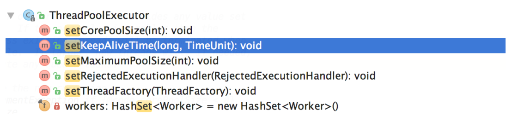

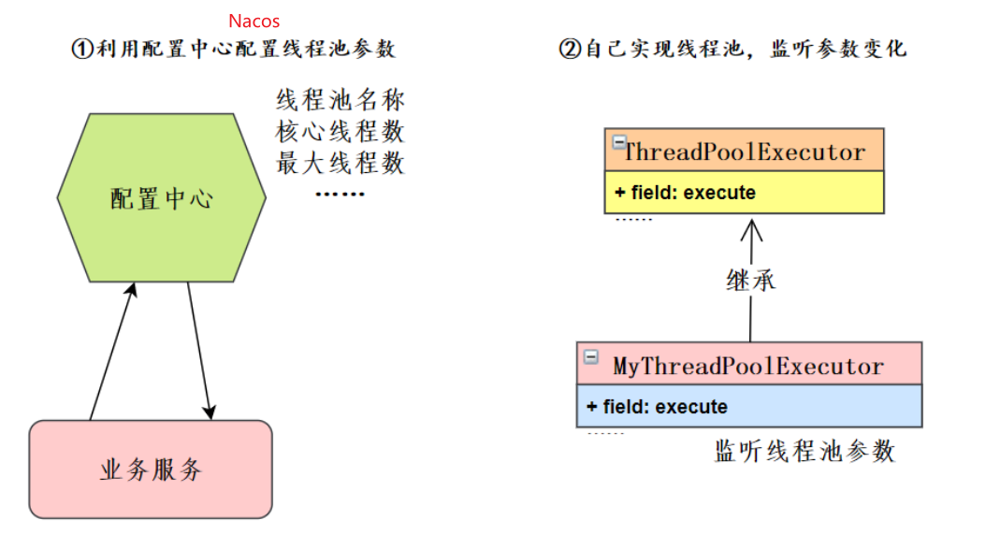

## Future

[2.CompletableFuture](https://www.yuque.com/nibiwanxiamei/yrd6t1/2.completablefuture)

### Future 类有什么用？

`Future` \*\* 类是\*\*\*\*<font style="color:#DF2A3F;">异步</font>\*\***思想的典型运用**，**主要用在一些需要执行耗时任务的场景，避免程序一直原地等待耗时任务执行完成，执行效率太低。** 执行某一耗时的任务时，可以将这个耗时任务交给一个子线程去异步执行，同时不用等待耗时任务执行完成。后续通过 `Future` 类获取到耗时任务的执行结果。程序的执行效率就明显提高了。

多线程中经典的 **Future 模式**，可以将其看作是一种设计模式，核心思想是\*\*<font style="color:#DF2A3F;">异步调用</font>\*\*，主要用在多线程领域。

在 Java 中，`Future` 类只是一个泛型接口，位于 `java.util.concurrent` 包下，其中定义了 5 个方法，主要包括下面这 4 个功能：

* 取消任务；
* 判断任务是否被取消;
* 判断任务是否已经执行完成;
* 获取任务执行结果。

```java
// V 代表了Future执行的任务返回值的类型
public interface Future<V> {
    // 取消任务执行
    // 成功取消返回 true，否则返回 false
    boolean cancel(boolean mayInterruptIfRunning);
    // 判断任务是否被取消
    boolean isCancelled();
    // 判断任务是否已经执行完成
    boolean isDone();
    // 获取任务执行结果
    V get() throws InterruptedException, ExecutionException;
    // 指定时间内没有返回计算结果就抛出 TimeOutException 异常
    V get(long timeout, TimeUnit unit)

        throws InterruptedException, ExecutionException, TimeoutExceptio

}
```

### Callable 和 Future 有什么关系？

`FutureTask` \*\* 提供了 \*\*`Future` \*\* 接口的基本实现，常用来封装 \*\*`Callable` \*\* 和 \*\*`Runnable`，具有取消任务、查看任务是否执行完成以及获取任务执行结果的方法。`ExecutorService.submit()` 方法返回的其实就是 `Future` 的实现类 `FutureTask` 。

```java
<T> Future<T> submit(Callable<T> task);
Future<?> submit(Runnable task);
```

`FutureTask` 不光实现了 `Future`接口，还实现了`Runnable` 接口，因此可以作为任务直接被线程执行。

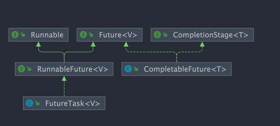

`FutureTask` \*\* 有两个构造函数，可传入 **`Callable` \*\* 或者 **`Runnable` \*\* 对象。实际上，传入 **`Runnable`** 对象也会在方法内部转换为**`Callable` \*\* 对象。**

```java
public FutureTask(Callable<V> callable) {
    if (callable == null)
        throw new NullPointerException();
    this.callable = callable;
    this.state = NEW;
}
public FutureTask(Runnable runnable, V result) {
    // 通过适配器RunnableAdapter来将Runnable对象runnable转换成Callable对象
    this.callable = Executors.callable(runnable, result);
    this.state = NEW;
}
```

`FutureTask`相当于对`Callable` 进行了封装，管理着任务执行的情况，存储了 `Callable` 的 `call` 方法的任务执行结果。

### CompletableFuture 类有什么用？

`Future` 在实际使用过程中存在一些局限性比如不支持异步任务的编排组合、获取计算结果的 `get()` 方法为阻塞调用。

Java 8 才被引入`CompletableFuture` 类可以解决`Future` 的这些缺陷。`CompletableFuture` 除了提供了更为好用和强大的`Future`\*\* 特性**之外，还**<font style="color:#DF2A3F;">提供了函数式编程、异步任务编排组合</font>\*\*（可以将多个异步任务串联起来，组成一个完整的链式调用）等能力。

```java
public class CompletableFuture<T> implements Future<T>, CompletionStage<T> {
}
```

`CompletionStage` 接口描述了一个异步计算的阶段。很多计算可以分成多个阶段或步骤，此时可以通过它将所有步骤组合起来，形成异步计算的流水线。

`CompletionStage` 接口中的方法比较多，`CompletableFuture` 的函数式能力就是这个接口赋予的。从这个接口的方法参数你就可以发现其大量使用了 Java8 引入的函数式编程。

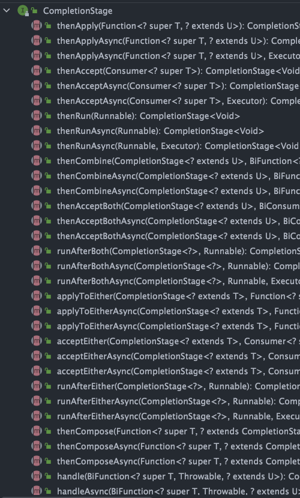

### 函数式接口有几种？

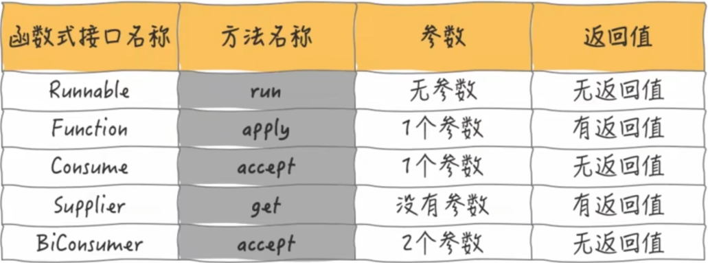

## AQS

[12.AbstractQueuedSynchronizer之AQS](https://www.yuque.com/nibiwanxiamei/yrd6t1/54e71355958010230793cec1b53581a2)

[最好的aqs讲解](https://www.bilibili.com/video/BV1E14y1E7Q4/?spm_id_from=333.788\&vd_source=434fcae166de8f97cb224fceaaf2e219)

AQS 的全称为 `AbstractQueuedSynchronizer` ，翻译过来的意思就是**抽象队列同步器**。这个类在 `java.util.concurrent.locks` 包下面。

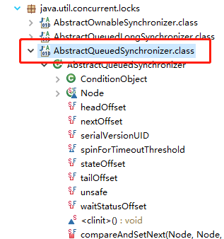

**AQS 就是一个抽象类，主要用来构建锁和同步器。**

> AQS是抽象类，但是方法却不是抽象方法。为什么呢？
>
> **<font style="color:#DF2A3F;">采用了模板方法的模式</font>**
>
> **<font style="color:#DF2A3F;">首先AQS不希望new的方式获取实例，所以设为抽象类。</font>**
>
> **<font style="color:#DF2A3F;">其次方法不是抽象方法是因为AQS希望子类自己去判断哪些方法是自己需要实现的</font>**

AQS 为构建锁和同步器提供了一些通用功能的实现，因此，使用 AQS 能简单且高效地构造出应用广泛的大量的同步器，比如我们提到的 `ReentrantLock`，`Semaphore`，其他的诸如 `ReentrantReadWriteLock`，`SynchronousQueue`等等皆是基于 AQS 的

### AQS 的原理是什么？

AQS 核心思想是，如果被请求的共享资源空闲，则将当前请求资源的线程设置为有效的工作线程，并且将共享资源设置为锁定状态。如果被请求的共享资源被占用，那么就需要一套线程阻塞等待以及被唤醒时锁分配的机制，这个机制 AQS 是用 **<font style="color:#DF2A3F;">CLH 队列锁</font>** 实现的，即将暂时获取不到锁的线程加入到队列中。

CLH(Craig,Landin,and Hagersten) 队列是一个**虚拟的\*\*\*\*<font style="color:#DF2A3F;">双向队列</font>**（虚拟的双向队列即不存在队列实例，仅存在结点之间的关联关系）。AQS 是将每条请求共享资源的线程封装成一个 CLH 锁队列的一个结点（Node）来实现锁的分配。在 CLH 同步队列中，一个节点表示一个线程，它保存着线程的引用（thread）、 当前节点在队列中的状态（waitStatus）、前驱节点（prev）、后继节点（next）。

CLH 队列结构如下图所示：

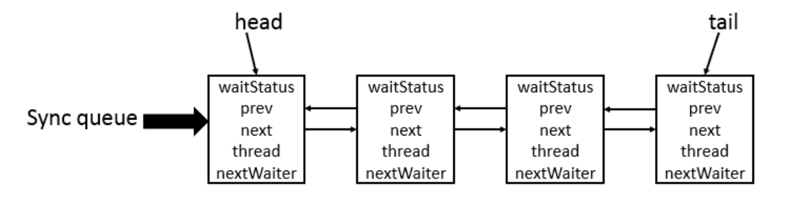

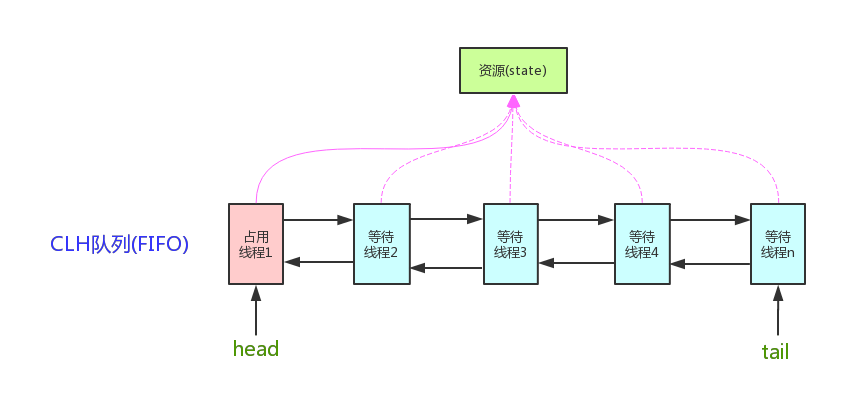

AQS 使用 \*\* int 成员变量 state 表示同步状态\*\*，通过内置的 **线程等待队列** 来完成获取资源线程的排队工作。\
**state 变量由 volatile 修饰**，用于展示当前临界资源的获锁情况。

```java
// 共享变量，使用volatile修饰保证线程可见性
private volatile int state;
```

状态信息 `state` 可以通过 `protected` 类型的`getState()` **、**`setState()`**和**`compareAndSetState()`  进行操作。并且，这几个方法都是 `final` 修饰的，在子类中无法被重写。

```java
//返回同步状态的当前值
protected final int getState() {
     return state;
}
 // 设置同步状态的值
protected final void setState(int newState) {
     state = newState;
}
//原子（CAS操作）将同步状态值设置为给定值update如果当前同步状态的值等于expect（期望值）
protected final boolean compareAndSetState(int expect, int update) {
      return unsafe.compareAndSwapInt(this, stateOffset, expect, update);
}
```

以 `ReentrantLock` 为例，`state` 初始值为 0，表示未锁定状态。A 线程 `lock()` 时，会调用 `tryAcquire()` 独占该锁并将 `state+1` 。此后，其他线程再 `tryAcquire()` 时就会失败，直到 A 线程 `unlock()` 到 `state=`0（即释放锁）为止，其它线程才有机会获取该锁。当然，释放锁之前，**A 线程自己是可以重复获取此锁的（**`state` \*\* 会累加），这就是可重入的概念\*\*。但要注意，**获取多少次就要释放多少次，这样才能保证 state 是能回到零态的。**

再以 `CountDownLatch` 以例，任务分为 N 个子线程去执行，`state` 也初始化为 N（注意 N 要与线程个数一致）。这 N 个子线程是并行执行的，**每个子线程执行完后**`countDown()` \*\* 一次，state 会 CAS(Compare and Swap) 减 1\*\*。等到所有子线程都执行完后(即 `state=0` )，会 `unpark()` 主调用线程，然后主调用线程就会从 `await()` 函数返回，继续后余动作

### Semaphore 有什么用？

`synchronized` 和 `ReentrantLock` 都是一次只允许一个线程访问某个资源，而`Semaphore` **(信号量)** 可以用来控制同时访问特定资源的线程数量。

```java
// 初始共享资源数量
final Semaphore semaphore = new Semaphore(5);
// 获取1个许可
semaphore.acquire();
// 释放1个许可
semaphore.release();
```

当初始的资源个数为 1 的时候，`Semaphore` 退化为排他锁。

`Semaphore` 有两种模式：。

* **公平模式：**  调用 `acquire()` 方法的顺序就是获取许可证的顺序，遵循 FIFO；
* **非公平模式：**  抢占式的。

`Semaphore` 对应的两个构造方法如下：

```java
public Semaphore(int permits) {
  	sync = new NonfairSync(permits);
}

public Semaphore(int permits, boolean fair) {
  	sync = fair ? new FairSync(permits) : new NonfairSync(permits);
}
```

**这两个构造方法，都必须提供许可的数量，第二个构造方法可以指定是公平模式还是非公平模式，默认非公平模式。**`Semaphore` 通常用于那些资源有明确访问数量限制的场景 - **生产者消费者，读者写者，哲学家问题**；

比如限流（仅限于单机模式，实际项目中推荐使用 Redis +Lua 来做限流）

### Semaphore 的原理是什么？

`Semaphore` 是**共享锁**的一种实现，**<font style="color:#DF2A3F;">默认构造 AQS 的 </font>**<code><font style="color:#DF2A3F;">state</font></code><font style="color:#DF2A3F;"> </font>**<font style="color:#DF2A3F;"> 值为 </font>**<code><font style="color:#DF2A3F;">permits</font></code>，你可以将 `permits` 的值理解为许可证的数量，只有拿到许可证的线程才能执行。

调用`semaphore.acquire()` ，线程尝试获取许可证，如果 `state >= 0` 的话，则表示可以获取成功。如果获取成功的话，使用 CAS 操作去修改 `state` 的值 `state=state-1`。如果 `state<0` 的话，则表示许可证数量不足。此时会创建一个 Node 节点加入阻塞队列，挂起当前线程。

```java
/**
 *  获取1个许可证
 */
public void acquire() throws InterruptedException {
 	 sync.acquireSharedInterruptibly(1);
}
/**
 * 共享模式下获取许可证，获取成功则返回，失败则加入阻塞队列，挂起线程
 */
public final void acquireSharedInterruptibly(int arg)
    throws InterruptedException {
    if (Thread.interrupted())
      throw new InterruptedException();
        // 尝试获取许可证，arg为获取许可证个数，当可用许可证数减当前获取的许可证数结果小于0,则创建一个节点加入阻塞队列，挂起当前线程。
    if (tryAcquireShared(arg) < 0)
      doAcquireSharedInterruptibly(arg);
}
```

调用`semaphore.release();` ，线程尝试释放许可证，并使用 CAS 操作去修改 `state` 的值 `state=state+1`。释放许可证成功之后，同时会唤醒同步队列中的一个线程。被唤醒的线程会重新尝试去修改 `state` 的值 `state=state-1` ，如果 `state>=0` 则获取令牌成功，否则重新进入阻塞队列，挂起线程。

```java
// 释放一个许可证
public void release() {
  	sync.releaseShared(1);
}

// 释放共享锁，同时会唤醒同步队列中的一个线程。
public final boolean releaseShared(int arg) {
    //释放共享锁
    if (tryReleaseShared(arg)) {
      //唤醒同步队列中的一个线程
      doReleaseShared();
      return true;
    }
    return false;
}
```

### CountDownLatch 有什么用？

<code><font style="color:#DF2A3F;">CountDownLatch</font></code><font style="color:#DF2A3F;"> </font>**<font style="color:#DF2A3F;">允许 </font>**<code><font style="color:#DF2A3F;">count</font></code><font style="color:#DF2A3F;"> </font>**<font style="color:#DF2A3F;"> 个线程阻塞在一个地方，直至所有线程的任务都执行完毕。</font>**

`CountDownLatch` 是**一次性**的，计数器的值只能在构造方法中初始化一次，之后没有任何机制再次对其设置值，当 `CountDownLatch` 使用完毕后，它不能再次被使用。

> 类似于**一次性大门**，所有的线程完成后都要到这个大门这里来等待开门。

### CountDownLatch 的原理是什么？

<code><font style="color:#DF2A3F;">CountDownLatch</font></code><font style="color:#DF2A3F;"> </font>**<font style="color:#DF2A3F;">是共享锁的一种实现，默认构造 AQS 的 </font>**<font style="color:#DF2A3F;"> </font><code><font style="color:#DF2A3F;">state</font></code><font style="color:#DF2A3F;"> </font>**<font style="color:#DF2A3F;"> 值为 </font>**<font style="color:#DF2A3F;"> </font><code><font style="color:#DF2A3F;">count</font></code><font style="color:#DF2A3F;">。</font>当线程使用 `countDown()` 方法时,其实使用了`tryReleaseShared`方法以 CAS 的操作来减少 `state`,直至 `state` 为 0 。当调用 `await()` 方法的时候，如果 `state` 不为 0，那就证明任务还没有执行完毕，`await()` 方法就会一直阻塞，也就是说 `await()` 方法之后的语句不会被执行。直到`count` 个线程调用了`countDown()`使 state 值被减为 0，或者调用`await()`的线程被中断，才会从阻塞中被唤醒，`await()` 方法之后的语句得到执行。

### 用过 CountDownLatch 么？什么场景下用的？

`CountDownLatch` 的作用就是允许 count 个线程阻塞在一个地方，直至所有线程的任务都执行完毕。之前在项目中，\*\*<font style="color:#DF2A3F;">使用多线程读取多个文件处理</font>\*\*的场景，我用到了 `CountDownLatch` 。具体场景是下面这样的：

我们要读取处理 6 个文件，这 6 个任务都是没有执行顺序依赖的任务，但是我们需要返回给用户的时候将这几个文件的处理的结果进行统计整理。

为此我们定义了一个线程池和 count 为 6 的`CountDownLatch`对象 。使用线程池处理读取任务，每一个线程处理完之后就将 count-1，调用`CountDownLatch`对象的 `await()`方法，直到所有文件读取完之后，才会接着执行后面的逻辑。

```java
public class CountDownLatchExample1 {
    // 处理文件的数量
    private static final int threadCount = 6;

    public static void main(String[] args) throws InterruptedException {
        // 创建一个具有固定线程数量的线程池对象（推荐使用构造方法创建）
        ExecutorService threadPool = Executors.newFixedThreadPool(10);
        final CountDownLatch countDownLatch = new CountDownLatch(threadCount);
        for (int i = 0; i < threadCount; i++) {
            final int threadnum = i;
            threadPool.execute(() -> {
                try {
                    //处理文件的业务操作
                    //......
                } catch (InterruptedException e) {
                    e.printStackTrace();
                } finally {
                    //表示一个文件已经被完成
                    countDownLatch.countDown();
                }

            });
        }
        countDownLatch.await();
        threadPool.shutdown();
        System.out.println("finish");
    }
}
```

可以使用 `CompletableFuture` 类来改进！Java8 的 `CompletableFuture` 提供了很多对多线程友好的方法，使用它可以很方便地为我们编写多线程程序，什么异步、串行、并行或者等待所有线程执行完任务什么的都非常方便。

```java
CompletableFuture<Void> task1 =
    CompletableFuture.supplyAsync(()->{
        //自定义业务操作
    });
//......
CompletableFuture<Void> task6 =
    CompletableFuture.supplyAsync(()->{
    //自定义业务操作
    });
......
CompletableFuture<Void> headerFuture=CompletableFuture.allOf(task1,.....,task6);

try {
    headerFuture.join();
} catch (Exception ex) {
    //......
}
System.out.println("all done. ");
```

上面的代码还可以优化，当任务过多的时候，把每一个 task 都列出来不太现实，可以考虑通过循环来添加任务

```java
//文件夹位置
List<String> filePaths = Arrays.asList(...)
// 异步处理所有文件
List<CompletableFuture<String>> fileFutures = filePaths.stream()
    .map(filePath -> doSomeThing(filePath))
    .collect(Collectors.toList());
// 将他们合并起来
CompletableFuture<Void> allFutures = CompletableFuture.allOf(
    fileFutures.toArray(new CompletableFuture[fileFutures.size()])
);
```

### CyclicBarrier 有什么用？

CyclicBarrier 和 CountDownLatch 非常类似，也可以实现线程间的技术等待，但是它的功能比 CountDownLatch 更加复杂和强大。主要应用场景和 CountDownLatch 类似。

**CountDownLatch 的实现是基于 AQS 的，而 CycliBarrier 是基于 ReentrantLock(ReentrantLock 也属于 AQS 同步器)和 Condition 的。**

***

### CyclicBarrier原理

[CyclicBarrier原理-CSDN博客](https://blog.csdn.net/wr_java/article/details/115132315)

`CyclicBarrier` 内部通过一个 `count` 变量作为计数器，`count` 的初始值为 `parties` 属性的初始化值，\*\*每当一个线程到了栅栏这里了，那么就将计数器减 1。\*\*如果 count 值为 0 了，表示这是这一代最后一个线程到达栅栏，就尝试执行我们构造方法中输入的任务。

```java
//每次拦截的线程数
private final int parties;
//计数器
private int count;
```

**<font style="color:rgb(77, 77, 77);">CyclicBarrier 计数器可以重复使用，一旦计数器归零，会触发一次屏障操作，然后计数器重新初始化。</font>**

**<font style="color:rgb(77, 77, 77);"></font>**


> 更新: 2025-09-04 17:58:29  
> 原文: <https://www.yuque.com/nibiwanxiamei/yrd6t1/22ce3d145526e6bd2fbff0435196d07c>