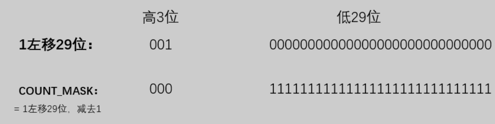
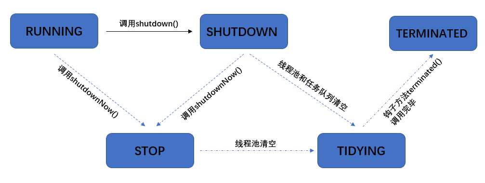

# 线程池源码解析

# 创建线程池

```java
     ThreadPoolExecutor executor = new ThreadPoolExecutor(10, 20, 0L
                                    ,TimeUnit.MILLISECONDS, new LinkedBlockingQueue<>(),
                                        Executors.defaultThreadFactory(), new ThreadPoolExecutor.AbortPolicy());
```

**<font style="color:#DF2A3F;">创建线程池后是0个线程，提交任务执行才会创建新的线程</font>**。**线程池的状态和线程数量都是通过一个原子类型AtomicInteger的变量ctl来表示的，创建线程池的时候就会将ctl初始化为RUNNING状态和0个工作线程**

```java
private final AtomicInteger ctl = new AtomicInteger(ctlOf(RUNNING, 0));
```

# 线程池主要属性和方法

```java
public class ThreadPoolExecutor extends AbstractExecutorService {
    // 线程池的状态和线程数量都是通过一个原子类型AtomicInteger的变量ctl来表示的，创建线程池的时候就会将ctl初始化为RUNNING状态和0个工作线程
    private final AtomicInteger ctl = new AtomicInteger(ctlOf(RUNNING, 0));
    // 表示低29位的值，用于表示线程池中工作线程的数量
    private static final int COUNT_BITS = Integer.SIZE - 3; // =29
    // 用于表示线程池中工作线程的数量的最大值，等于2^29-1
    private static final int CAPACITY   = (1 << COUNT_BITS) - 1; // =000 11111...
    // 线程池的五种状态，高3位表示    下面的状态值依次增高，是根据他们状态流程的顺序依次增高的
    private static final int RUNNING    = -1 << COUNT_BITS; // 111 00000...
    private static final int SHUTDOWN   =  0 << COUNT_BITS; // 000 00000...
    private static final int STOP       =  1 << COUNT_BITS; // 001 00000...
    private static final int TIDYING    =  2 << COUNT_BITS; // 010 00000...
    private static final int TERMINATED =  3 << COUNT_BITS; // 011 00000...
 
    // 传入ctl，计算返回线程池的状态
    // 通过与运算，将高3位的值保留，低29位的值置为0
    private static int runStateOf(int c)     { return c & ~CAPACITY; }
    // 传入ctl，计算返回线程池中工作线程的数量
    // 通过与运算，将高3位的值置为0，低29位的值保留
    private static int workerCountOf(int c)  { return c & CAPACITY; }
    // 计算ctl的值，等于运行状态“加上”线程数量
    // 通过或运算，将高3位和低29位的值都保留，合并为ctl并返回
    private static int ctlOf(int rs, int wc) { return rs | wc; }
 
 
    // runStateLessThan方法用于判断线程池的状态是否小于某个状态
    private static boolean runStateLessThan(int c, int s) {
        return c < s;
    }
    // runStateAtLeast方法用于判断线程池的状态是否大于等于某个状态
    private static boolean runStateAtLeast(int c, int s) {
        return c >= s;
    }
    // isRunning方法用于判断线程池的状态是否是RUNNING状态
    private static boolean isRunning(int c) {
        return c < SHUTDOWN;
    }
    // 该方法用于增加工作线程的数量，如果增加成功则返回true，否则返回false
    private boolean compareAndIncrementWorkerCount(int expect) {
        return ctl.compareAndSet(expect, expect + 1);
    }
    // 该方法用于减少工作线程的数量，如果减少成功则返回true，否则返回false
    private boolean compareAndDecrementWorkerCount(int expect) {
        return ctl.compareAndSet(expect, expect - 1);
    }
    // 该方法用于设置线程池的状态，如果设置成功则返回true，否则返回false
    private void decrementWorkerCount() {
        do {} while (! compareAndDecrementWorkerCount(ctl.get()));
    }
    // 用于保存工作线程的集合
    private final HashSet<Worker> workers = new HashSet<Worker>();
    // 线程池的状态锁，对线程池状态（比如线程池大小、runState等）的改变都要使用这个锁
    private final ReentrantLock mainLock = new ReentrantLock();
    // 线程池的条件锁，用mainLock创建的，在线程池的状态发生改变时，会使用这个条件锁来通知所有等待的线程
    private final Condition termination = mainLock.newCondition();
 
 
    // 核心参数：任务阻塞队列
    private final BlockingQueue<Runnable> workQueue;
    // 核心参数：线程池的线程工厂，用于创建线程
    private volatile ThreadFactory threadFactory;
    // 核心参数：拒绝策略，用于在线程池已经关闭或者线程数已经达到最大值的情况下，对新任务的处理策略
    private volatile RejectedExecutionHandler handler;
    // 核心参数：当线程数大于核心线程数时，多余的空闲线程存活的最长时间
    private volatile long keepAliveTime;
    // 是否允许核心线程空闲退出，默认值为false
    private volatile boolean allowCoreThreadTimeOut;
    // 核心参数：线程池的核心线程数
    private volatile int corePoolSize;
    // 核心参数：线程池的最大线程数
    private volatile int maximumPoolSize;
 
    // 这是一个动态的变量。
    // largestPoolSize表示线程池中曾经出现过的最大线程数，即在线程池的整个生命周期中，曾经有多少个线程同时处于活动状态。所以说largestPoolSize是小于等于maximumPoolSize的。
    // 它的值可以通过ThreadPoolExecutor的getLargestPoolSize()方法获取。
    private int largestPoolSize;
    // 表示已经完成的任务数量
    private long completedTaskCount;
    // 默认的拒绝策略，默认的拒绝策略就是直接抛出异常。如果构造方法中没有转入指定的拒绝策略，就会将defaultHandler赋值给handler
    private static final RejectedExecutionHandler defaultHandler =
        new AbortPolicy();
    ...
}
```

## 状态相关ctl



```java
 // 线程池的状态和线程数量都是通过一个原子类型AtomicInteger的变量ctl来表示的，创建线程池的时候就会将ctl初始化为RUNNING状态和0个工作线程
    private final AtomicInteger ctl = new AtomicInteger(ctlOf(RUNNING, 0));
    // 表示低29位的值，用于表示线程池中工作线程的数量
    private static final int COUNT_BITS = Integer.SIZE - 3; // =29
    // 用于表示线程池中工作线程的数量的最大值，等于2^29-1
    private static final int CAPACITY   = (1 << COUNT_BITS) - 1; // =000 11111...
    // 线程池的五种状态，高3位表示    下面的状态值依次增高，是根据他们状态流程的顺序依次增高的
    private static final int RUNNING    = -1 << COUNT_BITS; // 111 00000...
    private static final int SHUTDOWN   =  0 << COUNT_BITS; // 000 00000...
    private static final int STOP       =  1 << COUNT_BITS; // 001 00000...
    private static final int TIDYING    =  2 << COUNT_BITS; // 010 00000...
    private static final int TERMINATED =  3 << COUNT_BITS; // 011 00000...
 
    // 传入ctl，计算返回线程池的状态
    // 通过与运算，将高3位的值保留，低29位的值置为0
    private static int runStateOf(int c)     { return c & ~CAPACITY; }
    // 传入ctl，计算返回线程池中工作线程的数量
    // 通过与运算，将高3位的值置为0，低29位的值保留
    private static int workerCountOf(int c)  { return c & CAPACITY; }
    // 计算ctl的值，等于运行状态“加上”线程数量
    // 通过或运算，将高3位和低29位的值都保留，合并为ctl并返回
    private static int ctlOf(int rs, int wc) { return rs | wc; }
```

## 设置线程数

```java
  // 该方法用于增加工作线程的数量，如果增加成功则返回true，否则返回false
    private boolean compareAndIncrementWorkerCount(int expect) {
        return ctl.compareAndSet(expect, expect + 1);
    }
    // 该方法用于减少工作线程的数量，如果减少成功则返回true，否则返回false
    private boolean compareAndDecrementWorkerCount(int expect) {
        return ctl.compareAndSet(expect, expect - 1);
    }
    // 该方法用于设置线程池的状态，如果设置成功则返回true，否则返回false
    private void decrementWorkerCount() {
        do {} while (! compareAndDecrementWorkerCount(ctl.get()));
    }
```

## 核心参数

```java
    // 核心参数：任务阻塞队列
    private final BlockingQueue<Runnable> workQueue;
    // 核心参数：线程池的线程工厂，用于创建线程
    private volatile ThreadFactory threadFactory;
    // 核心参数：拒绝策略，用于在线程池已经关闭或者线程数已经达到最大值的情况下，对新任务的处理策略
    private volatile RejectedExecutionHandler handler;
    // 核心参数：当线程数大于核心线程数时，多余的空闲线程存活的最长时间
    private volatile long keepAliveTime;
    // 是否允许核心线程空闲退出，默认值为false
    private volatile boolean allowCoreThreadTimeOut;
    // 核心参数：线程池的核心线程数
    private volatile int corePoolSize;
    // 核心参数：线程池的最大线程数
    private volatile int maximumPoolSize;
```

## 五种内部类

总的来说其实就两类：**<font style="color:#DF2A3F;">1、拒绝策略（Policy）  2、工作线程类（Worker）</font>**

拒绝策略

| **RejectedExecutionHandler** | **特性及效果** |
| --- | --- |
| **AbortPolicy** | 线程池默认的策略，如果元素添加到线程池失败，会抛出RejectedExecutionException异常 |
| **DiscardPolicy** | 如果添加失败，则放弃，并且不会抛出任何异常 |
| **DiscardOldestPolicy** | 如果添加到线程池失败，会将队列中最早添加的元素移除，再尝试添加，如果失败则按该策略不断重试 |
| **CallerRunsPolicy** | 如果添加失败，那么主线程会自己调用执行器中的execute方法来执行改任务 |
| **自定义** | 如果觉得以上几种策略都不合适，那么可以自定义符合场景的拒绝策略。需要实现RejectedExecutionHandler接口，并将自己的逻辑写在rejectedExecution方法内。 |

[【线程池】Java线程池的内部类Worker详解\_线程池worker-CSDN博客](https://blog.csdn.net/cy973071263/article/details/131484384?spm=1001.2014.3001.5502)

## 线程池生命周期

```java
// 线程池的状态和线程数量都是通过一个原子类型AtomicInteger的变量ctl来表示的，创建线程池的时候就会将ctl初始化为RUNNING状态和0个工作线程
private final AtomicInteger ctl = new AtomicInteger(ctlOf(RUNNING, 0));
// 表示低29位的值，用于表示线程池中工作线程的数量
private static final int COUNT_BITS = Integer.SIZE - 3; // =29
// 用于表示线程池中工作线程的数量的最大值，等于2^29-1
private static final int CAPACITY   = (1 << COUNT_BITS) - 1; // =000 11111...
// 线程池的五种状态，高3位表示    下面的状态值依次增高，是根据他们状态流程的顺序依次增高的
private static final int RUNNING    = -1 << COUNT_BITS; // 111 00000...
private static final int SHUTDOWN   =  0 << COUNT_BITS; // 000 00000...
private static final int STOP       =  1 << COUNT_BITS; // 001 00000...
private static final int TIDYING    =  2 << COUNT_BITS; // 010 00000...
private static final int TERMINATED =  3 << COUNT_BITS; // 011 00000...
// 传入ctl，计算返回线程池的状态
// 通过与运算，将高3位的值保留，低29位的值置为0
private static int runStateOf(int c)     { return c & ~CAPACITY; }
// 传入ctl，计算返回线程池中工作线程的数量
// 通过与运算，将高3位的值置为0，低29位的值保留
private static int workerCountOf(int c)  { return c & CAPACITY; }
// 计算ctl的值，等于运行状态“加上”线程数量
// 通过或运算，将高3位和低29位的值都保留，合并为ctl并返回
private static int ctlOf(int rs, int wc) { return rs | wc; }
 
 
// runStateLessThan方法用于判断线程池的状态是否小于某个状态
private static boolean runStateLessThan(int c, int s) {
    return c < s;
}
// runStateAtLeast方法用于判断线程池的状态是否大于等于某个状态
private static boolean runStateAtLeast(int c, int s) {
    return c >= s;
}
// isRunning方法用于判断线程池的状态是否是RUNNING状态
private static boolean isRunning(int c) {
    return c < SHUTDOWN;
}
```

ctl是一个[AtomicInteger](https://so.csdn.net/so/search?q=AtomicInteger\&spm=1001.2101.3001.7020)类型的变量，它包含两个概念（32位，**高3位表示状态，低29位标识数量**）：

1. workerCount：表明当前有效的线程数
2. runState：表明当前线程池的状态，\*\*<font style="color:#DF2A3F;">Running，Shutdown，Stop，Tidying，Terminate</font>\*\*五种状态。

* RUNNING，表示可接受新任务，且可执行队列中的任务；
* SHUTDOWN，表示不接受新任务，但可执行队列中的任务；
* STOP，表示不接受新任务，且不再执行队列中的任务，且中断正在执行的任务；
* TIDYING，所有任务已经中止，且工作线程数量为0，最后变迁到这个状态的线程将要执行terminated()钩子方法，只会有一个线程执行这个方法；
* TERMINATED，中止状态，已经执行完terminated()钩子方法；



# 线程池执行

## 执行流程

线程的执行流程讲解很多，核心参数就是核心线程数，最大线程数，阻塞队列。

```java
// 提交任务，任务并非立即执行，是将任务提交到任务队列中，然后线程池再从任务队列中取出任务执行
public void execute(Runnable command) {
    // 任务不能为空
    if (command == null)
        throw new NullPointerException();

    // 获取ctl（高3位存储状态，低29位存储工作线程的数量）
    int c = ctl.get();
    // 1. 如果工作线程数量小于核心数量
    if (workerCountOf(c) < corePoolSize) {
        // 就添加一个工作线程（核心）  并将该任务作为该工作线程的第一个任务，创建线程完成后直接返回
        if (addWorker(command, true))
            return;
        // 如果创建工作线程失败，则重新获取下ctl
        c = ctl.get();
    }
    // 2. 如果达到了核心数量且线程池是运行状态，则将任务加入队列（workQueue是构造方法的核心参数之一）
    if (isRunning(c) && workQueue.offer(command)) {
        // 再次获取ctl
        int recheck = ctl.get();
        // 再次检查线程池状态，如果不是运行状态，就移除任务并执行拒绝策略
        if (! isRunning(recheck) && remove(command))
            reject(command);
        // 容错检查工作线程数量是否为0，如果为0就创建一个，此时就不用为工作线程绑定任务了，因为任务已经加入到队列中了
        else if (workerCountOf(recheck) == 0)
            addWorker(null, false);
    }
    // 3. 任务入队列失败（例如队列满了），尝试创建非核心工作线程，将该任务和非核心工作线程绑定在一起
    else if (!addWorker(command, false))
        // 非核心工作线程创建失败，执行拒绝策略
        reject(command);
}
```

提交任务的过程大致如下：

（1）工作线程数量小于核心数量，创建核心线程，并将任务交给该核心线程去执行；

（2）达到核心数量，将任务加入任务队列；

（3）任务队列满了，创建非核心线程，并将任务交给该非核心线程去执行；

（4）线程数达到最大数量，队列也满了，则执行拒绝策略；

## addWorker()

**创建一个工作线程**

1. 使用循环 CAS 操作来将线程数加 1；
2. 新建一个线程并启用。

```java
// 该方法用于创建新的工作线程添加到线程池中，如果添加成功则启动线程
// 参数firstTask是一个Runnable对象，表示要给该线程的第一个任务
// 参数core表示创建的是否是核心线程
// 返回值表示是否成功创建并启动了工作线程
private boolean addWorker(Runnable firstTask, boolean core) {
    // 判断有没有资格创建新的工作线程
    // 主要是一些状态/数量的检查等等
    retry:
    for (;;) {
        // 获取ctl
        int c = ctl.get();
        // 获取当前线程池运行状态
        int rs = runStateOf(c);
        // 线程池状态检查
        if (rs >= SHUTDOWN && // 大于等于SHUTDOWN说明线程池不是RUNNING(-1)状态
            ! (rs == SHUTDOWN &&
               firstTask == null &&
               ! workQueue.isEmpty()))
            // 两种情况会直接返回false  
            //1.如果非运行状态  
           //2.不是【线程池是停止状态并且传入的任务是null并且workQueue不等于空】这种情况 
            return false;
        // 工作线程数量检查
        for (;;) {
            // 获取当前线程数
            int wc = workerCountOf(c);
            if (wc >= CAPACITY ||
                wc >= (core ? corePoolSize : maximumPoolSize))
                // 判断是否饱和容量了，如果已经达到最大线程数则不能再新建线程，直接返回false
                return false;
            // 完成了上面的判断后，说明现在线程池可以创建新线程，则将线程数量加1，因为后面要创建线程了，并跳出循环
            if (compareAndIncrementWorkerCount(c))
                // 因为外面的retry:已经不在循环内了，跳到retry:位置后也不会再进入到该循环了，其实就相当于跳出这两层循环并且不再进入这两层循环，执行后续的流程
                break retry;
            // 如果上面的compareAndIncrementWorkerCount(c)方法返回false，则说明有其他线程在操作线程池的线程数量，所以需要重新获取ctl
            c = ctl.get();  // Re-read ctl
            // 如果当前的运行状态已经和最开始获取的状态不一样了
            if (runStateOf(c) != rs)
                // 回到retry:，但是因为这里用的是continue，所以程序往后执行还是会再次进入到该循环继续执行上面的判断
                continue retry;
            // else CAS failed due to workerCount change; retry inner loop
        }
    }

    // 如果上面的条件满足，则会把工作线程数量加1，然后执行下面创建线程的动作
    // 标记是否启动了工作线程
    boolean workerStarted = false;
    // 标记是否成功添加了工作线程
    boolean workerAdded = false;
    // 要创建的Worker对象
    Worker w = null;
    try {
        // 创建工作线程
        // 增加一个worker 这个firstTask就是一个线程（任务线程，每一个Worker都和一个任务线程绑定），Runable,具体可以看这Worker源码
        w = new Worker(firstTask);
        // 这个是绑定在Worker上的工作线程，并不是任务线程，工作线程是用来执行任务的，
        final Thread t = w.thread;
        // 判断t是否为null
        if (t != null) {
            // 获取线程池的锁
            final ReentrantLock mainLock = this.mainLock;
            // 在读取线程池状态的时候就应该上锁，防止有并发操作破坏程序的一致性，上下不一致
            mainLock.lock();
            try {
                // 锁定后并重新检查线程池的状态，查看是否存在线程工厂的失败或者锁定前的关闭
                // 获取线程池运行状态
                int rs = runStateOf(ctl.get());
                if (rs < SHUTDOWN ||
                    (rs == SHUTDOWN && firstTask == null)) {
                    if (t.isAlive()) // precheck that t is startable
                        throw new IllegalThreadStateException();
                    // 添加到工作线程队列。 workers是线程池中存放工作线程的集合
                    // 增加work  每一个线程池都持有一个workers集合，里面存储着线程池的所有worker，也就是所有线程
                    workers.add(w);
                    // 还在池子中的线程数量（只能在mainLock中使用）
                    int s = workers.size();
                    // 不能超过线程池的最大线程数量
                    if (s > largestPoolSize)
                        largestPoolSize = s;
                    // 标记线程添加成功
                    workerAdded = true;
                }
            } finally {
                // 解锁
                mainLock.unlock();
            }
            if (workerAdded) {
                // 线程添加成功之后启动线程
                // 启动绑定在worker上的线程。启动了之后该工作线程就会开始从任务队列中拿任务去执行了
                t.start();
                // 标记工作线程启动成功
                workerStarted = true;
            }
        }
    } finally {
        // 线程启动失败，执行失败方法（线程数量减1，执行tryTerminate()方法等）
        if (! workerStarted)
            addWorkerFailed(w);
    }
    // 返回新创建的工作线程是否启动成功
    return workerStarted;
}
```

## `addWorkerFailed`()

添加worker失败，中止线程池

```java
private void addWorkerFailed(Worker w) {
    final ReentrantLock mainLock = this.mainLock;
    // 加锁
    mainLock.lock();
    try {
        // 移除添加失败的worker
        if (w != null)
            workers.remove(w);
        // 减少worker数量
        decrementWorkerCount();
        // 尝试终止线程池
        tryTerminate();
    } finally {
        // 解锁
        mainLock.unlock();
}
```


**线程池内的线程会while不断获取task，能获取到task就会继续执行，如果获取不到则进入队列超时等待，还是没有获取到则执行**`processWorkerExit` **()方法。此方法保证了核心线程数不会少，一但线程池内线程数小于核心线程数，就会创建新的线程。**

```java
private void processWorkerExit(Worker w, boolean completedAbruptly) {
        if (completedAbruptly) // If abrupt, then workerCount wasn't adjusted
            decrementWorkerCount();
        final ReentrantLock mainLock = this.mainLock;
        mainLock.lock();
        try {
            completedTaskCount += w.completedTasks;
            workers.remove(w);
        } finally {
            mainLock.unlock();
        }
        tryTerminate();
        int c = ctl.get();
        if (runStateLessThan(c, STOP)) {
            if (!completedAbruptly) {
                int min = allowCoreThreadTimeOut ? 0 : corePoolSize;
                if (min == 0 && ! workQueue.isEmpty())
                    min = 1;
                if (workerCountOf(c) >= min)
                    return; // replacement not needed
            }
            addWorker(null, false);
        }
    }

```

# ThreadPoolExecutor原理

ThreadPoolExecutor里面使用到JUC同步器框架，主要用于四个方面：

* 全局锁**mainLock**成员属性，是可重入锁ReentrantLock类型，主要是**用于访问工作线程Worker集合和进行数据统计记录时候的加锁操作。**
* 条件变量termination，Condition类型，用于线程进行等待终结awaitTermination()方法时的带期限阻塞。
* 任务队列workQueue，BlockingQueue<Runnable>类型，任务队列，用于存放待执行的任务。
* 工作线程，内部类Worker类型，是线程池中真正的工作线程对象。

## getTask()

```java
private Runnable getTask() {
    // 记录上一次从队列中拉取的时候是否超时
    boolean timedOut = false; // Did the last poll() time out?
    // 注意这是死循环
    for (;;) {
        int c = ctl.get();

        // Check if queue empty only if necessary.
        // 第一个if：如果线程池状态至少为SHUTDOWN，也就是rs >= SHUTDOWN(0)，则需要判断两种情况（或逻辑）：
        // 1. 线程池状态至少为STOP(1)，也就是线程池正在停止，一般是调用了shutdownNow()方法
        // 2. 任务队列为空
        // 如果在线程池至少为SHUTDOWN状态并且满足上面两个条件之一，则工作线程数wc减去1，然后直接返回null
        if (runStateAtLeast(c, SHUTDOWN)
            && (runStateAtLeast(c, STOP) || workQueue.isEmpty())) {
            decrementWorkerCount();
            return null;
        }
        // 跑到这里说明线程池还处于RUNNING状态，重新获取一次工作线程数
        int wc = workerCountOf(c);

        // Are workers subject to culling?
        // timed临时变量勇于线程超时控制，决定是否需要通过poll()此带超时的非阻塞方法进行任务队列的任务拉取
        // 1.allowCoreThreadTimeOut默认值为false，如果设置为true，则允许核心线程也能通过poll()方法从任务队列中拉取任务
        // 2.工作线程数大于核心线程数的时候，说明线程池中创建了额外的非核心线程，这些非核心线程一定是通过poll()方法从任务队列中拉取任务
        boolean timed = allowCoreThreadTimeOut || wc > corePoolSize;
        // 第二个if：
        // 1.wc > maximumPoolSize说明当前的工作线程总数大于maximumPoolSize，说明了通过setMaximumPoolSize()方法减少了线程池容量
        // 或者 2.timed && timedOut说明了线程命中了超时控制并且上一轮循环通过poll()方法从任务队列中拉取任务为null
        // 并且 3. 工作线程总数大于1或者任务队列为空，则通过CAS把线程数减去1，同时返回null，
        // CAS把线程数减去1失败会进入下一轮循环做重试
        if ((wc > maximumPoolSize || (timed && timedOut))
            && (wc > 1 || workQueue.isEmpty())) {
            if (compareAndDecrementWorkerCount(c))
                return null;
            continue;
        }

        try {
            // 如果timed为true，通过poll()方法做超时拉取，keepAliveTime时间内没有等待到有效的任务，则返回null
            // 如果timed为false，通过take()做阻塞拉取，会阻塞到有下一个有效的任务时候再返回（一般不会是null）
            Runnable r = timed ?
                workQueue.poll(keepAliveTime, TimeUnit.NANOSECONDS) :
                workQueue.take();
            // 这里很重要，只有非null时候才返回，null的情况下会进入下一轮循环
            if (r != null)
                return r;
            // 跑到这里说明上一次从任务队列中获取到的任务为null，一般是workQueue.poll()方法超时返回null
            timedOut = true;
        } catch (InterruptedException retry) {
            timedOut = false;
        }
    }
}
```

这段逻辑大多数情况下是针对非核心线程。

在execute()方法中，当线程池总数已经超过了corePoolSize并且还小于maximumPoolSize时，当任务队列已经满了的时候，会通过addWorker(task,false)添加非核心线程。而这里的逻辑恰好类似于addWorker(task,false)的反向操作，用于减少非核心线程，使得工作线程总数趋向于corePoolSize。

如果对于非核心线程，上一轮循环获取任务对象为null，这一轮循环很容易满足timed && timedOut为true，这个时候getTask()返回null会导致Worker#runWorker()方法跳出死循环，之后执行processWorkerExit()方法处理后续工作，而该非核心线程对应的Worker则变成“游离对象”，等待被JVM回收。

当allowCoreThreadTimeOut设置为true的时候，这里分析的非核心线程的生命周期终结逻辑同时会适用于核心线程。那么可以总结出keepAliveTime的意义：\
当允许核心线程超时，也就是allowCoreThreadTimeOut设置为true的时候，此时keepAliveTime表示空闲的工作线程（包括核心线程）的存活周期。\
默认情况下不允许核心线程超时，此时keepAliveTime表示空闲的非核心线程的存活周期。

## processWorkerExit()

```java
private void processWorkerExit(Worker w, boolean completedAbruptly) {
    // 因为抛出用户异常导致线程终结，直接使工作线程数减1即可
    // 如果没有任何异常抛出的情况下是通过getTask()返回null引导线程正常跳出runWorker()方法的while死循环从而正常终结，这种情况下，在getTask()中已经把线程数减1
    if (completedAbruptly) // If abrupt, then workerCount wasn't adjusted
        decrementWorkerCount();

    final ReentrantLock mainLock = this.mainLock;
    mainLock.lock();
    try {
        // 全局的已完成任务记录数加上此将要终结的Worker中的已完成任务数
        completedTaskCount += w.completedTasks;
        // 工作线程集合中移除此将要终结的Worker
        workers.remove(w);
    } finally {
        mainLock.unlock();
    }
   
    // 见下一小节分析，用于根据当前线程池的状态判断是否需要进行线程池terminate处理
    tryTerminate();

    int c = ctl.get();
    // 如果线程池的状态小于STOP，也就是处于RUNNING或者SHUTDOWN状态的前提下：
    // 1.如果线程不是由于抛出用户异常终结，如果允许核心线程超时，则保持线程池中至少存在一个工作线程
    // 2.如果线程由于抛出用户异常终结，或者当前工作线程数，那么直接添加一个新的非核心线程
    if (runStateLessThan(c, STOP)) {
        if (!completedAbruptly) {
            // 如果允许核心线程超时，最小值为0，否则为corePoolSize
            int min = allowCoreThreadTimeOut ? 0 : corePoolSize;
            // 如果最小值为0，同时任务队列不空，则更新最小值为1
            if (min == 0 && ! workQueue.isEmpty())
                min = 1;
            // 工作线程数大于等于最小值，直接返回不新增非核心线程
            if (workerCountOf(c) >= min)
                return; // replacement not needed
        }
        addWorker(null, false);
    }
}
```

代码的后面部分区域，会判断线程池的状态，如果线程池是RUNNING或者SHUTDOWN状态的前提下，如果当前的工作线程由于抛出用户异常被终结，那么会新创建一个非核心线程。如果当前的工作线程并不是抛出用户异常被终结（正常情况下的终结），那么会这样处理：

* allowCoreThreadTimeOut为true，也就是允许核心线程超时的前提下，如果任务队列空，则会通过创建一个非核心线程保持线程池中至少有一个工作线程。
* allowCoreThreadTimeOut为false，如果工作线程总数大于等于corePoolSize则直接返回，否则创建一个非核心线程，也就是会趋向于保持线程池中的工作线程数量趋向于corePoolSize。


> 更新: 2024-08-08 15:21:23  
> 原文: <https://www.yuque.com/nibiwanxiamei/yrd6t1/su2h776kddeoy1wu>