# API网关 + 分布式ID

# API网关基础知识总结

## 什么是网关？

> **微服务中，一个系统被拆分为多个服务，但是像安全认证，流量控制，日志，监控等功能是每个服务都需要的，没有网关的话，我们就需要在每个服务中单独实现，这使得我们做了很多重复的事情并且没有一个全局的视图来统一管理这些功能。**

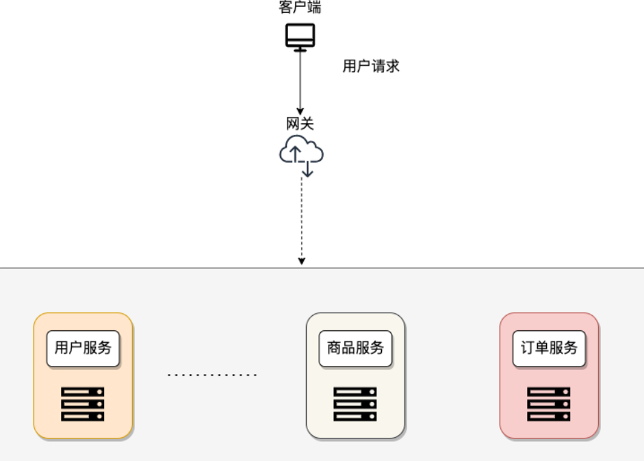

一般情况下，网关可以为我们提供请求转发、安全认证（身份/权限认证）、流量控制、负载均衡、降级熔断、日志、监控、参数校验、协议转换等功能。

网关主要做了两件事情：**请求转发** + **请求过滤**。

由于引入网关之后，会多一步网络转发，因此性能会有一点影响（几乎可以忽略不计，尤其是内网访问的情况下）。 另外，我们需要保障网关服务的高可用，避免单点风险。

如下图所示，网关服务外层通过 Nginx（其他负载均衡设备/软件也行） **进⾏负载转发以达到⾼可⽤** 。Nginx 在部署的时候，尽量也要考虑高可用，避免单点风险。

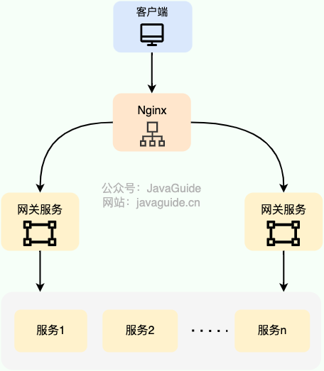

## 网关能提供哪些功能？

绝大部分网关可以提供下面这些功能（有一些功能需要借助其他框架或者中间件）：

* **请求转发**：将请求转发到目标微服务。
* **负载均衡**：根据各个微服务实例的负载情况或者具体的负载均衡策略配置对请求实现动态的负载均衡。
* **安全认证**：对用户请求进行身份验证并仅允许可信客户端访问 API，并且还能够使用类似 RBAC 等方式来授权。
* **参数校验**：支持参数映射与校验逻辑。
* **日志记录**：记录所有请求的行为日志供后续使用。
* **监控告警**：从业务指标、机器指标、JVM 指标等方面进行监控并提供配套的告警机制。
* **流量控制**：对请求的流量进行控制，也就是限制某一时刻内的请求数。
* **熔断降级**：实时监控请求的统计信息，达到配置的失败阈值后，自动熔断，返回默认值。
* **响应缓存**：当用户请求获取的是一些静态的或更新不频繁的数据时，一段时间内多次请求获取到的数据很可能是一样的。对于这种情况可以将响应缓存起来。这样用户请求可以直接在网关层得到响应数据，无需再去访问业务服务，减轻业务服务的负担。
* **响应聚合**：某些情况下用户请求要获取的响应内容可能会来自于多个业务服务。网关作为业务服务的调用方，可以把多个服务的响应整合起来，再一并返回给用户。
* **灰度发布**：将请求动态分流到不同的服务版本（最基本的一种灰度发布）。
* **异常处理**：对于业务服务返回的异常响应，可以在网关层在返回给用户之前做转换处理。这样可以把一些业务侧返回的异常细节隐藏，转换成用户友好的错误提示返回。
* **API 文档：**  如果计划将 API 暴露给组织以外的开发人员，那么必须考虑使用 API 文档，例如 Swagger 或 OpenAPI。
* **协议转换**：通过协议转换整合后台基于 REST、AMQP、Dubbo 等不同风格和实现技术的微服务，面向 Web Mobile、开放平台等特定客户端提供统一服务。
* **证书管理**：将 SSL 证书部署到 API 网关，由一个统一的入口管理接口，降低了证书更换时的复杂度。

## [有哪些常见的网关系统？](https://javaguide.cn/distributed-system/api-gateway.html#%E6%9C%89%E5%93%AA%E4%BA%9B%E5%B8%B8%E8%A7%81%E7%9A%84%E7%BD%91%E5%85%B3%E7%B3%BB%E7%BB%9F)

### Spring Cloud Gateway

SpringCloud Gateway 属于 Spring Cloud 生态系统中的网关，其诞生的目标是为了替代老牌网关 **Zuul**

为了提升网关的性能，SpringCloud Gateway 基于 Spring WebFlux 。Spring WebFlux 使用 Reactor 库来实现响应式编程模型，底层基于 Netty 实现同步非阻塞的 I/O。

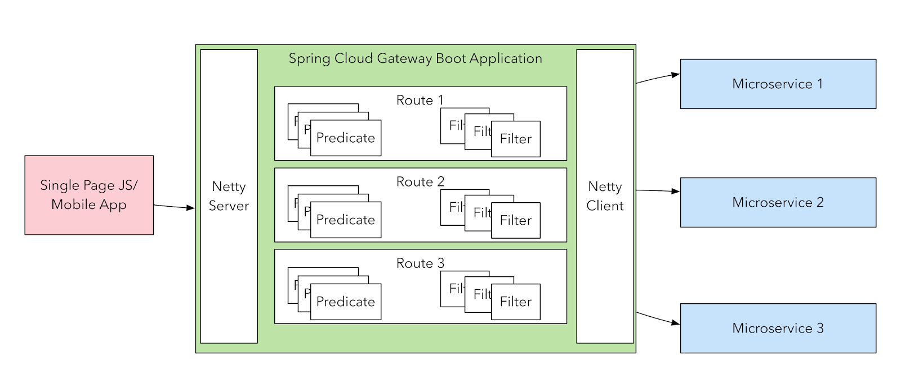

# SpringCloud GateWay常见问题

## Spring Cloud Gateway 的工作流程

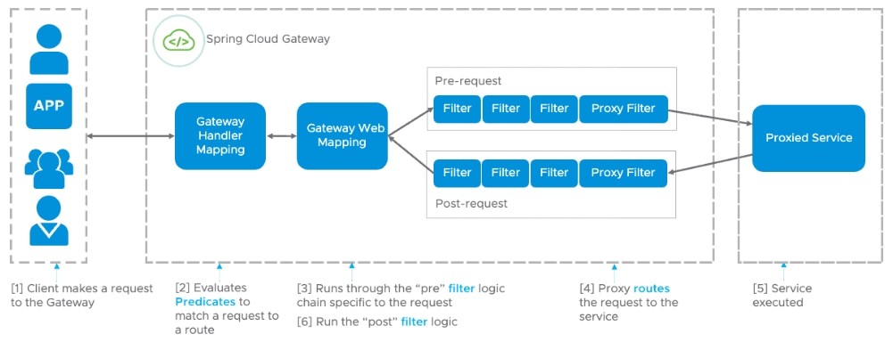

**具体的流程分析：**

1. **路由判断**：客户端的请求到达网关后，先经过 Gateway Handler Mapping 处理，这里面会做断言（Predicate）判断，看下符合哪个路由规则，这个路由映射后端的某个服务。
2. **请求过滤**：然后请求到达 Gateway Web Handler，这里面有很多过滤器，组成过滤器链（Filter Chain），这些过滤器可以对请求进行拦截和修改，比如添加请求头、参数校验等等，有点像净化污水。然后将请求转发到实际的后端服务。这些过滤器逻辑上可以称作 Pre-Filters，Pre 可以理解为“在...之前”。
3. **服务处理**：后端服务会对请求进行处理。
4. **响应过滤**：后端处理完结果后，返回给 Gateway 的过滤器再次做处理，逻辑上可以称作 Post-Filters，Post 可以理解为“在...之后”。
5. **响应返回**：响应经过过滤处理后，返回给客户端。

> **总结：客户端的请求先通过匹配规则找到合适的路由，就能映射到具体的服务。然后请求经过过滤器处理后转发给具体的服务，服务处理后，再次经过过滤器处理，最后返回给客户端。**

## Spring Cloud Gateway 的断言是什么？

断言（Predicate）说白了它就是对一个表达式进行 if 判断，结果为真或假，如果为真则做这件事，否则做那件事。

在 Gateway 中，如果客户端发送的请求满足了断言的条件，则映射到指定的路由器，就能转发到指定的服务上进行处理。

断言配置的示例如下，配置了两个路由规则，有一个 predicates 断言配置，当请求 url 中包含 `api/thirdparty`，就匹配到了第一个路由 `route_thirdparty`。

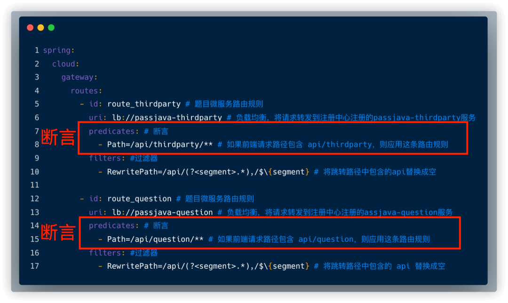

常见的路由断言规则如下图所示：

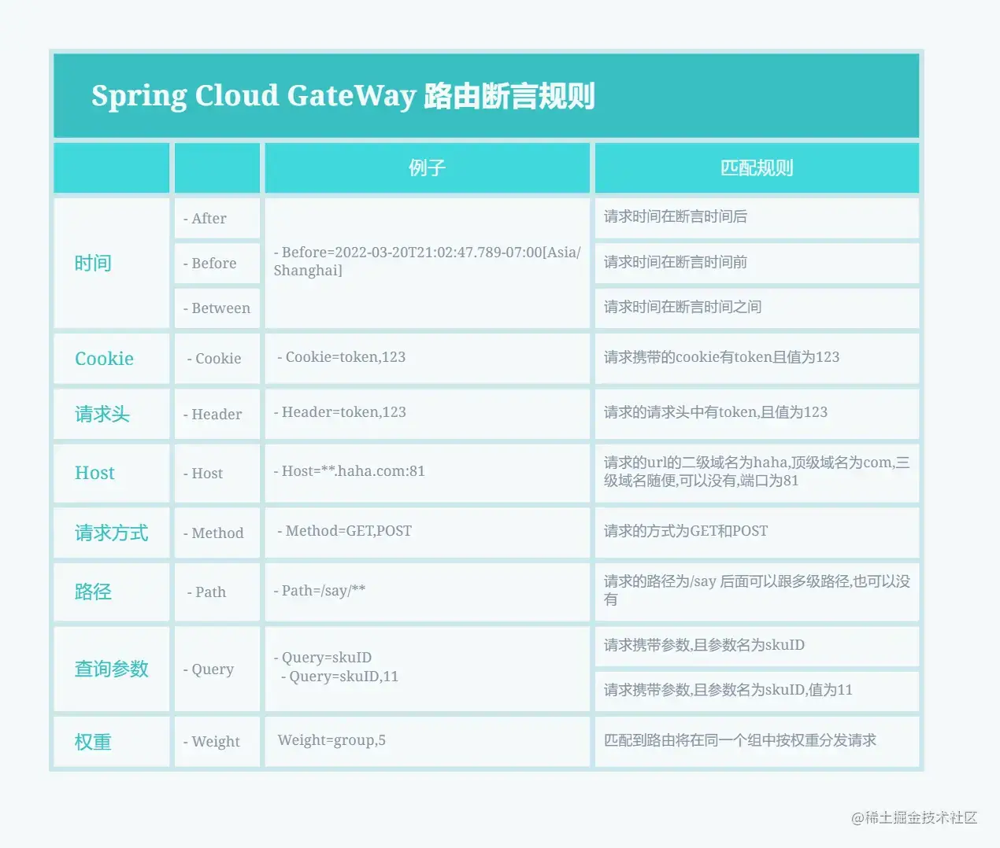

## Spring Cloud Gateway 的路由和断言是什么关系？

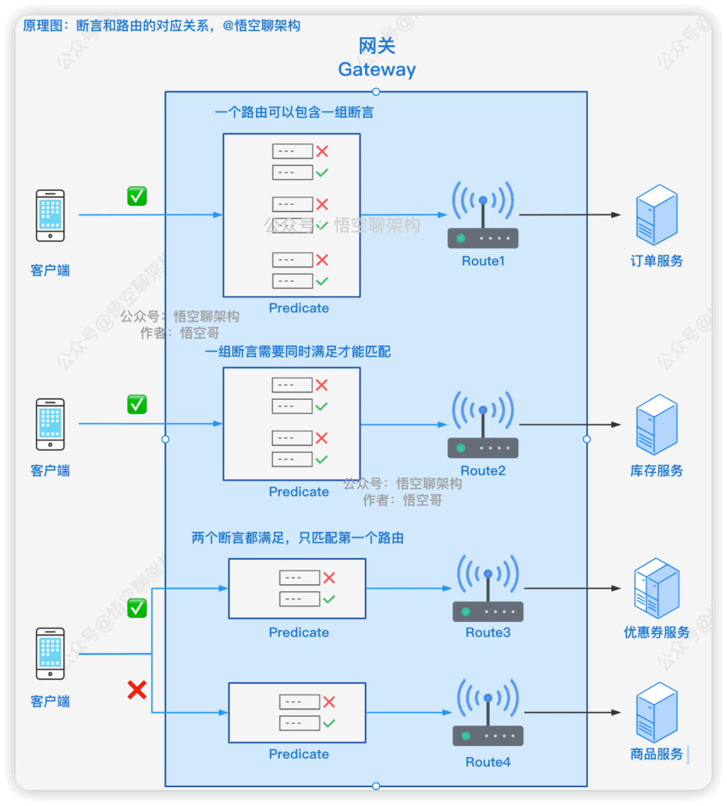

* **一对多**：一个路由规则可以包含多个断言。如上图中路由 Route1 配置了三个断言 Predicate。
* **同时满足**：如果一个路由规则中有多个断言，则需要同时满足才能匹配。如上图中路由 Route2 配置了两个断言，客户端发送的请求必须同时满足这两个断言，才能匹配路由 Route2。
* **第一个匹配成功**：如果一个请求可以匹配多个路由，则映射第一个匹配成功的路由。如上图所示，客户端发送的请求满足 Route3 和 Route4 的断言，但是 Route3 的配置在配置文件中靠前，所以只会匹配 Route3。

## Spring Cloud Gateway 支持限流吗？

Spring Cloud Gateway 自带了限流过滤器，对应的接口是 `RateLimiter`，`RateLimiter` 接口只有一个实现类 `RedisRateLimiter` （基于 Redis + Lua 实现的限流），提供的限流功能比较简易且不易使用。

从 Sentinel 1.6.0 版本开始，**Sentinel 引入了 Spring Cloud Gateway 的适配模块**，可以提供两种资源维度的限流：route 维度和自定义 API 维度。也就是说，Spring Cloud Gateway 可以结合 Sentinel 实现更强大的网关流量控制。

## Spring Cloud Gateway 如何自定义全局异常处理？

在 SpringBoot 项目中，只需要在项目中配置  `**@RestControllerAdvice**`和  `**@ExceptionHandler**`就可以了。不过，这种方式在 Spring Cloud Gateway 下不适用。

Spring Cloud Gateway 提供了多种全局处理的方式，比较常用的一种是实现`ErrorWebExceptionHandler`并重写其中的`handle`方法。

```java
@Order(-1)
@Component
@RequiredArgsConstructor
public class GlobalErrorWebExceptionHandler implements ErrorWebExceptionHandler {
    private final ObjectMapper objectMapper;

    @Override
    public Mono<Void> handle(ServerWebExchange exchange, Throwable ex) {
    // ...
    }
}
```

# 分布式ID

## 分布式 ID 介绍

**ID 是数据的唯一标识**。

### 什么是分布式 ID？

在分库之后， 数据遍布在不同服务器上的数据库，数据库的自增主键已经没办法满足生成的主键唯一了。**我们如何为不同的数据节点生&#x6210;****全局唯一主键****&#x5462;？**

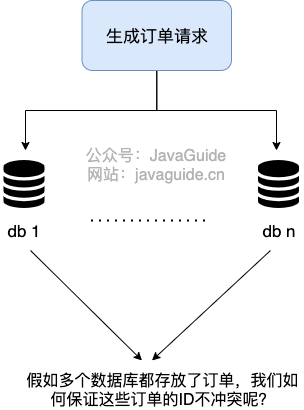

**分布式 ID 是分布式系统下的 ID，可以保证不同数据节点通用全局ID**

### 分布式 ID 需要满足哪些要求?

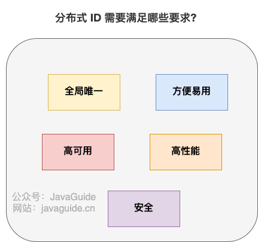

* **全局唯一**：ID 的全局唯一性肯定是首先要满足的！
* **高性能**：分布式 ID 的生成速度要快，对本地资源消耗要小。
* **高可用**：生成分布式 ID 的服务要保证可用性无限接近于 100%。
* **方便易用**：拿来即用，使用方便，快速接入！

除了这些之外，一个比较好的分布式 ID 还应保证：

* **安全**：ID 中不包含敏感信息。
* **有序递增**：如果要把 ID 存放在数据库的话，ID 的有序性可以提升数据库写入速度。并且，很多时候 ，我们还很有可能会直接通过 ID 来进行排序。
* **有具体的业务含义**：生成的 ID 如果能有具体的业务含义，可以让定位问题以及开发更透明化（通过 ID 就能确定是哪个业务）。
* **独立部署**：也就是分布式系统单独有一个发号器服务，专门用来生成分布式 ID。这样就生成 ID 的服务可以和业务相关的服务解耦。不过，这样同样带来了网络调用消耗增加的问题。总的来说，如果需要用到分布式 ID 的场景比较多的话，独立部署的发号器服务还是很有必要的。

## 分布式 ID 常见解决方案

### 数据库

#### 数据库主键自增

数据库主键自增，通过关系型数据库的**自增主键产生来唯一的 ID**。

**通过** <code>**replace into**</code> **来插入数据。**

```sql
BEGIN;
REPLACE INTO sequence_id (stub) VALUES ('stub');
SELECT LAST_INSERT_ID();
COMMIT;
```

插入数据这里，我们没有使用 `insert into` 而是使用 `replace into` 来插入数据，具体步骤是这样的：

* 第一步：尝试把数据插入到表中。
* 第二步：如果主键或唯一索引字段出现重复数据错误而插入失败时，先从表中删除含有重复关键字值的冲突行，然后再次尝试把数据插入到表中。

这种方式的优缺点也比较明显：

* **优点**：实现起来比较简单、ID 有序递增、存储消耗空间小
* **缺点**：**支持的并发量不大、存在数据库单点问题**（可以使用数据库集群解决，不过增加了复杂度）、ID 没有具体业务含义、安全问题（比如根据订单 ID 的递增规律就能推算出每天的订单量，商业机密啊！ ）、每次获取 ID 都要访问一次数据库（增加了对数据库的压力，获取速度也慢）

#### 数据库号段模式

数据库主键自增这种模式，每次获取 ID 都要访问一次数据库，ID 需求比较大的时候，肯定是不行的。

批量获取，然后存在在内存里面，需要用到的时候，直接从内存里面拿。**基于数据库的号段模式来生成分布式 ID。**

**1. 创建一个数据库表。**

```sql
CREATE TABLE `sequence_id_generator` (
  `id` int(10) NOT NULL,
  `current_max_id` bigint(20) NOT NULL COMMENT '当前最大id',
  `step` int(10) NOT NULL COMMENT '号段的长度',
  `version` int(20) NOT NULL COMMENT '版本号',
  `biz_type`    int(20) NOT NULL COMMENT '业务类型',
   PRIMARY KEY (`id`)
) ENGINE=InnoDB DEFAULT CHARSET=utf8mb4;
```

`current_max_id` 字段和`step`字段主要**用于获取批量 ID**，获取的批量 id 为：`current_max_id ~ current_max_id+step`。

`version` 字段主要用于解决并发问题（乐观锁）,`biz_type` 主要用于表示业务类型。

相比于数据库主键自增的方式，**数据库的号段模式对于数据库的访问次数更少，数据库压力更小。**

**数据库号段模式的优缺点:**

* **优点**：ID 有序递增、存储消耗空间小
* **缺点**：存在数据库单点问题（可以使用数据库集群解决，不过增加了复杂度）、ID 没有具体业务含义、安全问题（比如根据订单 ID 的递增规律就能推算出每天的订单量，商业机密啊！ ）

#### NoSQL

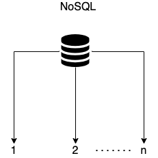

一般情况下，NoSQL 方案使用 Redis 多一些。我们通过 Redis 的 `incr` 命令即可实现对 id 原子顺序递增。

```shell
127.0.0.1:6379> set sequence_id_biz_type 1
OK
127.0.0.1:6379> incr sequence_id_biz_type
(integer) 2
127.0.0.1:6379> get sequence_id_biz_type
"2"
```

**Redis 方案的优缺点：**

* **优点**：性能不错并且生成的 ID 是有序递增的
* **缺点**：和数据库主键自增方案的缺点类似

除了 Redis 之外，MongoDB ObjectId 经常也会被拿来当做分布式 ID 的解决方案。

### 算法

#### UUID

UUID 是 Universally Unique Identifier（通用唯一标识符） 的缩写。UUID 包含 32 个 16 进制数字（8-4-4-4-12）。

JDK 就提供了现成的生成 UUID 的方法，一行代码就行了。

```java
//输出示例：cb4a9ede-fa5e-4585-b9bb-d60bce986eaa
UUID.randomUUID()
```


虽然，UUID 可以做到全局唯一性，但是，我们一般很少会使用它。

比如使用 UUID 作为 MySQL 数据库主键的时候就非常不合适：

* 数据库主键要尽量越短越好，而 **UUID 的消耗的存储空间比较大**（32 个字符串，128 位）。
* **UUID 是无顺序的**，InnoDB 引擎下，数据库主键的无序性会严重影响数据库性能。

最后，我们再简单分析一下 **UUID 的优缺点** （面试的时候可能会被问到的哦！） :

* **优点**：生成速度比较快、简单易用
* **缺点**：存储消耗空间大（32 个字符串，128 位）、 不安全（基于 MAC 地址生成 UUID 的算法会造成 MAC 地址泄露)、无序（非自增）、没有具体业务含义、需要解决重复 ID 问题（当机器时间不对的情况下，可能导致会产生重复 ID）

#### **Snowflake(雪花算法)**

Snowflake 是 Twitter 开源的分布式 ID 生成算法。Snowflake 由 64 bit 的二进制数字组成，这 64bit 的二进制被分成了几部分，每一部分存储的数据都有特定的含义：

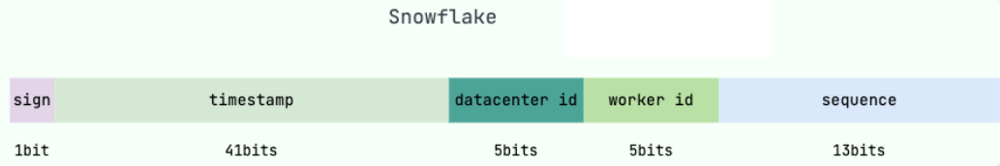

* **sign(1bit)** :符号位（标识正负），始终为 0，代表生成的 ID 为正数。
* **timestamp (41 bits)** :一共 41 位，用来表示时间戳，单位是毫秒，可以支撑 2 ^41 毫秒（约 69 年）
* **datacenter id + worker id (10 bits)** :一般来说，前 5 位表示机房 ID，后 5 位表示机器 ID（实际项目中可以根据实际情况调整）。这样就可以区分不同集群/机房的节点。
* **sequence (12 bits)** :一共 12 位，用来表示序列号。 序列号为自增值，代表单台机器每毫秒能够产生的最大 ID 数(2^12 = 4096),也就是说**单台机器每毫秒最多可以生成 4096 个 唯一 ID。**

在实际项目中，我们一般也会对 Snowflake 算法进行改造，最常见的就是**在 Snowflake 算法生成的 ID 中加入业务类型信息**。

Snowflake 算法的优缺点：

* **优点**：生成速度比较快、生成的 ID 有序递增、比较灵活（可以对 Snowflake 算法进行简单的改造比如加入业务 ID）
* **缺点**：需要解决重复 ID 问题（ID 生成依赖时间，在获取时间的时候，可能会出现时间回拨的问题，也就是服务器上的时间突然倒退到之前的时间，进而导致会产生重复 ID）、依赖机器 ID 对分布式环境不友好（当需要自动启停或增减机器时，固定的机器 ID 可能不够灵活）。

### 开源框架

#### UidGenerator(百度)

[UidGenerator](https://github.com/baidu/uid-generator) 是百度开源的一款基于 Snowflake(雪花算法)的唯一 ID 生成器。

不过，UidGenerator 对 Snowflake(雪花算法)进行了改进，生成的唯一 ID 组成如下：

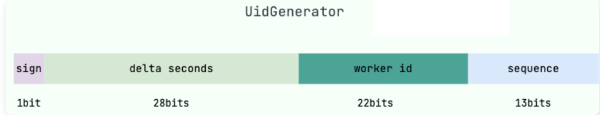

* **sign(1bit)** :符号位（标识正负），始终为 0，代表生成的 ID 为正数。
* **delta seconds (28 bits)** :当前时间，相对于时间基点"2016-05-20"的增量值，单位：秒，最多可支持约 8.7 年
* **worker id (22 bits)** :机器 id，最多可支持约 420w 次机器启动。内置实现为在启动时由数据库分配，默认分配策略为用后即弃，后续可提供复用策略。
* **sequence (13 bits)** :每秒下的并发序列，13 bits 可支持每秒 8192 个并发。

#### Leaf(美团)

[Leaf](https://github.com/Meituan-Dianping/Leaf)是美团开源的一个分布式 ID 解决方案 。这个项目的名字 Leaf（树叶） 起源于德国哲学家、数学家莱布尼茨的一句话：“There are no two identical leaves in the world”（世界上没有两片相同的树叶） 。

Leaf 提供了 **号段模式** 和 **Snowflake(雪花算法)**  这两种模式来生成分布式 ID。并且，它支持双号段，还解决了雪花 ID 系统时钟回拨问题。不过，时钟问题的解决需要弱依赖于 Zookeeper（使用 Zookeeper 作为注册中心，通过在特定路径下读取和创建子节点来管理 workId） 。

‍


> 更新: 2025-10-20 14:48:15  
> 原文: <https://www.yuque.com/nibiwanxiamei/yrd6t1/79bf26c512db5924e6835932cb7eeafb>