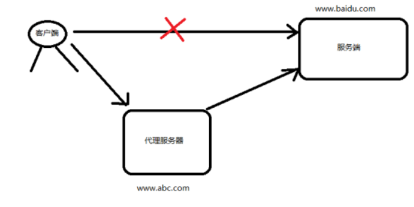
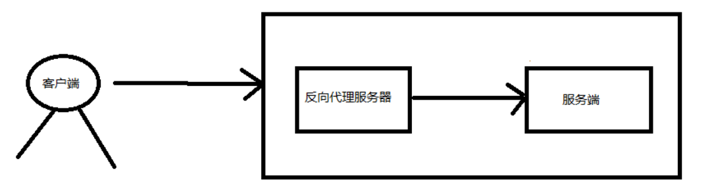

# Nginx

正向代理是**代理服务器位于****客户端****和目标服务器之间**，客户端发送请求时需先将请求发送至代理服务器，代理服务器再将请求转发给目标服务器，并将响应返回给客户端。这种配置可以用于代理客户端访问受限制的内容或保护客户端的身份信息。（服务端不知道客户端的真实IP,都是通过代理服务器转发的请求和响应）

1、正向代理是为了代理客户端发送请求，而反向代理是为了代理服务器接收请求。

2、正向代理的主体是客户端，而反向代理的主体是服务器

[Nginx的代理和负载均衡_nginx 代理 负载-CSDN博客](https://blog.csdn.net/pupcarrot/article/details/133855594)

> 更新: 2024-09-18 15:32:01  
> 原文: <https://www.yuque.com/nibiwanxiamei/yrd6t1/wmy99riniby8m1g8>