# RPC & Dubbo

***

# RPC基础知识总结

## RPC 是什么?

**<font style="color:#DF2A3F;">RPC（Remote Procedure Call）</font>**<font style="color:#DF2A3F;">  </font>**<font style="color:#DF2A3F;">远程过程调用</font>**<font style="color:#DF2A3F;">，</font>\*\*<font style="color:#DF2A3F;"> RPC 关注的是远程调用而非本地调用。</font>\*\***通过 RPC 可以帮助我们调用远程计算机上某个服务的方法，这个过程就像调用本地方法一样简单。并且！我们不需要了解底层网络编程的具体细节。**

***

**为什么要 RPC ？**  **两个不同的服务器上的服务提供的方法不在一个内存空间**，所以，需要通过网络编程才能传递方法调用所需要的参数。并且，方法调用的结果也需要通过网络编程来接收。

但是，如果我们自己手动网络编程来实现这个调用过程的话工作量是非常大的，因为，我们需要考虑底层传输方式（TCP 还是 UDP）、序列化方式等等方面。

## RPC 的原理是什么?

RPC 的 核心功能看作是下面 👇 5 个部分实现的：

1. **客户端（服务消费端）** ：调用远程方法的一端。
2. **客户端 Stub（桩）** ：这其实就是一代理类。代理类主要做的事情很简单，就是把你调用方法、类、方法参数等信息传递到服务端。
3. **网络传输**：网络传输就是你要把你调用的方法的信息比如说参数啊这些东西传输到服务端，然后服务端执行完之后再把返回结果通过网络传输给你传输回来。网络传输的实现方式有很多种比如最近基本的 Socket 或者性能以及封装更加优秀的 Netty（推荐）。
4. **服务端 Stub（桩）** ：这个桩就不是代理类了。我觉得理解为桩实际不太好，大家注意一下就好。这里的服务端 Stub 实际指的就是接收到客户端执行方法的请求后，去执行对应的方法然后返回结果给客户端的类。
5. **服务端（服务提供端）** ：提供远程方法的一端。

具体原理图如下

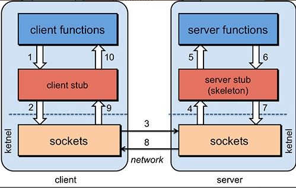

* 服务消费端（client）以本地调用的方式调用远程服务；
* 客户端 Stub（client stub） 接收到调用后负责将方法、参数等组装成能够进行网络传输的消息体（序列化）：RpcRequest；
* 客户端 Stub（client stub） 找到远程服务的地址，并将消息发送到服务提供端；
* 服务端 Stub（桩）收到消息将消息反序列化为 Java 对象: RpcRequest；
* 服务端 Stub（桩）根据RpcRequest中的类、方法、方法参数等信息调用本地的方法；
* 服务端 Stub（桩）得到方法执行结果并将组装成能够进行网络传输的消息体：RpcResponse（序列化）发送至消费方；
* 客户端 Stub（client stub）接收到消息并将消息反序列化为 Java 对象:RpcResponse ，这样也就得到了最终结果。

> **本地调用远程方法 -> 客户端找到远程地址，封装消息 -> 服务收到消息，执行本地方法，返回结果**

## 有哪些常见的 RPC 框架？

RPC 框架指的是可以**让客户端直接调用服务端方法，就像调用本地方法一样简单的框架**，比如 **Dubbo、Motan、gRPC** 这些。

**如果需要和 HTTP 协议打交道，解析和封装 HTTP 请求和响应。这类框架并不能算是“RPC 框架”，比如 Feign。**

### Dubbo

* GitHub：<https://github.com/apache/incubator-dubbo>
* 官网：<https://dubbo.apache.org/zh/>

# 有HTTP 协议，为什么还要有 RPC ？

假设需要在 A 电脑的进程发一段数据到 B 电脑的进程，一般会在代码里使用 **socket** 进行编程。

可选项一般也就**TCP 和 UDP 二选一。TCP 可靠，UDP 不可靠**

```java
fd = socket(AF_INET,SOCK_STREAM,0);
```

其中`SOCK_STREAM`，是指使用**字节流**传输数据，就是**TCP 协议**。

在定义了 socket 之后，就可以对这个 socket 进行操作，比如用`bind()`绑定 IP 端口，用`connect()`发起建连。

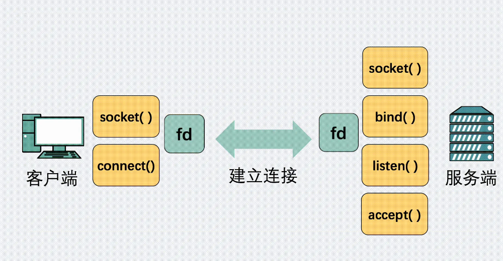

在连接建立之后，就可以使用`send()`发送数据，`recv()`接收数据。

## 使用纯裸 TCP 会有什么问题

TCP 三个特点：**面向连接**、**可靠**、**基于字节流**。

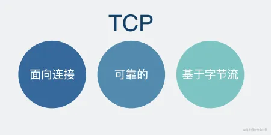

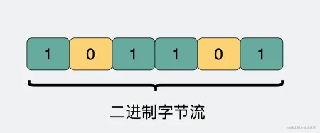

纯裸 TCP 收发的这些 01 串之间是 **无界的** ，根本不知道到哪个地方才算一条完整消息。

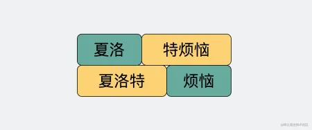

这就是所谓的\*\*<font style="color:#DF2A3F;">粘包</font>\*\***问题** **，需要自定义的规则** ，**区分消息边界** 。

会把每条要发送的数据都包装一下，比如加**消息头** ，消息头里写清楚一个完整的包长度是多少，根据这个长度可以继续接收数据，截取出来后它们就是我们真正要传输的 **消息体** 。

**消息头** ，还可以放各种东西，比如消息体是否被压缩过和消息体格式之类的，只要上下游都约定好了，互相都认就可以了，这就是所谓的 **协议。**


**<font style="color:#DF2A3F;">基于 TCP，就衍生了非常多的协议，比如 HTTP 和 RPC。</font>**

## HTTP 和 RPC

### RPC 是一种调用方式

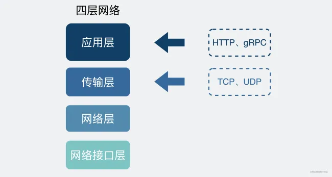

**TCP 是传输层的协议** ，基于 TCP 的 HTTP 和各类 RPC 协议：都只是定义了不同消息格式的 **应用层协议** **.**

**HTTP**（**H**yper **T**ext **T**ransfer **P**rotocol）协议又叫做 **超文本传输协议** 。

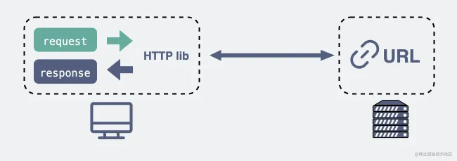

**RPC**（**R**emote **P**rocedure **C**all）： **远程过程调用**，它本身并不是一个具体的协议，而是一种 **调用方式**

如果现在这不是个本地方法，而是个**远端服务器**暴露出来的一个方法`remoteFunc`，还能像调用本地方法那样去调用它，这样就可以**屏蔽掉一些网络细节**

```java
res = remoteFunc(req)
```

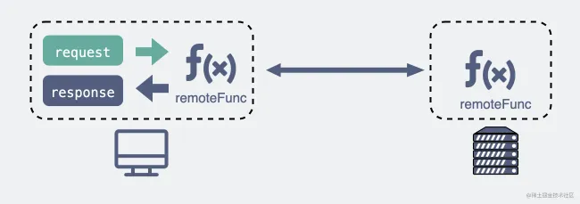

虽然大部分 RPC 协议底层使用 TCP，但实际上 **它们不一定非得使用 TCP，改用 UDP 或者 HTTP，其实也可以做到类似的功能。**

### 有 RPC 了，为什么还要有 HTTP 呢？

> **HTTP是超文本传输协议，平时我们浏览器访问各种页面都需要使用。RPC是远程过程调用，主要是在调用远程服务时，能让调用远程方法像调用本地方法一样简单。设计的目的不同，使用场景不同，性能不同**

[RPC是什么？HTTP是什么？RPC和HTTP有什么区别？\_哔哩哔哩\_bilibili](https://www.bilibili.com/video/BV1Qv4y127B4/?spm_id_from=333.788.top_right_bar_window_history.content.click\&vd_source=434fcae166de8f97cb224fceaaf2e219)

现在电脑上装的各种联网软件，比如 xx 管家，xx 卫士，它们都作为客户端（Client） 需要跟服务端（Server） 建立连接收发消息，此时都会用到应用层协议，在这种 Client/Server (C/S) 架构下，它们可以使用自家造的 RPC 协议，因为它只管连自己公司的服务器就 ok 了。

但有个软件不同，浏览器（Browser） ，不管是 Chrome 还是 IE，它们不仅要能访问自家公司的**服务器（Server）**  ，还需要访问其他公司的网站服务器，因此它们需要有个统一的标准，不然大家没法交流。于是，HTTP 就是那个时代用于统一 **Browser/Server (B/S)**  的协议。

### HTTP 和 RPC 有什么区别

#### 服务发现

向某个服务器发起请求需要先建立连接，而建立连接的前提是，知道 **IP 地址和端口** 。找到服务对应的 IP 端口的过程，就是 **服务发现**。

* **HTTP** 知道服务的域名，通过 **DNS 服务** 解析 IP 地址，默认**80 端口**。
* **RPC** ，就有些区别，一般会有专门的中间服务去保存服务名和 IP 信息，比如 **Consul、Etcd、Nacos、ZooKeeper，甚至是 Redis**。想要访问某个服务，就去这些中间服务去获得 IP 和端口信息。由于 DNS 也是服务发现的一种，所以也有基于 DNS 去做服务发现的组件，比如 **CoreDNS**。

#### 底层连接形式

**以 HTTP1.1 协议为例，其默认在建立底层 TCP 连接之后会一直保持这个连接（keep alive），之后的请求和响应都会复用这条连接。**

**而 RPC 协议，也跟 HTTP 类似，也是通过建立 TCP 长链接进行数据交互，但不同的地方在于，****<font style="color:#DF2A3F;">RPC 协议一般还会再建个连接池，在请求量大的时候，建立多条连接放在池内，要发数据的时候就从池里取一条连接出来</font>****，用完放回去，下次再复用，可以说非常环保。**

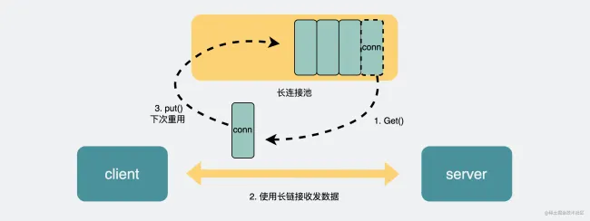

#### 传输的内容

基于 TCP 传输的消息，无非都是 **消息头 Header 和消息体 Body。**

**Header** 是用于标记一些特殊信息，其中最重要的是 **消息体长度**。

**Body** 放真正需要传输的内容，而这些内容只能是二进制 01 串。所以 TCP 传字符串和数字都问题不大，字符串可以转成编码再变成 01 串，而数字本身也能直接转为二进制。结构体转为二进制 01 串，方案现在也有很多现成的，比如 **JSON，Protocol Buffers (Protobuf)**  。

将结构体转为二进制的过程就叫**序列化** ，反过来将二进制数组复原成结构体的过程叫**反序列化**。

RPC定制化程度更高，可以采用体积更小的 **Protobuf** 或其他序列化协议去保存结构体数据，同时也不需要像 HTTP 那样考虑各种浏览器行为，比如 302 重定向跳转啥的。**<font style="color:#DF2A3F;">因此性能也会更好一些，这也是在公司内部微服务中抛弃 HTTP，选择使用 RPC 的最主要原因。</font>**

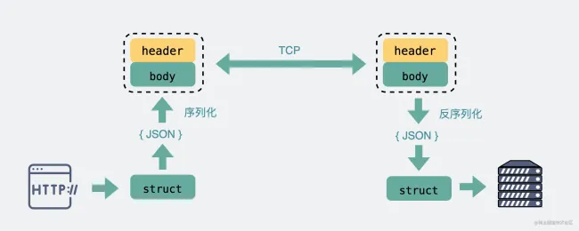

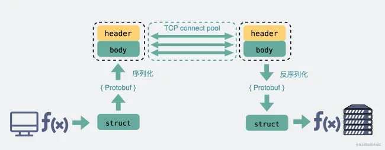

# Dubbo

[Apache Dubbo](https://github.com/apache/dubbo) |ˈdʌbəʊ| 是一款高性能、轻量级的开源 **WEB 和 RPC** 框架。

**<font style="color:#DF2A3F;">Apache Dubbo 是一款 RPC 服务开发框架，用于解决微服务架构下的服务治理与通信问题</font>**

根据 [Dubbo 官方文档](https://dubbo.apache.org/zh/)的介绍，Dubbo 提供了六大核心能力

1. 面向接口代理的高性能 **RPC 调用**。
2. 智能容错和负载均衡。
3. 服务自动注册和发现。
4. 高度可扩展能力。
5. 运行期流量调度。
6. 可视化的服务治理与运维。

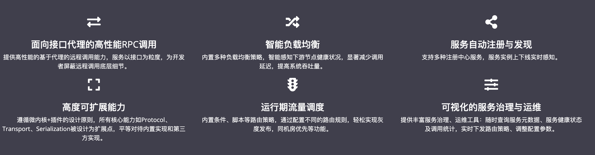

**Dubbo 不光可以帮助我们调用远程服务，还提供了一些其他开箱即用的功能比如智能负载均衡。**

## 服务架构

### 水平扩展和垂直扩展

单体架构有上限，系统扩展性差，存在热点问题，耦合度高，技术栈受限

水平扩展：增加机器数目，复制单体架构

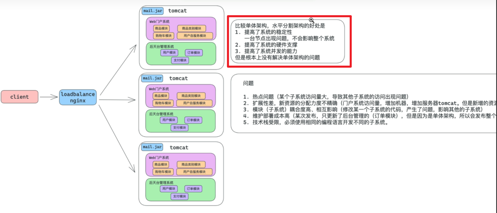

垂直扩展：单体架构进行子系统划分

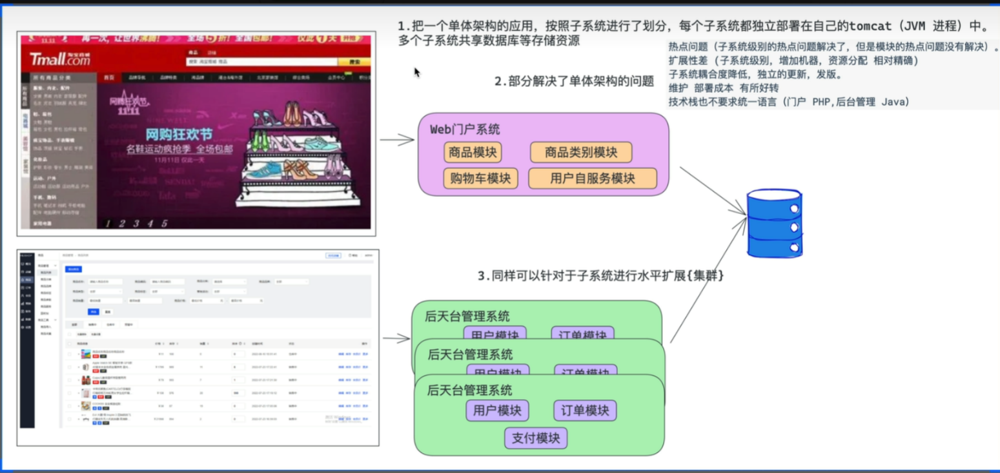

RPC架构

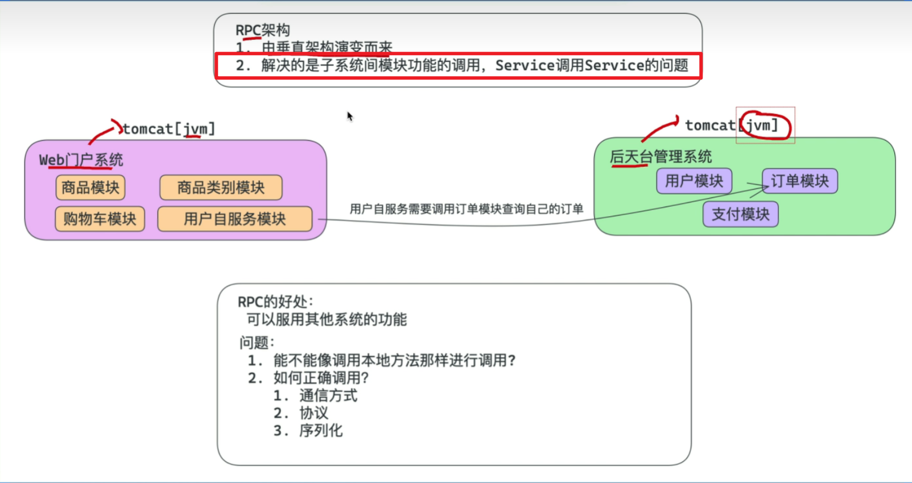

### SOA\[Service-Oriented Architectrue]架构

**RPC架构演化而来 -- Dubbo**

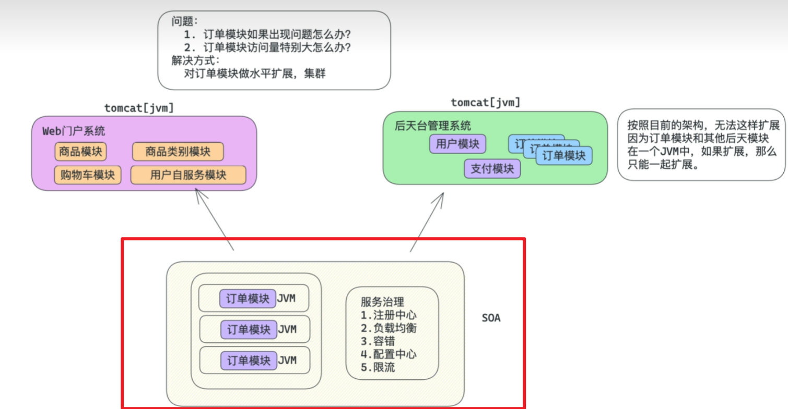

### 微服务架构

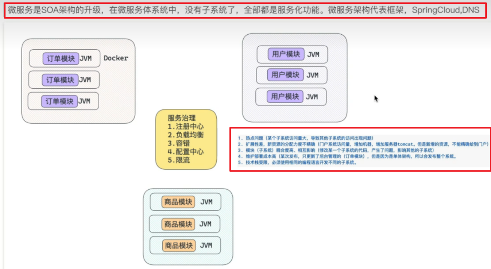

## Dubbo3

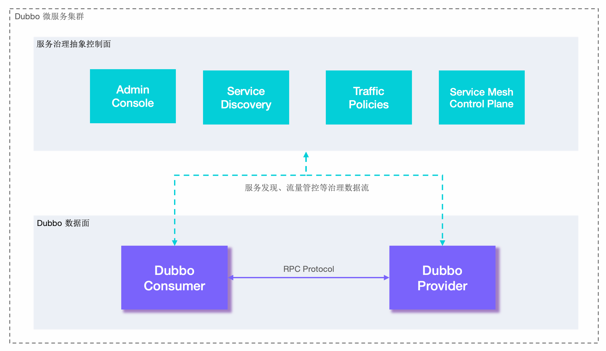

### 基本术语

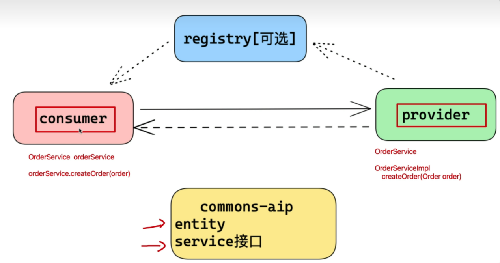

1.provider：功能提供者\
2.consumer：功能调用者【功能消费者】\
3.commons--api：通用内容实体entity，service接口\
4.registry：注册中心 - 可选，管理provider集群

## 面试题

分布式服务架构下，系统被拆分成不同的服务比如短信服务、安全服务，每个服务独立提供系统的某个核心服务。我们可以使用 Java RMI（Java Remote Method Invocation）、Hessian 这种支持远程调用的框架来简单地暴露和引用远程服务。但是！当服务越来越多之后，服务调用关系越来越复杂。当应用访问压力越来越大后，负载均衡以及服务监控的需求也迫在眉睫。--dubbo解决这类问题

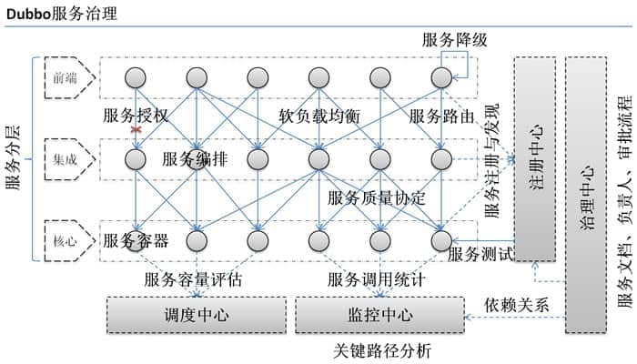

### Dubbo 架构中的核心角色有哪些？

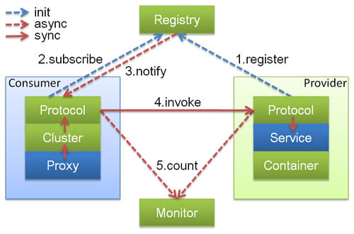

* **Container：**  服务运行容器，负责加载、运行服务提供者。必须。
* **Provider：**  暴露服务的服务提供方，会向注册中心注册自己提供的服务。必须。
* **Consumer：**  调用远程服务的服务消费方，会向注册中心订阅自己所需的服务。必须。
* **Registry：**  服务注册与发现的注册中心。注册中心会返回服务提供者地址列表给消费者。非必须。
* **Monitor：**  统计服务的调用次数和调用时间的监控中心。服务消费者和提供者会定时发送统计数据到监控中心。 非必须。

### Dubbo 中的 Invoker 概念了解么？

简单来说，`Invoker` 就是 Dubbo 对远程调用的抽象。

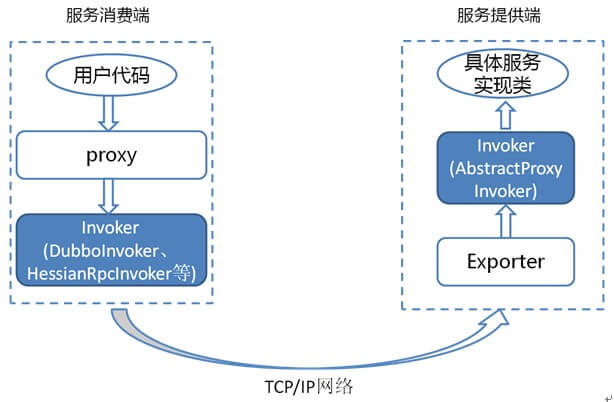

`Invoker` 分为

* 服务提供 `Invoker`
* 服务消费 `Invoker`

**假如需要调用一个远程方法，需要动态代理来屏蔽远程调用的细节！我们屏蔽掉的这些细节就依赖对应的** `**Invoker**` **实现，**  `**Invoker**` **实现了真正的远程服务调用。**

‍


> 更新: 2024-09-06 10:33:08  
> 原文: <https://www.yuque.com/nibiwanxiamei/yrd6t1/a0b047ca35247ce8dc3f64510aee0a23>