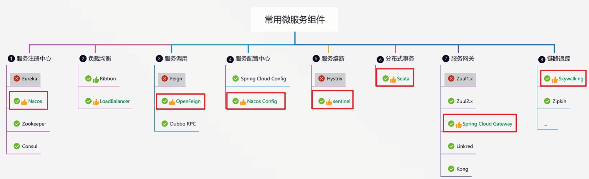
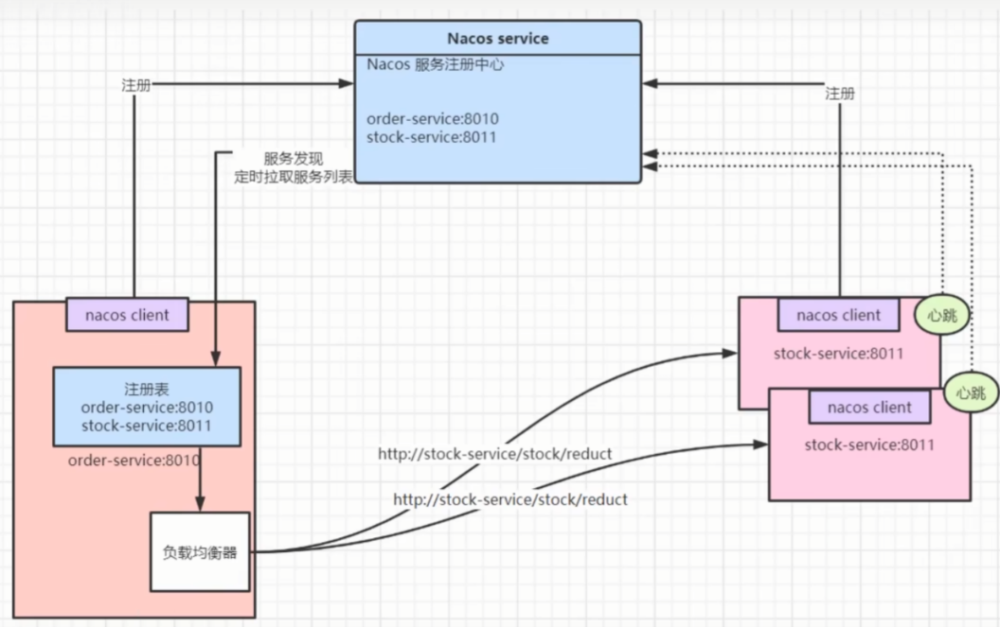
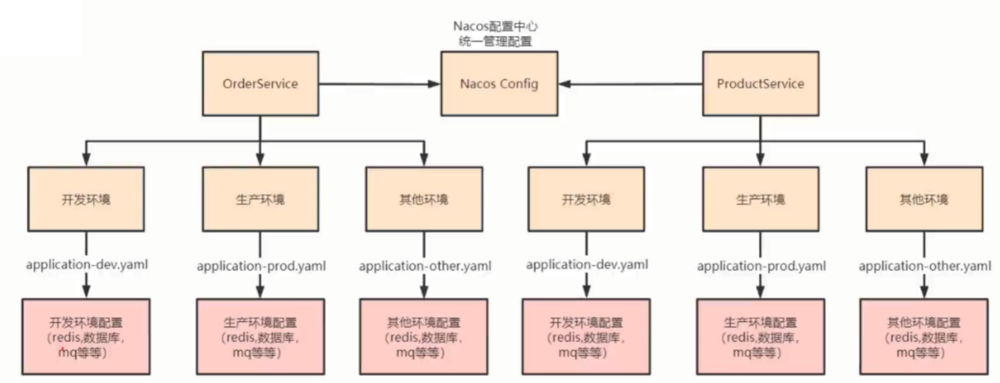
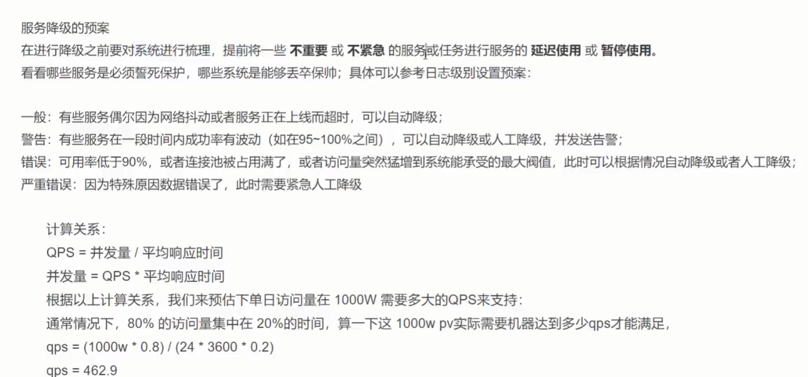

# SpringCloud

---

# 为什么用微服务，优缺点
:::color4
**单体服务中，系统的所有模块都是编写在一个机器上，这样做的话部署会简单，但是单体服务不适合我们进行扩展，各个模块之间的耦合度也比较高，需要更新模块时，需要停止整个系统才能更新。同时单体服务对技术栈的选择也不够灵活。**

**业务量很大的情况下，单体服务无法承载大量的需求。微服务架构是将应用程序拆分成多个服务，同时可以更方便的扩展分布式系统。针对不同的服务也可以选择适合的技术栈，选择上会更加灵活。针对不同服务的需求，可以合理动态分配资源，甚至可以采用不同的开发语言开发对应模块。当然微服务也会带来服务复杂性增加，运维压力增大等问题。**

:::

## 微服务
1. **更好的可维护性**：微服务架构将应用程序拆分成多个服务，每个服务都有自己的代码库和团队。这使得代码更加模块化，更易于维护和更新。
2. **<font style="color:#DF2A3F;">更高的可靠性</font>**：**由于每个服务都可以独立部署和运行，系统更加健壮，可以更好地处理故障和错误。当一个服务出现问题时，其他服务可以正常运行，减少了系统崩溃的风险。**
3. **更快的开发速度**：团队可以独立开发和部署服务，这使得开发速度更快。此外，由于每个服务都是独立的，因此可以使用不同的技术栈和工具来开发服务，提高了开发灵活性。
4. **更好的可移植性**：微服务架构允许将应用程序拆分成多个服务，每个服务都可以独立部署和运行。这使得系统更加可移植，可以在不同的环境中运行。
5. **更好的****<font style="color:#DF2A3F;">可扩展性</font>**：**每个服务可以独立部署和扩展，这使得系统更加可扩展，可以根据需要添加或删除服务。这种细粒度的扩展方式可以更有效地利用资源，并降低维护成本。**
6. **更好的安全性**：微服务架构允许将安全控制分散在多个服务中，这使得系统更加安全。此外，由于每个服务都是独立的，因此可以更容易地实现安全策略和控制。
7. **<font style="color:#DF2A3F;">更好的技术栈选择</font>**：**微服务架构允许使用不同的技术栈和工具来开发服务，这使得团队可以选择最适合他们的技术栈和工具。**

**缺点**：

1. **复杂性增加**：微服务架构将一个大型应用程序分解为多个小型的服务，这导致系统整体的复杂度提高。需要管理更多的服务实例、网络通信、服务间的交互、数据一致性等问题。
2. **运维难度增大**：每个微服务都需要独立部署、监控、升级和维护，这增加了运维工作量。对于容器化和自动化工具的要求也更高，否则可能会面临资源浪费和效率低下的问题。
3. **测试和调试的复杂性**：由于微服务架构涉及多个服务之间的协作，因此测试和调试变得更加复杂。需要考虑服务之间的依赖关系、数据一致性等问题。
4. **数据一致性**：由于微服务架构中的服务通常都有自己的数据存储，因此需要确保不同服务之间的数据同步和一致性，这增加了数据管理的复杂性。

## 单体服务
<font style="color:rgb(5, 7, 59);background-color:rgb(253, 253, 254);">单体服务是一种将所有服务组件集成在一个独立的系统单位中进行开发、部署和维护的架构模式。在这种架构中，前端用户界面、后端服务器逻辑、数据库操作等组件通常紧密耦合在一起，形成一个统一的程序。</font>

**<font style="color:rgb(5, 7, 59);background-color:rgb(253, 253, 254);">优点</font>**<font style="color:rgb(5, 7, 59);background-color:rgb(253, 253, 254);">：</font>

1. **<font style="color:rgb(5, 7, 59);background-color:rgb(253, 253, 254);">部署简单</font>**<font style="color:rgb(5, 7, 59);background-color:rgb(253, 253, 254);">：单体服务架构简单，易于部署和维护，特别适用于小型项目和初创企业。</font>
2. **<font style="color:rgb(5, 7, 59);background-color:rgb(253, 253, 254);">开发成本低</font>**<font style="color:rgb(5, 7, 59);background-color:rgb(253, 253, 254);">：由于所有服务组件都集中在一个项目中，开发人员可以更容易地理解和修改代码，降低了开发成本。</font>
3. **<font style="color:rgb(5, 7, 59);background-color:rgb(253, 253, 254);">性能优势</font>**<font style="color:rgb(5, 7, 59);background-color:rgb(253, 253, 254);">：单体服务通常具有更好的性能，因为它减少了服务之间的网络调用和通信开销。</font>

**<font style="color:rgb(5, 7, 59);background-color:rgb(253, 253, 254);">缺点</font>**<font style="color:rgb(5, 7, 59);background-color:rgb(253, 253, 254);">：</font>

1. **<font style="color:rgb(5, 7, 59);background-color:rgb(253, 253, 254);">可维护性差</font>**<font style="color:rgb(5, 7, 59);background-color:rgb(253, 253, 254);">：随着项目规模的扩大和复杂度的增加，单体服务可能会变得难以维护，因为所有的服务组件都紧密耦合在一起。</font>
2. **<font style="color:rgb(5, 7, 59);background-color:rgb(253, 253, 254);">扩展性差</font>**<font style="color:rgb(5, 7, 59);background-color:rgb(253, 253, 254);">：单体服务只能作为一个整体进行扩展，无法根据业务模块的需要进行伸缩，这可能会限制系统的扩展能力。</font>
3. **<font style="color:rgb(5, 7, 59);background-color:rgb(253, 253, 254);">技术栈限制</font>**<font style="color:rgb(5, 7, 59);background-color:rgb(253, 253, 254);">：单体服务通常使用统一的技术平台和框架，限制了技术选型的灵活性。</font>


# SpringCloud和Dubbo的区别是什么 ♥
[RPC & Dubbo](https://www.yuque.com/nibiwanxiamei/yrd6t1/a0b047ca35247ce8dc3f64510aee0a23)


+ **<font style="color:rgb(5, 7, 59);background-color:rgb(253, 253, 254);">SpringCloud</font>**<font style="color:rgb(5, 7, 59);background-color:rgb(253, 253, 254);">：为微服务架构下的一站式解决方案。它不仅关注服务的调用和治理，还提供了配置管理、服务发现、断路器等一整套分布式系统的开发工具，能够快速构建分布式系统。</font>
+ **<font style="color:rgb(5, 7, 59);background-color:rgb(253, 253, 254);">Dubbo</font>**<font style="color:rgb(5, 7, 59);background-color:rgb(253, 253, 254);">：关注点主要在于服务的调用和治理。Dubbo通过</font>**<font style="color:rgb(5, 7, 59);background-color:rgb(253, 253, 254);">RPC（远程过程调用）</font>**<font style="color:rgb(5, 7, 59);background-color:rgb(253, 253, 254);">实现服务提供方的输出和服务消费方的输入功能，致力于提供透明化的RPC远程服务调用方案以及SOA服务治理方案。</font>


# 微服务组件





# Nacos


Nacos(Naming and Discovery Service)是开源的**服务发现、配置管理和服务治理平台**，由阿里巴巴提供。Nacos提供了一站式的解决方案，支持**服务注册与发现、动态配置管理、服务健康监测、动态DNS服务**等功能，以及对多种环境的适配。

## Nacos底层原理
[Nacos 的 Distro 一致性协议 | Nacos](https://nacos.io/zh-cn/blog/nacos-distro-mechanism/)

[nacos集群 raft协议下数据同步原理（cp模式）_nacos cp的原理-CSDN博客](https://blog.csdn.net/XiWangDeFengChe/article/details/121875201)

### <font style="color:rgb(5, 7, 59);background-color:rgb(253, 253, 254);">一、服务注册与发现</font>
+ **<font style="color:rgb(5, 7, 59);background-color:rgb(253, 253, 254);">原理</font>**<font style="color:rgb(5, 7, 59);background-color:rgb(253, 253, 254);">：Nacos通过服务注册中心来实现服务的注册与发现。</font>**<font style="color:#DF2A3F;background-color:rgb(253, 253, 254);">当一个服务启动时，它会向Nacos服务注册中心注册自己的信息，包括服务名、IP地址、端口号等</font>**<font style="color:rgb(5, 7, 59);background-color:rgb(253, 253, 254);">。其他服务可以通过Nacos服务注册中心来查询服务的信息，实现服务之间的通信。</font>
+ **<font style="color:rgb(5, 7, 59);background-color:rgb(253, 253, 254);">模式</font>**<font style="color:rgb(5, 7, 59);background-color:rgb(253, 253, 254);">：Nacos支持两种服务发现的模式——</font>**<font style="color:#DF2A3F;background-color:rgb(253, 253, 254);">主动模式和被动模式</font>**<font style="color:rgb(5, 7, 59);background-color:rgb(253, 253, 254);">。主动模式下，服务实例在启动时主动向命名服务注册自身的信息，并定期发送心跳以保持注册信息的有效性。被动模式下，服务实例在启动时不主动注册，而是等待其他服务查询时再进行注册。</font>

### <font style="color:rgb(5, 7, 59);background-color:rgb(253, 253, 254);">二、配置管理</font>
+ **<font style="color:rgb(5, 7, 59);background-color:rgb(253, 253, 254);">原理</font>**<font style="color:rgb(5, 7, 59);background-color:rgb(253, 253, 254);">：Nacos提供了动态配置的管理功能。应用程序可以从配置服务中获取配置信息，包括数据库连接、业务规则等。配置服务支持配置的动态更新，当配置发生变化时，Nacos会通知订阅了该配置信息的应用。</font>
+ **<font style="color:rgb(5, 7, 59);background-color:rgb(253, 253, 254);">数据交互方式</font>**<font style="color:rgb(5, 7, 59);background-color:rgb(253, 253, 254);">：Nacos采用</font>**<font style="color:#DF2A3F;background-color:rgb(253, 253, 254);">客户端主动拉（Pull）模型，应用通过长轮询（Long Polling）的方式来获取配置数据。</font>**<font style="color:rgb(5, 7, 59);background-color:rgb(253, 253, 254);">客户端与服务端建立</font>**<font style="color:#DF2A3F;background-color:rgb(253, 253, 254);">TCP长连接</font>**<font style="color:rgb(5, 7, 59);background-color:rgb(253, 253, 254);">，当服务端配置数据有变动时，通过长连接将数据推送给客户端。此外，客户端还会保存一份配置的快照在本地文件中，优先读取本地快照以减少对服务端的压力。</font>

### <font style="color:rgb(5, 7, 59);background-color:rgb(253, 253, 254);">三、服务健康检查</font>
+ **<font style="color:rgb(5, 7, 59);background-color:rgb(253, 253, 254);">原理</font>**<font style="color:rgb(5, 7, 59);background-color:rgb(253, 253, 254);">：Nacos支持对服务的健康状态进行检查。通过定时向Nacos上报自身的健康状态，服务可以实现自身的健康检查，并及时发现故障的服务。注册中心也会定期向服务实例发送健康检查请求，以确保服务实例的可用性和健康状态。</font>

### <font style="color:rgb(5, 7, 59);background-color:rgb(253, 253, 254);">四、集群管理</font>
+ **<font style="color:rgb(5, 7, 59);background-color:rgb(253, 253, 254);">原理</font>**<font style="color:rgb(5, 7, 59);background-color:rgb(253, 253, 254);">：Nacos支持集群部署，可以通过多个Nacos节点来实现高可用性和负载均衡。Nacos节点之间会进行数据同步和选举，保证数据的一致性和高可用性。此外，Nacos还提供了全局高可用、同城容灾和数据多级容灾等机制，以确保服务的稳定性和可靠性。</font>

### <font style="color:rgb(5, 7, 59);background-color:rgb(253, 253, 254);">五、持久化存储</font>
+ **<font style="color:rgb(5, 7, 59);background-color:rgb(253, 253, 254);">原理</font>**<font style="color:rgb(5, 7, 59);background-color:rgb(253, 253, 254);">：Nacos使用数据库或者本地文件系统来存储注册信息、配置信息等数据。通过持久化存储，Nacos能够保证数据的可靠性和持久性。在有DB模式下，Nacos的Server与DB保持数据一致性，Server之间通过Raft协议保证数据一致性。</font>

### <font style="color:rgb(5, 7, 59);background-color:rgb(253, 253, 254);">六、通信协议</font>
+ **<font style="color:rgb(5, 7, 59);background-color:rgb(253, 253, 254);">原理</font>**<font style="color:rgb(5, 7, 59);background-color:rgb(253, 253, 254);">：Nacos使用HTTP和TCP协议来实现服务注册、发现和配置管理。服务之间通过HTTP或TCP协议来进行通信。例如，在配置管理中，客户端通过HTTP请求从Nacos服务端拉取配置数据；在服务注册与发现中，服务实例通过TCP协议与Nacos注册中心进行通信。</font>

## nacos注册中心核心功能原理





**<font style="color:#DF2A3F;">服务注册：服务启动后通过Rest请求方式向Nacos Server注册</font>**  
服务心跳：Nacose Client会维护一个定时心跳持续通知Nacos Server，默认**5s**一次，如果nacos Clienti超过了**15秒**没有接收心跳，会将服务健康状态设置false(拉取的时候会忽略)，如果nacos Clienti超过了**30秒**没有接收心跳剔除服务。  
**<font style="color:#DF2A3F;">服务发现：Nacose Client会有一个定时任务，实时去Nacos Server拉取健康服务</font>**  
服务停止：Nacose Client会主动通过Rest请求Nacos Server发送一个注销的请求


## Nacos挂掉了，服务还能使用吗？


**Nacos有持久化模式和集群模型，服务会将Nacos持久化到本地，或者集群的高可用。短时间没有问题，长时间获取不到服务则会报错。**

## Nacos配置中心核心功能原理




**<font style="color:rgb(77, 77, 77);">Nacos通过长轮询与推送机制实现配置的动态更新和实时推送。当配置信息发生变化时，Nacos能够自动将更新推送给所有相关的服务实例，无需重启服务即可使新配置生效。</font>**

+ **<font style="color:#DF2A3F;">客户端发起长轮询请求</font>****<font style="color:rgb(77, 77, 77);">：客户端通过向Nacos服务器发起长轮询请求来保持连接。长轮询请求不同于短轮询，它不会立即返回响应，而是等待服务器有数据更新或连接超时。</font>**
+ **<font style="color:#DF2A3F;">服务端处理长轮询请求</font>****<font style="color:rgb(77, 77, 77);">：服务端收到客户端的长轮询请求后，会检查配置是否发生了变更。如果没有变更，服务端会设置一个定时任务，延期一段时间后执行（如29.5秒），并将客户端的长轮询连接加入到等待队列中。如果在延时期间配置发生了变更，服务端会立即返回变更信息给客户端。</font>**
+ **<font style="color:#DF2A3F;">客户端接收更新</font>****<font style="color:rgb(77, 77, 77);">：客户端在接收到服务端的配置更新通知后，会根据新的配置信息更新本地缓存，并触发相应的配置刷新逻辑。</font>**

**<font style="color:rgb(77, 77, 77);">Nacos还支持通过</font>****<font style="color:#DF2A3F;">WebSocket等更实时的推送方式</font>****<font style="color:rgb(77, 77, 77);">，将配置更新推送给客户端。这种方式可以减少客户端与服务器之间的通信次数，提高配置更新的实时性和效率。</font>**

**<font style="color:rgb(77, 77, 77);">客户端进行启动的时候，就会优先拉取本地的配置，如果本地配置不存在，那么就会和这个服务端建立这个http请求，然后去拉取这个服务端的全部配置，就是配置中心的全部配置。在拉取到全部配置之后，会去获取每一个配置文件的dataId，然后通过这个id对服务端的每一个配置文件进行一个监听的操作。</font>**

[nacos配置中心的底层原理以及实现_nacos底层原理-CSDN博客](https://blog.csdn.net/zhenghuishengq/article/details/126416860)

# 服务网关GateWay


**<font style="color:#DF2A3F;">限流，授权认证，熔断降级，负载均衡，服务监控，路由转发</font>**

## 路由转发


+ **<font style="color:rgb(5, 7, 59);background-color:rgb(253, 253, 254);">核心功能</font>**<font style="color:rgb(5, 7, 59);background-color:rgb(253, 253, 254);">：SpringCloud Gateway能够根据请求的特定条件（如URL路径、请求参数、请求头等）将请求转发到后端的微服务实例。这种路由功能使得微服务架构中的请求能够统一地通过网关进行转发，简化了请求的路由逻辑。</font>
+ **<font style="color:rgb(5, 7, 59);background-color:rgb(253, 253, 254);">支持多种路由策略</font>**<font style="color:rgb(5, 7, 59);background-color:rgb(253, 253, 254);">：包括基于路径、请求参数、请求头、主机等多种条件的路由，满足复杂的路由需求。</font>
+ **<font style="color:rgb(5, 7, 59);background-color:rgb(253, 253, 254);">动态路由配置</font>**<font style="color:rgb(5, 7, 59);background-color:rgb(253, 253, 254);">：支持在运行时动态地添加、修改和删除路由配置，提高了系统的灵活性和可扩展性。</font>

## 负载均衡


<font style="color:rgb(5, 7, 59);background-color:rgb(253, 253, 254);">SpringCloud Gateway可以与服务注册中心Nacos集成，自动从注册中心获取服务实例信息，并根据负载均衡策略将请求分发到不同的微服务实例上，实现负载均衡。</font>

<font style="color:rgb(5, 7, 59);background-color:rgb(253, 253, 254);"></font>

# <font style="color:rgb(5, 7, 59);background-color:rgb(253, 253, 254);">Sentinel</font>
## 熔断


**服务A调用的某个服务B不可用时，上游服务A为了保证自己不受影响，及时切断与服务B的通讯。以防服务雪崩**

## 降级


**当系统出现异常情况时，服务降级会主动屏蔽一些非核心或可选的功能，而只提供最基本的功能，以确保系统的稳定运行。比如电商交易系统在双 11 时，使用的人比较多，此时如果开放所有功能，可能会导致系统不可用，所以此时可以开启降级功能，优先保证支付功能可用，而其他非核心功能，如评论、物流、商品介绍等功能可以暂时关闭。**




## 限流


常见限流算法：**计数器算法、滑动窗口算法、漏桶算法、令牌桶算法。****<font style="color:#DF2A3F;">sentinel默认滑动窗口算法</font>**

[百度安全验证](https://baijiahao.baidu.com/s?id=1775465543262504956&wfr=spider&for=pc)

1. 滑动窗口更细粒度的统计：
    - Sentinel 的滑动窗口可以在一个时间窗口内对流量进行更细粒度的统计。它将时间窗口划分为多个小的时间片段，每个片段内统计流量数据，这样可以更准确地反映短时间内的流量变化情况。
    - 相比之下，令牌桶算法主要是基于固定的令牌生成速率和桶的大小来控制流量，对于短时间内的流量突发情况可能无法做出及时准确的响应。
2. 适应复杂场景：
    - 在实际的分布式系统中，流量的变化往往是复杂多样的，可能会出现瞬间的流量高峰，如促销活动、突发的热点事件等。滑动窗口能够更好地适应这种复杂的流量变化场景，通过实时调整流量控制策略，确保系统的稳定性。
    - 例如，在电商平台的大促活动中，流量可能在短时间内急剧增加，滑动窗口可以快速检测到这种变化，并及时调整限流策略，防止系统崩溃。

滑动窗口的优点：

+ **<font style="color:#DF2A3F;background-color:rgb(244, 246, 248);">精确控制：滑动窗口允许精确控制每个时间段内的请求数目，从而更好地适应业务需求。它能够更好地处理高频次请求的流量平滑控制。</font>**
+ **<font style="color:#DF2A3F;background-color:rgb(244, 246, 248);">动态适应：滑动窗口允许根据实际流量变化动态调整，从而有效应对突发流量或业务需求变化。</font>**


# 服务雪崩


某个服务挂掉后，其他的服务访问挂掉的服务，大量请求堆积，导致其他的服务也挂掉，产生链式反应，产生服务雪崩。

解决方案：熔断降级，异步请求快速失败。


# Feign 远程调用
加入maven配置，启动类加上 <font style="color:#bbbbbb;background-color:#282c34;">@EnableFeignClients("com.jcy.coupon.distribution.remote")</font>

```java
@FeignClient(value = "engine", url = "${coupon.distribution.feign.remote-url.engine:}")
public interface CouponTemplateRemoteService {

    /**
     * 查询优惠券模板
     */
    @GetMapping("/api/engine/coupon-template/query")
    Result<CouponTemplateQueryRemoteRespDTO> pageQueryCouponTemplate(
            @RequestParam(value = "shopNumber") String shopNumber,
            @RequestParam(value = "couponTemplateId") String couponTemplateId
    );
}
```

# 负载均衡


负载均衡策略


# 为什么需要链路追踪


在微服务中，有的上下游可能有十几个服务，如果某一环出了问题，排查起来非常困难，所以，就需要进行链路追踪，来帮助排查问题。

**通过链路追踪，可以可视化地追踪请求从一个微服务到另一个微服务的调用情况。除了排查问题，链路追踪黑还可以帮助优化性能，可视化依赖关系、服务监控和告警。**


‍


> 更新: 2025-03-10 21:45:47  
> 原文: <https://www.yuque.com/nibiwanxiamei/yrd6t1/4578c0cc72422b3d5b7f50fbc8e73c2f>