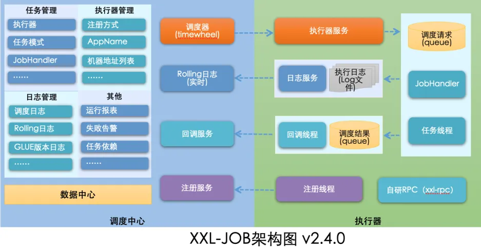
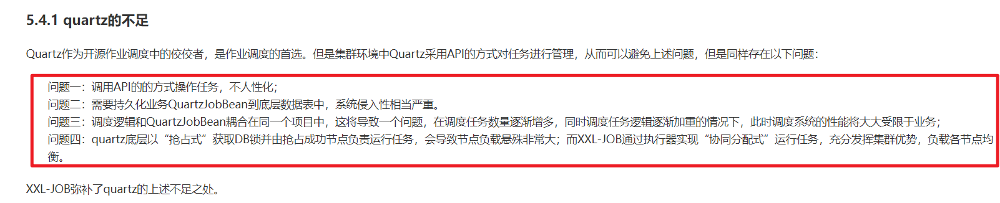

# XXLJOB

[分布式任务调度平台XXL-JOB](https://www.xuxueli.com/xxl-job/#5.4.1%20quartz%E7%9A%84%E4%B8%8D%E8%B6%B3)

[Java初级面试题之Quartz定时任务_经典Java面试题及答案-动力节点](https://www.bjpowernode.com/tutorial_baseinterviewquestions/224.html)

[Spring中常用的11个扩展点_spring 扩展点-CSDN博客](https://blog.csdn.net/ZL4120505/article/details/138136297)

# 为什么选择XXLJob

考虑到是**分布式项目**，且定时任务的业务处理相对来说比较独立，所以在选择定时任务框架时，需要考虑一些关键因素，而 Xxl-job 恰好满足这些需求：

1. **可视化管理界面**：Xxl-job 提供直观、易用的可视化管理界面，让我们能够方便地管理和监控定时任务。
2. **分布式任务调度**：对于分布式系统，Xxl-job 提供了强大的分布式任务调度能力，可以轻松地实现任务在集群中的分发和执行。
3. **任务执行日志**：Xxl-job 支持任务执行日志的记录和查看，这有助于及时发现和解决任务执行中的问题。
4. **支持动态增删任务**：Xxl-job允许在项目运行或上线后动态添加和删除任务，无需停止整个服务。
5. **代码入侵较低**：定时任务相对独立，代码入侵比较严重的框架肯定是不会考虑的，而xxl-job完全采用注解方式，使用成本低，且兼容性较好。

xxl-job的设计思想可以与Nacos类似，xxl-job的调度中心就可以看做是nacos的[注册中心](https://cloud.tencent.com/product/tse?from_column=20065&from=20065)，nacos是将一个个服务注册到nacos注册中心，而**xxl-job是将一个个定时任务注册到“调度中心”**。

+ Xxl-job将调度行为抽象形成“调度中心”公共平台，而自身并不承担业务逻辑，“调度中心”负责发起调度请求。
+ 将任务抽象成分散的JobHandler，交由“执行器”统一管理，“执行器”负责接收调度请求并执行对应的JobHandler中业务逻辑。
+ **“调度”和“任务”两部分可以相互解耦****，提高系统整体稳定性和扩展性；**

> 更新: 2024-08-15 14:32:06  
> 原文: <https://www.yuque.com/nibiwanxiamei/yrd6t1/rwfg95nzcr6a1mxw>