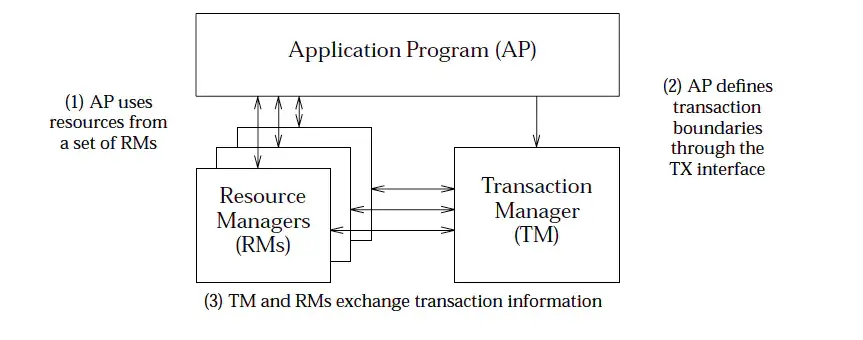
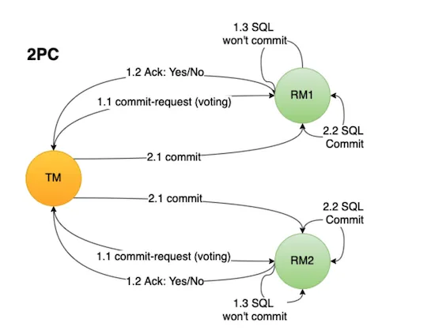
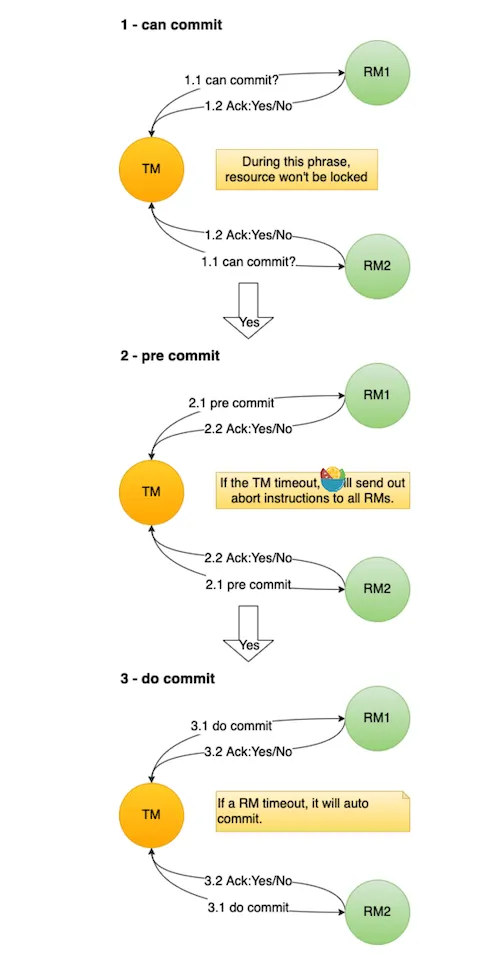
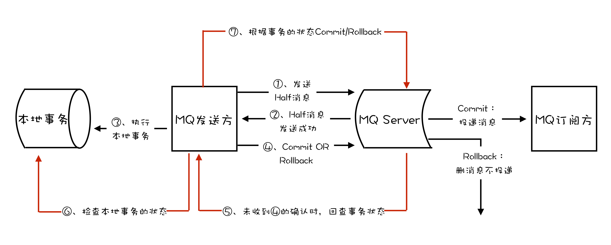

# 分布式事务

# 分布式事务概述
微服务架构下，一个系统被拆分为多个小的微服务。每个微服务都可能存在不同的机器上，并且每个微服务可能都有一个单独的数据库供自己使用。这种情况下，一组操作可能会涉及到多个微服务以及多个数据库。**分布式事务的终极目标就是保证系统中多个相关联的数据库中的数据的一致性！**

**分布式事务无法满足ACID特性，但是需要满足CAP理论和BASE理论。**

[CAP & BASE理论详解](https://www.yuque.com/nibiwanxiamei/yrd6t1/d7043aa6299d453426967df23da14f0a)

# 分布式事务解决方案
**2PC**、**3PC**、**TCC**、**本地消息表**、**MQ 事务**（Kafka 和 RocketMQ 都提供了事务相关功能） 、**Saga** 

[Mq消息队列](https://www.yuque.com/nibiwanxiamei/yrd6t1/0762d3f7456a51dee928a917a485ae3a)

2PC、3PC 属于业务代码无侵入方案，都是基于 XA 规范衍生出来的实现，XA 规范是 X/Open 组织定义的分布式事务处理（DTP，Distributed Transaction Processing）标准。TCC、Saga 属于业务侵入方案，MQ 事务依赖于使用消息队列的场景，本地消息表不支持回滚。

## 2PC

+ **AP（Application Program）**：应用程序本身。
+ **RM（Resource Manager）** ：资源管理器，也就是事务的参与者，绝大部分情况下就是指数据库（后文会以关系型数据库为例），一个分布式事务往往涉及到多个 RM。
+ **TM（Transaction Manager）** ：事务管理器，负责管理全局事务，分配事务唯一标识，监控事务的执行进度，并负责事务的提交、回滚、失败恢复等。

+ **2** -> 指代事务提交的 2 个阶段
+ **P**-> Prepare (准备阶段)
+ **C** ->Commit（提交阶段）

### **准备阶段(Prepare)**
准备阶段的核心是“询问”事务参与者执行本地数据库事务操作是否成功。  
准备阶段的工作流程：

1. **事务协调者/管理者（后文简称 TM）** 向所有涉及到的 **事务参与者（后文简称 RM）** 发送消息询问：“你是否可以执行事务操作呢？”，并等待其答复。
2. **RM** 接收到消息之后，开始执行本地数据库事务预操作比如写 redo log/undo log 日志，**此时并不会提交事务** 。
3. **RM** 如果执行本地数据库事务操作成功，那就回复“Yes”表示我已就绪，否则就回复“No”表示我未就绪。

### 提交阶段(Commit)
提交阶段的核心是“询问”事务参与者提交本地事务是否成功。

当所有事务参与者都是“就绪”状态的话：

1. **TM** 向所有参与者发送消息：“你们可以提交事务啦！”（**Commit 消息**）
2. **RM** 接收到 **Commit 消息** 后执行 **提交本地数据库事务** 操作，执行完成之后 **释放整个事务期间所占用的资源**。
3. **RM** 回复：“事务已经提交” （**ACK 消息**）。
4. **TM** 收到所有 **事务参与者** 的 **ACK 消息** 之后，整个分布式事务过程正式结束。

## 3PC

3PC 是人们在 2PC 的基础上做了一些优化得到的。3PC 把 2PC 中的 **准备阶段(Prepare)** 做了进一步细化，分为 2 个阶段：

+ 准备阶段(CanCommit)
+ 预提交阶段(PreCommit)

## MQ事务
RocketMQ 、 Kafka、Pulsar 、QMQ 都提供了事务相关的功能。事务允许事件流应用将消费，处理，生产消息整个过程定义为一个原子操作。

+ MQ 发送方（比如物流服务）在消息队列上开启一个事务，然后发送一个“半消息”给 MQ Server/Broker。事务提交之前，半消息对于 MQ 订阅方/消费者（比如第三方通知服务）不可见
+ 半消息发送成功的话，MQ 发送方就开始执行本地事务。
+ MQ 发送方的本地事务执行成功的话，“半消息”变成正常消息，可以正常被消费。MQ 发送方的本地事务执行失败的话，会直接回滚。

**MQ 的事务消息使用的是两阶段提交（2PC），简单来说就是咱先发送半消息，等本地事务执行成功之后，半消息才变为正常消息。**

> 更新: 2024-07-24 22:01:06  
> 原文: <https://www.yuque.com/nibiwanxiamei/yrd6t1/xc06wnmds4xpaknn>