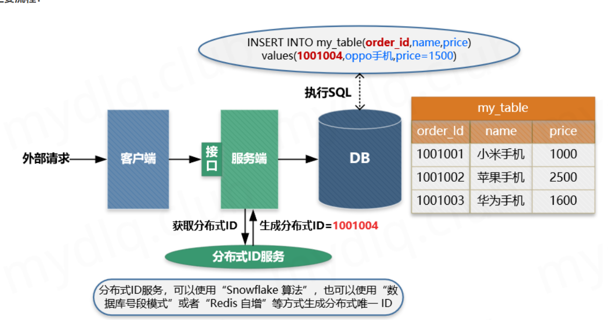
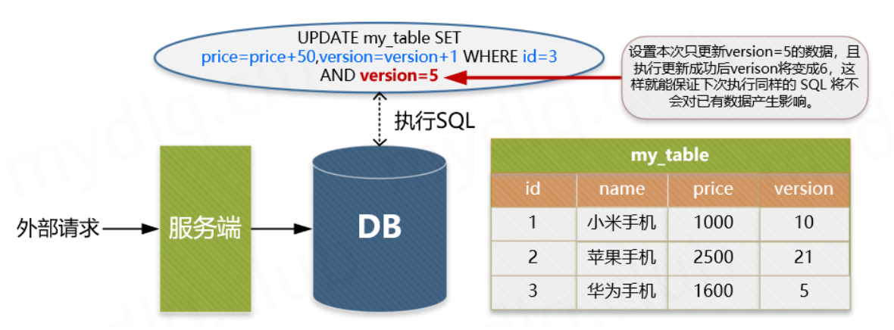
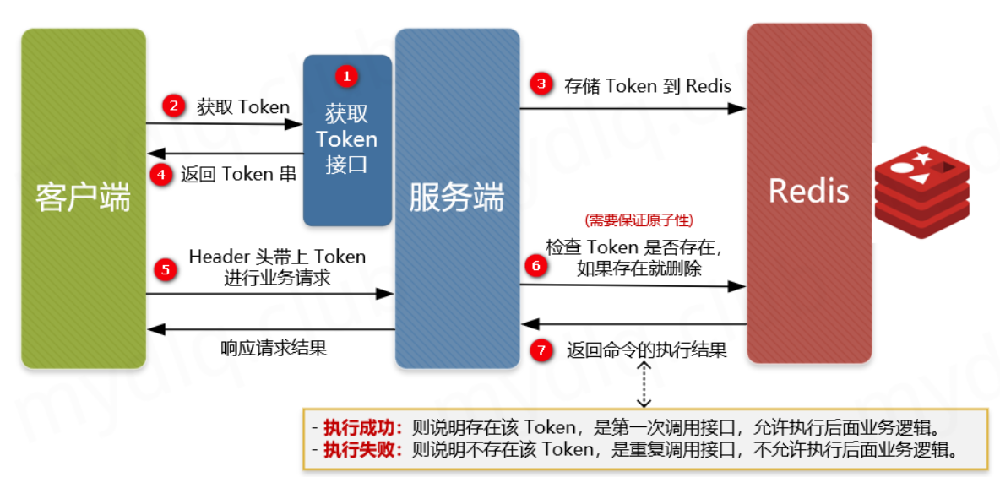
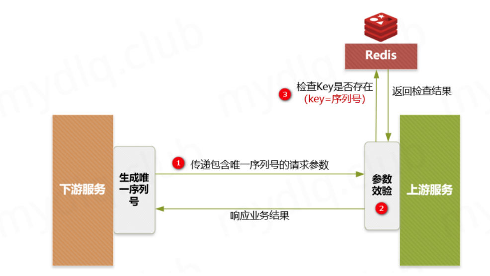

# 分布式幂等性

**幂等性：****一次和多次请求某一个资源对于资源本身应该具有同样的结果**

MQ消息消费中使用Redis支持幂等性；**通过 Redis 和RocketMQ配合实现消息队列消费业务下的幂等场景，保障消息在一定时间内消费且仅消费一次。**

[Spring Boot Spring Cloud 微服务 分布式项目 实现接口幂等性的 4 种方案_gateway解决幂等性问题-CSDN博客](https://blog.csdn.net/qq_44866828/article/details/126302774?utm_source=miniapp_weixin)

## 引入幂等性出现的问题
幂等性是为了简化客户端逻辑处理，能放置重复提交等操作，但却增加了服务端的逻辑复杂性和成本，其主要是：

+ 把并行执行的功能改为串行执行，降低了执行效率。
+ **增加了额外控制幂等的业务逻辑，复杂化了业务功能；**

所以在使用时候需要考虑是否引入幂等性的必要性，根据实际业务场景具体分析，除了业务上的特殊要求外，一般情况下不需要引入的接口幂等性。

## Restful API 接口的幂等性
| **方法类型** | **是否幂等** | **描述** |
| :---: | :---: | :---: |
| Get | √ | Get 方法用于获取资源。其一般不会也不应当对系统资源进行改变，所以是幂等的。 |
| Post | × | Post 方法一般用于创建新的资源。其每次执行都会新增数据，所以不是幂等的。 |
| Put | - | Put 方法一般用于修改资源。该操作则分情况来判断是不是满足幂等，更新操作中直接根据某个值进行更新，也能保持幂等。不过执行累加操作的更新是非幂等。 |
| Delete | - | Delete 方法一般用于删除资源。该操作则分情况来判断是不是满足幂等，当根据唯一值进行删除时，删除同一个数据多次执行效果一样。不过需要注意，带查询条件的删除则就不一定满足幂等了。例如在根据条件删除一批数据后，这时候新增加了一条数据也满足条件，然后又执行了一次删除，那么将会导致新增加的这条满足条件数据也被删除。 |

## ♥♥♥ 幂等性实现
### 数据库唯一主键
[API网关 + 分布式ID](https://www.yuque.com/nibiwanxiamei/yrd6t1/79bf26c512db5924e6835932cb7eeafb)

**适用操作：**

+ 插入操作
+ 删除操作

**使用限制：**

+ 需要生成全局唯一主键 ID；

主要流程：

+ ① 客户端执行创建请求，调用服务端接口。
+ ② 服务端执行业务逻辑，生成一个分布式 ID，将该 ID 充当待插入数据的主键，然后执数据插入操作，运行对应的 SQL 语句。
+ ③ 服务端将该条数据插入数据库中，如果插入成功则表示没有重复调用接口。如果抛出主键重复异常，则表示数据库中已经存在该条记录，返回错误信息到客户端。

### 数据库乐观锁（加版本）
适用于执行“更新操作”的过程，我们可以提前在对应的数据表中多添加一个字段，充当当前数据的版本标识。这样每次对该数据库该表的这条数据执行更新时，都会将该版本标识作为一个条件，值为上次待更新数据中的版本标识的值。 - 类似于CAS操作

### **防重 Token 令牌**
**适用操作：**

+ 插入操作
+ 更新操作
+ 删除操作

**使用限制：**

+ 需要生成全局唯一 Token 串；
+ 需要使用第三方组件 Redis 进行数据效验；

:::success
注意，在并发情况下，执行 Redis 查找数据与删除需要保证原子性，否则很可能在并发下无法保证幂等性。其实现方法可以使用分布式锁或者使用 Lua 表达式来注销查询与删除操作。

:::

### **下游传递唯一序列号**
**适用操作：**

+ 插入操作
+ 更新操作
+ 删除操作

**使用限制：**

+ 要求第三方传递唯一序列号；
+ 需要使用第三方组件 Redis 进行数据效验；

:::success
上面步骤中插入数据到 Redis 一定要设置过期时间。这样能保证在这个时间范围内，如果重复调用接口，则能够进行判断识别。如果不设置过期时间，很可能导致数据无限量的存入 Redis，致使 Redis 不能正常工作。

:::

> 更新: 2025-07-23 17:22:44  
> 原文: <https://www.yuque.com/nibiwanxiamei/yrd6t1/fmgyr2rnsc0ftmg9>