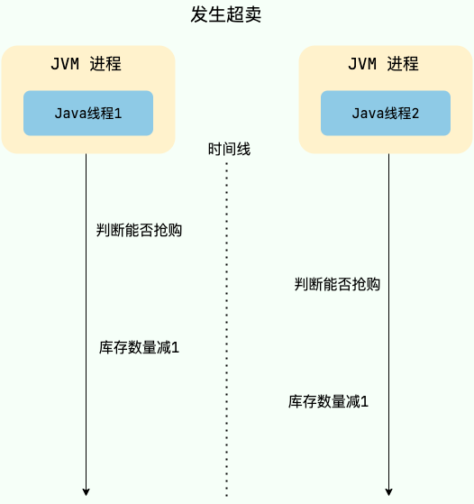
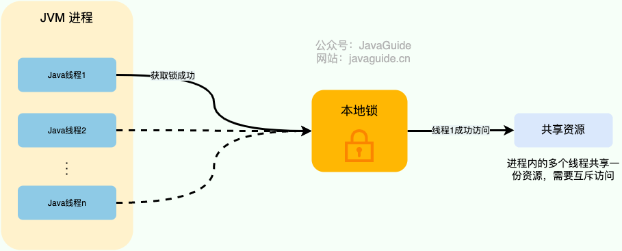
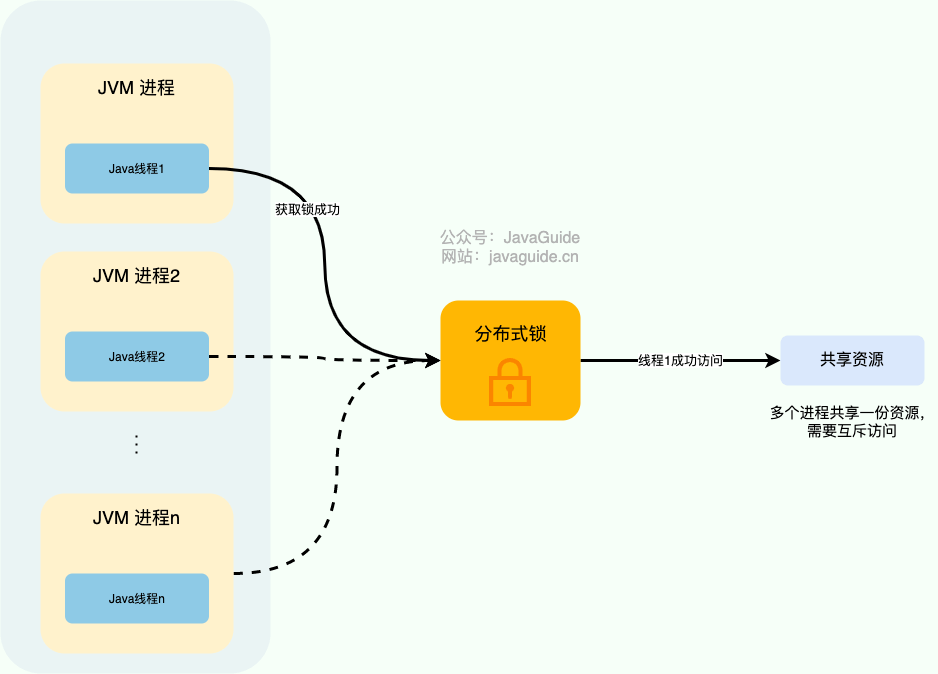
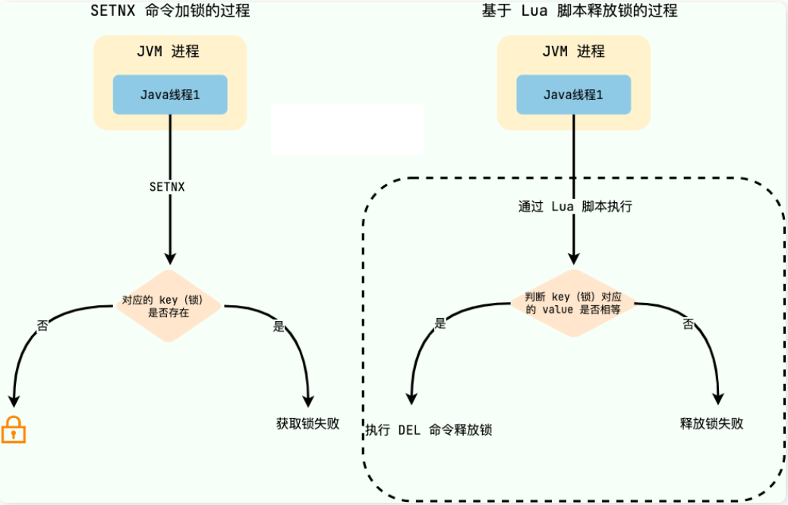
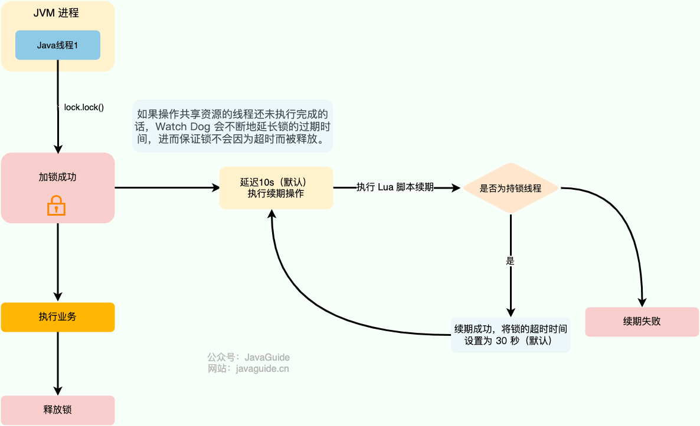
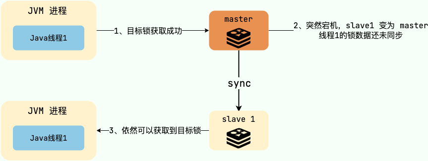
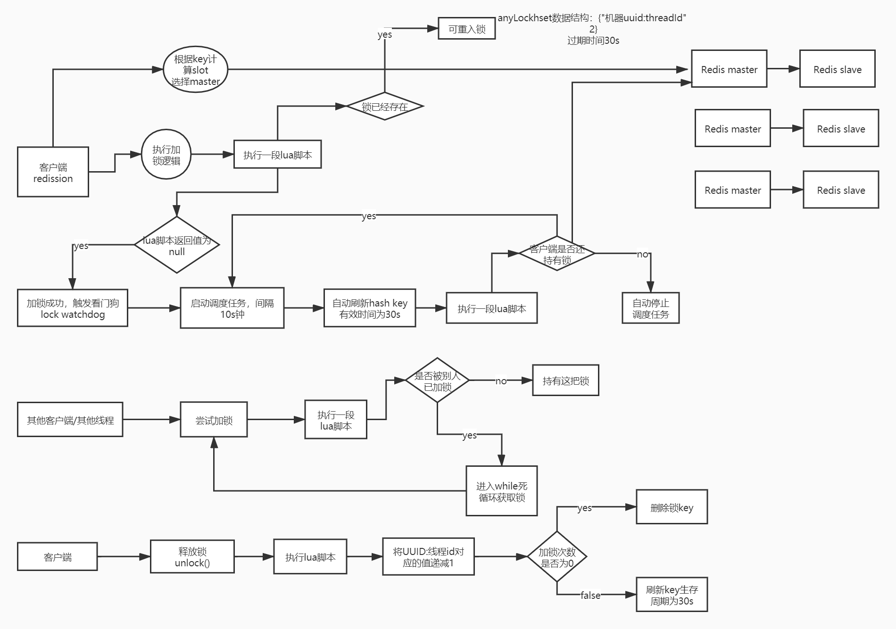
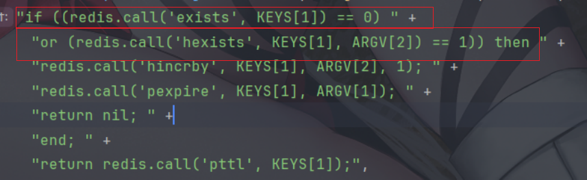
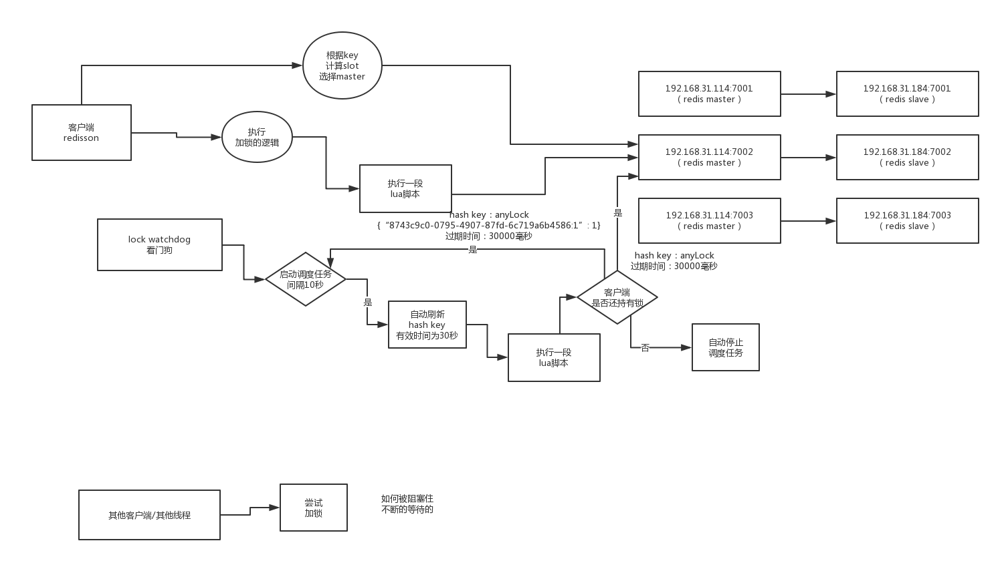
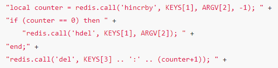

# 分布式锁

***

# 分布式锁

## 为什么需要分布式锁？

**在多线程环境中，多个线程同时访问共享资源（例如商品库存、外卖订单），会发生竞争，可能会导致出现脏数据或者系统问题，威胁到程序的正常运行。**

***

举个例子，假设现在有 100 个用户参与某个限时秒杀活动，每位用户限购 1 件商品，且商品的数量只有 3 个。如果不对共享资源进行互斥访问，就可能出现以下情况：

* 线程 1、2、3 等多个线程同时进入抢购方法，每一个线程对应一个用户。
* 线程 1 查询用户已经抢购的数量，发现当前用户尚未抢购且商品库存还有 1 个，因此认为可以继续执行抢购流程。
* 线程 2 也执行查询用户已经抢购的数量，发现当前用户尚未抢购且商品库存还有 1 个，因此认为可以继续执行抢购流程。
* 线程 1 继续执行，将库存数量减少 1 个，然后返回成功。
* 线程 2 继续执行，将库存数量减少 1 个，然后返回成功。
* 此时就发生了超卖问题，导致商品被多卖了一份。



**为了保证共享资源被安全地访问，我们需要使用\*\*\*\*互斥操作对共享资源进行保护** **，即同一时刻只允许一个线程访问共享资源，其他线程需要等待当前线程释放后才能访问。这样可以避免数据竞争和脏数据问题，保证程序的正确性和稳定性。**

**如何才能实现共享资源的互斥访问呢？**  锁是一个比较通用的解决方案，更准确点来说是**悲观锁**。

悲观锁总是假设最坏的情况，认为共享资源每次被访问的时候就会出现问题(比如共享数据被修改)，所以每次在获取资源操作的时候都会上锁，这样其他线程想拿到这个资源就会阻塞直到锁被上一个持有者释放。也就是说，**共享资源每次只给一个线程使用，其它线程阻塞，用完后再把资源转让给其它线程**。

对于单机多线程来说，在 Java 中，我们通常使用 `ReetrantLock` 类、`Synchronized` 关键字这类 JDK 自带的 **本地锁** 来控制一个 JVM 进程内的多个线程对本地共享资源的访问。



分布式系统下，不同的服务/客户端通常运行在独立的 JVM 进程上。如果多个 JVM 进程共享同一份资源的话，使用本地锁就没办法实现资源的互斥访问了。于是，**分布式锁** 就诞生了。



**<font style="color:#DF2A3F;">独立的进程中的线程访问共享资源是互斥的，同一时刻只有一个线程可以获取到分布式锁访问共享资源</font>**

## 分布式锁应该具备哪些条件？

一个最基本的分布式锁需要满足：

* **互斥**：任意一个时刻，锁只能被一个线程持有。
* **高可用**：锁服务是高可用的，当一个锁服务出现问题，能够自动切换到另外一个锁服务。并且，即使客户端的释放锁的代码逻辑出现问题，锁最终一定还是会被释放，不会影响其他线程对共享资源的访问。这一般是通过超时机制实现的。
* **可重入**：一个节点获取了锁之后，还可以再次获取锁。

除了上面这三个基本条件之外，一个好的分布式锁还需要满足下面这些条件：

* **高性能**：获取和释放锁的操作应该快速完成，并且不应该对整个系统的性能造成过大影响。
* **非阻塞**：如果获取不到锁，不能无限期等待，避免对系统正常运行造成影响。

## 分布式锁的常见实现方式有哪些？

**常见分布式锁实现方案如下：**

* **基于关系型数据库比如 MySQL 实现分布式锁。**
* **基于分布式协调服务 ZooKeeper 实现分布式锁。**
* **基于分布式键值存储系统比如 ****<font style="color:#DF2A3F;">Redis</font>**** 、Etcd 实现分布式锁。**

# 分布式锁常见实现方案总结

## 基于 Redis 实现分布式锁

### 如何基于 Redis 实现一个最简易的分布式锁

在 Redis 中， `SETNX` 命令是可以帮助我们实现互斥。`SETNX` 即 **SET** if **N**ot Exists (对应 Java 中的 `setIfAbsent` 方法)，**如果 key 不存在的话，才会设置 key 的值**。

```java
SETNX lockKey uniqueValue
(integer) 1
SETNX lockKey uniqueValue
(integer) 0
```

释放锁的话，直接通过 `DEL` 命令删除对应的 key 即可。

```java
DEL lockKey
(integer) 1
```

**为了防止误删到其他的锁，这里我们建议使用 Lua 脚本通过 key 对应的 value（唯一值）来判断。**

选用 Lua 脚本是为了保证解锁操作的原子性。因为 Redis 在执行 Lua 脚本时，可以以原子性的方式执行，从而保证了锁释放操作的原子性。

```java
// 释放锁时，先比较锁对应的 value 值是否相等，避免锁的误释放
if redis.call("get",KEYS[1]) == ARGV[1] then
    return redis.call("del",KEYS[1])
else
    return 0
end
```



这是一种最简易的 Redis 分布式锁实现，实现方式比较简单，性能也很高效。不过，这种方式实现分布式锁存在一些问题。比如**应用程序遇到一些问题比如释放锁的逻辑突然挂掉，可能会导致锁无法被释放，进而造成共享资源无法再被其他线程/进程访问。**

### 为什么要给锁设置一个过期时间？

为了避免锁无法被释放，我们可以想到的一个解决办法就是：**给这个 key（也就是锁） 设置一个过期时间**

```java
127.0.0.1:6379> SET lockKey uniqueValue EX 3 NX
OK
```

* **lockKey**：加锁的锁名；
* **uniqueValue**：能够唯一标示锁的随机字符串；
* **NX**：只有当 lockKey 对应的 key 值不存在的时候才能 SET 成功；
* **EX**：过期时间设置（秒为单位）EX 3 标示这个锁有一个 3 秒的自动过期时间。与 EX 对应的是 PX（毫秒为单位），这两个都是过期时间设置。

**如果操作共享资源的时间大于过期时间，就会出现锁提前过期的问题，进而导致分布式锁直接失效。如果锁的超时时间设置过长，又会影响到性能。**

### 如何实现锁的优雅续期？

[GitHub - redisson/redisson: Redisson - Easy Redis Java client and Real-Time Data Platform. Valkey compatible. Sync/Async/RxJava/Reactive API. Over 50 Redis based Java objects and services: Set, Multimap, SortedSet, Map, List, Queue, Deque, Semaphore, Lock, AtomicLong, Map Reduce, Bloom filter, Spring Cache, Tomcat, Scheduler, JCache API, Hibernate, RPC, local cache ...](https://github.com/redisson/redisson)

Redisson 是一个开源的 Java 语言 Redis 客户端，提供了很多开箱即用的功能，不仅仅包括多种分布式锁的实现。并且，Redisson 还支持 Redis 单机、Redis Sentinel、Redis Cluster 等多种部署架构。

**Redisson 中的分布式锁自带自动续期机制**，使用起来非常简单，原理也比较简单，其提供了一个专门用来监控和续期锁的 \*\*守护线程 \*\*- **Watch Dog（ 看门狗）** ，如果操作共享资源的线程还未执行完成的话，Watch Dog 会不断地延长锁的过期时间，进而保证锁不会因为超时而被释放。



看门狗名字的由来于 `getLockWatchdogTimeout()`  方法，这个方法返回的是看门狗给锁续期的过期时间，默认为 30 秒（[redisson-3.17.6](https://github.com/redisson/redisson/releases/tag/redisson-3.17.6)）。

```java
//默认 30秒，支持修改
private long lockWatchdogTimeout = 30 * 1000;

public Config setLockWatchdogTimeout(long lockWatchdogTimeout) {
    this.lockWatchdogTimeout = lockWatchdogTimeout;
    return this;
}
public long getLockWatchdogTimeout() {
   return lockWatchdogTimeout;
}
```

**默认情况下，每过 10 秒，看门狗就会执行续期操作，将锁的超时时间设置为 30 秒。看门狗续期前也会先判断是否需要执行续期操作，需要才会执行续期，否则取消续期操作。**

以 Redisson 的分布式可重入锁 `RLock` 为例来说明如何使用 Redisson 实现分布式锁：

```java
// 1.获取指定的分布式锁对象
RLock lock = redisson.getLock("lock");
// 2.拿锁且不设置锁超时时间，具备 Watch Dog 自动续期机制
lock.lock();
// 3.执行业务
...
// 4.释放锁
lock.unlock();
```

只有未指定锁超时时间，才会使用到 Watch Dog 自动续期机制。

```java
// 手动给锁设置过期时间，不具备 Watch Dog 自动续期机制
lock.lock(10, TimeUnit.SECONDS);
```

### 如何实现可重入锁？

**可重入锁指的是在**\*\*<font style="color:#DF2A3F;">一个线程中可以多次获取同一把锁</font>\*\*，比如一个线程在执行一个带锁的方法，该方法中又调用了另一个需要相同锁的方法，则该线程可以直接执行调用的方法即可重入 ，而无需重新获得锁。像 Java 中的 `synchronized` 和 `ReentrantLock` 都属于可重入锁。

**不可重入的分布式锁基本可以满足绝大部分业务场景了，一些特殊的场景可能会需要使用可重入的分布式锁。**

可重入分布式锁的实现核心思路是线程在获取锁的时候**判断是否为自己的锁**，如果**是就不用再重新获取**了。为此，我们可以为每个锁关联一个**可重入计数器**和一个**占有它的线程**。当可重入计数器大于 0 时，则锁被占有，需要判断占有该锁的线程和请求获取锁的线程是否为同一个。

> **Redisson** 内置了多种类型的锁比如可重入锁（Reentrant Lock）、自旋锁（Spin Lock）、公平锁（Fair Lock）、多重锁（MultiLock）、 红锁（RedLock）、 读写锁（ReadWriteLock）。

### Redis 如何解决集群情况下分布式锁的可靠性？

为了避免单点故障，生产环境下的 Redis 服务通常是集群化部署的。

Redis 集群下，上面介绍到的分布式锁的实现会存在一些问题。由于 **Redis 集群数据同步到各个节点时是异步的，如果在 Redis 主节点获取到锁后，在没有同步到其 他节点时，Redis 主节点宕机了，此时新的 Redis 主节点依然可以获取锁，所以多个应用服务就可以同时获取到锁。**



[Distributed Locks with Redis](https://redis.io/topics/distlock)

[【Redis】之 RedLock 分布式锁-CSDN博客](https://blog.csdn.net/aiwangtingyun/article/details/131252366)

**Redlock 算法的思想是让客户端向 Redis 集群中的多个独立的 Redis 实例依次请求申请加锁，如果客户端能够和**\*\*<font style="color:#DF2A3F;">半数以上的实例成功地完成加锁操作</font>\*\*\*\*，那么我们就认为，客户端成功地获得分布式锁，否则加锁失败。\*\*

**Redlock 是直接操作 Redis 节点的，并不是通过 Redis 集群操作的，这样才可以避免 Redis 集群主从切换导致的锁丢失问题。**

# ‍Redisson分布式锁实现

## Redisson分布式锁加锁



```java
RLock lock = redisson.getLock("anyLock");

lock.lock();
lock.unlock();

```

<code><font style="color:rgb(255, 80, 44);background-color:rgb(255, 245, 245);">RedissonLock</font></code><font style="color:rgb(37, 41, 51);"> 的id返回的是一个UUID对象，每个机器都对应一个自己的id属性，</font><code><font style="color:rgb(255, 80, 44);background-color:rgb(255, 245, 245);">id</font></code><font style="color:rgb(37, 41, 51);"> 值就类似于："8743c9c0-0795-4907-87fd-6c719a6b4586"</font>

**<font style="color:rgb(37, 41, 51);">redisson具体的执行加锁逻辑都是通过lua脚本来完成的，lua脚本能够保证原子性。</font>**

```lua
"if (redis.call('exists', KEYS[1]) == 0) then " +
  "redis.call('hset', KEYS[1], ARGV[2], 1); " +
  "redis.call('pexpire', KEYS[1], ARGV[1]); " +
  "return nil; " +
"end; " +

```

<code><font style="color:rgb(255, 80, 44);background-color:rgb(255, 245, 245);">KEYS[1]</font></code><font style="color:rgb(37, 41, 51);"> 参数是：“anyLock” </font><code><font style="color:rgb(255, 80, 44);background-color:rgb(255, 245, 245);">ARGV[2]</font></code><font style="color:rgb(37, 41, 51);"> 是：“id + ":" + threadId”</font>

<font style="color:rgb(37, 41, 51);">首先用的</font><code><font style="color:rgb(255, 80, 44);background-color:rgb(255, 245, 245);">exists</font></code><font style="color:rgb(37, 41, 51);"> 判断redis中是否存在当前key，如果不存在就等于0，然后执行</font><code><font style="color:rgb(255, 80, 44);background-color:rgb(255, 245, 245);">hset</font></code><font style="color:rgb(37, 41, 51);">指令，将“anyLock id:threadId 1”存储到redis中，最终redis存储的数据类似于：</font>

```json
anyLock：
{
  "8743c9c0-0795-4907-87fd-6c719a6b4586:1":1
}

```

<font style="color:rgb(37, 41, 51);">用</font><code><font style="color:rgb(255, 80, 44);background-color:rgb(255, 245, 245);">pexpire</font></code><font style="color:rgb(37, 41, 51);">设置过期时间，默认</font><code><font style="color:rgb(255, 80, 44);background-color:rgb(255, 245, 245);">internalLockLeaseTime</font></code><font style="color:rgb(37, 41, 51);">为</font>**<font style="color:#DF2A3F;">30s</font>**<font style="color:rgb(37, 41, 51);">。最后返回为null，即加锁成功。</font>



## Redisson分布式锁可重入

```lua
"if (redis.call('hexists', KEYS[1], ARGV[2]) == 1) then " +
  "redis.call('hincrby', KEYS[1], ARGV[2], 1); " +
  "redis.call('pexpire', KEYS[1], ARGV[1]); " +
  "return nil; " +
"end; " +
"return redis.call('pttl', KEYS[1]);",

```

<code><font style="color:rgb(255, 80, 44);background-color:rgb(255, 245, 245);">ARGV[2]</font></code><font style="color:rgb(37, 41, 51);"> 是：“id + ":" + threadId” 同一个机器同一个线程再次来请求，这里是1，然后执行</font><code><font style="color:rgb(255, 80, 44);background-color:rgb(255, 245, 245);">hincrby</font></code><font style="color:rgb(37, 41, 51);">， hset设置的value+1 变成了2，然后继续设置过期时间。同理，一个线程重入后，解锁时value - 1。最终返回key剩余过期时间。</font>

## <font style="color:rgb(37, 41, 51);">Reddison watch dog实现原理</font>

<font style="color:rgb(37, 41, 51);">Redisson 引入了watch dog的概念，当A获取到锁执行后，如果锁没过期，有个后台线程会自动延长锁的过期时间，防止因为业务没有执行完而锁过期的情况。调度任务每隔</font>**<font style="color:#DF2A3F;">10s</font>**<font style="color:rgb(37, 41, 51);">钟执行一次，lua脚本中是续约过期时间，使得当前线程持有的锁不会因为过期时间到了而失效</font>

```java
protected RFuture<Boolean> renewExpirationAsync(long threadId) {
    return commandExecutor.evalWriteAsync(getName(), LongCodec.INSTANCE, RedisCommands.EVAL_BOOLEAN,
            "if (redis.call('hexists', KEYS[1], ARGV[2]) == 1) then " +
                "redis.call('pexpire', KEYS[1], ARGV[1]); " +
                "return 1; " +
            "end; " +
            "return 0;",
        Collections.<Object>singletonList(getName()), 
        internalLockLeaseTime, getLockName(threadId));
}

```



## Redisson 互斥锁原理

```java
@Override
public void lockInterruptibly(long leaseTime, TimeUnit unit) throws InterruptedException {
    long threadId = Thread.currentThread().getId();
    Long ttl = tryAcquire(leaseTime, unit, threadId);
    // 返回ttl说明加锁成功，不为空则是加锁失败
    if (ttl == null) {
        return;
    }

    RFuture<RedissonLockEntry> future = subscribe(threadId);
    commandExecutor.syncSubscription(future);

    try {
    	// 死循环去尝试获取锁
        while (true) {
        	// 再次尝试加锁
            ttl = tryAcquire(leaseTime, unit, threadId);
            // 如果ttl=null说明抢占锁成功
            if (ttl == null) {
                break;
            }

            // ttl 大于0，抢占锁失败，这个里面涉及到Semaphore，后续会讲解
            if (ttl >= 0) {
                getEntry(threadId).getLatch().tryAcquire(ttl, TimeUnit.MILLISECONDS);
            } else {
                getEntry(threadId).getLatch().acquire();
            }
        }
    } finally {
        unsubscribe(future, threadId);
    }
}

```

## Redisson释放锁原理

```java
protected RFuture<Boolean> unlockInnerAsync(long threadId) {
    return commandExecutor.evalWriteAsync(getName(), LongCodec.INSTANCE, RedisCommands.EVAL_BOOLEAN,
		// 判断锁key值是否存在
        "if (redis.call('exists', KEYS[1]) == 0) then " +
            "redis.call('publish', KEYS[2], ARGV[1]); " +
            "return 1; " +
        "end;" +
        // 判断当前机器、当前线程id对应的key是否存在
        "if (redis.call('hexists', KEYS[1], ARGV[3]) == 0) then " +
            "return nil;" +
        "end; " +
        // 计数器数量-1 可重入锁
        "local counter = redis.call('hincrby', KEYS[1], ARGV[3], -1); " +
        // 如果计数器大于0，说明还在持有锁
        "if (counter > 0) then " +
            "redis.call('pexpire', KEYS[1], ARGV[2]); " +
            "return 0; " +
        "else " +
        	// 使用del指令删除key
            "redis.call('del', KEYS[1]); " +
            "redis.call('publish', KEYS[2], ARGV[1]); " +
            "return 1; "+
        "end; " +
        "return nil;",
        Arrays.<Object>asList(getName(), getChannelName()), LockPubSub.unlockMessage, internalLockLeaseTime, getLockName(threadId));
}

```

# Redisson 分布式读写🔒实现

<font style="color:rgb(37, 41, 51);">Redisson中使用</font><code><font style="color:rgb(255, 80, 44);background-color:rgb(255, 245, 245);">RedissonReadWriteLock</font></code><font style="color:rgb(37, 41, 51);">来实现读写锁，它是</font><code><font style="color:rgb(255, 80, 44);background-color:rgb(255, 245, 245);">RReadWriteLock</font></code><font style="color:rgb(37, 41, 51);">的子类，具体实现读写锁的类分别是：</font><code><font style="color:rgb(255, 80, 44);background-color:rgb(255, 245, 245);">RedissonReadLock</font></code><font style="color:rgb(37, 41, 51);">和</font><code><font style="color:rgb(255, 80, 44);background-color:rgb(255, 245, 245);">RedissonWriteLock</font></code>

```java
    // 读取统计数据需要和修改短链接互斥,采用分布式读写锁效率更高(读操作远高于写操作)
    RReadWriteLock readWriteLock = redissonClient.getReadWriteLock(String.format(LOCK_GID_UPDATE_KEY, fullShortUrl));
    RLock rLock = readWriteLock.readLock();
    rLock.lock();
    try {
        // 统计pvuv信息，读取操作
    } catch (Throwable ex) {
        log.error("短链接访问量统计异常", ex);
    } finally {
        rLock.unlock();
    }
```

```java
    RReadWriteLock readWriteLock = redissonClient.getReadWriteLock(String.format(RedisKeyConstant.LOCK_GID_UPDATE_KEY, requestParam.getFullShortUrl()));
    RLock rLock = readWriteLock.writeLock();
    rLock.lock();
    try {
        // 修改gid操作
    }finally {
        rLock.unlock();
    }
```

## Redisson readLock流程

```java
public class RedissonReadLock extends RedissonLock implements RLock {
    @Override
    <T> RFuture<T> tryLockInnerAsync(long leaseTime, TimeUnit unit, long threadId, RedisStrictCommand<T> command) {
        internalLockLeaseTime = unit.toMillis(leaseTime);

        return commandExecutor.evalWriteAsync(getName(), LongCodec.INSTANCE, command,
                                "local mode = redis.call('hget', KEYS[1], 'mode'); " +
                                "if (mode == false) then " +
                                  "redis.call('hset', KEYS[1], 'mode', 'read'); " +
                                  "redis.call('hset', KEYS[1], ARGV[2], 1); " +
                                  "redis.call('set', KEYS[2] .. ':1', 1); " +
                                  "redis.call('pexpire', KEYS[2] .. ':1', ARGV[1]); " +
                                  "redis.call('pexpire', KEYS[1], ARGV[1]); " +
                                  "return nil; " +
                                "end; " +
                                "if (mode == 'read') or (mode == 'write' and redis.call('hexists', KEYS[1], ARGV[3]) == 1) then " +
                                  "local ind = redis.call('hincrby', KEYS[1], ARGV[2], 1); " + 
                                  "local key = KEYS[2] .. ':' .. ind;" +
                                  "redis.call('set', key, 1); " +
                                  "redis.call('pexpire', key, ARGV[1]); " +
                                  "redis.call('pexpire', KEYS[1], ARGV[1]); " +
                                  "return nil; " +
                                "end;" +
                                "return redis.call('pttl', KEYS[1]);",
                        Arrays.<Object>asList(getName(), getReadWriteTimeoutNamePrefix(threadId)), 
                        internalLockLeaseTime, getLockName(threadId), getWriteLockName(threadId));
    }
}

```

<font style="color:rgb(37, 41, 51);">客户端A用：</font>**<font style="color:rgb(37, 41, 51);">UUID\_01:threadId\_01标识</font>**<font style="color:rgb(37, 41, 51);"> 客户端B用：</font>**<font style="color:rgb(37, 41, 51);">UUID\_02:threadId\_02标识</font>**

**<font style="color:rgb(37, 41, 51);">KEYS：</font>**

* <font style="color:rgb(37, 41, 51);">KEYS\[1]: </font><code><font style="color:rgb(255, 80, 44);background-color:rgb(255, 245, 245);">getName()</font></code><font style="color:rgb(37, 41, 51);">  - 锁名称：RReadWriteLock readWriteLock = redissonClient.getReadWriteLock(</font>**<font style="color:#DF2A3F;">name</font>**<font style="color:rgb(37, 41, 51);">)</font>
* <font style="color:rgb(37, 41, 51);">KEYS\[2]:</font><font style="color:rgb(37, 41, 51);"> </font><code><font style="color:rgb(255, 80, 44);background-color:rgb(255, 245, 245);">getReadWriteTimeoutNamePrefix(threadId)</font></code><font style="color:rgb(37, 41, 51);"> </font><font style="color:rgb(37, 41, 51);">=  {anyLock}:UUID\_01:threadId\_01:rwlock\_timeout</font>

**<font style="color:rgb(37, 41, 51);">ARGV：</font>**

* <font style="color:rgb(37, 41, 51);">ARGV\[1]: internalLockLeaseTime = 30000毫秒 = 30s</font>
* <font style="color:rgb(37, 41, 51);">ARGV\[2]: getLockName(threadId) = UUID\_01:threadId\_01</font>
* <font style="color:rgb(37, 41, 51);">ARGV\[3]: getWriteLockName(threadId) = UUID\_01:threadId\_01:write</font>

**<font style="color:rgb(37, 41, 51);">LUA解读</font>**

* <font style="color:rgb(37, 41, 51);">hget </font>**<font style="color:rgb(37, 41, 51);">anyLock</font>**<font style="color:rgb(37, 41, 51);"> mode 第一次加锁时是空的</font>
* <font style="color:rgb(37, 41, 51);">mode = false，进入if逻辑</font>
* <font style="color:rgb(37, 41, 51);">hset anyLock UUID\_01:threadId\_01 1 - </font>**<font style="color:rgb(37, 41, 51);">anyLock是hash结构，设置hash的key、value</font>**
* <font style="color:rgb(37, 41, 51);">set {anyLock}:UUID\_01:threadId\_01:rwlock\_timeout:1 1 设置一个string类型的key value数据</font>
* <font style="color:rgb(37, 41, 51);">pexpire {anyLock}:UUID\_01:threadId\_01:rwlock\_timeout:1 30000 设置key value的过期时间</font>
* <font style="color:rgb(37, 41, 51);">pexpire anyLock 30000 设置anyLock的过期时间</font>

```json
anyLock: {
  "mode": "read",
  "UUID_01:threadId_01": 1
}
{anyLock}:UUID_01:threadId_01:rwlock_timeout:1  1

```

:::success
**<font style="color:#DF2A3F;">设置了两个key，一个是锁（hash结构包含mode和加锁线程数），一个是加锁线程重入次数记录。</font>**

**<font style="color:#DF2A3F;">一把锁会被多个线程加锁，过期时间也包含了锁的过期时间，加锁线程的过期时间。</font>**

:::

**<font style="color:rgb(37, 41, 51);"></font>**

**<font style="color:rgb(37, 41, 51);">此时客户端A已经加过读锁，此时如果继续加读锁会怎样处理呢？</font>**

1. <font style="color:rgb(37, 41, 51);">hget anyLock mode  此时mode=read，会进入第二个if判断</font>
2. <font style="color:rgb(37, 41, 51);">hincrby anyLock UUID\_01:threadId\_01 1 此时hash中的value会加1，变成2</font>
3. <font style="color:rgb(37, 41, 51);">set {anyLock}:UUID\_01:threadId\_01:rwlock\_timeout:2 1 ind 为hincrby结果，hincrby返回是2</font>
4. <font style="color:rgb(37, 41, 51);">pexpire anyLock 30000</font>
5. <font style="color:rgb(37, 41, 51);">pexpire {anyLock}:UUID\_01:threadId\_01:rwlock\_timeout:2 30000</font>

```json
anyLock: {
  "mode": "read",
  "UUID_01:threadId_01": 2
}

{anyLock}:UUID_01:threadId_01:rwlock_timeout:1  1
{anyLock}:UUID_01:threadId_01:rwlock_timeout:2  1

```

**<font style="color:rgb(37, 41, 51);">此时客户端B已经继续加读锁</font>**

```json
anyLock: {
  "mode": "read",
  "UUID_01:threadId_01": 2,
  "UUID_02:threadId_02": 1
}

{anyLock}:UUID_01:threadId_01:rwlock_timeout:1  1
{anyLock}:UUID_01:threadId_01:rwlock_timeout:2  1
{anyLock}:UUID_02:threadId_02:rwlock_timeout:1  1

```

**<font style="color:rgb(37, 41, 51);">为哈希表 key 中的域 field 的值加上增量 increment，如果 key 不存在，一个新的哈希表被创建并执行 HINCRBY 命令。</font>**

## <font style="color:rgb(37, 41, 51);">Redisson writeLock流程</font>

```java
public class RedissonWriteLock extends RedissonLock implements RLock {
    @Override
    <T> RFuture<T> tryLockInnerAsync(long leaseTime, TimeUnit unit, long threadId, RedisStrictCommand<T> command) {
        internalLockLeaseTime = unit.toMillis(leaseTime);

        return commandExecutor.evalWriteAsync(getName(), LongCodec.INSTANCE, command,
                            "local mode = redis.call('hget', KEYS[1], 'mode'); " +
                            "if (mode == false) then " +
                                  "redis.call('hset', KEYS[1], 'mode', 'write'); " +
                                  "redis.call('hset', KEYS[1], ARGV[2], 1); " +
                                  "redis.call('pexpire', KEYS[1], ARGV[1]); " +
                                  "return nil; " +
                              "end; " +
                              "if (mode == 'write') then " +
                                  "if (redis.call('hexists', KEYS[1], ARGV[2]) == 1) then " +
                                      "redis.call('hincrby', KEYS[1], ARGV[2], 1); " + 
                                      "local currentExpire = redis.call('pttl', KEYS[1]); " +
                                      "redis.call('pexpire', KEYS[1], currentExpire + ARGV[1]); " +
                                      "return nil; " +
                                  "end; " +
                                "end;" +
                                "return redis.call('pttl', KEYS[1]);",
                        Arrays.<Object>asList(getName()), 
                        internalLockLeaseTime, getLockName(threadId));
    }
}

```

**<font style="color:rgb(37, 41, 51);">KEYS：</font>**

* <font style="color:rgb(37, 41, 51);">KEYS\[1]: </font><code><font style="color:rgb(255, 80, 44);background-color:rgb(255, 245, 245);">getName()</font></code><font style="color:rgb(37, 41, 51);">  - 锁名称：RReadWriteLock readWriteLock = redissonClient.getReadWriteLock(</font>**<font style="color:#DF2A3F;">name</font>**<font style="color:rgb(37, 41, 51);">)</font>
* <font style="color:rgb(37, 41, 51);">KEYS\[2]:</font><font style="color:rgb(37, 41, 51);"> </font><code><font style="color:rgb(255, 80, 44);background-color:rgb(255, 245, 245);">getReadWriteTimeoutNamePrefix(threadId)</font></code><font style="color:rgb(37, 41, 51);"> </font><font style="color:rgb(37, 41, 51);">=  {anyLock}:UUID\_01:threadId\_01:rwlock\_timeout</font>

**<font style="color:rgb(37, 41, 51);">ARGV：</font>**

* <font style="color:rgb(37, 41, 51);">ARGV\[1]: internalLockLeaseTime = 30000毫秒 = 30s</font>
* <font style="color:rgb(37, 41, 51);">ARGV\[2]: getWriteLockName(threadId) = UUID\_01:threadId\_01:write</font>

**<font style="color:rgb(37, 41, 51);">LUA脚本加锁流程</font>**

* <font style="color:rgb(37, 41, 51);">hget anyLock mode，此时没人加锁，mode=false</font>
* <font style="color:rgb(37, 41, 51);">hset anyLock mode write</font>
* <font style="color:rgb(37, 41, 51);">hset anyLock UUID\_01:threadId\_01:write 1</font>
* <font style="color:rgb(37, 41, 51);">pexpire anyLock 30000</font>

```lua
anyLock: {
    "mode": "write",
    "UUID_01:threadId_01:write": 1
}
```

**<font style="color:rgb(37, 41, 51);">此时再次来加写锁，直接到另一个if语句中：</font>**

* <font style="color:rgb(37, 41, 51);">hexists anyLock UUID\_01:threadId\_01:write</font>
* <font style="color:rgb(37, 41, 51);">hincrby anyLock UUID\_01:threadId\_01:write 1</font>
* <font style="color:rgb(37, 41, 51);">pexpire anyLock pttl + 30000</font>

```lua
anyLock: {
    "mode": "write",
    "UUID_01:threadId_01:write": 2
}
```

### A写锁重入

```java
"if (mode == 'read') 
or 
    (mode == 'write' and redis.call('hexists', KEYS[1], ARGV[3]) == 1) then "
```

```lua
anyLock: {
    "mode": "write",
    "UUID_01:threadId_01:write": 2
}

```

### AB加读锁，C再加写锁

```lua
anyLock: {
  "mode": "read",
  "UUID_01:threadId_01": 1,
  "UUID_02:threadId_02": 1
}

{anyLock}:UUID_01:threadId_01:rwlock_timeout:1    1
{anyLock}:UUID_02:threadId_02:rwlock_timeout:1    1
```

* <font style="color:rgb(37, 41, 51);">hget anyLock mode，mode = read，已经有人加了读锁，不是写锁，所以if语句不会成立</font>
* <font style="color:rgb(37, 41, 51);">pttl anyLock，返回一个anyLock的剩余生存时间</font>
* **<font style="color:#DF2A3F;">客户端C加锁失败，就会不断的尝试重试去加锁</font>**

### <font style="color:#DF2A3F;">总结</font>

* <font style="color:rgb(37, 41, 51);">读锁与读锁非互斥</font>
* <font style="color:rgb(37, 41, 51);">读锁与写锁互斥</font>
* <font style="color:rgb(37, 41, 51);">写锁与写锁互斥</font>
* <font style="color:rgb(37, 41, 51);">读读、写写 同个客户端同个线程都可重入</font>
* <font style="color:rgb(37, 41, 51);">先写锁再加读锁可重入</font>
* <font style="color:rgb(37, 41, 51);">先读锁再写锁不可重入</font>

## <font style="color:rgb(37, 41, 51);">Redisson readLock 释放</font>

### <font style="color:rgb(37, 41, 51);">不同客户端加了读锁 / 同一个客户端+线程多次可重入加了读锁</font>

```lua
anyLock: {
  "mode": "read",
  "UUID_01:threadId_01": 2,
  "UUID_02:threadId_02": 1
}

{anyLock}:UUID_01:threadId_01:rwlock_timeout:1		1
{anyLock}:UUID_01:threadId_01:rwlock_timeout:2		1
{anyLock}:UUID_02:threadId_02:rwlock_timeout:1		1
```

```java
public class RedissonReadLock extends RedissonLock implements RLock {
    @Override
    protected RFuture<Boolean> unlockInnerAsync(long threadId) {
        String timeoutPrefix = getReadWriteTimeoutNamePrefix(threadId);
        String keyPrefix = getKeyPrefix(threadId, timeoutPrefix);

        return commandExecutor.evalWriteAsync(getName(), LongCodec.INSTANCE, RedisCommands.EVAL_BOOLEAN,
                "local mode = redis.call('hget', KEYS[1], 'mode'); " +
                "if (mode == false) then " +
                    "redis.call('publish', KEYS[2], ARGV[1]); " +
                    "return 1; " +
                "end; " +
                "local lockExists = redis.call('hexists', KEYS[1], ARGV[2]); " +
                "if (lockExists == 0) then " +
                    "return nil;" +
                "end; " +
                    
                "local counter = redis.call('hincrby', KEYS[1], ARGV[2], -1); " + 
                "if (counter == 0) then " +
                    "redis.call('hdel', KEYS[1], ARGV[2]); " + 
                "end;" +
                "redis.call('del', KEYS[3] .. ':' .. (counter+1)); " +
                
                "if (redis.call('hlen', KEYS[1]) > 1) then " +
                    "local maxRemainTime = -3; " + 
                    "local keys = redis.call('hkeys', KEYS[1]); " + 
                    "for n, key in ipairs(keys) do " + 
                        "counter = tonumber(redis.call('hget', KEYS[1], key)); " + 
                        "if type(counter) == 'number' then " + 
                            "for i=counter, 1, -1 do " + 
                                "local remainTime = redis.call('pttl', KEYS[4] .. ':' .. key .. ':rwlock_timeout:' .. i); " + 
                                "maxRemainTime = math.max(remainTime, maxRemainTime);" + 
                            "end; " + 
                        "end; " + 
                    "end; " +
                            
                    "if maxRemainTime > 0 then " +
                        "redis.call('pexpire', KEYS[1], maxRemainTime); " +
                        "return 0; " +
                    "end;" + 
                        
                    "if mode == 'write' then " + 
                        "return 0;" + 
                    "end; " +
                "end; " +
                    
                "redis.call('del', KEYS[1]); " +
                "redis.call('publish', KEYS[2], ARGV[1]); " +
                "return 1; ",
                Arrays.<Object>asList(getName(), getChannelName(), timeoutPrefix, keyPrefix), 
                LockPubSub.unlockMessage, getLockName(threadId));
    }
}

```

**<font style="color:rgb(37, 41, 51);">客户端A来释放锁：</font>**<font style="color:rgb(37, 41, 51);"> 对应的KEYS和ARGV参数为：</font>

**<font style="color:rgb(37, 41, 51);">KEYS：</font>**

* <font style="color:rgb(37, 41, 51);">KEYS\[1]: </font><code><font style="color:rgb(255, 80, 44);background-color:rgb(255, 245, 245);">getName()</font></code><font style="color:rgb(37, 41, 51);">  - 锁名称：RReadWriteLock readWriteLock = redissonClient.getReadWriteLock(</font>**<font style="color:#DF2A3F;">name</font>**<font style="color:rgb(37, 41, 51);">)</font>
* <font style="color:rgb(37, 41, 51);">KEYS\[2] = redisson\_rwlock:{anyLock}</font>
* <font style="color:rgb(37, 41, 51);">KEYS\[3]: </font><code><font style="color:rgb(255, 80, 44);background-color:rgb(255, 245, 245);">getReadWriteTimeoutNamePrefix(threadId)</font></code><font style="color:rgb(37, 41, 51);"> =  {anyLock}:UUID\_01:threadId\_01:rwlock\_timeout</font>
* <font style="color:rgb(37, 41, 51);">KEYS\[4] = {anyLock}</font>

**<font style="color:rgb(37, 41, 51);">ARGV：</font>**

* <font style="color:rgb(37, 41, 51);">ARGV\[1]: 0</font>
* <font style="color:rgb(37, 41, 51);">ARGV\[2]: getLockName(threadId) = UUID\_01:threadId\_01</font>

<font style="color:rgb(37, 41, 51);"></font>

**<font style="color:rgb(37, 41, 51);">LUA删除操作</font>**

* <font style="color:rgb(37, 41, 51);">hget anyLock mode：mode = read</font>
* <font style="color:rgb(37, 41, 51);">hexists anyLock UUID\_01:threadId\_01：肯定是存在的，因为这个客户端A加过读锁</font>
* <font style="color:rgb(37, 41, 51);">hincrby anyLock UUID\_01:threadId\_01 -1，将这个客户端对应的加锁次数递减1，现在就是变成1，counter = 1</font>
* <font style="color:rgb(37, 41, 51);">del {anyLock}:UUID\_01:threadId\_01:rwlock\_timeout:2，删除了一个timeout key</font>

```lua
anyLock: {
  "mode": "read",
  "UUID_01:threadId_01": 1,
  "UUID_02:threadId_02": 1
}
{anyLock}:UUID_01:threadId_01:rwlock_timeout:1    1
{anyLock}:UUID_02:threadId_02:rwlock_timeout:1    1
```

**<font style="color:rgb(37, 41, 51);">客户端A继续来释放锁：</font>**



<code><font style="color:rgb(255, 80, 44);background-color:rgb(255, 245, 245);">counter == 0</font></code><font style="color:rgb(37, 41, 51);">的逻辑，所以会执行</font><code><font style="color:rgb(255, 80, 44);background-color:rgb(255, 245, 245);">"redis.call('hdel', KEYS[1], ARGV[2]); "</font></code>

```lua
anyLock: {
  "mode": "read",
  "UUID_02:threadId_02": 1
}

{anyLock}:UUID_02:threadId_02:rwlock_timeout:1    1
```

**<font style="color:rgb(37, 41, 51);">客户端B继续来释放锁：</font>**<font style="color:rgb(37, 41, 51);">客户端B流程也和上面一直，执行完后就会删除anyLock这个key</font>

### <font style="color:rgb(37, 41, 51);">同一个客户端/线程先加写锁再加读锁</font>

```lua
anyLock: {
  "mode": "write",
  "UUID_01:threadId_01:write": 1,
  "UUID_01:threadId_01": 1
}
{anyLock}:UUID_01:threadId_01:rwlock_timeout:1    1
```

<font style="color:rgb(37, 41, 51);">此时客户端A来释放读锁：</font>

1. <font style="color:rgb(37, 41, 51);">hincrby anyLock UUID\_01:threadId\_01 -1，将这个客户端对应的加锁次数递减1，现在就是变成1，counter = 0</font>
2. <font style="color:rgb(37, 41, 51);">hdel anyLock UUID\_01:threadId\_01，此时就是从hash数据结构中删除客户端A这个加锁的记录</font>
3. <font style="color:rgb(37, 41, 51);">del {anyLock}:UUID\_01:threadId\_01:rwlock\_timeout:1，删除了一个timeout key</font>

```lua
anyLock: {
  "mode": "write",
  "UUID_01:threadId_01:write": 1
}
```

## Redisson writeLock释放

```java
public class RedissonWriteLock extends RedissonLock implements RLock {
    @Override
    protected RFuture<Boolean> unlockInnerAsync(long threadId) {
        return commandExecutor.evalWriteAsync(getName(), LongCodec.INSTANCE, RedisCommands.EVAL_BOOLEAN,
                "local mode = redis.call('hget', KEYS[1], 'mode'); " +
                "if (mode == false) then " +
                    "redis.call('publish', KEYS[2], ARGV[1]); " +
                    "return 1; " +
                "end;" +
                "if (mode == 'write') then " +
                    "local lockExists = redis.call('hexists', KEYS[1], ARGV[3]); " +
                    "if (lockExists == 0) then " +
                        "return nil;" +
                    "else " +
                        "local counter = redis.call('hincrby', KEYS[1], ARGV[3], -1); " +
                        "if (counter > 0) then " +
                            "redis.call('pexpire', KEYS[1], ARGV[2]); " +
                            "return 0; " +
                        "else " +
                            "redis.call('hdel', KEYS[1], ARGV[3]); " +
                            "if (redis.call('hlen', KEYS[1]) == 1) then " +
                                "redis.call('del', KEYS[1]); " +
                                "redis.call('publish', KEYS[2], ARGV[1]); " + 
                            "else " +
                                // has unlocked read-locks
                                "redis.call('hset', KEYS[1], 'mode', 'read'); " +
                            "end; " +
                            "return 1; "+
                        "end; " +
                    "end; " +
                "end; "
                + "return nil;",
        Arrays.<Object>asList(getName(), getChannelName()), 
        LockPubSub.unlockMessage, internalLockLeaseTime, getLockName(threadId));
    }
}
```

### <font style="color:rgb(37, 41, 51);">同一个客户端多次可重入加写锁 / 同一个客户端先加写锁再加读锁</font>

```lua
anyLock: {
  "mode": "write",
  "UUID_01:threadId_01:write": 2,
  "UUID_01:threadId_01": 1
}
{anyLock}:UUID_01:threadId_01:rwlock_timeout:1    1

```

* <font style="color:rgb(37, 41, 51);">上面mode=write，后面使用hincrby进行-1操作，此时count=1</font>
* <font style="color:rgb(37, 41, 51);">如果count>0，此时使用pexpire然后返回0</font>
* <font style="color:rgb(37, 41, 51);">此时客户端A再来释放写锁，count=0</font>
* <font style="color:rgb(37, 41, 51);">hdel anyLock UUID\_01:threadId\_01:write</font>

```lua
anyLock: {
  "mode": "write",
  "UUID_01:threadId_01": 1
}
{anyLock}:UUID_01:threadId_01:rwlock_timeout:1    1
```

<font style="color:rgb(37, 41, 51);">后续还会接着判断，如果count=0，代表写锁都已经释放完了，此时hlen如果>1，代表加的还有读锁，所以接着执行：</font><code><font style="color:rgb(255, 80, 44);background-color:rgb(255, 245, 245);">hset anyLock mode read</font></code><font style="color:rgb(37, 41, 51);">, 将写锁转换为读锁</font>

```lua
anyLock: {
  "mode": "read",
  "UUID_01:threadId_01": 1
}
{anyLock}:UUID_01:threadId_01:rwlock_timeout:1    1
```


> 更新: 2024-09-22 16:47:32  
> 原文: <https://www.yuque.com/nibiwanxiamei/yrd6t1/cb2f774f8c71e1114d55936312fe1611>