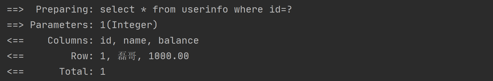
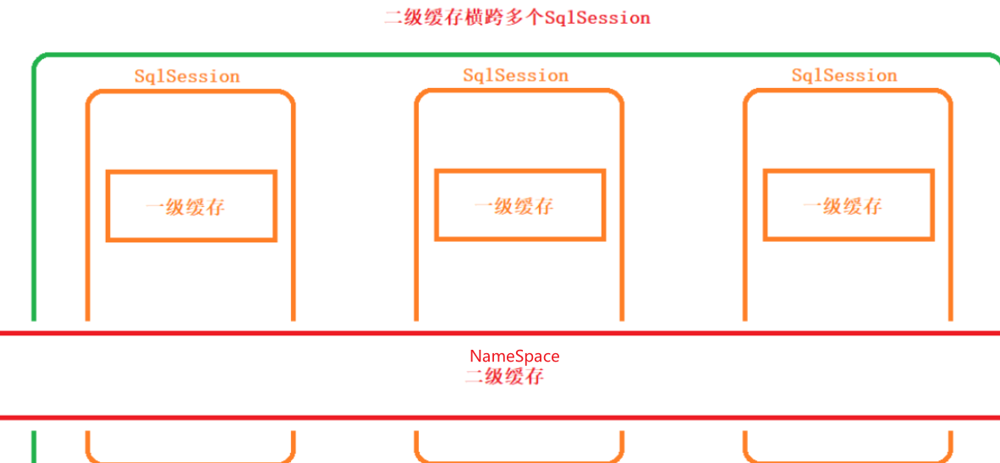

# Mybatis

***

:::success
**<font style="color:#DF2A3F;">Mybatis 是一个半自动的 ORM（对象关系映射）框架，它内部封装了 JDBC， 开发时只需要关注 SQL 语句本身，不需要花费精力去处理加载驱动、创建连接、创建statement 等繁杂的过程。</font>**

**<font style="color:#DF2A3F;">适合：复杂动态SQL查询，使用SQL不依赖框架生成的SQL；</font>**

:::

Mybatis特点：灵活简洁，易学习使用，映射能力强大，Spring框架集成良好，支持自定义插件；

## 为什么说 MyBatis 是半自动 ORM 映射工具？它与全自动的区别在哪里？

ORM - Object Relational Mapping - 对象关系映射

\*\*Hibernate \*\*属于全自动 ORM 映射工具，使用 Hibernate 查询关联对象或者关联集合对象时，可以根据对象关系模型直接获取，自动生成sql语句，所以它是全自动的。 **MyBatis 在查询关联对象或关联集合对象时，需要手动编写 sql 来完成**，所以，称之为半自动 ORM 映射工具。

## #{} 和 ${} 的区别是什么？ ♥♥♥

* <code><font style="color:#DF2A3F;">${}</font></code><font style="color:#DF2A3F;">是 </font>**<font style="color:#DF2A3F;">变量占位符</font>**<font style="color:#DF2A3F;">，</font>**<font style="color:#DF2A3F;">直接字符串拼接到sql中</font>**

```sql
select * from users order by ${orderCols}
```

`orderCols`可以是 `name`、`name desc`、`name,sex asc`等，实现灵活的排序。

* <code><font style="color:#DF2A3F;">#{}</font></code><font style="color:#DF2A3F;">是 sql 的</font>**<font style="color:#DF2A3F;">参数占位符</font>**<font style="color:#DF2A3F;">，</font>**<font style="color:#DF2A3F;">用预处理的方式来执行业务</font>**<font style="color:#DF2A3F;">，</font>**<font style="color:#DF2A3F;">MyBatis 会将 sql 中的</font>**<code>**<font style="color:#DF2A3F;">#{}</font>**</code>**<font style="color:#DF2A3F;">替换为? 号</font>**，在 sql 执行前会使用 PreparedStatement 的参数设置方法，按序给 sql 的? 号占位符设置参数值

```sql
<select id="getUserById" resultType="com.example.demo.model.UserInfo">
    select * from userinfo where id=#{id}
</select>
```



> **<font style="color:#DF2A3F;">当传递的是普通参数时，需要使用 #{} 的方式，而当传递的是 SQL 命令或 SQL 关键字时，需要使用  </font>**<code>**<font style="color:#DF2A3F;">${}</font>**</code>**<font style="color:#DF2A3F;">  来对 SQL 中的参数进行直接替换并执行。</font>**

1、功能不同：`${}` 是直接替换，而 #{} 是预处理；

2、使用场景不同：**普通参数使用 #{}，如果传递的是 SQL 命令或 SQL 关键字，需要使用**  `${}` **，但在使用前一定要做好安全验证（防止出现SQL注入问题）；**

3、**安全性不同：使用 **<code>**${}**</code>** 存在安全问题（SQL注入），而 #{} 则不存在安全问题。**

## 表列和对象属性名称不一致

* **sql语句起别名**
* **采用resultMap进行属性和列名映射**
* **在对象属性上加注解@Colum**

## xml 映射文件中，除了常见的 select、insert、update、delete 标签之外，还有哪些标签？

`<resultMap>`、 `<parameterMap>`、 `<sql>`、 `<include>`、 `<selectKey>` ，加上动态 sql 的 9 个标签， `trim|where|set|foreach|if|choose|when|otherwise|bind` 等，其中  `<sql>`  **为 sql 片段标签**，**通过**  `<include>`  **标签引入 sql 片段**，  `<selectKey>`  **为不支持自增的主键生成策略标签。**

## Dao（Mapper） 接口的工作原理是什么？

:::success
**<font style="color:#DF2A3F;">Dao 接口的工作原理是</font>**<font style="color:#DF2A3F;"> </font>**<font style="color:#DF2A3F;">JDK 动态代理</font>**<font style="color:#DF2A3F;">，</font>**<font style="color:#DF2A3F;">MyBatis 运行时会为 Dao 接口生成代理 proxy 对象，代理对象  会拦截接口方法，转而执行</font>**<font style="color:#DF2A3F;"> </font><code>**<font style="color:#DF2A3F;">MappedStatement</font>**</code>**<font style="color:#DF2A3F;"> 所代表的 sql，然后将 sql 执行结果返回。</font>**

:::

通常一个 xml 映射文件，都会写一个 Dao 接口与之对应。**Dao 接口就是** `Mapper` **接口**，**接口的全限名，就是映射文件中的 namespace 的值**，**接口的方法名，就是映射文件中** `MappedStatement` **的 id 值，接口方法内的参数，就是传递给 sql 的参数。**

```java
@Mapper
public interface UserMapper {
    List<User> selectAllUser();
}
```

```xml
<?xml version="1.0" encoding="UTF-8" ?>
<!DOCTYPE mapper PUBLIC "-//mybatis.org//DTD Mapper 3.0//EN" "http://mybatis.org/dtd/mybatis-3-mapper.dtd" >
<mapper namespace="com.jcy.interview.mappers.UserMapper" >
    <select id="selectAllUser" resultType="com.jcy.interview.domain.User">
        select * from t_user
    </select>
</mapper>
```

`Mapper` 接口是没有实现类的，当调用接口方法时，**接口全限名+方法名拼接字符串**可唯一定位一个 `MappedStatement` **(一次操作)**   。每一个 `<select>`、 `<insert>`、 `<update>`、 `<delete>` 标签，都会被解析为一个 `MappedStatement` 对象。

## ♥♥♥ Dao 接口里的方法，参数不同时，方法能重载吗？

**Dao 接口里的方法可以重载，但是 Mybatis 的 xml 里面的 ID 不允许重复。**

```java
/**
 * Mapper接口里面方法重载
 */
public interface StuMapper {

 List<Student> getAllStu();

 List<Student> getAllStu(@Param("id") Integer id);
}
```

id就是这两个的区别，正常逻辑用if判断。在 `StuMapper.xml` 中利用 Mybatis 的\*\*<font style="color:#DF2A3F;">动态 sql</font>\*\*<font style="color:#DF2A3F;"> </font> 就可以实现。

```xml
<select id="getAllStu" resultType="com.pojo.Student">
  select * from student
  <where>
    <if test="id != null">
      id = #{id}
    </if>
  </where>
</select>
```

**<font style="color:#DF2A3F;">Mybatis 的 Dao 接口可以有多个重载方法，但是多个接口对应的映射必须只有一个</font>**

Dao 接口方法可以重载，但是需要满足以下条件：

1. **仅有一个无参方法和一个有参方法**
2. **多个有参方法时，参数数量必须一致。且使用相同的**   `@Param`   **，或者使用**  `param1`  **这种**

下例中第二个方法就不行，执行此方法会报错。

```java
Person queryById();
Person queryById(@Param("id") Long id);
Person queryById(@Param("id") Long id, @Param("name") String name);
```

```xml
<select id="queryById" resultMap="PersonMap">
    select
      id, name, age, address
    from person
    <where>
        <if test="id != null">
            id = #{id}
        </if>
        <if test="name != null and name != ''">
            name = #{name}
        </if>
    </where>
    limit 1
</select>
```

`org.apache.ibatis.scripting.xmltags. DynamicContext. ContextAccessor#getProperty` 方法用于获取 `<if>` 标签中的条件值

```java
public Object getProperty(Map context, Object target, Object name) {
  Map map = (Map) target;

  Object result = map.get(name);
  if (map.containsKey(name) || result != null) {
    return result;
  }

  Object parameterObject = map.get(PARAMETER_OBJECT_KEY);
  if (parameterObject instanceof Map) {
    return ((Map)parameterObject).get(name);
  }

  return null;
}
```

`parameterObject` 为 map，存放的是 Dao 接口中参数相关信息。

1. `queryById()`方法执行时，`parameterObject`为 null，`getProperty`方法返回 null 值，`<if>`标签获取的所有条件值都为 null，所有条件不成立，动态 sql 可以正常执行。
2. `queryById(1L)`方法执行时，`parameterObject`为 map，包含了`id`和`param1`两个 key 值。当获取`<if>`标签中`name`的属性值时，进入`((Map)parameterObject).get(name)`方法中，map 中 key 不包含`name`，所以抛出异常。
3. `queryById(1L,"1")`方法执行时，`parameterObject`中包含`id`,`param1`,`name`,`param2`四个 key 值，`id`和`name`属性都可以获取到，动态 sql 正常执行。

## MyBatis一级缓存和二级缓存



* <font style="color:rgba(0, 0, 0, 0.75);">一级缓存（本地缓存）\ </font>**<font style="color:rgba(0, 0, 0, 0.75);">sqlSession</font>**<font style="color:rgba(0, 0, 0, 0.75);">级别的缓存。（相当于一个方法内的缓存）</font>
* <font style="color:rgba(0, 0, 0, 0.75);">二级缓存（全局缓存）\ </font><font style="color:rgba(0, 0, 0, 0.75);">基于</font>**<font style="color:rgba(0, 0, 0, 0.75);">namespace</font>**<font style="color:rgba(0, 0, 0, 0.75);">名称空间级别的缓存.即一个mapper.xml对应一个缓存</font>

<font style="color:rgba(0, 0, 0, 0.75);"></font>

<font style="color:rgb(77, 77, 77);">一级缓存基于</font><font style="color:rgb(0, 0, 0);background-color:rgb(248, 248, 64);">sqlSession默认开启</font><font style="color:rgb(77, 77, 77);">,在操作数据库时需要构造SqlSession对象，在对象中有一个</font><font style="color:rgb(0, 0, 0);background-color:rgb(248, 248, 64);">HashMap</font><font style="color:rgb(77, 77, 77);">用于存储缓存数据。不同的SqlSession之间的缓存数据区域是互相不影响的。</font>

<font style="color:rgb(77, 77, 77);">Mybatis的二级缓存是指mapper映射文件。二级缓存的作用域是</font><font style="color:rgb(0, 0, 0);background-color:rgb(248, 248, 64);">同一个namespace下的mapper映射文件内容</font><font style="color:rgb(77, 77, 77);">，多个SqlSession共享。</font>

## MyBatis 是如何进行分页的？分页插件的原理是什么？

**(1)**  **使用 RowBounds  对象进行分页，它是针对 ResultSet 结果集执行的内存分页，而非物理分页**；

**(2)**  可以在 sql 内直接书写**物理分页的参数（Limit）** 来完成物理分页功能，

**(3)**  也可以使用**分页插件来完成物理分页。**

分页插件的基本原理是使用 MyBatis 提供的**拦截器**，**实现自定义拦截器**，在插件的拦截方法内拦截待执行的 sql，然后重写 sql，根据 dialect 方言，添加对应的物理分页语句和物理分页参数。

举例：`select _ from student` ，拦截 sql 后重写为：`select t._ from （select \* from student）t limit 0，10`

> * **<font style="color:#DF2A3F;">xml文件直接写sql分页</font>**
> * **<font style="color:#DF2A3F;">RowBounds</font>\*\*\*\*<font style="color:#DF2A3F;">逻辑分页</font>**
> * **<font style="color:#DF2A3F;">Inteceptor拦截器实现，在select语句动态拼接分页</font>**

## 简述 MyBatis 的插件运行原理，以及如何编写一个插件

MyBatis 仅可以编写针对 `ParameterHandler` **、**  `ResultSetHandler` **、**  `StatementHandler` **、**  `Executor` 这 4 种接口的插件，MyBatis 使用 **JDK 的动态代理**，为需要拦截的接口生成代理对象以实现接口方法拦截功能，每当执行这 4 种接口对象的方法时，就会进入拦截方法，具体就是 `InvocationHandler` 的 `invoke()` 方法，当然，只会拦截那些你指定需要拦截的方法。

实现 MyBatis 的 `Interceptor` 接口并复写 `intercept()` 方法，然后在给插件编写注解，指定要拦截哪一个接口的哪些方法即可，记住，别忘了在配置文件中配置你编写的插件。

## MyBatis 执行批量插入，能返回数据库主键列表吗？

可以。JDBC自带了批量插入器

## MyBatis 动态 sql 是做什么的？都有哪些动态 sql？能简述一下动态 sql 的执行原理不？

MyBatis 动态 sql 可以**在 xml 映射文件内，以标签的形式编写动态 sql，完成逻辑判断和动态拼接 sql 的功能**。其执行原理为，使用 OGNL 从 sql 参数对象中计算表达式的值，根据表达式的值动态拼接 sql，以此来完成动态 sql 的功能。

MyBatis 提供了 9 种动态 sql 标签:

* `<if></if>`
* `<where></where>(trim,set)`
* `<choose></choose>（when, otherwise）`
* `<foreach></foreach>`
* `<bind/>`

关于 MyBatis 动态 SQL 的详细介绍：[Mybatis 系列全解（八）：Mybatis 的 9 大动态 SQL 标签你知道几个？](https://segmentfault.com/a/1190000039335704)。

关于这些动态 SQL 的具体使用方法：[Mybatis【13】-- Mybatis 动态 sql 标签怎么使用？](https://cloud.tencent.com/developer/article/1943349)

## MyBatis 是如何将 sql 执行结果封装为目标对象并返回的？都有哪些映射形式？

> **JDBC返回结果封装在resultSet中，如果列名和实体属性名能对应（比如驼峰命名 -- 需开启），则直接用resultType标签指定即可，如果不对应需要用resultMap标签进行映射**

第一种是使用 `<resultMap>` 标签，**逐一定义列名和对象属性名之间的映射关系**。

第二种是使用 sql 列的别名功能，**将列别名书写为对象属性名**，比如 T\_NAME AS NAME，对象属性名一般是 name，小写，但是列名不区分大小写，MyBatis 会忽略列名大小写，智能找到与之对应对象属性名，你甚至可以写成 T\_NAME AS NaMe，MyBatis 一样可以正常工作。

**有了列名与属性名的映射关系后，MyBatis 通过反射创建对象**，**同时使用反射给对象的属性逐一赋值并返回**

## MyBatis 能执行一对一、一对多的关联查询吗？都有哪些实现方式，以及它们之间的区别

MyBatis 不仅可以执行一对一、一对多的关联查询，还可以执行多对一，多对多的关联查询，多对一查询，其实就是一对一查询，只需要把 `selectOne()` 修改为 `selectList()` 即可；多对多查询，其实就是一对多查询，只需要把 `selectOne()` 修改为 `selectList()` 即可。

**一对一：在resultMap标签中使用 association 标签**

```xml
<resultMap type="Student" id="Student_Class_Map">
		<result column="sid"  property="sid"/>
		<result column="sname"  property="sname"/>
		<result column="birthday"  property="birthday"/>
		<result column="ssex"  property="ssex"/>
		<result column="classid"  property="classid"/>
		<association property="bj">
			<result column="classid"  property="classid"/>
			<result column="classname"  property="classname"/>
		</association>
	</resultMap>

	<!--一对一查询-->
	<select id="findAllStudent" resultMap="Student_Class_Map">
	 	select * from student
	 	inner join class on student.classid=class.classid
	</select>
```

**一对多：在resultMap 标签中使用collection标签**

```xml
<resultMap type="Banji" id="Class_Student_Map">
		<result column="classid"  property="classid"/>
		<result column="classname"  property="classname"/>
		<collection property="slist" ofType="Student">
			<result column="sid"  property="sid"/>
			<result column="sname"  property="sname"/>
			<result column="birthday"  property="birthday"/>
			<result column="ssex"  property="ssex"/>
			<result column="classid"  property="classid"/>
		</collection>
	</resultMap>
 
	<select id="findAllBanji" resultMap="Class_Student_Map">
		select * from class
		left join student on class.classid=student.classid
		order by class.classid
	</select>
```

## MyBatis 是否支持延迟加载？如果支持，它的实现原理是什么？

[浅析mybatis延迟加载](https://baijiahao.baidu.com/s?id=1764391833473691877\&wfr=spider\&for=pc)

**延迟加载是指在使用某个对象时，只有在需要访问其关联对象时才进行加载，而不是在一开始就加载所有对象。**

MyBatis 仅支持 association 关联对象和 collection 关联集合对象的延迟加载，association 指的就是一对一，collection 指的就是一对多查询。在 MyBatis 配置文件中，可以配置是否启用延迟加载 `lazyLoadingEnabled=true|false。`

**Mybatis使&#x7528;****代理模式****&#x6765;实现延迟加载**。当需要使用某个对象的关联对象时，Mybatis会生成一个代理对象，该代理对象只有在真正访问关联对象时才会触发加载。

**比如Order内有一个User对象，可以将关联对象user进行延迟加载，只有在需要访问user属性时才进行加载。**

## MyBatis 的 xml 映射文件中，不同的 xml 映射文件，id 是否可以重复？

不同的 xml 映射文件，如果配置了 namespace，那么 id 可以重复；如果没有配置 namespace，那么 id 不能重复；毕竟 namespace 不是必须的，只是最佳实践而已。

**namespace+id** 是作为 <code>**Map<String, MappedStatement>**</code>  的 key 使用的，如果没有 namespace，就剩下 id，那么，id 重复会导致数据互相覆盖。

## ♥♥♥MyBatis 都有哪些 Executor 执行器？它们之间的区别是什么？

* <code>**<font style="color:#DF2A3F;">SimpleExecutor</font>**</code><font style="color:#DF2A3F;"> </font>**：**  每执行一次 update 或 select，就开启一个 Statement 对象，用完立刻关闭 Statement 对象。
* <code>**<font style="color:#DF2A3F;">ReuseExecutor</font>**</code><font style="color:#DF2A3F;"> </font>**：**  执行 update 或 select，以 sql 作为 key 查找 Statement 对象，存在就使用，不存在就创建，用完后，不关闭 Statement 对象，而是放置于 Map\<String, Statement>内，供下一次使用。简言之，就是重复使用 Statement 对象。
* <code>**<font style="color:#DF2A3F;">BatchExecutor</font>**</code>：执行 update（没有 select，JDBC 批处理不支持 select），将所有 sql 都添加到批处理中（addBatch()），等待统一执行（executeBatch()），它缓存了多个 Statement 对象，每个 Statement 对象都是 addBatch()完毕后，等待逐一执行 executeBatch()批处理。与 JDBC 批处理相同。

作用范围：`Executor` 的这些特点，都严格限制在 SqlSession 生命周期范围内。

## MyBatis 中如何指定使用哪一种 Executor 执行器？

在 MyBatis 配置文件中，可以指定默认的 `ExecutorType` 执行器类型，也可以手动给 `DefaultSqlSessionFactory` 的创建 SqlSession 的方法传递 `ExecutorType` 类型参数。

## MyBatis 是否可以映射 Enum 枚举类？

**MyBatis 可以映射枚举类，不单可以映射枚举类，MyBatis 可以映射任何对象到表的一列上。** 映射方式为自定义一个 `TypeHandler` ，实现 `TypeHandler` 的 `setParameter()` 和 `getResult()` 接口方法。 `TypeHandler` 有两个作用：

* 一是完成从 javaType 至 jdbcType 的转换；
* 二是完成 jdbcType 至 javaType 的转换，体现为 `setParameter()` 和 `getResult()` 两个方法，分别代表设置 sql 问号占位符参数和获取列查询结果。

```java
public enum Gender {
    MALE, FEMALE
}
```

```xml
<resultMap id="userResultMap" type="User">
    <id property="id" column="id" />
    <result property="gender" column="gender" typeHandler="org.apache.ibatis.type.EnumTypeHandler" javaType="Gender" />
</resultMap>
```

# 实际操作

## insert和insertSelective有什么区别

1. **<font style="color:#DF2A3F;">选择性插入</font>**<font style="color:#DF2A3F;">：</font>**<font style="color:#DF2A3F;">insertSelective</font>**<font style="color:#DF2A3F;">方法只会将对象中不为</font>**<font style="color:#DF2A3F;">null</font>**<font style="color:#DF2A3F;">的字段插入到数据库中。这意味着如果对象的某些属性为</font>**<font style="color:#DF2A3F;">null</font>**<font style="color:#DF2A3F;">，这些属</font>**<font style="color:#DF2A3F;">性对应的数据库列将不会被更新，保持其默认值或现有值。</font>**
2. **<font style="color:#DF2A3F;">减少数据冗余</font>****<font style="color:#DF2A3F;">：通过只插入非空字段，可以避免将无意义的</font>****<font style="color:#DF2A3F;">null</font>\*\*\*\*<font style="color:#DF2A3F;">值写入数据库，从而减少数据冗余。</font>**
3. **<font style="color:#DF2A3F;">提高灵活性：在某些情况下，业务逻辑可能只需要更新部分字段。使用insertSelective可以更灵活地控制哪些字段被插入。</font>**


> 更新: 2025-07-09 18:21:16  
> 原文: <https://www.yuque.com/nibiwanxiamei/yrd6t1/81bdfece59ac70b28010f45062b90c32>