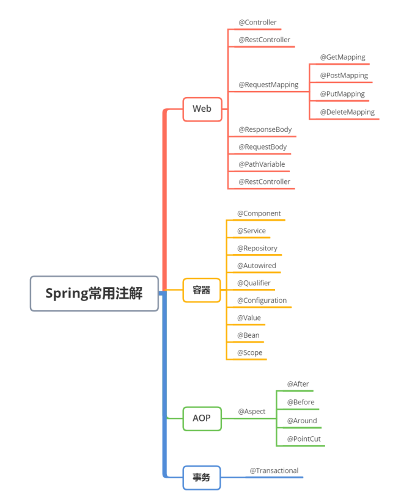
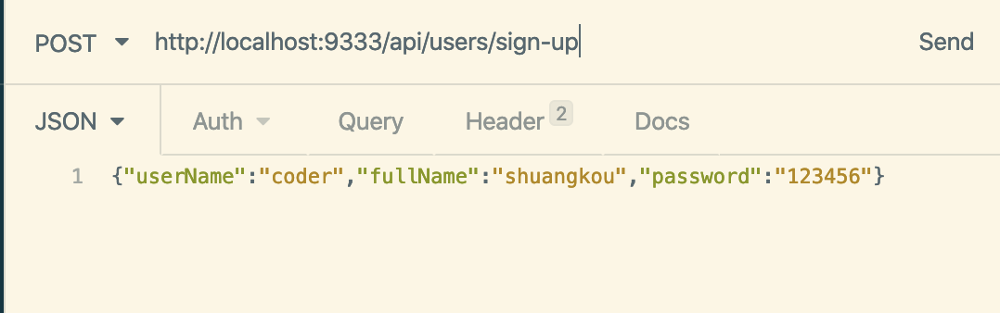
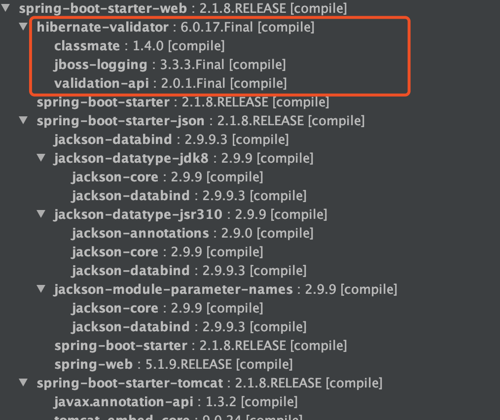

# Spring&SpringBoot常用注解总结

***

## 

# Spring\&SpringBoot常用注解总结

# `@SpringBootApplication`

***这个注解是 Spring Boot 项目的基石，创建 SpringBoot 项目之后会默认在主类加上***

```java
@SpringBootApplication
public class SpringSecurityJwtGuideApplication {
      public static void main(java.lang.String[] args) {
        SpringApplication.run(SpringSecurityJwtGuideApplication.class, args);
    }
}
```

`@SpringBootApplication`看作是  `@Configuration` **、** `@EnableAutoConfiguration` **、** `@ComponentScan` 注解的集合。

```java
package org.springframework.boot.autoconfigure;
@Target(ElementType.TYPE)
@Retention(RetentionPolicy.RUNTIME)
@Documented
@Inherited
@SpringBootConfiguration
@EnableAutoConfiguration
@ComponentScan(excludeFilters = {
    @Filter(type = FilterType.CUSTOM, classes = TypeExcludeFilter.class),
    @Filter(type = FilterType.CUSTOM, classes = AutoConfigurationExcludeFilter.class) })
public @interface SpringBootApplication {
   ......
}

package org.springframework.boot;
@Target(ElementType.TYPE)
@Retention(RetentionPolicy.RUNTIME)
@Documented
@Configuration
public @interface SpringBootConfiguration {

}
```

根据 SpringBoot 官网，这三个注解的作用分别是：

* `@EnableAutoConfiguration` **：启用 SpringBoot 的自动配置机制**
* `@ComponentScan` **：扫描被** `@Component` \*\* (\*\* `@Repository` **,** `@Service` **,** `@Controller` **)注解的 bean，注解默认会扫描该类所在的包下所有的类** **。**
* `@Configuration` **：允许在 Spring 上下文中注册额外的 bean 或导入其他配置类**

# Spring Bean 相关

## `@Autowired`

自动导入对象到类中，被注入进的类同样要被 Spring 容器管理比如：Service 类注入到 Controller 类中。

`Autowired`**默认按照类型匹配，有多个匹配就按照名称匹配**。由Spring提供

```java
@Service
public class UserService {
  ......
}

@RestController
@RequestMapping("/users")
public class UserController {
   @Autowired
   private UserService userService;
   ......
}
```

## `@Component`,`@Repository`,`@Service`, `@Controller`

我们一般使用 `@Autowired` 注解让 Spring 容器帮我们自动装配 bean。**把类标识成可用于**  `@Autowired` **注解自动装配的 bean 的类**,可以采用以下注解实现：

* `@Component`：通用的注解，可标注任意类为 `Spring` 组件。如果一个 Bean 不知道属于哪个层，可以使用`@Component` 注解标注。
* `@Repository` : 对应持久层即 Dao 层，主要用于数据库相关操作。
* `@Service` : 对应服务层，主要涉及一些复杂的逻辑，需要用到 Dao 层。
* `@Controller` : 对应 Spring MVC 控制层，主要用于接受用户请求并调用 Service 层返回数据给前端页面。

## `@RestController`

`@RestController`注解是 `@Controller`**和** `@ResponseBody`的合集,表示这是个控制器 bean,并且是将函数的返回值直接填入 HTTP 响应体中,是 REST 风格的控制器。

*Guide：现在都是前后端分离，说实话我已经很久没有用过* <code>_@Controller_</code> *。如果你的项目太老了的话，就当我没说。 -- 现在都是*\_**返回json让前端去渲染**\_

单独使用 `@Controller` 不加 `@ResponseBody`的话一般是用在要返回一个视图的情况，这种情况属于比较传统的 Spring MVC 的应用，对应于前后端不分离的情况。`@Controller` +`@ResponseBody` 返回 JSON 或 XML 形式数据

关于`@RestController` 和 `@Controller`的对比，请看这篇文章：[@RestController vs @Controller](https://mp.weixin.qq.com/s?__biz=Mzg2OTA0Njk0OA==\&mid=2247485544\&idx=1\&sn=3cc95b88979e28fe3bfe539eb421c6d8\&chksm=cea247a3f9d5ceb5e324ff4b8697adc3e828ecf71a3468445e70221cce768d1e722085359907\&token=1725092312\&lang=zh_CN#rd)

## `@Scope`

声明 Spring Bean 的作用域，使用方法:

```java
@Bean
@Scope("singleton")
public Person personSingleton() {
    return new Person();
}
```

**四种常见的 Spring Bean 的作用域：**

* singleton : 唯一 bean 实例，Spring 中的 bean 默认都是单例的。
* prototype : 每次请求都会创建一个新的 bean 实例。
* request : 每一次 HTTP 请求都会产生一个新的 bean，该 bean 仅在当前 HTTP request 内有效。
* session : 每一个 HTTP Session 会产生一个新的 bean，该 bean 仅在当前 HTTP session 内有效。

## `@Configuration`

一般用来声明配置类，可以使用 `@Component`注解替代，不过使用`@Configuration`注解声明配置类更加语义化。

```java
@Configuration
public class AppConfig {
    @Bean
    public TransferService transferService() {
        return new TransferServiceImpl();
    }
}
```

# 处理常见的 HTTP 请求类型

**5 种常见的请求类型:**

* **GET**：请求从服务器获取特定资源。举个例子：`GET /users`（获取所有学生）
* **POST**：在服务器上创建一个新的资源。举个例子：`POST /users`（创建学生）
* **PUT**：更新服务器上的资源（客户端提供更新后的整个资源）。举个例子：`PUT /users/12`（更新编号为 12 的学生）
* **DELETE**：从服务器删除特定的资源。举个例子：`DELETE /users/12`（删除编号为 12 的学生）
* **PATCH**：更新服务器上的资源（客户端提供更改的属性，可以看做作是部分更新），使用的比较少，这里就不举例子了。

## GET 请求

`@GetMapping("users")` \*\* 等价于\*\* `@RequestMapping(value="/users",method=RequestMethod.GET)`

```java
@GetMapping("/users")
public ResponseEntity<List<User>> getAllUsers() {
 return userRepository.findAll();
}
```

## POST 请求

`@PostMapping("users")` 等价于`@RequestMapping(value="/users",method=RequestMethod.POST)`

关于`@RequestBody`注解的使用，在下面的“前后端传值”这块会讲到。

```java
@PostMapping("/users")
public ResponseEntity<User> createUser(@Valid @RequestBody UserCreateRequest userCreateRequest) {
 return userRespository.save(userCreateRequest);
}
```

## PUT 请求

`@PutMapping("/users/{userId}")` 等价于`@RequestMapping(value="/users/{userId}",method=RequestMethod.PUT)`

```java
@PutMapping("/users/{userId}")
public ResponseEntity<User> updateUser(@PathVariable(value = "userId") Long userId,
  @Valid @RequestBody UserUpdateRequest userUpdateRequest) {
  ......
}
```

## **DELETE 请求**

`@DeleteMapping("/users/{userId}")`等价于`@RequestMapping(value="/users/{userId}",method=RequestMethod.DELETE)`

```java
@DeleteMapping("/users/{userId}")
public ResponseEntity deleteUser(@PathVariable(value = "userId") Long userId){
  ......
}
```

# 前后端传值

## `@PathVariable` 和 `@RequestParam`

`@PathVariable`**用于获取路径参数，** `@RequestParam`**用于获取查询参数** **（一般跟在？后面）**

```java
@GetMapping("/klasses/{klassId}/teachers")
public List<Teacher> getKlassRelatedTeachers(
         @PathVariable("klassId") Long klassId,
         @RequestParam(value = "type", required = false) String type ) {
...
}
```

如果我们请求的 url 是：`/klasses/``123456``/teachers?``type=web`

那么我们服务获取到的数据就是：`klassId=123456,type=web`。

## `@RequestBody`

用于读取 Request 请求（可能是 POST,PUT,DELETE,GET 请求）的 body 部分并且**Content-Type 为 ****application/json** 格式的数据，接收到数据之后会**自动将数据绑定到 Java 对象**上去。系统会使用`HttpMessageConverter`或者自定义的`HttpMessageConverter`将请求的 body 中的 json 字符串转换为 java 对象。

```java
@PostMapping("/sign-up")
public ResponseEntity signUp(@RequestBody @Valid UserRegisterRequest userRegisterRequest) {
  userService.save(userRegisterRequest);
  return ResponseEntity.ok().build();
}
```

`UserRegisterRequest`对象：

```java
@Data
@AllArgsConstructor
@NoArgsConstructor
public class UserRegisterRequest {
    @NotBlank
    private String userName;
    @NotBlank
    private String password;
    @NotBlank
    private String fullName;
}
```

我们发送 post 请求到这个接口，并且 body 携带 JSON 数据：

```json
{ "userName": "coder", "fullName": "shuangkou", "password": "123456" }
```



**一个请求方法只可以有一个** <code>**@RequestBody**</code> **，但是可以有多个** <code>**@RequestParam**</code>**和** <code>**@PathVariable**</code>。 如果你的方法必须要用两个 `@RequestBody`来接受数据的话，大概率是你的数据库设计或者系统设计出问题了！

# 读取配置信息

**很多时候我们需要将一些常用的配置信息比如阿里云 oss、发送短信、微信认证的相关配置信息等等放到配置文件中。**

我们的数据源`application.yml`内容如下：

```yaml
wuhan2020: 2020年初武汉爆发了新型冠状病毒，疫情严重，但是，我相信一切都会过去！武汉加油！中国加油！

my-profile:
  name: Guide哥
  email: koushuangbwcx@163.com

library:
  location: 湖北武汉加油中国加油
  books:
    - name: 天才基本法
      description: 二十二岁的林朝夕在父亲确诊阿尔茨海默病这天，得知自己暗恋多年的校园男神裴之即将出国深造的消息——对方考取的学校，恰是父亲当年为她放弃的那所。
    - name: 时间的秩序
      description: 为什么我们记得过去，而非未来？时间“流逝”意味着什么？是我们存在于时间之内，还是时间存在于我们之中？卡洛·罗韦利用诗意的文字，邀请我们思考这一亘古难题——时间的本质。
    - name: 了不起的我
      description: 如何养成一个新习惯？如何让心智变得更成熟？如何拥有高质量的关系？ 如何走出人生的艰难时刻？
```

## `@Value`(常用)

```java
@Value("${wuhan2020}")
String wuhan2020;
```

## `@ConfigurationProperties`(常用)

通过`@ConfigurationProperties`读取配置信息并与 bean 绑定。

```java
@Component
@ConfigurationProperties(prefix = "library")
class LibraryProperties {
    @NotEmpty
    private String location;
    private List<Book> books;

    @Setter
    @Getter
    @ToString
    static class Book {
        String name;
        String description;
    }
  省略getter/setter
  ......
}
```

## `@PropertySource`（不常用）

`@PropertySource`读取指定 properties 文件

```java
@Component
@PropertySource("classpath:website.properties")

class WebSite {
    @Value("${url}")
    private String url;

  省略getter/setter
  ......
}
```

# 参数校验

**即使在前端对数据进行校验的情况下，我们还是要对传入后端的数据再进行一遍校验，避免用户绕过浏览器直接通过一些 HTTP 工具直接向后端请求一些违法数据。**

**JSR(Java Specification Requests）**  是一套 JavaBean 参数校验的标准，它定义了很多常用的校验注解，我们可以直接将这些注解加在我们 JavaBean 的属性上面，这样就可以在需要校验的时候进行校验了，非常方便！

校验的时候我们实际用的是 **Hibernate Validator** 框架。Hibernate Validator 是 Hibernate 团队最初的数据校验框架，Hibernate Validator 4.x 是 Bean Validation 1.0（JSR 303）的参考实现，Hibernate Validator 5.x 是 Bean Validation 1.1（JSR 349）的参考实现，目前最新版的 Hibernate Validator 6.x 是 Bean Validation 2.0（JSR 380）的参考实现。

SpringBoot 项目的 spring-boot-starter-web 依赖中已经有 hibernate-validator 包，不需要引用相关依赖。如下图所示（通过 idea 插件—Maven Helper 生成）：

**注**：\*\*更新版本的 spring-boot-starter-web 依赖中不再有 hibernate-validator 包（如 2.3.11.RELEASE），需要自己引入 **<code>**spring-boot-starter-validation**</code> \*\* 依赖。**



## 一些常用的字段验证的注解

* `@NotEmpty` 被注释的字符串的不能为 null 也不能为空
* `@NotBlank` 被注释的字符串非 null，并且必须包含一个非空白字符
* `@Null` 被注释的元素必须为 null
* `@NotNull` 被注释的元素必须不为 null
* `@AssertTrue` 被注释的元素必须为 true
* `@AssertFalse` 被注释的元素必须为 false
* `@Pattern(regex=,flag=)`被注释的元素必须符合指定的正则表达式
* `@Email` 被注释的元素必须是 Email 格式。
* `@Min(value)`被注释的元素必须是一个数字，其值必须大于等于指定的最小值
* `@Max(value)`被注释的元素必须是一个数字，其值必须小于等于指定的最大值
* `@DecimalMin(value)`被注释的元素必须是一个数字，其值必须大于等于指定的最小值
* `@DecimalMax(value)` 被注释的元素必须是一个数字，其值必须小于等于指定的最大值
* `@Size(max=, min=)`被注释的元素的大小必须在指定的范围内
* `@Digits(integer, fraction)`被注释的元素必须是一个数字，其值必须在可接受的范围内
* `@Past`被注释的元素必须是一个过去的日期
* `@Future` 被注释的元素必须是一个将来的日期

## 验证请求体(RequestBody)

```java
@Data
@AllArgsConstructor
@NoArgsConstructor
public class Person {

    @NotNull(message = "classId 不能为空")
    private String classId;

    @Size(max = 33)
    @NotNull(message = "name 不能为空")
    private String name;

    @Pattern(regexp = "((^Man$|^Woman$|^UGM$))", message = "sex 值不在可选范围")
    @NotNull(message = "sex 不能为空")
    private String sex;

    @Email(message = "email 格式不正确")
    @NotNull(message = "email 不能为空")
    private String email;

}
```

我们在需要验证的参数上加上了`@Valid`注解，如果验证失败，它将抛出`MethodArgumentNotValidException`。

```java
@RestController
@RequestMapping("/api")
public class PersonController {
    @PostMapping("/person")
    public ResponseEntity<Person> getPerson(@RequestBody @Valid Person person) {
        return ResponseEntity.ok().body(person);
    }
}
```

## 验证请求参数(Path Variables 和 Request Parameters)

**一定一定不要忘记在类上加上 \*\* <code>**@Validated**</code> \*\* 注解了，这个参数可以告诉 Spring 去校验方法参数。**

```java
@RestController
@RequestMapping("/api")
@Validated
public class PersonController {
    @GetMapping("/person/{id}")
    public ResponseEntity<Integer> getPersonByID(@Valid @PathVariable("id") @Max(value = 5,message = "超过 id 的范围了") Integer id) {
        return ResponseEntity.ok().body(id);
    }
}
```

# 全局处理 Controller 层异常

**Spring 项目必备的全局处理 Controller 层异常。**

**相关注解：**

1. `@ControllerAdvice` :注解定义全局异常处理类
2. `@ExceptionHandler` :注解声明异常处理方法

```java
@ControllerAdvice
@ResponseBody
public class GlobalExceptionHandler {

    /**
     * 请求参数异常处理
     */
    @ExceptionHandler(MethodArgumentNotValidException.class)
    public ResponseEntity<?> handleMethodArgumentNotValidException(MethodArgumentNotValidException ex, HttpServletRequest request) {
       ......
    }
}
```

更多关于 Spring Boot 异常处理的内容

1. [SpringBoot 处理异常的几种常见姿势](https://mp.weixin.qq.com/s?__biz=Mzg2OTA0Njk0OA==\&mid=2247485568\&idx=2\&sn=c5ba880fd0c5d82e39531fa42cb036ac\&chksm=cea2474bf9d5ce5dcbc6a5f6580198fdce4bc92ef577579183a729cb5d1430e4994720d59b34\&token=2133161636\&lang=zh_CN#rd)
2. [使用枚举简单封装一个优雅的 Spring Boot 全局异常处理！](https://mp.weixin.qq.com/s?__biz=Mzg2OTA0Njk0OA==\&mid=2247486379\&idx=2\&sn=48c29ae65b3ed874749f0803f0e4d90e\&chksm=cea24460f9d5cd769ed53ad7e17c97a7963a89f5350e370be633db0ae8d783c3a3dbd58c70f8\&token=1054498516\&lang=zh_CN#rd)

# 自定义注解使用（必须会 - 项目中使用）

[Aop之自定义注解用法与用途-切点与切面\_aop切点自定义注解-CSDN博客](https://blog.csdn.net/qq_44413835/article/details/122175718)

[自定义权限校验注解、枚举和注解和新特性（反射+注解）\_权限过滤基于自定义枚举类-CSDN博客](https://blog.csdn.net/qq_44413835/article/details/116331645)

# JPA 相关

## 创建表

`@Entity`声明一个类对应一个数据库实体。

`@Table` 设置表名

```java
@Entity
@Table(name = "role")
public class Role {
    @Id
    @GeneratedValue(strategy = GenerationType.IDENTITY)
    private Long id;
    private String name;
    private String description;
    省略getter/setter......
}
```

## 创建主键

`@Id`：声明一个字段为主键。

使用`@Id`声明之后，我们还需要定义主键的生成策略。我们可以使用 `@GeneratedValue` 指定主键生成策略。

\*\*1.通过 \*\* <code>**@GeneratedValue**</code>**直接使用 JPA 内置提供的四种主键生成策略来指定主键生成策略。**

```java
@Id
@GeneratedValue(strategy = GenerationType.IDENTITY)
private Long id;
```

```java
public enum GenerationType {

    /**
     * 使用一个特定的数据库表格来保存主键
     * 持久化引擎通过关系数据库的一张特定的表格来生成主键,
     */
    TABLE,

    /**
     *在某些数据库中,不支持主键自增长,比如Oracle、PostgreSQL其提供了一种叫做"序列(sequence)"的机制生成主键
     */
    SEQUENCE,

    /**
     * 主键自增长
     */
    IDENTITY,

    /**
     *把主键生成策略交给持久化引擎(persistence engine),
     *持久化引擎会根据数据库在以上三种主键生成 策略中选择其中一种
     */
    AUTO
}
```

`@GeneratedValue`注解默认使用的策略是`GenerationType.AUTO`

```java
public @interface GeneratedValue {

    GenerationType strategy() default AUTO;
    String generator() default "";
}
```

一般使用 MySQL 数据库的话，使用`GenerationType.IDENTITY`策略比较普遍一点（分布式系统的话需要另外考虑使用分布式 ID）。

2.\*\*通过 \*\* <code>**@GenericGenerator**</code>\*\*声明一个主键策略，然后 \*\* <code>**@GeneratedValue**</code>**使用这个策略**

```java
@Id
@GeneratedValue(generator = "IdentityIdGenerator")
@GenericGenerator(name = "IdentityIdGenerator", strategy = "identity")
private Long id;
```

等价于：

```java
@Id
@GeneratedValue(strategy = GenerationType.IDENTITY)
private Long id;
```

## 设置字段类型

`@Column` 声明字段。

**示例：**

设置属性 userName 对应的数据库字段名为 user\_name，长度为 32，非空

```java
@Column(name = "user_name", nullable = false, length=32)
private String userName;
```

设置字段类型并且加默认值，这个还是挺常用的。

```java
@Column(columnDefinition = "tinyint(1) default 1")
private Boolean enabled;
```

## 指定不持久化特定字段

`@Transient`：声明不需要与数据库映射的字段，在保存的时候不需要保存进数据库 。

如果我们想让`secrect` 这个字段不被持久化，可以\*\*使用 \*\* `**@Transient**`**关键字声明**。

```java
@Entity(name="USER")
public class User {

    ......
    @Transient
    private String secrect; // not persistent because of @Transient

}
```

除了 `@Transient`关键字声明， 还可以采用下面几种方法：

```java
static String secrect; // not persistent because of static
final String secrect = "Satish"; // not persistent because of final
transient String secrect; // not persistent because of transient
```

## 声明大字段

`@Lob`:声明某个字段为大字段。

```java
@Lob
private String content;
```

更详细的声明：

```java
@Lob
//指定 Lob 类型数据的获取策略， FetchType.EAGER 表示非延迟加载，而 FetchType.LAZY 表示延迟加载 ；
@Basic(fetch = FetchType.EAGER)
//columnDefinition 属性指定数据表对应的 Lob 字段类型
@Column(name = "content", columnDefinition = "LONGTEXT NOT NULL")
private String content;
```

## 创建枚举类型的字段

可以使用枚举类型的字段，不过枚举字段要用`@Enumerated`注解修饰。

```java
public enum Gender {
    MALE("男性"),
    FEMALE("女性");

    private String value;
    Gender(String str){
        value=str;
    }
}
```

```java
@Entity
@Table(name = "role")
public class Role {
    @Id
    @GeneratedValue(strategy = GenerationType.IDENTITY)
    private Long id;
    private String name;
    private String description;
    @Enumerated(EnumType.STRING)
    private Gender gender;
    省略getter/setter......
}
```

## 增加审计功能

只要继承了 `AbstractAuditBase`的类都会默认加上下面四个字段

```java
@Data
@AllArgsConstructor
@NoArgsConstructor
@MappedSuperclass
@EntityListeners(value = AuditingEntityListener.class)
public abstract class AbstractAuditBase {

    @CreatedDate
    @Column(updatable = false)
    @JsonIgnore
    private Instant createdAt;

    @LastModifiedDate
    @JsonIgnore
    private Instant updatedAt;

    @CreatedBy
    @Column(updatable = false)
    @JsonIgnore
    private String createdBy;

    @LastModifiedBy
    @JsonIgnore
    private String updatedBy;
}
```

‍


> 更新: 2025-07-11 09:55:41  
> 原文: <https://www.yuque.com/nibiwanxiamei/yrd6t1/9c03e4bb6922b4f54b0d0230c5d78e8d>