# Spring

***

# Spring基础

## 什么是 Spring 框架?

:::success
**<font style="color:#DF2A3F;">Spring 是一款开源的轻量级 Java 开发框架，Spring 支持 IOC 和 AOP</font>\*\*\*\*、可以很方便地对数据库访问 、可以很方便地集成第三方组件（电子邮件，任务，调度，缓存等等）、对单元测试支持比较好、支持声明式事务。能够提高开发人员的开发效率以及系统的可维护性。**

:::

**Spring 支持** **IoC** **（Inversion of Control:控制反转） 和** **AOP** **(Aspect-Oriented Programming:面向切面编程)** 、**可以很方便地对数据库访问** **、可以很方便地集成第三方组件（电子邮件，任务，调度，缓存等等）、对单元测试支持比较好、支持 RESTful Java 应用程序的开发。**

<font style="color:rgb(44, 62, 80);">Spring框架核心特性包括：</font>

* **<font style="color:rgb(48, 79, 254);">IoC容器</font>**<font style="color:rgb(44, 62, 80);">：Spring通过控制反转实现了对象的创建和对象间的依赖关系管理。开发者只需要定义好Bean及其依赖关系，Spring容器负责创建和组装这些对象。</font>
* **<font style="color:rgb(48, 79, 254);">AOP</font>**<font style="color:rgb(44, 62, 80);">：面向切面编程，允许开发者定义横切关注点，例如事务管理、安全控制等，独立于业务逻辑的代码。通过AOP，可以将这些关注点模块化，提高代码的可维护性和可重用性。</font>
* **<font style="color:rgb(48, 79, 254);">事务管理</font>**<font style="color:rgb(44, 62, 80);">：Spring提供了一致的事务管理接口，支持声明式和编程式事务。开发者可以轻松地进行事务管理，而无需关心具体的事务API。</font>
* **<font style="color:rgb(48, 79, 254);">MVC框架</font>**<font style="color:rgb(44, 62, 80);">：Spring MVC是一个基于Servlet API构建的Web框架，采用了模型-视图-控制器（MVC）架构。它支持灵活的URL到页面控制器的映射，以及多种视图技术。</font>

## Spring 包含的模块有哪些？

**Spring5.x 版本中 Web 模块的 Portlet 组件已经被废弃掉，同时增加了用于异步响应式处理的 WebFlux 组件。**

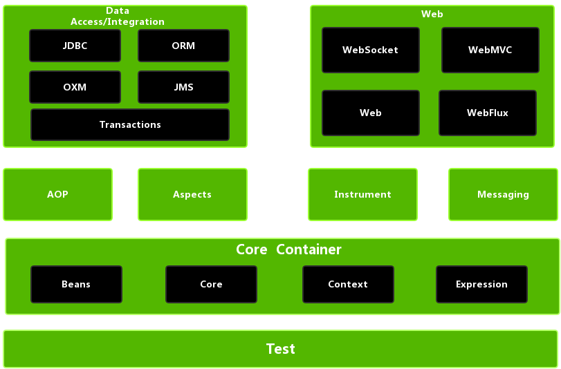

Spring 各个模块的依赖关系如下：

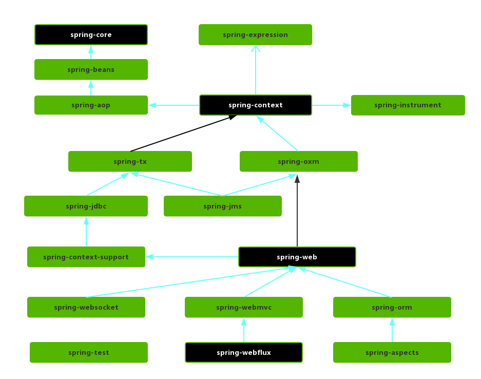

### Core Container

Spring 框架的核心模块，也可以说是基础模块，**主要提供 IoC 依赖注入和DI特性**。Spring 其他所有的功能基本都需要依赖于该模块，我们从上面那张 Spring 各个模块的依赖关系图就可以看出来。

* **spring-core**：Spring 框架基本的核心工具类。
* **spring-beans**：提供对 bean 的创建、配置和管理等功能的支持。
* **spring-context**：提供对国际化、事件传播、资源加载等功能的支持。
* **spring-expression**：提供对表达式语言（Spring Expression Language） SpEL 的支持，只依赖于 core 模块，不依赖于其他模块，可以单独使用。

### AOP

* **spring-aspects**：该模块为与 AspectJ 的集成提供支持。
* **spring-aop**：提供了面向切面的编程实现。
* **spring-instrument**：提供了为 JVM 添加代理（agent）的功能。 具体来讲，它为 Tomcat 提供了一个织入代理，能够为 Tomcat 传递类文 件，就像这些文件是被类加载器加载的一样。没有理解也没关系，这个模块的使用场景非常有限。

### Data Access/Integration

* **spring-jdbc**：提供了对数据库访问的抽象 JDBC。不同的数据库都有自己独立的 API 用于操作数据库，而 Java 程序只需要和 JDBC API 交互，这样就屏蔽了数据库的影响。
* **spring-tx**：提供对事务的支持。
* **spring-orm**：提供对 Hibernate、JPA、iBatis 等 ORM 框架的支持。
* **spring-oxm**：提供一个抽象层支撑 OXM(Object-to-XML-Mapping)，例如：JAXB、Castor、XMLBeans、JiBX 和 XStream 等。
* **spring-jms** : 消息服务。自 Spring Framework 4.1 以后，它还提供了对 spring-messaging 模块的继承。

### Spring Web

* **spring-web**：对 Web 功能的实现提供一些最基础的支持。
* **spring-webmvc**：提供对 Spring MVC 的实现。
* **spring-websocket**：提供了对 WebSocket 的支持，WebSocket 可以让客户端和服务端进行双向通信。
* **spring-webflux**：提供对 WebFlux 的支持。WebFlux 是 Spring Framework 5.0 中引入的新的响应式框架。与 Spring MVC 不同，它不需要 Servlet API，是完全异步。

### Messaging

**spring-messaging** 是从 Spring4.0 开始新加入的一个模块，主要职责是为 Spring 框架集成一些基础的报文传送应用。

### Spring Test

Spring 团队提倡测试驱动开发（TDD）。有了控制反转 (IoC)的帮助，单元测试和集成测试变得更简单。

Spring 的测试模块对 JUnit（单元测试框架）、TestNG（类似 JUnit）、Mockito（主要用来 Mock 对象）、PowerMock（解决 Mockito 的问题比如无法模拟 final, static， private 方法）等等常用的测试框架支持的都比较好

## Spring,Spring MVC,Spring Boot 之间什么关系?  ♥♥

:::color4
**Spring是一款开源的轻量级的java框架，包含很多个模块，支持IOC和AOP。Spring MVC 是 Spring 中的一个很重要的模块，主要赋予 Spring 快速构建 MVC 架构的 Web 程序的能力。**

**SpringBoot是基于Spring的，****<font style="color:rgb(51,51,51);">可以快速创建独立的 Spring 应用程序。</font>**** 约定大于配置的原则，自动装配简化了Spring的配置，能做到开箱即用。同时内嵌容器简化部署流程，直接快速启动。**

:::

Spring 包含了多个功能模块，其中最重要的是 Spring-Core（主要提供 IoC 依赖注入功能的支持） 模块， Spring 中的其他模块（比如 Spring MVC）的功能实现基本都需要依赖于该模块。

**Spring MVC 是 Spring 中的一个很重要的模块**，主要赋予 Spring 快速构建 MVC 架构的 Web 程序的能力。**MVC 是模型(Model)、视图(View)、控制器(Controller)** 的简写，其核心思想是通过将业务逻辑、数据、显示分离来组织代码

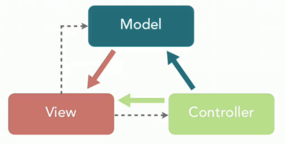

**Spring Boot 旨在简化 Spring 开发**（**减少配置文件，开箱即用**！）。

Spring Boot 只是简化了配置，如果你需要构建 MVC 架构的 Web 程序，你还是需要使用 Spring MVC 作为 MVC 框架，只是说 Spring Boot 帮你简化了 Spring MVC 的很多配置，真正做到开箱即用。

# Spring IoC

## 对于 Spring IoC 的了解

:::color4
**<font style="color:#DF2A3F;">IOC - Inversion of Control：控制反转，是一种设计思想，由容器来控制对象的生命周期和对象之间的依赖关系，由容器完成对象的注入，简化应用开发。DI依赖注入是指容器实例化对象时将其依赖注入到对象中，DI是IOC的一种实现方式。</font>**

:::

**IoC（Inversion of Control:控制反转）**  是一种设计思想，而不是一个具体的技术实现。IoC 的思想就是将原本在程序中手动创建对象的控制权，交由 Spring 框架来管理。不过， IoC 并非 Spring 特有，在其他语言中也有应用。

**为什么叫控制反转？**

* **控制**：指的是对象创建（实例化、管理）的权力
* **反转**：控制权交给外部环境（Spring 框架、IoC 容器）

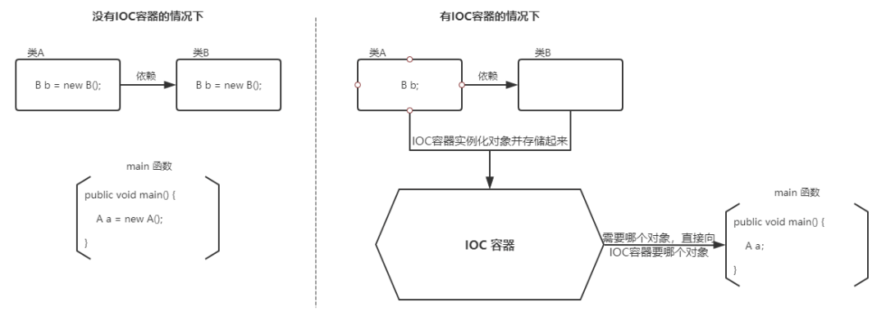

**<font style="color:#DF2A3F;">将对象之间的相互依赖关系交给 IoC 容器来管理，并由 IoC 容器完成对象的注入。</font>** 这样可以简化应用的开发，把应用从复杂的依赖关系中解放出来。 IoC 容器就像是一个工厂一样，需要创建一个对象的时候，只需要配置好配置文件/注解即可，完全不用考虑对象是如何被创建出来的。在实际项目中一个 Service 类可能依赖了很多其他的类，假如需要实例化这个 Service，可能要每次都要搞清这个 Service 所有底层类的构造函数，这可能会把人逼疯。如果利用 IoC 的话，只需要配置好，然后在需要的地方引用就行了，这大大**增加了项目的可维护性且降低了开发难度。**

在 Spring 中， IoC 容器是 Spring 用来实现 IoC 的载体，<font style="color:#DF2A3F;"> </font>**<font style="color:#DF2A3F;">IoC 容器实际上就是个 Map（key，value），Map 中存放的是各种对象。</font>**

**<font style="color:#DF2A3F;"></font>**

相关阅读：

* [IoC 源码阅读](https://javadoop.com/post/spring-ioc)
* [IoC & AOP 详解（快速搞懂）](a59e53725e695fc8934dd2ea00c584d8)

## 什么是 Spring Bean？

\*\*Bean 代指的就是那些被 IoC 容器所管理的对象。\*\*告诉 IoC 容器帮助我们管理哪些对象，这个是通过配置元数据来定义的。配置元数据可以是 XML 文件、注解或者 Java 配置类。

```xml
<!-- Constructor-arg with 'value' attribute -->
<bean id="..." class="...">
   <constructor-arg value="..."/>
</bean>
```

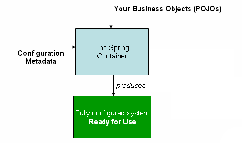

`org.springframework.beans`和 `org.springframework.context` 这两个包是 IoC 实现的基础

## 将一个类声明为 Bean 的注解有哪些?

* `@Component`：**通用的注解**，可标注任意类为 `Spring` 组件。如果一个 Bean 不知道属于哪个层，可以使用`@Component` 注解标注。
* `@Repository` : 对应**持久层**即 Dao 层，主要用于数据库相关操作。
* `@Service` : 对应**服务层**，主要涉 和配置。

3. `@Bean`：用于在配置类中定义一个Bean，Spring容器会根据该注解创建并管理该Bean。

## 注入 Bean 的注解有哪些？ ♥♥♥

**Spring 内置的 **<code>**@Autowired**</code>** 以及 JDK 内置的 **<code>**@Resource**</code>** 和 **<code>**@Inject**</code>** 都可以用于注入 Bean。**

## [@Autowired ](/Autowired) 和 [@Resource ](/Resource) 的区别是什么？

:::success

* <font style="color:#DF2A3F;"> </font><code>**<font style="color:#DF2A3F;">@Autowired</font>**</code><font style="color:#DF2A3F;"> </font>**<font style="color:#DF2A3F;">是 Spring 提供的注解，</font>**<font style="color:#DF2A3F;"> </font>**<font style="color:#DF2A3F;">默认的注入方式为</font>**<code>**<font style="color:#DF2A3F;">byType</font>**</code><font style="color:#DF2A3F;">。 </font><code>**<font style="color:#DF2A3F;">@Resource</font>**</code><font style="color:#DF2A3F;"> </font>**<font style="color:#DF2A3F;">是 JDK 提供的注解，默认注入方式为</font>**<font style="color:#DF2A3F;"> </font><code>**<font style="color:#DF2A3F;">byName</font>**</code><font style="color:#DF2A3F;">。</font>
* **<font style="color:#DF2A3F;">当一个接口存在多个实现类的情况下，</font>**<font style="color:#DF2A3F;"> </font><code><font style="color:#DF2A3F;">@Autowired</font></code><font style="color:#DF2A3F;"> </font>**<font style="color:#DF2A3F;">和</font>**<font style="color:#DF2A3F;"> </font><code><font style="color:#DF2A3F;">@Resource</font></code>**<font style="color:#DF2A3F;">都需要通过名称才能正确匹配到对应的 Bean。</font>**<code><font style="color:#DF2A3F;">Autowired</font></code><font style="color:#DF2A3F;"> </font>**<font style="color:#DF2A3F;">可以通过</font>**<font style="color:#DF2A3F;">  </font><code><font style="color:#DF2A3F;">@Qualifier</font></code><font style="color:#DF2A3F;"> </font>**<font style="color:#DF2A3F;">注解来显式指定名称，</font>**<font style="color:#DF2A3F;"> </font><code><font style="color:#DF2A3F;">@Resource</font></code>**<font style="color:#DF2A3F;">可以通过</font>**<font style="color:#DF2A3F;"> </font><code><font style="color:#DF2A3F;">name</font></code><font style="color:#DF2A3F;"> </font>**<font style="color:#DF2A3F;">属性来显式指定名称</font>**<font style="color:#DF2A3F;">。</font>
* <font style="color:#DF2A3F;"> </font><code><font style="color:#DF2A3F;background-color:#FBDE28;">@Autowired</font></code><font style="color:#DF2A3F;background-color:#FBDE28;"> </font>**<font style="color:#DF2A3F;background-color:#FBDE28;">支持在构造函数、方法、字段和参数上使用。</font>**<font style="color:#DF2A3F;background-color:#FBDE28;"> </font><code><font style="color:#DF2A3F;background-color:#FBDE28;">@Resource</font></code><font style="color:#DF2A3F;background-color:#FBDE28;"> </font>**<font style="color:#DF2A3F;background-color:#FBDE28;">主要用于字段和方法上的注入，不支持在构造函数或参数上使用。</font>**

:::

`Autowired` \*\* 属于 Spring 内置的注解\*\*，默认的注入方式为`byType`，优先根据接口类型去匹配并注入 Bean （接口的实现类）。当一个接口存在多个实现类的话，`byType`这种方式就无法正确注入对象了。

这种情况下，注入方式会变为 `byName`（根据名称进行匹配），这个名称通常就是类名（首字母小写）。就比如说下面代码中的 `smsService`

```java
// smsService 就是我们上面所说的名称
@Autowired
private SmsService smsService;
```

> <code>**<font style="color:#DF2A3F;">Autowired</font>**</code>**<font style="color:#DF2A3F;">默认按照类型匹配，有多个匹配就按照名称匹配</font>**

举个例子，`SmsService` 接口有两个实现类: `SmsServiceImpl1`和 `SmsServiceImpl2`，且它们都已经被 Spring 容器所管理。

```java
// 报错，byName 和 byType 都无法匹配到 bean
@Autowired
private SmsService smsService;
// 正确注入 SmsServiceImpl1 对象对应的 bean
@Autowired
private SmsService smsServiceImpl1;
// 正确注入  SmsServiceImpl1 对象对应的 bean
// smsServiceImpl1 就是我们上面所说的名称
@Autowired
@Qualifier(value = "smsServiceImpl1")
private SmsService smsService;
```

**<font style="color:#DF2A3F;">建议通过 </font>**<font style="color:#DF2A3F;"> </font><code><font style="color:#DF2A3F;">@Qualifier</font></code><font style="color:#DF2A3F;"> </font>**<font style="color:#DF2A3F;"> 注解来显式指定名称而不是依赖变量的名称。</font>**

`@Resource`**属于 JDK 提供的注解**，默认注入方式为 `byName`。如果无法通过名称匹配到对应的 Bean 的话，注入方式会变为`byType`。

`@Resource` 有两个比较重要且日常开发常用的属性：`name`（名称）、`type`（类型）。

```java
public @interface Resource {
    String name() default "";
    Class<?> type() default Object.class;
}
```

如果仅指定 `name` 属性则注入方式为`byName`，如果仅指定`type`属性则注入方式为`byType`，如果同时指定`name` 和`type`属性（不建议这么做）则注入方式为`byType`+`byName`。

```java
// 报错，byName 和 byType 都无法匹配到 bean
@Resource
private SmsService smsService;
// 正确注入 SmsServiceImpl1 对象对应的 bean
@Resource
private SmsService smsServiceImpl1;
// 正确注入 SmsServiceImpl1 对象对应的 bean（比较推荐这种方式）
@Resource(name = "smsServiceImpl1")
private SmsService smsService;
```

## @Autowire底层原理

**@Autowired原理是通过使用反射机制，在容器启动时扫描并解析带有@Autowired注解的字段、构造方法或者Setter方法，然后根据其类型和名称在容器中查找相应的Bean，自动将其注入到目标对象中。**

1. **容器会扫描并解析所有的Bean定义，创建BeanDefinition对象，并将其存储在BeanFactory中。**
2. **当容器启动时，会调用BeanPostProcessor的postProcessBeforeInitialization方法，该方法会扫描所有的Bean对象，查找带有@Autowired注解的字段、构造方法或者Setter方法。**
3. **找到@Autowired注解的字段、构造方法或者Setter方法时，通过反射机制获取它的类型和名称。**
4. **然后，容器会根据类型和名称在BeanFactory中查找相应的Bean。**
5. **如果找到匹配的Bean，则将其注入到目标对象中，完成自动装配。**
6. **如果没有找到匹配的Bean，会抛出异常。**

## @Component和@Bean的区别？ ♥♥♥

:::success
**<font style="color:#DF2A3F;">@Component  注解作用于类，是一个通用注解，Spring自动创建这个类的实例对象注入到容器中。</font>**

**<font style="color:#DF2A3F;"> @Bean注解作用于配置类方法上，把方法返回的对象注入到容器中。@Bean注解自定义性强，可以定义Bean的创建，初始化的过程。</font>**

:::

### `@Component`

* **用途**: `@Component`是一个通用的注解，用于**指示Spring容器将注解的类作为Bean进行管理**。它是一个更高级别的注解，通常用于自动检测和配置组件。
* **位置**: `@Component`注解直接放在类定义上。
* **作用域**: 默认情况下，使用`@Component`注解的Bean是单例的（singleton），但可以通过在类上添加`@Scope`注解来改变其作用域。
* **实例化**: Spring容器在启动时会自动扫描标记有`@Component`注解的类，并根据配置创建Bean实例。

### `@Bean`

* **用途**: `@Bean`注解用于方法上，**指示Spring容器通过该方法的返回值创建一个Bean**。它通常在配置类中使用，用于精确控制Bean的创建过程。
* **位置**: `@Bean`注解放在方法上，而不是类上。
* **作用域**: `@Bean`注解默认创建的Bean也是单例的，但可以通过`@Scope`注解指定不同的作用域，如`prototype`（多例）、`request`（请求作用域）、`session`（会话作用域）等。
* **实例化**: `@Bean`注解的方法由Spring容器调用，以创建Bean实例。这允许开发者在方法中编写逻辑来控制Bean的创建过程，例如依赖注入、方法调用等。

## Bean 的作用域有哪些?

Spring 中 Bean 的作用域通常有下面几种：

* **singleton** : IoC 容器中只有唯一的 bean 实例。Spring 中的 bean 默认都是单例的，是对单例设计模式的应用。
* **prototype** : 每次获取都会创建一个新的 bean 实例。也就是说，连续 `getBean()` 两次，得到的是不同的 Bean 实例。
* **request** （仅 Web 应用可用）: 每一次 HTTP 请求都会产生一个新的 bean（请求 bean），该 bean 仅在当前 HTTP request 内有效。
* **session** （仅 Web 应用可用） : 每一次来自新 session 的 HTTP 请求都会产生一个新的 bean（会话 bean），该 bean 仅在当前 HTTP session 内有效。
* **application/global-session** （仅 Web 应用可用）：每个 Web 应用在启动时创建一个 Bean（应用 Bean），该 bean 仅在当前应用启动时间内有效。
* **websocket** （仅 Web 应用可用）：每一次 WebSocket 会话产生一个新的 bean。

**如何配置 bean 的作用域呢？**

xml 方式：

```xml
<bean id="..." class="..." scope="singleton"></bean>
```

注解方式

```java
@Bean
@Scope(value = ConfigurableBeanFactory.SCOPE_PROTOTYPE)
public Person personPrototype() {
    return new Person();
}
```

## Bean 是线程安全的吗？ ♥♥♥

:::success
**<font style="color:#DF2A3F;">Spring 框架中的 Bean 是否线程安全，取决于其作用域和状态。多例模式不存在线程竞争，无线程安全问题。单例模式下，若bean 是有状态的话，那就存在线程安全问题。有状态 Bean 是指包含可变的成员变量的对象。</font>**

:::

大部分 Bean 实际都是无状态（没有定义可变的成员变量）的（比如 Dao、Service），这种情况下， Bean 是线程安全的。

对于有状态单例 Bean 的线程安全问题，常见的有两种解决办法：

1. 在 Bean 中尽量**避免定义可变的成员变量**。
2. 在类中定义一个 <code>**ThreadLocal**</code>\*\* 成员变量\*\*，将需要的可变成员变量保存在 `ThreadLocal` 中（推荐的一种方式）。

## Bean 的生命周期了解么 😅😅😅

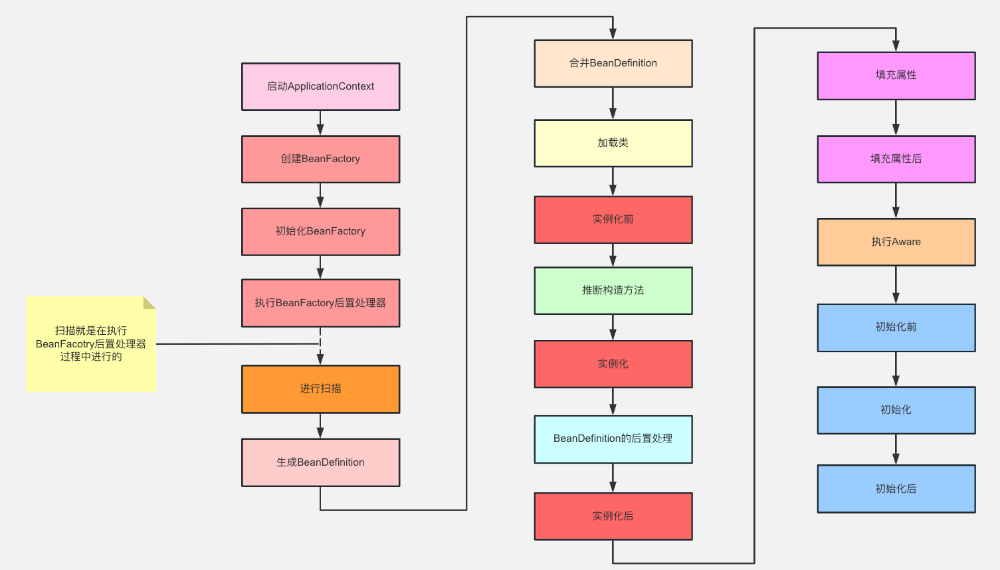

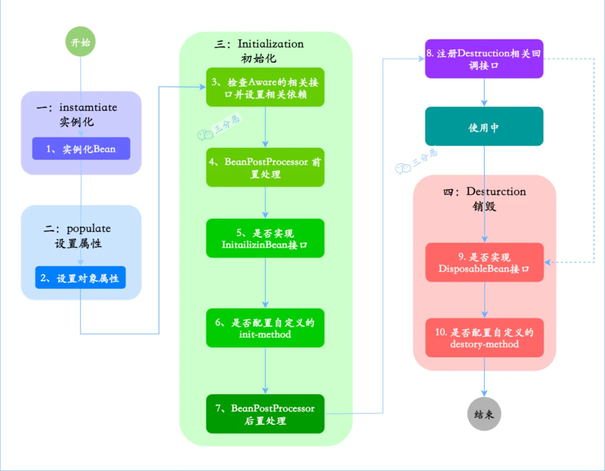

* **实例化**
  * Bean 容器找到配置文件中 Spring Bean 的定义。
  * Bean 容器利用反射创建一个 Bean 的实例。
* **设置属性**
  * 利用 `set()`方法设置一些属性值。
* **初始化**
  * 如果 Bean 实现了 `BeanNameAware` 接口，调用 `setBeanName()`方法，传入 Bean 的名字。
  * 如果 Bean 实现了 `BeanClassLoaderAware` 接口，调用 `setBeanClassLoader()`方法，传入 `ClassLoader`对象的实例。
  * 如果 Bean 实现了 `BeanFactoryAware` 接口，调用 `setBeanFactory()`方法，传入 `BeanFactory`对象的实例。
  * 与上面的类似，如果实现了其他 `*.Aware`接口，就调用相应的方法。
  * 如果有和加载这个 Bean 的 Spring 容器相关的 `BeanPostProcessor` 对象，执行`postProcessBeforeInitialization()` 方法
  * 如果 Bean 实现了`InitializingBean`接口，执行`afterPropertiesSet()`方法。
  * 如果 Bean 在配置文件中的定义包含 init-method 属性，执行指定的方法。
  * 如果有和加载这个 Bean 的 Spring 容器相关的 `BeanPostProcessor` 对象，执行`postProcessAfterInitialization()` 方法
* **销毁Bean**
  * 如果 Bean 实现了 `DisposableBean` 接口，执行 `destroy()` 方法。
  * 如果 Bean 在配置文件中的定义包含 destroy-method 属性，执行指定的方法

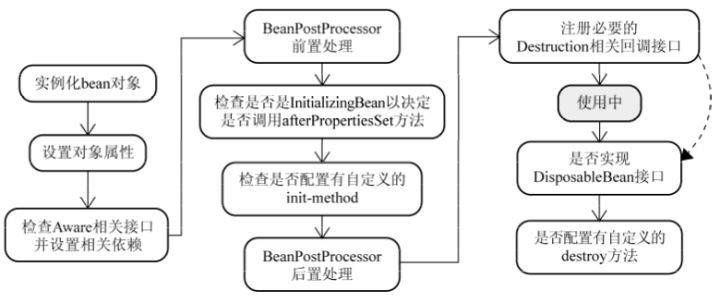

> **<font style="color:#DF2A3F;">推断构造方法 -> 实例化对象 -> 填充属性，依赖注入 -> 实现了Aware接口则处理Aware回调 -> BeanPostProcess前置处理 -> 初始化处理InitializingBean和init-method -> BeanPostProcess后置处理 -> 初始化后进行AOP</font>**

### Aware接口

**Aware接口是一组用于让Bean获得Spring容器中某些特定功能的接口**。实现这些接口的Bean可以获取Spring容器中的各种资源或服务。这些接口是Spring提供的**扩展点**，**允许Bean在其生命周期的特定阶段访问Spring容器的内部功能或状态。**

1. <code>**<font style="color:#DF2A3F;background-color:rgb(244, 246, 248);">BeanNameAware</font>**</code>
   * **<font style="color:rgb(36, 41, 47);background-color:rgb(244, 246, 248);">作用</font>**<font style="color:rgb(36, 41, 47);background-color:rgb(244, 246, 248);">: 提供对当前Bean在Spring容器中的名称的访问。</font>
   * **<font style="color:rgb(36, 41, 47);background-color:rgb(244, 246, 248);">方法</font>**<font style="color:rgb(36, 41, 47);background-color:rgb(244, 246, 248);">:</font><font style="color:rgb(36, 41, 47);background-color:rgb(244, 246, 248);"> </font><code><font style="color:rgb(36, 41, 47);background-color:rgb(244, 246, 248);">void setBeanName(String name);</font></code>
   * **<font style="color:rgb(36, 41, 47);background-color:rgb(244, 246, 248);">用途</font>**<font style="color:rgb(36, 41, 47);background-color:rgb(244, 246, 248);">: 允许Bean在其初始化时获取到其在容器中的名称。这对于Bean的自定义配置或调试很有用。</font>
2. <code>**<font style="color:#DF2A3F;background-color:rgb(244, 246, 248);">BeanFactoryAware</font>**</code>
   * **<font style="color:rgb(36, 41, 47);background-color:rgb(244, 246, 248);">作用</font>**<font style="color:rgb(36, 41, 47);background-color:rgb(244, 246, 248);">: 允许Bean访问</font><code><font style="color:rgb(36, 41, 47);background-color:rgb(244, 246, 248);">BeanFactory</font></code><font style="color:rgb(36, 41, 47);background-color:rgb(244, 246, 248);">对象。</font>
   * **<font style="color:rgb(36, 41, 47);background-color:rgb(244, 246, 248);">方法</font>**<font style="color:rgb(36, 41, 47);background-color:rgb(244, 246, 248);">:</font><font style="color:rgb(36, 41, 47);background-color:rgb(244, 246, 248);"> </font><code><font style="color:rgb(36, 41, 47);background-color:rgb(244, 246, 248);">void setBeanFactory(BeanFactory beanFactory);</font></code>
   * **<font style="color:rgb(36, 41, 47);background-color:rgb(244, 246, 248);">用途</font>**<font style="color:rgb(36, 41, 47);background-color:rgb(244, 246, 248);">: 使Bean能够直接访问</font><code><font style="color:rgb(36, 41, 47);background-color:rgb(244, 246, 248);">BeanFactory</font></code><font style="color:rgb(36, 41, 47);background-color:rgb(244, 246, 248);">，从而可以进行更细粒度的Bean管理操作，如动态地获取其他Bean的引用或访问Bean工厂的功能。</font>
3. <code>**<font style="color:#DF2A3F;background-color:rgb(244, 246, 248);">ApplicationContextAware</font>**</code>
   * **<font style="color:rgb(36, 41, 47);background-color:rgb(244, 246, 248);">作用</font>**<font style="color:rgb(36, 41, 47);background-color:rgb(244, 246, 248);">: 提供对</font><code><font style="color:rgb(36, 41, 47);background-color:rgb(244, 246, 248);">ApplicationContext</font></code><font style="color:rgb(36, 41, 47);background-color:rgb(244, 246, 248);">的访问。</font>
   * **<font style="color:rgb(36, 41, 47);background-color:rgb(244, 246, 248);">方法</font>**<font style="color:rgb(36, 41, 47);background-color:rgb(244, 246, 248);">:</font><font style="color:rgb(36, 41, 47);background-color:rgb(244, 246, 248);"> </font><code><font style="color:rgb(36, 41, 47);background-color:rgb(244, 246, 248);">void setApplicationContext(ApplicationContext applicationContext);</font></code>
   * **<font style="color:rgb(36, 41, 47);background-color:rgb(244, 246, 248);">用途</font>**<font style="color:rgb(36, 41, 47);background-color:rgb(244, 246, 248);">: 允许Bean访问整个Spring应用上下文，通常用于访问环境信息、事件发布、资源加载等操作。</font>
4. <code>**<font style="color:rgb(36, 41, 47);background-color:rgb(244, 246, 248);">MessageSourceAware</font>**</code>
   * **<font style="color:rgb(36, 41, 47);background-color:rgb(244, 246, 248);">作用</font>**<font style="color:rgb(36, 41, 47);background-color:rgb(244, 246, 248);">: 提供对</font><code><font style="color:rgb(36, 41, 47);background-color:rgb(244, 246, 248);">MessageSource</font></code><font style="color:rgb(36, 41, 47);background-color:rgb(244, 246, 248);">的访问。</font>
   * **<font style="color:rgb(36, 41, 47);background-color:rgb(244, 246, 248);">方法</font>**<font style="color:rgb(36, 41, 47);background-color:rgb(244, 246, 248);">:</font><font style="color:rgb(36, 41, 47);background-color:rgb(244, 246, 248);"> </font><code><font style="color:rgb(36, 41, 47);background-color:rgb(244, 246, 248);">void setMessageSource(MessageSource messageSource);</font></code>
   * **<font style="color:rgb(36, 41, 47);background-color:rgb(244, 246, 248);">用途</font>**<font style="color:rgb(36, 41, 47);background-color:rgb(244, 246, 248);">: 允许Bean访问Spring的消息资源，以便进行国际化（i18n）或本地化操作。</font>
5. <code>**<font style="color:rgb(36, 41, 47);background-color:rgb(244, 246, 248);">ApplicationEventPublisherAware</font>**</code>
   * **<font style="color:rgb(36, 41, 47);background-color:rgb(244, 246, 248);">作用</font>**<font style="color:rgb(36, 41, 47);background-color:rgb(244, 246, 248);">: 提供对</font><code><font style="color:rgb(36, 41, 47);background-color:rgb(244, 246, 248);">ApplicationEventPublisher</font></code><font style="color:rgb(36, 41, 47);background-color:rgb(244, 246, 248);">的访问。</font>
   * **<font style="color:rgb(36, 41, 47);background-color:rgb(244, 246, 248);">方法</font>**<font style="color:rgb(36, 41, 47);background-color:rgb(244, 246, 248);">:</font><font style="color:rgb(36, 41, 47);background-color:rgb(244, 246, 248);"> </font><code><font style="color:rgb(36, 41, 47);background-color:rgb(244, 246, 248);">void setApplicationEventPublisher(ApplicationEventPublisher applicationEventPublisher);</font></code>
   * **<font style="color:rgb(36, 41, 47);background-color:rgb(244, 246, 248);">用途</font>**<font style="color:rgb(36, 41, 47);background-color:rgb(244, 246, 248);">: 使Bean能够发布Spring应用上下文中的事件。</font>
6. <code>**<font style="color:rgb(36, 41, 47);background-color:rgb(244, 246, 248);">ResourceLoaderAware</font>**</code>
   * **<font style="color:rgb(36, 41, 47);background-color:rgb(244, 246, 248);">作用</font>**<font style="color:rgb(36, 41, 47);background-color:rgb(244, 246, 248);">: 提供对</font><code><font style="color:rgb(36, 41, 47);background-color:rgb(244, 246, 248);">ResourceLoader</font></code><font style="color:rgb(36, 41, 47);background-color:rgb(244, 246, 248);">的访问。</font>
   * **<font style="color:rgb(36, 41, 47);background-color:rgb(244, 246, 248);">方法</font>**<font style="color:rgb(36, 41, 47);background-color:rgb(244, 246, 248);">:</font><font style="color:rgb(36, 41, 47);background-color:rgb(244, 246, 248);"> </font><code><font style="color:rgb(36, 41, 47);background-color:rgb(244, 246, 248);">void setResourceLoader(ResourceLoader resourceLoader);</font></code>
   * **<font style="color:rgb(36, 41, 47);background-color:rgb(244, 246, 248);">用途</font>**<font style="color:rgb(36, 41, 47);background-color:rgb(244, 246, 248);">: 允许Bean通过</font><code><font style="color:rgb(36, 41, 47);background-color:rgb(244, 246, 248);">ResourceLoader</font></code><font style="color:rgb(36, 41, 47);background-color:rgb(244, 246, 248);">加载资源，如文件、类路径资源等。</font>
7. <code>**<font style="color:rgb(36, 41, 47);background-color:rgb(244, 246, 248);">ServletContextAware</font>**</code>
   * **<font style="color:rgb(36, 41, 47);background-color:rgb(244, 246, 248);">作用</font>**<font style="color:rgb(36, 41, 47);background-color:rgb(244, 246, 248);">: 提供对</font><code><font style="color:rgb(36, 41, 47);background-color:rgb(244, 246, 248);">ServletContext</font></code><font style="color:rgb(36, 41, 47);background-color:rgb(244, 246, 248);">的访问（主要用于Web应用程序）。</font>
   * **<font style="color:rgb(36, 41, 47);background-color:rgb(244, 246, 248);">方法</font>**<font style="color:rgb(36, 41, 47);background-color:rgb(244, 246, 248);">:</font><font style="color:rgb(36, 41, 47);background-color:rgb(244, 246, 248);"> </font><code><font style="color:rgb(36, 41, 47);background-color:rgb(244, 246, 248);">void setServletContext(ServletContext servletContext);</font></code>
   * **<font style="color:rgb(36, 41, 47);background-color:rgb(244, 246, 248);">用途</font>**<font style="color:rgb(36, 41, 47);background-color:rgb(244, 246, 248);">: 使Bean能够访问Servlet上下文，从而进行Web环境相关的操作，如获取上下文参数、访问Servlet配置等。</font>

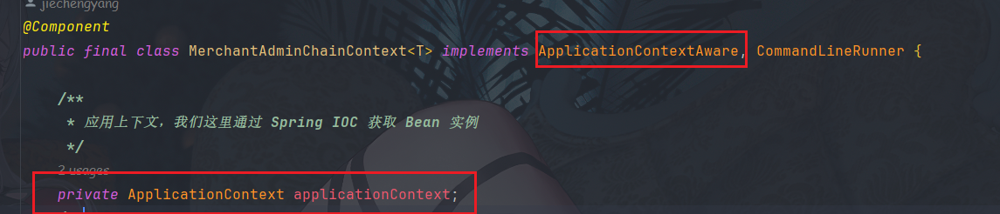

### BeanPostProcessor接口

**<font style="color:rgb(34, 34, 34);">Bean后置处理</font>**<font style="color:rgb(34, 34, 34);">：对Spring 工厂创建的对象进行二次加工处理，即预初始化和后初始化。</font>

<code><font style="color:rgb(51, 51, 51);background-color:rgb(235, 245, 253);">postProcessBeforeInitialization()</font></code><font style="color:rgb(34, 34, 34);"> </font><font style="color:rgb(34, 34, 34);">方法：在 Bean 实例化、属性注入后，初始化前调用。</font>

<code><font style="color:rgb(51, 51, 51);background-color:rgb(235, 245, 253);">postProcessAfterInitialization()</font></code><font style="color:rgb(34, 34, 34);"> 方法：在 Bean 实例化、属性注入、初始化都完成后调用。</font>

<font style="color:rgb(34, 34, 34);">创建PostProcessor类，实现</font><code><font style="color:rgb(51, 51, 51);background-color:rgb(235, 245, 253);">BeanPostProcessor接口</font></code><font style="color:rgb(34, 34, 34);">，并重写预初始化方法</font><code><font style="color:rgb(51, 51, 51);background-color:rgb(235, 245, 253);">postProcessBeforeInitialization()</font></code><font style="color:rgb(34, 34, 34);">和后初始化方法</font><code><font style="color:rgb(51, 51, 51);background-color:rgb(235, 245, 253);">postProcessAfterInitialization()</font></code>

```java
/**
 * Spring Bean后置处理器
 */
public class PostProcessor implements BeanPostProcessor {
    @Override
    public Object postProcessBeforeInitialization(Object bean, String beanName) throws BeansException {
        System.out.println(beanName+"正在执行预初始化方法");
        return bean;
    }
 
    @Override
    public Object postProcessAfterInitialization(Object bean, String beanName) throws BeansException {
        System.out.println(beanName+"正在执行后初始化方法");
        return bean;
    }
}
```

<font style="color:rgb(34, 34, 34);"></font>

### Bean的实例化和初始化有什么区别

**<font style="color:#DF2A3F;">实例化：通过构造方法获取一个Bean实例对象（还没有填充属性）</font>**

**<font style="color:#DF2A3F;">初始化：实例化后，执行对象的初始化方法（填充属性）</font>**

## 三级缓存 解决循环依赖  💨💨💨

循环依赖：A，B两个对象中都需要对方的实例，在初始化时都没有实例，去单例池Map中查找，都无法找到对方，然后去创建对方实例，进入循环 -- 多个 Bean 之间互相依赖或引用到对方，最终形成了 **闭环**。

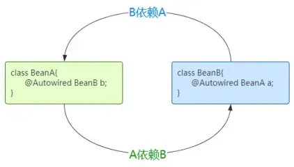

<font style="color:rgb(44, 62, 80);">循环依赖问题在Spring中主要有三种情况：</font>

* **<font style="color:rgb(44, 62, 80);">第一种：通过构造方法进行依赖注入时产生的循环依赖问题。</font>**
* **<font style="color:rgb(44, 62, 80);">第二种：通过setter方法进行依赖注入且是在多例（原型）模式下产生的循环依赖问题。</font>**
* **<font style="color:rgb(44, 62, 80);">第三种：通过setter方法进行依赖注入且是在单例模式下产生的循环依赖问题。</font>**

**<font style="color:rgb(44, 62, 80);">只有【第三种方式】的循环依赖问题被 Spring 解决了，其他两种方式在遇到循环依赖问题时，Spring都会产生异常。</font>**

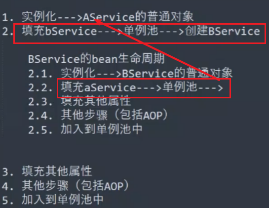

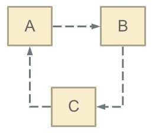

* Spring 容器的整个生命周期中，单例Bean对象是唯一的。即可以使用**缓存**来加速访问
* Spring 源码中使用了大量的 Cache 手段，其中在循环依赖问题的解决过程中就使用了“**三级缓存**”
* \*\*三级缓存的意义 \*\*
  * **singletonObject：一级缓存**，**<font style="color:#DF2A3F;">存放完全实例化且属性赋值完成的 Bean</font>\*\*\*\* ，可以直接使用**
  * **earlySingletonObject：二级缓存**，**<font style="color:#DF2A3F;">存放实例化后但是没有属性赋值的Bean</font>\*\*\*\*，也就是还没有依赖注入的Bean**。
  * **singletonFactories：三级缓存**，**<font style="color:#DF2A3F;">存放实例化完成的 Bean 工厂</font>**（**存放的是函数式接口 -- lambda表达式**，**传入Bean名和Bean实例）（aop创建） ，不会立即调用**。**用来冲破循环**，**在ABA碰到循环时调用，\*\*\*\*<font style="color:#DF2A3F;">创建动态代理或者Bean实例对象放入二级缓存</font>** **，删除lambda表达式。**
* 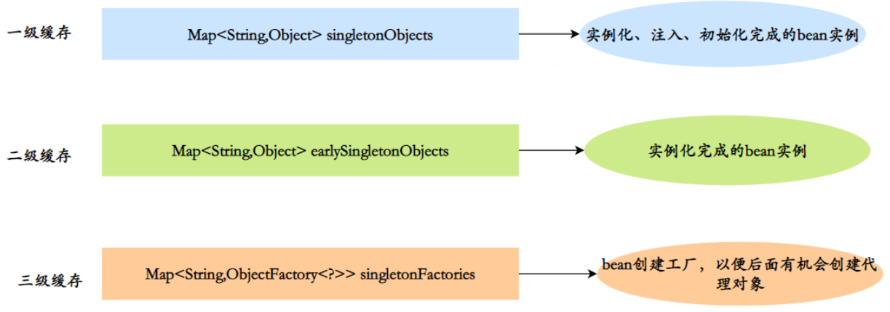

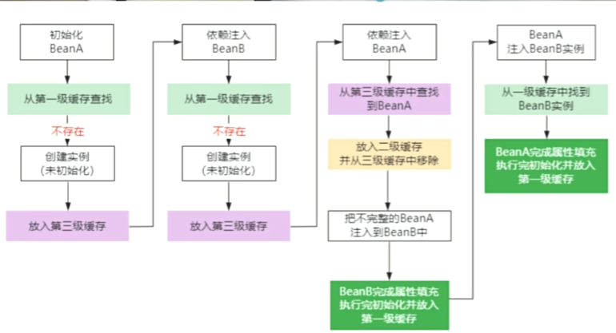

**Spring可以解决的循环依赖问题**

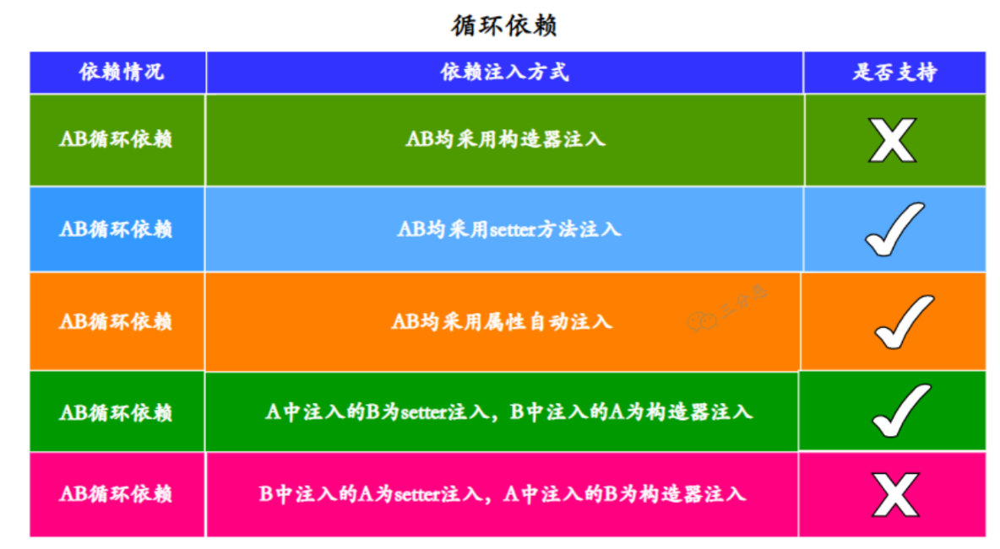

<font style="color:rgb(51,51,51);">Spring 在创建 Bean 时默认会根据自然排序进行创建，所以 A 会先于 B 进行创建。</font>\
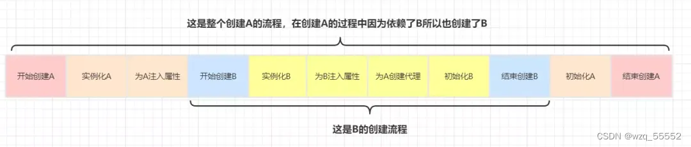

### lazy 注解作用

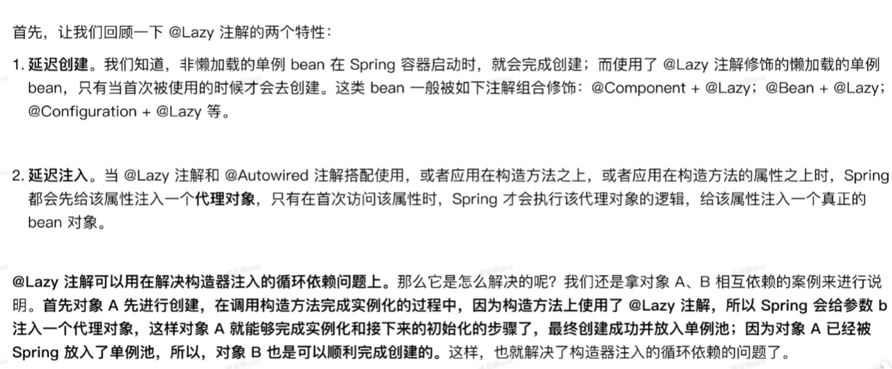

### RequiredArgsConstructor构造器注入带来的问题

[探索 Lombok自动注入注解 之 @RequiredArgsConstructor ：原理、实践、踩坑及填坑\_requiredargsconstructor循环依赖-CSDN博客](https://blog.csdn.net/q2qwert/article/details/140683375)

## 为什么需要三级缓存，二级缓存不行吗

doCreateBean当中有个判断当前对象是否已经处于正在创建的流程中了，说明循环创建了，这样就会将三级缓存和二级缓存启用。此时再依赖注入创建其他对象，再再依赖注入的时候就能从三级缓存中找到对应的函数，生成临时对象放在二级缓存中，并且此时会将AOP提前触发。

三级缓存存在的必要性是因为有代理对象的存在，在代理对象循环注入代理对象的时候，希望注入的是最终的代理对象而不是原始对象，从源码中可知，**生成代理对象的操作是在属性注入之后完成的**，这样会无限陷入死循环，必须找一种办法在发生这样的情况下提前暴露出代理对象，因此有暴露操作 - 也就是需要二级缓存

假如此时只有二级缓存，那么这个提前暴露的代理对象应该放到哪里呢?放一级缓存中存在很大歧义并且不好判断是否是需要提前代理的对象，因此引入了一层中间缓存用于存放需要被提前代理而暴露出的对象来。

## BeanFactory vs ApplicationContext ♥♥♥

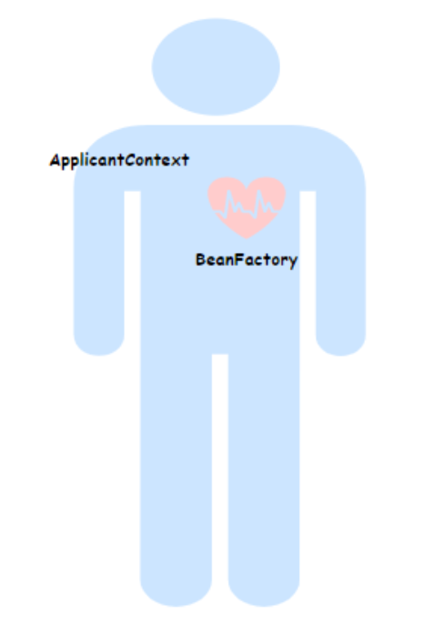

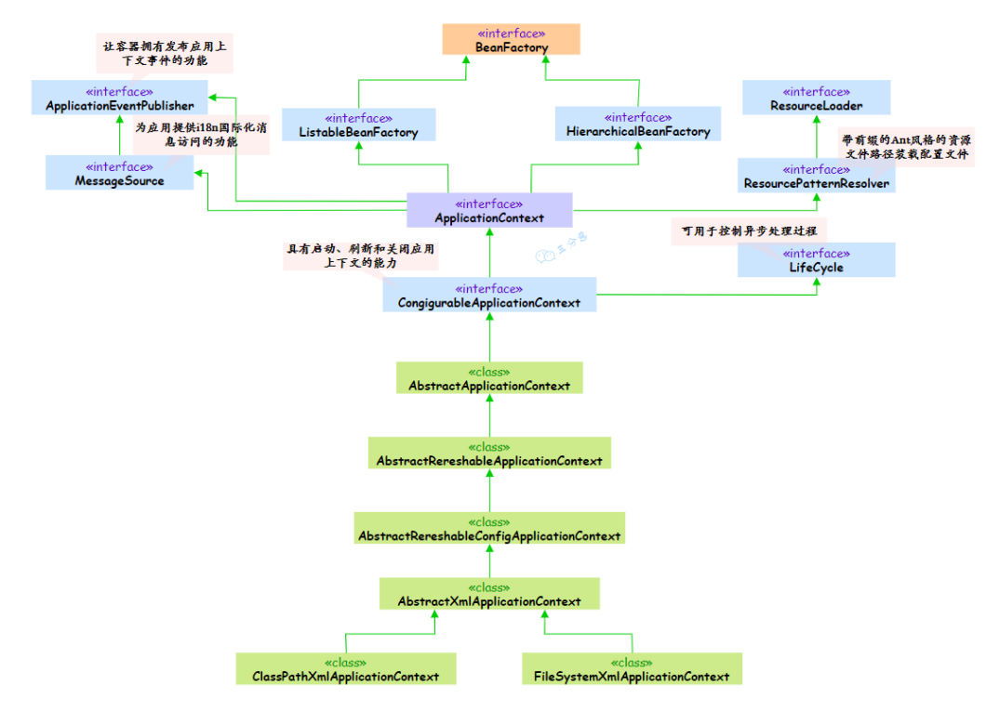

**<font style="color:rgb(51,51,51);">BeanFactory 接口位于类结构树的顶端，它最主要的方法就是 getBean(String var1)，这个方法从容器器中返回特定名称的 Bean</font>**\*\* 。**<code>**ApplicationContext**</code>** 扩展了 **<code>**BeanFactory**</code>** ,除了有\*\*<code>**BeanFactory**</code>**的功能还有额外更多功能，所以一般使用**<code>**ApplicationContext**</code>**会更多。**

* `BeanFactory`：延迟注入(使用到某个 bean 的时候才会注入),相比于`ApplicationContext` 来说会占用更少的内存，程序启动速度更快。只负责创建和获取Bean。
* `ApplicationContext`：容器启动的时候，一次性创建所有 bean 。`BeanFactory` 仅提供了最基本的依赖注入支持。

## <font style="color:rgb(51,51,51);">Spring 容器器启动阶段会干什么</font>

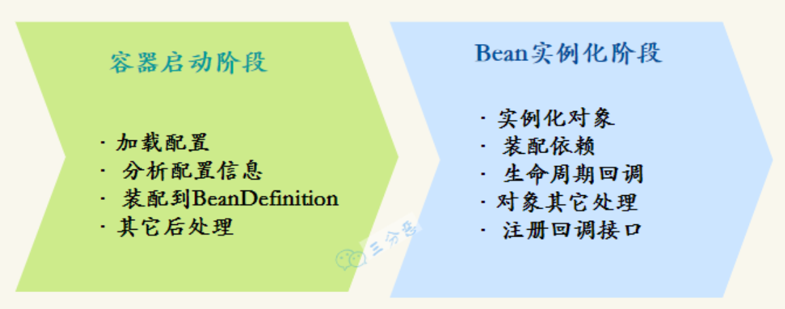

容器启动开始，加载配置元数据，在部分情况下，容器需要依赖某些工具类对加载的配置元数据进行解析和分析，并将分析后的信息组为相应的**BeanDefinition**。**最后把这些保存 Bean 定义必要信息的 BeanDefinition，注册到相应的 BeanDefinitionRegistry，容器启动完毕。**

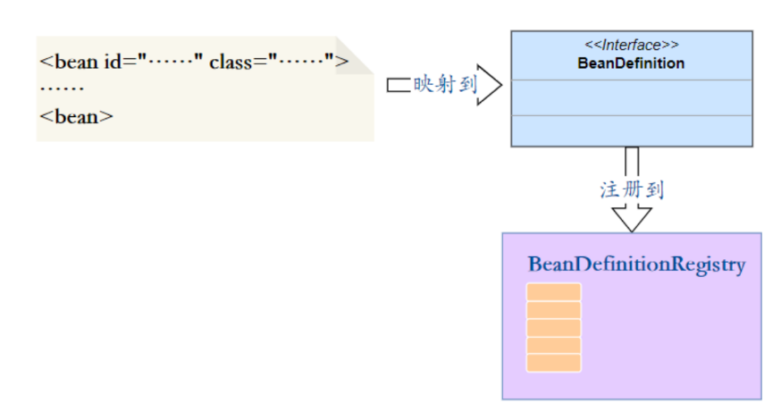

**之后就是对象实例化阶段：和前面的Bean生命周期一致。**

***

## Spring依赖注入方式

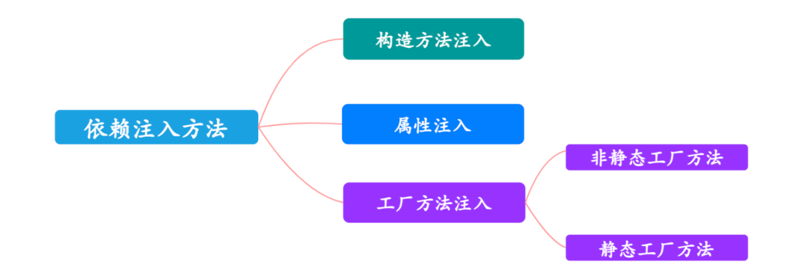

# Spring AOP

**AOP(Aspect-Oriented Programming:面向切面编程)能够将那些与业务无关，却为业务模块所共同调用的逻辑或责任（例如事务处理、日志管理、权限控制等）*****封装起来*****，\*\*\*\*<font style="color:rgb(48, 79, 254);">减少系统的重复代码</font>**<font style="color:rgb(44, 62, 80);">，</font>\*\*<font style="color:rgb(48, 79, 254);">降低模块间的耦合度。</font>\*\***在不修改源代码的情况下，给程序动态统一添加额外功能的一种技术。**

Spring AOP 就是基于动态代理的，如果要代理的对象，实现了某个接口，那么 Spring AOP 会使用 **JDK Proxy**，去创建代理对象，而对于没有实现接口的对象，就无法使用 JDK Proxy 去进行代理了，这时候 Spring AOP 会使用 **Cglib** 生成一个被代理对象的子类来作为代理

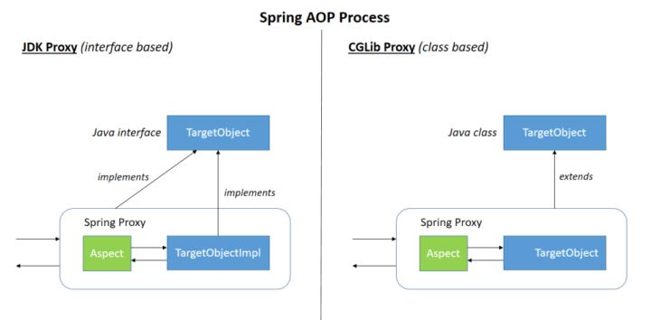

AOP 切面编程涉及到的一些专业术语：

| 术语 | 含义 |
| --- | --- |
| 目标(Target) | 被通知的对象 |
| 代理(Proxy) | 向目标对象应用通知之后创建的代理对象 |
| 连接点(JoinPoint) | 目标对象的所属类中，定义的所有方法均为连接点 |
| 切入点(Pointcut) | 被切面拦截 / 增强的连接点（切入点一定是连接点，连接点不一定是切入点） |
| 通知(Advice) | 增强的逻辑 / 代码，也即拦截到目标对象的连接点之后要做的事情 |
| 切面(Aspect) | 切入点(Pointcut)+通知(Advice) |
| Weaving(织入) | 将通知应用到目标对象，进而生成代理对象的过程动作 |

## SpringBoot为什么使用CGLib作为默认动态代理实现？

AOP使用JDK动态代理有什么问题？

* <font style="color:rgb(77, 77, 77);">CGLIB能够代理那些没有实现接口的类，而JDK动态代理只能代理实现了接口的类。</font>
* <font style="color:rgb(5, 7, 59);background-color:rgb(253, 253, 254);">基于字节码生成的方式通常比基于反射的JDK动态代理在性能上更优。</font>
* <font style="color:rgb(5, 7, 59);background-color:rgb(253, 253, 254);">当使用JDK动态代理时，由于代理类是基于接口创建的，因此无法直接获取被代理类实现的方法上的注解。注解信息通常被存储在类的方法元数据中，而JDK动态代理创建的代理类仅实现了接口，不包含被代理类的具体实现细节。</font>

## Spring AOP 和 AspectJ AOP 有什么区别？

**<font style="color:#DF2A3F;">Spring AOP 属于运行时增强，而 AspectJ 是编译时增强</font>**<font style="color:#DF2A3F;"> </font>**。** \*\* Spring AOP 基于代理(Proxying)，而 AspectJ 基于字节码操作(Bytecode Manipulation)。\*\*

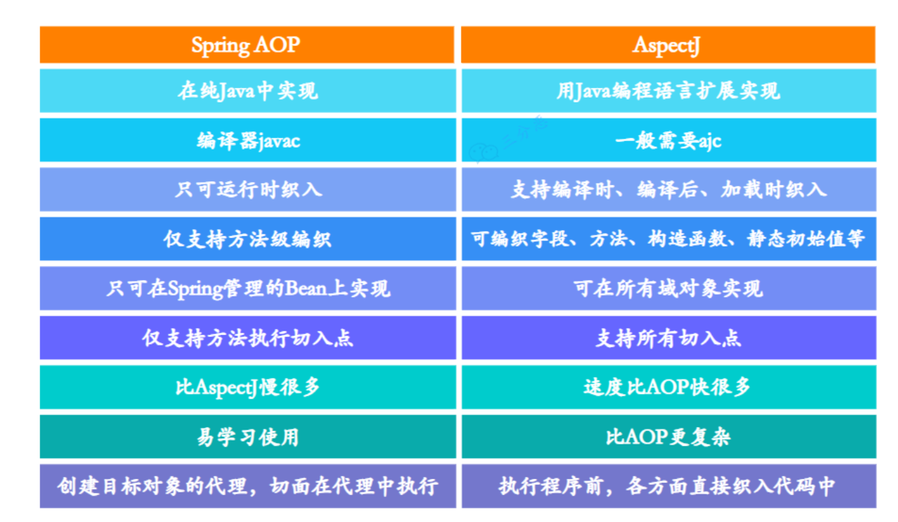

Spring AOP 已经集成了 AspectJ ，AspectJ 应该算的上是 Java 生态系统中最完整的 AOP 框架了。AspectJ 相比于 Spring AOP 功能更加强大，但是 Spring AOP 相对来说更简单，

如果我们的切面比较少，那么两者性能差异不大。但是，当切面太多的话，最好选择 AspectJ ，它比 Spring AOP 快很多。

## AspectJ 定义的通知类型有哪些？

* **Before**（前置通知）：目标对象的方法调用之前触发
* **After** （后置通知）：目标对象的方法调用之后触发
* **AfterReturning**（返回通知）：目标对象的方法调用完成，在返回结果值之后触发
* **AfterThrowing**（异常通知）：目标对象的方法运行中抛出异常后触发。AfterReturning 和 AfterThrowing 两者互斥。如果方法调用成功无异常，则会有返回值；如果方法抛出了异常，则不会有返回值。
* **Around** （环绕通知）：编程式控制目标对象的方法调用。环绕通知是所有通知类型中可操作范围最大的一种，因为它可以直接拿到目标对象，以及要执行的方法，所以环绕通知可以任意的在目标对象的方法调用前后搞事，甚至不调用目标对象的方法

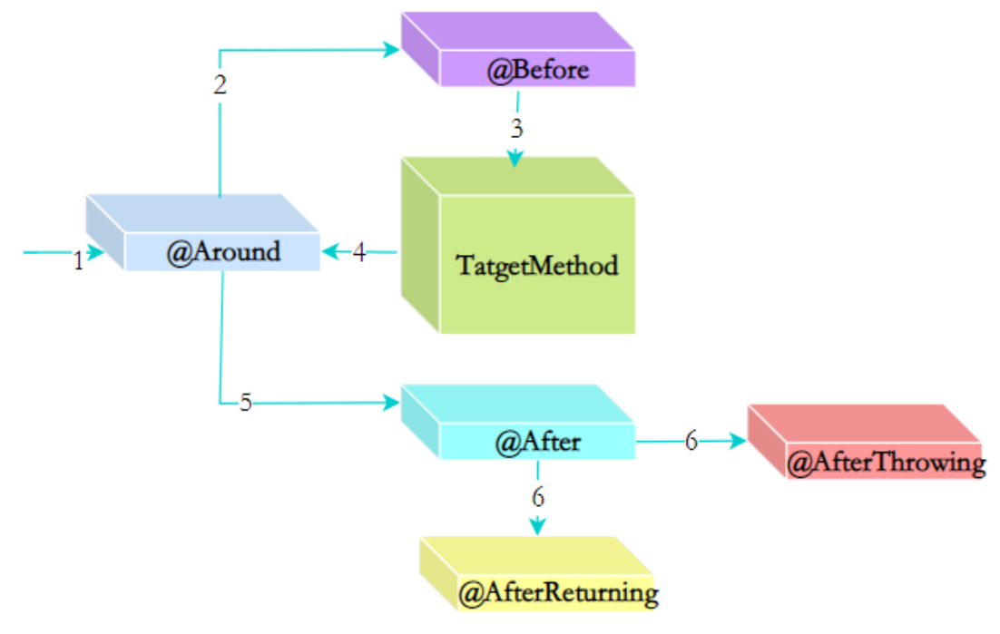

> **<font style="color:#DF2A3F;">前置，后置，环绕，返回，异常</font>**

## 切点表达式

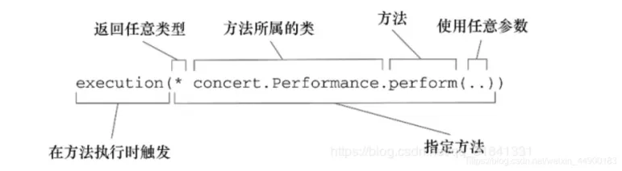

## 多个切面的执行顺序如何控制？

1、通常使用`@Order` 注解直接定义切面顺序

```java
// 值越小优先级越高
@Order(3)
@Component
@Aspect
public class LoggingAspect implements Ordered {
```

**2、实现**<code>**Ordered**</code> \*\* 接口重写 **<code>**getOrder**</code> \*\* 方法。**

```javascript
  @Component
  @Aspect
  public class LoggingAspect implements Ordered {
  // ....
  @Override
    public int getOrder() {
    // 返回值越小优先级越高
    return 1;
  }
}
```

## JDK动态代理 vs CGLib动态代理

**<font style="color:rgb(51, 51, 51);">动态代理：在程序运行期，创建目标对象的代理对象，并对目标对象中的方法进行功能性增强的一种技术</font>**

**JDK动态代理需要实现接口，生成代理对象对目标类的方法增强；**

\*\*CGLib无需实现接口，****<font style="color:rgb(51,51,51);">原理是通过字节码技术为一个类创建子类，并在子类中采用方法拦截的技术拦截所有父类方法的调用，顺势织入横切逻辑</font>**** \*\*

### JDK动态代理实现

```java
public interface ISolver {
    void solver();
}
```

```java
public class Solver implements ISolver{
    @Override
    public void solver() {
        System.out.println("疯狂掉头发解决问题……");
    }
}
```

代理对象

```java
public class ProxyFactory {
    private Object target;

    public ProxyFactory(Object target) {
        this.target = target;
    }
    public Object getProxyInstance(){
        return Proxy.newProxyInstance(target.getClass().getClassLoader(), target.getClass().getInterfaces(), new InvocationHandler(){

            @Override
            public Object invoke(Object proxy, Method method, Object[] args) throws Throwable {
                System.out.println("请问有什什么可以帮到您？ ");
                Object returnValue = method.invoke(target, args);
                System.out.println("问题已经解决啦！ ");
                return null;
            }
        });
    }
}
```

代理对象的使用

```java
public class Client {
    public static void main(String[] args) {
        Solver solver = new Solver();
        ISolver proxyInstance = (ISolver) new ProxyFactory(solver).getProxyInstance();
        proxyInstance.solver();
    }
}
```

### args参数的作用

1. **<font style="color:rgb(0, 0, 0) !important;">传递方法参数</font>**<font style="color:rgba(0, 0, 0, 0.85) !important;">\ </font><font style="color:rgba(0, 0, 0, 0.85) !important;">当代理对象调用方法时，所有传入的参数会被封装到 </font><code><font style="color:rgba(0, 0, 0, 0.85) !important;">args</font></code><font style="color:rgba(0, 0, 0, 0.85) !important;"> 数组中，并传递给 </font><code><font style="color:rgba(0, 0, 0, 0.85) !important;">invoke</font></code><font style="color:rgba(0, 0, 0, 0.85) !important;"> 方法。例如：</font>**<font style="color:rgba(0, 0, 0, 0.85);">java</font>**

```java
// 客户端调用
user.getName("param1", 2);

// 会触发 invoke 方法，此时：
// args = ["param1", 2]
```

2. **<font style="color:rgb(0, 0, 0) !important;">转发参数到目标对象</font>**<font style="color:rgba(0, 0, 0, 0.85) !important;">\ </font><font style="color:rgba(0, 0, 0, 0.85) !important;">在</font><font style="color:rgba(0, 0, 0, 0.85) !important;"> </font><code><font style="color:rgba(0, 0, 0, 0.85) !important;">invoke</font></code><font style="color:rgba(0, 0, 0, 0.85) !important;"> </font><font style="color:rgba(0, 0, 0, 0.85) !important;">方法内部，通常需要将</font><font style="color:rgba(0, 0, 0, 0.85) !important;"> </font><code><font style="color:rgba(0, 0, 0, 0.85) !important;">args</font></code><font style="color:rgba(0, 0, 0, 0.85) !important;"> </font><font style="color:rgba(0, 0, 0, 0.85) !important;">传递给目标对象的实际方法，以保证参数的正确性：</font>**<font style="color:rgba(0, 0, 0, 0.85);">java</font>**

```java
return method.invoke(target, args); // 将参数传递给目标对象的方法
```

3. **<font style="color:rgb(0, 0, 0) !important;">参数拦截与修改</font>**<font style="color:rgba(0, 0, 0, 0.85) !important;">\ </font><font style="color:rgba(0, 0, 0, 0.85) !important;">你可以在代理逻辑中检查或修改</font><font style="color:rgba(0, 0, 0, 0.85) !important;"> </font><code><font style="color:rgba(0, 0, 0, 0.85) !important;">args</font></code><font style="color:rgba(0, 0, 0, 0.85) !important;">，例如：</font>**<font style="color:rgba(0, 0, 0, 0.85);">java</font>**

```java
if (args != null && args.length > 0) {
    // 修改第一个参数
    args[0] = "modifiedValue";
}
```

### CGLib动态代理

[cglib之Enhancer - 活在夢裡 - 博客园](https://www.cnblogs.com/micrari/p/7565632.html)

# SpringMVC

**MVC ：模型(Model)、视图(View)、控制器(Controller)** ，核心思想是将**业务逻辑、数据、显示分离来组织代码。**


MVC 是一种设计模式，\*\*<font style="color:#DF2A3F;">Spring MVC 是 Spring 中的一个很重要的模块，主要赋予 Spring 快速构建 MVC 架构的 Web 程序的能力。</font>\*\*Spring MVC 下一般把后端项目分为 **Service 层（处理业务）、Dao 层（数据库操作）、Entity 层（实体类）、Controller 层(控制层，返回数据给前台页面)** 。

> SpringMvc是Spring Framework中的一个模块，是在servlet的基础之上构建的，同时使用了MVC模式的一个web框架。目的是简化传统servlet和JSP下的web开发。同时对传统的MVC模式进行增强和扩展
>
> 1.把传统的controller拆分为前端控制器<code>**DispatcherServlet**</code>和后端控制器Controller
>
> 2.Model模型拆分为Service和Repository
>
> 3.在视图层面可以支持多种不同的试图

## 过滤器和拦截器

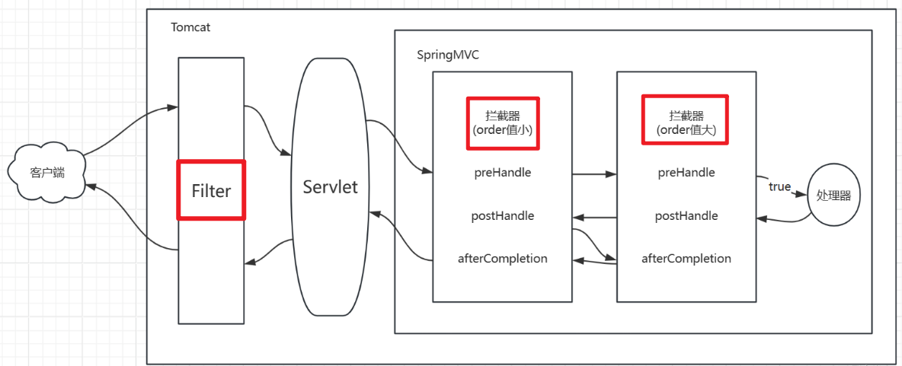

### 过滤器（Filter）

<font style="color:rgb(77, 77, 77);">过滤器（Filter）是 </font>**<font style="color:rgb(77, 77, 77);">Java Servlet</font>**<font style="color:rgb(77, 77, 77);"> 技术中的一个重要部分，用于</font>**<font style="color:rgb(77, 77, 77);">在 Servlet 处理请求之前或响应之后对数据进行某些处理</font>**<font style="color:rgb(77, 77, 77);">。过滤器可以实现诸如日志记录、请求数据修改、响应数据修改、权限控制等功能。</font>

<font style="color:rgb(77, 77, 77);"></font>

<font style="color:rgb(77, 77, 77);">过滤器工作在 Servlet 容器中，拦截客户端的请求和服务器的响应。过滤器链（Filter Chain）是多个过滤器按照一定的顺序执行的集合，一个请求可以依次通过多个过滤器，然后到达目标 Servlet，响应也会按相反的顺序经过这些过滤器返回给客户端。</font>

* **<font style="color:rgba(0, 0, 0, 0.75);">生命周期管理</font>**<font style="color:rgba(0, 0, 0, 0.75);">：</font>
  * <font style="color:rgba(0, 0, 0, 0.75);">Servlet 容器负责过滤器的生命周期管理。过滤器的生命周期方法包括</font><font style="color:rgba(0, 0, 0, 0.75);"> </font><code><font style="color:rgb(199, 37, 78);background-color:rgb(249, 242, 244);">init</font></code><font style="color:rgba(0, 0, 0, 0.75);">（初始化）、</font><code><font style="color:rgb(199, 37, 78);background-color:rgb(249, 242, 244);">doFilter</font></code><font style="color:rgba(0, 0, 0, 0.75);">（执行过滤操作）和</font><font style="color:rgba(0, 0, 0, 0.75);"> </font><code><font style="color:rgb(199, 37, 78);background-color:rgb(249, 242, 244);">destroy</font></code><font style="color:rgba(0, 0, 0, 0.75);">（销毁）。</font>
* **<font style="color:rgba(0, 0, 0, 0.75);">请求处理流程</font>**<font style="color:rgba(0, 0, 0, 0.75);">：</font>
  * <font style="color:rgba(0, 0, 0, 0.75);">当一个请求到达 Servlet 容器时，容器会根据部署描述符（web.xml）或注解配置，决定是否以及如何调用过滤器链。</font>
  * <font style="color:rgba(0, 0, 0, 0.75);">过滤器链是多个过滤器按照一定的顺序执行的集合。容器按照这个顺序依次调用每个过滤器的</font><font style="color:rgba(0, 0, 0, 0.75);"> </font><code><font style="color:rgb(199, 37, 78);background-color:rgb(249, 242, 244);">doFilter</font></code><font style="color:rgba(0, 0, 0, 0.75);"> </font><font style="color:rgba(0, 0, 0, 0.75);">方法。</font>
* **<font style="color:rgba(0, 0, 0, 0.75);">doFilter 方法</font>**<font style="color:rgba(0, 0, 0, 0.75);">：</font>
  * <font style="color:rgba(0, 0, 0, 0.75);">在</font><font style="color:rgba(0, 0, 0, 0.75);"> </font><code><font style="color:rgb(199, 37, 78);background-color:rgb(249, 242, 244);">doFilter</font></code><font style="color:rgba(0, 0, 0, 0.75);"> </font><font style="color:rgba(0, 0, 0, 0.75);">方法中，开发者可以实现自定义的处理逻辑，比如修改请求头、记录日志等。</font>
  * <code><font style="color:rgb(199, 37, 78);background-color:rgb(249, 242, 244);">doFilter</font></code><font style="color:rgba(0, 0, 0, 0.75);"> </font><font style="color:rgba(0, 0, 0, 0.75);">方法中必须调用</font><font style="color:rgba(0, 0, 0, 0.75);"> </font><code><font style="color:rgb(199, 37, 78);background-color:rgb(249, 242, 244);">FilterChain</font></code><font style="color:rgba(0, 0, 0, 0.75);"> </font><font style="color:rgba(0, 0, 0, 0.75);">的</font><font style="color:rgba(0, 0, 0, 0.75);"> </font><code><font style="color:rgb(199, 37, 78);background-color:rgb(249, 242, 244);">doFilter</font></code><font style="color:rgba(0, 0, 0, 0.75);"> </font><font style="color:rgba(0, 0, 0, 0.75);">方法，这样请求才能继续传递给下一个过滤器或目标资源（如 Servlet）。如果不调用，请求处理流程将会停止。</font>
* **<font style="color:rgba(0, 0, 0, 0.75);">工作机制</font>**<font style="color:rgba(0, 0, 0, 0.75);">：</font>
  * <font style="color:rgba(0, 0, 0, 0.75);">过滤器可以修改请求和响应，但它们通常不会生成响应或结束请求，因为这通常是 Servlet 或其他资源的职责。</font>

```java
@WebFilter("/example/*") // 过滤器应用于 URL 模式 "/example/*"
public class ExampleFilter implements Filter {
    
    @Override
    public void init(FilterConfig filterConfig) throws ServletException {
        // 初始化代码，例如资源加载
    }

    @Override
    public void doFilter(ServletRequest request, ServletResponse response, FilterChain chain)
            throws IOException, ServletException {
        // 在请求处理之前执行的代码
        System.out.println("Before Servlet processing");

        chain.doFilter(request, response); // 将请求传递给下一个过滤器或目标资源

        // 在请求处理之后执行的代码
        System.out.println("After Servlet processing");
    }

    @Override
    public void destroy() {
        // 清理代码，例如释放资源
    }
}
```

### 拦截器（Interceptor）

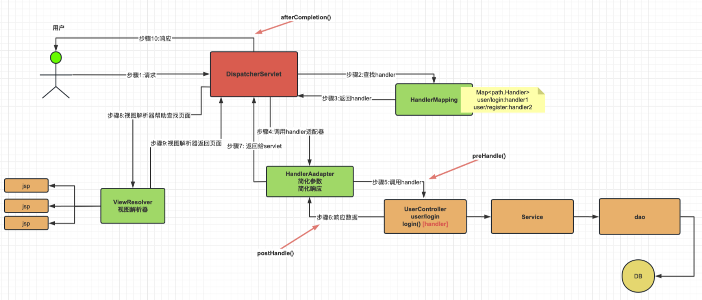

**<font style="color:rgb(77, 77, 77);">拦截器（Interceptor）是 Spring MVC 框架中的一个核心组件，用于在处理 HTTP 请求的过程中进行拦截和处理。拦截器主要用于实现跨切面（cross-cutting）的逻辑，如日志记录、性能统计、安全控制、事务处理等。</font>**

**<font style="color:rgb(77, 77, 77);">拦截器工作在 Spring 的 DispatcherServlet 和具体的 Controller 之间。</font>**<font style="color:rgb(77, 77, 77);">当一个请求被发送到 Spring MVC 应用时，DispatcherServlet 首先接收到这个请求，然后根据配置的拦截器链对请求进行预处理，最后将请求转发到相应的 Controller 进行处理。</font>

* **<font style="color:rgba(0, 0, 0, 0.75);">实现机制</font>**<font style="color:rgba(0, 0, 0, 0.75);">：</font>
  * <font style="color:rgba(0, 0, 0, 0.75);">在Spring框架中，拦截器（Interceptor）是基于</font>**<font style="color:rgba(0, 0, 0, 0.75);">Java动态代理和AOP（面向切面编程）的</font>**<font style="color:rgba(0, 0, 0, 0.75);">。</font>
  * **<font style="color:rgba(0, 0, 0, 0.75);">当一个请求到达被拦截的方法或Controller时，Spring利用动态代理生成一个代理对象，该代理对象包含了目标对象（被拦截的方法或Controller）以及拦截器的逻辑。</font>**<font style="color:rgba(0, 0, 0, 0.75);"></font>
* **<font style="color:rgba(0, 0, 0, 0.75);">集成于 Spring MVC</font>**<font style="color:rgba(0, 0, 0, 0.75);">：</font>
  * <font style="color:rgba(0, 0, 0, 0.75);">拦截器是与 Spring MVC 的</font><font style="color:rgba(0, 0, 0, 0.75);"> </font><code><font style="color:rgb(199, 37, 78);background-color:rgb(249, 242, 244);">DispatcherServlet</font></code><font style="color:rgba(0, 0, 0, 0.75);"> </font><font style="color:rgba(0, 0, 0, 0.75);">集成的。当一个请求被</font><font style="color:rgba(0, 0, 0, 0.75);"> </font><code><font style="color:rgb(199, 37, 78);background-color:rgb(249, 242, 244);">DispatcherServlet</font></code><font style="color:rgba(0, 0, 0, 0.75);"> </font><font style="color:rgba(0, 0, 0, 0.75);">接收后，它会处理和调度这个请求到相应的处理器（Controller）。</font>
* **<font style="color:rgba(0, 0, 0, 0.75);">处理器映射（Handler Mapping）</font>**<font style="color:rgba(0, 0, 0, 0.75);">：</font>
  * <font style="color:rgba(0, 0, 0, 0.75);">在请求到达 Controller 之前，Spring 会根据请求的 URL 查找对应的 Handler Mapping，然后确定相应的 Controller。</font>
* **<font style="color:rgba(0, 0, 0, 0.75);">拦截器链</font>**<font style="color:rgba(0, 0, 0, 0.75);">：</font>
  * <font style="color:rgba(0, 0, 0, 0.75);">在请求达到 Controller 之前，以及响应返回给客户端之前，拦截器链中的拦截器会被依次调用。</font>
  * <font style="color:rgba(0, 0, 0, 0.75);">通过实现 </font><code><font style="color:rgb(199, 37, 78);background-color:rgb(249, 242, 244);">WebMvcConfigurer</font></code><font style="color:rgba(0, 0, 0, 0.75);"> 接口的 </font><code><font style="color:rgb(199, 37, 78);background-color:rgb(249, 242, 244);">addInterceptors</font></code><font style="color:rgba(0, 0, 0, 0.75);"> 方法将它们添加到应用中。</font>
* **<font style="color:rgba(0, 0, 0, 0.75);">方法级别的拦截</font>**<font style="color:rgba(0, 0, 0, 0.75);">：</font>
  * <font style="color:rgba(0, 0, 0, 0.75);">更精细地控制处理流程，能够在 Controller 方法执行前后以及请求完成后进行拦截处理。</font>
* **<font style="color:rgba(0, 0, 0, 0.75);">上下文访问</font>**<font style="color:rgba(0, 0, 0, 0.75);">：</font>
  * <font style="color:rgba(0, 0, 0, 0.75);">拦截器可以访问请求的上下文，包括请求和响应对象、处理器（Controller）的信息等。这使得拦截器可以执行如权限检查、日志记录等更复杂的任务。</font>

```java
public class MyInterceptor implements HandlerInterceptor {
    @Override
    public boolean preHandle(HttpServletRequest request, HttpServletResponse response, Object handler) {
        // 请求处理前的逻辑
        return true; // 返回 true 继续流程，返回 false 中断流程
    }
    @Override
    public void postHandle(HttpServletRequest request, HttpServletResponse response, Object handler, ModelAndView modelAndView) {
        // 请求处理后的逻辑，但在视图渲染前
    }
    @Override
    public void afterCompletion(HttpServletRequest request, HttpServletResponse response, Object handler, Exception ex) {
        // 请求处理完毕后的逻辑
    }
}

@Configuration
public class WebMvcConfig implements WebMvcConfigurer {
    @Override
    public void addInterceptors(InterceptorRegistry registry) {
        registry.addInterceptor(new MyInterceptor()).addPathPatterns("/**"); // 应用于所有路径
    }
}
```

## Spring MVC 的核心组件有哪些？♥♥

* <code>**DispatcherServlet**</code>：**核心的中央处理器**，负责接收请求、分发，并给予客户端响应。
* <code>**HandlerMapping**</code>：**处理器映射器**，根据 URL 去匹配查找能处理的 <code>**Handler**</code> ，并会将请求涉及到的拦截器和 `Handler` 一起封装。
* <code>**HandlerAdapter**</code>：**处理器适配器**，根据 `HandlerMapping` 找到的 `Handler` ，适配执行对应的 `Handler`；
* <code>**Handler**</code>：**请求处理器**，处理实际请求的处理器。（controller）
* <code>**ViewResolver**</code>：**视图解析器**，根据 `Handler` 返回的逻辑视图 / 视图，解析并渲染真正的视图，并传递给 `DispatcherServlet` 响应客户端

# 根据URL获取具体的处理方法

```java
	protected void doDispatch(HttpServletRequest request, HttpServletResponse response) throws Exception {
		//保存原始请求
		HttpServletRequest processedRequest = request;
		HandlerExecutionChain mappedHandler = null;
		boolean multipartRequestParsed = false;
		try {
			ModelAndView mv = null;
			try {
				// Determine handler for the current request.
				// 标记1.0 根据request寻找handle 
				mappedHandler = getHandler(processedRequest);
				//根据handle寻找HandlerAdapter
				// 所有这里使用了适配器模式，对调用方法的接收参数和响应参数进行处理
				HandlerAdapter ha = getHandlerAdapter(mappedHandler.getHandler());
				//应用preHandle方法
				if (!mappedHandler.applyPreHandle(processedRequest, response)) {
					return;
				}
				// Actually invoke the handler.
				//调用真正的handle
				mv = ha.handle(processedRequest, response, mappedHandler.getHandler());
				//应用视图解析器
				applyDefaultViewName(processedRequest, mv);
				//应用postHandle方法
				mappedHandler.applyPostHandle(processedRequest, response, mv);
			}
	}
```

<font style="color:rgb(38, 38, 38);">getHandler()会根据请求request的url来</font>**<font style="color:rgb(38, 38, 38);">获取一个处理器执行链</font>****<font style="color:#DF2A3F;">HandlerExecutionChaing</font>****<font style="color:rgb(38, 38, 38);">，如何获取HandlerExecutionChaing 代码如下所示：</font>**

:::success <font style="color:rgb(38, 38, 38);">HandlerExecutionChain 之所以存在，主要是为了将处理器（Handler）与一组拦截器（Interceptors）绑定在一起，从而形成一个处理链。这个处理链不仅包含了核心的处理器逻辑，还包含了围绕处理器的前置和后置处理逻辑。</font>

:::

```java

	protected HandlerExecutionChain getHandler(HttpServletRequest request) throws Exception {
		if (this.handlerMappings != null) {
			//request 包括请求路径
			//handlerMappings 包括url 和controller&method的对应关系
			for (HandlerMapping hm : this.handlerMappings) {
				//获取处理器执行链
				HandlerExecutionChain handler = hm.getHandler(request);
				if (handler != null) {
					return handler;
				}
			}
		}
		return null;
	}
```

<font style="color:rgb(38, 38, 38);">调用HandlerMapping 的getHandler()方法尝试获取</font>**<font style="color:rgb(38, 38, 38);">处理器执行链</font>**<font style="color:rgb(38, 38, 38);">，如果遍历完HandlerMapping 还没有获取到处理器链则返回null，Springmvc默认会加载5个HandlerMapping。</font>

```java
public final HandlerExecutionChain getHandler(HttpServletRequest request) throws Exception {
		//标记2. 获取处理器
		Object handler = getHandlerInternal(request);
		if (handler == null) {
			handler = getDefaultHandler();
		}
		if (handler == null) {
			return null;
		}
		// Bean name or resolved handler
		if (handler instanceof String) {
			String handlerName = (String) handler;
			handler = obtainApplicationContext().getBean(handlerName);
		}

		//用HandlerExecutionChain 封装handler
		HandlerExecutionChain executionChain = getHandlerExecutionChain(handler, request);
		
		return executionChain;
	}
```

<font style="color:rgb(38, 38, 38);">getHandlerInternal()方法获取一个HandlerMethod，springmvc在底层缓存了url和HandlerMethod之间的对应关系，该映射关系被mappingRegistry所保存，当有请求来时，直接通过url获取HandlerMethod对象，后使用getHandlerExecutionChain()方法对请求和HandlerMethod进行封装，返回处理器执行链，处理方法如下所示：</font>

```java
protected HandlerExecutionChain getHandlerExecutionChain(Object handler, HttpServletRequest request) {
    HandlerExecutionChain chain = (handler instanceof HandlerExecutionChain handlerExecutionChain ?
                                   handlerExecutionChain : new HandlerExecutionChain(handler));

    for (HandlerInterceptor interceptor : this.adaptedInterceptors) {
        if (interceptor instanceof MappedInterceptor mappedInterceptor) {
            if (mappedInterceptor.matches(request)) {
                chain.addInterceptor(mappedInterceptor.getInterceptor());
            }
        }
        else {
            chain.addInterceptor(interceptor);
        }
    }
    return chain;
}
```

<font style="color:rgb(38, 38, 38);">最后，将HandlerExecutionChain 交给HandlerAdapter处理器处理</font>

## SpringMVC 工作原理了解吗?

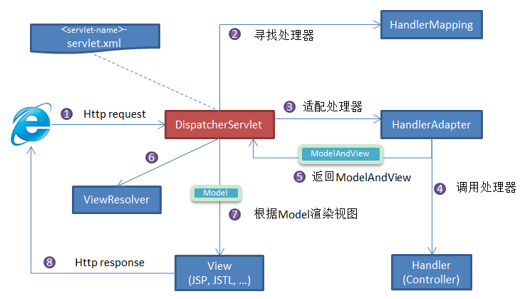

**流程说明（重要）**  **：**

1. 客户端（浏览器）发送请求， `DispatcherServlet`拦截请求。
2. `DispatcherServlet` 根据请求信息调用 `HandlerMapping` 。`HandlerMapping` 根据 URL 去匹配查找能处理的 `Handler`（ `Controller` 控制器） ，并会将请求涉及到的拦截器和 `Handler` 一起封装。
3. `DispatcherServlet` 调用 `HandlerAdapter`适配器执行 `Handler` 。
4. `Handler` 完成用户请求的处理后，返回`ModelAndView` 对象给`DispatcherServlet`，`ModelAndView` 包含了数据模型以及相应的视图的信息。`Model` 是返回的数据对象，`View` 是个逻辑上的 `View`。
5. `ViewResolver` 会根据逻辑 `View` 查找实际的 `View`。
6. `DispaterServlet` 把返回的 `Model` 传给 `View`（视图渲染）。
7. 把 `View` 返回给请求者（浏览器）

## RestFul风格下SpringMVC的工作流程 ♥♥♥

**Restful 接口，响应格式是 json，常用注解：@ResponseBody**

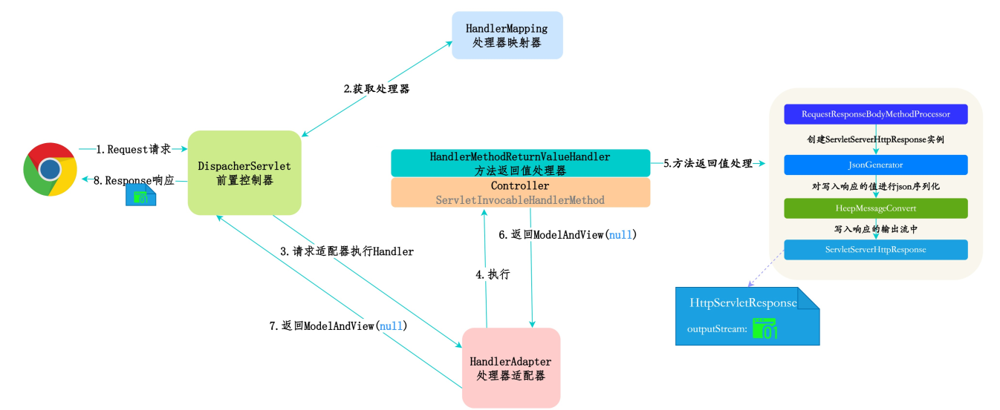

1. 客户端（浏览器）发送请求， `DispatcherServlet`拦截请求。
2. `DispatcherServlet` 根据请求信息调用 `HandlerMapping` 。`HandlerMapping` 根据 URL 去匹配查找能处理的 `Handler`（ `Controller` 控制器） ，并会将请求涉及到的拦截器和 `Handler` 一起封装。
3. `DispatcherServlet` 调用 `HandlerAdapter`适配器执行 `Handler` 。
4. `Handler` 完成用户请求的处理后，调用HandlerMethodReturnValueHandler去处理返回值
   1. 调用RequsetResponseBodyMethodProcessor，创建ServletHttpResponse实例。
   2. 使用HttpMessageConverter的write方法，将返回值写入ServletHttpResponse的OutputStream流中
   3. 写入时使用JsonGenerator（使用Jackson框架）对返回值Json序列化。
5. 执行完请求和，返回的ModelAndView是null，ServletHttpResoponse已经写入了响应Json，无需处理View。

## 统一异常处理怎么做？

推荐使用注解的方式统一异常处理，具体会使用到  <code>**<font style="color:#DF2A3F;">@ControllerAdvice</font>**</code>**<font style="color:#DF2A3F;">  +   </font>**<code>**<font style="color:#DF2A3F;">@ExceptionHandler</font>**</code>

```java
@ControllerAdvice
@ResponseBody
public class GlobalExceptionHandler {
    @ExceptionHandler(BaseException.class)
    public ResponseEntity<?> handleAppException(BaseException ex, HttpServletRequest request) {
      //......
    }
    @ExceptionHandler(value = ResourceNotFoundException.class)
    public ResponseEntity<ErrorReponse> handleResourceNotFoundException(ResourceNotFoundException ex, HttpServletRequest request) {
      //......
    }
}
```

# Spring 事务 ♥♥♥

## Spring 管理事务的方式有几种？

* **编程式事务**：在代码中硬编码(不推荐使用) : 通过 `TransactionTemplate`或者 `TransactionManager` 手动管理事务，实际应用中很少使用，但是对于你理解 Spring 事务管理原理有帮助。
* **声明式事务**：在 XML 配置文件中配置或者直接基于注解（推荐使用） : 实际是通过 AOP 实现（基于`@Transactional` 的全注解方式使用最多），但是粒度只能到方法级别，无法到代码块级别。

## Spring 事务中哪几种事务传播行为?

**事务传播行为是为了解决业务层事务方法之间互相调用的事务问题。\*\*\*\*<font style="color:#DF2A3F;">当事务方法被另一个事务方法调用时，必须指定事务应该如何传播</font>**。例如：方法可能继续在现有事务中运行，也可能开启一个新事务在自己的事务中运行。

**1.**<code>**TransactionDefinition.PROPAGATION_****<font style="color:#DF2A3F;">REQUIRED</font>**</code>

使用的最多的一个事务传播行为，我们平时经常使用的`@Transactional`注解默认使用就是这个事务传播行为。如果当前存在事务，则加入该事务；如果当前没有事务，则创建一个新的事务。

<code>**2.TransactionDefinition.PROPAGATION_****<font style="color:#DF2A3F;">REQUIRES_NEW</font>**</code>

创建一个新的事务，如果当前存在事务，则把当前事务挂起。也就是说不管外部方法是否开启事务，`Propagation.REQUIRES_NEW`修饰的内部方法会新开启自己的事务，且开启的事务相互独立，互不干扰。

**3.**<code>**TransactionDefinition.PROPAGATION_****<font style="color:#DF2A3F;">NESTED</font>**</code>

如果当前存在事务，则创建一个事务作为当前事务的\*\*<font style="color:#DF2A3F;">嵌套</font>\*\*事务来运行；如果当前没有事务，则该取值等价于`TransactionDefinition.PROPAGATION_REQUIRED`。

**4.**<code>**TransactionDefinition.PROPAGATION_****<font style="color:#DF2A3F;">MANDATOR</font>**</code>

如果当前存在事务，则加入该事务；如果当前没有事务，则抛出异常。（mandatory：强制性）。这个使用的很少。

若是错误的配置以下 3 种事务传播行为，事务将不会发生回滚：

* <code>**TransactionDefinition.PROPAGATION_SUPPORTS**</code>: 如果当前存在事务，则加入该事务；如果当前没有事务，则以非事务的方式继续运行。
* <code>**TransactionDefinition.PROPAGATION_NOT_SUPPORTED**</code>: 以非事务方式运行，如果当前存在事务，则把当前事务挂起。
* <code>**TransactionDefinition.PROPAGATION_NEVER**</code>: 以非事务方式运行，如果当前存在事务，则抛出异常。

## Spring事务嵌套过深导致性能原因

过多的事务嵌套会导致资源的利用增加，或者是数据库锁等待的时间较长。

优化方案：减少不必要的资源嵌套，合并服务的操作，或者调整事务的传播行为，使用<code>**PROPAGATION_****<font style="color:#DF2A3F;">REQUIRES_NEW</font>**</code>**代替**<code>**PROPAGATION_****<font style="color:#DF2A3F;">REQUIRED</font>**</code>**。**

## Spring 事务中的隔离级别有哪几种?

和事务传播行为这块一样，为了方便使用，Spring 也相应地定义了一个枚举类：`Isolation`。

```java
public enum Isolation {

    DEFAULT(TransactionDefinition.ISOLATION_DEFAULT),

    READ_UNCOMMITTED(TransactionDefinition.ISOLATION_READ_UNCOMMITTED),

    READ_COMMITTED(TransactionDefinition.ISOLATION_READ_COMMITTED),

    REPEATABLE_READ(TransactionDefinition.ISOLATION_REPEATABLE_READ),

    SERIALIZABLE(TransactionDefinition.ISOLATION_SERIALIZABLE);

    private final int value;

    Isolation(int value) {
        this.value = value;
    }
    public int value() {
        return this.value;
    }
```

* <code>**TransactionDefinition.ISOLATION_DEFAULT**</code> :使用后端数据库默认的隔离级别，MySQL 默认采用的 `REPEATABLE_READ` 隔离级别 Oracle 默认采用的 `READ_COMMITTED` 隔离级别.
* <code>**TransactionDefinition.ISOLATION_****<font style="color:#DF2A3F;">READ_UNCOMMITTED</font>**</code> :最低的隔离级别，使用这个隔离级别很少，因为它允许读取尚未提交的数据变更，**可能会导致脏读、幻读或不可重复读**
* <code>**TransactionDefinition.ISOLATION_****<font style="color:#DF2A3F;">READ_COMMITTED</font>**</code> : 允许读取并发事务已经提交的数据，**可以阻止脏读，但是幻读或不可重复读仍有可能发生**
* <code>**TransactionDefinition.ISOLATION_****<font style="color:#DF2A3F;">REPEATABLE_READ</font>**</code> : 对同一字段的多次读取结果都是一致的，除非数据是被本身事务自己所修改，**可以阻止脏读和不可重复读，但幻读仍有可能发生。**
* <code>**TransactionDefinition.ISOLATION_****<font style="color:#DF2A3F;">SERIALIZABLE</font>**</code> : 最高的隔离级别，完全服从 ACID 的隔离级别。所有的事务依次逐个执行，这样事务之间就完全不可能产生干扰，也就是说，**该级别可以防止脏读、不可重复读以及幻读**。但是这将严重影响程序的性能。通常情况下也不会用到该级别。

## @Transactional(rollbackFor  = Exception.class)注解了解吗？

`Exception` 分为运行时异常 `RuntimeException` 和非运行时异常。事务管理对于企业应用来说是至关重要的，**即使出现异常情况，它也可以保证数据的一致性**。

当 `@Transactional` 注解作用于类上时，该类的所有 \*\*<font style="color:#DF2A3F;">public 方法</font>\*\*将都具有该类型的事务属性，同时，我们也可以在方法级别使用该标注来覆盖类级别的定义。如果类或者方法加了这个注解，那么这个类里面的方法抛出异常，就会回滚，数据库里面的数据也会回滚。

在 `@Transactional` **注解中如果不配置**`rollbackFor`**属性,那么事务只会在遇到**`RuntimeException`**的时候才会回滚**，加上 `rollbackFor=Exception.class`,可以让事务在遇到非运行时异常时也回滚。

## @Transactional失效场景 ♥♥♥♥

1. **<font style="color:#DF2A3F;">注解添加在非public的方法</font>**<font style="color:#DF2A3F;"> </font>**<font style="color:#DF2A3F;">：</font>**  当@Transactional**注解添加在一个非public的方法上**，该方法是通过内部调用（而不是通过代理调用）时，事务可能会失效。
2. **<font style="color:#DF2A3F;">异常未被正确捕获</font>**<font style="color:#DF2A3F;"> </font>**<font style="color:#DF2A3F;">：</font>**  如果在@Transactional注解的方法中抛出异常，但异常未被正确捕获\*\*（rollbackfor配置错误）\*\*而导致方法直接返回，事务可能无法正常回滚。
3. **<font style="color:#DF2A3F;">同一个类中方法调用</font>\*\*\*\*：**  如果@Transactional注解的方法直接在同一个类中的另一个方法中被调用，事务可能会失效，因为Spring默认使用基于代理的AOP实现。

[Spring同一个Service类非事务方法调用事务方法事务失效解决方案\_在一个非事务方法里面,调用相同类下面事务方法b, 那么方法b事务也不会生效;-CSDN博客](https://blog.csdn.net/shichen2010/article/details/121792816)

4. **<font style="color:#DF2A3F;">数据库引擎不支持事务</font>\*\*\*\*：**  如果数据库引擎不支持事务操作，或者事务管理器配置不正确，也会导致@Transactional注解失效。
5. **<font style="color:#DF2A3F;">事务方法被final修饰</font>\*\*\*\*：**  如果@Transactional注解的方法被final修饰，Spring无法基于代理实现事务管理，可能导致事务失效。
6. **事务传播行为配置错误**：配置了上述的错误传播行为导致事务失效。

关于事务实效的第三点，案例如下

```java
@Service
public class UserService {

    public void createUser(User user) {
        // 这里直接调用了同类中的事务方法
        this.saveUser(user);  // 事务不会生效!
        this.saveLog(user);   // 即使saveLog抛出异常，saveUser的操作也不会回滚
    }

    @Transactional
    public void saveUser(User user) {
        // 保存用户到数据库
        userRepository.save(user);
    }

    public void saveLog(User user) {
        // 保存日志
        logRepository.save(new Log("User created: " + user.getName()));
        throw new RuntimeException("模拟日志保存失败"); // 故意抛出异常
    }
}
```

1. <font style="color:rgb(64, 64, 64);">外部调用</font><code>**<font style="color:rgb(64, 64, 64);background-color:rgb(236, 236, 236);">createUser()</font>**</code><font style="color:rgb(64, 64, 64);">时，Spring代理会拦截这个调用</font>
2. <font style="color:rgb(64, 64, 64);">但</font><code>**<font style="color:rgb(64, 64, 64);background-color:rgb(236, 236, 236);">createUser()</font>**</code><font style="color:rgb(64, 64, 64);">方法内部直接调用</font><code>**<font style="color:rgb(64, 64, 64);background-color:rgb(236, 236, 236);">saveUser()</font>**</code><font style="color:rgb(64, 64, 64);">时，是</font>**<font style="color:rgb(64, 64, 64);">直接调用</font>**<font style="color:rgb(64, 64, 64);">而不是通过代理调用</font>
3. <font style="color:rgb(64, 64, 64);">因此</font><code>**<font style="color:rgb(64, 64, 64);background-color:rgb(236, 236, 236);">@Transactional</font>**</code><font style="color:rgb(64, 64, 64);">的切面逻辑不会被执行</font>
4. <font style="color:rgb(64, 64, 64);">即使</font><code>**<font style="color:rgb(64, 64, 64);background-color:rgb(236, 236, 236);">saveLog()</font>**</code><font style="color:rgb(64, 64, 64);">抛出异常，</font><code>**<font style="color:rgb(64, 64, 64);background-color:rgb(236, 236, 236);">saveUser()</font>**</code><font style="color:rgb(64, 64, 64);">的操作也不会回滚</font>

# Spring Data JPA

## 如何使用 JPA 在数据库中非持久化一个字段？

```java
@Entity(name="USER")
public class User {

    @Id
    @GeneratedValue(strategy = GenerationType.AUTO)
    @Column(name = "ID")
    private Long id;

    @Column(name="USER_NAME")
    private String userName;

    @Column(name="PASSWORD")
    private String password;

    private String secrect;

}
```

如果我们想让`secrect` 这个字段不被持久化 - 静态修饰，final修饰，transient修饰，@Transient注解

```java
static String transient1; // not persistent because of static
final String transient2 = "Satish"; // not persistent because of final
transient String transient3; // not persistent because of transient
@Transient
String transient4; // not persistent because of @Transient
```

**一般使用后面两种方式比较多**

## JPA 的审计功能是做什么的？有什么用？

**审计功能主要是帮助我们记录数据库操作的具体行为比如某条记录是谁创建的、什么时间创建的、最后修改人是谁、最后修改时间是什么时候。**

```java
@Data
@AllArgsConstructor
@NoArgsConstructor
@MappedSuperclass
@EntityListeners(value = AuditingEntityListener.class)
public abstract class AbstractAuditBase {

    @CreatedDate
    @Column(updatable = false)
    @JsonIgnore
    private Instant createdAt;

    @LastModifiedDate
    @JsonIgnore
    private Instant updatedAt;

    @CreatedBy
    @Column(updatable = false)
    @JsonIgnore
    private String createdBy;

    @LastModifiedBy
    @JsonIgnore
    private String updatedBy;
}
```

* `@CreatedDate`: 表示该字段为创建时间字段，在这个实体被 insert 的时候，会设置值
* `@CreatedBy` :表示该字段为创建人，在这个实体被 insert 的时候，会设置值\
  `@LastModifiedDate`、`@LastModifiedBy`同理

## 实体之间的关联关系注解有哪些？

* `@OneToOne` : 一对一。
* `@ManyToMany`：多对多。
* `@OneToMany` : 一对多。
* `@ManyToOne`：多对一。

利用 `@ManyToOne` 和 `@OneToMany` 也可以表达多对多的关联关系。

# Spring Security

## 有哪些控制请求访问权限的方法？

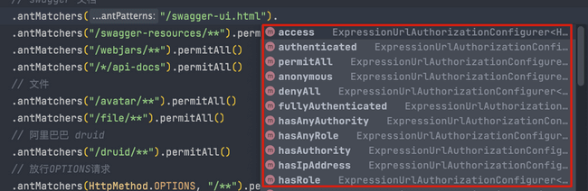

* `permitAll()`：无条件允许任何形式访问，不管你登录还是没有登录。
* `anonymous()`：允许匿名访问，也就是没有登录才可以访问。
* `denyAll()`：无条件决绝任何形式的访问。
* `authenticated()`：只允许已认证的用户访问。
* `fullyAuthenticated()`：只允许已经登录或者通过 remember-me 登录的用户访问。
* `hasRole(String)` : 只允许指定的角色访问。
* `hasAnyRole(String)` : 指定一个或者多个角色，满足其一的用户即可访问。
* `hasAuthority(String)`：只允许具有指定权限的用户访问
* `hasAnyAuthority(String)`：指定一个或者多个权限，满足其一的用户即可访问。
* `hasIpAddress(String)` : 只允许指定 ip 的用户访问。

## 如何对密码进行加密？

如果我们需要保存密码这类敏感数据到数据库的话，需要先加密再保存。

Spring Security 提供了多种加密算法的实现，开箱即用，非常方便。这些加密算法实现类的父类是 `PasswordEncoder` ，如果你想要自己实现一个加密算法的话，也需要继承 `PasswordEncoder`。

`PasswordEncoder` 接口一共也就 3 个必须实现的方法。

```java
public interface PasswordEncoder {
    // 加密也就是对原始密码进行编码
    String encode(CharSequence var1);
    // 比对原始密码和数据库中保存的密码
    boolean matches(CharSequence var1, String var2);
    // 判断加密密码是否需要再次进行加密，默认返回 false
    default boolean upgradeEncoding(String encodedPassword) {
        return false;
    }
}
```


> 更新: 2025-07-14 18:01:57  
> 原文: <https://www.yuque.com/nibiwanxiamei/yrd6t1/a27d40442f2379900045bac0c5917bfa>