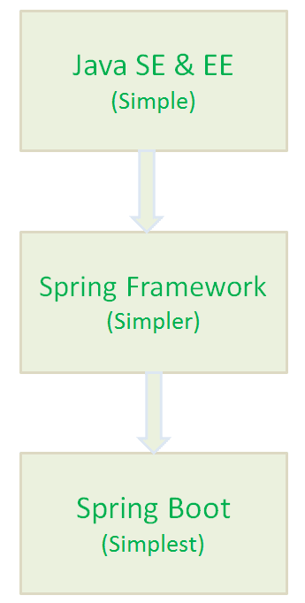
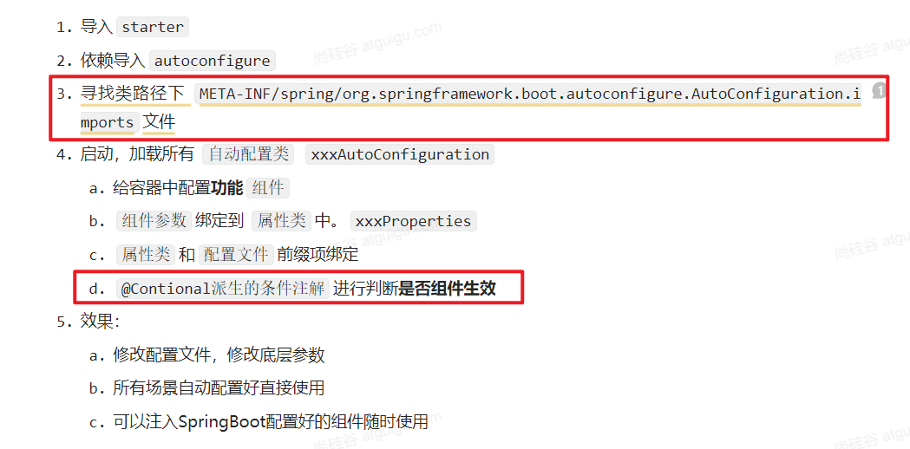
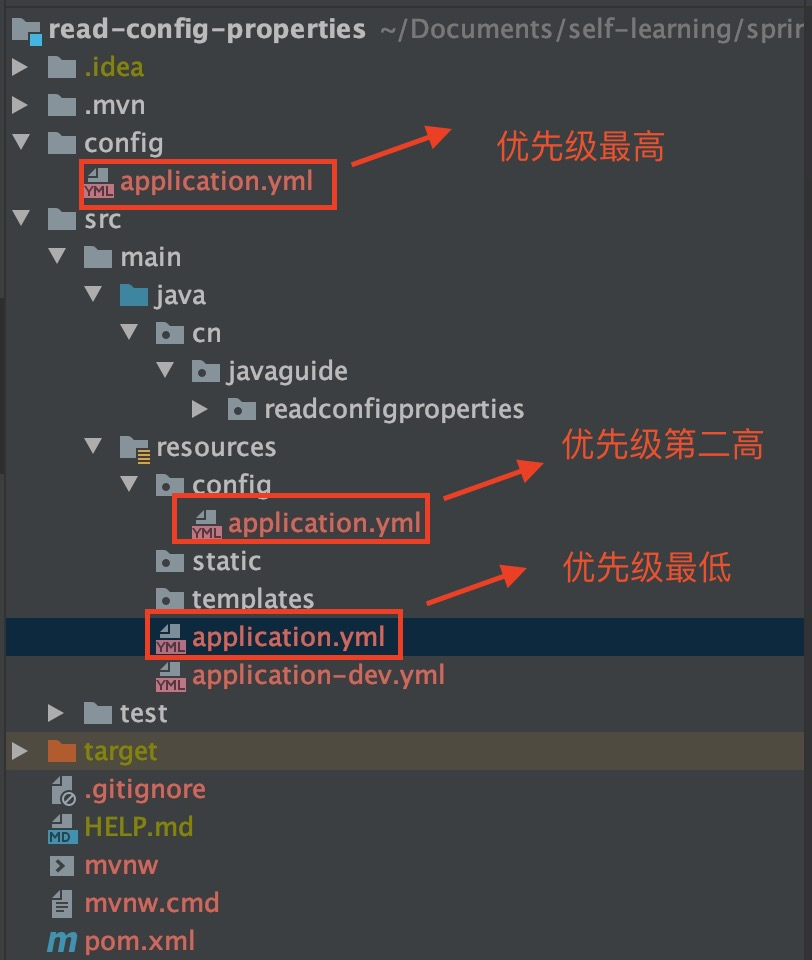
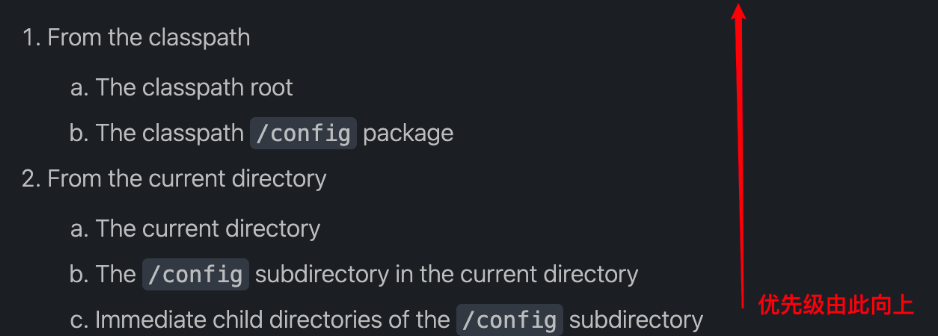
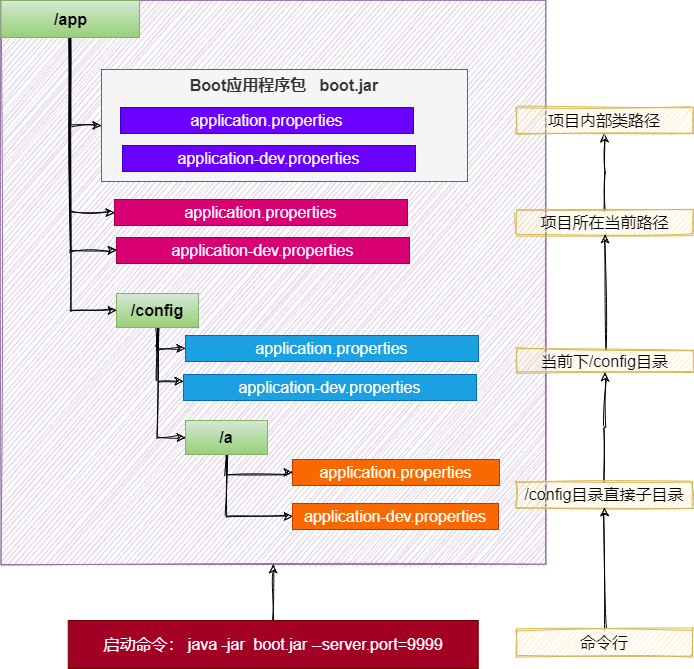
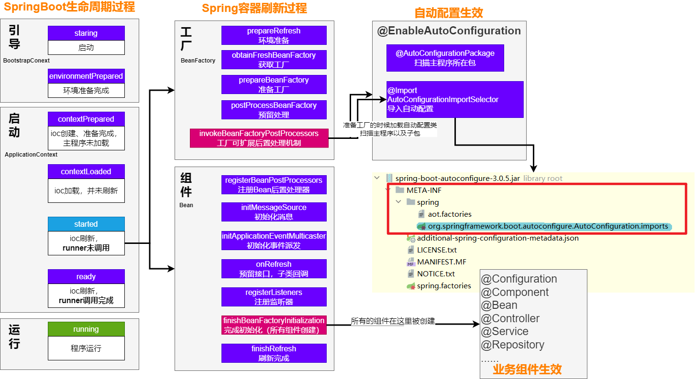

# SpringBoot

***

## 简单介绍一下 Spring?有啥缺点?

**Spring 是一款开源的轻量级 Java 开发框架** ，**Spring 支持** **IoC** **（Inversion of Control:控制反转） 和** **AOP** **(Aspect-Oriented Programming:面向切面编程)** 、**可以很方便地对数据库访问** **、可以很方便地集成第三方组件（电子邮件，任务，调度，缓存等等）、对单元测试支持比较好、支持 RESTful Java 应用程序的开发。**

**<font style="color:#DF2A3F;">虽然 Spring 的组件代码是轻量级的，但它的配置却是重量级的（需要大量 XML 配置） 。</font>**

为此，Spring 2.5 引入了基于注解的组件扫描，这消除了大量针对应用程序自身组件的显式 XML 配置。Spring 3.0 引入了基于 Java 的配置，这是一种类型安全的可重构配置方式，可以代替 XML。

尽管如此，我们依旧没能逃脱配置的魔爪。开启某些 Spring 特性时，比如事务管理和 Spring MVC，还是需要用 XML 或 Java 进行显式配置。启用第三方库时也需要显式配置，比如基于 Thymeleaf 的 Web 视图。配置 Servlet 和过滤器（比如 Spring 的DispatcherServlet）同样需要在 web.xml 或 Servlet 初始化代码里进行显式配置。组件扫描减少了配置量，Java 配置让它看上去简洁不少，但 Spring 还是需要不少配置。

## 为什么要有 SpringBoot?

**<font style="color:#DF2A3F;">Spring Boot 是一个基于 Spring 框架的开源框架，用于快速创建独立的、生产级别的、可运行的 Spring 应用程序。它采用了约定优于配置的理念，基于SpringBoot自动配置原理，使开发者可以不需要手动配置大量的 Spring 配置文件，而快速搭建可运行的应用程序，SpringBoot会帮助开发者做很多配置和装配任务。</font>**



**SpringBoot约定优于配置（相当于要使用SpringBoot，第三方就要给我默认配置好，用户可以直接使用默认配置就运行项目，当然这些配置也是可以修改的）**

## 说出使用 Spring Boot 的主要优点

* Spring Boot 基于\*\*<font style="color:#DF2A3F;">自动配置</font>\*\*，所需的开发或工程时间减少，通常会提高整体生产力。
* Spring Boot 不需要编写大量样板代码、XML 配置和注释。
* Spring Boot 可以与 Spring 生态系统集成， Spring JDBC、Spring ORM、Spring Data、Spring Security 等。
* Spring Boot **<font style="color:#DF2A3F;">遵循约定优于配置</font>\*\*\*\*，用户可以直接使用默认配置就运行项目**
* Spring Boot **<font style="color:#DF2A3F;">应用程序内嵌web容器</font>**，如 Tomcat 和 Jetty，可以轻松地开发和测试 web 应用程序
* Spring Boot 提供命令行接口(CLI)工具，用于开发和测试 Spring Boot 应用程序
* Spring Boot 提供了多种插件，可以使用内置工具(如 Maven 和 Gradle)开发和测试 Spring Boot 应用程序。

## 什么是 Spring Boot Starters?

Spring Boot Starters 是**一系列依赖关系的集合**。引入一个starter就可以快速地集成相关的技术或库

在没有 Spring Boot Starters 之前，我们开发 REST 服务或 Web 应用程序时; 我们需要使用像 Spring MVC，Tomcat 和 Jackson 这样的库，这些依赖我们需要手动一个一个添加。但是，有了 Spring Boot Starters 我们只需要一个只需添加一个spring-boot-starter-web一个依赖就可以了，这个依赖包含的子依赖中包含了我们开发 REST 服务需要的所有依赖。

```xml
<dependency>
    <groupId>org.springframework.boot</groupId>
    <artifactId>spring-boot-starter-web</artifactId>
</dependency>
```

## spring-boot-starter-parent有什么作用？

spring-boot-starter-parent 是 **Spring Boot 官方提供的一个 Maven 父工程**，作为 Spring Boot 项目的父工程，**<font style="color:#DF2A3F;">继承了一些常用依赖的版本号和插件的配置</font>\*\*\*\*，可以方便地引入 Spring Boot 的依赖，减少了手动配置的复杂度和出错的概率，同时也确保了 Spring Boot 依赖之间的兼容性。**

> **<font style="color:#DF2A3F;">官方配置好的maven依赖，包括其他依赖的版本都帮我们管理好了，并不需要自己手动配置。</font>**

## Spring Boot 支持哪些内嵌 Servlet 容器？

| Name    | Servlet Version    |
| --- | --- |
| Tomcat 9.0    | 4.0    |
| Jetty 9.4    | 3.1    |
| Undertow 2.0    | 4.0 |

## SpringBoot 实现热部署有哪几种方式？

使用\*\* Spring DevTools\*\*：Spring DevTools 可以在项目的 POM 文件中添加依赖来使用

```xml

<dependency>
    <groupId>org.springframework.boot</groupId>
    <artifactId>spring-boot-devtools</artifactId>
    <optional>true</optional>
</dependency>
```

使用\*\* Spring Loaded\*\*：一个 Java 类热替换工具，能够实现类文件的快速重载，避免了反复构建和部署的过程

## 介绍一下@SpringBootApplication 注解

```java
package org.springframework.boot.autoconfigure;
@Target(ElementType.TYPE)
@Retention(RetentionPolicy.RUNTIME)
@Documented
@Inherited
@SpringBootConfiguration
@EnableAutoConfiguration
@ComponentScan(excludeFilters = {
		@Filter(type = FilterType.CUSTOM, classes = TypeExcludeFilter.class),
		@Filter(type = FilterType.CUSTOM, classes = AutoConfigurationExcludeFilter.class) })
public @interface SpringBootApplication {
   ......
}
```

@SpringBootApplication是  **<font style="color:#DF2A3F;">@Configuration、@EnableAutoConfiguration、@ComponentScan</font>**\*\*  \*\* 注解的集合。

* **@EnableAutoConfiguration：启用 SpringBoot 的自动配置机制**
* **@ComponentScan： 扫描组件bean，注解默认会扫描**\*\*<font style="color:#DF2A3F;">该类所在的包及其子包下所有的类</font>\*\*\*\*。\*\*
* **@Configuration：用来直接或间接注册Bean到IOC容器中的**

## **Spring Boot 的自动配置是如何实现的?**



\*\*<font style="color:#DF2A3F;">@EnableAutoConfiguration</font>\*\*是启动自动配置的关键，源码如下：

```java
@Target({ElementType.TYPE})
@Retention(RetentionPolicy.RUNTIME)
@Documented
@Inherited
@AutoConfigurationPackage
@Import({AutoConfigurationImportSelector.class})
public @interface EnableAutoConfiguration {
    String ENABLED_OVERRIDE_PROPERTY = "spring.boot.enableautoconfiguration";

    Class<?>[] exclude() default {};

    String[] excludeName() default {};
}
```

:::success

1. **<font style="color:#DF2A3F;">@EnableAutoConfiguration 注解通过 Spring 提供的  @Import   注解导入了AutoConfigurationImportSelector</font>**<font style="color:#DF2A3F;">类</font>（@Import  注解可以导入配置类或者 Bean 到当前类中）。
2. AutoConfigurationImportSelector类中**getCandidateConfigurations()** 方法会扫描META-INF/spring.factory文件，文件内存放的是需要自动配置的类全路径，**<font style="color:#DF2A3F;">将所有自动配置类的信息以 List 的形式返回。这些配置信息会被 Spring 容器作 bean 来管理。</font>**
3. **<font style="color:#DF2A3F;">再根据@Conditional  注解来判定那些类需要加载进入容器中。</font>**

:::

```java
protected List<String> getCandidateConfigurations(AnnotationMetadata metadata, AnnotationAttributes attributes) {
		List<String> configurations = SpringFactoriesLoader.loadFactoryNames(getSpringFactoriesLoaderFactoryClass(),
				getBeanClassLoader());
		Assert.notEmpty(configurations, "No auto configuration classes found in META-INF/spring.factories. If you "
				+ "are using a custom packaging, make sure that file is correct.");
		return configurations;
	}
```

@Conditional  注解

1. @ConditionalOnClass：其中指定的类必须存在时，才会生效。
2. @ConditionalOnBean：容器中有指定的Bean时，才会生效。

拿 Spring Security 的自动配置举个例子:SecurityAutoConfiguration中导入了**WebSecurityEnablerConfiguration**类，WebSecurityEnablerConfiguration源代码如下：

```java
@Configuration
@ConditionalOnBean(WebSecurityConfigurerAdapter.class)
@ConditionalOnMissingBean(name = BeanIds.SPRING_SECURITY_FILTER_CHAIN)
@ConditionalOnWebApplication(type = ConditionalOnWebApplication.Type.SERVLET)
@EnableWebSecurity
public class WebSecurityEnablerConfiguration {

}
```

WebSecurityEnablerConfiguration类中使用 **@ConditionalOnBean  **指定了容器中必须还有**WebSecurityConfigurerAdapter** 类或其实现类。所以，一般情况下 Spring Security 配置类都会去实现 **WebSecurityConfigurerAdapter**，这样自动将配置就完成了。

## 什么是 YAML？YAML 配置的优势在哪里 ?

YAML 是一种人类可读的数据序列化语言。它通常用于配置文件。与属性文件相比，如果我们想要在配置文件中添加复杂的属性，YAML 文件就更加结构化，而且更少混淆。可以看出 YAML 具有分层配置数据。

相比于 Properties 配置的方式，**YAML 配置的方式更加直观清晰，简介明了，有层次感**。

YAML 配置的方式有一个缺点，那就是不支持 [@PropertySource ](/PropertySource) 注解导入自定义的 YAML 配置。

## SpringBoot的核心配置文件有哪几个？他们的区别是什么？

**Spring Boot的核心配置文件有以下几个：**

1. **application.properties**
2. **application.yml**
3. **bootstrap.properties**
4. **bootstrap.yml**

**<font style="color:#DF2A3F;">application是应用程序的配置文件，而bootstrap是用于Spring Boot上下文的配置文件。</font>**

## Spring Boot 加载配置文件的优先级？



配置文件优先级如下：（逐渐升高）

* jar 包内的application.properties/yml
* jar 包内的application-{profile}.properties/yml
* jar 包外的application.properties/yml
* jar 包外的application-{profile}.properties/yml

建议：用一种格式的配置文件。**<font style="color:#DF2A3F;">如果.properties和.yml同时存在,则.properties优先</font>**



> **结论：\*\*\*\*<font style="color:#DF2A3F;">包外 > 包内； 同级情况：profile配置 > application配置，文件下config包内大于此文件下其他配置文件。bootstrap.yml文件会优先于nacos读取配置文件，nacos地址就再此配置文件中</font>**



## Spring Boot 如何做请求参数校验？

Spring Boot 程序做请求参数校验的话只需要**spring-boot-starter-web** 依赖就够了，它的子依赖包含了我们所需要的东西。

### 校验注解

JSR 提供的校验注解:

* @Null  被注释的元素必须为 null
* @NotNull  被注释的元素必须不为 null
* @AssertTrue  被注释的元素必须为 true
* @AssertFalse  被注释的元素必须为 false
* @Min(value)  被注释的元素必须是一个数字，其值必须 **大于等于指定的最小值**
* @Max(value)  被注释的元素必须是一个数字，其值必须小于等于指定的最大值
* @DecimalMin(value)  被注释的元素必须是一个数字，其值必须大于等于指定的最小值
* @DecimalMax(value)  被注释的元素必须是一个数字，其值必须小于等于指定的最大值
* @Size(max=, min=) 被注释的元素的大小必须在指定的范围内
* @Digits  (integer, fraction) 被注释的元素必须是一个数字，其值必须在可接受的范围内
* @Past  被注释的元素必须是一个过去的日期
* @Future  被注释的元素必须是一个将来的日期
* @Pattern(regex=,flag=) 被注释的元素必须符合指定的正则表达式

Hibernate Validator 提供的校验注解：

* @NotBlank(message  =) 验证字符串非 null，且长度必须大于 0
* @Email  被注释的元素必须是电子邮箱地址
* @Length(min=,max=) 被注释的字符串的大小必须在指定的范围内
* @NotEmpty  被注释的字符串的必须非空
* @Range(min=,max=,message=) 被注释的元素必须在合适的范围内

```java
@Data
@AllArgsConstructor
@NoArgsConstructor
public class Person {

    @NotNull(message = "classId 不能为空")
    private String classId;

    @Size(max = 33)
    @NotNull(message = "name 不能为空")
    private String name;

    @Pattern(regexp = "((^Man$|^Woman$|^UGM$))", message = "sex 值不在可选范围")
    @NotNull(message = "sex 不能为空")
    private String sex;

    @Email(message = "email 格式不正确")
    @NotNull(message = "email 不能为空")
    private String email;

}
```

### 验证请求体(RequestBody)

需要验证的参数上加上了 \*\*<font style="color:#DF2A3F;">@Valid  </font>\*\*\*\*注解 \*\*，如果验证失败，它将抛出MethodArgumentNotValidException。默认情况下，Spring 会将此异常转换为 HTTP Status 400（错误请求）。

```java
@RestController
@RequestMapping("/api")
public class PersonController {

    @PostMapping("/person")
    public ResponseEntity<Person> getPerson(@RequestBody @Valid Person person) {
        return ResponseEntity.ok().body(person);
    }
}
```

### 验证请求参数(Path Variables 和 Request Parameters)

```java
@RestController
@RequestMapping("/api")
@Validated
public class PersonController {

    @GetMapping("/person/{id}")
    public ResponseEntity<Integer> getPersonByID(@Valid @PathVariable("id") @Max(value = 5,message = "超过 id 的范围了") Integer id) {
        return ResponseEntity.ok().body(id);
    }

    @PutMapping("/person")
    public ResponseEntity<String> getPersonByName(@Valid @RequestParam("name") @Size(max = 6,message = "超过 name 的范围了") String name) {
        return ResponseEntity.ok().body(name);
    }
}
```

## 如何使用 Spring Boot 实现全局异常处理？

可以使用 **<font style="color:#DF2A3F;">@ControllerAdvice  和 @ExceptionHandler</font>**  处理全局异常。

```java
/**
 * 统一异常处理、数据预处理等
 */
@ControllerAdvice
public class ControllerExceptionHandler {

    private static final Logger LOG = LoggerFactory.getLogger(ControllerExceptionHandler.class);

    /**
     * 所有异常统一处理
     * @param e
     * @return
     */
    @ExceptionHandler(value = Exception.class)
    @ResponseBody
    public CommonResult exceptionHandler(Exception e) throws Exception{
        LOG.info("seata全局事务ID：{}", RootContext.getXID());
        if (StrUtil.isNotBlank(RootContext.getXID())){
            throw e;
        }
        CommonResult commonResp = new CommonResult();
        LOG.error("系统异常：", e);
        commonResp.setSuccess(false);
        commonResp.setMessage("系统出现异常，请联系管理员");
        return commonResp;
    }

    /**
     * 业务异常统一处理
     * @param e
     * @return
     */
    @ExceptionHandler(value = BusinessException.class)
    @ResponseBody
    public CommonResult exceptionHandler(BusinessException e) {
        CommonResult commonResp = new CommonResult();
        LOG.error("业务异常：{}", e.getE().getDesc());
        commonResp.setSuccess(false);
        commonResp.setMessage(e.getE().getDesc());
        return commonResp;
    }

    /**
     * 校验异常统一处理
     * @param e
     * @return
     */
    @ExceptionHandler(value = BindException.class)
    @ResponseBody
    public CommonResult exceptionHandler(BindException e) {
        CommonResult commonResp = new CommonResult();
        LOG.error("校验异常：{}", e.getBindingResult().getAllErrors().get(0).getDefaultMessage());
        commonResp.setSuccess(false);
        commonResp.setMessage(e.getBindingResult().getAllErrors().get(0).getDefaultMessage());
        return commonResp;
    }

}
```

## Spring Boot 中如何实现定时任务 ?

\*\*@Scheduled \*\* 注解就能很方便地创建一个定时任务。

```java

@EnableScheduling
@Component
public class SpringBootTestJob {
    //秒 分 时 日 月 星期	年
    @Scheduled(cron = "0/5 * * * * ?")
    private void test(){
        System.out.println("SpringBootTestJobTesting!!!");
    }
}
```

需要在 SpringBoot 中我们只需要在启动类上加上\*\*@EnableScheduling  \*\*注解，这样才可以启动定时任务。

但是项目中用的比较多的是**quartz | XXLJob**

* **springboot自带定时任务不适合集群使用。单体应用是可以的。**
* **虽然可以加分布式锁解决集群，但是效率不高。**
* **无法实时更改定时任务状态和策略。**

```java
public class QuartzTest implements Job {
    @Override
    public void execute(JobExecutionContext jobExecutionContext) throws JobExecutionException {
        System.out.println("QuartzTestJobTesting!!!");
    }
}

@Configuration
 public class QuartzConfig {

     /**
      * 声明一个任务
      * @return
      */
     @Bean
     public JobDetail jobDetail() {
         return JobBuilder.newJob(QuartzTest.class)
                 .withIdentity("QuartzTestJob", "test")
                 .storeDurably()
                 .build();
     }

     /**
      * 声明一个触发器，什么时候触发这个任务
      * @return
      */
     @Bean
     public Trigger trigger() {
         return TriggerBuilder.newTrigger()
                 .forJob(jobDetail())
                 .withIdentity("trigger", "trigger")
                 .startNow()
                 .withSchedule(CronScheduleBuilder.cronSchedule("*/10 * * * * ?"))
                 .build();
     }
 }
```

## springboot解决跨域 ♥♥♥♥

在Spring Boot中解决跨域问题有几种常用的方法，可以根据实际需要选择合适的方式。以下是几种常见的解决跨域问题的方式：

1. 使用 `@CrossOrigin`注解：\
   `@CrossOrigin`注解可以应用于类或方法上，以允许特定的跨域请求。通过在Controller层或特定方法上添加该注解，并配置相应的参数，如`allowCredentials`、`allowedOrigins`、`allowedMethods`等，可以实现局部跨域。

```java
@RestController  
@RequestMapping("/api")  
@CrossOrigin(origins = "http://example.com") // 允许http://example.com进行跨域请求  
public class MyController {  
    // ...  
}
```

2. 自定义WebMvcConfigurer：\
   通过实现`WebMvcConfigurer`**接口并重写**`addCorsMappings`方法，可以在全局配置跨域设置。这种方式允许开发者自定义跨域的规则，如允许特定的域名、HTTP方法和头部信息。

```java
 @Configuration  
 public class CorsConfig implements WebMvcConfigurer {  

     @Override  
     public void addCorsMappings(CorsRegistry registry) {  
         registry.addMapping("/**") // 允许所有路径  
                 .allowedOrigins("http://example.com") // 允许哪些域的请求  
                 .allowedMethods("GET", "POST", "PUT", "DELETE") // 允许哪些方法  
                 .allowedHeaders("*") // 允许哪些header  
                 .allowCredentials(true) // 是否允许发送Cookie  
                 .maxAge(3600); // 预检请求的有效期，单位为秒  
     }  
 }
```

3. 使用`CorsFilter`  ：\
   通过创建和配置`CorsFilter` Bean，可以在过滤器级别实现跨域控制。这种方法提供了最大的灵活性，允许开发者详细配置跨域的规则，并且可以应用于Spring Security的过滤链中。
4. 全局配置文件：\
   在Spring Boot的配置文件（如`application.properties`或`application.yml`）中，可以使用`spring.web.cors.enabled`属性来全局性地开启或关闭CORS。通过这种方式可以非常简单地控制跨域请求的处理。
5. 响应中手动设置**CORS头部**：\
   在Controller的方法中，可以通过手动设置`HttpServletResponse`的CORS相关头部信息来处理跨域问题。这种方式适用于对单个HTTP请求进行精细控制的情况。
6. 使用**Spring Cloud Gateway网关**：\
   如果在微服务架构中，可以使用Spring Cloud Gateway等网关来统一处理跨域问题。在网关中配置跨域规则，可以实现对所有服务的跨域请求进行管理。
7. 使用**Nginx作为反向代理**：\
   在Nginx配置中可以设置相应的代理pass指令和`add_header`指令来代理客户端的跨域请求，这样后端Spring Boot应用就不需要处理跨域问题。

## Springboot启动流程 🔞🔞🔞



1. <font style="color:rgba(0, 0, 0, 0.75);">加载启动类\ </font><font style="color:rgba(0, 0, 0, 0.75);">当 SpringBoot 项目启动时，会在当前工作目录下寻找有@SpringBootApplication注解标识的类，并把这个类作为应用程序的入口点。如果找不到这样的主类，则会打印错误信息并退出。</font>
2. <font style="color:rgba(0, 0, 0, 0.75);">加载配置文件\ </font><font style="color:rgba(0, 0, 0, 0.75);">SpringBoot会自动扫描当前项目的resources目录，并加载其中的application.properties或application.yml等配置文件。这些配置文件中包含了应用程序的各种参数，例如数据库连接信息、日志级别等等。</font>
3. <font style="color:rgba(0, 0, 0, 0.75);">初始化ApplicationContext\ </font><font style="color:rgba(0, 0, 0, 0.75);">SpringBoot会创建一个SpringApplication对象，并调用其run()方法来初始化ApplicationContext。这个过程中，SpringBoot会读取配置文件中的参数，并将它们转换成Environment对象中的属性。同时，它还会扫描当前项目中的所有Bean，并将它们注册到ApplicationContext中。</font>
4. <font style="color:rgba(0, 0, 0, 0.75);">启动内嵌的Web服务器\ </font><font style="color:rgba(0, 0, 0, 0.75);">SpringBoot内置Tomcat和Jetty等Web服务器，当SpringBoot应用程序启动时，它会根据配置文件中的信息自动创建Tomcat或Jetty等Web容器，并将Spring容器注册到Web容器中，使得SpringBoot应用程序可以直接以Web应用程序的形式运行。</font>
5. <font style="color:rgba(0, 0, 0, 0.75);">启动应用程序\ </font><font style="color:rgba(0, 0, 0, 0.75);">根据之前创建好的 Spring 容器以及Web服务器，启动相应的线程进行服务处理。</font>
6. <font style="color:rgba(0, 0, 0, 0.75);">监听应用程序的状态\ </font><font style="color:rgba(0, 0, 0, 0.75);">SpringBoot会监听应用程序的状态，并根据需要进行相应的操作。例如，当应用程序退出时，它会打印出详细的日志信息，并将应用程序的上下文环境恢复到初始状态。</font>


> 更新: 2024-10-08 10:10:41  
> 原文: <https://www.yuque.com/nibiwanxiamei/yrd6t1/f45c7756c4a0ef1cd2dc6109c14e3bdb>