# Spring重要知识点

***

# IOC & AOP

:::color4
**<font style="color:#DF2A3F;">IOC：控制反转，是一种设计思想，由容器来控制对象的声明周期和对象之间的依赖关系，完成对象的注入，简化应用开发。DI依赖注入是指容器实例化对象时将其依赖注入到对象中，DI是IOC的一种实现方式。</font>**

:::

**IOC （Inversion of Control ）即控制反转/反转控制。它是一种思想不是一个技术实现。描述的是：Java 开发领域对象的创建以及管理的问题。**

例如：类 A 依赖于类 B

* **传统开发方式** ：类 A 中手动通过 new 来 new 一个 B 的对象
* **使用 IoC 思想的开发方式** ：不通过 new 来创建对象，而是通过 IoC 容器(Spring 框架) 来帮助我们实例化对象。需要哪个对象，直接从 IoC 容器里面去取。

从以上两种开发方式的对比：我们  *“丧失了一个权力” (创建、管理对象的权力)，从而也得到了一个好处（不用再考虑对象的创建、管理等一系列的事情）*

**为什么叫控制反转?**

* **控制** ：指的是**对象创建（实例化、管理）** 的权力
* **反转** ：控制权**交给外部环境**（IoC 容器）

> **把创建对象的权力交给IOC容器，使得用户不在需要关注对象的创建和管理。**

## IOC 解决了什么问题?

1. **<font style="color:#DF2A3F;">对象之间的耦合度降低</font>**<font style="color:#DF2A3F;">。</font>
2. **<font style="color:#DF2A3F;">资源变的容易管理</font>**；比如 Spring 容器提供的话很容易就可以实现一个单例。
3. 用户无需关注和管理对象之间复杂的依赖关系，专注业务开发。

## IOC 和 DI 有区别吗？

IoC（Inverse of Control:控制反转）是一种设计思想或者说是某种模式。这个设计思想就是 **将原本在程序中手动创建对象的控制权交给第三方比如 IoC 容器。**  对于我们常用的 Spring 框架来说， IoC 容器实际上就是个  **Map（key，value）** ,Map 中存放的是各种对象。

IoC 最常见以及最合理的**实现方式**叫做依赖注入（Dependency Injection，简称 DI）。

> **<font style="color:#DF2A3F;">DI是IOC的实现</font>**

## AOP 解决了什么问题？

:::success
**<font style="color:#DF2A3F;">AOP能够将那些与业务无关，却为业务模块所共同调用的逻辑或责任（例如事务处理、日志管理、权限控制等）</font>*****<font style="color:#DF2A3F;">封装起来</font>*****<font style="color:#DF2A3F;">，在不修改源代码的情况下，给程序动态统一添加额外功能的一种技术。</font>**

:::

AOP（Aspect Oriented Programming）即面向切面编程，AOP 是 OOP（面向对象编程）的一种延续，二者互补，并不对立。AOP 的目的是将**横切关注点**（如**日志记录、事务管理、权限控制、接口限流、接口幂**等等）从核心业务逻辑中分离出来，通过**动态代理、字节码操作**等技术，实现代码的复用和解耦，提高代码的可维护性和可扩展性。OOP 的目的是将业务逻辑按照对象的属性和行为进行封装，通过类、对象、继承、多态等概念，实现代码的模块化和层次化（也能实现代码的复用），提高代码的可读性和可维护性。

AOP 之所以叫面向切面编程，是因为它的核心思想就是将横切关注点从核心业务逻辑中分离出来，形成一个个的**切面（Aspect）** 。

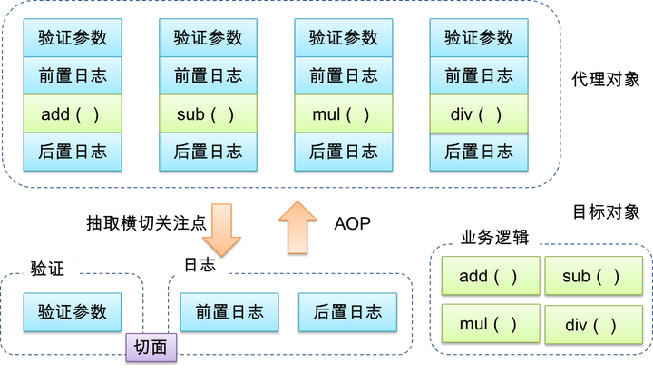

* **横切关注点（cross-cutting concerns）**  ：多个类或对象中的**公共行为**（如日志记录、事务管理、权限控制、接口限流、接口幂等等）。
* **切面（Aspect）** ：**对横切关注点进行封装的类**，一个切面是一个类。切面可以定义多个通知，用来实现具体的功能。
* **连接点（JoinPoint）** ：连接点是方法调用或者方法执行时的某个特定时刻（如方法调用、异常抛出等）。
* **通知（Advice）** ：通知就是切面在某个连接点要执行的操作。通知有五种类型，分别是前置通知（Before）、后置通知（After）、返回通知（AfterReturning）、异常通知（AfterThrowing）和环绕通知（Around）。前四种通知都是在目标方法的前后执行，而环绕通知可以控制目标方法的执行过程。
* **切点（Pointcut）** ：一个切点是一个表达式，它用来匹配哪些连接点需要被切面所增强。切点可以通过注解、正则表达式、逻辑运算等方式来定义。比如 `execution(* com.xyz.service..*(..))`匹配 `com.xyz.service` 包及其子包下的类或接口。
* **织入（Weaving）** ：织入是将切面和目标对象连接起来的过程，也就是将通知应用到切点匹配的连接点上。常见的织入时机有两种，分别是编译期织入（AspectJ）和运行期织入（AspectJ）。

OOP 不能很好地处理一些分散在多个类或对象中的公共行为（如日志记录、事务管理、权限控制、接口限流、接口幂等等），这些行为通常被称为 **横切关注点（cross-cutting concerns）**  。如果我们在每个类或对象中都重复实现这些行为，那么会导致代码的冗余、复杂和难以维护。

AOP 可以将横切关注点（如日志记录、事务管理、权限控制、接口限流、接口幂等等）从 **核心业务逻辑（core concerns，核心关注点）**  中分离出来，实现关注点的分离。

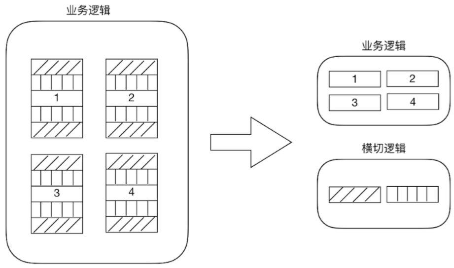

## AOP 的应用场景有哪些？

* **日志记录**：自定义日志记录注解，利用 AOP，一行代码即可实现日志记录。
* **性能统计**：利用 AOP 在目标方法的执行前后统计方法的执行时间，方便优化和分析。
* **事务管理**：`@Transactional` 注解可以让 Spring 为我们进行事务管理比如回滚异常操作，免去了重复的事务管理逻辑。`@Transactional`注解就是基于 AOP 实现的。
* **权限控制**：利用 AOP 在目标方法执行前判断用户是否具备所需要的权限，如果具备，就执行目标方法，否则就不执行。例如，SpringSecurity 利用`@PreAuthorize` 注解一行代码即可自定义权限校验。
* **接口限流**：利用 AOP 在目标方法执行前通过具体的限流算法和实现对请求进行限流处理。
* **缓存管理**：利用 AOP 在目标方法执行前后进行缓存的读取和更新。

## AOP 实现方式有哪些？

AOP 的常见实现方式有\*\*<font style="color:#DF2A3F;">动态代理（AOP）、字节码（AspectJ）操作</font>\*\*等方式。、

Spring AOP 就是基于动态代理的，如果要代理的对象，实现了某个接口，那么 Spring AOP 会使用 **JDK Proxy**，去创建代理对象，而对于没有实现接口的对象，就无法使用 JDK Proxy 去进行代理了，这时候 Spring AOP 会使用 **Cglib** 生成一个被代理对象的子类来作为代理

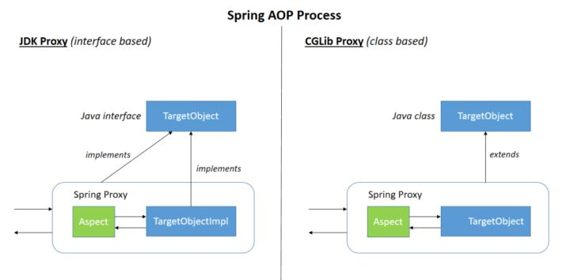

**<font style="color:#DF2A3F;">Spring AOP 属于运行时增强，而 AspectJ 是编译时增强</font>\*\*\*\*。**  Spring AOP 基于代理(Proxying)，而 AspectJ 基于字节码操作(Bytecode Manipulation)。

# Spring事务

\*\*<font style="color:#DF2A3F;">事务是逻辑上的一组操作，要么都执行，要么都不执行。</font>\*\***事务能否生效数据库引擎是否支持事务是关键。比如常用的 MySQL 数据库默认使用支持事务的** <code>**innodb**</code>**引擎。但是，如果把数据库引擎变为** <code>**myisam**</code> **，那么程序也就不再支持事务了！**

## 事务的特性（ACID）了解么?

* **原子性**（`Atomicity`）：事务是最小的执行单位，不允许分割。事务的原子性确保动作要么全部完成，要么完全不起作用；
* **一致性**（`Consistency`）：执行事务前后，数据保持一致，例如转账业务中，无论事务是否成功，转账者和收款人的总额应该是不变的；
* **隔离性**（`Isolation`）：并发访问数据库时，一个用户的事务不被其他事务所干扰，各并发事务之间数据库是独立的；
* **持久性**（`Durability`）：一个事务被提交之后。它对数据库中数据的改变是持久的，即使数据库发生故障也不应该对其有任何影响。

**只有**\*\*<font style="color:#DF2A3F;">保证了事务的持久性、原子性、隔离性之后，一致性才能得到保障</font>\*\*\*\*。也就是说 A、I、D 是手段，C 是目的！\*\*

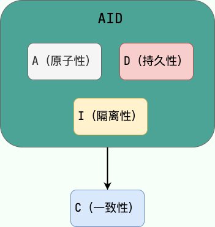

## Spring 对事务的支持

在 MySQL 中，恢复机制是通过 **回滚日志（undo log）**  实现的，所有事务进行的修改都会先记录到这个回滚日志中，然后再执行相关的操作。如果执行过程中遇到异常的话，直接利用 **回滚日志** 中的信息将数据回滚到修改之前的样子即可！并且，**回滚日志会先于数据持久化到磁盘上（redo log的undo区域）**。这样就保证了即使遇到数据库突然宕机等情况，当用户再次启动数据库的时候，数据库还能够通过查询回滚日志来回滚之前未完成的事务

### Spring 支持两种方式的事务管理

#### 编程式事务管理

通过 `TransactionTemplate`或者`TransactionManager`手动管理事务，实际应用中很少使用

```java
@Autowired
private TransactionTemplate transactionTemplate;
public void testTransaction() {

        transactionTemplate.execute(new TransactionCallbackWithoutResult() {
            @Override
            protected void doInTransactionWithoutResult(TransactionStatus transactionStatus) {

                try {

                    // ....  业务代码
                } catch (Exception e){
                    //回滚
                    transactionStatus.setRollbackOnly();
                }

            }
        });
}
```

```java
@Autowired
private PlatformTransactionManager transactionManager;

public void testTransaction() {

  TransactionStatus status = transactionManager.getTransaction(new DefaultTransactionDefinition());
          try {
               // ....  业务代码
              transactionManager.commit(status);
          } catch (Exception e) {
              transactionManager.rollback(status);
          }
}
```

#### 声明式事务管理

通过 AOP 实现（基于`@Transactional` 的全注解方式使用最多）

```java
@Transactional(propagation = Propagation.REQUIRED)
public void aMethod {
  //do something
  B b = new B();
  C c = new C();
  b.bMethod();
  c.cMethod();
}
```

### Spring 事务管理接口介绍

Spring 框架中，事务管理相关最重要的 3 个接口如下：

* <code>**PlatformTransactionManager（**``**管理者**``**）**</code> ：（平台）事务管理器，Spring 事务策略的核心。
* <code>**TransactionDefinition（**``**规则**``**）**</code> ：事务定义信息(事务隔离级别、传播行为、超时、只读、回滚规则)。
* <code>**TransactionStatus**</code>（**状态**）：事务运行状态。

可以把 <code>**PlatformTransactionManager**</code> 接口可以被看作是**事务上层的管理者**，而 <code>**TransactionDefinition**</code> 和 <code>**TransactionStatus**</code> 这两个接口可以看作是**事务的描述**。

<code>**PlatformTransactionManager**</code> 会根据 <code>**TransactionDefinition**</code> 的定义比如事务超时时间、隔离级别、传播行为等来进行事务管理 ，而 <code>**TransactionStatus**</code> 接口则提供了一些方法来获取事务相应的状态比如是否新事务、是否可以回滚等等。

#### PlatformTransactionManager:事务管理接口

**Spring 并不直接管理事务，而是提供了多种事务管理器** 。Spring 事务管理器的接口是：<code>**PlatformTransactionManager**</code> 。通过这个接口，Spring 为各个平台如：JDBC(`DataSourceTransactionManager`)、Hibernate(`HibernateTransactionManager`)、JPA(`JpaTransactionManager`)等都提供了对应的事务管理器，但是具体的实现就是各个平台自己的事情了。<code>**PlatformTransactionManager**</code> **接口的具体实现如下:**

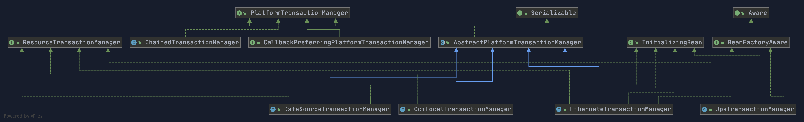

`PlatformTransactionManager`接口中定义了三个方法：

```java
package org.springframework.transaction;

import org.springframework.lang.Nullable;

public interface PlatformTransactionManager {
    //获得事务
    TransactionStatus getTransaction(@Nullable TransactionDefinition var1) throws TransactionException;
    //提交事务
    void commit(TransactionStatus var1) throws TransactionException;
    //回滚事务
    void rollback(TransactionStatus var1) throws TransactionException;
}
```

#### TransactionDefinition:事务属性

事务管理器接口 <code>**PlatformTransactionManager**</code> 通过 <code>**getTransaction(TransactionDefinition definition)**</code>  方法来得到一个事务，这个方法里面的参数是 <code>**TransactionDefinition**</code> 类 ，这个类就定义了一些基本的事务属性。

事务属性包含了 5 个方面：

* 隔离级别
* 传播行为
* 回滚规则
* 是否只读
* 事务超时

```java
package org.springframework.transaction;

import org.springframework.lang.Nullable;

public interface TransactionDefinition {
    int PROPAGATION_REQUIRED = 0;
    int PROPAGATION_SUPPORTS = 1;
    int PROPAGATION_MANDATORY = 2;
    int PROPAGATION_REQUIRES_NEW = 3;
    int PROPAGATION_NOT_SUPPORTED = 4;
    int PROPAGATION_NEVER = 5;
    int PROPAGATION_NESTED = 6;
    int ISOLATION_DEFAULT = -1;
    int ISOLATION_READ_UNCOMMITTED = 1;
    int ISOLATION_READ_COMMITTED = 2;
    int ISOLATION_REPEATABLE_READ = 4;
    int ISOLATION_SERIALIZABLE = 8;
    int TIMEOUT_DEFAULT = -1;
    // 返回事务的传播行为，默认值为 REQUIRED。
    int getPropagationBehavior();
    //返回事务的隔离级别，默认值是 DEFAULT
    int getIsolationLevel();
    // 返回事务的超时时间，默认值为-1。如果超过该时间限制但事务还没有完成，则自动回滚事务。
    int getTimeout();
    // 返回是否为只读事务，默认值为 false
    boolean isReadOnly();

    @Nullable
    String getName();
}
```

#### TransactionStatus:事务状态

`TransactionStatus`接口用来记录事务的状态 该接口定义了一组方法,用来获取或判断事务的相应状态信息。

`PlatformTransactionManager.getTransaction(…)`方法返回一个 `TransactionStatus` 对象。

```java
public interface TransactionStatus{
    boolean isNewTransaction(); // 是否是新的事务
    boolean hasSavepoint(); // 是否有恢复点
    void setRollbackOnly();  // 设置为只回滚
    boolean isRollbackOnly(); // 是否为只回滚
    boolean isCompleted; // 是否已完成
}
```

### 事务属性详解

一般都是使用 `@Transactional` 注解来开启事务

#### 事务传播行为

**事务传播行为是为了解决业务层方法之间互相调用的事务问题**。

当事务方法被另一个事务方法调用时，必须指定事务应该如何传播。例如：方法可能继续在现有事务中运行，也可能开启一个新事务，并在自己的事务中运行。

举个例子：我们在 A 类的`aMethod()`方法中调用了 B 类的 `bMethod()` 方法。这个时候就涉及到业务层方法之间互相调用的事务问题。如果我们的 `bMethod()`如果发生异常需要回滚，如何配置事务传播行为才能让 `aMethod()`也跟着回滚呢？这个时候就需要事务传播行为的知识了。

```java
@Service
Class A {
    @Autowired
    B b;
    @Transactional(propagation = Propagation.xxx)
    public void aMethod {
        //do something
        b.bMethod();
    }
}

@Service
Class B {
    @Transactional(propagation = Propagation.xxx)
    public void bMethod {
       //do something
    }
}
```

在`TransactionDefinition`定义中包括了如下几个表示传播行为的常量

```java
public interface TransactionDefinition {
    int PROPAGATION_REQUIRED = 0;
    int PROPAGATION_SUPPORTS = 1;
    int PROPAGATION_MANDATORY = 2;
    int PROPAGATION_REQUIRES_NEW = 3;
    int PROPAGATION_NOT_SUPPORTED = 4;
    int PROPAGATION_NEVER = 5;
    int PROPAGATION_NESTED = 6;
    ......
}
```

Spring 相应地定义了一个枚举类：`Propagation`

```java
package org.springframework.transaction.annotation;

import org.springframework.transaction.TransactionDefinition;

public enum Propagation {

    REQUIRED(TransactionDefinition.PROPAGATION_REQUIRED),

    SUPPORTS(TransactionDefinition.PROPAGATION_SUPPORTS),

    MANDATORY(TransactionDefinition.PROPAGATION_MANDATORY),

    REQUIRES_NEW(TransactionDefinition.PROPAGATION_REQUIRES_NEW),

    NOT_SUPPORTED(TransactionDefinition.PROPAGATION_NOT_SUPPORTED),

    NEVER(TransactionDefinition.PROPAGATION_NEVER),

    NESTED(TransactionDefinition.PROPAGATION_NESTED);

    private final int value;

    Propagation(int value) {
        this.value = value;
    }

    public int value() {
        return this.value;
    }
}
```

**1.**<code>**TransactionDefinition.PROPAGATION_REQUIRED**</code>

`@Transactional`注解默认使用就是这个事务传播行为。如果当前存在事务，则加入该事务；如果当前没有事务，则创建一个新的事务。

* 如果外部方法没有开启事务的话，`Propagation.REQUIRED`修饰的内部方法会新开启自己的事务，且开启的事务相互独立，互不干扰。
* 如果外部方法开启事务并且被`Propagation.REQUIRED`的话，所有`Propagation.REQUIRED`修饰的内部方法和外部方法均属于同一事务 ，只要一个方法回滚，整个事务均回滚。

<code>**2.TransactionDefinition.PROPAGATION_REQUIRES_NEW**</code>

创建一个新的事务，如果当前存在事务，则把当前事务挂起。也就是说不管外部方法是否开启事务，`Propagation.REQUIRES_NEW`修饰的内部方法会新开启自己的事务，且开启的事务相互独立，互不干扰。

**A回滚，B不回滚。B异常回滚满足A的条件，A也会回滚**

**3.**<code>**TransactionDefinition.PROPAGATION_NESTED**</code>:

如果当前存在事务，就在嵌套事务内执行；如果当前没有事务，就执行与`TransactionDefinition.PROPAGATION_REQUIRED`类似的操作。

* 外部方法开启事务的情况下，在内部开启一个新的事务，作为嵌套事务存在。
* 如果外部方法无事务，则单独开启一个事务，与 `PROPAGATION_REQUIRED` 类似。

**A回滚B回滚，B回滚A不回滚**

<code>**4.TransactionDefinition.PROPAGATION_MANDATORY**</code>

如果当前存在事务，则加入该事务；如果当前没有事务，则抛出异常。（mandatory：强制性）

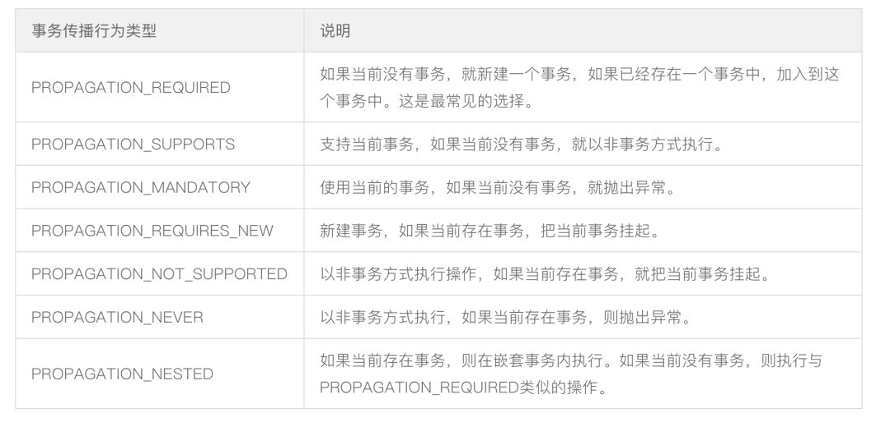

#### 事务隔离级别

`ransactionDefinition` 接口中定义了五个表示隔离级别的常量，Spring 也相应地定义了一个枚举类：`Isolation`

```java
public enum Isolation {

  DEFAULT(TransactionDefinition.ISOLATION_DEFAULT),

  READ_UNCOMMITTED(TransactionDefinition.ISOLATION_READ_UNCOMMITTED),

  READ_COMMITTED(TransactionDefinition.ISOLATION_READ_COMMITTED),

  REPEATABLE_READ(TransactionDefinition.ISOLATION_REPEATABLE_READ),

  SERIALIZABLE(TransactionDefinition.ISOLATION_SERIALIZABLE);

  private final int value;
  Isolation(int value) {
    this.value = value;
  }
  public int value() {
    return this.value;
  }
}
```

* <code>**TransactionDefinition.ISOLATION_DEFAULT**</code> :使用后端数据库默认的隔离级别，MySQL 默认采用的 `REPEATABLE_READ` 隔离级别 Oracle 默认采用的 `READ_COMMITTED` 隔离级别.
* <code>**TransactionDefinition.ISOLATION_READ_UNCOMMITTED**</code> :最低的隔离级别，使用这个隔离级别很少，因为它允许读取尚未提交的数据变更，**可能会导致脏读、幻读或不可重复读**
* <code>**TransactionDefinition.ISOLATION_READ_COMMITTED**</code> : 允许读取并发事务已经提交的数据，**可以阻止脏读，但是幻读或不可重复读仍有可能发生**
* <code>**TransactionDefinition.ISOLATION_REPEATABLE_READ**</code> : 对同一字段的多次读取结果都是一致的，除非数据是被本身事务自己所修改，**可以阻止脏读和不可重复读，但幻读仍有可能发生。**
* <code>**TransactionDefinition.ISOLATION_SERIALIZABLE**</code> : 最高的隔离级别，完全服从 ACID 的隔离级别。所有的事务依次逐个执行，这样事务之间就完全不可能产生干扰，也就是说，**该级别可以防止脏读、不可重复读以及幻读**。但是这将严重影响程序的性能。通常情况下也不会用到该级别。

> 脏读：事务读取到了其他事务没有提交的数据
>
> 不可重复读：同一次事务前后查询结果不一致
>
> 幻读：一次事务中前后数据量发生变化，比如事务清空表格，另一个事务插入数据，查询发现表不空

| 隔离级别 | 脏读 | 不可重复读 | 幻读 |
| --- | --- | --- | --- |
| READ-UNCOMMITTED | √ | √ | √ |
| READ-COMMITTED | × | √ | √ |
| REPEATABLE-READ | × | × | √ |
| SERIALIZABLE | × | × | × |

#### 事务超时属性

所谓事务超时，就是指一个事务所允许执行的最长时间，如果超过该时间限制但事务还没有完成，则自动回滚事务。在 `TransactionDefinition` 中以 int 的值来表示超时时间，其单位是秒，默认值为-1，这表示事务的超时时间取决于底层事务系统或者没有超时时间

#### 事务的只读属性

```java
package org.springframework.transaction;
import org.springframework.lang.Nullable;
public interface TransactionDefinition {
    ......
    // 返回是否为只读事务，默认值为 false
    boolean isReadOnly();
}
```

对于只有读取数据查询的事务，可以指定事务类型为 readonly，即只读事务。只读事务不涉及数据的修改，数据库会提供一些优化手段，适合用在有多条数据库查询操作的方法中。

给方法加上了`Transactional`注解的话，这个方法执行的所有`sql`会被放在一个事务中。如果声明了只读事务的话，数据库就会去优化它的执行，并不会带来其他的什么收益。

如果不加`Transactional`，每条`sql`会开启一个单独的事务，中间被其它事务改了数据，都会实时读取到最新值。

#### 事务回滚规则

这些规则定义了哪些异常会导致事务回滚而哪些不会。默认情况下，事务只有遇到运行期异常（`RuntimeException` 的子类）时才会回滚，`Error` 也会导致事务回滚，但是，在遇到检查型（Checked）异常时不会回滚。

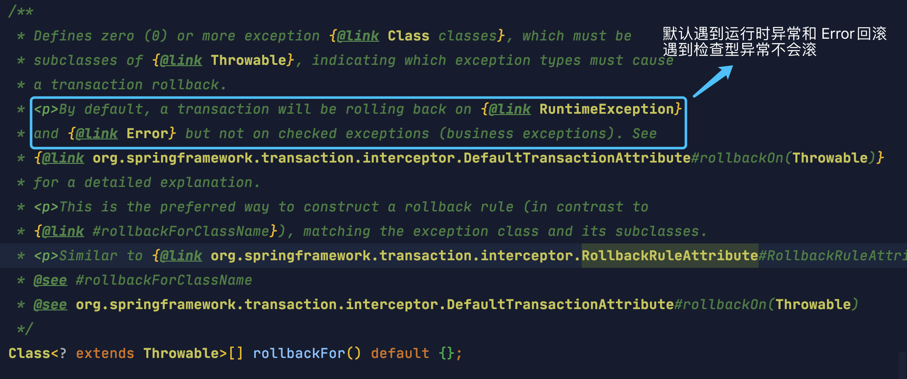

回滚你定义的特定的异常类型的话，可以这样：

```java
@Transactional(rollbackFor= MyException.class)
```

# Spring中的设计模式

## 控制反转(IoC)和依赖注入(DI)

**IoC 是一个原则，而不是一个模式，以下模式（但不限于）实现了 IoC 原则。**

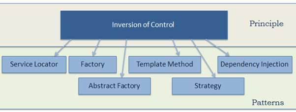

**Spring IoC 容器就像是一个工厂一样，当我们需要创建一个对象的时候，只需要配置好配置文件/注解即可，完全不用考虑对象是如何被创建出来的。IoC 容器负责创建对象，将对象连接在一起，配置这些对象，并从创建中处理这些对象的整个生命周期，直到它们被完全销毁。**

## 工厂设计模式

Spring 使用工厂模式可以通过 `BeanFactory` 或 `ApplicationContext` 创建 bean 对象。

* <code>**BeanFactory**</code>**：延迟注入(使用到某个 bean 的时候才会注入),相比于**<code>**ApplicationContext**</code>\*\* 来说会占用更少的内存，程序启动速度更快。只负责创建和获取Bean。\*\*
* <code>**ApplicationContext**</code>**：容器启动的时候，一次性创建所有 bean 。**<code>**BeanFactory**</code>\*\* 仅提供了最基本的依赖注入支持，**<code>**ApplicationContext**</code>** 扩展了 **<code>**BeanFactory**</code>** ,除了有\*\*<code>**BeanFactory**</code>**的功能还有额外更多功能，所以一般使用**<code>**ApplicationContext**</code>**会更多。**

> **BeanFactory速度快但是功能少（只能获取Bean和创建Bean），ApplicationContext速度稍慢但是功能多**（解析配置类，注册BeanDefinition）

`ApplicationContext` 的三个实现类：

1. `ClassPathXmlApplication`：把上下文文件当成类路径资源。
2. `FileSystemXmlApplication`：从文件系统中的 XML 文件载入上下文定义信息。
3. `XmlWebApplicationContext`：从 Web 系统中的 XML 文件载入上下文定义信息。

```java
      ApplicationContext ac = new ClassPathXmlApplicationContext("beans.xml");
      HelloWorld helloworld = (HelloWorld) ac.getBean("helloWorld");
      helloworld.sayHello();
```

## 单例设计模式

**使用单例模式的好处** :

* 对于频繁使用的对象，可以省略创建对象所花费的时间，对于重量级对象而言，节省系统资源呢开销。
* 由于 new 操作的次数减少，因而对系统内存的使用频率也会降低，这将减轻 GC 压力，缩短 GC 停顿时间。

**Spring 中 bean 的\*\*\*\*默认作用域就是 singleton(单例)的** **。**

* **prototype** : 每次获取都会创建一个新的 bean 实例。也就是说，连续 `getBean()` 两次，得到的是不同的 Bean 实例。
* **request** （仅 Web 应用可用）: 每一次 HTTP 请求都会产生一个新的 bean（请求 bean），该 bean 仅在当前 HTTP request 内有效。
* **session** （仅 Web 应用可用） : 每一次来自新 session 的 HTTP 请求都会产生一个新的 bean（会话 bean），该 bean 仅在当前 HTTP session 内有效。
* **application/global-session** （仅 Web 应用可用）：每个 Web 应用在启动时创建一个 Bean（应用 Bean），，该 bean 仅在当前应用启动时间内有效。
* **websocket** （仅 Web 应用可用）：每一次 WebSocket 会话产生一个新的 bean。

Spring 通过 <code>**ConcurrentHashMap**（线程安全）</code>  实现单例注册表的特殊方式实现单例模式。

```java
// 通过 ConcurrentHashMap（线程安全） 实现单例注册表
private final Map<String, Object> singletonObjects = new ConcurrentHashMap<String, Object>(64);

public Object getSingleton(String beanName, ObjectFactory<?> singletonFactory) {
        Assert.notNull(beanName, "'beanName' must not be null");
        synchronized (this.singletonObjects) {
            // 检查缓存中是否存在实例
            Object singletonObject = this.singletonObjects.get(beanName);
            if (singletonObject == null) {
                //...
                try {
                    singletonObject = singletonFactory.getObject();
                }
                //...
                // 如果实例对象在不存在，我们注册到单例注册表中。
                addSingleton(beanName, singletonObject);
            }
            return (singletonObject != NULL_OBJECT ? singletonObject : null);
        }
    }
    //将对象添加到单例注册表
    protected void addSingleton(String beanName, Object singletonObject) {
            synchronized (this.singletonObjects) {
                this.singletonObjects.put(beanName, (singletonObject != null ? singletonObject : NULL_OBJECT));
            }
        }
}
```

**单例 Bean 存在线程安全问题吗？**

单例 Bean 存在线程问题，主要是因为**当多个线程操作同一个对象的时候是存在资源竞争的**。

常见的有两种解决办法：

1. **在 Bean 中尽量避免定义可变的成员变量。**
2. 在类中定义一个 `ThreadLocal` 成员变量，将需要的可变成员变量保存在 `ThreadLocal` 中（推荐的一种方式）。

不过，大部分 Bean 实际都是**无状态（没有实例变量）** 的（比如 Dao、Service），这种情况下， Bean 是线程安全的。

> 无状态（无实例变量）就不存在线程安全问题
>
> 有状态（实例变量），若不可变那就不存在，若可变则存在安全问题

## 代理模式

### 代理模式在 AOP 中的应用

**AOP(Aspect-Oriented Programming，面向切面编程)  将那些与核心业务无关，却被业务模块所共同调用的代码（例如事务处理、日志管理、权限控制等）封装起来，便于减少系统的重复代码，降低模块间的耦合度，并有利于未来的可拓展性和可维护性。**

AOP 实现方式有哪些？

**Spring AOP 属于运行时增强，而 AspectJ 是编译时增强。**  Spring AOP 基于代理(Proxying)，而 AspectJ 基于字节码操作(Bytecode Manipulation)。

## 模板方法

模板方法模式是一种行为设计模式，它定义一个操作中的算法的骨架，而将一些步骤延迟到子类中。 模板方法使得子类可以不改变一个算法的结构即可重定义该算法的某些特定步骤的实现方式。

Spring 中 `JdbcTemplate`、`HibernateTemplate` 等以 Template 结尾的对数据库操作的类，它们就使用到了模板模式。

一般情况下，我们都是使用继承的方式来实现模板模式，但是 Spring 并没有使用这种方式，而是**使用 Callback 模式与模板方法模式配合，既达到了代码复用的效果，同时增加了灵活性**。

## 观察者模式

观察者模式是一种对象行为型模式。它表示的是一种对象与对象之间具有依赖关系，**当一个对象发生改变的时候，依赖这个对象的所有对象也会做出反应**。**Spring 事件驱动模型**就是观察者模式很经典的一个应用。Spring 事件驱动模型非常有用，在很多场景都可以解耦我们的代码。比如我们每次**添加商品的时候都需要重新更新商品索引**，这个时候就可以利用观察者模式来解决这个问题。

### Spring 事件驱动模型中的三种角色

#### 事件角色

`ApplicationEvent` (`org.springframework.context`包下)充当事件的角色，这是一个抽象类，它继承了`java.util.EventObject`并实现了 `java.io.Serializable`接口。

Spring 中默认存在以下事件，他们都是对 `ApplicationContextEvent` 的实现(继承自`ApplicationContextEvent`)：

* `ContextStartedEvent`：`ApplicationContext` 启动后触发的事件;
* `ContextStoppedEvent`：`ApplicationContext` 停止后触发的事件;
* `ContextRefreshedEvent`：`ApplicationContext` 初始化或刷新完成后触发的事件;
* `ContextClosedEvent`：`ApplicationContext` 关闭后触发的事件。

#### 事件监听者角色

`ApplicationListener` 充当了事件监听者角色，它是一个接口，里面只定义了一个 `onApplicationEvent（）`方法来处理`ApplicationEvent`。`ApplicationListener`接口类源码如下，可以看出接口定义看出接口中的事件只要实现了 `ApplicationEvent`就可以了。所以，在 Spring 中我们只要实现 `ApplicationListener` 接口的 `onApplicationEvent()` 方法即可完成监听事件

```java
package org.springframework.context;
import java.util.EventListener;
@FunctionalInterface
public interface ApplicationListener<E extends ApplicationEvent> extends EventListener {
    void onApplicationEvent(E var1);
}
```

#### 事件发布者角色

`ApplicationEventPublisher` 充当了事件的发布者，它也是一个接口。

```java
@FunctionalInterface
public interface ApplicationEventPublisher {
    default void publishEvent(ApplicationEvent event) {
        this.publishEvent((Object)event);
    }
    void publishEvent(Object var1);
}
```

### Spring 的事件流程总结

1. 定义一个事件: 实现一个继承自 `ApplicationEvent`，并且写相应的构造函数；
2. 定义一个事件监听者：实现 `ApplicationListener` 接口，重写 `onApplicationEvent()` 方法；
3. 使用事件发布者发布消息: 可以通过 `ApplicationEventPublisher` 的 `publishEvent()` 方法发布消息。

## 适配器模式

**适配器模式(Adapter Pattern) 将一个接口转换成客户希望的另一个接口，使接口不兼容的类可以一起工作。**

### Spring AOP 中的适配器模式

Spring AOP 的实现是基于代理模式，但是 **Spring AOP 的增强或通知(Advice)使用到了适配器模式**，与之相关的接口是`AdvisorAdapter` 。

Advice 常用的类型有：`BeforeAdvice`（目标方法调用前,前置通知）、`AfterAdvice`（目标方法调用后,后置通知）、`AfterReturningAdvice`(目标方法执行结束后，return 之前)等等。每个类型 Advice（通知）都有对应的拦截器:`MethodBeforeAdviceInterceptor`、`AfterReturningAdviceInterceptor`、`ThrowsAdviceInterceptor` 等等。

**Spring 预定义的通知要通过对应的适配器，适配成** `MethodInterceptor` **接口(方法拦截器)类型的对象**（如：`MethodBeforeAdviceAdapter` 通过调用 `getInterceptor` 方法，将 `MethodBeforeAdvice` 适配成 `MethodBeforeAdviceInterceptor` ）。

### Spring MVC 中的适配器模式

在 Spring MVC 中，`DispatcherServlet` 根据请求信息调用 `HandlerMapping`，解析请求对应的 `Handler`。解析到对应的 `Handler`（也就是我们平常说的 `Controller` 控制器）后，开始由`HandlerAdapter` 适配器处理。`HandlerAdapter` 作为期望接口，具体的适配器实现类用于对目标类进行适配，`Controller` 作为需要适配的类。

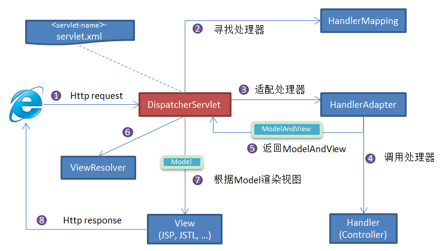

**为什么要在 Spring MVC 中使用适配器模式？**

> Spring MVC控制器中**Handler的四种实现方式**：Controller、HttpRequestHandler、Servlet、[@RequestMapping ](/RequestMapping)

[**https://blog.csdn.net/weixin\_43907800/article/details/105176720**](https://blog.csdn.net/weixin_43907800/article/details/105176720)

[**https://cloud.tencent.com/developer/article/1497623**](https://cloud.tencent.com/developer/article/1497623)

Spring MVC 中的 `Controller` **种类众多，不同类型的** `Controller` **通过不同的方法来对请求进行处理。** 如果不利用适配器模式的话，`DispatcherServlet` 直接获取对应类型的 `Controller`，需要的自行来判断，像下面这段代码一样：

```java
if(mappedHandler.getHandler() instanceof MultiActionController){
   ((MultiActionController)mappedHandler.getHandler()).xxx
}else if(mappedHandler.getHandler() instanceof XXX){
    ...
}else if(...){
   ...
}
```

假如我们再增加一个 `Controller`类型就要在上面代码中再加入一行 判断语句，这种形式就使得程序难以维护，也违反了设计模式中的开闭原则 – 对扩展开放，对修改关闭。

## 装饰者模式

装饰者模式可以动态地给对象添加一些额外的属性或行为。相比于使用继承，装饰者模式更加灵活。

`InputStream` 类下有 `FileInputStream` (读取文件)、`BufferedInputStream` (增加缓存,使读取文件速度大大提升)等子类都在不修改`InputStream` 代码的情况下扩展了它的功能。

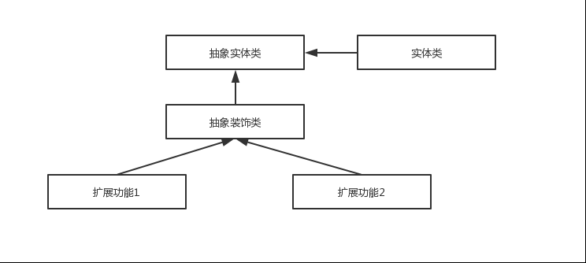

# Spring中常用的11个扩展点

[Spring中常用的11个扩展点\_spring 扩展点-CSDN博客](https://blog.csdn.net/ZL4120505/article/details/138136297)

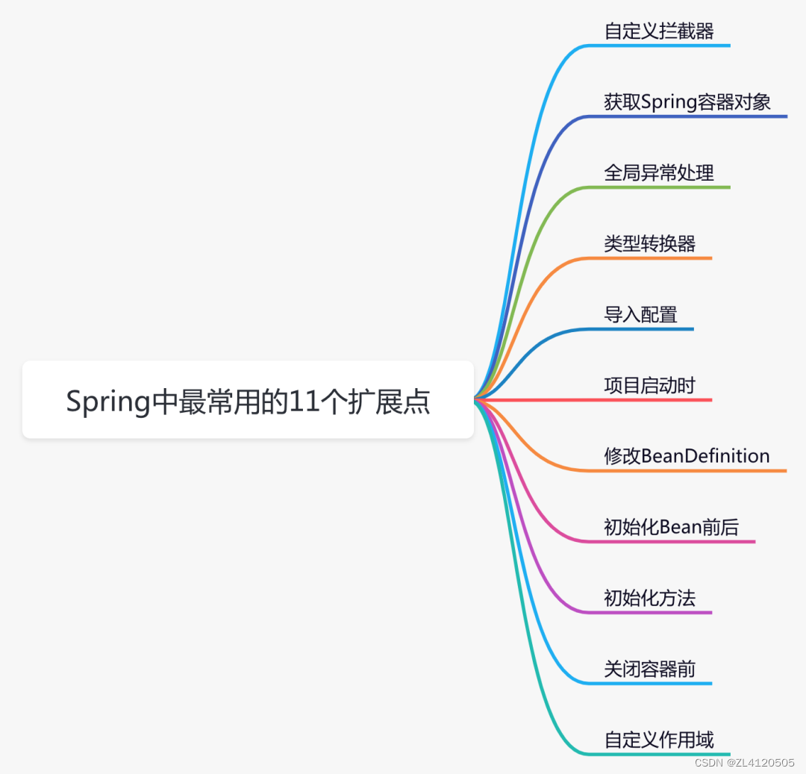

# Sprinboot自动装配原理

## 什么是 SpringBoot 自动装配？ ♥♥♥♥

SpringBoot 定义了一套接口规范，这套规范规定：SpringBoot 在启动时会扫描外部引用 jar 包中的`META-INF/spring.factories`文件，将文件中配置的类型信息加载到 Spring 容器（此处涉及到 JVM 类加载机制与 Spring 的容器知识），并执行类中定义的各种操作。**对于外部 jar 来说，只需要按照 SpringBoot 定义的标准，就能将自己的功能装置进 SpringBoot。**

Spring Boot 中，我们直接引入一个 starter 即可。比如你想要在项目中使用 redis 的话，直接在项目中引入对应的 starter 即可。

```xml
<dependency>
    <groupId>org.springframework.boot</groupId>
    <artifactId>spring-boot-starter-data-redis</artifactId>
</dependency>
```

引入 starter 之后，我们通过少量注解和一些简单的配置就能使用第三方组件提供的功能了。

自动装配可以简单理解为：**通过注解或者一些简单的配置就能在 Spring Boot 的帮助下实现某块功能。**

> **自动装配：自动把第三方组件的Bean装入到容器中。在启动类上加@SpringBootApplication这样的复合注解就可以实现自动装配，具体的注解是@EnableAutoConfiguration。**
>
> 1.引入第三方的starter
>
> 2.扫描外部引用 jar 包中的`META-INF/spring.factories`

## SpringBoot 是如何实现自动装配的？

<https://www.yuque.com/leifengyang/springboot3/lliphvul8b19pqxp#SDebr>

核心注解 `@SpringBootApplication`

```java
@Target({ElementType.TYPE})
@Retention(RetentionPolicy.RUNTIME)
@Documented
@Inherited
<1.>@SpringBootConfiguration
<2.>@ComponentScan
<3.>@EnableAutoConfiguration
public @interface SpringBootApplication {

}

@Target({ElementType.TYPE})
@Retention(RetentionPolicy.RUNTIME)
@Documented
@Configuration //实际上它也是一个配置类
public @interface SpringBootConfiguration {
}
```

`@SpringBootApplication`看作是 `@Configuration` **、**`@EnableAutoConfiguration` **、** `@ComponentScan` 注解的集合。

* <code>**@EnableAutoConfiguration**</code>**：启用 SpringBoot 的自动配置机制**
* `@Configuration`：允许在上下文中注册额外的 bean 或导入其他配置类
* `@ComponentScan`：扫描被`@Component` (`@Service`,`@Controller`)注解的 bean，注解默认会扫描启动类所在的包下所有的类 ，可以自定义不扫描某些 bean。如下图所示，容器中将排除`TypeExcludeFilter`和`AutoConfigurationExcludeFilter`。

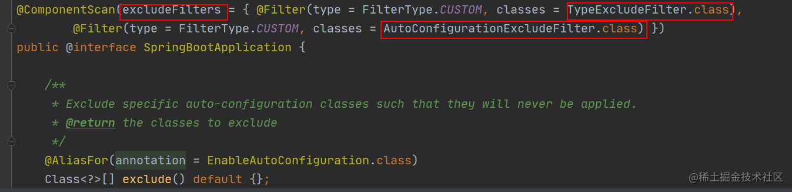

### @EnableAutoConfiguration:自动装配的核心注解

自动装配核心功能的实现实际是通过 <code>**<font style="color:#DF2A3F;">AutoConfigurationImportSelector</font>**</code>类。

```java
@Target({ElementType.TYPE})
@Retention(RetentionPolicy.RUNTIME)
@Documented
@Inherited
@AutoConfigurationPackage //作用：将main包下的所有组件注册到容器中
@Import({AutoConfigurationImportSelector.class}) //加载自动装配类 xxxAutoconfiguration
public @interface EnableAutoConfiguration {
    String ENABLED_OVERRIDE_PROPERTY = "spring.boot.enableautoconfiguration";

    Class<?>[] exclude() default {};

    String[] excludeName() default {};
}
```

### AutoConfigurationImportSelector:加载自动装配类

```java
public class AutoConfigurationImportSelector implements DeferredImportSelector, BeanClassLoaderAware, ResourceLoaderAware, BeanFactoryAware, EnvironmentAware, Ordered {

}

public interface DeferredImportSelector extends ImportSelector {

}

public interface ImportSelector {
    String[] selectImports(AnnotationMetadata var1);
}
```

可以看出，`AutoConfigurationImportSelector` 类实现了 `ImportSelector`接口，也就实现了这个接口中的 `selectImports`方法，该方法主要用于\*\*<font style="color:#DF2A3F;">获取所有符合条件的类的全限定类名，这些类需要被加载到 IoC 容器中</font>\*\*<font style="color:#DF2A3F;">。</font>

```java
private static final String[] NO_IMPORTS = new String[0];

public String[] selectImports(AnnotationMetadata annotationMetadata) {
        // <1>.判断自动装配开关是否打开
        if (!this.isEnabled(annotationMetadata)) {
            return NO_IMPORTS;
        } else {
          //<2>.获取所有需要装配的bean
            AutoConfigurationMetadata autoConfigurationMetadata = AutoConfigurationMetadataLoader.loadMetadata(this.beanClassLoader);
            AutoConfigurationImportSelector.AutoConfigurationEntry autoConfigurationEntry = this.getAutoConfigurationEntry(autoConfigurationMetadata, annotationMetadata);
            return StringUtils.toStringArray(autoConfigurationEntry.getConfigurations());
        }
    }
```

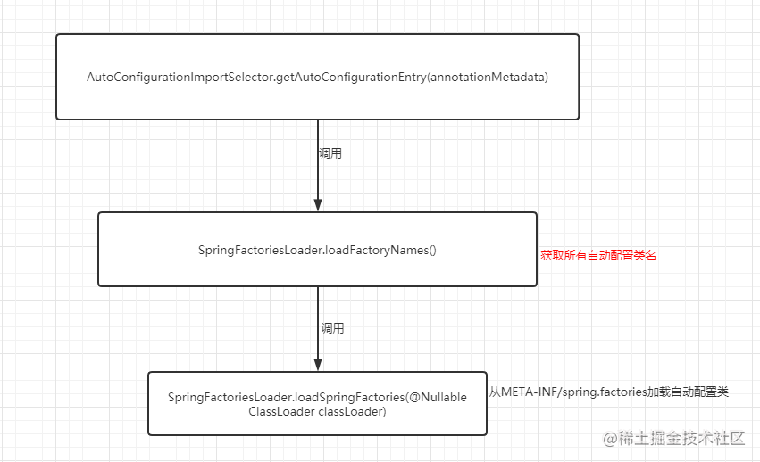

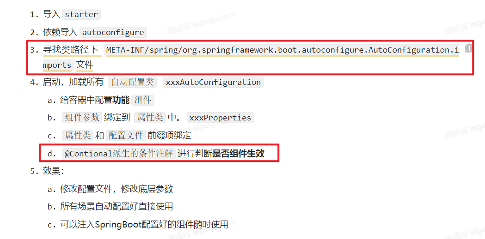

## 如何实现一个Starter

第一步，创建`threadpool-spring-boot-starter`工程

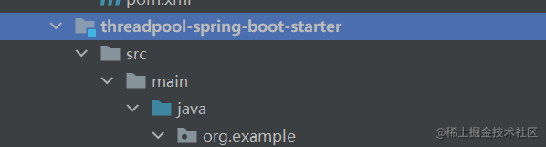

第二步，引入 Spring Boot 相关依赖

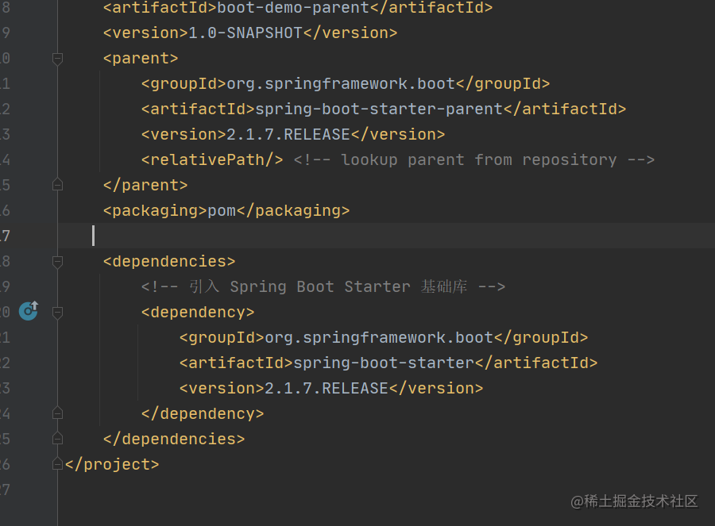

第三步，创建`ThreadPoolAutoConfiguration`

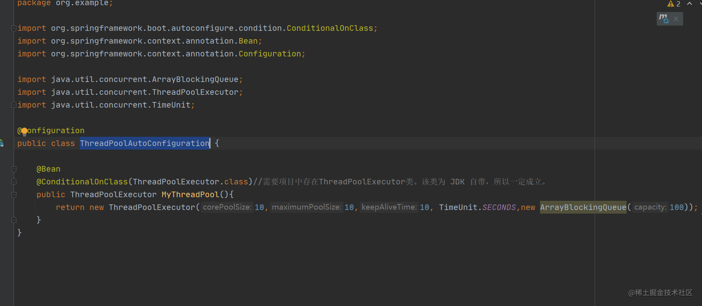

第四步，在`threadpool-spring-boot-starter`工程的 resources 包下创建`META-INF/spring.factories`文件

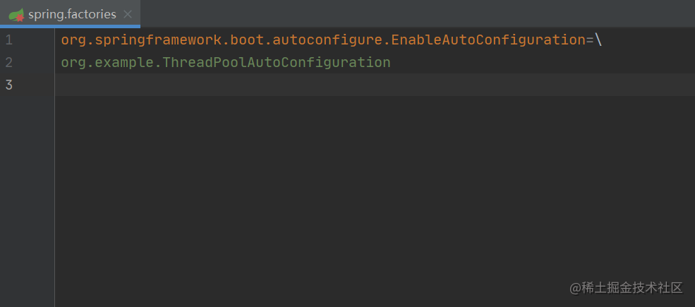

最后新建工程引入`threadpool-spring-boot-starter`

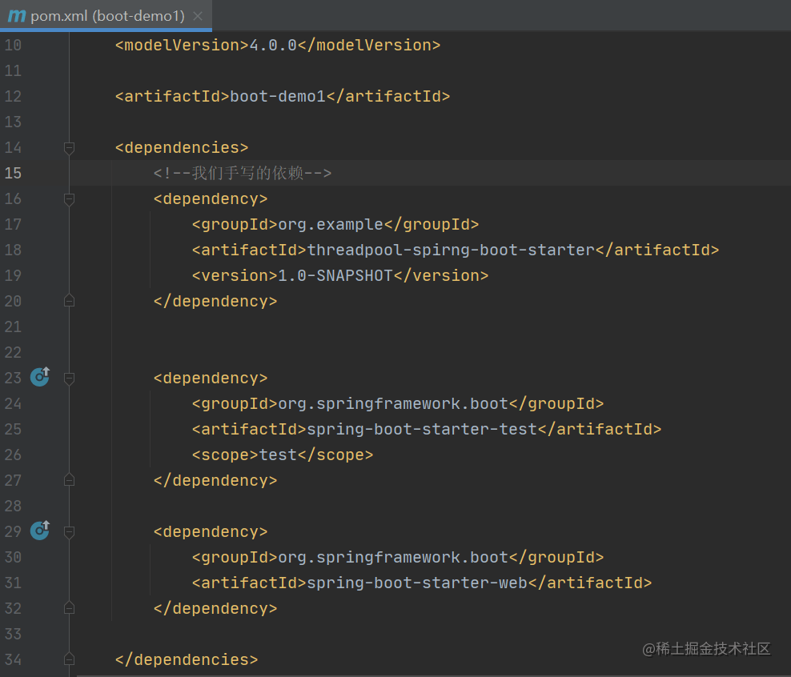

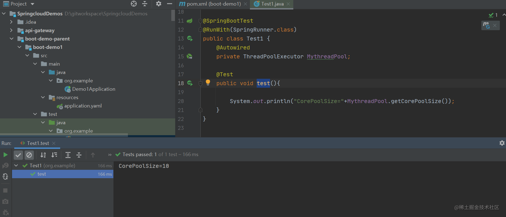

Spring Boot 通过`@EnableAutoConfiguration`开启自动装配，通过 SpringFactoriesLoader 最终加载`META-INF/spring.factories`中的自动配置类实现自动装配，自动配置类其实就是通过`@Conditional`按需加载的配置类，想要其生效必须引入`spring-boot-starter-xxx`包实现起步依赖


> 更新: 2024-08-16 14:50:59  
> 原文: <https://www.yuque.com/nibiwanxiamei/yrd6t1/21393c622c8c81ebe02f3e918f8d0ff0>