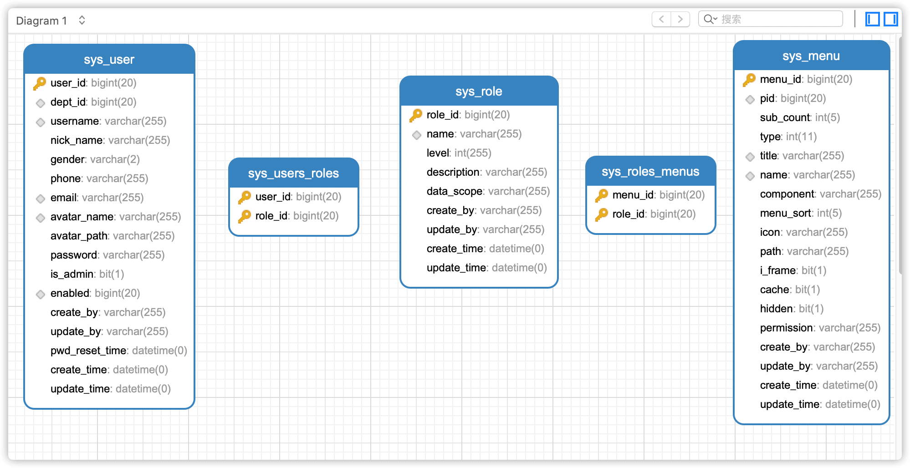
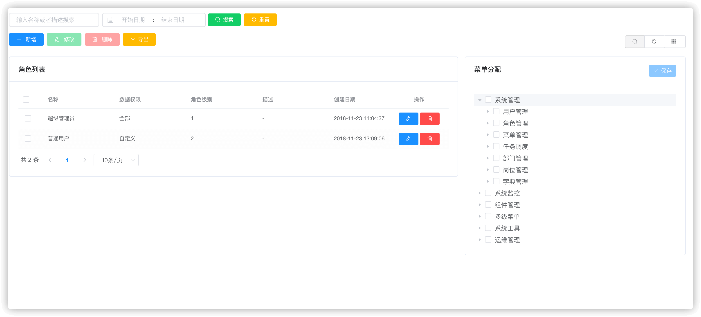
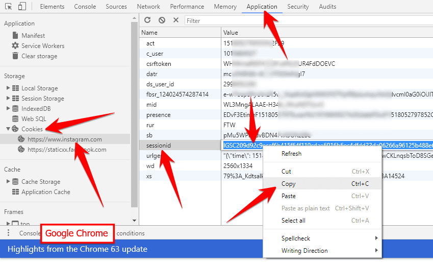
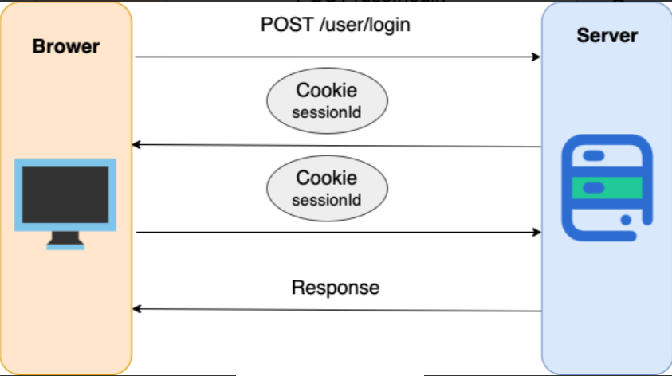

# 认证授权

gr1		wpoiu9

***

# 认证授权基础概念详解

## 认证 (Authentication) 和授权 (Authorization)的区别是什么？

* **认证 (Authentication)：**  校验用户身份
* **授权 (Authorization)：**  校验用户权限

## RBAC 模型了解吗？

**RBAC 即基于角色的权限访问控制（Role-Based Access Control）**。是一种**通过角色关联权限，角色同时又关联用户的授权的方式**。

一个用户可以拥有若干角色，每一个角色又可以被分配若干权限，这样就构造成“用户-角色-权限” 的授权模型。在这种模型中，用户与角色、角色与权限之间构成了多对多的关系。在 RBAC 权限模型中，权限与角色相关联，用户通过成为包含特定角色的成员而得到这些角色的权限，这就极大地简化了权限的管理。

为了实现 RBAC 权限模型，数据库表的常见设计如下（一共 5 张表，2 张用户建立表之间的联系）：





## 什么是 Cookie ? Cookie 的作用是什么?



<code><font style="color:#DF2A3F;">Cookie</font></code><font style="color:#DF2A3F;"> </font>**<font style="color:#DF2A3F;">和</font>**<font style="color:#DF2A3F;"> </font><code><font style="color:#DF2A3F;">Session</font></code><font style="color:#DF2A3F;"> </font>**<font style="color:#DF2A3F;">都是用来跟踪浏览器用户身份的会话方式</font>**，但是两者的应用场景不太一样。

维基百科是这样定义 `Cookie` 的：

> `Cookies` 是某些网站为了辨别用户身份而储存在用户本地终端上的数据（通常经过加密）。

简单来说：<code>**Cookie**</code> **存放在客户端，一般用来保存用户信息**。

下面是 `Cookie` 的一些应用案例：

1. 在 `Cookie` 中保存已经登录过的用户信息，下次访问网站的时候页面可以自动获的一些基本信息。除此之外，`Cookie` 还能保存用户首选项，主题和其他设置信息。
2. 使用 `Cookie` 保存 `SessionId` 或者 `Token` ，向后端发送请求的时候带上 `Cookie`，这样后端就能取到 `Session` 或者 `Token` 了。这样就能记录用户当前的状态了，因为 HTTP 协议是无状态的。
3. `Cookie` 还可以用来记录和分析用户行为。在网上购物的时候，HTTP 协议是没有状态的，服务器想要获取在某个页面的停留状态或者看了哪些商品，一种常用的实现方式就是将这些信息存放在 `Cookie`

## 如何在项目中使用 Cookie 呢？

Spring Boot 项目为例。

**1)设置** <code>**Cookie**</code> **返回给客户端**

```java
@GetMapping("/change-username")
public String setCookie(HttpServletResponse response) {
    // 创建一个 cookie
    Cookie cookie = new Cookie("username", "Jovan");
    //设置 cookie过期时间
    cookie.setMaxAge(7 * 24 * 60 * 60); // expires in 7 days
    //添加到 response 中
    response.addCookie(cookie);

    return "Username is changed!";
}
```

**2) 使用 Spring 框架提供的**  <code>**@CookieValue**</code> **注解获取特定的 cookie 的值**

```java
@GetMapping("/")
public String readCookie(@CookieValue(value = "username", defaultValue = "Atta") String username) {
    return "Hey! My username is " + username;
}
```

**3) 读取所有的** <code>**Cookie**</code> **值**

```java
@GetMapping("/all-cookies")
public String readAllCookies(HttpServletRequest request) {
    Cookie[] cookies = request.getCookies();
    if (cookies != null) {
        return Arrays.stream(cookies)
                .map(c -> c.getName() + "=" + c.getValue()).collect(Collectors.joining(", "));
    }

    return "No cookies";
}
```

## Cookie 和 Session 有什么区别？

<code>**Session**</code> **的主要作用就是通过服务端记录用户的状态。**  典型的场景是购物车，添加商品到购物车的时候，系统不知道是哪个用户操作的，因为 HTTP 协议是无状态的。服务端给特定的用户创建特定的 `Session` 之后就可以标识这个用户并且跟踪这个用户了。

`Cookie` **数据保存在客户端(浏览器端)，**`Session` **数据保存在服务器端。** 相对来说 `Session` 安全性更高。如果使用 `Cookie` 的一些敏感信息不要写入 `Cookie` 中，最好能将 `Cookie` 信息加密然后使用到的时候再去服务器端解密。

## 如何使用 Session-Cookie 方案进行身份验证？

很多时候都是通过 `SessionID` 来实现特定的用户，`SessionID` **一般会选择存放在 Redis** 。

1. 用户成功登陆系统，然后返回给客户端具有 `SessionID` 的 `Cookie` 。
2. 当用户向后端发起请求的时候会把 `SessionID` 带上，这样后端就知道你的身份状态了。



1. 用户向服务器发送用户名、密码、验证码用于登陆系统。
2. 服务器验证通过后，服务器为用户创建一个 `Session`，并将 `Session` 信息存储起来。
3. 服务器向用户返回一个 `SessionID`，写入用户的 `Cookie`。
4. 当用户保持登录状态时，`Cookie` 将与每个后续请求一起被发送出去。
5. 服务器可以将存储在 `Cookie` 上的 `SessionID` 与存储在内存中或者数据库中的 `Session` 信息进行比较，以验证用户的身份，返回给用户客户端响应信息的时候会附带用户当前的状态。

使用 `Session` 的时候需要注意下面几个点：

* 依赖 `Session` 的关键业务一定要确保客户端开启了 `Cookie`。
* 注意 `Session` 的过期时间。

## 多服务器节点下 Session-Cookie 方案如何做？

Session-Cookie 方案在单体环境是一个非常好的身份认证方案。但是，当服务器水平拓展成多节点时，Session-Cookie 方案就要面临挑战了。

举个例子：假如我们部署了两份相同的服务 A，B，用户第一次登陆的时候 ，Nginx 通过负载均衡机制将用户请求转发到 A 服务器，此时用户的 Session 信息保存在 A 服务器。结果，用户第二次访问的时候 Nginx 将请求路由到 B 服务器，由于 B 服务器没有保存 用户的 Session 信息，导致用户需要重新进行登陆。

**我们应该如何避免上面这种情况的出现呢？**

有几个方案可供大家参考：

1. 某个用户的所有请求都通过特性的哈希策略分配给同一个服务器处理。这样的话，每个服务器都保存了一部分用户的 Session 信息。服务器宕机，其保存的所有 Session 信息就完全丢失了。
2. 每一个服务器保存的 Session 信息都是互相同步的，也就是说每一个服务器都保存了全量的 Session 信息。每当一个服务器的 Session 信息发生变化，我们就将其同步到其他服务器。这种方案成本太大，并且，节点越多时，同步成本也越高。
3. **单独使用一个所有服务器都能访问到的数据节点（比如缓存）来存放 Session 信息。为了保证高可用，数据节点尽量要避免是单点。 -- 存放在redis中**
4. Spring Session 是一个用于在多个服务器之间管理会话的项目。它可以与多种后端存储（如 Redis、MongoDB 等）集成，从而实现分布式会话管理。通过 Spring Session，可以将会话数据存储在共享的外部存储中，以实现跨服务器的会话同步和共享。

## 如果没有 Cookie 的话 Session 还能用吗？

一般是通过 `Cookie` 来保存 `SessionID` ，假如你使用了 `Cookie` 保存 `SessionID` 的方案的话， 如果客户端禁用了 `Cookie`，那么 `Session` 就无法正常工作。

但是，并不是没有 `Cookie` 之后就不能用 `Session` 了，**可以将** `SessionID` **放在请求的** `url` **里面**`https://javaguide.cn/?Session_id=xxx` 。这种方案的话可行，但是安全性和用户体验感降低。当然，为了安全你也可以对 `SessionID` 进行一次加密之后再传入后端。

## 为什么 Cookie 无法防止 CSRF 攻击，而 Token 可以？

**CSRF(Cross Site Request Forgery)**  一般被翻译为 **跨站请求伪造** 。那么什么是 **跨站请求伪造** 呢？说简单点，就是用你的身份去发送一些对你不友好的请求。举个简单的例子：

小壮登录了某网上银行，他来到了网上银行的帖子区，看到一个帖子下面有一个链接写着“科学理财，年盈利率过万”，小壮好奇的点开了这个链接，结果发现自己的账户少了 10000 元。这是这么回事呢？原来黑客在链接中藏了一个请求，这个请求直接利用小壮的身份给银行发送了一个转账请求,也就是通过你的 Cookie 向银行发出请求。

```java
<a src=http://www.mybank.com/Transfer?bankId=11&money=10000>科学理财，年盈利率过万</>
```

上面也提到过，进行 `Session` 认证的时候，我们一般使用 `Cookie` **来存储** `SessionId`,当我们登陆后后端生成一个 `SessionId` 放在 Cookie 中返回给客户端，服务端通过 Redis 或者其他存储工具记录保存着这个 `SessionId`，客户端登录以后每次请求都会带上这个 `SessionId`，服务端通过这个 `SessionId` 来标示你这个人。如果别人通过 `Cookie` 拿到了 `SessionId` 后就可以代替你的身份访问系统了。

`Session` **认证中** `Cookie` **中的** `SessionId` **是由浏览器发送到服务端的，借助这个特性，攻击者就可以通过让用户误点攻击链接，达到攻击效果。**

但是，我们使用 `Token` 的话就不会存在这个问题，**登录成功获得** `Token` **之后，一般会选择存放在** `localStorage`  **（浏览器本地存储）中**。然后**在前端通过某些方式会给每个发到后端的请求加上这个** `Token`,这样就不会出现 CSRF 漏洞的问题。因为，即使你点击了非法链接发送了请求到服务端，这个非法请求是不会携带 `Token` 的，所以这个请求将是非法的。

需要注意的是：不论是 `Cookie` 还是 `Token` 都无法避免 **跨站脚本攻击（Cross Site Scripting）XSS** 。

### <font style="color:rgb(5, 7, 59);background-color:rgb(253, 253, 254);">Cookie 无法防止 CSRF 攻击的原因</font>

1. **<font style="color:rgb(5, 7, 59);background-color:rgb(253, 253, 254);">自动携带特性</font>**<font style="color:rgb(5, 7, 59);background-color:rgb(253, 253, 254);">：Cookie 有一个过期时间，在这段时间内，Cookie 是存储在客户端的。当再次访问相同的网站时，浏览器会自动在 HTTP 请求中带上该网站用户登录后的 Cookie。CSRF 攻击正是利用这一点，通过诱使用户点击恶意链接或访问恶意网站，利用用户的 Cookie 向目标网站发送请求，执行非用户本意的操作。</font>
2. **<font style="color:rgb(5, 7, 59);background-color:rgb(253, 253, 254);">安全性限制</font>**<font style="color:rgb(5, 7, 59);background-color:rgb(253, 253, 254);">：虽然可以通过设置 Cookie 的 HttpOnly 和 Secure 属性来增加其安全性，防止通过客户端脚本访问 Cookie，但这些措施并不能防止 CSRF 攻击，因为 CSRF 攻击并不依赖于直接访问 Cookie，而是利用浏览器自动携带 Cookie 的机制。</font>

### <font style="color:rgb(5, 7, 59);background-color:rgb(253, 253, 254);">Token 可以防止 CSRF 攻击的原因</font>

1. **<font style="color:rgb(5, 7, 59);background-color:rgb(253, 253, 254);">手动携带</font>**<font style="color:rgb(5, 7, 59);background-color:rgb(253, 253, 254);">：与 Cookie 不同，Token 一般是通过前端代码（如 JavaScript）手动添加到请求头（Header）或请求体（Body）中的。这意味着即使攻击者诱使用户点击了恶意链接，这个链接发出的请求也不会自动携带 Token，除非前端代码被恶意修改或存在其他漏洞。</font>
2. **<font style="color:rgb(5, 7, 59);background-color:rgb(253, 253, 254);">验证机制</font>**<font style="color:rgb(5, 7, 59);background-color:rgb(253, 253, 254);">：服务器在收到请求时，会检查请求中是否包含有效的 Token，并且该 Token 是否与服务器中保存的 Token 相匹配。由于 CSRF 攻击无法获取到用户的 Token（因为 Token 不是自动携带的），因此无法构造出有效的请求来通过服务器的验证。</font>
3. **<font style="color:rgb(5, 7, 59);background-color:rgb(253, 253, 254);">存储位置</font>**<font style="color:rgb(5, 7, 59);background-color:rgb(253, 253, 254);">：Token 通常会存储在浏览器的 LocalStorage 或 SessionStorage 中，而不是像 Cookie 那样存储在 HTTP 请求头中。这种存储方式进一步增加了 Token 的安全性，因为 LocalStorage 和 SessionStorage 的访问受到同源策略的限制，攻击者无法从其他网站访问这些存储区域。</font>

## 什么是 JWT?JWT 由哪些部分组成？

[JWT 基础概念详解](https://javaguide.cn/system-design/security/jwt-intro.html)

JWT （JSON Web Token） 是目前最流行的跨域认证解决方案，是一种基于 Token 的认证授权机制。 从 JWT 的全称可以看出，JWT 本身也是 Token，一种规范化之后的 JSON 结构的 Token。

JWT 自身包含了身份验证所需要的所有信息，因此，我们的服务器不需要存储 Session 信息。这显然增加了系统的可用性和伸缩性，大大减轻了服务端的压力。

可以看出，**JWT 更符合设计 RESTful API 时的「Stateless（无状态）」原则** 。

并且， 使用 JWT 认证可以有效避免 CSRF 攻击，因为 JWT 一般是存在在 localStorage 中，使用 JWT 进行身份验证的过程中是不会涉及到 Cookie 的。

# OAuth2.0

<font style="color:rgb(44, 62, 80);">OAuth 是一个行业的标准授权协议，主要用来授权第三方应用获取有限的权限。</font>

<font style="color:rgb(44, 62, 80);">实际上它就是一种授权机制，它的最终目的是为第三方应用颁发一个有时效性的令牌 Token，使得第三方应用能够通过该令牌获取相关的资源。</font>

* <font style="color:rgb(44, 62, 80);">OAuth 2.0 比较常用的场景就是第三方登录，当你的网站接入了第三方登录的时候一般就是使用的 OAuth 2.0 协议。</font>
* <font style="color:rgb(44, 62, 80);">现在 OAuth 2.0 也常见于支付场景（微信支付、支付宝支付）和开发平台（微信开放平台、阿里开放平台等等）。</font>

<font style="color:rgb(44, 62, 80);">大概流程：用户在应用登录选择微信扫码，应用请求第三方微信OAuth2.0认证，显示二维码后第三方等待用户操作，用户扫码后确认权限和信息，第三方微信给应用发送生成的token（包含用户信息和权限），也会给用户发送token，之后用户请求带上token即可</font>


> 更新: 2024-08-26 09:29:45  
> 原文: <https://www.yuque.com/nibiwanxiamei/yrd6t1/f8dcb92b0a756a6811fba1ae0664e1d0>