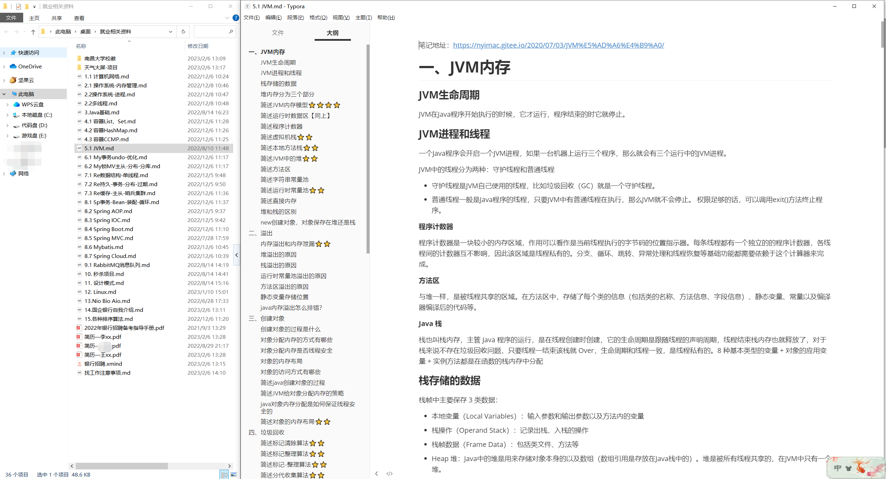
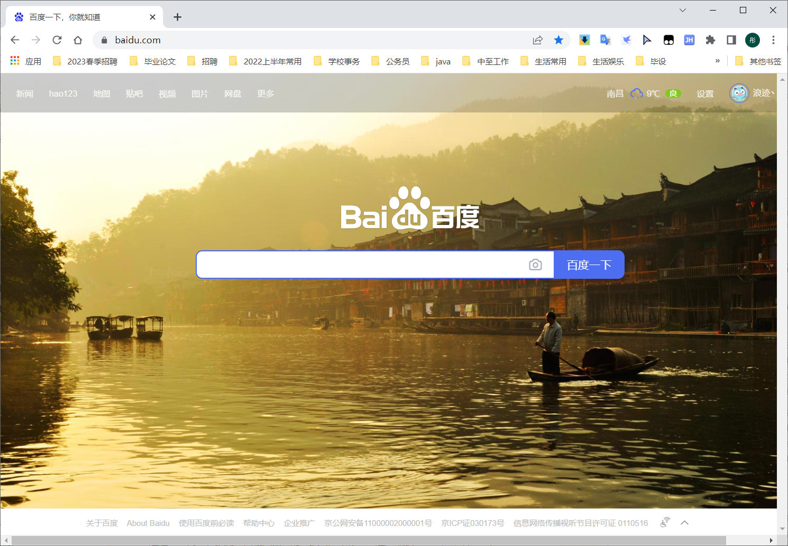

# 找工作流程 - 重点

---

## 方法论

### 算法

- [ ]  1. **每天都需要刷题，按照专题来刷(labuladong和代码随想录)，leetcode前300理解完就基本全面覆盖面试时候的题目了，时间不够的话刷leetcode hot100题。** 
    1. **笔试直接自行发挥。**

### 项目

**项目每一点都要理解透，介绍项目的时候你需要按照软件工程设计原则来讲。**

+ **这个项目是做什么样的一件事**
+ **实现了那些功能（也就是接口）**
+ **为什么需要这些功能**
+ **然后是实现的整体流程**
+ **在介绍流程的时候说一下为什么需要用到这些技术栈，用来解决什么问题？**
+ **然后背熟----不要在自我介绍的时候说，除非面试官提了让你介绍项目自我介绍就介绍一下大学和研究生的情况就好。**

### 八股

- [ ] **第一点-----不要想着去反驳面试官，除非是技术的点你确认自己的理解没有任何的问题。**
- [ ] **先看操作系统，把小林coding的操作系统那一部分除pagecache部分的全面理解并且能够回答出标题的问题才算结束。**
- [ ] **然后看mysql 和 redis， 先看小林coding，都记下来，然后看 innodb引擎那本书以及redis设计与实现。 mysql想要继续深入的话看mysql 45讲足以应付面试，redis需要理解reddisson分布式锁的源码加锁结构，最好看一遍reddisson分布式锁的源码。 然后各个场景方面需要去网上搜集面试题自己回答融会贯通。**
- [ ] **java的jvm方法  直接看javaguide 背下来以及  深入java虚拟机这本书。**
- [ ] **数据库阶段告一段落，去看掘金的竹子爱熊猫的这几部分的详解串一下过程，形成自己回答问题的结构。**
- [ ] **java并发的juc部分直接看  java高并发核心编程卷2以及java的源码， 尤其是线程池 、aqs、threadLocal、reetreenlock。**
- [ ] **rocketMQ的话背背八股，想想场景题怎么回答，背完rocketMQ背kafka。**
- [ ] **spring 的 八股 主要是 bean的生命周期、ioc和aop以及@transaction注解， 看书的话spring揭秘和源代码debug。 要补充的是可能问到分布式事务。springboot的话主要要看的是注解的解析和加载，也就是springboot的启动流程。**
- [ ] **其余的八股根据项目所使用的来。**
- [ ] **推荐  尼恩的技术自由圈这个公众号，会发一些优质的八股文。shardingsphere这种分库分表和es的八股也可以记**
- [ ] **但是最重要的是OS和计网，很多问题可以往os这个底层扯**

### 八股文回答方式

#### 例子1

+ **回答八股文的时候，如果问题是怎么解决缓存击穿这种常见的问题，尽量往代码的细节实现去扯，让面试官知道你了解细节。比如分布式锁解决缓存击穿，为什么用双重检查锁，可以说是为了避免缓存已经加载完成之后的线程的请求还是会打到数据库所以使用双重检查锁的方式减少对数据库的无效请求。第二个例子是面试官可能会追问，比如你回答到redis的pipeline，那么pipeline的原理是什么，是类似于cpu指令流水线。体现自己的底层功底，重要。**

#### 例子2

+ **如果是不常见的设计题，先理清逻辑讲宏观设计，再去讲自己想的实现细节，要以平稳的语速回答，需要刻意练习，把自己的回答方法刻到脑子里面。不合适的场景没必要说出来，直接说可行解就好了。**
+ **比如缓存和数据库一致性。有六种方案，前三种是先写缓存再写数据库，先写数据库再写缓存、先删除缓存再写数据库在多线程并发的情况下存在较大的数据不一致性问题，一般的话不会在生产中使用。其余三种 先写数据库再删缓存、缓存双删以及binlog+cannal更新缓存，可以根据场景进行使用，比如有消息队列就可以用缓存双删和binlog+cannal， binlog+cannal呢也需要消息队列，但是可能不一致性时间延迟较长，需要根据具体场景进行选择。**

#### 例子3

+ **进程和线程的区别？我自己的总结**
+ **进程有自己的进程控制块和描述符，有自己的虚拟内存页表需要覆盖整个操作系统的内存，并且进程的页表中有一些是已经和物理地址映射分配内存了的， 而线程在java中作为进程的部分的一次执行，有自己的程序计数器和虚拟机栈，但是共享进程的堆和方法区等空间，这样的话进程的切换需要保存的信息更少，而且不一定会触发缺页中断，因为进程可能映射过地址了，而进程分为子进程和非子进程，非子进程的话是一定会创建新的页表，读取写入一定触发缺页中断的开销，保存的上下文堆栈信息更多，更耗时，而子进程会由于linux写时复制的问题，共享一页表部分空间，这样缺页中断也会少一些。  体现出你对  os的理解非常深入，因为面试大家只需要有那么几个亮点+手撕过就行，大部分面试题没有差距的。**
+ **这种回答很全面并且底层，而且可以引导面试官问写时复制的原理。**

#### 例子4

+ **redis为什么快？**
+ **这里只提一个点展示， 基于内存，但是你说基于内存的时候要说参照物，比如提到mysql基于磁盘读取数据和基于内存的redis是量级上的差别。**

### 例子5

+ **原则是往实现原理和底层聊，照着这个原则来。**

### 场景题

+ **linux相关的场景题要自己搜索背下来，腾讯和字节这种厂比较喜欢问。**
+ **服务器负载满了可能是哪些问题导致的？**
+ **服务器  cpu 90%有些什么原因？**
+ **消息积压1亿条怎么解决？**
+ **要你设计一个系统怎么设计？这里的系统是很广泛的，被问的时候会很具体。**
+ **如何设计一个短链系统？**
+ **如何设计一个秒杀系统？**

### 投递流程

+ **大厂不能一上来就投，先面小厂和中厂。大厂就包括腾讯、字节、美团、快手、京东、小红书等等。**
+ **阿里卡本科211，满帮也是，没有就不用去投，饿了么这种小一点的可能不卡。**
+ **小公司到hr面也可以刷刷hr面的面试经验，看看hr会问些什么自己结合自己的经历来回答。**

### 简历方面

+ **先写自己研究生期间负责的内容总结。**
+ **规则组上饶麻将的程序上线要写上去，可以不写已经上线，但是hr面自我介绍的时候要说，优化的点也要聊明白。**
+ **知识星球的话想加就加，不是很贵也没坏处，八股文就别购买别人的了，书和小林、guide足够**

### hr面---非常的重要， 切忌嘴瓢，不会就背

#### 为什么想来xx地点？

+ **家人在，女朋友也在这边工作，有弟弟/哥哥姐姐的也可以说在附近工作，或者就是当前地点，问到在哪个公司也可以说就自己开店啥的？同时有同学在附近**

#### 为什么想来我们公司？

+ **经过前几次的面试和面试官的交流，我认为公司的技术氛围是比较浓厚的，因为面试官都非常专业，不管是宏观和细节上的错误都会加以指正。并且和面试官的交流也非常的愉快，这让我感觉到公司的交流氛围也是非常不错的，很符合我心中对公司的期望。**
+ **如果公司名气大，比如 美团、快手这种公司， 就说公司本身名气也比较大，这对我的职业发展也是比较有利的， 然后再自己结合公司的企业价值观说（这里非常重要），面试之前去查，小公司这方面就不用多说了，然后加上   并且我是本身也比较喜欢钻研技术和底层，相信也能在公司做好自己本身的工作，而且本人喜欢技术交流， 可以很好的融入公司的氛围。**

#### 职业规划？

+ **进入公司之后，首先会做好自己的本职工作，完成自己分内的内容，深入了解业务。在有余力的情况下，首先也会了解同事的工作内容看是否能够帮助的同时，其次要去学习与公司有利的一些技术栈的底层原理，看能不能更加帮助公司， 在面试过程中呢也遇到了一些不会的问题，我希望在2~3年的工作中能够自己有能力独立的完成数据库的设计，功能等， 成为一个高级的软件工程师，再远的一个规划的话可能就不是特别清晰了，因为离我太远了，只有大概得想法，就是在此基础之上，钻研技术和架构，想朝着架构师的方向去发展。**

#### 其他offer？

+ **问就是1个offer+2个hr面，  hr面要说和公司同等差不多的公司。**
+ **比如我自己的情况， 秋招保底签了xx公司 xxk， 然后现在快手3面完成，但是面试官主动跟我说还有一轮hr面试（不管有没有说没说），想来也是通过了面试，然后美团也到了3面了，但是贵公司更加符合我对心中公司的期望。**
+ **这一部分是为自己加码，首先我不是没人要，并且有同等的公司在流程中， 表达自己很想去但是也有其他去处。**

#### 自己的优缺点？背就完事，自己酌情修改，但是避雷
---

+  **优点** 
    - **喜欢钻研技术，特别是底层原理，操作系统和计算机网络还是比较了解。因为我了解底层才是核心技术，设计原则才是我们要把控的东西，并且直到技术是为了业务服务，要了解原理才能更好的为业务服务，用户至上的概念。**
    - **能够很好的和同事沟通，及时的反应问题，并且研究生期间我也和师弟合作完成了xxx项目，也喜欢团队合作。在跨部门的合作中也存在过效率不高的问题，最终是让我们导师和其他部门的leader进行沟通的，只要在期限内完成任务就行。**
    - **喜欢和别人交流技术，技术和原理是越辨越清晰的，每个人都有自己的长处。**
+  **缺点** 
    - **因为平时钻研技术和原理比较多，对于业务的理解相对就没有那么深入。**
    - **有轻微的代码强迫症，所以会以更高的标准和细节去写更加优雅效率更高的代码，但是这种方式消耗的时间更多，所以在我研究生期间吧，有时候需要加班去权衡两者。当然碰见紧急的情况也需要以项目需求为主，之后再优化**（优化是不可能优化的）。
    - **这里要说不是缺点的缺点。**

#### 对加班怎么看？

+ **在其职谋其位，如果公司出现紧急的项目或者需求需要员工加班的话是可以的。**
+ **对于我们应届生来说，因为技术在飞速的成长期，适当的加班也是有好处的。**
+ **对于 xx（公司名）的业务体量来说，我们要想做到快速承接公司内的各项需求，需要学习的内容还有很多，那这些都会是我们技术成长路线上宝贵的财富。**
+ **所以我觉得适当的加班没有问题。**
+ **硬问能接受的时间 的话自己酌情来说，提前想好。**

#### 为什么要学习一门技术以及怎么学？

+ **首先对一门技术的学习要先了解这门技术是适合什么业务场景，根据业务带入场景对技术的理解更深刻。同时也需要对比相似技术栈的优略，选择合适的技术即可。然后我会去找到技术栈对应的文档，根据文档内容进行一个初步学习，有时候我还会结合一些相关的教学视频，比如去B站youtube等找相关视频辅助学习。如果学习过程中出现了问题，我会去百度或者github,CSDN等地方寻求解决方案。在学习好基本业务场景的使用后，我还会去了解一些底层原理，加深我对这门技术的理解。**

#### 工作中遇到难题怎么解决？

+ **遇到问题的话我个人而言还是用于挑战解决难题的，当然我会先对这个问题尝试解决，会去百度，或者去各类博客查看是否有相关的解决方案，也可以使用GPT进行相关解决方案。如果一个问题我可能在短时间内解决不了，我可能就会寻求老师同事或者leader的帮助。这样能够节约时间成本，不耽误工作业务。在空闲时间之后，还需要对这个问题进行复盘，理解问题的原因和解决方案后，我的理解会更加深刻，下次遇到类似的问题就可以自己解决了。**

#### 期望薪资

+ **offershow自己查。**
+ **说的时候要结合自己的努力、工作xxx等去说，然后最我的终期望薪资是xxk。不要打直球。**
+ **招聘上有就先说范围，没有就根据offershow上的查询。**

**我期望薪资能和当前市场相同岗位待遇持平即可，请问贵公司的薪资结构是怎样的呢？**

**薪资架构，看对面的年终奖、补贴、绩效占比、考核标准、公积金、年假，然后按自己的总包期望说一个月薪期望。**

#### 有没有什么想问我的？

+ **薪资、福利、年终。**
+ **负责的业务？**
+ **base地点 （这个最开始要问，因为要说你爸妈兄弟姐妹都在这边啥的）**
+ **hr面就这些了**

#### 避雷？

+ **喜欢公司的业务， 你懂什么业务你就喜欢业务。**
+ **缺点忌讳真的说自己的缺点，你说你就是傻逼，最多说一下你跟技术完全无关并且与性格无关的缺点，举个例子  紧张的时候说话快了有时候会表达不太清晰，但是现在已经在极力改正了，然后反问一下hr是否还有这样的情况。**

# 注意事项：以下所有内容，只适用于国企银行

**照片材料在"南昌大学校徽文件夹"中，先使用免费的模板，然后使用DC(pdf编辑软件进行简历编辑)**

1. **在**[https://www.wondercv.com/cvs](https://www.wondercv.com/cvs)超级简历中使用免费模板
2. **在pdf编辑软件Acrobat DC中将每行标题标深蓝色(符合校徽风格)，然后插入校徽（左上角）和简历照片（右上角）**

**付费版超级简历：直接使用模板即可**

### 找工作时间

**5月提前批，线上实习**

**6月-11月 秋招正式批（就业机会最多的时候）**

**12月-过年前 冬季招聘&补录（机会也是蛮多的）**

**过年后-8月 春季招聘&夏季招聘**

### 面试技巧（线上笔试版）

**向日葵软件控制，主机A（侧方位机，进入答题界面的机器）被控制，主机B控制，主机A的摄像头放在主机B上，主机A新建桌面(win+tab)防止向日葵图标，即可实现单摄像头自己搜题**

### 面试技巧（线上面试版）

**准备好一个无音键盘或者用笔记本电脑，还有一个无音鼠标。**

**正常面试都是腾讯会议，可以一边问一边看笔记。**

**同时打开浏览器，如果遇到不会的问题，直接搜，他一边提问，你一边准备好搜。**

**八股文把常见的背一背，不常见的就别背了。**

### 测评技巧（选最符合的和最不符合的）

> **程序员研发岗：注重研发，别选那种销售适宜的性格**
>

+  **【同一类性格表述，前后不要矛盾，非常重要】** 
    - **不能太能言善辩，不能雄心勃勃，不要表现自己的特性**
    - **不能太广泛交友，工作不要独来独往、不要过于自信**
    - **不能盲目乐观，或者热衷规划，空谈理论，无法实践**
    - **要可靠，诚实可信，吃苦耐劳，艰苦奋斗，乐于分享，乐于讨论**
    - **能够循规蹈矩，不排斥枯燥的重复性工作**
    - **适当规划未来，对未来有信心**
    - **愿意加班**
    - **别想当领导（领导个勾八，领导把你招进去就是想让你领导他的吗）**
+  **【最符合的举例】** 
    - **按时完成；受承诺**
    - **广泛听取别人意见，愿意帮助别人；**
    - **坚持，客观，创新，有见解；**
    - **喜欢有压力、忙碌的生活；**
    - **情绪稳定**
    - **对数据进行统计和分析**
+  **【避雷举例】** 
    - **我掌控着自己的未来**
    - **我在重大事情发生前会紧张**
    - **我想有人陪在我身边**
    - **我坚持自己的做事方式**
    - **我善于结交朋友**
    - **我喜欢结识陌生人**
    - **我善于谈判**
    - **我善于推销**
    - **我是个很健谈的人**
    - **我关注别人的做事目的与做事动机**
    - **我善于理解人们背后的动机**
    - **我善于体会他人的感受**
    - **我要超越别人**
    - **我有较大的野心**
    - **我想成为团队中的领导**
    - **我更愿意领导别人**
    - **我喜欢挑战别人的想法**
    - **我享受独自工作**

### 注意事项

**脸皮要足够的厚，有的公司简历没过，就打电话过去一个一个的问，求HR给个面试机会。**

### 求职相关APP

**BOSS直聘**

**智联招聘（最常用）**

**牛客网**

**脉脉**

**小红书**

**企查查**

**前程无忧51job**

**国聘**

**猎聘**

**闲鱼**

### 面试着装

**（线下面试）尽可能的着正装，西装+领带+衬衫+西裤。2000-3000**

**（远程面试）白衬衫+领带足矣**

### 银行类

1. **浙商银行**
2. **杭州银行**
3. **浙商银行**
4. **宁波银行**
5. **南京银行**
6. **苏州银行**
7. **徽商银行**
8. **北京银行**
9. **江苏银行**
10. **招商银行**
11. **上海银行**
12. **中国银行**
13. **中国建设银行**
14. **中国邮政储蓄银行**
15. **九江银行**
16. **昆山农商行**
17. **江苏农村商业银行**
18. **等等，估计有上百家，稳定性各不相同，国有六大行稳定性5星，股份制4星，城商行4星，村镇银行3星**
19. **地方：宁波银行、九江银行、南京银行、北京银行**
20. **股份制：招商、中信、浦发**
21. **要轮岗的最好别去，很多人轮不回去，四大行薪资大多也比较低，推荐去总行或者分行的金融科技岗（不轮岗的那种）。**

### 银行-研发中心

1. **交通银行总行**
2. **邮储研发中心（30w+）**
3. **中行软开**
4. **北京银行灾备中心**
5. **数据中心**
6. **研发中心**
7. **灾备中心**
8. **招银网络（高薪，但不够稳定）**
9. **要写代码**

### 银行-金租、理财、基金、券商子公司

1. **苏银金租、苏银理财、苏银基金**
2. **永赢金租、宁银理财、宁银基金**
3. **等等，估计有十几家，高薪，稳定性4星。**
4. **券商>基金>理财>金租，这种子公司超有钱，甚至比银行还要有钱。**
5. **项目经理。**

### 银行-金融科技子公司

1. **北银金融科技（私企）**
2. **中银金融科技（不错）**
3. **交银金融科技（10000x24）**
4. **建信金融科技（还可以）**
5. **等等，估计有十几家，稳定性3星。**

### 运营商

1. **移动**
2. **电信**
3. **联通（一般）**
4. **铁通（一般）**
5. **中国邮政（SB企业）**
6. **薪资一般，稳定性5星**
7. **尽可能选省移动、电信，或者经济发达地区的市移动、电信**

### 运营商-子公司

1. **天翼云30**
2. **天翼安全25+3**
3. **天翼物联**
4. **联通数科**
5. **杭小研**
6. **苏小研（中国移动云能力中心）**
7. **等等，估计有十几家，高薪，稳定性3星。**

### 军工行业

1. **14所（40-50w）**
2. **55所**
3. **28所（34w）**
4. **熊猫汉达，卫通/通信**
5. **723/724**
6. **沈飞所**
7. **一汽大众（好单位）**
8. **等等，估计有上百家，薪资较高**
9. **个别的所，具体问题具体分析，稳定性5星，但你会累的自己跑路。30%还不错，70%。**

### 地方性国企

1. **航天江南15w+3w，100多人**
2. **江苏港口集团（工资较低），10000+，12w，每年涨5%**
3. **军工行业的子公司**
4. **扬州曙光光电（江苏大型国企，18w）**
5. **稳定性3星，特别是中小型国企，倒闭裁员的几率还是有，而且很难跳槽**
6. **非常看效益，也许过个几年效益不好一样要倒闭降薪裁员。**

### 全国性国企

**这种还是比较推荐，稳定性4星，待遇一般。**

### 结论

**没有什么工作是能干一辈子的，稳定也只是相对的，除了公务员事业编，啥都不够稳定。**

**最好是选择一个较大的平台，以后也有跳槽的机会。**

**没有最好的工作，只有最合适的工作。**

> 更新: 2025-07-30 17:09:50  
> 原文: <https://www.yuque.com/nibiwanxiamei/yrd6t1/27c60380c6f537b24f59ed41e7989b2a>