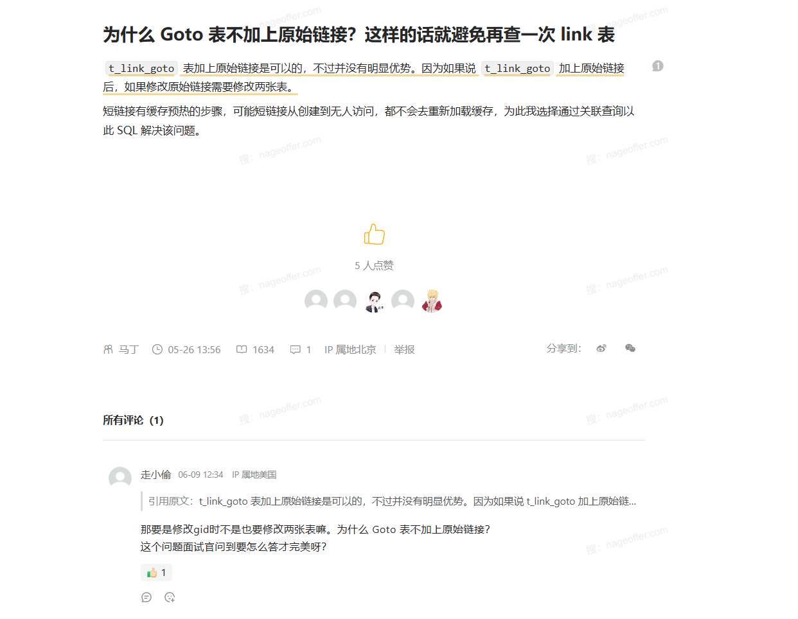

# 百度提前批 -一面 面经

# **百度面试**

**1.自我介绍**

**2.实习相关：**

* **你做的是AI方向，为啥不继续做AI算法呢，要选择java开发呢？**
  * **本科做开发，研究生也想**
* **做的主要内容是什么？**
  * **非完备信息博弈智能决策体，四川麻将为背景，博弈决策系统**
* **多智能体系统是怎么样的？**
  * **多智能体：除了博弈树决策，还有深度学习，强化学习等方案进行决策，并且智能体将有领域大模型**
* **你对智能体的理解是什么？**
  * **理想情况：给如数据或者一些资料，智能体从中学习到一些技术和知识点**
* **这个2000w数据筛选的过程是怎么样的**
  * **数据筛选是公司给的，自己不同模型筛选不同数据，高手玩家的**
* **那么数据中如果高手玩家决策是错的，也会给模型学习到了**
  * **麻将本身是一种非完备信息博弈，不可能每一步都正确，可以尝试用博弈树来修正高手玩家的操作**
* **你的主要工作是什么？**
  * **非完备信息动态自适应博弈搜索树构建  +  深度学习优化搜索树**
* **你们这个大模型的处理是怎么样的？ 同学的**
* **赢大师APP开发做了什么东西，这个问答体系是怎么样的。提供解释**

**3.项目**

* **介绍一下你这个短链接项目吧**
* **布隆过滤器的底层原理是什么**
  * **bitmap + 一组hash函数，注意误判问题**
* **项目中布隆过滤器有什么用**
  * **判断短链接是否存在，判断用户名是否存在**
* **双重判定锁是怎么做的，有什么作用**
* **数据库和缓存一致性怎么做的**

[短链接](https://www.yuque.com/nibiwanxiamei/yrd6t1/d098e4f76821d27d3563495fb12beed5)

* **更新数据库的操作是在事务提交前还是提交之后做的呢**
  * **开启事务后，更新数据，更新操作是写入redo log日志，然后提交事务（两阶段提交）**
* **删除redis这个操作是怎么做的呢，直接delete吗**
  * **交给mq异步处理，重试**
* **数据库的数据是怎么去同步的呢？**
  * **mq异步处理**
* **除了这个，还有什么数据同步的方案吗**
  * **监听binlog + 消息队列（chnal）**
* **数据库主从节点之间数据的同步是异步的，那就会出现数据不一致的情况，你项目是怎么处理的呢？（我说 这些方法可以保证最终一致性，而且出现短暂不一致的情况少，项目是允许出现短暂的不一致的）；**
  * **还可以扩展，如果要保证强一致性，那就要牺牲可用性，CP和AP二选一**
* **数据库InnoDB 索引为什么用B +树**
  * **b+数的优势**
* **数据库中B+树删除操作会发生什么？**

[面试题：mysql 表删除一半数据，B+树索引文件会不会变小？？？](https://mp.weixin.qq.com/s?__biz=MzU0OTE4MzYzMw==\&mid=2247513308\&idx=3\&sn=370c37ee0083646c6757e29ebd2e6cbb\&chksm=fbb13d22ccc6b434eb191fd4a8a6c5e3989d62fa87fd506b555ae233e3ca9f0cfaf1b09fb097\&scene=27)

* **路由表有什么作用，为啥要做路由表，为什么不直接存放在一张表中**
  * **前端是没有GID的，而短链接表是gid分的，所以要先获取gid防止全表扫描。**
  * **路由表说了两遍，第一遍说错了，面试官提示后想到是减少访问量，虽然会修改两张表，但是访问只需要访问一张表**
  * 
* **你的数据库分片是怎么做的，用了ShardingShpere的什么模式**
  * **使用JDBC模式**
* **JDBC这个是在那个层面做的，prepare ？ statement？**
  * **（ShardingSphere-JDBC的SQL改写和路由决策是在**<code>**prepare**</code>**阶段（更具体地说是**<code>**PreparedStatement**</code>**的**<code>**prepare**</code>**方法调用时）完成的。）**
* **ShardingShpere分片是怎么分片的？对这个底层有了解过吗？**
  * **分片是不同表选取一个分片健，然后根据某些算法来映射，我项目中用的是hash算法来映射的**
* **sentinel限流操作是对整个系统限流还是针对某些接口限流。**
  * **接口限流，lua脚本对用户整体限流**
* **常见的限流算法了解过吗？**
  * **计数器，令牌桶，滑动窗口，漏桶**
* \*\*你用到了springcloud，为什么呢？\*\*\*\*分布式服务和单体服务的区别\*\***或者说优劣是什么**
  * **大概说说优势缺点就好**
* **nacos服务注册和发现是怎么做的呢，底层原理你了解过吗？**
  * **（回答只是使用，底层没深入了解）其实面试官就是问服务注册，心跳检测机制。服务启动注册到server，同时定期发送心跳保持健康，长时间没有心跳则剔除服务。**
* **nacos如果挂掉了，你的服务怎么办呢？**
  * **有持久化 | 高可用集群，短时间没问题，长时间需要报警**
* **自增主键，UUID，雪花算法，你觉得使用哪个更加合理，或者说适合什么场景？**
  * **（分布式可能会导致ID冲突报错，需要处理）（面试官解答：大部分自增就好，只有分库分表这种情况用雪花算法，即使是分布式，也只需要自增主键ID就ok）**

[SpringCloud](https://www.yuque.com/nibiwanxiamei/yrd6t1/4578c0cc72422b3d5b7f50fbc8e73c2f)

* **项目中有没有碰到CPU飙升或者OOM的现象呢，是怎么定位的呢？（jprofile）**

**4.八股**

* **Cookie和Session的区别**
  * Cookie的数据存储在客户端（通常是浏览器）。Session的数据存储在服务器端。
  * 单个Cookie的大小限制通常在4KB左右，而且大多数浏览器对每个域名的总Cookie数量也有限制。由于Session存储在服务器上，理论上不受数据大小的限制，主要受限于服务器的内存大小。
  * Cookie相对不安全，因为数据存储在客户端，容易受到XSS（跨站脚本攻击）的威胁。Session通常认为比Cookie更安全，因为敏感数据存储在服务器端。但仍然需要防范Session劫持（通过获取他人的Session ID）和会话固定攻击。
  * Cookie可以设置过期时间，过期后自动删除。也可以设置为会话Cookie，即浏览器关闭时自动删除。Session在默认情况下，当用户关闭浏览器时，Session结束。但服务器也可以设置Session的超时时间，超过这个时间未活动，Session也会失效。
  * 使用Cookie时，因为数据随每个请求发送到服务器，可能会影响网络传输效率，尤其是在Cookie数据较大时。使用Session时，因为数据存储在服务器端，每次请求都需要查询服务器上的Session数据，这可能会增加服务器的负载，特别是在高并发场景下。
* **数据库中索引的构建过程，查询的过程？**
* **数据库的修改是在事务提交之前还是事务提交之后（两阶段提交）**
  * **开启事务后修改，在提交事务。修改的数据是暂时再log日志中，提交事务有两阶段提交，主要是提交redolog和binlog，之后再去修改磁盘中的值**
* **动态代理的原理是什么？**
  * **代理模式，JDK动态代理和CGLIB动态代理。两个的区别（JDK VS 第三方，动态代理 VS 字节码代理， 实现接口 VS 无需实现接口）**
* **Spring事务失效场景（同一个类，一个类有事务，一个没有事务，两个方法调用后事务失效怎么处理）**
  * **获取IOC容器，从容器中获取对象进行方法调用**
  * **自注入，将自己@autowire，然后调用。**
* **我表删除了10w条数据，但是表的磁盘占用没什么变化是为什么?**
  * **删除操作并不会清空区域同时调整结构，我们会标记为已删除的状态，在后续如果要插入数据在对应的区域直接复用空间就可以了，因此磁盘占用没变化**
* **HashMap底层原理？扩容的过程（除了超过负载因子还有什么情况会导致map扩容吗）？**
  * **负载因子**
  * **初始化容量不是2次幂**
  * **某个树化但是整体长度没有超过64，也会先扩容**
* **多线程下扩容会有什么问题吗？举个例子说说看**
  * **数据丢失覆盖**
  * **死循环**
* **你们用JDK8还是17（用8了解17），17的hashmap扩容有什么一样的地方吗**
  * JDK 17 引入了一种“按需rehashing”的机制，在必要时对元素进行重新哈希，而不是在扩容时对所有元素进行全量rehashing。**通过延迟rehashing（当链表转换为树或者某些操作时再rehash），减少扩容时的性能开销。 JDK 17对HashMap内部结构和并发访问进行了优化，尤其是在高并发环境下的性能表现。  **
* **currenthashmap底层原理，加锁的过程，是怎么加的**
  * **segment | node节点，CAS操作，复杂操作加锁**
* **segment是基于reentrantlock的，说说这个吧**
  * **lock包下的锁，可中断，可重入，可公平非公平，condition接口唤醒更加合理，底层基于AQS**
* **AQS是什么，是怎么操作的？**
  * **抽象队列同步器，双向链表（队列），插入节点唤醒节点CAS操作**
* **CAS操作是什么？**
  * **unsafe类下的compareAndSwap（）比较并交换，有三个参数，期望值，修改值，目标值，期望值等于目标值才可以修改，否则需要重新获取在修改。**
* **CAS是自旋操作，会一直自旋吗？**
  * **不会，CAS自旋占用CPU资源，自旋一定时间后阻塞等待唤醒**
* **我看你简历没咋写Linux，那你对Linux的东西掌握的怎么样，怎么查看CPU内存的占用情况呢？（用top，df看磁盘，nvidia-smi看显卡，其余就是一些基本文件操作）**
  * **top命令查看CPU，内存占用情况**
* **你对容器的看法是怎么样的，平时用到过吗？（用到docker放置中间件），你觉得容器的好处和坏处是什么。**
  * **docker部署中间件，使用者会方便很多，无需关注配置不一致，开发者难度增加，且需要资源**

**5.算法：反转链表部分区域（给left和right反转这个区间）**

\*\*6.反问 \*\*

**多久出结果：本周**

**对我有什么建议吗？：面试官第一次面试，说觉得我不错，他认为现在面试不需要造火箭一样，只需要技术和知识够用就行。**

**总结：面试官人很好，我理解错的地方纠正，题解不充足的地方会提示，误解他的意思会说是他描述错了重新描述。**

**总结：shardingshpere需要关注 底层原理，nacos也需要查看底层原理，hashmap源码需要再看看，并看看JDK17的特性和变化。**

> 更新: 2024-08-28 10:54:48  
> 原文: <https://www.yuque.com/nibiwanxiamei/yrd6t1/fzasdgvtnt9swv0q>