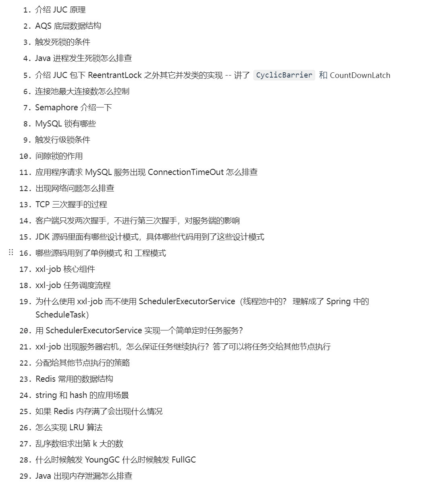
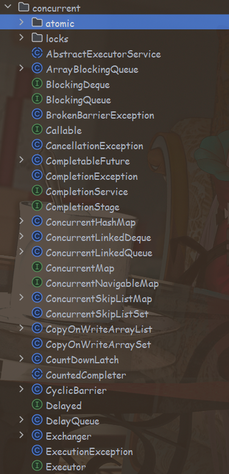
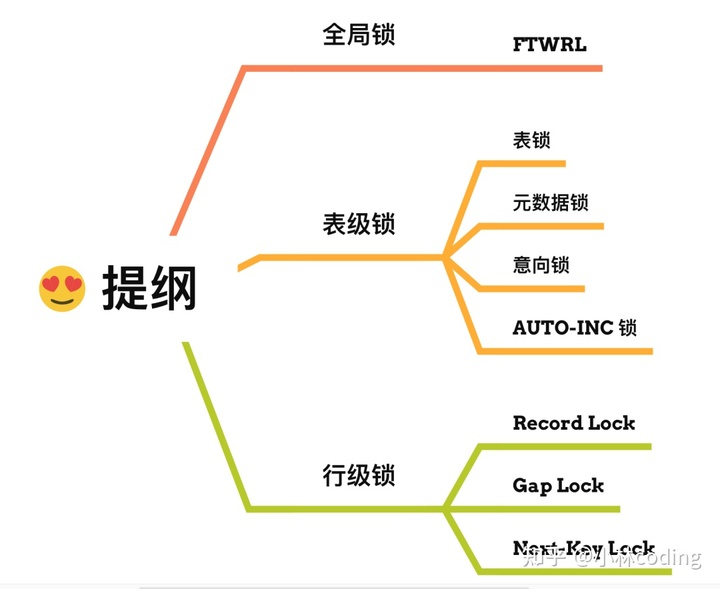
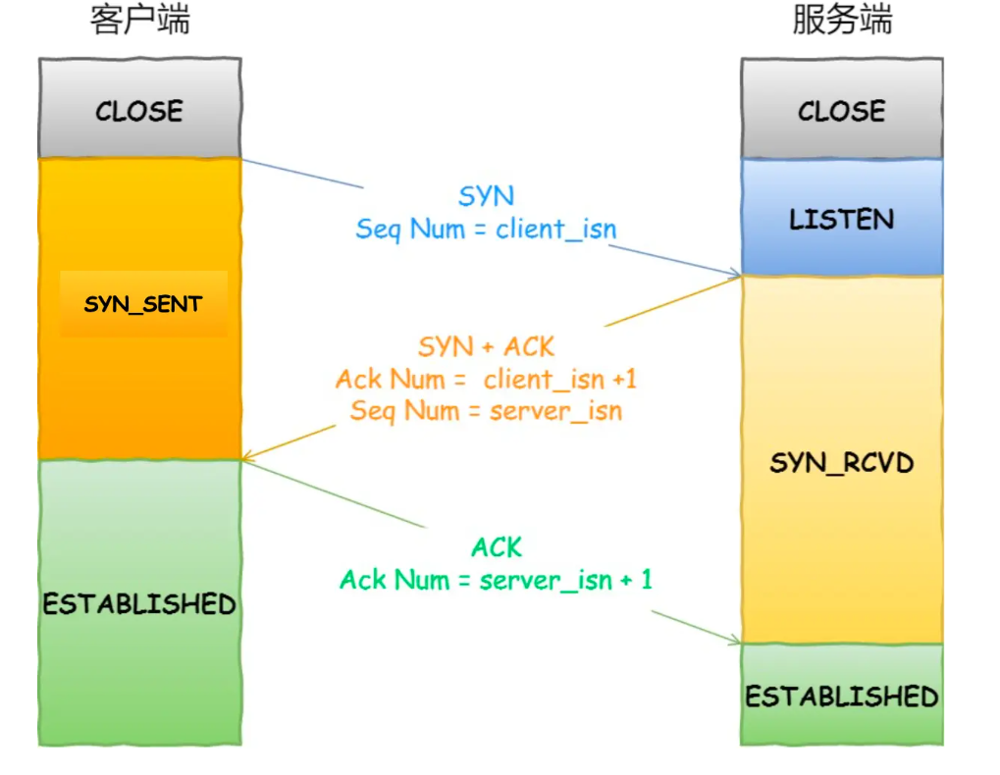

# P

1.介绍JUC原理

:::info
**JUC-java.util.concurrent 并发编程工具包，内置了许多并发编程也就是多线程中需要使用到的工具，比如lock锁，atomic原子类等等。使用多的是reentrantlock锁，原子类等等。这些工具都是保证并发编程的三大特性，原子性可见性和有序性。项目中使用到的锁就是Reentrantlock，底层的话使用的AQS抽象队列同步器**

:::

2.AQS底层数据结构

:::color2
**AQS抽象队列同步器 - 底层使用的是双向链表 / 队列，当线程无法获取到锁的适合，就会被封装为一个Node节点，并且CAS操作放入队列尾部。队列维护一个state表示当前节点的状态，同时首部是获取到锁的线程，当首部锁释放后，就会尝试唤醒后继节点，让后继节点获取到锁。当然如果说是非公平锁的实现，可能对头的不一定竞争得到锁，刚创建的节点也会尝试再次获取锁。如果是公平锁，队列有节点就直接入队。**

:::

3.触发死锁的条件

:::success
死锁四个必要条件

:::

4.Java进程发生死锁怎么排查

:::success
**jdk自带的工具  jps -k**

\*\*使用jstack 查看线程堆栈信息：jstack-l \*\*

**使用JConsole直接检测死锁（有现成的按钮）**

**JProfile排查内存泄漏或者内存溢出**

:::

5.介绍JUC包下ReentrantLock之外其它并发类的实现-讲了CyclicBarrier和CountDownLatch

:::success
semaphone

读写锁

CyclicBarrier

CountDownLatch

并发集合，copyOnWriteArrayList

:::

6,连接池最大连接数怎么控制

:::success
1.加锁

2.类比线程池，使用原子类保存状态数 - 利用CAS操作获取线程数目保证不超出最大线程数目

3.semaphone，把池当共享资源，设置好数量就好

:::

7.Semaphore介绍一下

:::success
信号量 - 实现多线程的同步和互斥，可以用来控制同时访问特定资源的线程数量。**默认构造 AQS 的 **<code>state</code> ** 值为 **<code>permits</code>，你可以将 `permits` 的值理解为许可证的数量，只有拿到许可证的线程才能执行。

:::

8.MySQL锁有哪些

:::success
库锁

表锁

行锁

:::

9.触发行级锁条件

当前读 + 删除修改插入

10.间隙锁的作用

记录锁 + 间隙锁 -- 可重复的解决大部分幻读场景 配合MVCC实现  扩展  什么是幻读，怎么防止的

11.应用程序请求MySQL服务出现ConnectionTimeOut怎么排查

12.出现网络问题怎么排查

:::success
ping网络，查看防火墙，查看端口情况，查看是否使用VPN等

:::

13.TCP三次握手的过程

14.客户端只发两次握手，不进行第三次握手，对服务端的影响

:::success
SYN攻击\*\*占满服务端的半连接队列，\*\*使得服务端不能为正常用户服务。

:::

15.JDK源码里面有哪些设计模式，具体哪些代码用到了这些设计模式

16.哪些源码用到了单例模式和工程模式

:::success
**模板模式：JDBCTemplate这类模板方法**

**工厂方法模式：\*\*\*\*java.util.Calendar**

**单例模式**

* **懒汉式**：JDK中<code>java.lang.Runtime</code>类就是懒汉式单例的一个例子，它在第一次被访问时创建实例。
* **饿汉式**：JDK中<code>java.lang.System</code>类使用了饿汉式单例模式，它在类加载时就完成了实例的初始化。

**建造者模式：StringBuilder**

**原型模式：Object类的clone方法**

**适配器模式：IO流那块**

**代理模式**

**策略模式：\*\*\*\*JDK中的**<code>**java.util.Comparator**</code>**接口和**<code>**java.util.SortedMap**</code>**的实现（如**<code>**TreeMap**</code>**）使用了策略模式，允许在运行时选择不同的排序策略。**

:::

17.xxl-job核心组件

18.xxljob任务调度流程

19.为什么使用Xxl-job而不使用SchedulerExecutorService(线程池中的？理解成了Spring中的

ScheduleTask)

:::success
单机和分布式的区别

:::

20.用SchedulerExecutorService实现一个简单定时任务服务？

21.xjob出现服务器宕机，怎么保证任务继续执行？答了可以将任务交给其他节点执行

22,分配给其他节点执行的策略

23.Redis常用的数据结构

24.string和hash的应用场景

25.如果Redis内存满了会出现什么情况

26.怎么实现LRU算法

27.乱序数组求出第k大的数

28.什么时候触发YoungGC什么时候触发FullGC

29.Java出现内存泄漏怎么排查

> 更新: 2024-08-14 17:27:28  
> 原文: <https://www.yuque.com/nibiwanxiamei/yrd6t1/hzhp96gozylv6w5t>