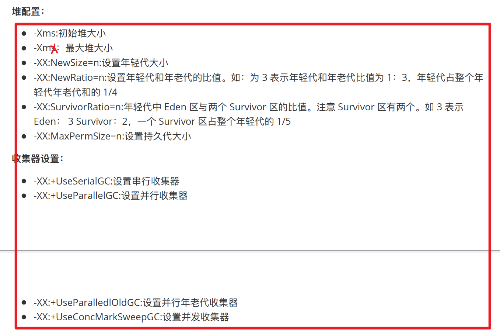
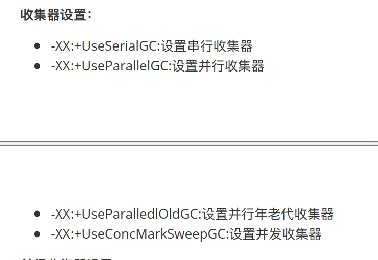

# 科大讯飞二面


java JVM 中OOM，如何优化？如何调整堆大小



溢出是在栈还是堆呢：堆和栈都有，栈溢出就是递归深度过深，堆空间就太小了

GC了解那些：串，并，CMS，G1

怎么配置垃圾回收器



java自定义注解

```java
@Target({ElementType.TYPE, ElementType.METHOD}) -》在那个范围有效？
@Retention(RetentionPolicy.RUNTIME) -》运行时生效，编译时生效？
@Documented
public @interface NoMQRepeatConsume {

    /**
     * 通过 SpEL 表达式生成的唯一 Key
     */
    String key();

    /**
     * 设置防重令牌 Key 过期时间，单位秒，默认 1 小时
     */
    long keyTimeout() default 3600L;
}

```

CS架构，客户端发送close信号，服务端响应后，客户端进入什么状态。四次挥手。注意区分是第几次挥手

linux系统查看网络状态 netstat，ss。。根据进程ID查看网络状态。<font style="color:rgb(51, 51, 51);">netstat -tulnp | grep 1234</font>

网盘下载模块如何实现限速

其他问题 - 遇到冲突怎么办

实现一个生产者消费者模型 - java编写


# 三面
自我介绍

实习介绍

对微服务分布式的理解

NACOS服务中心的原理

分布式系统下限流熔断降级的具体过程

讲讲架构

实现微信朋友圈，怎么实现

还有没有思考其他的类似的架构如何设计

很多都忘了  我以为是HR面，，结果来了技术面3面。。。。。。。


> 更新: 2024-09-10 20:08:55  
> 原文: <https://www.yuque.com/nibiwanxiamei/yrd6t1/lalwhm3rkc84wbhg>