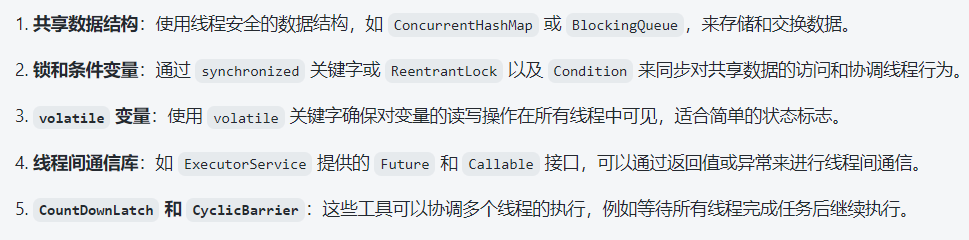
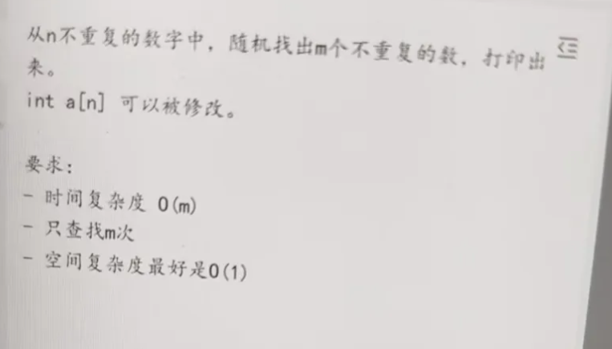
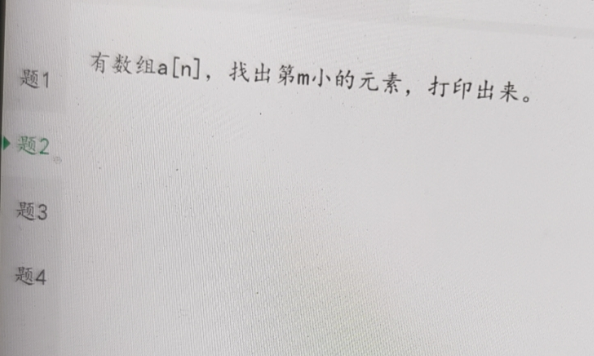
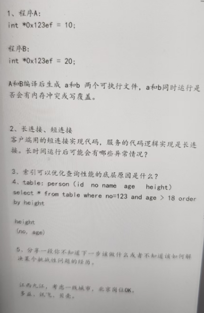
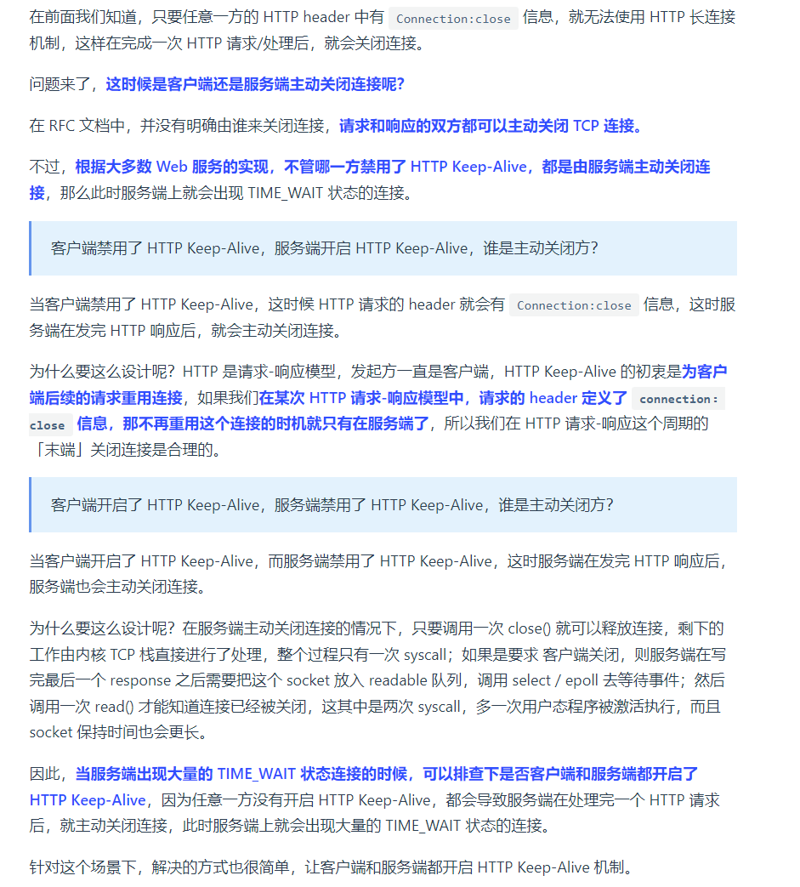

# 美团

# 一面
手撕：合并两个有序数组

+ 实习是算法，期望是算法还是java
+ 介绍实习的内容
+ 项目中收获了那些东西
+ 布隆过滤器介绍
+ zset怎么实现热度排行榜的
+ 榜单热度怎么淘汰呢
+ **整体说一下这个项目在稳定性方面做了那些事情呢？**
+ **java实现负载均衡，给你10个ip，每个ip权重不一样，怎么样用java实现呢？思路 + 如何写**
+ 主键索引和辅助索引介绍
+ 存储引擎对比
+ 乐观锁vs悲观锁 + 使用场景
+ CAS是怎么比较的
+ Hashtable知道吗 ，如果两个线程一个put一个get，能同时进行吗
+ Synchronized修饰静态方法锁的是什么？

# 二面
实习经历介绍

threadlocal存储上下文信息，为什么要用threadlocal，我直接用参数传递也可以达到一样的效果

两个线程之间如何传递这些信息 ？？ InheritableThreadLocal 父子传递

Transimittable哪个是防止线程池残留信息影响

使用ThreadLocal的案例，用java写一个案例。。。。。

```java
public class InheritableThreadLocalExample {

    // 创建一个 InheritableThreadLocal 实例
    private static final InheritableThreadLocal<String> threadLocal = new InheritableThreadLocal<>();

    public static void main(String[] args) {
        // 设置父线程中的数据
        threadLocal.set("Data from parent thread");

        // 启动一个子线程
        Thread childThread = new Thread(() -> {
            // 子线程读取父线程设置的数据
            String data = threadLocal.get();
            System.out.println("Data in child thread: " + data);
        });

        childThread.start();

        try {
            // 等待子线程完成
            childThread.join();
        } catch (InterruptedException e) {
            Thread.currentThread().interrupt();
            System.err.println("Main thread interrupted");
        }
        // 关闭线程池（如果使用线程池的话）
        // executorService.shutdown();
    }
}

```

**。。。。这里应该是想问我不同线程之间怎么通信而不是说用ThreadLocal（）**



**收到点赞评论私信，用RocketMQ异步发送系统消息，这个是在做什么  
****你异步操作怎么做到点赞实时推送呢？ - 异步操作只是用来入库以及后序处理，实时推送要用websocket或者sse**

新用户怎么查看我的一些评论信息（查数据库）、

redis + lua脚本实现限流 怎么实现的

写一个算法：最小覆盖字串（滑动窗口）

说一下操作系统中缓存的使用 （cache ，，主存的buffer，设备的buffer）

考研上岸的是吧

个人优势是什么？ 

抗压能力还行？举个例子 -----

你做了什么内容  为什么选你做组长做任务安排呢

你这段时间最满意的事情是什么？

在公司还是实验室？ - 什么时候开始全职，，什么时候写完论文，，现在在公司吗？

在公司就做一件事情吗？ 还做了什么事情

你还面试了其他的吗，进度怎么样，面了什么互联网大厂吗？在一面就挂了的，，原因是什么呢？


# 复活赛一面
介绍项目背景以及做的工作

项目的难点是什么

长连接和短链接是怎么转换的

缓存穿透击穿和学崩你是怎么解决的

连接生成速度有测试吗？ 实际使用有多少呢？

为什么要做这个系统

为什么要用Redis

有没有测试大概多少范围直接用mysql，请求达到多少需要用缓存呢  
redis大概存了多少数据量？什么时候会发生击穿呢

缓存是全量了，为什么还要去查询数据库呢？

写Redis失败怎么应对的

更新数据库 删除redis是怎么做的

用mq删除会有什么问题？

新增数据到数据库数据库成功但是插入redis失败了怎么办

布隆过滤器介绍一下

知道你用的布隆过滤器的长度是多少吗？ - 提了误判率 + 容量

分布式锁用于什么场景？ - 双重判定锁是做什么用的

手撕：k个一组反转链表

手撕sql：子查询

手撕sql：找出工资第二大的人，如果没有输出null -》 考察IF 和 IFNULL 或者直接子查询，忘了怎么写了

手撕：找出数组中未出现的最小正整数（力扣：缺失的正整数）


# 复活赛二面
访问过的放到末尾，缩小随机访问范围 - 关键是怎么把访问过的标记好



不能使用API，自己写快速排序 或者 用小根堆

、

力扣：最长重复字串




1.不会内存冲突：两个程序运行就是两个进程，操作系统给每个进程分配独立的虚拟地址进程空间，映射到的物理内存是不一样的，所以是相互独立的

追问：什么是虚拟内存，操作系统怎么把虚拟内存转为物理内存，怎么根据虚拟内存知道对应的页表是哪个

2.长连接短链接：**<font style="color:rgb(48, 79, 254);">根据大多数 Web 服务的实现，不管哪一方禁用了 HTTP Keep-Alive，都是由服务端主动关闭连接</font>**<font style="color:rgb(44, 62, 80);">，那么此时服务端上就会出现 TIME_WAIT 状态的连接。</font>

[4.1 TCP 三次握手与四次挥手面试题](https://xiaolincoding.com/network/3_tcp/tcp_interview.html#%E6%9C%8D%E5%8A%A1%E5%99%A8%E5%87%BA%E7%8E%B0%E5%A4%A7%E9%87%8F-time-wait-%E7%8A%B6%E6%80%81%E7%9A%84%E5%8E%9F%E5%9B%A0%E6%9C%89%E5%93%AA%E4%BA%9B)



3.mysql索引底层原理

4.索引优化：构建联合索引 + height的单独索引（height有索引可以避免文件排序）


> 更新: 2024-10-18 11:14:18  
> 原文: <https://www.yuque.com/nibiwanxiamei/yrd6t1/oxufpwb6toi5bn6s>