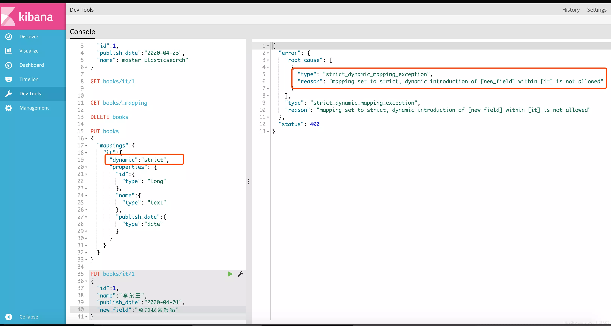
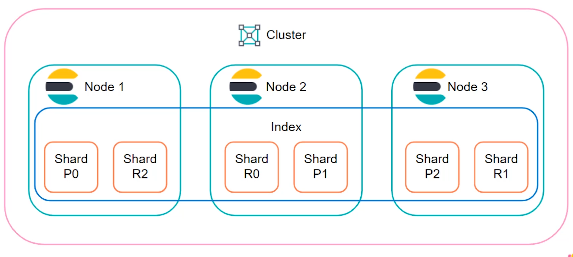

# Elasticsearch

---

# ES基础


## 什么是Elasticsearch


ElasticSearch 是一个**开源的 分布式、RESTful 搜索和分析引擎**，解决**数据库进行模糊搜索时存在的性能问题**，适用于所有类型的数据，包括文本、数字、地理空间、结构化和非结构化数据。


ElasticSearch 使用 Java 语言开发，基于 **Lucence**（**Lucene 是一个 Java 语言编写的高性能、全功能的文本搜索引擎库，提供强大的索引和搜索功能，以及拼写检查、高亮显示和高级分析功能**）。ES 早期版本需要 JDK，在 7.X 版本后已经集成了 JDK，已无需第三方依赖。


## Elasticsearch 可以帮助我们做什么？


1.关键词搜索，加快搜索速度。


2.基于定位分析，推荐内容。


3.结合 Elasticsearch、Kibana、Beats 和 Logstash 这些 Elastic Stack 的组件实现一个功能完善的日志系统。


## 为什么不用MYSQL


**Elasticsearch 主要为系统提供搜索功能， MySQL 这类传统关系型数据库主要为系统提供数据存储功能。**


+ 传统关系型数据库(如 MySQL )在大数据量下查询效率低下， **模糊匹配有可能导致全表扫描**。
+ MySQL 全文索引只支持 CHAR，VARCHAR 或者 TEXT 字段类型，**不支持分词器**。


Es的优势


+ 支持多种数据类型，非结构化，数值，地理信息。
+ 简单的 RESTful API，天生的兼容多语言开发。
+ 提供更丰富的分词器，支持热点词汇查询。
+ 近实时查询，Elasticsearch 每隔 1s 把数据存储至系统缓存中，且使用倒排索引提高检索效率。
+ 支持相关性搜索，可以根据条件对结果进行打分。
+ 天然分布式存储，使用分片支持更大的数据量。


> **数据类型丰富，RestFul API简洁方便，分词器多，热点词汇查询，倒排索引实时查询，天然分布式分片**
>


## Es基本概念 vs mysql
| MySQL    | Elasticsearch    |
| --- | --- |
| Table（表）    | Index（索引）    |
| Row（行）    | Document（文档）    |
| Column（列）    | Field（字段 ）    |
| Schema（约束）    | Mapping    |
| SQL（查询语言）    | DSL |


# 倒排索引和正排索引


倒排索引 也被称作反向索引（inverted index），是用于提高数据检索速度的一种数据结构，空间消耗比较大。倒排索引首先将检索文档进行分词得到多个词语/词条，然后将词语和文档 ID 建立关联，从而提高检索效率。


## 倒排索引的创建和检索流程


1.建立文档列表，每个文档都有一个唯一的文档 ID 与之对应。  
2通过分词器对文档进行分词，生成类似于 <词语，文档ID> 的一组组数据。  
3将词语作为索引关键字，记录下词语和文档的对应关系，也就是哪些文档中包含了该词语。


## 倒排索引由什么组成？


单词字典 ：用于存储单词列表。一般用 B+Tree 或 Hash 拉链法存储，提高查询效率。


倒排列表 ：**记录单词对应的文档集合**。分为：


+ DocID：即文档 id
+ TF : 单词出现频率，简称词频
+ Position：单词在文档中出现的位置，用于检索
+ Offset：偏移量，记录单词开始结束位置，用于高亮显示


## 倒排索引和正排索引的区别


正排索引：


优点：维护成本低，新增数据的时候，只要在末尾新增一个 ID


缺点：以 DocID 为索引，查询时需要扫描所有词语，一个一个比较，直至查到关键词，查询效率较低。


倒排索引：


优点：建立分词和 DocID 关系，大大提高查询效率


缺点：建立倒排索引的成本高。并且，维护起来也比较麻烦，因为文档的每次更新都意味着倒排索引的重建。还有一些搜索精度的问题，比如搜索dogs 和 dog 想要相同匹配结果，这时就需要合适的分词器了


# Mapping


Mapping（映射）定义字段名称、数据类型、优化信息（比如是否索引)、分词器，有点**类似于数据库中的表结构定义**。一个 Index 对应一个 Mapping。


Mapping 分为动态 Mapping 和显示 Mapping 两种：


+ 动态 Mapping：根据待索引数据自动建立索引、自动定义映射类型。
+ 显示 Mapping：手动控制字段的存储和索引方式比如哪些字符串字段应被视为全文字段。


```json
// 显示映射创建索引
PUT /my-index-000001
{
  "mappings": {
    "properties": {
      "age":    { "type": "integer" },
      "email":  { "type": "keyword"  },
      "name":   { "type": "text"  }
    }
  }
}
```


**在写入文档时，如果索引不存在，Elasticsearch 会自动根据数据类型自动推断 Mapping 信息 （Dynamic Mapping），但有时候不是很准确。**


## 动态 Mapping 有几种属性配置？


4 种，可在 Mapping 中配置 **dynamic = true/runtime/false/strict** （默认为 true）。


+ dynamic = true : 新字段被添加到映射中（默认）
+ dynamic = runtime 新字段作为运行时字段添加到映射中，这些字段未编入索引，并_source 在查询时加载。
+ dynamic = false ：新字段将被忽略，这些字段不会被索引或可搜索
+ dynamic = strict ： 如果检测到新字段，则会抛出异常并拒绝文档，新字段必须显式添加到映射中。





> 在原本没有这feild的情况下插入新feild的数据，四种处理情况。
>


## 动态 Mapping 如何防止字段无限增加？


如果使用了动态映射，插入的每个新文档都可能引入新字段。在索引中定义太多字段会导致 映射爆炸 ，从而导致内存不足的错误和难以恢复的情况。**使用 映射限制设置 来限制字段映射的数量**（手动或动态创建）并防止映射爆炸。


## 想要某个字段不被索引怎么做？


在 Mapping 中设置属性 **index = false，** 则该字段不可作为检索条件，但结果中还是包含该字段。


# 查询语句


## 查询语句的分类？


**1、请求体查询（最常用）**


```json
GET /shirts/_search
{
  "query": {
    "bool": {
      "filter": [
        { "term": { "color": "red"   }},
        { "term": { "brand": "gucci" }}
      ]
    }
  }
}
```


请求体查询又称为 Query DSL (Domain Specific Language) 领域特定语言，包括：


+ 叶子查询：指定条件指定字段查询，包括term分词查询和全文检索（match，match_phrase)
+ 复合查询：可包含叶子查询语句和复合查询，主要包括bool和 dis_max


2、请求 URI


```json
GET /users/\_search?q=\*&sort=age:asc&pretty
```


3、类 SQL 检索


```json
POST /_sql?format=txt
{
  "query": "SELECT * FROM uint-2020-08-17 ORDER BY itemid DESC LIMIT 5"
}
```


## Term 查询和全文检索区别？


term 查询条件不做分词处理，只有查询词和文档中的词精确匹配才会被搜索到，**一般用于非文本字段查询**。


```json
# 查询用户名中含有关键词 “张寒” 的人
GET users/_search
{
  "query": {
    "term": {
      "name": "张寒"
    }
  }
}
```


全文检索一般用于**文本查询** ，会使用对应分词器，步骤为：**分词->词项逐个查询->汇总多个词项得分**。


## 如何实现范围查询？


**range** 查询用于匹配在某一范围内的数值型、日期类型或者字符串型字段的文档，比如出生日期在 1996-01-01 到 2000-01-01 的人。使用 **range 查询只能查询一个字段**，不能作用在多个字段上。


range 查询支持的参数有以下几种：


+ gt 大于
+ gte 大于等于
+ lt 小于
+ lte 小于等于


```json
# 查询出生日期在 1996-01-01 到 2000-01-01 的人
GET users/_search
{
  "query": {
    "range": {
      "birthday": {
        "gte": "1996-01-01",
        "lte": "2000-01-01",
        "format": "yyyy-MM-dd"
      }
    }
  }
}
```


## Match 和 Match_phrase 区别？


match 查询多个检索词之间默认是 or 关系，可使用 operator 改为 and 关系


match_phrase 查询多个检索词之间默认是 and 关系，并且词的位置关系影响搜索结果


## bool 查询有几种查询子句？


bool 一般用于多条件多字段查询：match ，match_phrase ，term 等简单查询语句，主要有以下 4 种查询子句


+ must: 结果必须匹配 must 查询条件，贡献算分
+ should： 结果应该匹配 should 子句查询的一个或多个，贡献算分
+ must_not： 结果必须不能匹配该查询条件
+ filter： 结果必须匹配该过滤条件，但不计算得分，可提高查询效率


在北京找一个有房或者有车 ，身高不低于 150 的女朋友


```json

GET /users/_search
{
  "query": {
    "bool": {
      "must": [
        {
          "match": {
            "gender": "female" //性别必须为女
          }
        }
      ],
      "should": [
        {
          "match": {
            "hasroom": "true" //有房或者有车
          }
        },
        {
          "match": {
            "hascar": "true"
          }
        }
      ],
      "must_not": [
        {
          "range": {
            "height": {
              "gte": 150 //身高不低于150
            }
          }
        }
      ],
      "filter": [
        {
          "term": {
            "address": "北京" //必须北京，不过不算分
          }
        }
      ]
    }
  }
}
```


# 数据同步


## Elasticsearch 和 MySQL 同步的策略有哪些？


同步类型分为：**全量同步和增量同步。**


全量同步即建好 Elasticsearch 索引后一次性导入 MySQL 所有数据。全量同步有很多现成的工具可以用比如 go-mysql-elasticsearch、Datax。


> 一般都通过binlog进行全量同步
>


增量同步即对 MySQL 中新增，修改，删除的数据进行同步:


同步双写 ：修改数据时同步到 Elasticsearch。这种方式性能较差、存在丢数据风险且会耦合大量数据同步代码，一般不会使用。


**异步双写 ：修改数据时，使用 MQ 异步写入 Elasticsearch 提高效率。这种方式引入了新的组件和服务，增加了系统整体复杂性。**


定时器 ：定时同步数据到 Elasticsearch。这种方式时效性差，通常用于数据实时性不高的场景


binlog 同步组件 Canal(推荐) ： 使用 Canal 可以做到业务代码完全解耦，API 完全解耦，零代码实现准实时同步, Canal 通过解析 MySQL 的 binlog 日志文件进行数据同步。


# Elasticsearch 集群


## Elasticsearch 集群是什么？有什么用？


单台 Elasticsearch 服务器负载能力和存储能力有限，很多时候通过增加服务器配置也没办法满足我们的要求。并且，单个 Elasticsearch 节点会存在单点风险，没有做到高可用。为此，我们需要**搭建 Elasticsearch 集群**。


**Elasticsearch 集群是多个 Elasticsearch 节点的集合，这些节点共同协作，一起提供服务，可以解决单台 Elasticsearch 服务器无法处理的搜索需求和数据存储需求。** 出于高可用方面的考虑，集群中节点数量建议 3 个以上，并且其中至少两个节点不是仅投票主节点。





**Elasticsearch 集群可以很方便地实现横向扩展，我们可以动态添加或者删除 Elasticsearch 节点。当有节点加入集群中或者从集群中移除节点时，集群将会重新平均分布所有的数据。(类似redis集群)**


+ **分片是 Elasticsearch 在集群内分发数据的单位**。整个 Elasticsearch 集群的核心就是对所有的分片执行分布存储，索引，负载，路由的工作。
+ 副本分片主要是为了提高可用性，由于副本分片同样会占用资源，不建议为一个主分片分配过多的副本分片。
+ 当我们写索引数据的时候，只能写在主分片上，然后再同步到副本分片。
+ 当主分片出现问题的时候，会从可用的副本分片中选举一个新的主分片。


## 查询文档时如何找到对应的分片？


根据路由公式来决定的:


```python
shard = hash(routing) % number_of_primary_shards
```


**routing 是一个可以配置的变量,默认是使用文档的 id。**


对 routing取哈希再除以number_of_primary_shards(索引创建时指定的分片总数)得到的余数就是对应的分片。


当一个查询请求到达仅协调节点（coordinating only node） 后，仅协调节点会根据路由公式计算出目标分片，然后再将请求转发到目标分片的主分片节点上。


**要在创建索引的时候就确定好主分片的数量，并且不允许改变索引分片数。如果数量变化了, 那么所有之前路由的计算值都会无效，文档也再也找不到了。**


‍


> 更新: 2025-07-30 17:10:15  
> 原文: <https://www.yuque.com/nibiwanxiamei/yrd6t1/5e56dcf1316a4bade2f325b1a027e28f>