# MySql重要知识点

# MySQL索引详解

## 索引介绍

**<font style="color:#DF2A3F;">索引是一种用于快速查询和检索数据的数据结构，其本质是一种排序好的数据结构。</font>**

常见的索引结构有: B 树， B+树 和 Hash、红黑树。在 MySQL 中，无论是 Innodb（聚簇索引） 还是 MyIsam（非聚簇索引），都使用了 **B+树**作为索引结构。

## 索引的优缺点

**优点**：

* 使用索引可以**加快数据的检索速度**（大大减少检索的数据量）, 这也是创建索引的最主要的原因。
* 通过**创建唯一性索引，可以保证数据库表中每一行数据的唯一性**。

**缺点**：

* 创建索引和维护索引需要耗费许多时间。当对表中的数据进行增删改的时候，如果数据有索引，那么索引也需要动态的修改，会降低 SQL 执行效率。
* 索引需要使用物理文件存储，也会耗费一定空间。

但是，\*\*使用索引一定能提高查询性能吗？\*\*大多数情况下，索引查询都是比全表扫描要快的。但是如果数据库的数据量不大，那么使用索引也不一定能够带来很大提升

> **<font style="color:#DF2A3F;">适合索引情况：字段有唯一性限制的，经常用于 </font>**<code>**<font style="color:#DF2A3F;">WHERE</font>**</code>**<font style="color:#DF2A3F;"> 查询条件的字段，经常用于 </font>**<code>**<font style="color:#DF2A3F;">GROUP BY</font>**</code>**<font style="color:#DF2A3F;"> 和 </font>**<code>**<font style="color:#DF2A3F;">ORDER BY</font>**</code>**<font style="color:#DF2A3F;"> 的字段，表数据量大，可以构建索引。</font>**

## 索引底层数据结构选型

### Hash 表

哈希表是键值对的集合，通过键(key)即可快速取出对应的值(value)，因此哈希表可以快速检索数据（接近 O（1））。**哈希算法**（也叫散列算法）通过哈希算法，可以快速找到 key 对应的 index，找到了 index 也就找到了对应的 value。

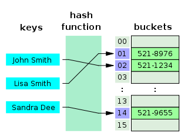

MySQL 的 **InnoDB 存储引擎不直接支持常规的哈希索引**，但是，InnoDB 存储引擎中存在一种特殊的“**<font style="color:#DF2A3F;">自适应哈希索引</font>**”（Adaptive Hash Index），自适应哈希索引并不是传统意义上的纯哈希索引，而是结合了 B+Tree 和哈希索引的特点，以便更好地适应实际应用中的数据访问模式和性能需求。

自适应哈希索引的每个哈希桶实际上是一个小型的 B+Tree 结构。这个 B+Tree 结构可以存储多个键值对，而不仅仅是一个键。这有助于减少哈希冲突链的长度，提高了索引的效率。

不管是聚集索引还是普通索引，记录定位的寻路路径（Search Path）都很长。回到Adaptive Hash Index的概念上：在MySQL运行的过程中，如果InnoDB发现：

* 有很多寻路很长（比如B+树层数太多、回表次数多等情况）的SQL；
* 有很多SQL会命中相同的页面（Page）。

**InnoDB会在自己的**\*\*<font style="color:#DF2A3F;">内存缓冲区（Buffer Pool）里</font>****，开辟一块区域，建立****<font style="color:#DF2A3F;">自适应哈希索引（Adaptive Hash Index，AHI）</font>\*\*\*\*，以加速查询。\*\*

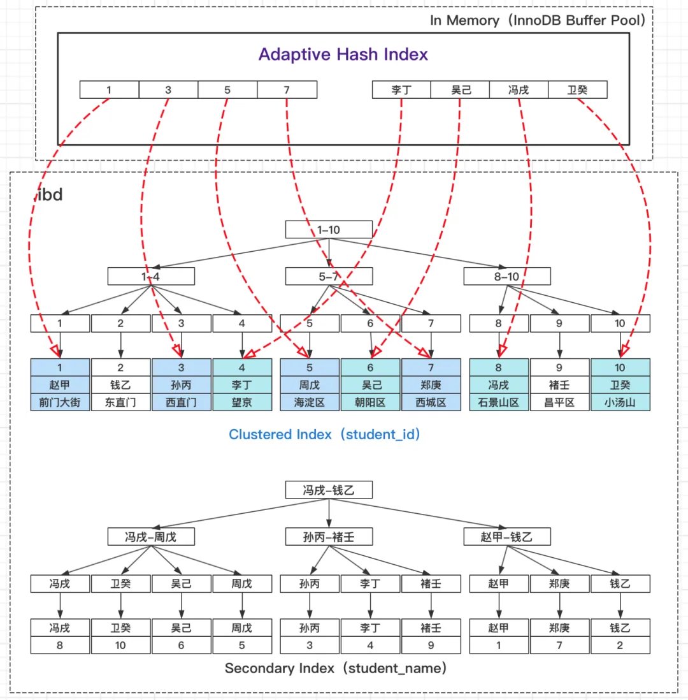

[MySQL各种“Buffer”之Adaptive Hash Index](https://mp.weixin.qq.com/s/ra4v1XR5pzSWc-qtGO-dBg)

**<font style="color:#DF2A3F;background-color:#FBDE28;">Hash 索引不支持顺序和范围查询。</font>**

### 二叉查找树(BST)

也就是二叉排序树，左 < 根 < 右

**二叉查找树的性能非常依赖于它的平衡程度，这就导致其不适合作为 MySQL 底层索引的数据结构。**

在二叉查找树基础上的改进型数据结构，如**平衡二叉树、B-Tree、B+Tree** 等。

### AVL 树

自平衡二叉查找树，AVL 树的特点是保证**任何节点的左右子树高度之差不超过 1**，因此也被称为高度平衡二叉树，它的**查找、插入和删除在平均和最坏情况下的时间复杂度都是 O(logn)。**

\*\*AVL 树需要频繁地进行旋转操作来保持平衡，因此会有较大的计算开销进而降低了查询性能。\*\*并且， 在使用 AVL 树时，**每个树节点仅存储一个数据，而每次进行磁盘 IO 时只能读取一个节点的数据**，如果需要查询的数据分布在多个节点上，那么就需要进行多次磁盘 IO。 **磁盘 IO 是一项耗时的操作，在设计数据库索引时，我们需要优先考虑如何最大限度地减少磁盘 IO 操作的次数。**

### 红黑树

红黑树是一种**自平衡二叉查找树**，通过在插入和删除节点时进行颜色变换和旋转操作，使得树始终保持平衡状态，它具有以下特点：

1. 每个节点非红即黑；
2. 根节点总是黑色的；
3. 每个叶子节点都是黑色的空节点（NIL 节点）；
4. 如果节点是红色的，则它的子节点必须是黑色的（反之不一定）；
5. 从根节点到叶节点或空子节点的每条路径，必须包含相同数目的黑色节点（即相同的黑色高度）。

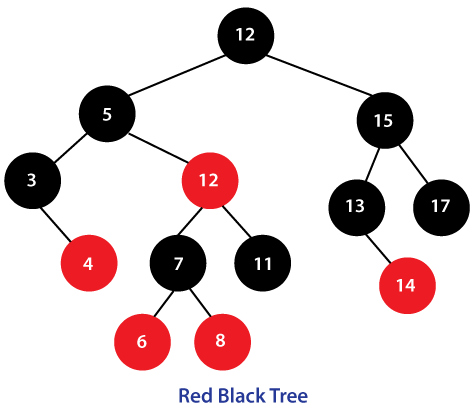

红黑树并不追求严格的平衡，而是大致的平衡。红黑树的查询效率稍有下降，因为红黑树的平衡性相对较弱，可能会导致树的高度较高，这可能会导致一些数据需要进行多次磁盘 IO 操作才能查询到，这也是 MySQL 没有选择红黑树的主要原因。红黑树的插入和删除操作效率大大提高了，因为红黑树在插入和删除节点时只需进行 O(1) 次数的旋转和变色操作，即可保持基本平衡状态，而不需要像 AVL 树一样进行 O(logn) 次数的旋转操作。

**红黑树的应用还是比较广泛的，****<font style="color:#DF2A3F;">TreeMap、TreeSet 以及 JDK1.8 的 HashMap 底层都用到了红黑树</font>****。对于数据在内存中的这种情况来说，红黑树的表现是非常优异的。**

### 跳表

<font style="color:rgb(36, 41, 46);">跳表是一种采用了用空间换时间思想的数据结构。</font>**<font style="color:rgb(36, 41, 46);">跳表会随机地将一些节点提升到更高的层次，以创建一种逐层的数据结构，以提高操作的速度。</font>**

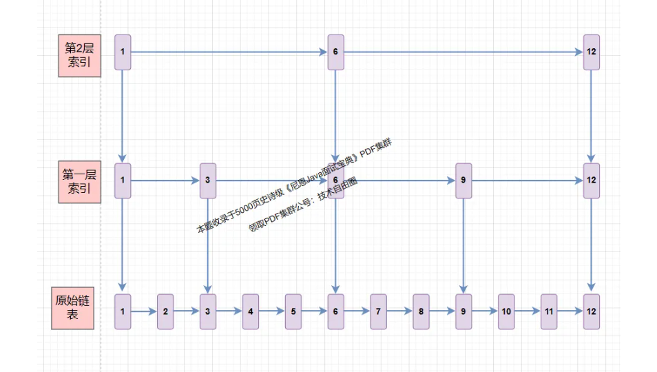

**<font style="color:rgb(36, 41, 46);">跳表(Skip List)的优点</font>**

* <font style="color:rgb(36, 41, 46);">平均</font>**<font style="color:rgb(36, 41, 46);">查找时间较低</font>**<font style="color:rgb(36, 41, 46);">：跳表的查询时间复杂度为O(log n)，与平衡树结构相似，但实现起来较为简单。</font>
* <font style="color:rgb(36, 41, 46);">插入和删除操作相对较快：由于跳表不需要进行节点的频繁平衡调整，插入和删除操作的性能较好。</font>

**<font style="color:rgb(36, 41, 46);">跳表(Skip List)的缺点</font>**

* <font style="color:rgb(36, 41, 46);">难实现</font>**<font style="color:rgb(36, 41, 46);">事务和数据持久性</font>**<font style="color:rgb(36, 41, 46);">：跳表的更新操作可能涉及多个层级，实现事务和数据持久性要求更复杂。</font>
* <font style="color:rgb(36, 41, 46);">空间开销较大：跳表需要额外的指针来连接不同层级，占用的内存空间较多。</font>

### B 树& B+树

B 树也称 B-树,全称为 **多路平衡查找树** ，B+ 树是 B 树的一种变体。B 树和 B+树中的 B 是 `Balanced` （平衡）的意思。目前大部分**数据库系统及文件系统都采用 B-Tree 或其变种 B+Tree 作为索引结构**。

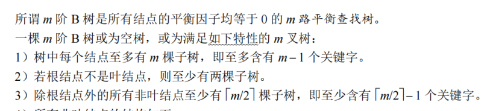


**B 树& B+树异同呢？**

* **B 树的所有节点既存放键(key) 也存放数据(data)，而** **B+树只有叶子节点存放 key 和 data**，**其他内节点只存放 key。**
* **B 树的叶子节点都是独立的 ;B+树的叶子节点有一条引用链指向与它相邻的叶子节点**。
* B 树的检索的过程相当于对范围内的每个节点的关键字做二分查找，可能没有到达叶子节点，就结束了。而 B+树的检索效率就很稳定了，任何查找都是从根节点到叶子节点的过程，叶子节点的顺序检索很明显。
* 在 B 树中进行范围查询时，首先找到要查找的下限，然后对 B 树进行中序遍历，直到找到查找的上限；而 B+树的范围查询，只需要对链表进行遍历即可。

**<font style="color:#DF2A3F;">B+树与 B 树相比，具备更少的 IO 次数(树高)、更稳定的查询效率和更适于范围查询这些优势。</font>**

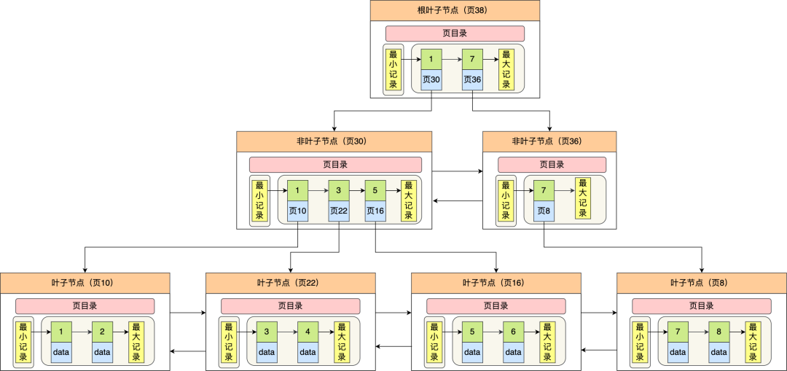

## 为什么MYSQL使用B+树而不使用跳表？

## 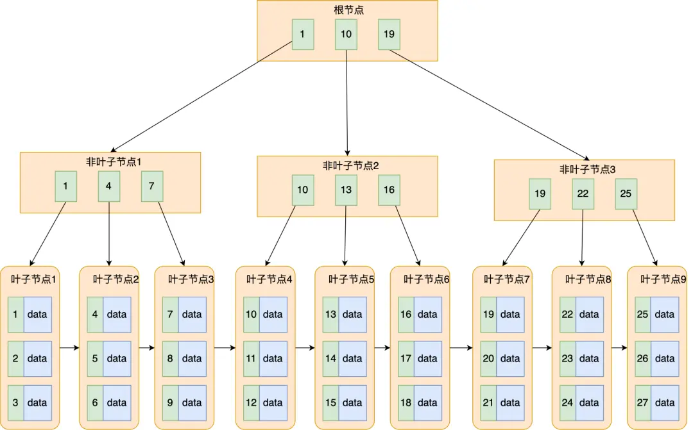

### <font style="color:rgb(30, 30, 30);background-color:rgb(212, 224, 250);">B+树更适合磁盘IO</font>

**<font style="color:rgb(36, 41, 46);">B+Tree一个节点是一个page</font>**<font style="color:rgb(36, 41, 46);">，是一种多叉树结构，每个结点都是一个16k的数据页，能存放较多索引信息。一次IO一个page，大大节省了磁盘IO的操作。</font>**<font style="color:rgb(36, 41, 46);">B+Tree</font>**<font style="color:rgb(36, 41, 46);">一个page 能存放较多索引信息 ，所以树的层数比较低， </font>**<font style="color:rgb(36, 41, 46);">三层</font>**<font style="color:rgb(36, 41, 46);">左右就可以存储</font>**<font style="color:rgb(36, 41, 46);">2kw</font>**<font style="color:rgb(36, 41, 46);">左右的数据也就是说查询一次数据，如果这些数据页都在磁盘里，那么最多需要查询</font>**<font style="color:rgb(36, 41, 46);">三次磁盘IO</font>**<font style="color:rgb(36, 41, 46);">。</font>

### <font style="color:rgb(30, 30, 30);background-color:rgb(212, 224, 250);">原生跳表不适合磁盘IO</font>

**<font style="color:rgb(36, 41, 46);">跳表是链表结构，一条数据一个结点，那么一个node节点一次磁盘io</font>**<font style="color:rgb(36, 41, 46);">， 一个page 页规模的IO存储的性能 估计要下降1000倍以上。原生跳表 一个node存放一个索引信息 ，所以树的层数比较高。如果最底层要存放2kw数据，且每次查询都要能达到二分查找的效果，2kw大概在2的24次方左右，所以，2kw数据的跳表大概高度在24层左右。 如果要进行查找，大概要进行 24次磁盘IO。</font>

## 索引分类总结

* <font style="color:rgb(44, 62, 80);">按「数据结构」分类：</font>**<font style="color:rgb(48, 79, 254);">B+tree索引、Hash索引、Full-text索引</font>**<font style="color:rgb(44, 62, 80);">。</font>
* <font style="color:rgb(44, 62, 80);">按「物理存储」分类：</font>**<font style="color:rgb(48, 79, 254);">聚簇索引（主键索引）、二级索引（辅助索引）</font>**<font style="color:rgb(44, 62, 80);">。</font>
* <font style="color:rgb(44, 62, 80);">按「字段特性」分类：</font>**<font style="color:rgb(48, 79, 254);">主键索引、唯一索引、普通索引、前缀索引</font>**<font style="color:rgb(44, 62, 80);">。</font>
* <font style="color:rgb(44, 62, 80);">按「字段个数」分类：</font>**<font style="color:rgb(48, 79, 254);">单列索引、联合索引</font>**<font style="color:rgb(44, 62, 80);">。</font>

按照数据结构维度划分：

* B+Tree 索引：MySQL 里默认和最常用的索引类型。只有叶子节点存储 value，非叶子节点只有指针和 key。
* 哈希索引：类似键值对的形式，一次即可定位。
* RTree 索引：一般不会使用，仅支持 geometry 数据类型，优势在于范围查找，效率较低，通常使用搜索引擎如 ElasticSearch 代替。
* 全文索引：对文本的内容进行分词，进行搜索。目前只有 `CHAR`、`VARCHAR` ，`TEXT` 列上可以创建全文索引。一般不会使用，效率较低，通常使用搜索引擎如 ElasticSearch 代替。

按照底层存储方式角度划分：

* 聚簇索引（聚集索引）：索引结构和数据一起存放的索引，InnoDB 中的主键索引就属于聚簇索引。
* 非聚簇索引（非聚集索引）：索引结构和数据分开存放的索引，二级索引(辅助索引)就属于非聚簇索引。MySQL 的 MyISAM 引擎，不管主键还是非主键，使用的都是非聚簇索引。

按照应用维度划分：

* 主键索引：加速查询 + 列值唯一 **（不可以有 NULL）** + 表中只有一个。
* 普通索引：仅加速查询。
* 唯一索引：加速查询 + 列值唯一 **（可以有 NULL）** 。
* 覆盖索引：一个索引包含（或者说覆盖）所有需要查询的字段的值。
* 联合索引：多列值组成一个索引，专门用于组合搜索，其效率大于索引合并。
* 全文索引：对文本的内容进行分词，进行搜索。目前只有 `CHAR`、`VARCHAR` ，`TEXT` 列上可以创建全文索引。一般不会使用，效率较低，通常使用搜索引擎如 ElasticSearch 代替。

> 主要划分：
>
> * **聚簇索引（主键索引）**
> * **非聚簇索引（二级索引，联合索引，覆盖索引）**
>
> **主键索引：包含整个表的数据，以主键列作为索引构建B+树**
>
> **二级索引：使用其他列作为索引构建B+树，只有部分数据**
>
> **联合索引：有多个列作为索引构建B+树**
>
> **覆盖索引：查找的列刚好是作为索引的列，二级索引就能查到，不需要回表查询**
>
> **回表：二级索引不包含表的所有数据，当查找列不在索引内，就需要回聚簇索引查询**

### 主键索引(Primary Key) - 聚簇索引

**数据表的主键列使用的就是主键索引。一张数据表有只能有一个主键，并且主键不能为 null，不能重复。**

**在 MySQL 的 InnoDB 的表中，当没有显示的指定表的主键时，InnoDB 会自动先检查表中是否有唯一索引且不允许存在 null 值的字段，如果有，则选择该字段为默认的主键，否则 InnoDB 将会自动创建一个 6Byte 的自增主键** **。**

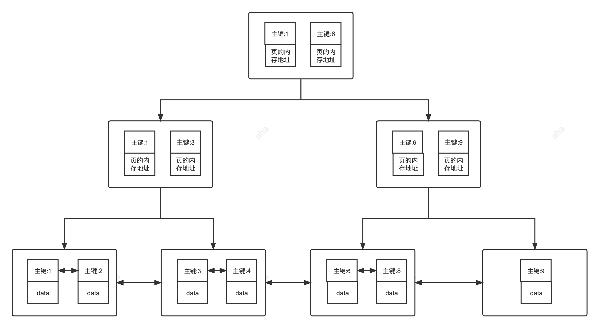

### 二级索引

\*\*二级索引（Secondary Index）又称为辅助索引，****<font style="color:#DF2A3F;">二级索引的叶子节点存储的数据是主键ID</font>****。也就是说，通过二级索引，可以定位主键的位置。\*\*唯一索引，普通索引，前缀索引等索引属于二级索引。

1. **唯一索引(Unique Key)** :唯一索引也是一种约束。唯一索引的属性列不能出现重复的数据，但是允许数据为 NULL，一张表允许创建多个唯一索引。 建立唯一索引的目的大部分时候都是为了该属性列的数据的唯一性，而不是为了查询效率。
2. **普通索引(Index)** :普通索引的唯一作用就是为了快速查询数据，一张表允许创建多个普通索引，并允许数据重复和 NULL。
3. **前缀索引(Prefix)** :前缀索引只适用于字符串类型的数据。前缀索引是对文本的前几个字符创建索引，相比普通索引建立的数据更小，因为只取前几个字符。
4. **全文索引(Full Text)** :全文索引主要是为了检索大文本数据中的关键字的信息，是目前搜索引擎数据库使用的一种技术。Mysql5.6 之前只有 MYISAM 引擎支持全文索引，5.6 之后 InnoDB 也支持了全文索引。

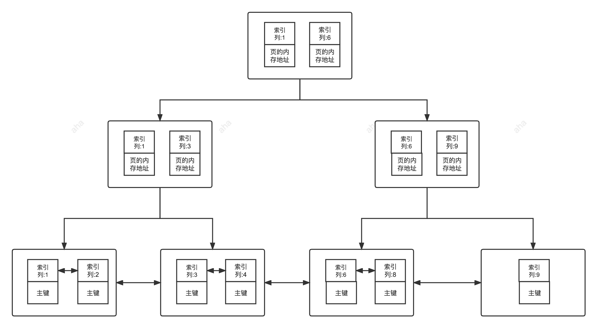

**<font style="color:#DF2A3F;background-color:#FBDE28;">主键索引存储的是主键id和全部数据</font>**<font style="color:#DF2A3F;background-color:#FBDE28;">，</font>**<font style="color:#DF2A3F;background-color:#FBDE28;">二级索引储存的是索引值和主键值</font>**

**主键索引用于唯一标识每一行数据，保证数据的完整性和一致性，并且可以用来加速对特定行的访问。而二级索引则用于优化对非主键列的查询，提高查询性能**。

### 聚簇索引（主键索引）与非聚簇索引（二级索引）

主键索引是基于主键构建的树，二级索引是基于其他列构建的树

> * **聚簇索引会存放整个表的数据**
> * **非聚簇索引只是存放部分数据，如果我们要根据非聚簇索引查找其他列，就需要回表也就是查找聚簇索引**

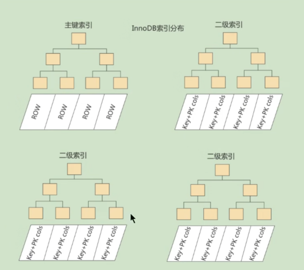

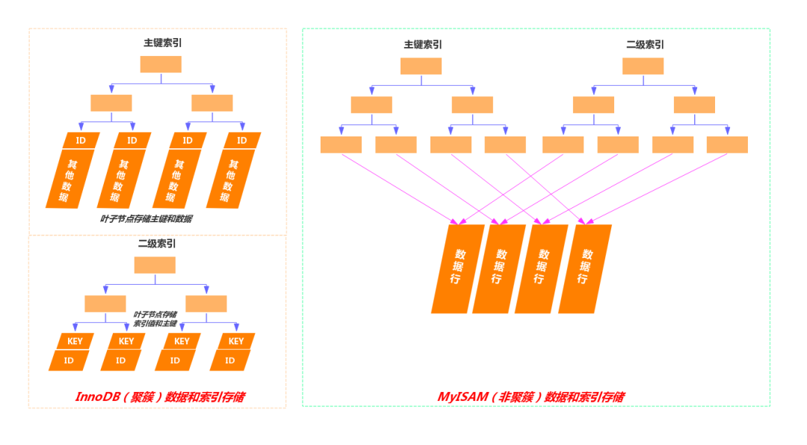

#### 聚簇索引（聚集索引）

**聚簇索引（Clustered Index）即**\*\*<font style="color:#DF2A3F;">索引结构和数据一起存放的索引</font>\*\*\*\*，并不是一种单独的索引类型。InnoDB 中的主键索引就属于聚簇索引。\*\*

**优点**：

* **查询速度非常快**：聚簇索引的查询速度快，整个 B+树本身就是一颗多叉平衡树，**叶子节点都是有序的**，**定位到索引的节点，就相当于定位到了数据**。相比于非聚簇索引， 聚簇索引少了一次读取数据的 IO 操作(回表)。
* **对排序查找和范围查找优化**：聚簇索引对于主键的排序查找和范围查找速度非常快。

**缺点**：

* **依赖于有序的数据**：因为 B+树是多路平衡树，如果索引的数据不是有序的，那么就需要在插入时排序，如果数据是整型还好，否则类似于字符串或 UUID 这种又长又难比较的数据，插入或查找的速度肯定比较慢。
* **更新代价大**：如果对索引列的数据被修改时，那么对应的索引也将会被修改，而且聚簇索引的叶子节点还存放着数据，修改代价肯定是较大的，所以对于主键索引来说，主键一般都是不可被修改的。

#### 非聚簇索引（非聚集索引）

**非聚簇索引(Non-Clustered Index)即**\*\*<font style="color:#DF2A3F;">索引结构和数据分开存放的索引</font>\*\*\*\*，并不是一种单独的索引类型。二级索引(辅助索引)就属于非聚簇索引\*\* **。MySQL 的 MyISAM 引擎，不管主键还是非主键，使用的都是非聚簇索引。**

非聚簇索引的叶子节点并不一定存放数据的指针，因为二级索引的叶子节点就存放的是主键，根据主键再回表查数据

**优点**：

* 更新代价比聚簇索引要小 。非聚簇索引的叶子节点是不存放数据的

**缺点**：

* **依赖于有序的数据**:跟聚簇索引一样，非聚簇索引也依赖于有序的数据
* **可能会二次查询(回表)** :这应该是非聚簇索引最大的缺点了。 **当查到索引对应的指针或主键后，可能还需要根据指针或主键再到数据文件或表中查询。**

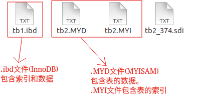

聚簇索引和非聚簇索引:

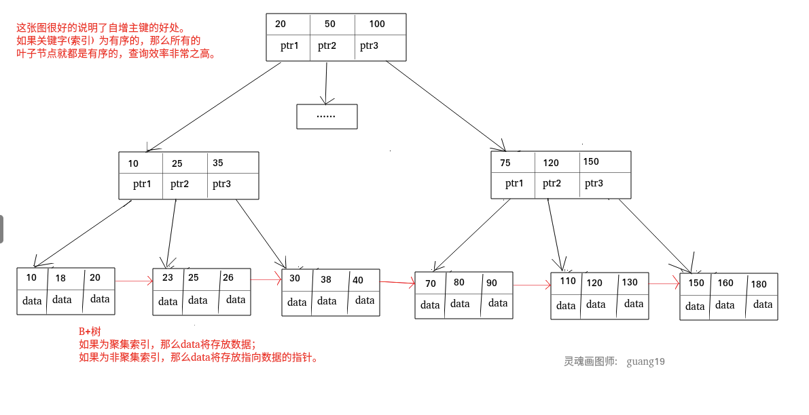

## 覆盖索引和联合索引

### 覆盖索引

**<font style="color:#DF2A3F;">如果一个索引包含（或者说覆盖）所有需要查询的字段的值，我们就称之为</font>**<font style="color:#DF2A3F;"> </font>**<font style="color:#DF2A3F;">覆盖索引（Covering Index）</font>**  。**<font style="color:rgb(48, 79, 254);">如果某个查询语句使用了二级索引，但是查询的数据不是主键值，这时在二级索引找到主键值后，需要去聚簇索引中获得数据行，这个过程就叫作「回表」，也就是说要查两个 B+ 树才能查到数据。不过，当查询的数据是主键值时，因为只在二级索引就能查询到，不用再去聚簇索引查，这个过程就叫作「索引覆盖」，也就是只需要查一个 B+ 树就能找到数据。</font>**

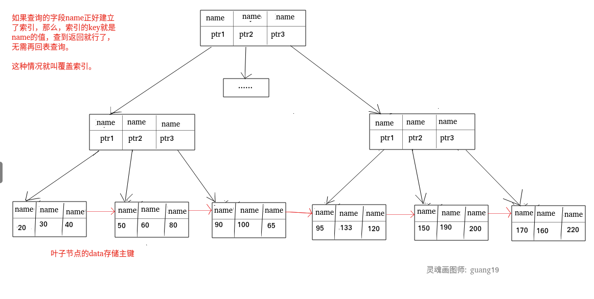

**如果查询的不是name字段，是age ，这个时候就需要回表查询**

### 联合索引

表中的多个字段创建索引，就是 **联合索引**，也叫 **组合索引** 或 **复合索引**。**不遵循「最左匹配原则」，联合索引会失效。**`(a, b, c)` 联合索引，是先按 a 排序，在 a 相同的情况再按 b 排序，在 b 相同的情况再按 c 排序。所以，**b 和 c 是全局无序，局部相对有序的**，这样在没有遵循最左匹配原则的情况下，是无法利用到索引的。

```sql
CREATE INDEX index_product_no_name ON product(product_no, name);
```

最左前缀匹配原则指的是，在使用联合索引时，**MySQL** 会根据联合索引中的字段顺序，从左到右依次到查询条件中去匹配，如果查询条件中存在与联合索引中最左侧字段相匹配的字段，则就会使用该字段过滤一批数据，直至联合索引中全部字段匹配完成，或者在执行过程中遇到范围查询（如  <code>**>**</code> 、 <code>**<**</code>  ）才会停止匹配。

**对于  **<code>**>=**</code>** 、 **<code>**<=**</code>** 、**<code>**BETWEEN**</code>**、**<code>**like**</code>\*\* 前缀匹配的范围查询，并不会停止匹配。所以，在使用联合索引时，可以将区分度高的字段放在最左边，这也可以过滤更多数据。\*\*

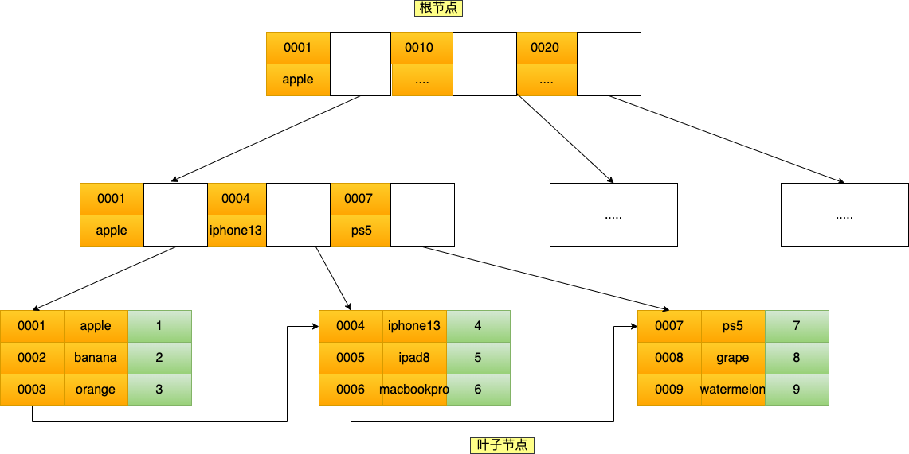

#### Q1: `select * from t_table where a > 1 and b = 2`，联合索引（a, b）哪一个字段用到了联合索引的 B+Tree？

**在符合 a >**  **1 条件的二级索引记录的范围里，b 字段的值是无序的。只有 a 字段用到了联合索引进行索引查询，而 b 字段并没有使用到联合索引**

#### Q2: `select * from t_table where a >= 1 and b = 2`，联合索引（a, b）哪一个字段用到了联合索引的 B+Tree？

**虽然在符合 a>= 1 条件的二级索引记录的范围里，b 字段的值是「无序」的，但是对于符合 a =**  **1 的二级索引记录的范围里，b 字段的值是「有序」的这条查询语句 a 和 b 字段都用到了联合索引进行索引查询**。

#### Q3: `SELECT * FROM t_table WHERE a BETWEEN 2 AND 8 AND b = 2`，联合索引（a, b）哪一个字段用到了联合索引的 B+Tree？

**这条查询语句 a 和 b 字段都用到了联合索引进行索引查询**。

#### Q4: `SELECT * FROM t_user WHERE name like 'j%' and age = 22`，联合索引（name, age）哪一个字段用到了联合索引的 B+Tree？

**对于符合 name =**  **j 的二级索引记录的范围里，age字段的值是「有序」的。这条查询语句 a 和 b 字段都用到了联合索引进行索引查询**。

## 回表

**<font style="color:rgb(48, 79, 254);">如果查询的数据不在二级索引里，就会先检索二级索引，找到对应的叶子节点，获取到主键值后，然后再检索主键索引，就能查询到数据了，这个过程就是回表</font>**<font style="color:rgb(44, 62, 80);">。</font>

## 索引下推

[贝壳面试：MySQL联合索引，最左匹配原则是什么？](https://mp.weixin.qq.com/s/aq2-gR0Wj5L9wPTClH3-xw)

**索引下推（Index Condition Pushdown）**  是 **MySQL 5.6** 版本中提供的一项索引优化功能，可以\*\*<font style="color:#DF2A3F;">在非聚簇索引遍历过程中，对索引中包含的字段先做判断，过滤掉不符合条件的记录，减少回表次数。</font>\*\*

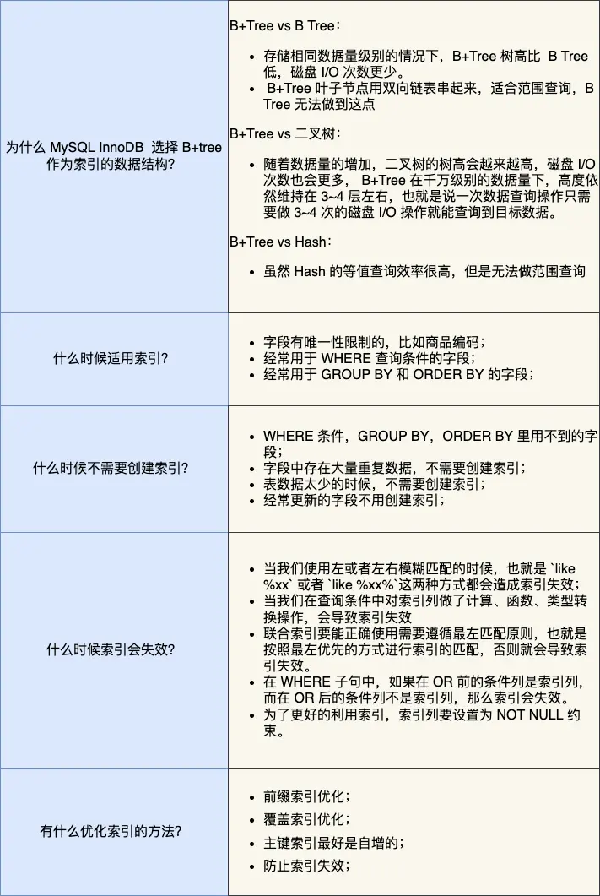

## 索引优化

<font style="color:rgb(44, 62, 80);">常见优化索引的方法：</font>

* **<font style="color:#DF2A3F;">前缀索引优化</font>**<font style="color:#DF2A3F;">：</font><font style="color:rgb(44, 62, 80);">使用前缀索引是为了减小索引字段大小，可以增加一个索引页中存储的索引值，有效提高索引的查询速度。在一些大字符串的字段作为索引时，使用前缀索引可以帮助我们减小索引项的大小。</font>
* **<font style="color:#DF2A3F;">覆盖索引优化</font>**<font style="color:#DF2A3F;">：</font><font style="color:rgb(44, 62, 80);">覆盖索引是指 SQL 中 query 的所有字段，在索引 B+Tree 的叶子节点上都能找得到的那些索引，从二级索引中查询得到记录，而不需要通过聚簇索引查询获得，可以避免回表的操作。</font>
* **<font style="color:#DF2A3F;">主键索引最好是自增的：</font>**
  * <font style="color:rgb(44, 62, 80);">如果我们使用自增主键，那么每次插入的新数据就会按顺序添加到当前索引节点的位置，不需要移动已有的数据，当页面写满，就会自动开辟一个新页面。因为每次</font>**<font style="color:rgb(48, 79, 254);">插入一条新记录，都是追加操作，不需要重新移动数据</font>**<font style="color:rgb(44, 62, 80);">，因此这种插入数据的方法效率非常高。</font>
  * <font style="color:rgb(44, 62, 80);">如果我们使用非自增主键，由于每次插入主键的索引值都是随机的，因此每次插入新的数据时，就可能会插入到现有数据页中间的某个位置，这将不得不移动其它数据来满足新数据的插入，甚至需要从一个页面复制数据到另外一个页面，通常将这种情况称为</font>**<font style="color:rgb(48, 79, 254);">页分裂</font>**<font style="color:rgb(44, 62, 80);">。页分裂还有可能会造成大量的内存碎片，导致索引结构不紧凑，从而影响查询效率。</font>
* **<font style="color:#DF2A3F;">防止索引失效：</font>**
  * <font style="color:rgb(44, 62, 80);">使用左或者左右模糊匹配的时候，也就是 </font><code><font style="color:rgb(71, 101, 130);">like %xx</font></code><font style="color:rgb(44, 62, 80);"> 或者 </font><code><font style="color:rgb(71, 101, 130);">like %xx%</font></code><font style="color:rgb(44, 62, 80);">这两种方式都会造成索引失效；</font>
  * <font style="color:rgb(44, 62, 80);">在查询条件中对索引列做了计算、函数、类型转换操作，这些情况下都会造成索引失效；</font>
  * <font style="color:rgb(44, 62, 80);">联合索引要能正确使用需要遵循最左匹配原则，也就是按照最左优先的方式进行索引的匹配，否则就会导致索引失效。</font>
  * <font style="color:rgb(44, 62, 80);">在 WHERE 子句中，如果在 OR 前的条件列是索引列，而在 OR 后的条件列不是索引列，那么索引会失效。</font>

## <font style="color:rgb(44, 62, 80);">索引失效情况</font>

[索引失效有哪些？](https://xiaolincoding.com/mysql/index/index_lose.html#%E7%B4%A2%E5%BC%95%E5%AD%98%E5%82%A8%E7%BB%93%E6%9E%84%E9%95%BF%E4%BB%80%E4%B9%88%E6%A0%B7)

* **<font style="color:rgb(44, 62, 80);">使用</font>****<font style="color:#DF2A3F;">左或者左右模糊匹配</font>****<font style="color:rgb(44, 62, 80);">的时候： like %xx 或者 like %xx%都会造成索引失效；</font>**
* **<font style="color:rgb(44, 62, 80);">在查询条件中对</font>****<font style="color:#DF2A3F;">索引列使用函数</font>****<font style="color:rgb(44, 62, 80);">，就会导致索引失效。</font>**
* **<font style="color:rgb(44, 62, 80);">在查询条件中对</font>****<font style="color:#DF2A3F;">索引列进行表达式计算</font>****<font style="color:rgb(44, 62, 80);">，也是无法走索引的。</font>**
* **<font style="color:rgb(44, 62, 80);">MySQL 在遇到字符串和数字比较的时候，会自动把字符串转为数字，然后再进行比较。如果字符串是索引列，而条件语句中的输入参数是数字的话，那么索引列会发生</font>****<font style="color:#DF2A3F;">隐式类型转换</font>****<font style="color:rgb(44, 62, 80);">，由于隐式类型转换是通过 CAST 函数实现的，等同于对索引列使用了函数，所以就会导致索引失效。</font>**
* **<font style="color:rgb(44, 62, 80);">联合索引要能正确使用需要</font>****<font style="color:#DF2A3F;">遵循最左匹配原则</font>****<font style="color:rgb(44, 62, 80);">，也就是按照最左优先的方式进行索引的匹配，否则就会导致索引失效。</font>**
* **<font style="color:rgb(44, 62, 80);">在 WHERE 子句中，在 OR 前的条件列是索引列而OR 后的条件列不是索引列索引会失效。</font>**

## <font style="color:rgb(44, 62, 80);">MySQL 使用 like “%x“，索引一定会失效吗？</font>

一个表有2个字段，其中name是索引字段，id拥有自增主键索引。

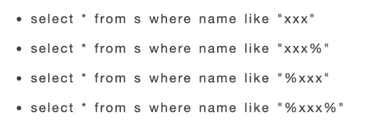

<font style="color:rgb(44, 62, 80);">第一条和第二条模糊查询语句也是一样可以走索引扫描，第二条查询语句的执行计划如下，Extra 里的 Using index 说明用上了覆盖索引：</font>

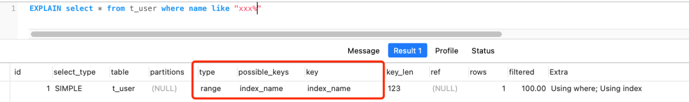

<font style="color:rgb(44, 62, 80);">第三条查询语句的执行计划（第四条也是一样的结果）</font>

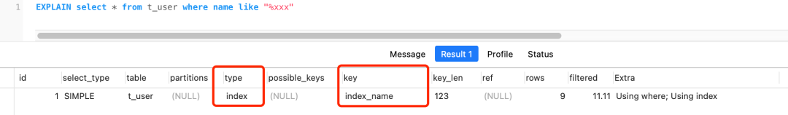

<font style="color:rgb(44, 62, 80);">这张表的字段没有「非索引」字段，所以 </font><code><font style="color:rgb(71, 101, 130);">select *</font></code><font style="color:rgb(44, 62, 80);"> 相当于 </font><code><font style="color:rgb(71, 101, 130);">select id,name</font></code><font style="color:rgb(44, 62, 80);">，然后</font>**<font style="color:rgb(48, 79, 254);">这个查询的数据都在二级索引的 B+ 树，因为二级索引的 B+ 树的叶子节点包含「索引值+主键值」，所以查二级索引的 B+ 树就能查到全部结果了，这个就是覆盖索引。</font>**

<font style="color:rgb(44, 62, 80);">type 是 </font><code>**<font style="color:#DF2A3F;">index</font>**</code>**<font style="color:#DF2A3F;">（全索引扫描）</font>**<font style="color:rgb(44, 62, 80);">，这代表着是通过全扫描二级索引的 B+ 树的方式查询到数据的，也就是遍历了整颗索引树。type=range 的查询效率会比 type=index 的高一些。</font>

## Mysql8新增索引方式

[MySQL8.0新特性-新的索引方式](https://www.jianshu.com/p/b64fcc6f3c21/)

## InnoDB<font style="color:#DF2A3F;">页面</font>是如何存储数据的

**<font style="color:rgb(48, 79, 254);">InnoDB 的数据是按「数据页」为单位来读写的，InnoDB 数据页的默认大小是 16KB。</font>**

<font style="color:rgb(44, 62, 80);">数据页包括七个部分，结构如下图：</font>


**<font style="color:rgb(48, 79, 254);">数据页中的记录按照「主键」顺序组成单向链表</font>**<font style="color:rgb(44, 62, 80);">，单向链表的特点就是插入、删除非常方便，但是检索效率不高，最差的情况下需要遍历链表上的所有节点才能完成检索。因此，数据页中有一个</font>**<font style="color:rgb(48, 79, 254);">页目录</font>**<font style="color:rgb(44, 62, 80);">，起到记录的索引作用。</font>

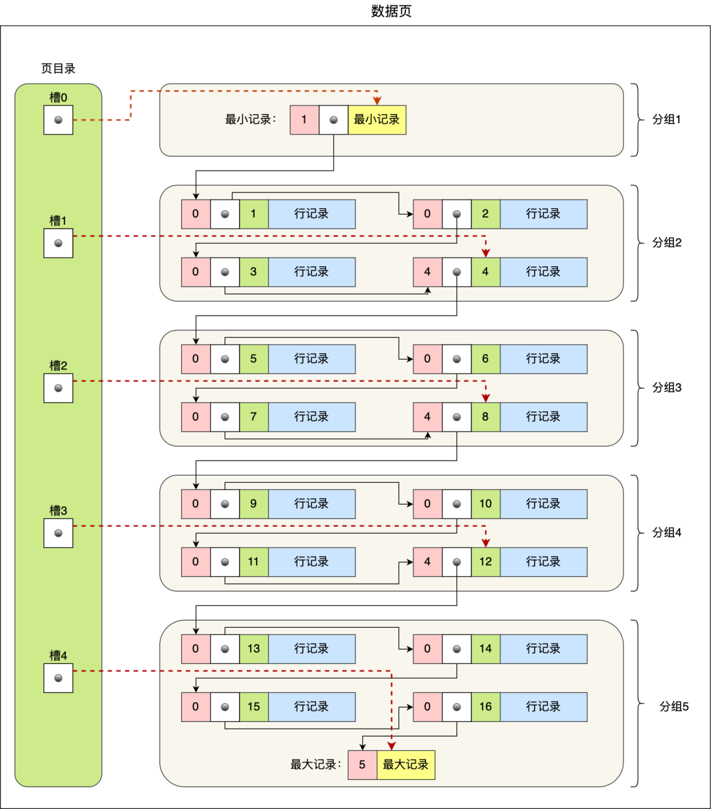

<font style="color:rgb(44, 62, 80);">页目录创建的过程如下：</font>

1. <font style="color:rgb(44, 62, 80);">将所有的记录划分成几个组，这些记录包括最小记录和最大记录，不包括标记为“已删除”的记录；</font>
2. <font style="color:rgb(44, 62, 80);">每个记录组的最后一条记录就是组内最大的那条记录，并且最后一条记录的头信息中会存储该组一共有多少条记录，作为 n\_owned 字段（上图中粉红色字段）</font>
3. <font style="color:rgb(44, 62, 80);">页目录用来存储每组最后一条记录的地址偏移量，这些地址偏移量会按照先后顺序存储起来，每组的地址偏移量也被称之为槽（slot），</font>**<font style="color:rgb(48, 79, 254);">每个槽相当于指针指向了不同组的最后一个记录</font>**<font style="color:rgb(44, 62, 80);">。</font>

<font style="color:rgb(44, 62, 80);">从图可以看到，</font>**<font style="color:rgb(48, 79, 254);">页目录就是由多个槽组成的，槽相当于分组记录的索引</font>**<font style="color:rgb(44, 62, 80);">。然后，因为记录是按照「主键值」从小到大排序的，所以</font>**<font style="color:rgb(48, 79, 254);">我们通过槽查找记录时，可以使用二分法快速定位要查询的记录在哪个槽（哪个记录分组），定位到槽后，再遍历槽内的所有记录，找到对应的记录</font>**<font style="color:rgb(44, 62, 80);">，无需从最小记录开始遍历整个页中的记录链表。</font>

<font style="color:rgb(44, 62, 80);">以上面那张图举个例子，5 个槽的编号分别为 0，1，2，3，4，我想查找主键为 11 的用户记录：</font>

* <font style="color:rgb(44, 62, 80);">先二分得出槽中间位是 (0+4)/2=2 ，2号槽里最大的记录为 8。因为 11 > 8，所以需要从 2 号槽后继续搜索记录；</font>
* <font style="color:rgb(44, 62, 80);">再使用二分搜索出 2 号和 4 槽的中间位是 (2+4)/2= 3，3 号槽里最大的记录为 12。因为 11 < 12，所以主键为 11 的记录在 3 号槽里；</font>
* <font style="color:rgb(44, 62, 80);">这里有个问题，</font>**<font style="color:rgb(48, 79, 254);">「槽对应的值都是这个组的主键最大的记录，如何找到组里最小的记录」</font>**<font style="color:rgb(44, 62, 80);">？比如槽 3 对应最大主键是 12 的记录，那如何找到最小记录 9。解决办法是：通过槽 3 找到 槽 2 对应的记录，也就是主键为 8 的记录。主键为 8 的记录的下一条记录就是槽 3 当中主键最小的 9 记录，然后开始向下搜索 2 次，定位到主键为 11 的记录，取出该条记录的信息即为我们想要查找的内容。</font>

<font style="color:rgb(44, 62, 80);">如果某个槽内的记录很多，然后因为记录都是单向链表串起来的，那这样在槽内查找某个记录的时间复杂度不就是 O(n) 了吗？</font>

<font style="color:rgb(44, 62, 80);">InnoDB 对每个分组中的记录条数都是有规定的，槽内的记录就只有几条：</font>

* <font style="color:rgb(44, 62, 80);">第一个分组中的记录只能有 1 条记录；</font>
* <font style="color:rgb(44, 62, 80);">最后一个分组中的记录条数范围只能在 1-8 条之间；</font>
* <font style="color:rgb(44, 62, 80);">剩下的分组中记录条数范围只能在 4-8 条之间。</font>

# MySQL三大日志(binlog、redo log和undo log)详解

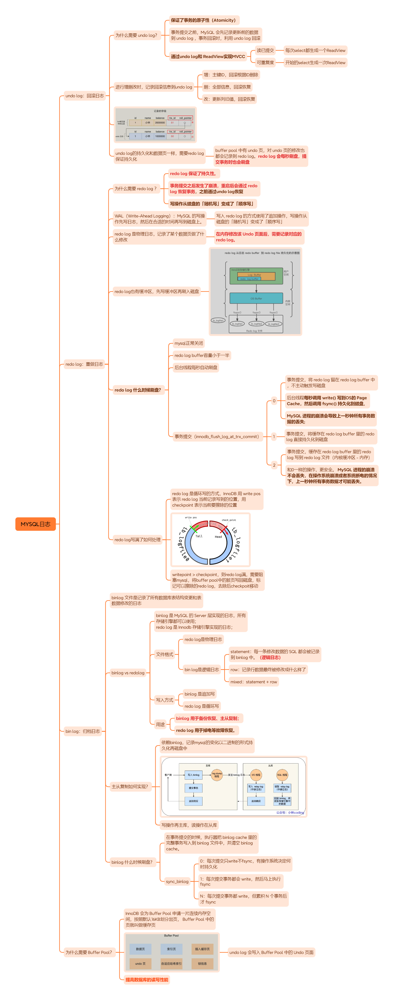

[MYSQL锁.xmind](https://www.yuque.com/attachments/yuque/0/2024/xmind/27139581/1719815016973-e6cc54de-d7bb-44a0-a1b2-3b51be3ab1f3.xmind)

`MySQL` 日志 主要包括错误日志、查询日志、慢查询日志、事务日志、二进制日志几大类。其中，比较重要的还要属**二进制日志**  `binlog` **（归档日志）和事务日志**  `redo log` **（重做日志）和**  `undo log` **（回滚日志）。**

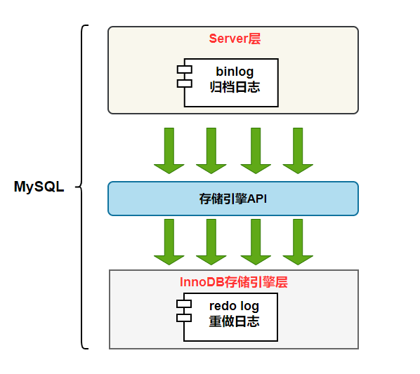

* **<font style="color:rgb(48, 79, 254);">undo log（回滚日志）</font>**<font style="color:rgb(44, 62, 80);">：是 Innodb 存储引擎层生成的日志，实现了事务中的</font>**<font style="color:rgb(48, 79, 254);">原子性</font>**<font style="color:rgb(44, 62, 80);">，主要</font>**<font style="color:rgb(48, 79, 254);">用于事务回滚和 MVCC</font>**<font style="color:rgb(44, 62, 80);">。</font>
* **<font style="color:rgb(48, 79, 254);">redo log（重做日志）</font>**<font style="color:rgb(44, 62, 80);">：是 Innodb 存储引擎层生成的日志，实现了事务中的</font>**<font style="color:rgb(48, 79, 254);">持久性（配合DubbleWrite Buffer双写缓冲区）</font>**<font style="color:rgb(44, 62, 80);">，主要</font>**<font style="color:rgb(48, 79, 254);">用于掉电等故障恢复</font>**<font style="color:rgb(44, 62, 80);">； </font>
* **<font style="color:rgb(48, 79, 254);">binlog （归档日志）</font>**<font style="color:rgb(44, 62, 80);">：是 Server 层生成的日志，主要</font>**<font style="color:rgb(48, 79, 254);">用于数据备份和主从复制</font>**<font style="color:rgb(44, 62, 80);">；</font>

## redo log（**持久性**）

`redo log`（重做日志）是`InnoDB`存储引擎独有的，它让`MySQL`拥有了\*\*<font style="color:#DF2A3F;">崩溃恢复能力</font>\*\*。

`MySQL` 实例挂了或宕机了，重启时`InnoDB`存储引擎会使用`redo log`恢复数据，保证数据的持久性与完整性。<font style="color:rgb(44, 62, 80);">为了防止断电导致数据丢失的问题，当有一条记录需要更新的时候，InnoDB 引擎就会先更新内存（同时标记为脏页），然后将本次对这个页的修改以 redo log 的形式记录下来，</font>**<font style="color:#DF2A3F;background-color:#FBDE28;">这个时候更新就算完成了</font>**<font style="color:rgb(44, 62, 80);">。</font>

:::success
**<font style="color:#DF2A3F;">mysql更新操作是在事务提交之前完成的，更新只需要更新redo log日志就好，提交事务就会进行两阶段提交刷盘，redo log先预提交，之后提交事务时提交bin log 和 redo log。</font>**

:::

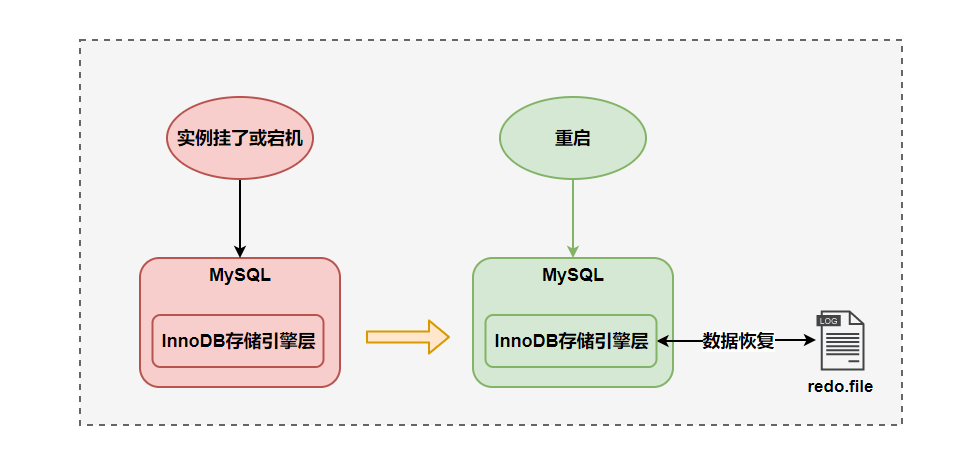

`MySQL` 中数据是以**页**为单位，查询一条记录，会从硬盘把一页的数据加载出来，加载出来的数据叫数据页，会放入到 `Buffer Pool` 中。（操作系统的分页管理）。后续的查询都是先从 `Buffer Pool` 中找，没有命中再去硬盘加载，减少硬盘 `IO` 开销，提升性能。

更新表数据的时候，也是如此，发现 `Buffer Pool` 里存在要更新的数据，就直接在 `Buffer Pool` 里更新。

然后会把 **“在某个数据页上做了什么修改”记录到**\*\*<font style="color:#DF2A3F;">重做日志缓存（</font>**<code>**<font style="color:#DF2A3F;">redo log buffer</font>**</code><font style="color:#DF2A3F;"> </font>**<font style="color:#DF2A3F;">）</font>\*\* 里，接着刷盘到 `redo log` 文件里。理想情况，事务一提交就会进行刷盘操作，但实际上，刷盘的时机是根据策略来进行的。

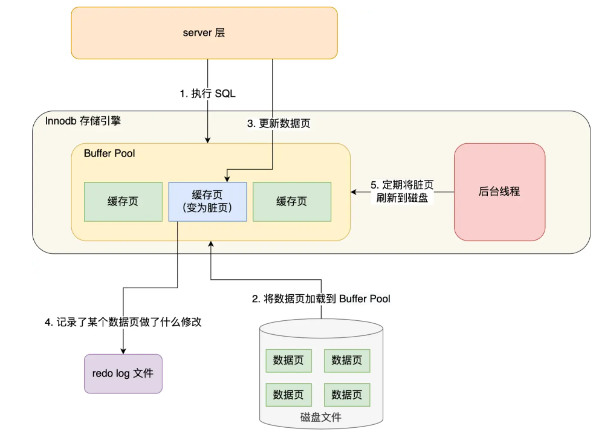

> **每条 redo 记录由“表空间号+数据页号+偏移量+修改数据长度+具体修改的数据”组成**

### 刷盘时机

InnoDB 将 redo log 刷到磁盘上有几种情况：

1. **事务提交**：当事务提交时，log buffer 里的 redo log 会被刷新到磁盘（可以通过`innodb_flush_log_at_trx_commit`参数控制）。
2. **log buffer 空间不足时**：log buffer 中缓存的 redo log 已经占满了 log buffer 总容量的**大约一半**左右，就需要把这些日志刷新到磁盘上。
3. **事务日志缓冲区满**：InnoDB 使用一个事务日志缓冲区（transaction log buffer）来暂时存储事务的重做日志条目。当缓冲区满时，会触发日志的刷新，将日志写入磁盘。
4. **Checkpoint（检查点）** ：InnoDB 定期会执行检查点操作，将内存中的**脏数据**（已修改但尚未写入磁盘的数据）刷新到磁盘，并且会将相应的重做日志一同刷新，以确保数据的一致性。
5. **后台刷新线程**：InnoDB 启动了一个后台线程，负责周期性（每隔 1 秒）地将脏页（已修改但尚未写入磁盘的数据页）刷新到磁盘，并将相关的重做日志一同刷新。
6. **正常关闭服务器**：MySQL 关闭的时候，redo log 都会刷入到磁盘里去。

> **事务提交，log空间不足，事务缓冲区满，检查点，刷新线程，关闭服务器**

总之，InnoDB 在多种情况下会刷新重做日志，以保证数据的持久性和一致性。

注意设置正确的刷盘策略`innodb_flush_log_at_trx_commit` 。根据 MySQL 配置的刷盘策略的不同，MySQL 宕机之后可能会存在轻微的数据丢失问题。

`innodb_flush_log_at_trx_commit` 的值有 3 种，也就是共有 3 种刷盘策略：

* <font style="color:rgb(44, 62, 80);">当设置该</font>**<font style="color:rgb(48, 79, 254);">参数为 0 时</font>**<font style="color:rgb(44, 62, 80);">，表示每次事务提交时 ，还是</font>**<font style="color:rgb(48, 79, 254);">将 redo log 留在 redo log buffer 中</font>**<font style="color:rgb(44, 62, 80);"> </font><font style="color:rgb(44, 62, 80);">，该模式下在事务提交时不会主动触发写入磁盘的操作。</font>
* <font style="color:rgb(44, 62, 80);">当设置该</font>**<font style="color:rgb(48, 79, 254);">参数为 1 时</font>**<font style="color:rgb(44, 62, 80);">，表示每次事务提交时，都</font>**<font style="color:rgb(48, 79, 254);">将缓存在 redo log buffer 里的 redo log 直接持久化到磁盘</font>**<font style="color:rgb(44, 62, 80);">，这样可以保证 MySQL 异常重启之后数据不会丢失。</font>
* <font style="color:rgb(44, 62, 80);">当设置该</font>**<font style="color:rgb(48, 79, 254);">参数为 2 时</font>**<font style="color:rgb(44, 62, 80);">，表示每次事务提交时，都只是缓存在 redo log buffer 里的 redo log </font>**<font style="color:rgb(48, 79, 254);">写到 redo log 文件，注意写入到「 redo log 文件」并不意味着写入到了磁盘</font>**<font style="color:rgb(44, 62, 80);">，因为操作系统的文件系统中有个 Page Cache，Page Cache 是专门用来缓存文件数据的，所以写入「 redo log文件」意味着写入到了操作系统的文件缓存。</font>

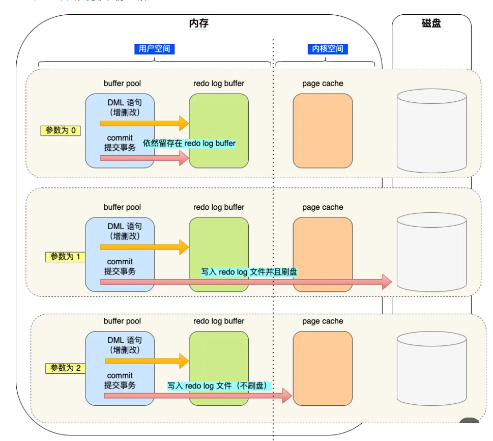

刷盘策略`innodb_flush_log_at_trx_commit` 的默认值为 1，设置为 1 的时候才不会丢失任何数据。为了保证事务的持久性，我们必须将其设置为 1。

* <font style="color:rgb(44, 62, 80);">针对参数 0 ：会把缓存在 redo log buffer 中的 redo log ，通过调用</font><font style="color:rgb(44, 62, 80);"> </font><font style="color:rgb(71, 101, 130);">write()</font><font style="color:rgb(44, 62, 80);"> </font><font style="color:rgb(44, 62, 80);">写到操作系统的 Page Cache，然后调用</font><font style="color:rgb(44, 62, 80);"> </font><font style="color:rgb(71, 101, 130);">fsync()</font><font style="color:rgb(44, 62, 80);"> </font><font style="color:rgb(44, 62, 80);">持久化到磁盘。</font>**<font style="color:rgb(48, 79, 254);">所以参数为 0 的策略，MySQL 进程的崩溃会导致上一秒钟所有事务数据的丢失</font>**<font style="color:rgb(44, 62, 80);">;</font>
* <font style="color:rgb(44, 62, 80);">针对参数 2 ：调用 fsync，将缓存在操作系统中 Page Cache 里的 redo log 持久化到磁盘。</font>**<font style="color:rgb(48, 79, 254);">所以参数为 2 的策略，较取值为 0 情况下更安全，因为 MySQL 进程的崩溃并不会丢失数据，只有在操作系统崩溃或者系统断电的情况下，上一秒钟所有事务数据才可能丢失</font>**<font style="color:rgb(44, 62, 80);">。</font>

另外，<code>**InnoDB**</code>\*\* 存储引擎有一个后台线程，****<font style="color:#DF2A3F;">每隔</font>**<code>**<font style="color:#DF2A3F;">1</font>**</code>**<font style="color:#DF2A3F;"> 秒</font>****，就会把 **<code>**redo log buffer**</code>** 中的内容写到文件系统缓存（**<code>**page cache**</code>**），然后调用 **<code>**fsync**</code>** 刷盘。\*\*

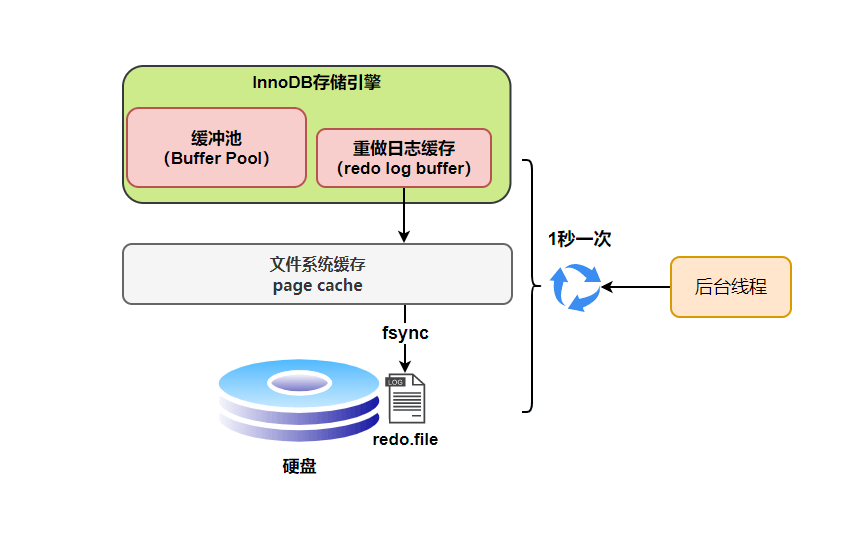

也就是说，一个没有提交事务的 `redo log` 记录，也可能会刷盘。因为在事务执行过程 `redo log` 记录是会写入`redo log buffer` 中，这些 `redo log` **记录会被后台线程刷盘。**

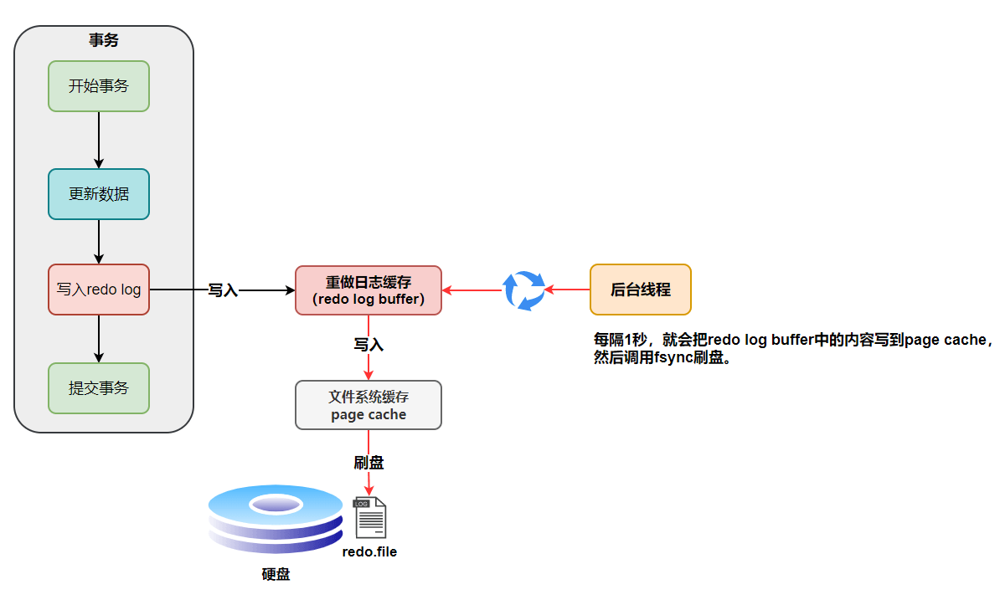

除了后台线程每秒`1`次的轮询操作，还有一种情况，当 `redo log buffer` **占用的空间即将达到** `innodb_log_buffer_size` **一半**的时候，后台线程会主动刷盘。

### 日志文件组

硬盘上存储的 `redo log` 日志文件不只一个，而是以一个**日志文件组**的形式出现的，每个的`redo`日志文件大小都是一样的。比如可以配置为一组`4`个文件，每个文件的大小是 `1GB`，整个 `redo log` 日志文件组可以记录`4G`的内容。

它采用的是**环形数组**形式，从头开始写，写到末尾又回到头循环写，如下图所示。

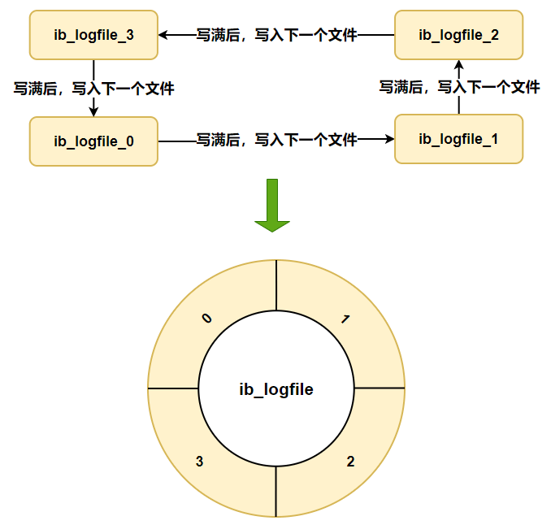

在个**日志文件组**中还有两个重要的属性，分别是 <code>**write pos、checkpoint**</code>

* **write pos** 是当前记录的位置，一边写一边后移
* **checkpoint** 是当前要擦除的位置，也是往后推移

> **write pos是开始位置，checkpoint是结束位置。相当于对头队尾**

每次刷盘 `redo log` 记录到**日志文件组**中，`write pos` 位置就会后移更新。

每次 `MySQL` 加载**日志文件组**恢复数据时，会清空加载过的 `redo log` 记录，并把 `checkpoint` 后移更新。

`write pos` 和 `checkpoint` 之间的还空着的部分可以用来写入新的 `redo log` 记录。

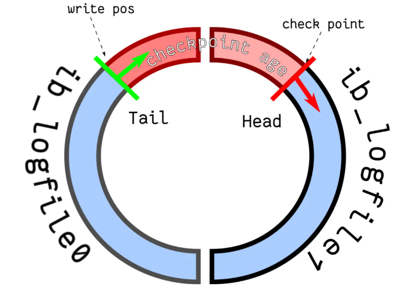

如果 `write pos` 追上 `checkpoint` ，表示**日志文件组**满了，这时候不能再写入新的 `redo log` 记录，`MySQL` 得停下来，清空一些记录，把 `checkpoint` 推进一下。

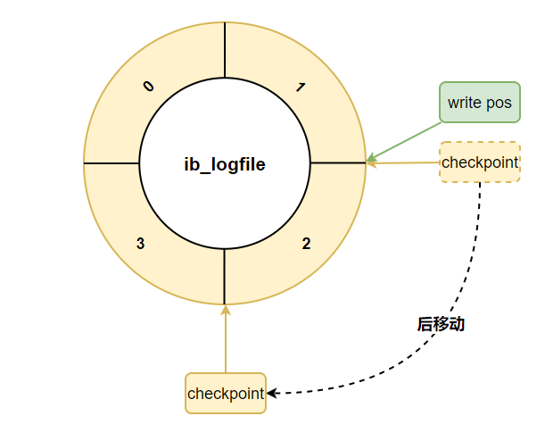

### CheckPoint 脏数据刷盘机制

**<font style="color:rgb(77, 77, 77);">为了避免发生数据丢失的问题，当前事务数据库普遍都采用了 </font>****<font style="color:#DF2A3F;">Write Ahead Log</font>****<font style="color:rgb(77, 77, 77);"> - 预写日志策略，即当事务提交时，</font>\*\*\*\*<font style="color:#DF2A3F;">先写重做日志，再修改页</font>**<font style="color:rgb(77, 77, 77);">。</font>**<font style="color:rgb(77, 77, 77);">缓冲池的容量和重做日志容量是有限的，所以需要定期将脏页刷回磁盘，引入 Checkpoint（检查点）技术。</font>**

<font style="color:rgb(77, 77, 77);">Checkpoint 所做的是将缓冲池中的脏页刷回到磁盘，不同之处在于每次刷新多少页到磁盘，每次从哪里获取脏页，以及什么时间触发 Checkpoint。在 InnoDB 内部有两种 Checkpoint，分别为：</font>

* **<font style="color:rgba(0, 0, 0, 0.75);">Sharp Checkpoint</font>**
  * <font style="color:rgb(77, 77, 77);">Sharp Checkpoint 发送在数据库关闭时将</font>**<font style="color:#DF2A3F;">所有的脏页</font>**<font style="color:rgb(77, 77, 77);">都刷新回磁盘，默认的工作方式</font>
* **<font style="color:rgba(0, 0, 0, 0.75);">Fuzzy Checkpoint</font>**
  * **<font style="color:rgb(77, 77, 77);">InnoDB 存储引擎内部使用 Fuzzy Checkpoint 进行页的刷新，每次只刷新一部分脏页</font>**<font style="color:rgb(77, 77, 77);">。</font>

<font style="color:rgb(77, 77, 77);"></font>

<font style="color:rgb(77, 77, 77);">InnoDB 存储引擎中触发 </font>**<font style="color:rgb(77, 77, 77);">Fuzzy Checkpoint</font>**<font style="color:rgb(77, 77, 77);">：</font>

* <font style="color:rgb(77, 77, 77);">Master Thread Checkpoint：Master Thread 差不多以</font>**<font style="color:rgb(77, 77, 77);">每秒或每十秒的速度从缓冲池的脏页列表中刷新一定比例的页回磁盘</font>**<font style="color:rgb(77, 77, 77);">，这个过程是</font>**<font style="color:rgb(77, 77, 77);">异步</font>**<font style="color:rgb(77, 77, 77);">的，不会阻塞其他操作。</font>
* <font style="color:rgb(77, 77, 77);">FLUSH\_LRU\_LIST Checkpoint：Buffer Pool 的 LRU 列表需要保留一定数量的空闲页面，来保证 Buffer Pool 中有足够的空间应对新的数据库请求。</font>**<font style="color:rgb(77, 77, 77);">在空闲列表不足时，移除LRU列表尾端的页，若移除的页为脏页，则需要进行 Checkpoint</font>**<font style="color:rgb(77, 77, 77);">。</font>
* <font style="color:rgb(77, 77, 77);">Async/Sync Flush Checkpoint：</font>**<font style="color:rgb(77, 77, 77);">当重做日志不可用（即 redo log 写满）时，需要强制将一些页刷新回磁盘</font>**<font style="color:rgb(77, 77, 77);">，此时脏页从脏页列表中获取。</font>
* <font style="color:rgb(77, 77, 77);">Dirty Page too much Checkpoint：</font>**<font style="color:rgb(77, 77, 77);">当脏页数量太多时会强制推进 Checkpoint，以保证缓冲区有足够的空闲页</font>**<font style="color:rgb(77, 77, 77);">。innodb\_max\_dirty\_pages\_pct 的默认值为75，表示当缓冲池脏页比例达到该值时，就会强制进行 Checkpoint，刷新一部分脏页到磁盘。</font>

<font style="color:rgb(77, 77, 77);"></font>

## <font style="color:rgb(77, 77, 77);">mysql双写缓冲区</font>

<font style="color:rgb(34, 34, 34);">Linux文件系统页（OS Page）的大小默认是4KB。而MySQL的页（Page）大小默认是16KB。</font>

```sql
SHOW VARIABLES LIKE 'innodb_page_size';
```

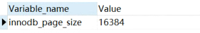

<font style="color:rgb(34, 34, 34);">程序因为需要跟操作系统交互，所以它们的页（Page）大小都为操作系统页大小的整数倍。</font>**<font style="color:rgb(34, 34, 34);">MySQL中一页数据刷到磁盘，要写4个文件系统里的页。</font>**

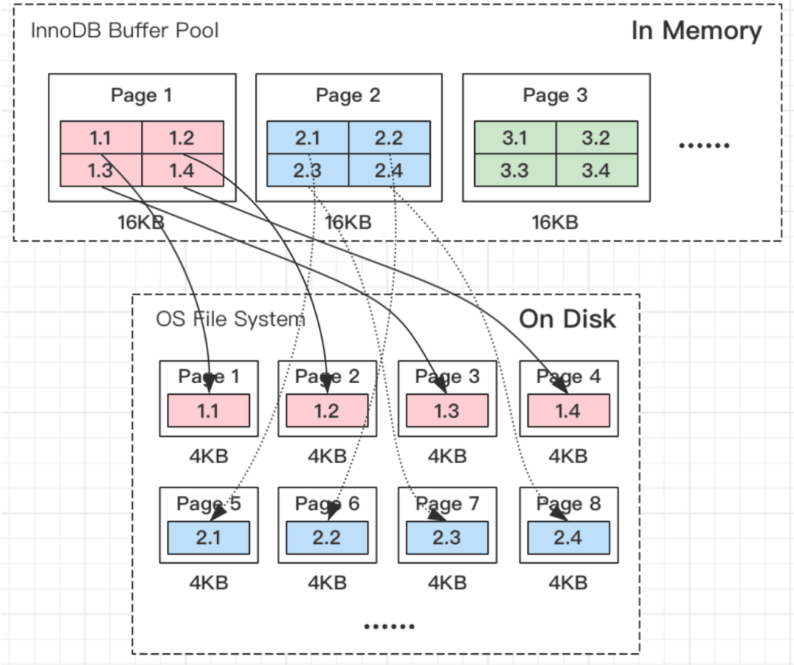

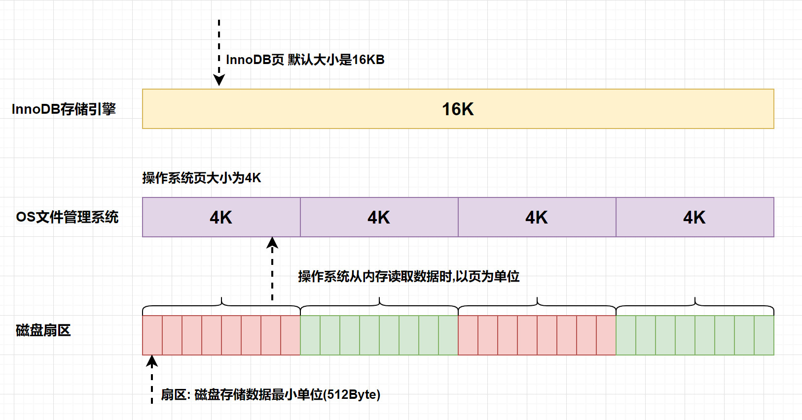

**<font style="color:rgb(34, 34, 34);">刷页的操作并非原子操作，比如操作系统写到第二个页的时候，Linux机器断电了，这时候就会出现问题了。造成「页数据损坏」。并且这种页数据损坏靠 redo日志是无法修复的。</font>****<font style="color:#DF2A3F;">redo重做日志中记录的是对页的物理操作，而</font>****<font style="color:#DF2A3F;background-color:#FBDE28;">不是页面的全量记录</font>****<font style="color:rgb(34, 34, 34);">，当发生「</font>****<font style="color:#DF2A3F;">Partial Page Write（部分页写入）</font>\*\*\*\*<font style="color:rgb(34, 34, 34);">」问题时，出现问题的是未修改过的数据，此时redo日志无能为力。</font>**

<font style="color:rgb(34, 34, 34);">Doublewrite Buffer的出现就是为了解决上面的这种情况，给InnoDB存储引擎提供了数据页的可靠性，虽然名字带了Buffer，但实际上Doublewrite Buffer是「</font>**<font style="color:rgb(34, 34, 34);">内存+磁盘</font>**<font style="color:rgb(34, 34, 34);">」的结构。</font>

* **<font style="color:rgb(34, 34, 34);">内存结构</font>**<font style="color:rgb(34, 34, 34);">：Doublewrite Buffer内存结构由128个页（Page）构成，大小是2MB。</font>
* **<font style="color:rgb(34, 34, 34);">磁盘结构</font>**<font style="color:rgb(34, 34, 34);">：Doublewrite Buffer磁盘结构在系统表空间上是128个页（2个区，extend1和extend2），大小是2MB。</font>

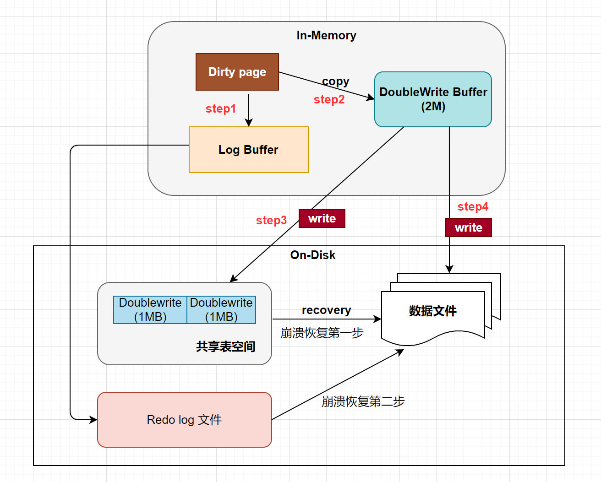

<font style="color:rgb(34, 34, 34);">Doublewrite Buffer的原理是，把数据页写到数据文件之前，InnoDB先把它们写到一个</font>**<font style="color:#DF2A3F;">「doublewrite buffer（双写缓冲区）」的共享表空间内</font>**<font style="color:rgb(34, 34, 34);">，在写doublewrite buffer完成后，InnoDB才会把页写到数据文件适当的位置。</font>

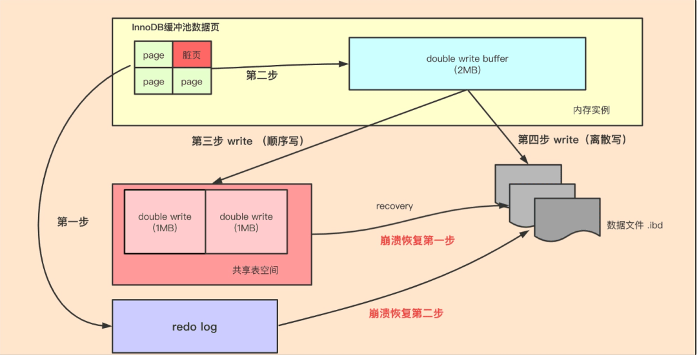

<font style="color:rgb(34, 34, 34);">当有数据页要刷盘时：</font>

* <font style="color:rgb(34, 34, 34);">页数据先通过</font><code><font style="color:rgb(51, 51, 51);background-color:rgb(235, 245, 253);">memcpy</font></code><font style="color:rgb(34, 34, 34);">函数拷贝至内存中的Doublewrite Buffer中。</font>
* <font style="color:rgb(34, 34, 34);">Doublewrite Buffer的内存里的数据页，会</font><code><font style="color:rgb(51, 51, 51);background-color:rgb(235, 245, 253);">fsync</font></code><font style="color:rgb(34, 34, 34);">刷到Doublewrite Buffer的磁盘上，分两次写入磁盘共享表空间中(连续存储，顺序写，性能很高)，每次写1MB。</font>
* <font style="color:rgb(34, 34, 34);">Doublewrite Buffer的内存里的数据页，再刷到数据磁盘存储.ibd文件上（离散写）。</font>

**<font style="color:rgb(34, 34, 34);">如果操作系统在将页写入磁盘的过程中发生了崩溃，在恢复过程中，InnoDB存储引擎可以从共享表空间中的Double write中找到该页的一个副本，将其复制到表空间文件，再应用redo日志</font>**<font style="color:rgb(34, 34, 34);">。</font>

**<font style="color:#DF2A3F;">MySQL的InnoDB存储引擎中，Redo log和Doublewrite Buffer共同工作确保数据的持久性和恢复能力。</font>**

## binlog

* `redo log` **是物理日志**，记录内容是“**在某个数据页上做了什么修改**”，属于 `InnoDB` 存储引擎。用于掉电故障恢复。
* `binlog` **是逻辑日志**，**记录内容是语句的原始逻辑**，类似于“给 ID=2 这一行的 c 字段加 1”，属于`MySQL Server` 层。不管什么存储引擎，只要发生了表数据更新，都会产生 `binlog` 日志。用于数据备份和主从同步。

`MySQL`数据库的**数据备份、主备、主主、主从**都离不开`binlog`，需要依靠`binlog`来同步数据，保证数据一致性。

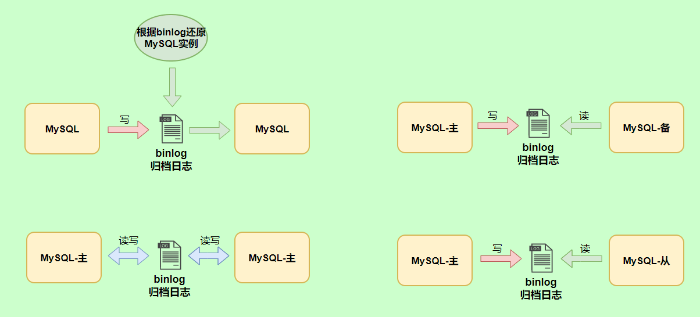

<code><font style="color:#DF2A3F;">binlog</font></code>**<font style="color:#DF2A3F;">会记录所有涉及更新数据的逻辑操作，并且是顺序写</font>**

### 集群主从复制如何实现

<font style="color:rgb(44, 62, 80);">复制的过程就是将 binlog 中的数据从主库传输到从库上。这个过程一般是</font>**<font style="color:rgb(48, 79, 254);">异步</font>**<font style="color:rgb(44, 62, 80);">的，也就是主库上执行事务操作的线程不会等待复制 binlog 的线程同步完成。</font>

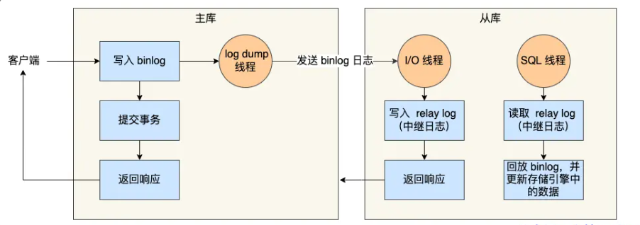

* <font style="color:rgb(44, 62, 80);">MySQL 主库在收到客户端提交事务的请求之后，会</font>**<font style="color:#DF2A3F;">先写入 binlog，再提交事务</font>**<font style="color:rgb(44, 62, 80);">，更新存储引擎中的数据，事务提交完成后，返回给客户端“操作成功”的响应。</font>
* <font style="color:rgb(44, 62, 80);">从库会创建一个专门的 I/O 线程，连接主库的 log dump 线程，来接收主库的 binlog 日志，再把 binlog 信息写入 relay log 的中继日志里，再返回给主库“复制成功”的响应。</font>
* <font style="color:rgb(44, 62, 80);">从库会创建一个用于回放 binlog 的线程，去读 relay log 中继日志，然后回放 binlog 更新存储引擎中的数据，最终实现主从的数据一致性。</font>

### 记录格式

`binlog` 日志有三种格式，可以通过`binlog_format`参数指定。

* **<font style="color:rgb(44, 62, 80);">STATEMENT</font>**<font style="color:rgb(44, 62, 80);">：每一条修改数据的 SQL 都会被记录到 binlog 中（相当于记录了逻辑操作，所以针对这种格式， binlog 可以称为逻辑日志），主从复制中 slave 端再根据 SQL 语句重现。但 STATEMENT 有</font>**<font style="color:rgb(44, 62, 80);">动态函数</font>**<font style="color:rgb(44, 62, 80);">的问题，比如你用了 uuid 或者 now 这些函数，你在主库上执行的结果并不是你在从库执行的结果，这种随时在变的函数会导致复制的数据不一致；</font>
* **<font style="color:rgb(44, 62, 80);">ROW</font>**<font style="color:rgb(44, 62, 80);">：记录行数据最终被修改成什么样了（这种格式的日志，就不能称为逻辑日志了），不会出现 STATEMENT 下动态函数的问题。 ROW 的</font>**<font style="color:rgb(44, 62, 80);">缺点是每行数据的变化结果都会被记录，比如执行批量 update 语句，更新多少行数据就会产生多少条记录，使 binlog 文件过大，而在 STATEMENT 格式下只会记录一个 update 语句而已；</font>**
* **<font style="color:rgb(44, 62, 80);">MIXED</font>**<font style="color:rgb(44, 62, 80);">：包含了 STATEMENT 和 ROW 模式，它会根据不同的情况自动使用 ROW 模式和 STATEMENT 模式；</font>

:::success
比如 **<font style="color:rgba(0, 0, 0, 0.85);">UPDATE students SET score = score + 10 WHERE score < 60;\ </font>\*\*\*\*<font style="color:rgba(0, 0, 0, 0.85);">在StateMent情况下就只记录这一条sql语句，但是在row情况下，如果这条sql影响了1000行数据，row就会记录1000行数据，导致binlog文件过大。</font>**

:::

指定`statement`，记录的内容是`SQL`语句原文，比如执行一条`update T set update_time=now() where id=1`，记录的内容如下

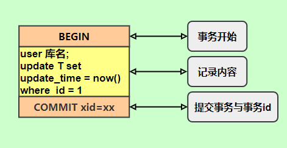

**同步数据时（分布式）** ，会执行记录的`SQL`语句，`update_time=now()` 这里会获取当前系统时间，直接执行会导致与原库的数据不一致。

为了解决这种问题，我们需要指定为`row`，记录的内容不再是简单的`SQL`语句了，还包含操作的具体数据，记录内容如下。

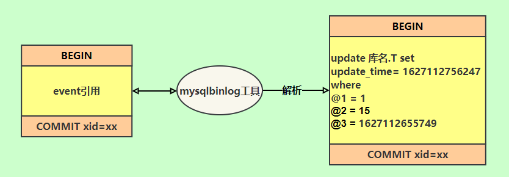

`update_time=now()`**变成了具体的时间**`update_time=1627112756247`，条件后面的 **@1、@2、@3 都是该行数据第 1 个~3 个字段的原始值**（**假设这张表只有 3 个字段**）。

这样就能保证同步数据的一致性，通常情况下都是指定为`row`，这样可以为数据库的恢复与同步带来更好的可靠性。但是这种格式，需要更大的容量来记录，比较占用空间，恢复与同步时会更消耗`IO`资源，影响执行速度。

所以就有了一种折中的方案，指定为`mixed`，记录的内容是前两者的混合。

<code><font style="color:#DF2A3F;">MySQL</font></code>**<font style="color:#DF2A3F;">会判断这条</font>**<code><font style="color:#DF2A3F;">SQL</font></code>**<font style="color:#DF2A3F;">语句是否可能引起数据不一致，如果是就用</font>**<code><font style="color:#DF2A3F;">row</font></code>**<font style="color:#DF2A3F;">格式，否则就用</font>**<code><font style="color:#DF2A3F;">statement</font></code>**<font style="color:#DF2A3F;">格式。</font>**

### 写入机制

`binlog`的写入时机：**事务执行过程中，先把日志写到**`binlog cache` **，事务提交的时候，再把**`binlog cache`**写到**`binlog`**文件中**。**因为**\*\*<font style="color:#DF2A3F;">一个事务的</font>**<code>**<font style="color:#DF2A3F;">binlog</font>**</code>**<font style="color:#DF2A3F;">不能被拆开</font>\*\*\*\*，无论这个事务多大，也要确保一次性写入，所以系统会给每个线程分配一个块内存作为\*\*<code>**binlog cache**</code>**。**

可以通过`binlog_cache_size`参数控制单个线程 binlog cache 大小，如果存储内容超过了这个参数，就要暂存到磁盘（`Swap`）。

`binlog`日志刷盘流程如下

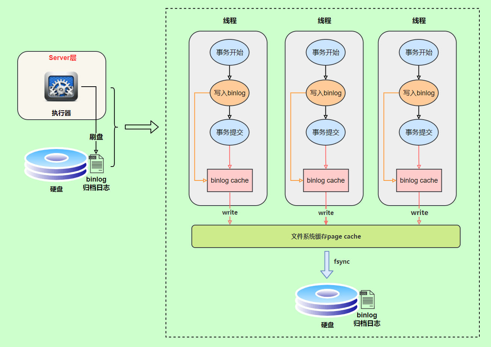

* **上图的 write，是指\*\*\*\*把日志写入到文件系统的 page cache** **，并没有把数据持久化到磁盘，所以速度比较快**
* **上图的 fsync，才是将数据持久化到磁盘的操作**

`write`和`fsync`的时机，可以由参数`sync_binlog`控制，默认是`1`。

**为**`0`**的时候，表示每次提交事务都只**`write` **，由系统自行判断什么时候执行**`fsync`。

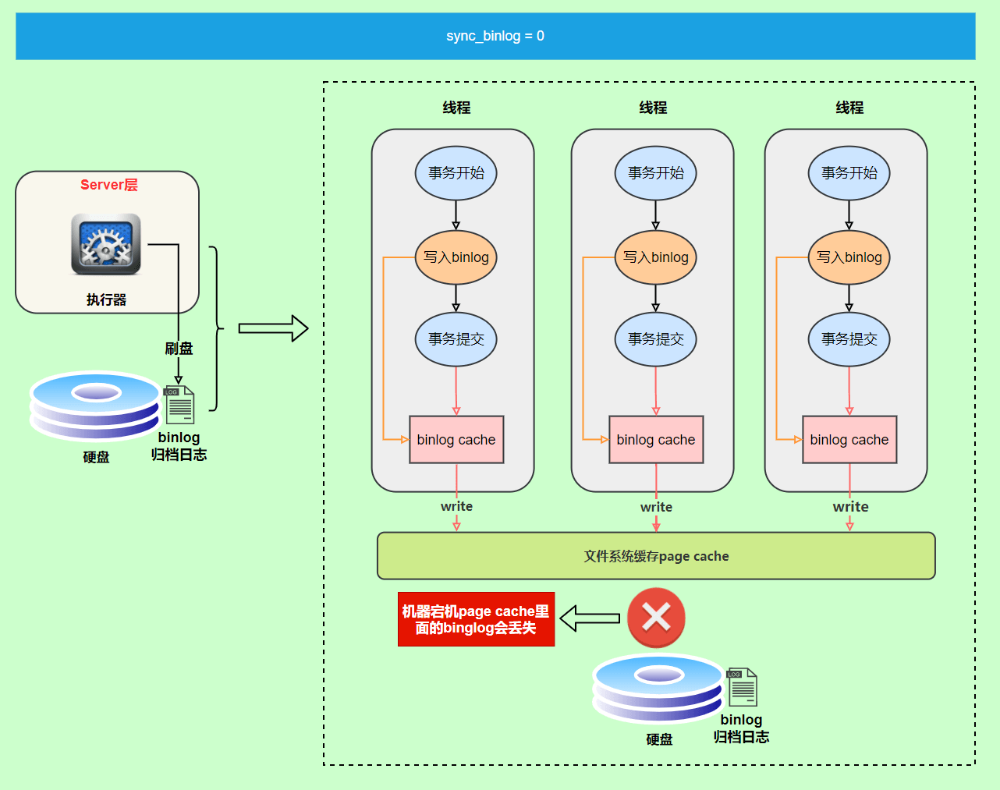

虽然性能得到提升，但是机器宕机，`page cache`里面的 binlog 会丢失。

**设置为**<code>**1**</code>，**表示每次提交事务都会执行**`fsync`，同 **redo log 日志刷盘流程**

最后还有一种折中方式，可以设置为`N(N>1)`，表示每次提交事务都`write`，但累积`N`个事务后才`fsync`。

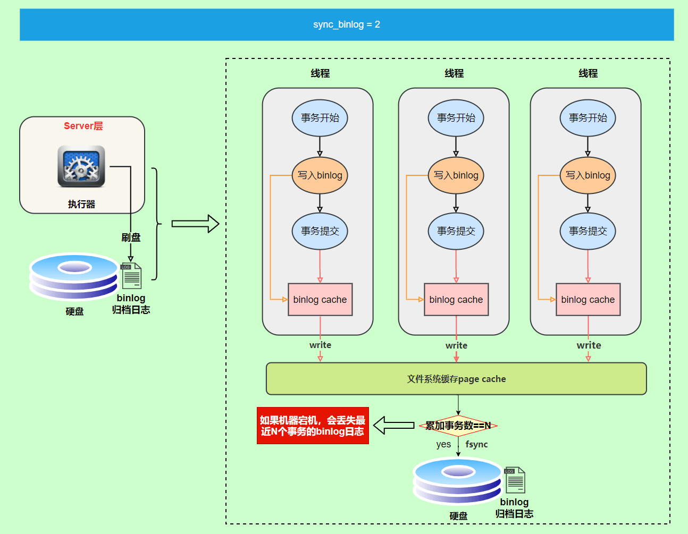

在出现`IO`瓶颈的场景里，将`sync_binlog`设置成一个比较大的值，可以提升性能。同样的，如果机器宕机，会丢失最近`N`个事务的`binlog`日志。

## **两阶段提交**

`redo log` **（重做日志）让**`InnoDB`**存储引擎拥有了崩溃恢复能力**。

`binlog` **（归档日志）保证了**`MySQL`**集群架构的数据一致性。**

虽然它们都属于持久化的保证，但是侧重点不同。

在执行更新语句过程，会记录`redo log`与`binlog`两块日志，以基本的事务为单位，<code>**<font style="color:#DF2A3F;">redo log</font>**</code>**<font style="color:#DF2A3F;">在事务执行过程中可以不断写入，而</font>**<code>**<font style="color:#DF2A3F;">binlog</font>**</code>**<font style="color:#DF2A3F;">只有在提交事务时才写入，所以</font>**<code>**<font style="color:#DF2A3F;">redo log</font>**</code>**<font style="color:#DF2A3F;">与</font>**<code>**<font style="color:#DF2A3F;">binlog</font>**</code>**<font style="color:#DF2A3F;">的写入时机不一样。</font>**

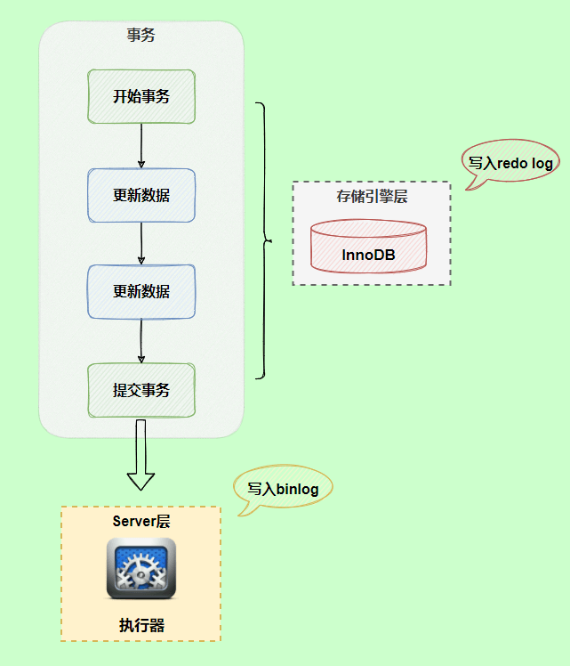

我们以`update`语句为例，假设`id=2`的记录，字段`c`值是`0`，把字段`c`值更新成`1`，`SQL`语句为`update T set c=1 where id=2`。假设执行过程中**写完**`redo log`**日志后，**`binlog`**日志写期间发生了异常**，会出现什么情况呢？

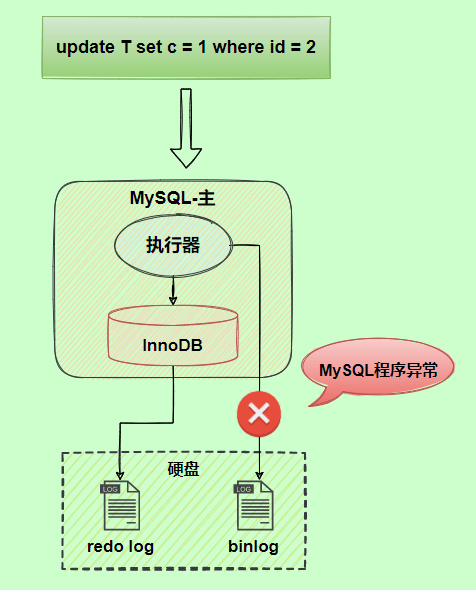

由于`binlog`没写完就异常，这时候`binlog`里面没有对应的修改记录。因此，之后用`binlog`日志恢复数据时，就会少这一次更新，恢复出来的这一行`c`值是`0`，而原库因为`redo log`日志恢复，这一行`c`值是`1`，最终数据不一致。

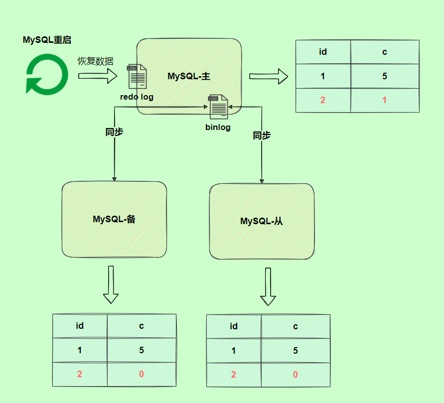

为了\*\*<font style="color:#DF2A3F;">解决redo log 和 bin log 之间的逻辑一致问题，</font>**<code><font style="color:#DF2A3F;">InnoDB</font></code>**<font style="color:#DF2A3F;">存储引擎使用两阶段提交方案</font>**<font style="color:#DF2A3F;">。</font>原理很简单，将`redo log`的写入拆成了两个步骤`prepare`和`commit`，这就是**两阶段提交\*\*。

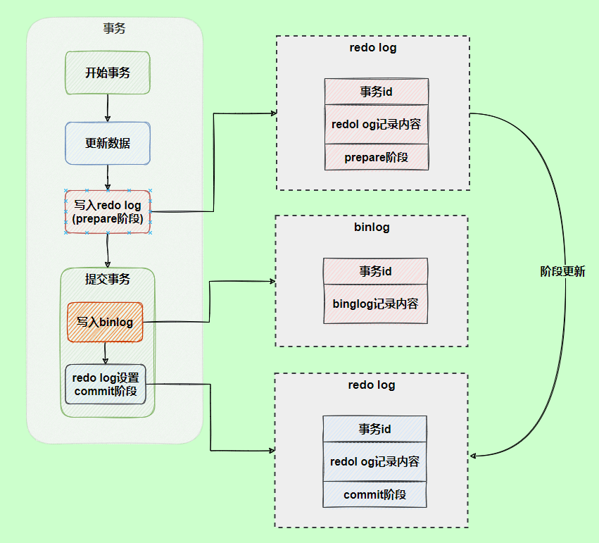

使用**两阶段提交**后，写入`binlog`时发生异常也不会有影响，因为`MySQL`根据`redo log`日志恢复数据时，发现`redo log`**还处于**`prepare`**阶段**，**并且没有对应**`binlog`**日志，就会回滚该事务。**

> **<font style="color:#DF2A3F;">先写入redo log，如果binlog没有的话，redo log记录的是prepare阶段，并没有提交，说明这个事务要失败。</font>**

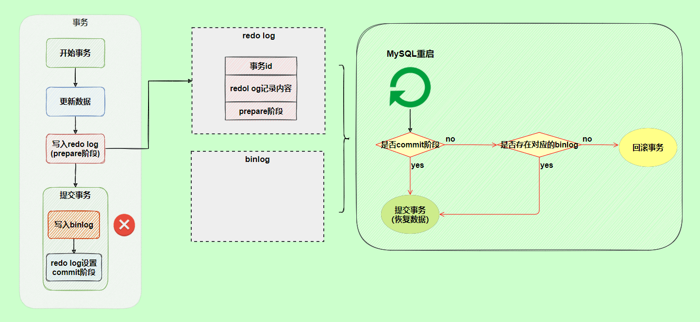

`redo log`设置`commit`阶段发生异常，那会不会回滚事务呢？

**<font style="color:#DF2A3F;">不会回滚事务</font>**<font style="color:#DF2A3F;">，</font>**<font style="color:#DF2A3F;">虽然</font>**<code><font style="color:#DF2A3F;">redo log</font></code>**<font style="color:#DF2A3F;">是处于</font>**<code><font style="color:#DF2A3F;">prepare</font></code>**<font style="color:#DF2A3F;">阶段，但是能通过事务</font>**<code><font style="color:#DF2A3F;">id</font></code>**<font style="color:#DF2A3F;">找到对应的</font>**<code><font style="color:#DF2A3F;">binlog</font></code>**<font style="color:#DF2A3F;">日志，所以</font>**<code><font style="color:#DF2A3F;">MySQL</font></code>**<font style="color:#DF2A3F;">认为是完整的，就会提交事务恢复数据。</font>**

## undo log（**原子性**）

在异常发生时，对已经执行的操作进行**回滚。** 在 MySQL 中，恢复机制是通过 **回滚日志（undo log）**  实现的

所有事务进行的修改都会先记录到这个回滚日志中，然后再执行相关的操作。如果执行过程中遇到异常的话，我们直接利用 **回滚日志** 中的信息将数据回滚到修改之前的样子即可！

<font style="color:rgb(44, 62, 80);">每当 InnoDB 引擎对一条记录进行操作（修改、删除、新增）时，要把回滚时需要的信息都记录到 undo log 里，比如：</font>

* <font style="color:rgb(44, 62, 80);">在</font>**<font style="color:rgb(48, 79, 254);">插入</font>**<font style="color:rgb(44, 62, 80);">一条记录时，要把这条记录的主键值记下来，这样之后回滚时只需要把这个主键值对应的记录</font>**<font style="color:rgb(48, 79, 254);">删掉</font>**<font style="color:rgb(44, 62, 80);">就好了；</font>
* <font style="color:rgb(44, 62, 80);">在</font>**<font style="color:rgb(48, 79, 254);">删除</font>**<font style="color:rgb(44, 62, 80);">一条记录时，要把这条记录中的内容都记下来，这样之后回滚时再把由这些内容组成的记录</font>**<font style="color:rgb(48, 79, 254);">插入</font>**<font style="color:rgb(44, 62, 80);">到表中就好了；</font>
* <font style="color:rgb(44, 62, 80);">在</font>**<font style="color:rgb(48, 79, 254);">更新</font>**<font style="color:rgb(44, 62, 80);">一条记录时，要把被更新的列的旧值记下来，这样之后回滚时再把这些列</font>**<font style="color:rgb(48, 79, 254);">更新为旧值</font>**<font style="color:rgb(44, 62, 80);">就好了。</font>

<font style="color:rgb(44, 62, 80);">一条记录的每一次更新操作产生的 undo log 格式都有一个 roll\_pointer 指针和一个 trx\_id 事务id：</font>

* <font style="color:rgb(44, 62, 80);">通过 trx\_id 可以知道该记录是被哪个事务修改的；</font>
* <font style="color:rgb(44, 62, 80);">通过 roll\_pointer 指针可以将这些 undo log 串成一个链表，这个链表就被称为版本链；</font>

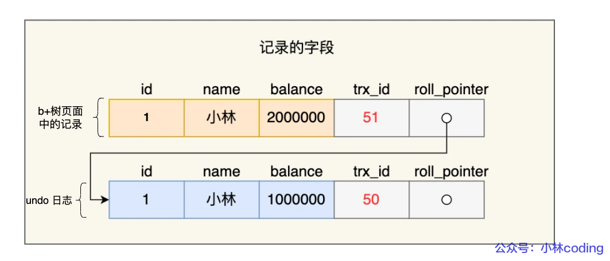

**<font style="color:#DF2A3F;">回滚日志会先于数据持久化到磁盘上</font>**。这样就保证了即使遇到数据库突然宕机等情况，当用户再次启动数据库的时候，数据库还能够通过查询回滚日志来回滚将之前未完成的事务。

<code><font style="color:#DF2A3F;">MVCC</font></code><font style="color:#DF2A3F;"> 的实现依赖于：</font>**<font style="color:#DF2A3F;">隐藏字段、Read View、undo log</font>**。在内部实现中，`InnoDB` 通过数据行的 `DB_TRX_ID` 和 `Read View` 来判断数据的可见性，如不可见，则通过数据行的 `DB_ROLL_PTR` 找到 `undo log` 中的历史版本。每个事务读到的数据版本可能是不一样的，在同一个事务中，用户只能看到该事务创建 `Read View` 之前已经提交的修改和该事务本身做的修改

<font style="color:rgb(44, 62, 80);">undo log 两大作用：</font>

* **<font style="color:rgb(48, 79, 254);">实现事务回滚，保障事务的原子性</font>**<font style="color:rgb(44, 62, 80);">。事务处理过程中，如果出现了错误或者用户执 行了 ROLLBACK 语句，MySQL 可以利用 undo log 中的历史数据将数据恢复到事务开始之前的状态。</font>
* **<font style="color:rgb(48, 79, 254);">实现 MVCC（多版本并发控制）关键因素之一</font>**<font style="color:rgb(44, 62, 80);">。MVCC 是通过 ReadView + undo log 实现的。undo log 为每条记录保存多份历史数据，MySQL 在执行快照读（普通 select 语句）的时候，会根据事务的 Read View 里的信息，顺着 undo log 的版本链找到满足其可见性的记录。</font>

## 总结

MySQL InnoDB 引擎使用 **redo log(重做日志)**  保证事务的**持久性**，使用 **undo log(回滚日志)**  来保证事务的**原子性，同时实现MVCC**。`MySQL`数据库的**数据备份、主备、主主、主从**都离不开`binlog`，需要依靠`binlog`来同步数据，**保证数据一致性**。

> **ACID：原子性，一致性，独立性，持久性**

# MySQL事务隔离级别详解

## 事务隔离级别总结

SQL 标准定义了四个隔离级别：

* **READ-UNCOMMITTED(读未提交)**  ：最低的隔离级别，允许读取尚未提交的数据变更，可能会导致脏读、幻读或不可重复读。
* **READ-COMMITTED(读已提交)**  ：允许读取并发事务已经提交的数据，可以阻止脏读，但是幻读或不可重复读仍有可能发生。
* **REPEATABLE-READ(可重复读)**  ：对同一字段的多次读取结果都是一致的，除非数据是被本身事务自己所修改，可以阻止脏读和不可重复读，但幻读仍有可能发生。
* **SERIALIZABLE(可串行化)**  ：最高的隔离级别，完全服从 ACID 的隔离级别。所有的事务依次逐个执行，这样事务之间就完全不可能产生干扰，也就是说，该级别可以防止脏读、不可重复读以及幻读。

| 隔离级别 | 脏读 | 不可重复读 | 幻读 |
| --- | --- | --- | --- |
| READ-UNCOMMITTED | √ | √ | √ |
| READ-COMMITTED | × | √ | √ |
| REPEATABLE-READ | × | × | √ |
| SERIALIZABLE | × | × | × |

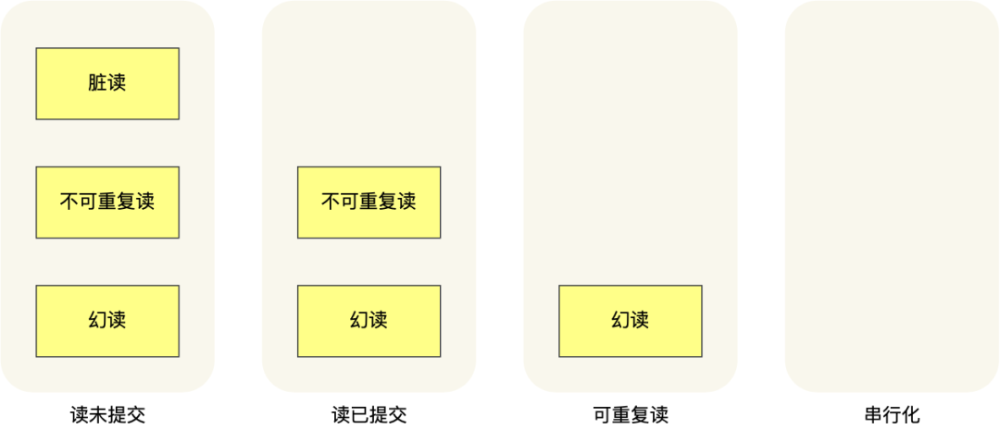

MySQL InnoDB 存储引擎的默认支持的隔离级别是 **<font style="color:#DF2A3F;">REPEATABLE-READ（可重读）</font>**<font style="color:#DF2A3F;"> </font>

**<font style="color:rgb(48, 79, 254);">MySQL InnoDB 引擎的默认隔离级别虽然是「可重复读」，但是它很大程度上避免幻读现象</font>**：

* <font style="color:rgb(44, 62, 80);">针对</font>**<font style="color:rgb(48, 79, 254);">快照读</font>**<font style="color:rgb(44, 62, 80);">（普通 select 语句），</font>**<font style="color:rgb(48, 79, 254);">通过 MVCC 方式解决了幻读</font>**<font style="color:rgb(44, 62, 80);">，可重复读隔离级别下，事务执行过程中只会创建一次ReadView，之后事务都使用这一个ReadView，所以就很好了避免幻读问题。</font>
* <font style="color:rgb(44, 62, 80);">针对</font>**<font style="color:rgb(48, 79, 254);">当前读</font>**<font style="color:rgb(44, 62, 80);">（select ... for update 等语句），</font>**<font style="color:rgb(48, 79, 254);">通过 next-key lock（记录锁+间隙锁）方式解决了幻读</font>**<font style="color:rgb(44, 62, 80);">，当执行 select ... for update 语句的时候，会加上 next-key lock，如果有其他事务在 next-key lock 锁范围内插入了一条记录，那么这个插入语句就会被阻塞，所以就很好了避免幻读问题。</font>

因为隔离级别越低，事务请求的锁越少，所以大部分数据库系统的隔离级别都是 **READ-COMMITTED** ，但是你要知道的是 InnoDB 存储引擎默认使用 **REPEATABLE-READ** 并不会有任何性能损失。

InnoDB 存储引擎在分布式事务的情况下一般会用到 SERIALIZABLE 隔离级别。

## 可重复读下的幻读

**<font style="color:rgb(48, 79, 254);">可重复读隔离级别下虽然很大程度上避免了幻读，但是还是没有能完全解决幻读</font>**<font style="color:rgb(44, 62, 80);">。</font>

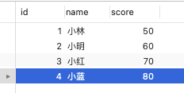

<font style="color:rgb(44, 62, 80);">事务 B 插入一条 id = 5 的记录，并且提交了事务。</font>

```sql
# 事务 B
mysql> begin;
Query OK, 0 rows affected (0.00 sec)

mysql> insert into t_stu values(5, '小美', 18);
Query OK, 1 row affected (0.00 sec)

mysql> commit;
Query OK, 0 rows affected (0.00 sec)

```

**<font style="color:rgb(48, 79, 254);">事务 A 更新 id = 5 这条记录，事务 A 看不到 id = 5 这条记录，但是他去更新了这条记录，这场景确实很违和，然后再次查询 id = 5 的记录，事务 A 就能看到事务 B 插入的纪录了。</font>**

```sql
# 事务 A
mysql> update t_stu set name = '小林coding' where id = 5;
Query OK, 1 row affected (0.01 sec)
Rows matched: 1  Changed: 1  Warnings: 0

mysql> select * from t_stu where id = 5;
+----+--------------+------+
| id | name         | age  |
+----+--------------+------+
|  5 | 小林coding   |   18 |
+----+--------------+------+
1 row in set (0.00 sec)

```

## 解决幻读的方法

解决幻读的方式有很多，但是它们的核心思想就是一个事务在操作某张表数据的时候，另外一个事务不允许新增或者删除这张表中的数据了。解决幻读的方式主要有以下几种：

1. **将事务隔离级别调整为 **<code>**SERIALIZABLE**</code>** 。**
2. **在可重复读的事务级别下，给事务操作的这张表添加表锁。**
3. \*\*在可重复读的事务级别下，给事务操作的这张表添加 **<code>**Next-key Lock（Record Lock + Gap Lock）**</code>** \*\*

**可重复读的隔离级别下可以防止幻读，不同的读方式采用的方法也不一样：**

* **<font style="color:#DF2A3F;">快照读</font>** ：由 MVCC 机制来保证不出现幻读。（select）
* **<font style="color:#DF2A3F;">当前读</font>** ：使用 Next-Key Lock 进行加锁来保证不出现幻读 (select..lock in share mode, select.. for update, update、insert、delete)

**MySql的InnoDB存储引擎的默认支持的隔离级别是REPEATABLE-READ，并采用next-key lock 算法，避免幻读，从而达到可串行化的隔离级别。**

**所谓的next key lock就是一个行锁（record lock）+间隙锁（gap lock），比如某一个辅助索引（比如上面的class\_id），如果它有1,3,5这几个值，那么当我们使用next key lock的锁住class\_id=1的时候，实际上锁住了（-无穷，1]，或者锁住class\_id=3的时候，实际上锁住的是（1,3]，也就是一个**\*\*<font style="color:#DF2A3F;">左开右闭</font>\*\***的区间。如果此时别的事务要在这个区间内插入数据，就会被阻塞住。这个锁一直到事务提交才会释放。因此，即使出现了上面图片里面这种情况，也可以保证前后两次去读的内容一致，因为对这个辅助索引上的锁是：“next key lock”，他会锁住一个区间。**


**但是注意，对于可重复读默认使用的就是next key lock，但是对于“唯一索引”，比如主键的索引，next key lock会降级成行锁，而不会锁住一个区间。因此，如果上面的事务1的update使用的是主键，事务2也使用主键进行插入，那么实际上事务2根本不会被阻塞，可以立即插入并返回。而对于非唯一索引，next key lock则不会降级。**

# MVCC的实现♥♥♥♥

## 多版本并发控制 (Multi-Version Concurrency Control)

**<font style="color:#DF2A3F;">MVCC 是一种并发控制机制，用于在多个并发事务同时读写数据库时保持数据的一致性和隔离性</font>**<font style="color:#DF2A3F;">。</font>**<font style="color:#DF2A3F;">它是通过</font>****<font style="color:#DF2A3F;background-color:#FBDE28;">在每个数据行上维护多个版本的数据</font>****<font style="color:#DF2A3F;">来实现的</font>**。**当一个事务要对数据库中的数据进行修改时，MVCC 会为该事务创建一个数据快照** **，而不是直接修改实际的数据行。**

**1、读操作（SELECT）：**

**当一个事务执行读操作时，它会使用快照读取。** 快照读取是基于事务开始时数据库中的状态创建的，因此事务不会读取其他事务尚未提交的修改。

* 对于读取操作，事务会查找符合条件的数据行，并**选择符合其事务开始时间的数据版本**进行读取。
* 如果某个数据行有多个版本，事务会选择**不晚于其开始时间的最新版本**，确保事务只读取在它开始之前已经存在的数据。
* 事务读取的是快照数据，因此其他并发事务对数据行的修改不会影响当前事务的读取操作。

**2、写操作（INSERT、UPDATE、DELETE）：**

当一个事务执行写操作时，会**生成一个新的数据版本**，**并将修改后的数据写入数据库**。

* 对于写操作，事务会为要修改的**数据行\*\*\*\*创建一个新的版本**，**并将修改后的数据写入新版本**。
* 新版本的数据会带有当前事务的版本号，以便其他事务能够正确读取相应版本的数据。
* **原始版本的数据仍然存在，供其他事务使用快照读取，这保证了其他事务不受当前事务的写操作影响。**

**3、事务提交和回滚：**

* 当一个**事务提交**时，它所做的**修改**将**成为数据库的最新版本**，**并且对其他事务可见**。
* 当一个事务回滚时，它所做的**修改**将**被撤销**，**对其他事务不可见**。

> 每个事务读取到数据都有自己的版本，事务如果提交成功那么版本也就随之更新，如果回滚那就对其他事务不可见。

**4、版本的回收：**

为了防止数据库中的版本无限增长，**MVCC 会定期进行版本的回收**。回收机制会删除已经不再需要的旧版本数据，从而释放空间。

MVCC 通过**创建数据的多个版本和使用快照读取**来实现并发控制。读操作使用旧版本数据的快照，写操作创建新版本，并确保原始版本仍然可用。这样，不同的事务可以在一定程度上并发执行，而不会相互干扰，从而提高了数据库的并发性能和数据一致性。

## 一致性非锁定读和锁定读

### 一致性非锁定读（快照读）

**一致性非锁定读（Consistent Nonlocking Reads）** 的实现，通常做法是**加一个版本号或者时间戳**字段，在更新数据的同时版本号 + 1 或者更新时间戳。查询时，将当前可见的版本号与对应记录的版本号进行比对，如果记录的版本小于可见版本，则表示该记录可见

在 `InnoDB` 存储引擎中，**多版本控制 (multi versioning) **就是对非锁定读的实现。如果读取的行正在执行 `DELETE` 或 `UPDATE` 操作，这时读取操作不会去等待行锁的释放。相反地，`InnoDB` 存储引擎会去读取行的一个快照数据，对于这种读取历史数据的方式，我们叫它**快照读 (snapshot read)**

在 `Repeatable Read` 和 `Read Committed` 两个隔离级别下，如果是执行普通的 `select` 语句（不包括 `select ... lock in share mode` ,`select ... for update`）则会使用 `一致性非锁定读（MVCC）`。并且\*\*<font style="color:#DF2A3F;">在</font>**<font style="color:#DF2A3F;"> </font><code>**<font style="color:#DF2A3F;">Repeatable Read</font>**</code><font style="color:#DF2A3F;"> </font>**<font style="color:#DF2A3F;">下</font>**<font style="color:#DF2A3F;"> </font><code><font style="color:#DF2A3F;">MVCC</font></code><font style="color:#DF2A3F;"> </font>**<font style="color:#DF2A3F;">实现了可重复读和防止部分幻读</font>\*\*

### 锁定读（当前读）

如果执行的是下列语句，就是 **<font style="color:#DF2A3F;">锁定读（Locking Reads）</font>**

* `select ... lock in share mode`
* `select ... for update`
* `insert`、`update`、`delete` 操作

**在锁定读下，读取的是数据的最新版本，这种读也被称为 **<code>**当前读（current read）**</code>**。锁定读会对读取到的记录加锁：**

* `select ... lock in share mode`：对记录加 `S` 锁，其它事务也可以加`S`锁，如果加 `x` 锁则会被阻塞
* `select ... for update`、`insert`、`update`、`delete`：对记录加 `X` 锁，且其它事务不能加任何锁

在一致性非锁定读下，**即使读取的记录已被其它事务加上** `X` **锁，这时记录也是可以被读取的，即读取的快照数据。** 上面说了，在 `Repeatable Read` 下 `MVCC` 防止了部分幻读，这边的 “部分” 是指在 `一致性非锁定读` 情况下，只能读取到第一次查询之前所插入的数据（根据 Read View 判断数据可见性，Read View 在第一次查询时生成）。

但是！如果是 `当前读` ，每次读取的都是最新数据，这时如果两次查询中间有其它事务插入数据，就会产生幻读。所以， <code>**InnoDB**</code> **在实现**<code>**Repeatable Read**</code> **时，如果执行的是当前读** **，则会对读取的记录使用** <code>**Next-key Lock**</code>  **，来防止其它事务在间隙间插入数据**

> 两种情况：**<font style="color:#DF2A3F;">非锁定读取（MVCC -- 类似乐观锁，用版本号和时间戳），锁定读（加锁 -- 类似悲观锁）</font>**
>
> * **MVCC情况下，**<code>**Repeatable Read**</code>**可以防止幻读，读取行的一个快照数据，不会被其他事务影响。**
> * **锁定读情况下，**<code>**Repeatable Read**</code>**防止幻读，采用加Next-Key Lock。**

## InnoDB 对 MVCC 的实现

<code>**<font style="color:#DF2A3F;">MVCC</font>**</code>**<font style="color:#DF2A3F;"> 的实现依赖于：隐藏字段、Read View、undo log</font>**。在内部实现中，`InnoDB` 通过数据行的 `DB_TRX_ID` 和 `Read View` 来判断数据的可见性，如不可见，则通过数据行的 `DB_ROLL_PTR` 找到 `undo log` 中的历史版本。每个事务读到的数据版本可能是不一样的，在同一个事务中，用户只能看到该事务创建 `Read View` 之前已经提交的修改和该事务本身做的修改

### 隐藏字段

在内部，`InnoDB` 存储引擎为每行数据添加了三个隐藏字段：

* `DB_TRX_ID（6字节）`：表示最后一次插入或更新该行的事务 id。此外，`delete` 操作在内部被视为更新，只不过会在记录头 `Record header` 中的 `deleted_flag` 字段将其标记为已删除
* `DB_ROLL_PTR（7字节）` **回滚指针，指向该行的** `undo log` 。如果该行未被更新，则为空
* `DB_ROW_ID（6字节）`：如果没有设置主键且该表没有唯一非空索引时，`InnoDB` 会使用该 id 来生成聚簇索引


### ReadView

<code>**Read View**</code>**主要是用来做可见性判断，里面保存了 “当前对本事务不可见的其他活跃事务”**

<font style="color:rgb(44, 62, 80);">Read View 有四个重要的字段：</font>

* <font style="color:rgb(44, 62, 80);">m\_ids ：指的是在创建 Read View 时，当前数据库中「活跃事务」的</font>**<font style="color:rgb(48, 79, 254);">事务 id 列表</font>**<font style="color:rgb(44, 62, 80);">，注意是一个列表，</font>**<font style="color:rgb(48, 79, 254);">“活跃事务”指的就是，启动了但还没提交的事务</font>**<font style="color:rgb(44, 62, 80);">。</font>
* <font style="color:rgb(44, 62, 80);">min\_trx\_id ：指的是在创建 Read View 时，当前数据库中「活跃事务」中事务</font><font style="color:rgb(44, 62, 80);"> </font>**<font style="color:rgb(48, 79, 254);">id 最小的事务</font>**<font style="color:rgb(44, 62, 80);">，也就是 m\_ids 的最小值。</font>
* <font style="color:rgb(44, 62, 80);">max\_trx\_id ：这个并不是 m\_ids 的最大值，而是</font>**<font style="color:rgb(48, 79, 254);">创建 Read View 时当前数据库中应该给下一个事务的 id 值</font>**<font style="color:rgb(44, 62, 80);">，也就是全局事务中最大的事务 id 值 + 1；</font>
* <font style="color:rgb(44, 62, 80);">creator\_trx\_id ：指的是</font>**<font style="color:rgb(48, 79, 254);">创建该 Read View 的事务的事务 id</font>**<font style="color:rgb(44, 62, 80);">。</font>


<font style="color:rgb(44, 62, 80);">对于使用 InnoDB 存储引擎的数据库表，它的聚簇索引记录中都包含下面两个隐藏列：</font>

* <font style="color:rgb(44, 62, 80);">trx\_id，当一个事务对某条聚簇索引记录进行改动时，会</font>**<font style="color:rgb(48, 79, 254);">把该事务的事务 id 记录在 trx\_id 隐藏列里</font>**<font style="color:rgb(44, 62, 80);">；</font>
* <font style="color:rgb(44, 62, 80);">roll\_pointer，每次对某条聚簇索引记录进行改动时，都会把旧版本的记录写入到 undo 日志中，然后</font>**<font style="color:rgb(48, 79, 254);">这个隐藏列是个指针，指向每一个旧版本记录</font>**<font style="color:rgb(44, 62, 80);">，于是就可以通过它找到修改前的记录。</font>


**事务可见性：**

***


<font style="color:rgb(44, 62, 80);">一个事务去访问记录的时候，除了自己的更新记录总是可见之外，还有这几种情况：</font>

* <font style="color:rgb(44, 62, 80);">如果记录的 trx\_id 值小于 Read View 中的</font><font style="color:rgb(44, 62, 80);"> </font><font style="color:rgb(71, 101, 130);">min\_trx\_id</font><font style="color:rgb(44, 62, 80);"> </font><font style="color:rgb(44, 62, 80);">值，表示这个版本的记录是在创建 Read View</font><font style="color:rgb(44, 62, 80);"> </font>**<font style="color:rgb(48, 79, 254);">前</font>**<font style="color:rgb(44, 62, 80);">已经提交的事务生成的，所以该版本的记录对当前事务</font>**<font style="color:rgb(48, 79, 254);">可见</font>**<font style="color:rgb(44, 62, 80);">。</font>
* <font style="color:rgb(44, 62, 80);">如果记录的 trx\_id 值大于等于 Read View 中的</font><font style="color:rgb(44, 62, 80);"> </font><font style="color:rgb(71, 101, 130);">max\_trx\_id</font><font style="color:rgb(44, 62, 80);"> </font><font style="color:rgb(44, 62, 80);">值，表示这个版本的记录是在创建 Read View</font><font style="color:rgb(44, 62, 80);"> </font>**<font style="color:rgb(48, 79, 254);">后</font>**<font style="color:rgb(44, 62, 80);">才启动的事务生成的，所以该版本的记录对当前事务</font>**<font style="color:rgb(48, 79, 254);">不可见</font>**<font style="color:rgb(44, 62, 80);">。</font>
* <font style="color:rgb(44, 62, 80);">如果记录的 trx\_id 值在 Read View 的</font><font style="color:rgb(44, 62, 80);"> </font><font style="color:rgb(71, 101, 130);">min\_trx\_id</font><font style="color:rgb(44, 62, 80);"> </font><font style="color:rgb(44, 62, 80);">和</font><font style="color:rgb(44, 62, 80);"> </font><font style="color:rgb(71, 101, 130);">max\_trx\_id</font><font style="color:rgb(44, 62, 80);"> </font><font style="color:rgb(44, 62, 80);">之间，需要判断 trx\_id 是否在 m\_ids 列表中：</font>
  * <font style="color:rgb(44, 62, 80);">如果记录的 trx\_id</font><font style="color:rgb(44, 62, 80);"> </font>**<font style="color:rgb(48, 79, 254);">在</font>**<font style="color:rgb(44, 62, 80);"> </font><font style="color:rgb(71, 101, 130);">m\_ids</font><font style="color:rgb(44, 62, 80);"> </font><font style="color:rgb(44, 62, 80);">列表中，表示生成该版本记录的活跃事务依然活跃着（还没提交事务），所以该版本的记录对当前事务</font>**<font style="color:rgb(48, 79, 254);">不可见</font>**<font style="color:rgb(44, 62, 80);">。</font>
  * <font style="color:rgb(44, 62, 80);">如果记录的 trx\_id</font><font style="color:rgb(44, 62, 80);"> </font>**<font style="color:rgb(48, 79, 254);">不在</font>**<font style="color:rgb(44, 62, 80);"> </font><font style="color:rgb(71, 101, 130);">m\_ids</font><font style="color:rgb(44, 62, 80);">列表中，表示生成该版本记录的活跃事务已经被提交，所以该版本的记录对当前事务</font>**<font style="color:rgb(48, 79, 254);">可见</font>**<font style="color:rgb(44, 62, 80);">。</font>

**<font style="color:rgb(48, 79, 254);">这种通过「版本链」来控制并发事务访问同一个记录时的行为就叫 MVCC（多版本并发控制）。</font>**

### undo-log

<font style="color:rgb(44, 62, 80);">undo log 两大作用：</font>

* **<font style="color:rgb(48, 79, 254);">实现事务回滚，保障事务的原子性</font>**<font style="color:rgb(44, 62, 80);">。事务处理过程中，如果出现了错误或者用户执 行了 ROLLBACK 语句，MySQL 可以利用 undo log 中的历史数据将数据恢复到事务开始之前的状态。</font>
* **<font style="color:rgb(48, 79, 254);">实现 MVCC（多版本并发控制）关键因素之一</font>**<font style="color:rgb(44, 62, 80);">。MVCC 是通过 ReadView + undo log 实现的。undo log 为每条记录保存多份历史数据，MySQL 在执行快照读（普通 select 语句）的时候，会根据事务的 Read View 里的信息，顺着 undo log 的版本链找到满足其可见性的记录。</font>

**在** <code>**InnoDB**</code> **存储引擎中** <code>**undo log**</code> **分为两种：**<code>**insert undo log**</code> **和** <code>**update undo log**</code> **：**

1. <code>**insert undo log**</code>：指在 `insert` 操作中产生的 `undo log`。因为 `insert`  **操作的记录只对事务本身可见**，**对其他事务不可见**（对其他可见会产生幻读），故该 `undo log` 可以在事务提交后直接删除。不需要进行 `purge` 操作。<code>**insert**</code> **时的数据初始状态：**


2. <code>**update undo log**</code>：`update` 或 `delete` 操作中产生的 `undo log`。该 `undo log`可能需要提供 `MVCC` 机制，因此不能在事务提交时就进行删除。提交时放入 `undo log` 链表，等待 `purge线程` 进行最后的删除。

**数据第一次被修改时：**


**数据第二次被修改时：**


不同事务或者相同事务的对同一记录行的修改，会使该记录行的 `undo log`  **成为一条链表**，链首就是最新的记录，链尾就是最早的旧记录。

### 数据可见性算法

在 `InnoDB` 存储引擎中，创建一个新事务后，执行每个 `select` 语句前，都会创建一个快照（Read View），**快照中保存了当前数据库系统中正处于活跃（没有 commit）的事务的 ID 号**。其实简单的说保存的是系统中当前不应该被本事务看到的其他事务 ID 列表（即 m\_ids）。当用户在这个事务中要读取某个记录行的时候，`InnoDB` 会将该记录行的 `DB_TRX_ID` 与 `Read View` 中的一些变量及当前事务 ID 进行比较，判断是否满足可见性条件


## RC 和 RR 隔离级别下 MVCC 的差异

在事务隔离级别 `RC（READ-COMMITTED）` 和 `RR（REPEATABLE-READ）` （InnoDB 存储引擎的默认事务隔离级别）下，`InnoDB` 存储引擎使用 `MVCC`（非锁定一致性读），但它们生成 `Read View` 的时机却不同

* 在 RC 隔离级别下的 <code>**每次select**</code> 查询前都生成一个`Read View` (m\_ids 列表)
* 在 RR 隔离级别下只在事务开始后 <code>**第一次select**</code> 数据前生成一个`Read View`（m\_ids 列表）

[事务隔离级别是怎么实现的？](https://xiaolincoding.com/mysql/transaction/mvcc.html#read-view-%E5%9C%A8-mvcc-%E9%87%8C%E5%A6%82%E4%BD%95%E5%B7%A5%E4%BD%9C%E7%9A%84)

## MVCC➕Next-key-Lock 防止幻读

`InnoDB`存储引擎在 RR 级别下通过 `MVCC`和 `Next-key Lock` 来解决幻读问题：

**1、执行普通** <code>**select**</code> **，此时会以** <code>**MVCC**</code> **快照读的方式读取数据**

在快照读的情况下，RR 隔离级别只会在事务开启后的第一次查询生成 `Read View` ，**<font style="color:rgb(48, 79, 254);">后续的查询语句利用这个 Read View，通过这个 Read View 就可以在 undo log 版本链找到事务开始时的数据，所以事务过程中每次查询的数据都是一样的</font>**。所以在生成 `Read View` 之后其它事务所做的更新、插入记录版本对当前事务并不可见，实现了可重复读和防止快照读下的 “幻读”。

**2、执行 select...for update/lock in share mode、insert、update、delete 等当前读**

在当前读下，读取的都是最新的数据，如果其它事务有插入新的记录，并且刚好在当前事务查询范围内，就会产生幻读！`InnoDB`\*\*<font style="color:#DF2A3F;"> 使用 Next-key Lock</font>\*\*来防止这种情况。当执	行当前读时，会锁定读取到的记录的同时，锁定它们的间隙，防止其它事务在查询范围内插入数据。只要我不让你插入，就不会发生幻读。


## RR情况下幻读完全解决了吗？

**<font style="color:rgb(48, 79, 254);">可重复读隔离级别下虽然很大程度上避免了幻读，但是还是没有能完全解决幻读</font>**<font style="color:rgb(44, 62, 80);">。</font>


<font style="color:rgb(44, 62, 80);">事务 A 执行查询 id = 5 的记录，此时表中是没有该记录的，所以查询不出来。</font>

<font style="color:rgb(44, 62, 80);">然后事务 B 插入一条 id = 5 的记录，并且提交了事务。</font>

**<font style="color:rgb(48, 79, 254);">事务 A 更新 id = 5 这条记录，事务 A 看不到 id = 5 这条记录，但是去更新了这条记录，然后再次查询 id = 5 的记录，事务 A 就能看到事务 B 插入的纪录了，幻读就是发生在这种违和的场景</font>**<font style="color:rgb(44, 62, 80);">。</font>


**<font style="color:rgb(48, 79, 254);">要避免这类特殊场景下发生幻读的现象的话，就是尽量在开启事务之后，马上执行 select ... for update 这类当前读的语句</font>**<font style="color:rgb(44, 62, 80);">，因为它会对记录加 next-key lock，从而避免其他事务插入一条新记录。</font>

## MVCC案例分析

注意，在MVCC中说的都是快照读，如果产生了当前读（update，select + lock）就会采取加锁并且读取最新数据的方式。


构造一个“数据无法修改”的场景


以上两种情况都会产生数据无法修改的现象

# SQL语句在MySQL中的执行过程

[执行一条 select 语句，期间发生了什么？](https://xiaolincoding.com/mysql/base/how_select.html#mysql-%E6%89%A7%E8%A1%8C%E6%B5%81%E7%A8%8B%E6%98%AF%E6%80%8E%E6%A0%B7%E7%9A%84)

## 一 MySQL 基础架构分析

### 1.1 MySQL 基本架构概览


* **连接器：**  身份认证和权限相关(登录 MySQL )。
* **查询缓存：**  执行查询语句的时候，会先查询缓存（MySQL 8.0 版本后移除，功能不太实用）。
* **分析器：**  没有命中缓存的话，SQL 语句就会经过分析器，分析SQL功能，检查SQL 语句语法是否正确。
* **优化器：**  按照 MySQL 认为最优的方案去执行。
* **执行器：**  执行语句，然后从存储引擎返回数据。


MySQL 主要分为 Server 层和存储引擎层：

* **Server 层**：主要包括连接器、查询缓存、分析器、优化器、执行器等，所有跨存储引擎的功能都在这一层实现，比如存储过程、触发器、视图，函数等，还有一个通用的日志模块 binlog 日志模块。
* **存储引擎**：主要负责数据的存储和读取，采用可以替换的**插件式架构（每个表能独立插件部署）**，支持 InnoDB、MyISAM、Memory 等多个存储引擎，其中 InnoDB 引擎有自有的日志模块 redolog 模块。**现在最常用的存储引擎是 InnoDB，它从 MySQL 5.5 版本开始就被当做默认存储引擎了。**

### 1.2 Server 层基本组件介绍

#### 1) 连接器

\*\*<font style="color:#DF2A3F;">连接器主要和身份认证和权限相关的功能相关：</font>\*\*主要负责用户登录数据库，进行用户的身份认证，包括校验账户密码，权限等操作，如果用户账户密码已通过，连接器会到权限表中查询该用户的所有权限，之后在这个连接里的权限逻辑判断都是会依赖此时读取到的权限数据

<font style="color:rgb(44, 62, 80);">如果一个用户已经建立了连接，即使管理员中途修改了该用户的权限，也不会影响已经存在连接的权限。</font>

#### 2) 查询缓存(MySQL 8.0 版本后移除)

查询缓存主要用来缓存我们所执行的 SELECT 语句以及该语句的结果集。

#### 3) 分析器

**没有命中缓存的话，SQL 语句就会经过分析器，分析SQL功能，检查SQL 语句语法是否正确。**

* **第一步，词法分析**，一条 SQL 语句有多个字符串组成，首先要提取关键字，比如 select，提出查询的表，提出字段名，提出查询条件等等。做完这些操作后，就会进入第二步。
* **第二步，语法分析**，主要就是判断你输入的 SQL 是否正确，是否符合 MySQL 的语法。

#### 4) 优化器

\*\*优化器的作用就是它认为的最优的执行方案去执行，比如多个索引的时候该如何选择索引，多表查询的时候如何选择关联顺序等。\*\*可以说，经过了优化器之后可以说这个语句具体该如何执行就已经定下来。

#### 5) 执行器

选择了执行方案后，MySQL 就准备开始执行，**执行前会校验该用户有没有权限，如果没有权限，就会返回错误信息，如果有权限，就会去调用引擎的接口，返回接口执行的结果**。

## ♥♥♥Update语句执行过程


<font style="color:rgb(44, 62, 80);">具体更新一条记录</font><font style="color:rgb(44, 62, 80);"> </font><code><font style="color:rgb(71, 101, 130);">UPDATE t_user SET name = 'xiaolin' WHERE id = 1;</font></code><font style="color:rgb(44, 62, 80);"> </font><font style="color:rgb(44, 62, 80);">的流程如下:</font>

1. <font style="color:rgb(44, 62, 80);">执行器负责具体执行，会调用存储引擎的接口，通过主键索引树搜索获取 id = 1 这一行记录：</font>
   * <font style="color:rgb(44, 62, 80);">如果 id=1 这一行所在的数据页本来就在 buffer pool 中，就直接返回给执行器更新；</font>
   * <font style="color:rgb(44, 62, 80);">如果记录不在 buffer pool，将数据页从磁盘读入到 buffer pool，返回记录给执行器。</font>
2. <font style="color:rgb(44, 62, 80);">执行器得到聚簇索引记录后，会看一下更新前的记录和更新后的记录是否一样：</font>
   * <font style="color:rgb(44, 62, 80);">如果一样的话就不进行后续更新流程；</font>
   * <font style="color:rgb(44, 62, 80);">如果不一样的话就把更新前的记录和更新后的记录都当作参数传给 InnoDB 层，让 InnoDB 真正的执行更新记录的操作；</font>
3. <font style="color:rgb(44, 62, 80);">开启事务， InnoDB 层更新记录前，首先要记录相应的 undo log，因为这是更新操作，需要把被更新的列的旧值记下来，也就是要生成一条 undo log，undo log 会写入 Buffer Pool 中的 Undo 页面，不过在内存修改该 Undo 页面后，需要记录对应的 redo log。</font>
4. **<font style="color:rgb(44, 62, 80);">InnoDB 层开始更新记录，会先更新内存（同时标记为脏页），然后将记录写到 redo log 里面，这个时候更新就算完成了。</font>**<font style="color:rgb(44, 62, 80);">为了减少磁盘I/O，不会立即将脏页写入磁盘，后续由后台线程选择一个合适的时机将脏页写入到磁盘。这就是 </font>**<font style="color:rgb(48, 79, 254);">WAL 技术</font>**<font style="color:rgb(44, 62, 80);">，MySQL 的写操作并不是立刻写到磁盘上，而是先写 redo 日志，然后在合适的时间再将修改的行数据写到磁盘上。</font>
5. <font style="color:rgb(44, 62, 80);">至此，一条记录更新完了。</font>
6. <font style="color:rgb(44, 62, 80);">在一条更新语句执行完成后，然后开始记录该语句对应的 binlog，此时记录的 binlog 会被保存到 binlog cache，并没有刷新到硬盘上的 binlog 文件，在事务提交时才会统一将该事务运行过程中的所有 binlog 刷新到硬盘。</font>
7. <font style="color:rgb(44, 62, 80);">事务提交（两阶段提交）：</font>
   * **<font style="color:rgb(48, 79, 254);">prepare 阶段</font>**<font style="color:rgb(44, 62, 80);">：将 redo log 对应的事务状态设置为 prepare，然后将 redo log 刷新到硬盘；</font>
   * **<font style="color:rgb(48, 79, 254);">commit 阶段</font>**<font style="color:rgb(44, 62, 80);">：将 binlog 刷新到磁盘，接着调用引擎的提交事务接口，将 redo log 状态设置为 commit（将事务设置为 commit 状态后，刷入到磁盘 redo log 文件）；</font>
8. <font style="color:rgb(44, 62, 80);">至此，一条更新语句执行完成。</font>

## 二 语句分析

SQL 可以分为两种，一种是查询，一种是更新（增加，修改，删除）。

### 2.1 查询语句

```sql
select * from tb_student  A where A.age='18' and A.name=' 张三 ';
```

* 先检查该语句是否有权限，如果没有权限，直接返回错误信息，如果有权限，在 MySQL8.0 版本以前，会先查询缓存，以这条 SQL 语句为 key 在内存中查询是否有结果，如果有直接缓存，如果没有，执行下一步。
* 通过分析器进行词法分析，提取 SQL 语句的关键元素，比如提取上面这个语句是查询 select，提取需要查询的表名为 tb\_student，需要查询所有的列，查询条件是这个表的 id='1'。然后判断这个 SQL 语句是否有语法错误，比如关键词是否正确等等，如果检查没问题就执行下一步。
* 接下来就是优化器进行确定执行方案，上面的 SQL 语句，可以有两种执行方案：
  * a.先查询学生表中姓名为“张三”的学生，然后判断是否年龄是 18。
  * b.先找出学生中年龄 18 岁的学生，然后再查询姓名为“张三”的学生。
  * **优化器根据自己的优化算法进行选择执行效率最好的一个方案（优化器认为，有时候不一定最好）。那么确认了执行计划后就准备开始执行了**。
* 进行权限校验，如果没有权限就会返回错误信息，如果有权限就会调用数据库引擎接口，返回引擎的执行结果。

### 2.2 更新语句

```sql
update tb_student A set A.age='19' where A.name=' 张三 ';
```

这条语句也基本上会沿着上一个查询的流程走，只不过执行更新的时候肯定要记录日志啦，这就会引入日志模块了，MySQL 自带的日志模块是 **binlog（归档日志）**  ，所有的存储引擎都可以使用，我们常用的 InnoDB 引擎还自带了一个日志模块 **redo log（重做日志）** ，我们就以 InnoDB 模式下来探讨这个语句的执行流程。流程如下：

* 先查询到张三这一条数据，如果有缓存，也是会用到缓存。
* **然后拿到查询的语句，把 age 改为 19，然后调用引擎 API 接口，写入这一行数据，InnoDB 引擎把数据保存在内存中，同时记录 redo log，此时 redo log 进入 prepare 状态，然后告诉执行器，执行完成了，随时可以提交。**
* **执行器收到通知后记录 binlog，然后调用引擎接口，提交 redo log 为提交状态。**
* 更新完成。

，**为什么 redo log 要两阶段提交**？：**<font style="color:#DF2A3F;">解决数据一致性的问题</font>**

* **先写 redo log 直接提交，然后写 binlog**，假设写完 redo log 后，机器挂了，binlog 日志没有被写入，那么机器重启后，这台机器会通过 redo log 恢复数据，但是这个时候 binlog 并没有记录该数据，后续进行机器备份的时候，就会丢失这一条数据，同时主从同步也会丢失这一条数据。
* **先写 binlog，然后写 redo log**，假设写完了 binlog，机器异常重启了，由于没有 redo log，本机是无法恢复这一条记录的，但是 binlog 又有记录，那么和上面同样的道理，就会产生数据不一致的情况。

## 三 总结

* MySQL 主要分为 Server 层和引擎层，Server 层主要包括连接器、查询缓存、分析器、优化器、执行器，同时还有一个日志模块（binlog），这个日志模块所有执行引擎都可以共用，redolog 只有 InnoDB 有。
* 引擎层是插件式的，目前主要包括，MyISAM,InnoDB,Memory 等。
* 查询语句的执行流程如下：**权限校验（如果命中缓存）--->查询缓存--->分析器--->优化器--->权限校验--->执行器--->引擎**
* 更新语句执行流程如下：**分析器---->权限校验---->执行器--->引擎---redo log(prepare 状态)--->binlog--->redo log(commit 状态)**

# MySQL执行计划分析


## 什么是执行计划？

**执行计划** 是指一条 SQL 语句在经过 **MySQL 查询优化器** 的优化会后，具体的执行方式。

执行计划通常用于 SQL 性能分析、优化等场景。通过 <code>**EXPLAIN**</code>\*\* \*\*的结果，可以了解到如数据表的查询顺序、数据查询操作的操作类型、哪些索引可以被命中、哪些索引实际会命中、每个数据表有多少行记录被查询等信息。

## 如何获取执行计划？

MySQL 为我们提供了 `EXPLAIN` 命令，来获取执行计划的相关信息。

<code><font style="color:#DF2A3F;">EXPLAIN</font></code><font style="color:#DF2A3F;"> </font>**<font style="color:#DF2A3F;">语句并不会真的去执行相关的语句，而是通过查询优化器对语句进行分析，找出最优的查询方案，并显示对应的信息。</font>**

`EXPLAIN` 执行计划支持 `SELECT`、`DELETE`、`INSERT`、`REPLACE` 以及 `UPDATE` 语句。我们一般多用于分析 `SELECT` 查询语句，使用起来非常简单，语法如下

```sql
EXPLAIN + SELECT 查询语句
```

```sql
mysql> explain SELECT * FROM dept_emp WHERE emp_no IN (SELECT emp_no FROM dept_emp GROUP BY emp_no HAVING COUNT(emp_no)>1);
+----+-------------+----------+------------+-------+-----------------+---------+---------+------+--------+----------+-------------+
| id | select_type | table    | partitions | type  | possible_keys   | key     | key_len | ref  | rows   | filtered | Extra       |
+----+-------------+----------+------------+-------+-----------------+---------+---------+------+--------+----------+-------------+
|  1 | PRIMARY     | dept_emp | NULL       | ALL   | NULL            | NULL    | NULL    | NULL | 331143 |   100.00 | Using where |
|  2 | SUBQUERY    | dept_emp | NULL       | index | PRIMARY,dept_no | PRIMARY | 16      | NULL | 331143 |   100.00 | Using index |
+----+-------------+----------+------------+-------+-----------------+---------+---------+------+--------+----------+-------------+
```

| **列名** | **含义** |
| --- | --- |
| id | SELECT 查询的序列标识符 |
| select\_type | SELECT 关键字对应的查询类型 |
| table | 用到的表名 |
| partitions | 匹配的分区，对于未分区的表，值为 NULL |
| type | 表的访问方法 |
| possible\_keys | 可能用到的索引 |
| key | 实际用到的索引 |
| key\_len | 所选索引的长度 |
| ref | 当使用索引等值查询时，与索引作比较的列或常量 |
| rows | 预计要读取的行数 |
| filtered | 按表条件过滤后，留存的记录数的百分比 |
| Extra | 附加信息 |

## 如何分析 EXPLAIN 结果？

### id

SELECT 标识符，是查询中 SELECT 的序号，用来标识整个查询中 SELELCT 语句的顺序。

id 如果相同，从上往下依次执行。id 不同，**id 值越大，执行优先级越高**，如果行引用其他行的并集结果，则该值可以为 NULL。

### select\_type

查询的类型，主要用于区分普通查询、联合查询、子查询等复杂的查询，常见的值有：

* **SIMPLE**：简单查询，不包含 UNION 或者子查询。
* **PRIMARY**：查询中如果包含子查询或其他部分，外层的 SELECT 将被标记为 PRIMARY。
* **SUBQUERY**：子查询中的第一个 SELECT。
* **UNION**：在 UNION 语句中，UNION 之后出现的 SELECT。
* **DERIVED**：在 FROM 中出现的子查询将被标记为 DERIVED。
* **UNION RESULT**：UNION 查询的结果。

### table

查询用到的表名，每行都有对应的表名，表名除了正常的表之外，也可能是以下列出的值：

* <code>**<unionM,N>**</code>  : 本行引用了 id 为 M 和 N 的行的 UNION 结果；
* <code>**<derivedN>**</code>  : 本行引用了 id 为 N 的表所产生的的派生表结果。派生表有可能产生自 FROM 语句中的子查询。
* <code>**<subqueryN>**</code>  : 本行引用了 id 为 N 的表所产生的的物化子查询结果。

### type（重要）

查询执行的类型，描述了查询是如何执行的。所有值的顺序从最优到最差排序为：system > const > eq\_ref > ref > fulltext > ref\_or\_null > index\_merge > unique\_subquery > index\_subquery > range > index > ALL

常见的几种类型具体含义如下：

* **system**：如果表使用的引擎对于表行数统计是精确的（如：MyISAM），且表中只有一行记录的情况下，访问方法是 system ，是 const 的一种特例。
* **const**：表中最多只有一行匹配的记录，一次查询就可以找到，常用于使用主键或唯一索引的所有字段作为查询条件。
* **eq\_ref**：当连表查询时，前一张表的行在当前这张表中只有一行与之对应。是除了 system 与 const 之外最好的 join 方式，常用于使用主键或唯一索引的所有字段作为连表条件。
* **ref**：使用普通索引作为查询条件，查询结果可能找到多个符合条件的行。
* **index\_merge**：当查询条件使用了多个索引时，表示开启了 Index Merge 优化，此时执行计划中的 key 列列出了使用到的索引。
* **range**：对索引列进行范围查询，执行计划中的 key 列表示哪个索引被使用了。
* **index**：查询遍历了整棵索引树，与 ALL 类似，只不过扫描的是索引，而索引一般在内存中，速度更快。
* **ALL**：全表扫描。

### possible\_keys

possible\_keys 列表示 MySQL 执行查询时可能用到的索引。如果这一列为 NULL ，则表示没有可能用到的索引；这种情况下，需要检查 WHERE 语句中所使用的的列，看是否可以通过给这些列中某个或多个添加索引的方法来提高查询性能。

### key（重要）

key 列表示 MySQL 实际使用到的索引。如果为 NULL，则表示未用到索引。

### key\_len

key\_len 列表示 MySQL 实际使用的索引的最大长度；当使用到联合索引时，有可能是多个列的长度和。在满足需求的前提下越短越好。如果 key 列显示 NULL ，则 key\_len 列也显示 NULL 。

### rows

rows 列表示根据表统计信息及选用情况，大致估算出找到所需的记录或所需读取的行数，数值越小越好。

### Extra（重要）

这列包含了 MySQL 解析查询的额外信息，通过这些信息，可以更准确的理解 MySQL 到底是如何执行查询的。常见的值如下：

* **Using filesort**：在排序时使用了外部的索引排序，没有用到表内索引进行排序。
* **Using temporary**：MySQL 需要创建临时表来存储查询的结果，常见于 ORDER BY 和 GROUP BY。
* **Using index**：表明查询使用了覆盖索引，不用回表，查询效率非常高。
* **Using index condition**：表示查询优化器选择使用了索引条件下推这个特性。
* **Using where**：表明查询使用了 WHERE 子句进行条件过滤。一般在没有使用到索引的时候会出现。
* **Using join buffer (Block Nested Loop)** ：连表查询的方式，表示当被驱动表的没有使用索引的时候，MySQL 会先将驱动表读出来放到 join buffer 中，再遍历被驱动表与驱动表进行查询。

这里提醒下，当 Extra 列包含 Using filesort 或 Using temporary 时，MySQL 的性能可能会存在问题，需要尽可能避免。

‍


> 更新: 2024-09-23 20:13:20  
> 原文: <https://www.yuque.com/nibiwanxiamei/yrd6t1/5a3410ed1f44eed18442bdfb0afa87d3>