# MySql常见面试

***

# MySql基础

## 什么是关系型数据库？

关系型数据库（**RDB**，**Relational Database**）：**建立在**\*\*<font style="color:#DF2A3F;">关系模型</font>\*\***的基础上的数据库**。**关系模型表明了数据库中所存储的数据之间的联系（一对一、一对多、多对多）**。大部分关系型数据库都使用 SQL 来操作数据库中的数据。并且，大部分关系型数据库都支持事务的四大特性 **(ACID)** 。

## 什么是 SQL？

SQL ：**结构化查询语言** **(Structured Query Language)** ，与数据库打交道，从数据库中读写数据。几乎所有的主流关系数据库都支持 SQL ，适用性非常强。并且，一些非关系型数据库也兼容 SQL 或者使用的是类似SQL 的查询语言。

SQL 可以帮助我们：

* 新建数据库、数据表、字段；
* 在数据库中增加，删除，修改，查询数据；
* 新建视图、函数、存储过程；
* 对数据库中的数据进行简单的数据分析；
* 搭配 Hive，Spark SQL 做大数据；
* 搭配 SQLFlow 做机器学习；

## 什么是 MySQL？

**MySQL 是一种关系型数据库，主要用于持久化存储系统中的一些数据比如用户信息。**

## Where 和 Having 的区别

* `WHERE`<font style="color:rgba(0, 0, 0, 0.85);">：</font>**<font style="color:rgba(0, 0, 0, 0.85);">在数据检索的初始阶段进行筛选，作用于</font>**<code>**FROM**</code>**<font style="color:rgba(0, 0, 0, 0.85);">子句之后，</font>\*\*\*\*<font style="color:#DF2A3F;">在分组（</font>**<code>**<font style="color:#DF2A3F;">GROUP BY</font>**</code>**<font style="color:#DF2A3F;">）和聚合函数计算之前</font>\*\*\*\*<font style="color:rgba(0, 0, 0, 0.85);">。</font>**<font style="color:rgba(0, 0, 0, 0.85);">它可以筛选出符合特定条件的行，以便后续的聚合操作和分组操作只针对这些行进行。</font>
  * 例如，从一个包含订单信息的表中筛选出特定日期范围内的订单记录，这个筛选条件是基于订单的日期列，不涉及聚合操作，所以适合使用`WHERE`。
* `HAVING`<font style="color:rgba(0, 0, 0, 0.85);">：</font>**<font style="color:#DF2A3F;">在分组和聚合函数计算之后进行筛选</font>\*\*\*\*<font style="color:rgba(0, 0, 0, 0.85);">，用于对分组后的结果集进行过滤。它通常与聚合函数一起使用，根据聚合结果来筛选分组。</font>**
  * 例如，从一个销售数据表中，先按照产品类别进行分组，计算每个类别的总销售额，然后筛选出总销售额大于 10000 的类别，这种情况就需要使用`HAVING`。

```sql
SELECT DISTINCT column1
FROM table_name
WHERE condition
GROUP BY column2
HAVING group_condition
ORDER BY column3;
```

## Count（\*） VS Count（1）

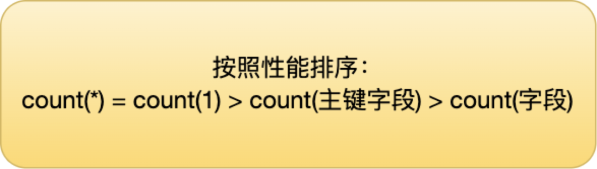

[count(\*) 和 count(1) 有什么区别？哪个性能最好？](https://xiaolincoding.com/mysql/index/count.html)

# MySQL 字段类型

MySQL 字段类型可以简单分为三大类：

* **数值类型**：整型（TINYINT、SMALLINT、MEDIUMINT、INT 和 BIGINT）、浮点型（FLOAT 和 DOUBLE）、定点型（DECIMAL）
* **字符串类型**：CHAR、VARCHAR、TINYTEXT、TEXT、MEDIUMTEXT、LONGTEXT、TINYBLOB、BLOB、MEDIUMBLOB 和 LONGBLOB 等，最常用的是 CHAR 和 VARCHAR。
* **日期时间\*\*\*\*类型**：YEAR、TIME、DATE、DATETIME 和 TIMESTAMP 等。


## UNSIGNED 属性有什么用？

MySQL 中的整数类型可以使用可选的 **UNSIGNED 属性来表示不允许负值的**\*\*<font style="color:#DF2A3F;">无符号整数</font>\*\*。使用 UNSIGNED 属性可以将正整数的上限提高一倍，因为它不需要存储负数值。

## CHAR 和 VARCHAR 的区别是什么？

**<font style="color:#DF2A3F;">CHAR 是定长字符串，VARCHAR 是变长字符串。</font>**

* CHAR 在存储时会在右边填充空格以达到指定的长度，检索时会去掉空格；
* VARCHAR 在存储时需要使用 1 或 2 个额外字节记录字符串的长度，检索时不需要处理。

## VARCHAR(100)和 VARCHAR(10)的区别是什么？

* **VARCHAR (100) 可以满足更大范围的字符存储需求，VARCHAR(10)存储超过 10 个字符时，就需要修改表结构才可以。**
* **二者存储相同的字符串，所占用磁盘的存储空间是一样的**
* **VARCHAR(100) 会消耗更多的内存。**这是因为 VARCHAR 类型在内存中**操作**时，通常会分配固定大小的内存块来保存值，即使用字符类型中定义的长度。

## DECIMAL 和 FLOAT/DOUBLE 的区别是什么？

* **DECIMAL 是定点数，FLOAT/DOUBLE 是浮点数。**
* **DECIMAL 可以存&#x50A8;****精确****&#x7684;小数值，FLOAT/DOUBLE 只能存&#x50A8;****近似****&#x7684;小数值。**

DECIMAL 用于存储具有精度要求的小数，例如与货币相关的数据，可以避免浮点数带来的精度损失。

在 Java 中，MySQL 的 DECIMAL 类型对应的是 Java 类 `java.math.``BigDecimal`。

## Mysql如何保留小数位

* **<font style="color:rgb(102, 102, 102);">ROUND(number, decimals)</font>**
* **<font style="color:rgb(18, 139, 78);background-color:rgb(247, 247, 247);">FORMAT</font>****<font style="color:rgb(95, 99, 100);background-color:rgb(247, 247, 247);">(</font>****<font style="color:rgb(0, 0, 0);background-color:rgb(247, 247, 247);">number</font>****<font style="color:rgb(95, 99, 100);background-color:rgb(247, 247, 247);">,</font>****<font style="color:rgb(0, 0, 0);background-color:rgb(247, 247, 247);"> decimals</font>\*\*\*\*<font style="color:rgb(95, 99, 100);background-color:rgb(247, 247, 247);">)</font>**
* **<font style="color:rgb(95, 99, 100);background-color:rgb(247, 247, 247);">使用DECIMAL类型保存数据，在列属性中配置保留小数位</font>**

## DATETIME 和 TIMESTAMP 的区别是什么？

* **DATETIME 类型没有时区信息，TIMESTAMP 和时区有关。**
* **TIMESTAMP 只需要使用 4 个字节的存储空间，但是 DATETIME 需要耗费 8 个字节的存储空间。**
* <code>**<font style="color:#DF2A3F;">TIMESTAMP</font>**</code>**<font style="color:#DF2A3F;">的范围是从 </font>**<code>**<font style="color:#DF2A3F;">1970-01-01 00:00:01 UTC</font>**</code>**<font style="color:#DF2A3F;"> 到 </font>**<code>**<font style="color:#DF2A3F;">2038-01-19 03:14:07 UTC</font>**</code>
* <code>**DATETIME**</code>**<font style="color:rgba(0, 0, 0, 0.85);">的范围是从 </font>**<code>**1000-01-01 00:00:00**</code>**<font style="color:rgba(0, 0, 0, 0.85);"> 到 </font>**<code>**9999-12-31 23:59:59**</code>

## NULL 和 '' 的区别是什么？

* `NULL`  **代表一个不确定的值**，**就算是两个** `NULL` **,它俩也不一定相等**。例如，`SELECT NULL=NULL`的结果为 false，但是在我们使用`DISTINCT`,`GROUP BY`,`ORDER BY`时,`NULL`又被认为是相等的。
* `''`**的长度是 0，是不占用空间的，而**`NULL` **是需要占用空间的。**
* `NULL` 会影响聚合函数的结果。例如，`SUM`、`AVG`、`MIN`、`MAX` 等**聚合函数会忽略** `NULL` **值**。 `COUNT` 的处理方式取决于参数的类型。如果参数是 `*`(`COUNT(*)`)，则会统计所有的记录数，包括 `NULL` 值；如果参数是某个字段名(`COUNT(列名)`)，则会忽略 `NULL` 值，只统计非空值的个数。
* 查询 `NULL` 值时，必须使用 `IS NULL` 或 `IS NOT NULLl` 来判断，而不能使用 =、!=、 <、> 之类的比较运算符。而`''`是可以使用这些比较运算符的。

**为什么不推荐null**

**1.null对索引不友好，且需要多占用空间**

\*\*2.聚合函数忽略null值，可能导致结果不准确 \*\*

**3.null会造成语义混淆，无法区分值是null还是说没有值**

## mysql一行记录是如何存储的

### mysql数据存放文件

* db.opt，用来存储当前数据库的默认字符集和字符校验规则。
* **t\_order.frm **，t\_order 的**表结构**会保存在这个文件。
* **t\_order.ibd**，t\_order 的**表数据**会保存在这个文件。表数据既可以存在共享表空间文件（文件名：ibdata1）里，也可以存放在独占表空间文件（文件名：表名字.ibd）。这个行为是由参数 innodb\_file\_per\_table 控制的，若设置了参数 innodb\_file\_per\_table 为 1，则会将存储的数据、索引等信息单独存储在一个独占表空间，从 MySQL 5.6.6 版本开始，它的默认值就是 1 了，因此从这个版本之后， MySQL 中每一张表的数据都存放在一个独立的 .ibd 文件。

### 表空间文件结构

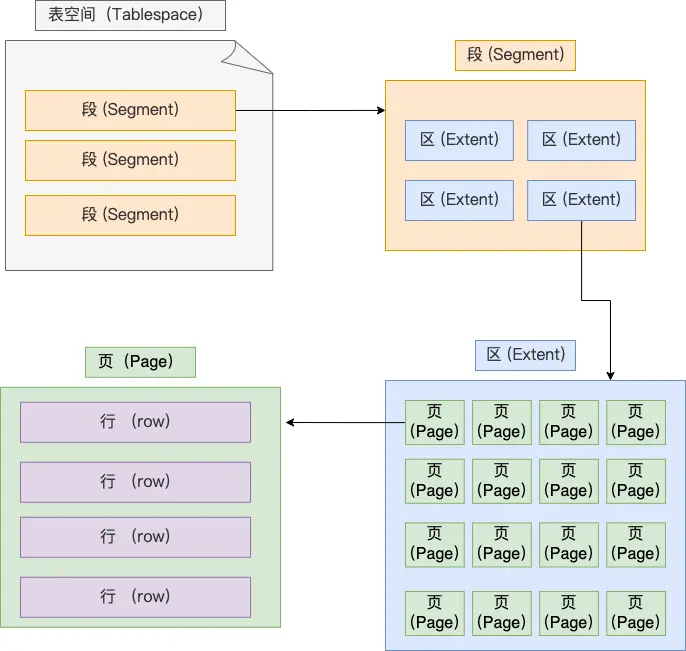

**<font style="color:#DF2A3F;">InnoDB 的数据是按「页」为单位来读写的，默认每个页的大小为 16KB</font>**

**B+ 树中每一层都是通过双向链表连接起来的，以页为单位来分配存储空间，链表中相邻的两个页之间的物理位置并不是连续的，那么磁盘查询时就会有大量的随机I/O， 是非常慢的。**

**在表中数据量大的时候，为某个索引分配空间的时候就不再按照页为单位分配了，而是按照**\*\*<font style="color:#DF2A3F;">区（extent）</font>\*\***为单位分配。每个区的大小为 1MB，对于 16KB 的页来说，连续的 64 个页会被划为一个区，这样就使得链表中相邻的页的物理位置也相邻，就能使用顺序 I/O 了**。

### InnoDB行结构

[MySQL 一行记录是怎么存储的？](https://xiaolincoding.com/mysql/base/row_format.html#mysql-%E7%9A%84%E6%95%B0%E6%8D%AE%E5%AD%98%E6%94%BE%E5%9C%A8%E5%93%AA%E4%B8%AA%E6%96%87%E4%BB%B6)

**Redundant、****<font style="color:#DF2A3F;">Compact</font>****、Dynamic和 Compressed 行格式。后三者属于紧凑型行格式。**

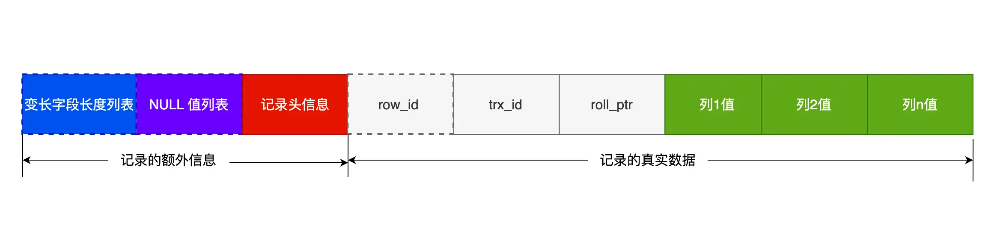

**<font style="color:rgb(44, 62, 80);">记录的额外信息包含 3 个部分：</font>****<font style="color:#DF2A3F;">变长字段长度列表、NULL 值列表、记录头信息</font>****<font style="color:rgb(44, 62, 80);">。</font>**

**变长字段的真实数据占用的字节数会按照列的顺序逆序存放**，**NULL 是不会存放在行格式中记录的真实数据部分里的，而是在NULL值列表内会有二进制对应每个列，当列值为null则置为1，null值列表也是逆序存放的。**

***

#### 1.为什么「变长字段长度列表」的信息要按照逆序存放？

**「记录头信息」中指向下一个记录的指针指向的是「记录头信息」和「真实数据」之间的位置，这样的好处是向左读就是记录头信息，向右读就是真实数据**。**使得位置靠前的记录的**\*\*<font style="color:#DF2A3F;">真实数据和数据对应的字段长度信息</font>****可以同时****<font style="color:#DF2A3F;">在一个 CPU Cache Line 中</font>****，这样就可以****<font style="color:#DF2A3F;">提高 CPU Cache 的命中率</font>\*\*。**同样的道理， NULL 值列表的信息也需要逆序存放。\*\*\*\*<font style="color:rgb(48, 79, 254);">当数据表没有变长字段的时候，比如全部都是 int 类型的字段，这时候表里的行格式就不会有「变长字段长度列表」了</font>**<font style="color:rgb(44, 62, 80);">，</font>

#### 2.行中NULL值的存储

**每个列对应一个二进制位（bit），二进制位按照列的顺序逆序排列，值为1表示该列的值为NULL**

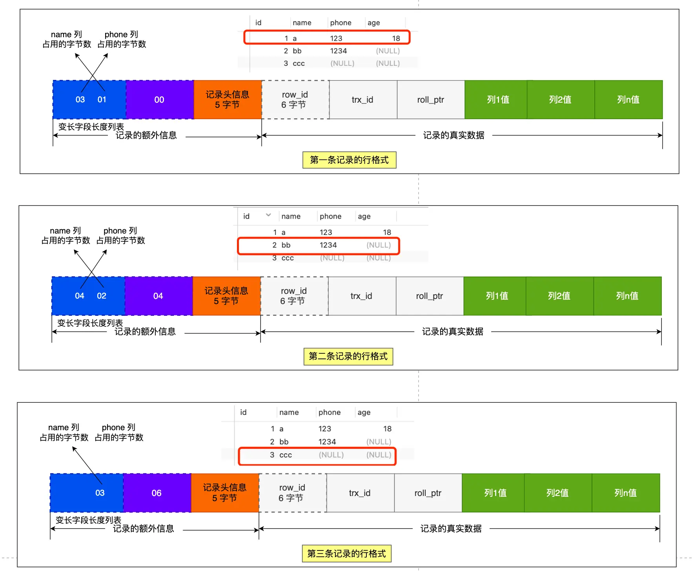

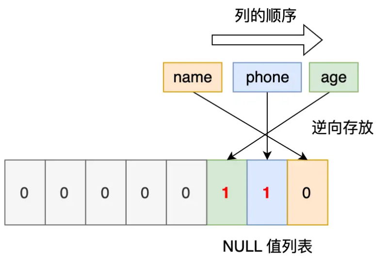

**<font style="color:rgb(48, 79, 254);">当数据表的字段都定义成 NOT NULL 的时候，这时候表里的行格式就不会有 NULL 值列表了</font>**<font style="color:rgb(44, 62, 80);">。</font>

#### 3.记录真实数据

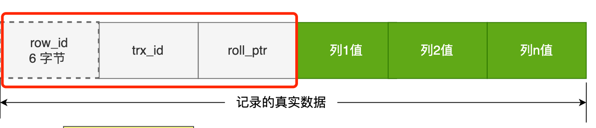

记录真实数据部分除了定义的字段，还有三个隐藏字段，分别为：**<font style="color:#DF2A3F;">row\_id、trx\_id、roll\_pointe</font>**

* <font style="color:rgb(44, 62, 80);">row\_id</font>

<font style="color:rgb(44, 62, 80);">如果建表指定了主键或者唯一约束列，那么就没有 row\_id 隐藏字段了。如果既没有指定主键，又没有唯一约束，那么 InnoDB 就会为记录添加 row\_id 隐藏字段。row\_id不是必需的，占用 6 个字节。</font>

* trx\_id

事务id，表示这个数据是由哪个事务生成的。 trx\_id是必需的，占用 6 个字节。

* roll\_pointer

这条记录上一个版本的指针。roll\_pointer 是必需的，占用 7 个字节。trx\_id和roll\_pointer是实现MVCC用的。

#### 4.varchar（n）中n最大是多少

**<font style="color:rgb(48, 79, 254);">MySQL 规定除了 TEXT、BLOBs 这种大对象类型之外，其他所有的列（不包括隐藏列和记录头信息）占用的字节长度加起来不能超过 65535 个字节</font>**<font style="color:rgb(44, 62, 80);">。</font>

**包含「变长字段长度列表」和 「NULL 值列表」所占用的字节数。所有字段的长度 + 变长字段字节数列表所占用的字节数 + NULL值列表所占用的字节数 <= 65535**。

#### 5.行溢出后，MySQL 是怎么处理的？

一个页的大小一般是 `16KB`，而一个 varchar(n) 类型的列最多可以存储 `65532字节（2B变长字段、1Bnull值）`，一些大对象如 TEXT、BLOB 可能存储更多的数据，这时一个页可能就存不了一条记录。这个时候就会**发生行溢出，多的数据就会存到另外的「溢出页」中**。

# MySQL 基础流程和架构

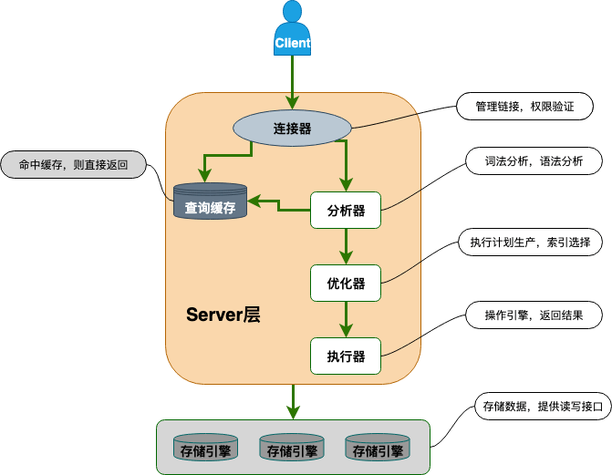

MySQL 主要由下面几部分构成：

* **连接器：**  身份认证和权限相关(登录 MySQL 的时候)。
* **查询缓存：**  执行查询语句的时候，会先查询缓存（**MySQL 8.0 版本后移除**）。
* **分析器：**  没有命中缓存的话，SQL 语句就会经过分析器，分析sql并校验sql
* **优化器：**  按照 MySQL 认为最优的方案去执行。
* **执行器：**  执行语句，然后从存储引擎返回数据。 执行语句之前会先判断是否有权限，如果没有权限的话，就会报错。
* **插件式存储引擎**：主要负责数据的存储和读取，采用的是插件式架构，支持 InnoDB、MyISAM、Memory 等多种存储引擎。

## 主从复制

<font style="color:rgb(44, 62, 80);">MySQL 的主从复制依赖于 binlog ，也就是记录 MySQL 上的所有变化并以二进制形式保存在磁盘上。复制的过程就是将 binlog 中的数据从主库传输到从库上。</font>

<font style="color:rgb(44, 62, 80);">这个过程一般是</font>**<font style="color:rgb(48, 79, 254);">异步</font>**<font style="color:rgb(44, 62, 80);">的，也就是主库上执行事务操作的线程不会等待复制 binlog 的线程同步完成。</font>

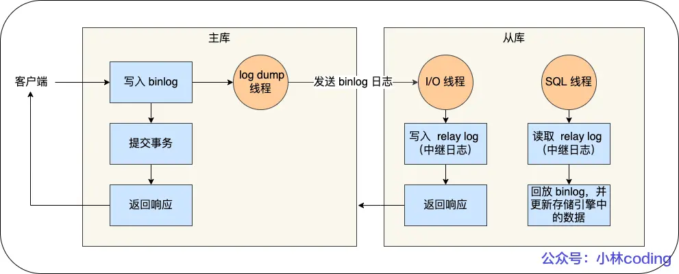

<font style="color:rgb(44, 62, 80);">MySQL 集群的主从复制过程梳理成 3 个阶段：</font>

* **<font style="color:rgb(48, 79, 254);">写入 Binlog</font>**<font style="color:rgb(44, 62, 80);">：主库写 binlog 日志，提交事务，并更新本地存储数据。</font>
* **<font style="color:rgb(48, 79, 254);">同步 Binlog</font>**<font style="color:rgb(44, 62, 80);">：把 binlog 复制到所有从库上，每个从库把 binlog 写到暂存日志中。</font>
* **<font style="color:rgb(48, 79, 254);">回放 Binlog</font>**<font style="color:rgb(44, 62, 80);">：回放 binlog，并更新存储引擎中的数据。</font>

<font style="color:rgb(44, 62, 80);">具体详细过程如下：</font>

* <font style="color:rgb(44, 62, 80);">MySQL 主库在收到客户端提交事务的请求之后，会先写入 binlog，再提交事务(</font>**<font style="color:#DF2A3F;">两阶段提交</font>**<font style="color:rgb(44, 62, 80);">)，更新存储引擎中的数据，事务提交完成后，返回给客户端“操作成功”的响应。</font>
* <font style="color:rgb(44, 62, 80);">从库会创建一个专门的 I/O 线程，连接主库的 log dump 线程，来接收主库的 binlog 日志，再把 binlog 信息写入 relay log 的中继日志里，再返回给主库“复制成功”的响应。</font>
* <font style="color:rgb(44, 62, 80);">从库会创建一个用于回放 binlog 的线程，去读 relay log 中继日志，然后回放 binlog 更新存储引擎中的数据，最终实现主从的数据一致性。</font>

<font style="color:rgb(44, 62, 80);">在完成主从复制之后，就可以在写数据时只写主库，在读数据时只读从库，这样即使写请求会锁表或者锁记录，也不会影响读请求的执行。</font>

# MySQL 存储引擎

## MySQL 支持哪些存储引擎？默认使用哪个？

MySQL 支持多种存储引擎，可以通过 <code>**SHOW ENGINES**</code> 命令来查看 MySQL 支持的所有存储引擎。

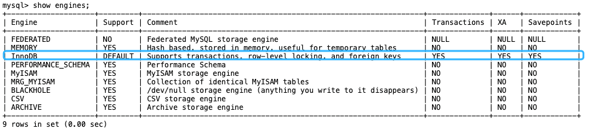

MySQL 当前**默认的存储引擎是 InnoDB**。并且，所有的存储引擎中**只有 InnoDB 是事务性存储引擎**。

## MySQL 存储引擎架构了解吗？

MySQL 存储引擎采用的是 **<font style="color:#DF2A3F;background-color:#FBDE28;">插件式架构</font>** ，支持多种存储引擎，甚至可以为不同的数据库表设置不同的存储引擎以适应不同场景的需要。**<font style="color:#DF2A3F;background-color:#FBDE28;">存储引擎是基于表的，而不是数据库</font>**<font style="background-color:#FBDE28;"> </font>\*\*。\*\*MySQL 官方文档也有介绍到如何编写一个自定义存储引擎

## MyISAM 和 InnoDB 有什么区别？ ♥♥♥♥

:::success
**<font style="color:#DF2A3F;background-color:#FBDE28;">锁粒度，事务支持，外键支持，崩溃恢复，MVCC，聚簇索引，count()效率</font>**

:::

* MyISAM 只有**表级锁**(table-level locking)， 一锁就是锁住了整张表，而 InnoDB 支持**行级锁(row-level locking)和表级锁**,默认为行级锁。
* MyISAM **不提供事务支持**。InnoDB **提供事务支持**，实现了 SQL 标准定义了四个隔离级别，具有提交(commit)和回滚(rollback)事务的能力。并且，InnoDB 默认使用的 **REPEATABLE-READ**（可重读）隔离级别是可以解决幻读问题发生。 **（基于 MVCC 和 Next-Key Lock）**
* MyISAM 不支持**外键**，而 InnoDB 支持
* MyISAM 不支持**数据库异常崩溃后的安全恢复**，而 InnoDB 支持，依赖于**redo log和doubleWrite buffer**。
* MyISAM 不支持**MVCC**，而 InnoDB 支持。
* **MyISAM 引擎和 InnoDB 引擎都是使用 B+Tree 作为索引结构，但是两者的实现方式不太一样。\*\*\*\*<font style="color:#DF2A3F;">InnoDB 引擎采用的是聚簇索引； MyISAM引擎采用的是非聚簇索引。</font>**

# MySQL 事务

## 什么是事务

**<font style="color:#DF2A3F;">事务是逻辑上的一组操作，要么都执行，要么都不执行</font>**

数据库事务可以保证多个对数据库的操作（也就是 SQL 语句）构成一个逻辑上的整体。构成这个逻辑上的整体的这些数据库操作遵循：**要么全部执行成功,要么全部不执行** 。

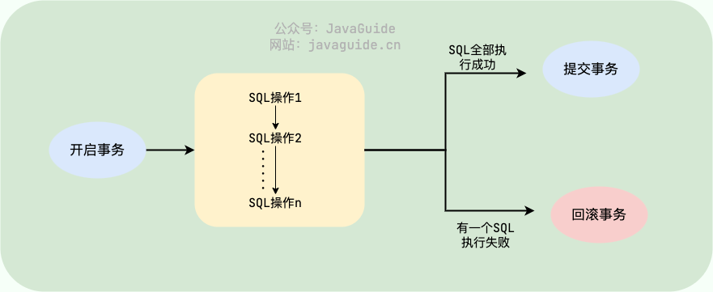

关系型数据库（例如：`MySQL`、`SQL Server`、`Oracle` 等）事务都有 **ACID** 特性：

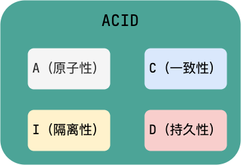

1. **原子性**（`Atomicity`）：事务是最小的执行单位，不允许分割。事务的原子性确保动作要么全部完成，要么完全不起作用；**通过**\*\*<font style="color:#DF2A3F;">undo log</font>\*\*\*\*（回滚日志）实现\*\*
2. **一致性**（`Consistency`）：执行事务前后，数据保持一致。**最终目的AID -> C**
3. **隔离性**（`Isolation`）：并发访问数据库时，一个用户的事务不被其他事务所干扰，各并发事务之间数据库是独立的； **（****<font style="color:#DF2A3F;">写-写操作通过锁来实现，读-写操作通过MVCC来实现</font>****）**
4. **持久性**（`Durability`）：一个事务被提交之后。它对数据库中数据的改变是持久的，即使数据库发生故障也不应该对其有任何影响。**通过**\*\*<font style="color:#DF2A3F;">redo log</font>\*\*\*\*（重做日志） + DubbleWrite Buffer（双写缓冲区）\*\*

**只有保证了事务的持久性、原子性、隔离性之后，一致性才能得到保障。也就是说 ****<font style="color:#DF2A3F;">A、I、D 是手段，C 是目的</font>****！**

## 并发事务带来了哪些问题?

### 脏读（Dirty read）

**<font style="color:rgb(48, 79, 254);">如果一个事务「读到」了另一个「未提交事务修改过的数据」，就意味着发生了「脏读」现象。</font>**

一个事务读取数据并且对数据进行了修改，这个修改对其他事务来说是可见的，即使当前事务没有提交。另外一个事务读取了这个还未提交的数据，但**第一个事务突然回滚，导致数据并没有被提交到数据库，那第二个事务读取到的就是脏数据**，这也就是脏读的由来。

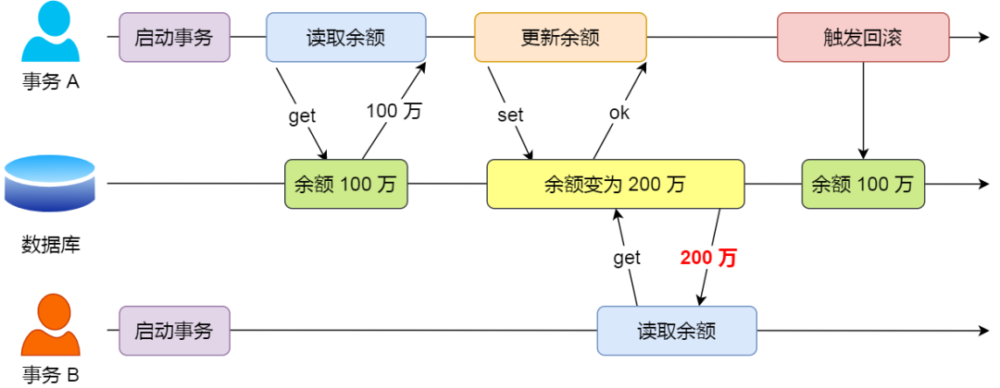

### 不可重复读（Unrepeatable read）

**<font style="color:rgb(48, 79, 254);">在一个事务内多次读取同一个数据，如果出现前后两次读到的数据不一样的情况，就意味着发生了「不可重复读」现象。</font>**

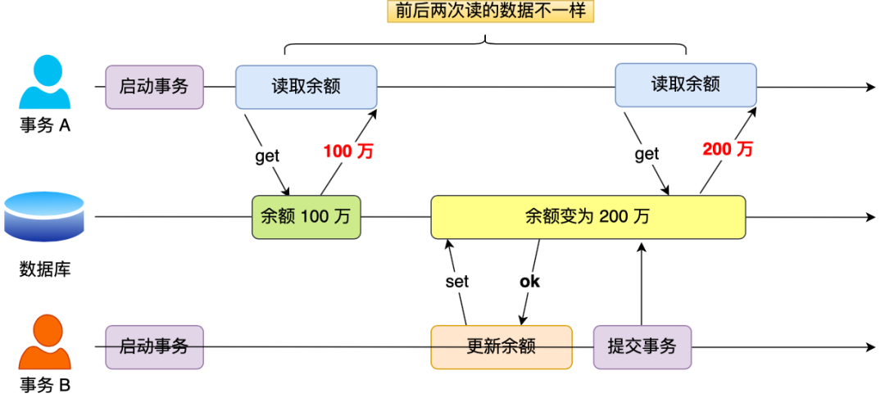

### 幻读（Phantom read）

**<font style="color:rgb(48, 79, 254);">在一个事务内多次查询某个符合查询条件的「记录数量」，如果出现前后两次查询到的记录数量不一样的情况，就意味着发生了「幻读」现象。</font>**

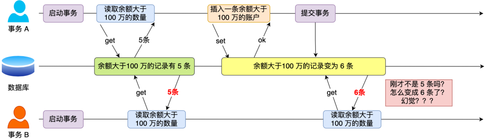

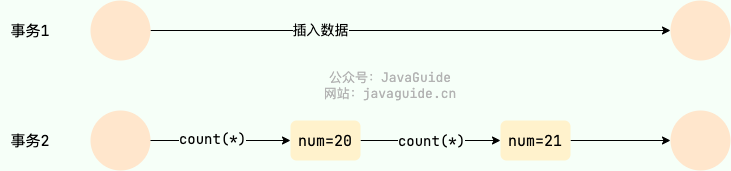

### 不可重复读和幻读有什么区别？

* **不可重复读的重点是内容修改或者记录减少比如多次读取一条记录发现其中某些记录的值被修改；**
* **幻读的重点在于记录新增比如多次执行同一条查询语句（DQL）时，发现查到的记录增加了。**

**幻读其实可以看作是不可重复读的一种特殊情况，单独把区分幻读的原因主要是解决幻读和不可重复读的方案不一样。**

## 并发事务的控制方式有哪些？

**<font style="color:#DF2A3F;">锁 和 MVCC</font>**。**锁可以看作是悲观控制的模式**，**多版本并发控制**（MVCC，Multiversion concurrency control）可**以看作是乐观控制的模式。**

**锁** 控制方式下会通过锁来显示\_**控制共享资源**\_而不是通过调度手段，MySQL 中主要是通过 **读写锁** 来实现并发控制。

* **共享锁（S 锁）** ：又称读锁，事务在读取记录的时候获取共享锁，允许多个事务同时获取（锁兼容）。
* **排他锁（X 锁）** ：又称写锁/独占锁，事务在修改记录的时候获取排他锁，不允许多个事务同时获取。如果一个记录已经被加了排他锁，那其他事务不能再对这条记录加任何类型的锁（锁不兼容）。

> 读锁可以多个获取，写锁只能独占。**读写锁可以做到读读并行，但是无法做到写读、写写并行**。

根据根据锁粒度的不同，又被分为 **表级锁(table-level locking)**  和 **行级锁(row-level locking)**

InnoDB 不光支持表级锁，还支持行级锁，默认为行级锁。行级锁的粒度更小，仅对相关的记录上锁即可（对一行或者多行记录加锁），所以对于并发写入操作来说， InnoDB 的性能更高。**不论是表级锁还是行级锁，都存在共享锁（Share Lock，S 锁）和排他锁（Exclusive Lock，X 锁）这两类。**

**MVCC** 是多版本并发控制方法，即对一份数据会存储多个版本，通过事务的可见性来保证事务能看到自己应该看到的版本。通常会有一个全局的版本分配器来为每一行数据设置**版本号**，版本号是唯一的。

> MVCC就类似于乐观锁了，有自己的版本。

## SQL 标准定义了哪些事务隔离级别?

SQL 标准定义了四个隔离级别：

* **READ-UNCOMMITTED(读取未提交)**  ：最低的隔离级别，允许读取尚未提交的数据变更，可能会导致脏读、幻读或不可重复读。
* **READ-COMMITTED(读取已提交)**  ：允许读取并发事务已经提交的数据，可以阻止脏读，但是幻读或不可重复读仍有可能发生。
* **REPEATABLE-READ(可重复读)**  ：对同一字段的多次读取结果都是一致的，除非数据是被本身事务自己所修改，可以阻止脏读和不可重复读，但幻读仍有可能发生。
* **SERIALIZABLE(可串行化)**  ：最高的隔离级别，完全服从 ACID 的隔离级别。所有的事务依次逐个执行，这样事务之间就完全不可能产生干扰，也就是说，该级别可以防止脏读、不可重复读以及幻读。

| 隔离级别 | 脏读 | 不可重复读 | 幻读 |
| --- | --- | --- | --- |
| READ-UNCOMMITTED | √ | √ | √ |
| READ-COMMITTED | × | √ | √ |
| REPEATABLE-READ | × | × | √ |
| SERIALIZABLE | × | × | × |

## MySQL 的隔离级别是基于锁实现的吗？

MySQL 的隔离级别基于\*\*<font style="color:#DF2A3F;">锁和 MVCC </font>\*\*（Multiversion concurrency control）机制共同实现的。

* SERIALIZABLE 隔离级别是通过锁来实现的，**<font style="color:#DF2A3F;">READ-COMMITTED 和 REPEATABLE-READ 隔离级别是基于 MVCC 实现的</font>**(**<font style="color:#DF2A3F;">前者每次查询都创建一次ReadView，后者多次查询只创建一次ReadView</font>**)。
* 不过， SERIALIZABLE 之外的其他隔离级别可能也需要用到锁机制，就比如 **REPEATABLE-READ 在当前读情况下需要使用加锁读来保证不会出现幻读**

## MySQL 的默认隔离级别是什么?

MySQL InnoDB 存储引擎的默认支持的隔离级别是 **REPEATABLE-READ（可重读）** 。

# MySQL 锁

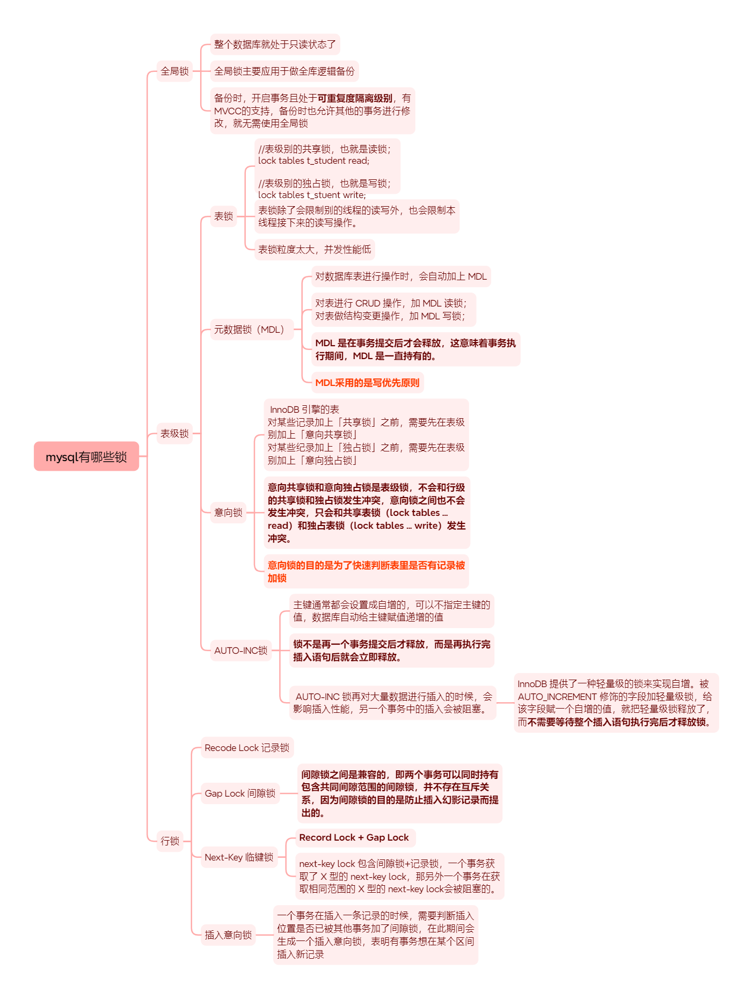

> **间隙锁是锁住区间的，多个事务可以对同一个间隙加锁，目的就是防止其他的事务插入  ，目的是一样的，防止插入，所以是可以共存的  但是如果a加了gap ，b也加了gap   那么a要插入的时候，因为b加了gap，a就会全加入一个插入意向锁，表明要插入，此时a阻塞等待b释放gap，同理b申请插入也会因为a有gap阻塞，产生死锁**

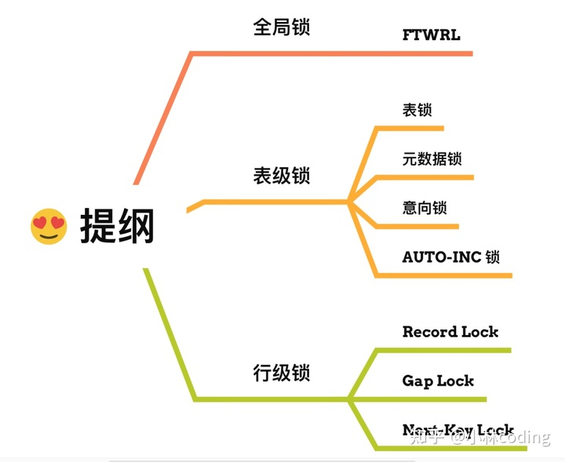

## 表级锁和行级锁了解吗？有什么区别？

**表级锁和行级锁对比**：

* **表级锁：**  锁定粒度最大的一种锁（全局锁除外），**针对非索引字段加的锁**，对当前**操作的整张表加锁**，实现简单，资源消耗也比较少，加锁快，不会出现死锁。不过，触发锁冲突的概率最高，高并发下效率极低。表级锁和存储引擎无关，MyISAM 和 InnoDB 引擎都支持表级锁。
* **行级锁：** 锁定粒度最小的一种锁，**针对索引字段加的锁** ，只针对**当前操作的行记录加锁**。 行级锁能大大减少数据库操作的冲突。其加锁粒度最小，并发度高，但开销也最大，加锁慢，会出现死锁。行级锁和存储引擎有关，是在存储引擎层面实现的。

## **获得行锁之后什么情况会变成表锁**

**InnoDB 的行锁是针对索引字段加的锁，表级锁是针对非索引字段加的锁。****<font style="color:#DF2A3F;">索引不能失效</font>****，否则都会从行锁升级为表锁。如果一条SQL语句用不到索引是不会使用行级锁的，会使用表级锁。** 当批量修改数据的时候，行锁会升级为表锁。

## MySQL有那些表级锁

<font style="color:rgb(44, 62, 80);">MySQL 里面表级别的锁有这几种：</font>

* <font style="color:rgb(44, 62, 80);">表锁：通过lock tables 语句可以对表加表锁，表锁除了会限制别的线程的读写外，也会限制本线程接下来的读写操作。</font>
* <font style="color:rgb(44, 62, 80);">元数据锁（MDL）;</font>
  * <font style="color:rgb(44, 62, 80);">对一张表进行 CRUD 操作时，加的是</font><font style="color:rgb(44, 62, 80);"> </font>**<font style="color:rgb(48, 79, 254);">MDL 读锁</font>**<font style="color:rgb(44, 62, 80);">；</font>
  * <font style="color:rgb(44, 62, 80);">对一张表做结构变更操作的时候，加的是 </font>**<font style="color:rgb(48, 79, 254);">MDL 写锁</font>**<font style="color:rgb(44, 62, 80);">；</font>
  * <font style="color:rgb(44, 62, 80);">MDL 是在事务提交后才会释放，这意味着</font>**<font style="color:rgb(48, 79, 254);">事务执行期间，MDL 是一直持有的</font>**<font style="color:rgb(44, 62, 80);">。</font>
* <font style="color:rgb(44, 62, 80);">意向锁；</font>
  * <font style="color:rgb(44, 62, 80);">当执行</font>**<font style="color:#DF2A3F;">插入、更新、删除</font>**<font style="color:rgb(44, 62, 80);">操作，需要先对表加上「意向独占锁」，然后对该记录加独占锁。</font>
  * **<font style="color:rgb(48, 79, 254);">意向共享锁和意向独占锁是表级锁，不会和行级的共享锁和独占锁发生冲突，而且意向锁之间也不会发生冲突，只会和共享表锁和独占表锁发生冲突。</font>**
  * <font style="color:rgb(44, 62, 80);">如果没有「意向锁」，那么加「独占表锁」时，就需要遍历表里所有记录，查看是否有记录存在独占锁（行锁），这样效率会很慢。</font>**<font style="color:rgb(48, 79, 254);">意向锁的目的是为了快速判断表里是否有记录被加锁</font>**<font style="color:rgb(44, 62, 80);">。</font>
* <font style="color:rgb(44, 62, 80);">AUTO-INC 锁：表里的主键通常都会设置成自增的，这是通过对主键字段声明 </font><code><font style="color:rgb(71, 101, 130);">AUTO_INCREMENT</font></code><font style="color:rgb(44, 62, 80);"> 属性实现的。AUTO-INC 锁是特殊的表锁机制，锁</font>**<font style="color:rgb(48, 79, 254);">不是再一个事务提交后才释放，而是再执行完插入语句后就会立即释放</font>**<font style="color:rgb(44, 62, 80);">。	</font>

## InnoDB 有哪几类行锁？

* **记录锁（Record Lock）** ：也被称为记录锁，属于单个行记录上的锁。
* **间隙锁（Gap Lock）** ：锁定一个范围，不包括记录本身。
* **临键锁（Next-Key Lock）** ：Record Lock+Gap Lock，锁定一个范围，包含记录本身，主要目的是**为了解决幻读问题**（MySQL 事务部分提到过）。记录锁只能锁住已经存在的记录，为了避免插入新记录，需要依赖间隙锁。 -\*\* \*\***<font style="color:#DF2A3F;">左开右闭(left, right]</font>**
* **插入意向锁：**<font style="color:rgb(44, 62, 80);">一个事务在</font>**<font style="color:#DF2A3F;">插入</font>**<font style="color:rgb(44, 62, 80);">一条记录的时候，需要判断插入位置是否已被其他事务加了间隙锁。如果有，插入操作就会发生</font>**<font style="color:rgb(48, 79, 254);">阻塞</font>**<font style="color:rgb(44, 62, 80);">，直到拥有间隙锁的那个事务提交为止（释放间隙锁的时刻），在此期间会生成一个</font>**<font style="color:rgb(48, 79, 254);">插入意向锁</font>**<font style="color:rgb(44, 62, 80);">，表明有事务想在某个区间插入新记录，但是现在处于等待状态。插入意向锁名字虽然有意向锁，但是它并</font>**<font style="color:rgb(48, 79, 254);">不是意向锁，它是一种特殊的间隙锁，属于行级别锁</font>**<font style="color:rgb(44, 62, 80);">。</font>

## 共享锁和排他锁呢？

不论是表级锁还是行级锁，都存在共享锁（Share Lock，S 锁）和排他锁（Exclusive Lock，X 锁）

* **共享锁（S 锁）** ：又称读锁，事务在读取记录的时候获取共享锁，允许多个事务同时获取（锁兼容）。
* **排他锁（X 锁）** ：又称写锁/独占锁，事务在修改记录的时候获取排他锁，不允许多个事务同时获取。如果一个记录已经被加了排他锁，那其他事务不能再对这条事务加任何类型的锁（锁不兼容）。

## 意向锁有什么作用？

如果需要用到表锁的话需要\*\*<font style="color:#DF2A3F;">判断表中的记录没有行锁</font>\*\*。

意向锁是表级锁，共有两种：

* **意向共享锁（Intention Shared Lock，IS 锁）** ：事务有意向对表中的某些记录加共享锁（S 锁），加共享锁前必须先取得该表的 IS 锁。
* **意向排他锁（Intention Exclusive Lock，IX 锁）** ：事务有意向对表中的某些记录加排他锁（X 锁），加排他锁之前必须先取得该表的 IX 锁。

**意向锁是由数据引擎自己维护的，用户无法手动操作意向锁，在为数据行加共享/排他锁之前，InooDB 会先获取该数据行所在在数据表的对应意向锁。**

意向锁之间是互相兼容的。

| | IS 锁 | IX 锁 |
| --- | --- | --- |
| IS 锁 | 兼容 | 兼容 |
| IX 锁 | 兼容 | 兼容 |

意向锁和共享锁和排它锁互斥（这里指的是表级别的共享锁和排他锁，意向锁不会与行级的共享锁和排他锁互斥）。

## Mysql什么时候会加行锁

**<font style="color:rgb(77, 77, 77);">保证事务隔离性的机制，除了加锁以外，还有MVCC。在一个事务中，当查询语句显式的加锁，也就是“select … lock in share mode”或者“select … for update”，以及增删改操作，都会加锁；而普通的“select …”读操作，则通过MVCC来保证基本的隔离性。</font>**

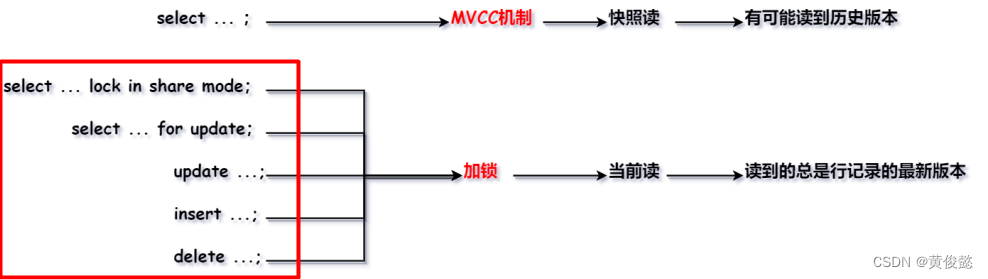

* **普通读不会加行锁，会加表锁 - MDL元数据读锁。**
* **加的行锁各不相同，比如当前读、更新、删除加的是**\*\*<font style="color:#DF2A3F;">Next-Key Lock</font>****，当然也有可能退化为记录锁和间隙锁。****<font style="color:#DF2A3F;">insert是插入意向锁</font>\*\*\*\*，会和临建锁冲突。\*\*

## MySQL锁是怎么加的

[MySQL知识点总结（五）——锁\_mysql什么时候加锁-CSDN博客](https://blog.csdn.net/weixin_43889578/article/details/135305759)

**<font style="color:rgb(48, 79, 254);">加锁的对象是索引，加锁的基本单位是 next-key lock</font>**<font style="color:rgb(44, 62, 80);">，</font>**<font style="color:rgb(44, 62, 80);">它是由记录锁和间隙锁组合而成的</font>**<font style="color:rgb(44, 62, 80);">，</font>**<font style="color:rgb(48, 79, 254);">next-key lock 是</font>****<font style="color:#DF2A3F;">前开后闭区间</font>****<font style="color:rgb(48, 79, 254);">，而间隙锁是前开后开区间</font>**<font style="color:rgb(44, 62, 80);">。</font>**<font style="color:rgb(48, 79, 254);">在能使用记录锁或者间隙锁就能避免幻读现象的场景下， next-key lock 就会退化成记录锁或间隙锁</font>**<font style="color:rgb(44, 62, 80);">。</font>

### <font style="color:rgb(44, 62, 80);">唯一索引等值查询</font>

<font style="color:rgb(44, 62, 80);">用唯一索引进行等值查询的时候，查询的记录存不存在，加锁的规则也会不同：</font>

* <font style="color:rgb(44, 62, 80);">当查询的记录是「存在」的，在索引树上定位到这一条记录后，将该记录的索引中的 next-key lock 会</font>**<font style="color:rgb(48, 79, 254);">退化成「记录锁」</font>**<font style="color:rgb(44, 62, 80);">。</font>
* <font style="color:rgb(44, 62, 80);">当查询的记录是「不存在」的，在索引树找到第一条大于该查询记录的记录后，将该记录的索引中的 next-key lock 会</font>**<font style="color:rgb(48, 79, 254);">退化成「间隙锁」</font>**<font style="color:rgb(44, 62, 80);">。</font>

**<font style="color:rgb(44, 62, 80);">当记录存在时：</font>**

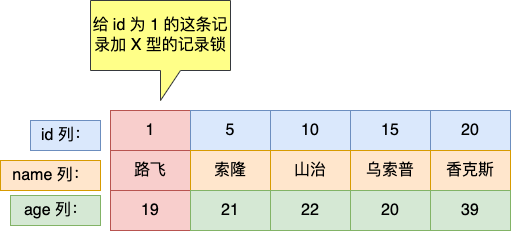

<font style="color:rgb(44, 62, 80);">接下来，如果有其他事务，对 id 为 1 的记录进行更新或者删除操作的话，这些操作都会被阻塞，因为更新或者删除操作也会对记录加 X 型的记录锁，而 X 锁和 X 锁之间是互斥关系。</font>

<font style="color:rgb(44, 62, 80);">通过 </font><font style="color:rgb(71, 101, 130);">select \* from performance\_schema.data\_locks\G;</font><font style="color:rgb(44, 62, 80);"> 这条语句，查看事务执行 SQL 过程中加了什么锁。</font>

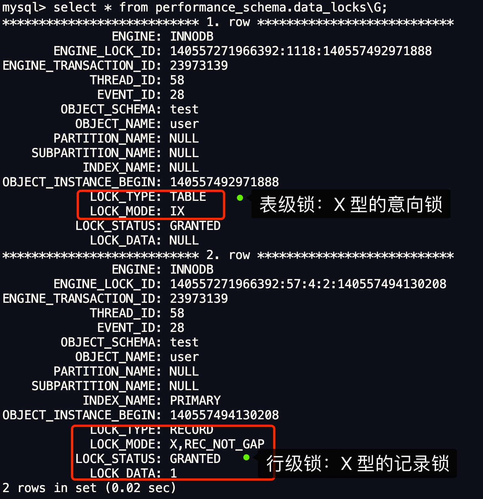

<font style="color:rgb(44, 62, 80);">上述操作会加一下两把</font><font style="color:rgb(44, 62, 80);">🔒</font>

* <font style="color:rgb(44, 62, 80);">表锁：X 类型的意向锁；</font>
* <font style="color:rgb(44, 62, 80);">行锁：X 类型的记录锁；</font>

<font style="color:rgb(44, 62, 80);">通过 LOCK\_MODE 可以确认是 next-key 锁，还是间隙锁，还是记录锁：</font>

* <font style="color:rgb(44, 62, 80);">如果 LOCK\_MODE 为</font><font style="color:rgb(44, 62, 80);"> </font><font style="color:rgb(71, 101, 130);">X</font><font style="color:rgb(44, 62, 80);">，说明是 next-key 锁；</font>
* <font style="color:rgb(44, 62, 80);">如果 LOCK\_MODE 为</font><font style="color:rgb(44, 62, 80);"> </font><font style="color:rgb(71, 101, 130);">X, REC\_NOT\_GAP</font><font style="color:rgb(44, 62, 80);">，说明是记录锁；</font>
* <font style="color:rgb(44, 62, 80);">如果 LOCK\_MODE 为 </font><font style="color:rgb(71, 101, 130);">X, GAP</font><font style="color:rgb(44, 62, 80);">，说明是间隙锁；</font>

<font style="color:rgb(44, 62, 80);">此时事务 A 在 id = 1 记录的主键索引上加的是记录锁，锁住的范围是 id 为 1 的这条记录。</font>**<font style="color:rgb(48, 79, 254);">加锁的对象是针对索引</font>**<font style="color:rgb(44, 62, 80);">，因为这里查询语句扫描的 B+ 树是聚簇索引树，即主键索引树，所以是对主键索引加锁。将对应记录的主键索引加 记录锁后，就意味着其他事务无法对该记录进行更新和删除操作了。</font>

<font style="color:rgb(44, 62, 80);"></font>

**<font style="color:rgb(44, 62, 80);">当记录不存在时：</font>**

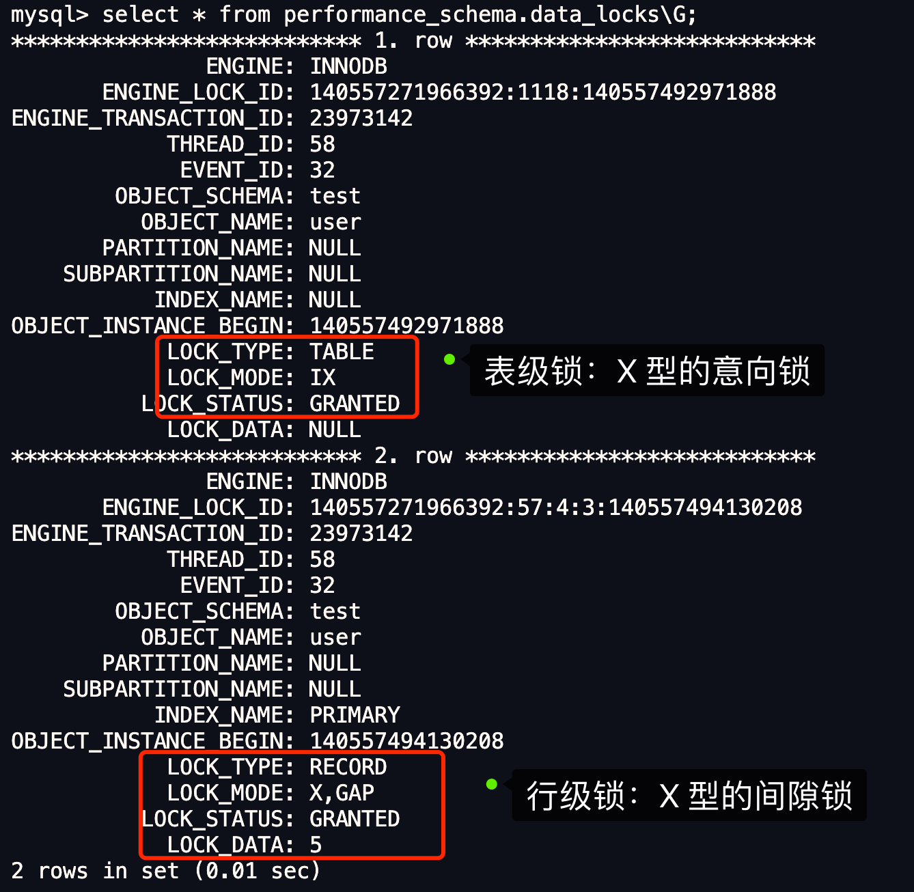

**<font style="color:rgb(48, 79, 254);">查询id为2的数据，此时事务 A 在 id = 5 记录的主键索引上加的是间隙锁，锁住的范围是 (1, 5)。</font>**

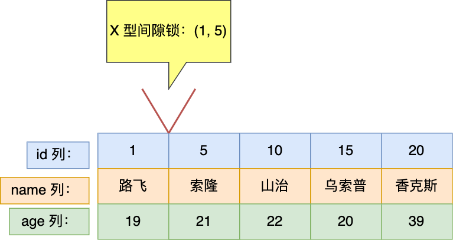

<font style="color:rgb(44, 62, 80);">如果有其他事务插入 id 值为 2、3、4 这一些记录的话，这些插入语句都会发生阻塞。</font>

### <font style="color:rgb(44, 62, 80);">唯一索引范围查询</font>

<font style="color:rgb(44, 62, 80);">当唯一索引进行范围查询时，</font>**<font style="color:rgb(48, 79, 254);">会对每一个扫描到的索引加 next-key 锁，然后如果遇到下面这些情况，会退化成记录锁或者间隙锁</font>**<font style="color:rgb(44, 62, 80);">：</font>

#### <font style="color:rgb(44, 62, 80);">情况1：大于等于范围查询</font>

<font style="color:rgb(44, 62, 80);">针对「大于等于」的范围查询，因为存在等值查询的条件，那么如果等值查询的记录是存在于表中，那么</font>**<font style="color:rgb(44, 62, 80);">该记录的索引中的 next-key 锁会</font>\*\*\*\*<font style="color:rgb(48, 79, 254);">退化成记录锁</font>**<font style="color:rgb(44, 62, 80);">。</font>

```sql
select * from user where id > 15 for update;
```

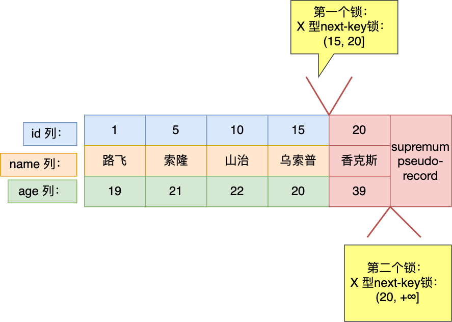

1. <font style="color:rgb(44, 62, 80);">最开始要找的第一行是 id = 20，由于查询该记录不是一个等值查询（不是大于等于条件查询），所以对该主键索引加的是范围为 (15, 20] 的 next-key 锁；</font>
2. <font style="color:rgb(44, 62, 80);">由于是范围查找，就会继续往后找存在的记录，虽然我们看见表中最后一条记录是 id = 20 的记录，但是实际在 Innodb 存储引擎中，会用一个特殊的记录来标识最后一条记录，该特殊的记录的名字叫 supremum pseudo-record ，所以扫描第二行的时候，也就扫描到了这个特殊记录的时候，会对该主键索引加的是范围为 (20, +∞] 的 next-key 锁。</font>

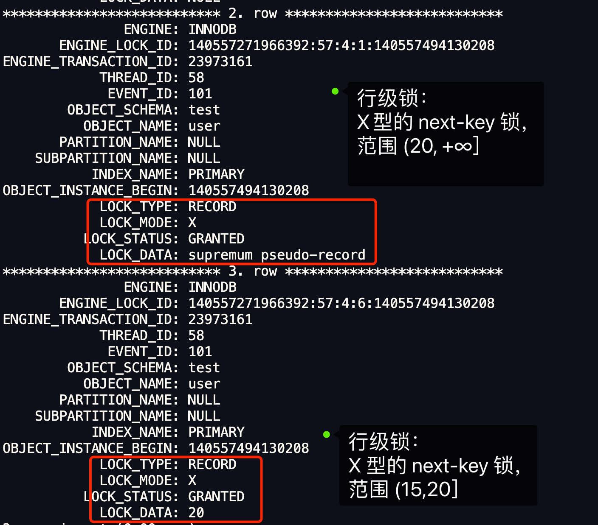

```sql
select * from user where id >= 15 for update;
```

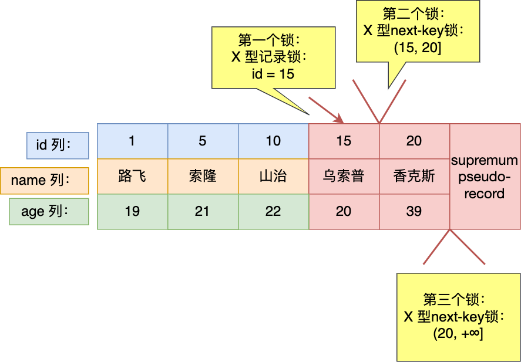

1. <font style="color:rgb(44, 62, 80);">最开始要找的第一行是 id = 15，由于查询该记录是一个等值查询（等于 15），所以该主键索引的 next-key 锁会</font>**<font style="color:rgb(48, 79, 254);">退化成记录锁</font>**<font style="color:rgb(44, 62, 80);">，也就是仅锁住 id = 15 这一行记录。</font>
2. <font style="color:rgb(44, 62, 80);">由于是范围查找，就会继续往后找存在的记录，扫描到的第二行是 id = 20，于是对该主键索引加的是范围为 (15, 20] 的 next-key 锁；</font>
3. <font style="color:rgb(44, 62, 80);">接着扫描到第三行的时候，扫描到了特殊记录（ supremum pseudo-record），于是对该主键索引加的是范围为 (20, +∞] 的 next-key 锁。</font>

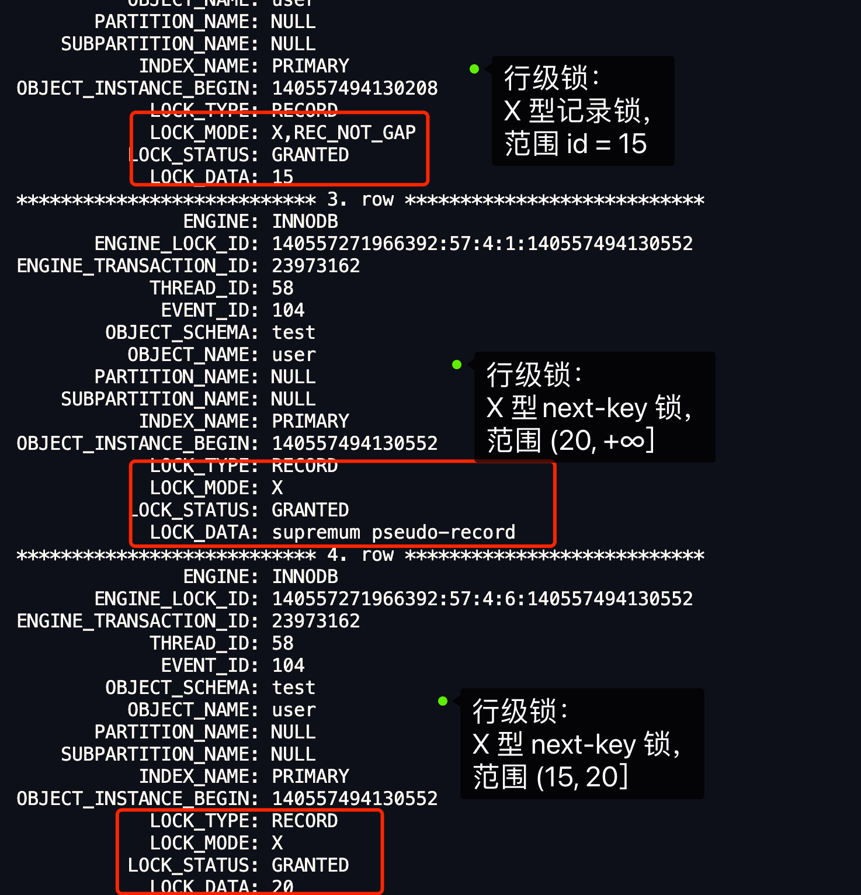

<font style="color:rgb(44, 62, 80);"></font>

#### <font style="color:rgb(44, 62, 80);">情况2：小于或小于等于范围查询</font>

* <font style="color:rgb(44, 62, 80);">当条件值的记录不在表中，那么不管是「小于」还是「小于等于」条件的范围查询，</font>**<font style="color:rgb(48, 79, 254);">扫描到终止范围查询的记录时，该记录的索引的 next-key 锁会退化成间隙锁</font>**<font style="color:rgb(44, 62, 80);">，其他扫描到的记录，都是在这些记录的索引上加 next-key 锁。</font>
* <font style="color:rgb(44, 62, 80);">当条件值的记录在表中，如果是「小于」条件的范围查询，</font>**<font style="color:rgb(48, 79, 254);">扫描到终止范围查询的记录时，该记录的索引的 next-key 锁会退化成间隙锁</font>**<font style="color:rgb(44, 62, 80);">，其他扫描到的记录，都是在这些记录的索引上加 next-key 锁；如果「小于等于」条件的范围查询，扫描到终止范围查询的记录时，该记录的索引 next-key 锁不会退化成间隙锁。其他扫描到的记录，都是在这些记录的索引上加 next-key 锁。</font>

```sql
select * from user where id < 6 for update;
```

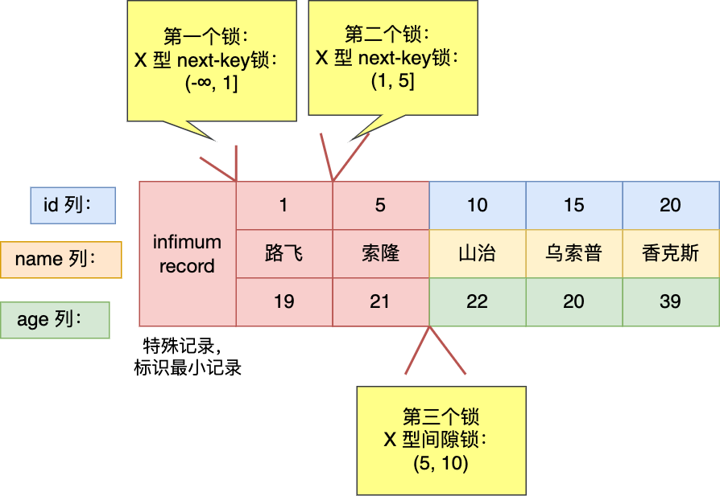

1. <font style="color:rgb(44, 62, 80);">最开始要找的第一行是 id = 1，于是对该主键索引加的是范围为 (-∞, 1] 的 next-key 锁；</font>
2. <font style="color:rgb(44, 62, 80);">由于是范围查找，就会继续往后找存在的记录，扫描到的第二行是 id = 5，所以对该主键索引加的是范围为 (1, 5] 的 next-key 锁；</font>
3. <font style="color:rgb(44, 62, 80);">由于扫描到的第二行记录（id = 5），满足 id < 6 条件，而且也没有达到终止扫描的条件，接着会继续扫描。</font>
4. <font style="color:rgb(44, 62, 80);">扫描到的第三行是 id = 10，该记录不满足 id < 6 条件的记录，所以 id = 10 这一行记录的锁会</font>**<font style="color:rgb(48, 79, 254);">退化成间隙锁</font>**<font style="color:rgb(44, 62, 80);">，于是对该主键索引加的是范围为 (5, 10) 的间隙锁。</font>
5. <font style="color:rgb(44, 62, 80);">由于扫描到的第三行记录（id = 10），不满足 id < 6 条件，达到了终止扫描的条件，于是停止扫描。</font>

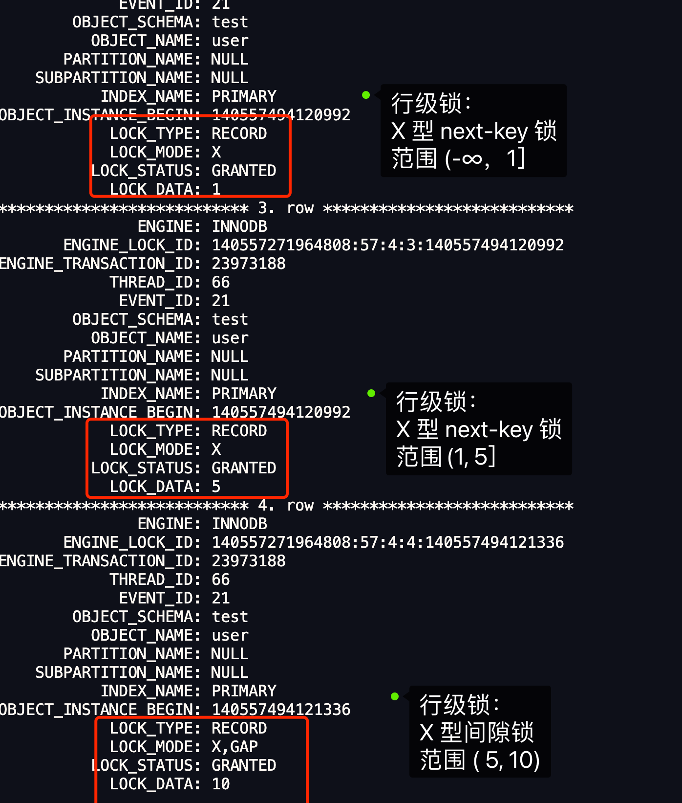

```sql
select * from user where id <= 5 for update;
```

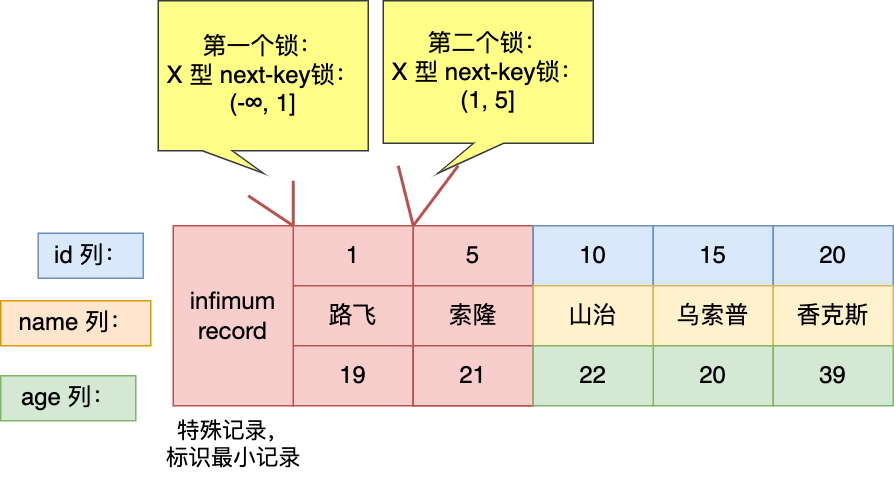

1. <font style="color:rgb(44, 62, 80);">最开始要找的第一行是 id = 1，于是对该记录加的是范围为 (-∞, 1] 的 next-key 锁；</font>
2. <font style="color:rgb(44, 62, 80);">由于是范围查找，就会继续往后找存在的记录，扫描到的第二行是 id = 5，于是对该记录加的是范围为 (1, 5] 的 next-key 锁。</font>
3. <font style="color:rgb(44, 62, 80);">由于主键索引具有唯一性，不会存在两个 id = 5 的记录，所以不会再继续扫描，于是停止扫描。</font>

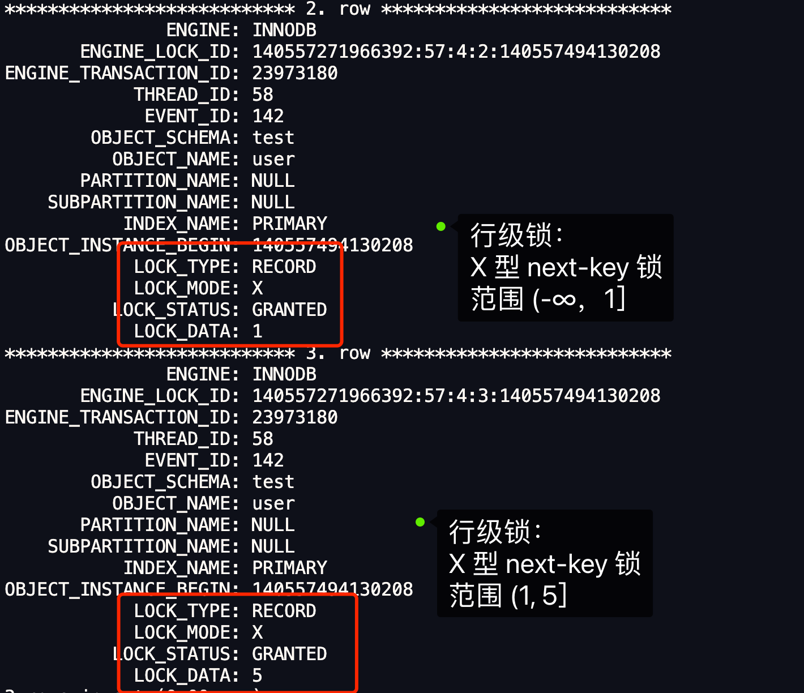

```sql
select * from user where id < 5 for update;
```

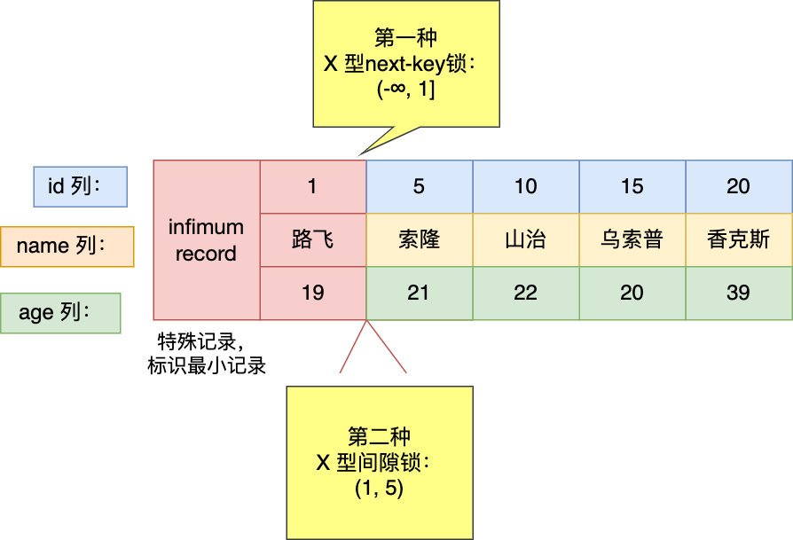

1. <font style="color:rgb(44, 62, 80);">最开始要找的第一行是 id = 1，于是对该记录加的是范围为 (-∞, 1] 的 next-key 锁；</font>
2. <font style="color:rgb(44, 62, 80);">由于是范围查找，就会继续往后找存在的记录，扫描到的第二行是 id = 5，该记录是第一条不满足 id < 5 条件的记录，于是</font>**<font style="color:rgb(48, 79, 254);">该记录的锁会退化为间隙锁，锁范围是 (1,5)</font>**<font style="color:rgb(44, 62, 80);">。</font>
3. <font style="color:rgb(44, 62, 80);">由于找到了第一条不满足 id < 5 条件的记录，于是停止扫描。</font>

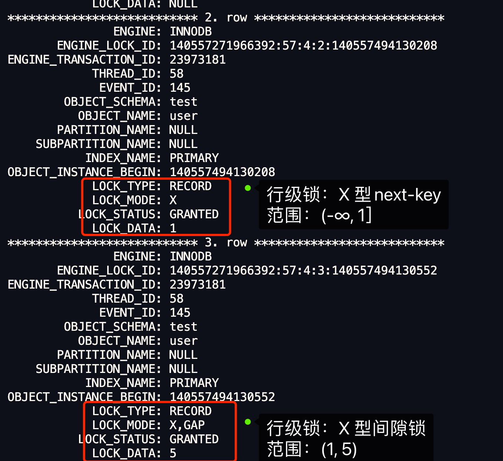

### <font style="color:rgb(44, 62, 80);">非唯一索引等值查询</font>

**<font style="color:rgb(48, 79, 254);">因为存在两个索引，一个是主键索引，一个是非唯一索引（二级索引），所以在加锁时，同时会对这两个索引都加锁，但是对主键索引加锁的时候，只有满足查询条件的记录才会对它们的主键索引加锁</font>**<font style="color:rgb(44, 62, 80);">。</font>

<font style="color:rgb(44, 62, 80);">针对非唯一索引等值查询时，查询的记录存不存在，加锁的规则也会不同： </font>

* <font style="color:rgb(44, 62, 80);">当查询的记录「存在」时，由于不是唯一索引，所以肯定存在索引值相同的记录，于是</font>**<font style="color:rgb(48, 79, 254);">非唯一索引等值查询的过程是一个扫描的过程，直到扫描到第一个不符合条件的二级索引记录就停止扫描，然后在扫描的过程中，对扫描到的二级索引记录加的是 next-key 锁，而对于第一个不符合条件的二级索引记录，该二级索引的 next-key 锁会退化成间隙锁。同时，在符合查询条件的记录的主键索引上加记录锁</font>**<font style="color:rgb(44, 62, 80);">。</font>
* <font style="color:rgb(44, 62, 80);">当查询的记录「不存在」时，</font>**<font style="color:rgb(48, 79, 254);">扫描到第一条不符合条件的二级索引记录，该二级索引的 next-key 锁会退化成间隙锁。因为不存在满足查询条件的记录，所以不会对主键索引加锁</font>**<font style="color:rgb(44, 62, 80);">。</font>

```sql
select * from user where age = 25 for update;
```

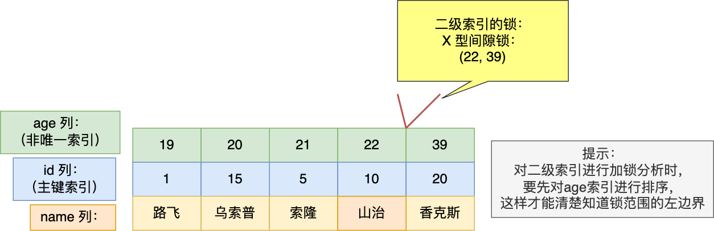

<font style="color:rgb(44, 62, 80);">定位到第一条不符合查询条件的二级索引记录，即扫描到 age = 39，于是</font>**<font style="color:rgb(48, 79, 254);">该二级索引的 next-key 锁会退化成间隙锁，范围是 (22, 39)</font>**<font style="color:rgb(44, 62, 80);">。</font>

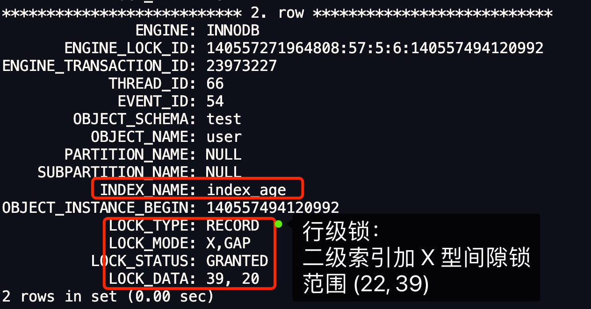

<font style="color:rgb(44, 62, 80);">如果有其他事务插入了 age 值为 23、24、25、26、....、38 这些新记录，那么这些插入语句都会发生阻塞。</font>**<font style="color:rgb(44, 62, 80);">不过对于插入 age = 39 和 age = 22 记录的语句，在一些情况是可以成功插入的，而一些情况则无法成功插入。</font>\*\*\*\*<font style="color:#DF2A3F;">这就要看对应的主键ID是否包含在间隙锁范围内，在则无法插入。</font>**

* <font style="color:rgb(44, 62, 80);">当其他事务插入一条 age = 22，id = 3 的记录的时候，在二级索引树上定位到插入的位置，而</font>**<font style="color:rgb(48, 79, 254);">该位置的下一条是 id = 10、age = 22 的记录，该记录的二级索引上没有间隙锁，所以这条插入语句可以执行成功</font>**<font style="color:rgb(44, 62, 80);">。</font>
* <font style="color:rgb(44, 62, 80);">当其他事务插入一条 age = 22，id = 12 的记录的时候，在二级索引树上定位到插入的位置，而</font>**<font style="color:rgb(48, 79, 254);">该位置的下一条是 id = 20、age = 39 的记录，正好该记录的二级索引上有间隙锁，所以这条插入语句会被阻塞，无法插入成功</font>**<font style="color:rgb(44, 62, 80);">。</font>

<font style="color:rgb(44, 62, 80);">插入 age = 39 记录的成功和失败的情况分别如下：</font>

* <font style="color:rgb(44, 62, 80);">当其他事务插入一条 age = 39，id = 3 的记录的时候，在二级索引树上定位到插入的位置，而</font>**<font style="color:rgb(48, 79, 254);">该位置的下一条是 id = 20、age = 39 的记录，正好该记录的二级索引上有间隙锁，所以这条插入语句会被阻塞，无法插入成功</font>**<font style="color:rgb(44, 62, 80);">。</font>
* <font style="color:rgb(44, 62, 80);">当其他事务插入一条 age = 39，id = 21 的记录的时候，在二级索引树上定位到插入的位置，而</font>**<font style="color:rgb(48, 79, 254);">该位置的下一条记录不存在，也就没有间隙锁了，所以这条插入语句可以插入成功</font>**<font style="color:rgb(44, 62, 80);">。</font>

```sql
select * from user where age = 22 for update;
```

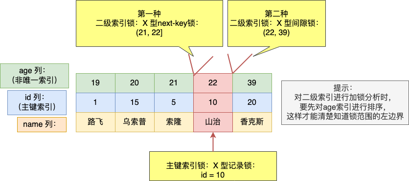

* <font style="color:rgb(44, 62, 80);">由于不是唯一索引，所以肯定存在值相同的记录，于是非唯一索引等值查询的过程是一个扫描的过程，最开始要找的第一行是 age = 22，于是对该二级索引记录加上范围为 (21, 22] 的 next-key 锁。同时，因为 age = 22 符合查询条件，于是对 age = 22 的记录的主键索引加上记录锁，即对 id = 10 这一行加记录锁。</font>
* <font style="color:rgb(44, 62, 80);">接着继续扫描，扫描到的第二行是 age = 39，该记录是第一个不符合条件的二级索引记录，所以该二级索引的 next-key 锁会</font>**<font style="color:rgb(48, 79, 254);">退化成间隙锁</font>**<font style="color:rgb(44, 62, 80);">，范围是 (22, 39)。</font>

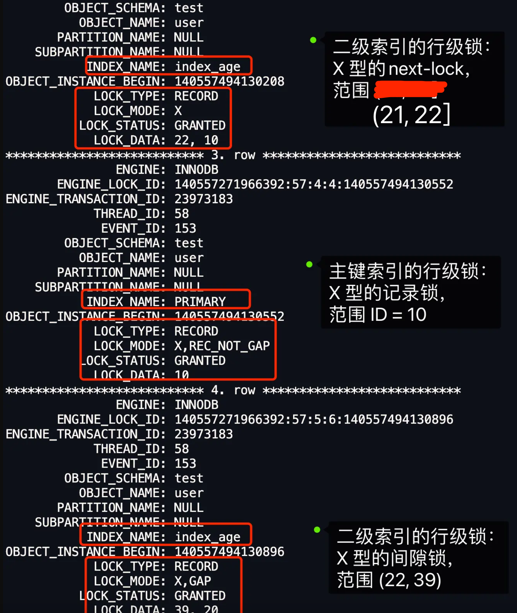

<font style="color:rgb(44, 62, 80);">从上图的分析，可以看到，事务 A 对二级索引（INDEX\_NAME: index\_age ）加了两个 X 型锁，分别是：</font>

* <font style="color:rgb(44, 62, 80);">在 age = 22 这条记录的二级索引上，加了范围为 (21, 22] 的 next-key 锁，意味着其他事务无法更新或者删除 age = 22 的这一些新记录，针对是否可以插入 age = 21 和 age = 22 的新记录，分析如下：</font>
  * <font style="color:rgb(44, 62, 80);">是否可以插入 age = 21 的新记录，还要看插入的新记录的 id 值，</font>**<font style="color:rgb(48, 79, 254);">如果插入 age = 21 新记录的 id 值小于 5，那么就可以插入成功</font>**<font style="color:rgb(44, 62, 80);">，因为此时插入的位置的下一条记录是 id = 5，age = 21 的记录，该记录的二级索引上没有间隙锁。</font>**<font style="color:rgb(48, 79, 254);">如果插入 age = 21 新记录的 id 值大于 5，那么就无法插入成功</font>**<font style="color:rgb(44, 62, 80);">，因为此时插入的位置的下一条记录是 id = 10，age = 22 的记录，该记录的二级索引上有间隙锁。</font>
  * <font style="color:rgb(44, 62, 80);">是否可以插入 age = 22 的新记录，还要看插入的新记录的 id 值，从</font><font style="color:rgb(44, 62, 80);"> </font><font style="color:rgb(71, 101, 130);">LOCK\_DATA : 22, 10</font><font style="color:rgb(44, 62, 80);"> </font><font style="color:rgb(44, 62, 80);">可以得知，其他事务插入 age 值为 22 的新记录时，</font>**<font style="color:rgb(48, 79, 254);">如果插入的新记录的 id 值小于 10，那么插入语句会发生阻塞；如果插入的新记录的 id 大于 10，还要看该新记录插入的位置的下一条记录是否有间隙锁，如果没有间隙锁则可以插入成功，如果有间隙锁，则无法插入成功</font>**<font style="color:rgb(44, 62, 80);">。</font>
* <font style="color:rgb(44, 62, 80);">在 age = 39 这条记录的二级索引上，加了范围 (22, 39) 的间隙锁。意味着其他事务无法插入 age 值为 23、24、..... 、38 的这一些新记录，针对是否可以插入 age = 22 和 age = 39 的新记录，分析如下：</font>
  * <font style="color:rgb(44, 62, 80);">是否可以插入 age = 22 的新记录，还要看插入的新记录的 id 值，</font>**<font style="color:rgb(48, 79, 254);">如果插入 age = 22 新记录的 id 值小于 10，那么插入语句会被阻塞，无法插入</font>**<font style="color:rgb(44, 62, 80);">，因为此时插入的位置的下一条记录是 id = 10，age = 22 的记录，该记录的二级索引上有间隙锁（ age = 22 这条记录的二级索引上有 next-key 锁）。</font>**<font style="color:rgb(48, 79, 254);">如果插入 age = 22 新记录的 id 值大于 10，也无法插入</font>**<font style="color:rgb(44, 62, 80);">，因为此时插入的位置的下一条记录是 id = 20，age = 39 的记录，该记录的二级索引上有间隙锁。</font>
  * <font style="color:rgb(44, 62, 80);">是否可以插入 age = 39 的新记录，还要看插入的新记录的 id 值，从 </font><font style="color:rgb(71, 101, 130);">LOCK\_DATA : 39, 20</font><font style="color:rgb(44, 62, 80);"> 可以得知，其他事务插入 age 值为 39 的新记录时，</font>**<font style="color:rgb(48, 79, 254);">如果插入的新记录的 id 值小于 20，那么插入语句会发生阻塞，如果插入的新记录的 id 大于 20，则可以插入成功</font>**<font style="color:rgb(44, 62, 80);">。</font>

### <font style="color:rgb(44, 62, 80);">非唯一索引范围查询</font>

**<font style="color:rgb(48, 79, 254);">非唯一索引范围查询，索引的 next-key lock 不会有退化为间隙锁和记录锁的情况，</font>**<font style="color:rgb(44, 62, 80);">也就是非唯一索引进行范围查询时，对二级索引记录加锁都是加 next-key 锁。</font>

```sql
select * from user where age >= 22  for update;
```

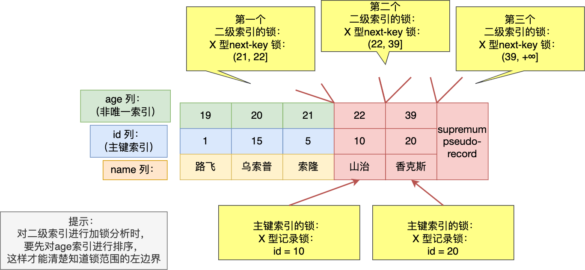

* <font style="color:rgb(44, 62, 80);">最开始要找的第一行是 age = 22，虽然范围查询语句包含等值查询，但是这里不是唯一索引范围查询，所以是不会发生退化锁的现象，因此对该二级索引记录加 next-key 锁，范围是 (21, 22]。同时，对 age = 22 这条记录的主键索引加记录锁，即对 id = 10 这一行记录的主键索引加记录锁。</font>
* <font style="color:rgb(44, 62, 80);">由于是范围查询，接着继续扫描已经存在的二级索引记录。扫面的第二行是 age = 39 的二级索引记录，于是对该二级索引记录加 next-key 锁，范围是 (22, 39]，同时，对 age = 39 这条记录的主键索引加记录锁，即对 id = 20 这一行记录的主键索引加记录锁。</font>
* <font style="color:rgb(44, 62, 80);">虽然我们看见表中最后一条二级索引记录是 age = 39 的记录，但是实际在 Innodb 存储引擎中，会用一个特殊的记录来标识最后一条记录，该特殊的记录的名字叫 supremum pseudo-record ，所以扫描第二行的时候，也就扫描到了这个特殊记录的时候，会对该二级索引记录加的是范围为 (39, +∞] 的 next-key 锁。</font>

# MySQL 性能优化

## 能用 MySQL 直接存储文件（比如图片）吗？

可以，直接存储文件对应的二进制数据即可。不过，还是建议不要在数据库中存储文件，会严重影响数据库性能，消耗过多存储空间。可以选择使用**云服务厂商提供的开箱即用的文件存储服务**，成熟稳定，价格也比较低


**数据库只存储文件地址信息，文件由文件存储服务负责存储。**

## MySQL 如何存储 IP 地址？

可以将 **IP 地址转换成整形数据**存储，性能更好，占用空间也更小。

MySQL 提供了两个方法来处理 ip 地址

* `INET_ATON()`：把 ip 转为无符号整型 (4-8 位)
* `INET_NTOA()` :把整型的 ip 转为地址

插入数据前，先用 `INET_ATON()` 把 ip 地址转为整型，显示数据时，使用 `INET_NTOA()` 把整型的 ip 地址转为地址显示即可。

## 读写分离和分库分表了解吗？

[SHARDINGSPHERE分库分表](https://www.yuque.com/nibiwanxiamei/yrd6t1/9d9c82f73ee8a691516c3d3882c44754)

## Mysql窗口函数

**普通的sum，avg，max，min等函数加上over之后就会变为窗口函数，而不是聚合效果。**

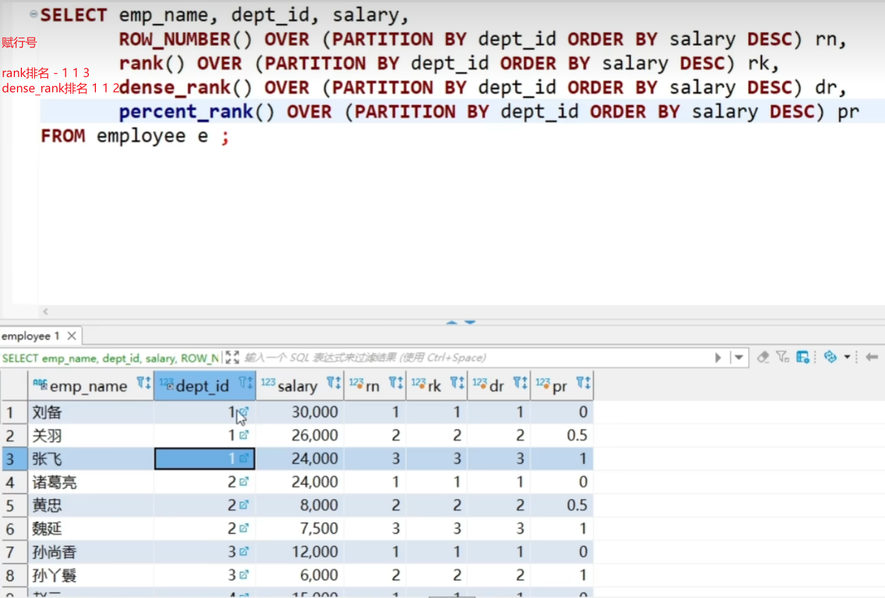

## mysql分页方式

<font style="color:rgb(61, 70, 77);">LIMIT</font>：<font style="color:rgb(61, 70, 77);">用于限制查询结果的返回行数。它有两个参数，第一个参数指定返回结果的起始偏移位置（从0开始计数），第二个参数指定返回结果的行数。</font>

```sql
SELECT * FROM table_name LIMIT 10, 10;
```

<font style="color:rgb(61, 70, 77);">OFFSET</font>：<font style="color:rgb(61, 70, 77);">用于指定查询结果的偏移位置。它只有一个参数，表示从第几条记录开始返回结果。</font>

```sql
SELECT * FROM table_name OFFSET 10;
```

<font style="color:rgb(61, 70, 77);">ROW\_NUMBER()函数可以为查询结果中的每一行赋予一个序号。在配合LIMIT子句使用时，可以实现分页查询。</font>

```sql
SELECT * FROM (
  SELECT *, ROW_NUMBER() OVER (ORDER BY column_name) AS row_num
  FROM table_name
) AS temp_table
WHERE row_num <= 10;
```

## 深分页如何优化？

[mysql深分页详解](https://juejin.cn/post/7012016858379321358)

[mysql深分页详解](https://juejin.cn/post/6985478936683610149#heading-1)

**<font style="color:rgb(44, 62, 80);">查询偏移量过大的场景我们称为深度分页，这会导致查询性能较低</font>**

```sql
# MySQL 在无法利用索引的情况下跳过1000000条记录后，再获取10条记录
SELECT * FROM t_order ORDER BY id LIMIT 1000000, 10
```

***

**排序字段有索引（**<font style="color:rgb(37, 41, 51);">耗时：非常慢 </font>**<font style="color:rgb(37, 41, 51);">18.350s elapsed</font>\*\*\*\*） 因为要回表**

```sql
select id,m_id, name, identity_no, address, create_time, modify_time 
from t2 
order by create_time desc 
limit 1000000, 20;
```

### 范围查询

<font style="color:rgb(44, 62, 80);">当可以保证 ID 的连续性时，根据 ID 范围进行分页是比较好的解决方案：</font>

```java
# 查询指定 ID 范围的数据
SELECT * FROM t_order WHERE id > 100000 AND id <= 100010 ORDER BY id
# 也可以通过记录上次查询结果的最后一条记录的ID进行下一页的查询：
SELECT * FROM t_order WHERE id > 100000 LIMIT 10
```

或者给定知道上次最后的ID，然后基于最后一个数据的ID查找。

### 子查询优化

**<font style="color:rgb(44, 62, 80);">先查询出 limit 第一个参数对应的主键值，再根据这个主键值再去过滤并 limit，这样效率会更快一些。</font>**

```sql
# 通过子查询来获取 id 的起始值，把 limit 1000000 的条件转移到子查询
SELECT * FROM t_order WHERE id >= (SELECT id FROM t_order limit 1000000, 1) LIMIT 10;
```

<font style="color:rgb(37, 41, 51);"></font>

**<font style="color:rgb(37, 41, 51);">子查询优化：执行时间：0.742 s elapsed 通过子查询不需要回表</font>**

```sql
SELECT   
    id, m_id, NAME, identity_no, address, create_time, modify_time 
FROM t2
WHERE id >= ( SELECT id FROM t2 ORDER BY create_time desc LIMIT 1000000, 1 ) LIMIT 20;
```

### [<font style="color:rgb(44, 62, 80);">延迟关联</font>](https://javaguide.cn/high-performance/deep-pagination-optimization.html#%E5%BB%B6%E8%BF%9F%E5%85%B3%E8%81%94)

<font style="color:rgb(44, 62, 80);">延迟关联的优化思路，跟子查询的优化思路其实是一样的：都是</font>**<font style="color:#DF2A3F;background-color:#FBDE28;">把条件转移到主键索引树，减少回表的次数</font>**<font style="color:rgb(44, 62, 80);">。不同点是，延迟关联使用了 INNER JOIN（内连接） 包含子查询。</font>

```sql
SELECT t1.* FROM t_order t1
INNER JOIN (SELECT id FROM t_order limit 1000000, 10) t2
ON t1.id = t2.id;

```

### <font style="color:rgb(44, 62, 80);">覆盖索引</font>

<font style="color:rgb(44, 62, 80);">索引中已经包含了所有需要获取的字段的查询方式称为覆盖索引。</font>

**覆盖索引的好处：**

* **避免 InnoDB 表进行索引的二次查询，也就是回表操作:** InnoDB 是以聚集索引的顺序来存储的，对于 InnoDB 来说，二级索引在叶子节点中所保存的是行的主键信息，如果是用二级索引查询数据的话，在查找到相应的键值后，还要通过主键进行二次查询才能获取我们真实所需要的数据。而在覆盖索引中，二级索引的键值中可以获取所有的数据，避免了对主键的二次查询（回表），减少了 IO 操作，提升了查询效率。
* **可以把随机 IO 变成顺序 IO 加快查询效率:** 由于覆盖索引是按键值的顺序存储的，对于 IO 密集型的范围查找来说，对比随机从磁盘读取每一行的数据 IO 要少的多，因此利用覆盖索引在访问时也可以把磁盘的随机读取的 IO 转变成索引查找的顺序 IO。

## 游标分页！！

<font style="color:rgb(23, 35, 63);">MySQL 提供了 LIMIT 关键字可以简单地实现分页查询，但当数据量较大时，一次性查询所有数据可能会导致性能问题。为了解决这个问题，可以使用</font>**<font style="color:#DF2A3F;">游标</font>**<font style="color:rgb(23, 35, 63);">来实现分页查询。</font>

<font style="color:rgb(23, 35, 63);">游标（Cursor）是数据库操作中的一个概念，它类似于一个指针，可以用来遍历结果集中的每一行数据。</font>**<font style="color:rgb(23, 35, 63);">通过游标，可以逐行地获取数据而不需要一次性查询所有结果。</font>**

**<font style="color:rgb(23, 35, 63);">游标分页的原理是通过每次查询一定数量的数据，</font>****<font style="color:#DF2A3F;">并记录当前查询的位置，下次查询时从记录的位置继续查询下一批数据</font>****<font style="color:rgb(23, 35, 63);">。这样可以避免一次性查询所有数据而导致的性能问题。</font>**

## mysql查询优化

**<font style="color:rgb(37, 41, 51);">没有查询条件，没有排序  id为主键（</font>**<font style="color:rgb(37, 41, 51);">100w之后的数据，耗时：</font>**<font style="color:rgb(37, 41, 51);">0.613s elapsed）</font>**

```sql
select id,m_id, name, identity_no, address, create_time, modify_time 
from t1 limit 1000000, 20;
```

**加主键排序**（<font style="color:rgb(37, 41, 51);">耗时：有所降低</font>**<font style="color:rgb(37, 41, 51);">0.417s elapsed</font>**）

```sql
select id,m_id, name, identity_no, address, create_time, modify_time 
from t1 order by id limit 1000000, 20;
```

### 为什么？

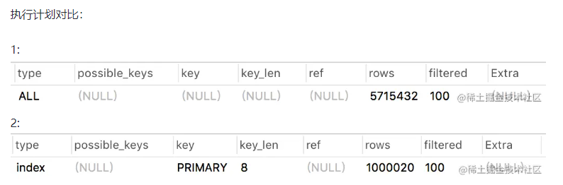

**全表扫描直接扫主键索引的叶子节点文件，扫的是文件，全索引扫描会走索引。扫文件的话，文件内的行数并不一定等于实际的行数，因为mysql是逻辑删除，可能存在一些还没真正删除的数据，同时还可能有其他原因导致两者不一致。**

***

## 慢sql如何优化

* **<font style="color:rgb(48, 79, 254);">分析查询语句</font>**<font style="color:rgb(1, 1, 1);">：使用EXPLAIN命令分析SQL执行计划，找出慢查询的原因，比如是否使用了</font>**<font style="color:rgb(1, 1, 1);">全表扫描</font>**<font style="color:rgb(1, 1, 1);">，是否</font>**<font style="color:rgb(1, 1, 1);">存在索引未被利用</font>**<font style="color:rgb(1, 1, 1);">的情况等，并根据相应情况对索引进行适当修改。</font>
* **<font style="color:rgb(48, 79, 254);">创建或优化索引</font>**<font style="color:rgb(1, 1, 1);">：根据查询条件</font>**<font style="color:rgb(1, 1, 1);">创建合适的索引</font>**<font style="color:rgb(1, 1, 1);">，特别是经常用于WHERE子句的字段、Orderby 排序的字段、Join 连表查询的字典、 group by的字段，并且如果查询中经常涉及多个字段，考虑创建联合索引，使用联合索引要符合最左匹配原则，不然会索引失效</font>
* **<font style="color:rgb(48, 79, 254);">避免索引失效</font>**<font style="color:rgb(1, 1, 1);">：比如</font>**<font style="color:rgb(1, 1, 1);">不要用左模糊匹配、函数计算、表达式计算</font>**<font style="color:rgb(1, 1, 1);">等等。尽量少使用OR语句，改用UNION语句，充分利用索引。</font>
* **<font style="color:rgb(48, 79, 254);">查询优化</font>**<font style="color:rgb(1, 1, 1);">：</font>**<font style="color:rgb(1, 1, 1);">避免使用SELECT \*</font>**<font style="color:rgb(1, 1, 1);">，只查询真正需要的列；使用</font>**<font style="color:rgb(1, 1, 1);">覆盖索引</font>**<font style="color:rgb(1, 1, 1);">，即索引包含所有查询的字段；联表查询最好要以</font>**<font style="color:rgb(1, 1, 1);">小表驱动大表</font>**<font style="color:rgb(1, 1, 1);">，并且被驱动表的字段要有索引，当然最好通过冗余字段的设计，避免联表查询。</font>
* **<font style="color:#DF2A3F;">分页优化</font>**<font style="color:rgb(1, 1, 1);">：针对 limit n,y </font>**<font style="color:rgb(1, 1, 1);">深分页的查询优化</font>**<font style="color:rgb(1, 1, 1);">，可以把Limit查询转换成某个位置的查询：select \* from tb\_sku where id>20000 limit 10，该方案适用于主键自增的表，</font>
* **<font style="color:rgb(48, 79, 254);">优化数据库表</font>**<font style="color:rgb(1, 1, 1);">：如果单表的数据超过了千万级别，考虑是否需要将</font>**<font style="color:rgb(1, 1, 1);">大表拆分为小表</font>**<font style="color:rgb(1, 1, 1);">，减轻单个表的查询压力。也可以将字段多的表分解成多个表，有些字段使用频率高，有些低，数据量大时，会由于使用频率低的存在而变慢，可以考虑分开。</font>
* **<font style="color:rgb(48, 79, 254);">使用缓存技术</font>**<font style="color:rgb(1, 1, 1);">：引入</font>**<font style="color:rgb(1, 1, 1);">缓存层</font>**<font style="color:rgb(1, 1, 1);">，如Redis，存储热点数据和频繁查询的结果，但是要考虑缓存一致性的问题，对于读请求会选择旁路缓存策略，对于写请求会选择先更新 db，再删除缓存的策略。</font>

:::success
项目中是否遇到慢查询的情况：

没有创建索引或则索引失效比较合理。

或者深分页问题：

* 10w  取后10条大概0.7s，走了二级索引  子查询优化后0.01s。
* 10w没有索引或者索引失效大概0.1s，加索引比如联合索引或者不计算索引0s

:::


> 更新: 2025-12-15 18:03:41  
> 原文: <https://www.yuque.com/nibiwanxiamei/yrd6t1/d6a60fbb352e1d4118070eb32262e55e>